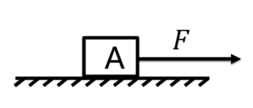
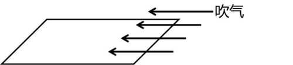

# 第 18 季 · 科学推理

来源：2026下半年省考第十八季行测模考大赛（广东卷）.pdf

共 5 题，保留原卷题号。分数与数学符号使用 LaTeX；图形使用原图或已标注的矢量重绘图。

## 第 66 题

原卷 PDF 页码：17；题目 ID：`gd-mock-2026h2-s18-q66`

如图所示，物块A在水平力F的作用下静止在粗糙程度均匀的地面上，将力F的大小增大至2F，若最大静摩擦力等于滑动摩擦力，则下列判断一定正确的是（    ）。

**A.** 物块A会向右做变加速运动

**B.** 物块A会向右做匀变速运动

**C.** 物块A仍保持静止

**D.** 物块A可能仍保持静止，也可能向右做加速运动

## 第 67 题

原卷 PDF 页码：17；题目 ID：`gd-mock-2026h2-s18-q67`

如图，沿着薄纸片的上表面吹气，薄纸片（    ），可知吹气过程中，空气对薄纸片上表面的压力（    ）下表面的压力。

**A.** 落下、大于

**B.** 落下、小于

**C.** 升起、大于

**D.** 升起、小于

## 第 68 题

原卷 PDF 页码：17；题目 ID：`gd-mock-2026h2-s18-q68`

为探究X、Y、Z三种金属的活动性强弱，设计两组实验：实验1：取三份等量稀盐酸，分别加入打磨光亮的 X、Y、Z金属片，只有金属Y发生反应并产生大量气泡，X、Z均无明显现象；实验2：将金属Z放入X的硫酸盐溶液中，充分反应后，金属Z表面析出固体X。则三种金属活动性由强到弱的顺序是（    ）。

**A.** Y>Z>X

**B.** Y>X>Z

**C.** Z>X>Y

**D.** X>Z>Y

## 第 69 题

原卷 PDF 页码：17, 18；题目 ID：`gd-mock-2026h2-s18-q69`

粮站收入粮食后，如果粮食不够干燥，那么堆在内部的粮食就会发霉，为了防止这种情况发生，粮站会对潮湿的粮食进行干燥处理，下列相关说法不正确的是（    ）。

**A.** 粮食可以进行呼吸作用，无法进行光合作用

**B.** 粮食含水量高时更易发霉，说明潮湿环境能提升霉菌的活性

**C.** 干燥处理不会对粮食的呼吸作用产生任何影响

**D.** 粮食堆放过密、通风差，会造成粮堆内部热量积聚

## 第 70 题

原卷 PDF 页码：18；题目 ID：`gd-mock-2026h2-s18-q70`

假如地球没有自转以及公转，下列现象最有可能在地球上出现的是（    ）。

**A.** 全球各地将不再有昼夜交替

**B.** 全球各地将全年温度适宜，四季如春

**C.** 太阳将从西方升起

**D.** 地球磁场将增强
