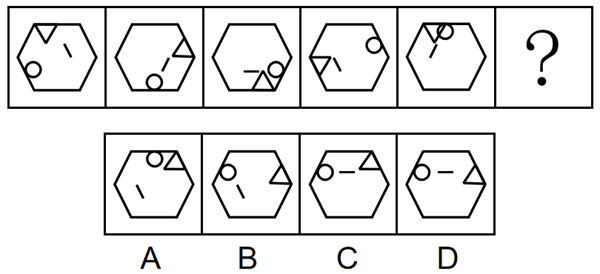
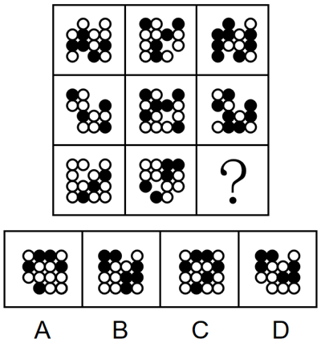
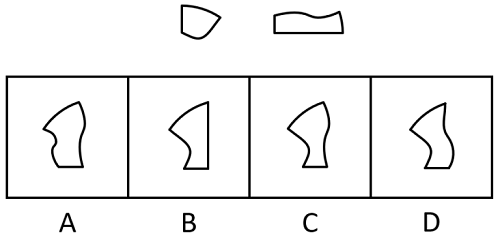
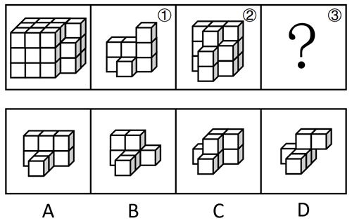
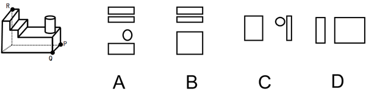

# 第 19 季 · 判断推理

来源：2026下半年省考第十九季行测模考大赛（广东卷）.pdf

共 20 题，保留原卷题号。分数与数学符号使用 LaTeX；图片路径指向同一资料包内的原图。

## 第 46 题

原卷 PDF 页码：12；题目 ID：`gd-mock-2026h2-s19-q46`

从所给的四个选项中，选择最合适的一个填入问号处，使之呈现一定的规律性：

**A.** 见题图中的 A 选项

**B.** 见题图中的 B 选项

**C.** 见题图中的 C 选项

**D.** 见题图中的 D 选项

## 第 47 题

原卷 PDF 页码：12；题目 ID：`gd-mock-2026h2-s19-q47`

从所给的四个选项中，选择最合适的一个填入问号处，使之呈现一定的规律性：

**A.** 见题图中的 A 选项

**B.** 见题图中的 B 选项

**C.** 见题图中的 C 选项

**D.** 见题图中的 D 选项

## 第 48 题

原卷 PDF 页码：12, 13；题目 ID：`gd-mock-2026h2-s19-q48`

下列选项中，能与所给图形组合成扇形的是（    ）。

**A.** 见题图中的 A 选项

**B.** 见题图中的 B 选项

**C.** 见题图中的 C 选项

**D.** 见题图中的 D 选项

## 第 49 题

原卷 PDF 页码：13；题目 ID：`gd-mock-2026h2-s19-q49`

左图给定的是由相同正方体堆叠而成的多面体，该多面体可以由①、②和③三个小多面体组合而成，以下哪项能填入问号处？

**A.** 见题图中的 A 选项

**B.** 见题图中的 B 选项

**C.** 见题图中的 C 选项

**D.** 见题图中的 D 选项

## 第 50 题

原卷 PDF 页码：13；题目 ID：`gd-mock-2026h2-s19-q50`

左边为给定的多面体，现用经P、Q、R三点的平面对其进行切割，问哪个选项是其切面？

**A.** 见题图中的 A 选项

**B.** 见题图中的 B 选项

**C.** 见题图中的 C 选项

**D.** 见题图中的 D 选项

## 第 51 题

原卷 PDF 页码：13；题目 ID：`gd-mock-2026h2-s19-q51`

在对不同月季资源香气特征的研究中，某农业研究团队对木香花的两种香型变种进行研究，通过基因组成的精细对比，成功鉴定出一种全新基因SCREP。该基因一旦启动表达，便能显著抑制关键芳香物质丁香酚的生物合成，展现出对香气代谢通路的强效调控作用。研究人员认为，SCREP基因正是月季花的“香气开关”。
以下哪项如果为真，最能支持上述观点？

**A.** SCREP基因可以抑制生成丁香酚的关键酶基因，并通过激活REF1基因精准调控丁香酚及其前体物质的积累速率

**B.** 在涵盖野生种、古老栽培种及现代栽培种的香气成分分析中，SCREP基因普遍存在于进化程度较高或人工选育的蔷薇品种中

**C.** 该研究阐明了新基因SCREP在月季花中实现表达增强的分子机制，以及其驱动表型效应产生的内在逻辑

**D.** 这项研究完整记录了新基因SCREP从“零”到“成熟功能基因”的全过程，清晰地呈现了基因起源的特殊路径

## 第 52 题

原卷 PDF 页码：14；题目 ID：`gd-mock-2026h2-s19-q52`

某老旧小区计划加装电梯，甲、乙、丙三个电梯品牌参与投标。对于最终中标的品牌，三位居民给出了如下猜测：
（1）小李：甲、乙两个品牌均能中标；
（2）小张：若丙品牌能中标，则甲品牌也能中标；
（3）小王：甲和乙两个品牌中，至多有一个能中标。中标结果出来后发现，只有一位居民预测正确。
根据上述信息可以推出：

**A.** 甲、乙均能中标

**B.** 乙、丙均能中标

**C.** 乙可能中标

**D.** 只有丙能中标

## 第 53 题

原卷 PDF 页码：14；题目 ID：`gd-mock-2026h2-s19-q53`

要懂中国艺术，必须得懂中国书法。因此，只有懂中国书法才能真正理解中国美学。
以下哪项如果为真，最能加强上述观点？

**A.** 中国书法提供给人最基本的中国美学

**B.** 中国书法是一种气韵生动的艺术

**C.** 懂中国艺术是真正理解中国美学的基本途径

**D.** 只要能欣赏中国书法就能真正理解中国美学

## 第 54 题

原卷 PDF 页码：14；题目 ID：`gd-mock-2026h2-s19-q54`

某处有一块闲置的空地，已按照规划比例绘制如下，现需要在空地中的6个区域内种植甲、乙、丙、丁、戊、己共6种植物，且1号区域到4号区域的面积相等，5号区域和6号区域的面积相等，已知：
（1）甲和丙所在种植区域的面积相等且不相邻；
（2）乙和己所在种植区域的面积不相等且不相邻；
（3）戊所在的种植区域只与其他3种植物所在的种植区域相邻。

**六个区域的位置**

| 第1列 | 第2列 | 第3列 | 第4列 |
| --- | --- | --- | --- |
| 1 | 1 | 1 | 2 |
| 4 | 5 | 5 | 2 |
| 4 | 6 | 6 | 2 |
| 4 | 3 | 3 | 3 |

这是区域布局编码，不是数字推理数表。同一数字重复出现的相邻格合并为原图的一个矩形区域；原图仅标注一次区域编号，内部没有这些附加分格。

如果乙种植在5号区域，以下除哪项外均可以推出？

**A.** 甲种植在2号区域

**B.** 丁种植在6号区域

**C.** 戊种植在1号区域

**D.** 己种植在3号区域

## 第 55 题

原卷 PDF 页码：14, 15；题目 ID：`gd-mock-2026h2-s19-q55`

在周一到周五的上课时间内，部分没课的大学生经常会在宿舍长时间玩电子游戏，为了督促学生将更多时间投入到学习和锻炼中，杜绝懒散风气滋生，近期某高校规定：在上课期间，学生无课时不得滞留宿舍。
以下哪项如果为真，最能削弱上述管理规定的实施效果?

**A.** 一些理工科学生更习惯在安静的宿舍里研读专业书籍

**B.** 该高校的所有学生并非都会严格遵守学校的管理规定

**C.** 没课的学生也会选择去图书馆玩手机或者校外上网

**D.** 部分学生会通过锁门、请假等方式来逃避相关检查

## 第 56 题

原卷 PDF 页码：15；题目 ID：`gd-mock-2026h2-s19-q56`

某大学一项最新研究显示，人类大脑的成熟远比普遍认知来得更晚。研究指出，人类大脑的发育从婴儿期到老年可划分为5个主要“发展阶段”，其中进入“成年模式”的关键年龄大约在32岁。有人提出，人的大脑至少要到30岁才能发育成熟，且部分能力会随年龄增长而变强。
以下哪项如果为真，最不能支持上述观点？

**A.** 大脑成熟的关键是灰质变薄、白质增厚，这些指标到了30岁才基本达到相对平衡

**B.** 在面临生活中的复杂情况时，30岁以下的青年人很容易表现出不成熟的一面

**C.** 人类大脑结构的变化并非线性发展，30岁左右的人，大脑结构会呈现较高的稳定性

**D.** 女人32岁就进入感情成熟阶段，而男人要到43岁才完全进入感情成熟阶段

## 第 57 题

原卷 PDF 页码：15；题目 ID：`gd-mock-2026h2-s19-q57`

在5000年-3500年前，古印度河流域文明存在于当今巴基斯坦和印度西北部的印度河及其支流周围，然而在强盛期后古印度河流域文明迅速走向了衰落，究其原因，研究者分析了5000年-3000年前整个印度河流域地区的气候变化，发现了一个关键的转折时期，当时气温上升了约0.5摄氏度，平均年降水量减少了10%-20%，且出现了多次长期干旱，研究者据此认为，多次长期干旱导致古印度河流域文明走向衰落。
以下哪项如果为真，最能削弱上述结论？

**A.** 古印度河流域文明发展之初，印度河的主河道曾因地震而发生了大规模的改道，一些依赖灌溉的重要城市被遗弃

**B.** 古印度河流域文明和古尼罗河流域文明有极大的相似之处，而后者的衰落是气候变化和政权更迭的综合结果

**C.** 由盛转衰时期，古印度河流域曾多次遭到来自中亚游牧民族的大规模入侵，当地贸易路线中断，政治体系完全崩溃

**D.** 古印度河流域文明高度依赖农业，长期干旱会使河流水量减少，地下水位下降，导致农业系统无法满足庞大人口的需求

## 第 58 题

原卷 PDF 页码：15, 16；题目 ID：`gd-mock-2026h2-s19-q58`

持之以恒地加强对校外培训机构乱象的治理，加大对隐形、变异学科培训的打击力度；关注学生的课堂学习效率和学习体验，培养学生自主学习能力和创新思维；建立多元化的教育评价体系，注重对学生品德、身心健康、兴趣特长等方面的评价······唯有如此，方能营造良好的教育生态。只有营造良好的教育生态，才能真正为“超前学习”降温。
由此可以推出：

**A.** 如果没有加强对校外培训机构乱象的治理，就无法建立多元化的教育评价体系

**B.** 若未能营造良好的教育生态，则说明没有关注学生的课堂学习效率和学习体验

**C.** 如果加强对校外培训机构乱象的治理，就能真正为“超前学习”降温

**D.** 若没有建立多元化的教育评价体系，就不能真正为“超前学习”降温

## 第 59 题

原卷 PDF 页码：16；题目 ID：`gd-mock-2026h2-s19-q59`

对马类化石的研究表明，早期始祖马呈现明显的低冠齿特征，而在后续演化过程中，马类牙冠显著增高。科研人员据此推断，马类的栖息环境存在由森林生态系统向开阔草原生态系统逐步转变的过程。要使上述推理成立，需要补充的前提条件是（    ）。

**A.** 马的面部结构较长，低头进食时双眼依旧高于草面，便于及时察觉天敌

**B.** 随着地球气候持续变冷和降水不断减少，大面积的森林逐渐被草原取代

**C.** 马类在演化过程中，奔跑速度逐渐提升，更能适应开阔环境的逃生需求

**D.** 草本植物对牙齿的磨损大于树木嫩叶，高牙冠有利于应对这种牙齿磨损

## 第 60 题

原卷 PDF 页码：16；题目 ID：`gd-mock-2026h2-s19-q60`

某单位有甲、乙、丙、丁、戊、己和庚七人，从周一到周日每天各安排一人值班，每人值班一天。已知：
（1）乙、丙的值班日期间隔大于2天；
（2）丙在甲前面值班，且二人的值班日期间隔大于2天；
（3）丁、戊的值班日期不相邻；
（4）甲、庚的值班日期相邻，且甲在庚前面值班。
根据上述条件，从周一到周日的值班安排一共有多少种可能的情况？

**A.** 3

**B.** 4

**C.** 5

**D.** 6

## 第 61 题

原卷 PDF 页码：16；题目 ID：`gd-mock-2026h2-s19-q61`

有观点认为，食物的包装是否精美与营养价值无关，因为即使包装变得再精美，也不会提升食物的营养价值。下列选项的逻辑结构与题干最为相似的是（    ）。

**A.** 广告宣传力度与产品质量无关，因为产品质量由生产工艺、原材料、生产标准和质量管控等因素共同决定

**B.** 运动装备价格与实际锻炼效果并无联系，因为即使运动装备的价格变得更高，实际锻炼效果也不会随之提升

**C.** 书籍内容深度不完全由篇幅决定，因为只扩充篇幅而不提升思想内涵，只能增加书籍厚度，并不会提升内容深度

**D.** 即便工作时不穿正式服装，也不会对业务能力造成影响，因此职场着装是否正式与业务能力高低并无直接关联

## 第 62 题

原卷 PDF 页码：16, 17；题目 ID：`gd-mock-2026h2-s19-q62`

某小区过去停车位严重不足，业主常因抢停车位发生矛盾。物业为缓解停车难问题，在小区内增设大量免费停车位，停车条件明显改善。但一段时间后物业发现，小区内的停车矛盾不仅没有缓和，反而比以前更加突出。下列选项如果为真，最能解释上述现象的是（    ）。

**A.** 该小区不限制外来车辆进出，增设免费停车位吸引大量周边小区居民前来停车

**B.** 该小区部分业主停车不规范，常出现一辆车占用两个停车位的情况

**C.** 该小区周边新建了多处商业设施，带动了区域人流量显著增长

**D.** 该小区内非机动车数量大幅增长，占用了部分机动车的通行空间

## 第 63 题

原卷 PDF 页码：17；题目 ID：`gd-mock-2026h2-s19-q63`

中药面包在制作过程中添加了陈皮、枸杞、西洋参等中药材，体现了“药食同源”的理念。因此，部分消费者认为这类面包具备养生功效，能够通过日常食用帮助调理身体、改善健康状况。上述论证的主要逻辑错误在于（    ）。

**A.** 忽视了中药面包的价格要高于普通面包，性价比不高

**B.** 默认了中药材可以添加到食品当中

**C.** 忽视了中药面包中的中药材含量远低于临床有效剂量

**D.** 默认了中药面包可以替代日常食物和药物

## 第 64 题

原卷 PDF 页码：17；题目 ID：`gd-mock-2026h2-s19-q64`

如果提高管理水平，企业工作效率就会得到提升；如果优化工作流程，企业工作效率也会得到提升。因此，企业要想提升工作效率，必须依靠提高管理水平或优化工作流程来实现。下列选项与题干逻辑结构最为相似的是（    ）。

**A.** 只要科学施肥，就能提高产量；只要科学施肥，就能改良土壤。因此，实现科学施肥就能提高产量或改良土壤

**B.** 只有绿色生产，才能减少污染；只有绿色生产，才能节约资源。因此，减少污染或节约资源都离不开绿色生产

**C.** 降低设备故障率离不开定期检修；避免安全事故离不开规范操作。因此，规范操作是降低设备故障率或避免安全事故的必要条件

**D.** 只要加强宣传，就能提高产品知名度；只要优化产品设计，就能提高产品知名度。因此，提高产品知名度的前提是加强宣传或优化产品设计

## 第 65 题

原卷 PDF 页码：17；题目 ID：`gd-mock-2026h2-s19-q65`

伪交替深海黑珊瑚自身无法合成多种氨基酸与维生素，必须依赖外部营养供给。然而，在食物极为匮乏的深海，仅靠偶然获得的有机物碎屑显然难以满足其生存需求。研究人员认为，共生菌群可能是伪交替深海黑珊瑚在深海生存的关键，能为其提供营养、解毒、抗氧化等核心支持。
以下属于上述推论暗含前提的是（    ）。

**A.** 深海环境水压高、温度低，给多数生物的生存都带来严峻挑战

**B.** 伪交替深海黑珊瑚不会将体内共生菌群视为入侵者并加以清除

**C.** 深海中的很多无脊椎动物一直以来都存在与微生物共生的现象

**D.** 伪交替深海黑珊瑚的共生菌群能在实验室条件下进行人工培养
