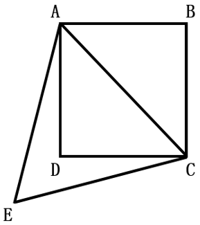

# 第 19 季 · 数量关系

来源：2026下半年省考第十九季行测模考大赛（广东卷）.pdf

共 15 题，保留原卷题号。分数与数学符号使用 LaTeX；图片路径指向同一资料包内的原图。

## 第 31 题

原卷 PDF 页码：9；题目 ID：`gd-mock-2026h2-s19-q31`

3，2， $\sqrt{13}$ ，8，6，10，10，3，（    ）

**A.** $\sqrt{109}$

**B.** 11

**C.** $\sqrt{103}$

**D.** 109

## 第 32 题

原卷 PDF 页码：9；题目 ID：`gd-mock-2026h2-s19-q32`

6，21，55，105，209，（    ）

**A.** 197

**B.** 268

**C.** 299

**D.** 400

## 第 33 题

原卷 PDF 页码：9, 10；题目 ID：`gd-mock-2026h2-s19-q33`

$\frac{9}{10}$ ， $\frac{3}{5}$ ， $\frac{2}{5}$ ， $\frac{4}{15}$ ，（    ）， $\frac{16}{135}$

**A.** $\frac{7}{45}$

**B.** $\frac{8}{45}$

**C.** $\frac{7}{60}$

**D.** $\frac{2}{15}$

## 第 34 题

原卷 PDF 页码：10；题目 ID：`gd-mock-2026h2-s19-q34`

5，-14，43，-128，385，（    ）

**A.** 1513

**B.** -1513

**C.** 1154

**D.** -1154

## 第 35 题

原卷 PDF 页码：10；题目 ID：`gd-mock-2026h2-s19-q35`

**四个圆内的数字**

| 圆（自左向右） | 左上 | 右上 | 左下 | 右下 |
| --- | --- | --- | --- | --- |
| 1 | 25 | 3 | 7 | −4 |
| 2 | 14 | 8 | 6 | 34 |
| 3 | 51 | 9 | 4 | −15 |
| 4 | 22 | 8 | 7 | ？ |

每个圆用一条竖直直径和一条水平直径分为四个区域。

**A.** 23

**B.** 34

**C.** 45

**D.** 56

## 第 36 题

原卷 PDF 页码：10；题目 ID：`gd-mock-2026h2-s19-q36`

为奖励上一学期表现优异的同学，某班级共花费141元购买了笔记本、水彩笔、文具盒三种文具各若干。已知三种文具的单价分别为9元/个、14元/盒、21元/个，问此次最多购买了几盒水彩笔？

**A.** 3

**B.** 4

**C.** 6

**D.** 10

## 第 37 题

原卷 PDF 页码：10；题目 ID：`gd-mock-2026h2-s19-q37`

如图所示，在正方形ABCD区域种植月季，在四边形ADCE区域种植郁金香。已知 $\triangle ACE$ 为等边三角形，月季的种植面积为10平方米，则郁金香的种植面积约为：

**A.** 3.66平方米

**B.** 4.25平方米

**C.** 5.32平方米

**D.** 8.66平方米

## 第 38 题

原卷 PDF 页码：10, 11；题目 ID：`gd-mock-2026h2-s19-q38`

某汽车配件厂安排甲、乙两条生产线共同生产240个零件。如果先由甲生产线生产2天，乙生产线再加入共同生产10天可以完成任务；如果先由乙生产线生产5天，再由甲生产线生产18天可以完成任务。问甲生产线独自完成这批零件比乙生产线独自完成多用几天？

**A.** 1

**B.** 2

**C.** 3

**D.** 4

## 第 39 题

原卷 PDF 页码：11；题目 ID：`gd-mock-2026h2-s19-q39`

某箱子中装有红、黄、白、绿四种颜色的小球，小球数量之和不超过100个。已知黄球的数量比其余三种颜色小球的数量之和多 $\frac{5}{9}$ ，白球的数量是红球的3倍，绿球有4个。问黄球比红球多多少个？

**A.** 40

**B.** 44

**C.** 48

**D.** 52

## 第 40 题

原卷 PDF 页码：11；题目 ID：`gd-mock-2026h2-s19-q40`

雨天过后，景区湖泊中一个高为7米的圆锥体景观（底面朝上）正好被全部淹没。景区为保证此圆锥体景观的观赏效果，计划对该湖泊进行泄洪，若要保证其体积至少有 $\frac{37}{64}$ 露出水面，则该湖泊泄洪至少要使水位降低多少米？

**A.** 1.54

**B.** 1.75

**C.** 2.10

**D.** 3.00

## 第 41 题

原卷 PDF 页码：11；题目 ID：`gd-mock-2026h2-s19-q41`

某公司招聘时，4名应届毕业生同时参加笔试。每人首次笔试合格的概率均为0.8，且未合格者有一次补考机会，补考合格的概率均为0.4。若首次笔试合格人数不足参加笔试总人数的一半，则取消补考。恰好有3名应届毕业生笔试合格的概率约为：

**A.** 0.20

**B.** 0.25

**C.** 0.28

**D.** 0.32

## 第 42 题

原卷 PDF 页码：11；题目 ID：`gd-mock-2026h2-s19-q42`

社区为了丰富辖区老人的晚年生活，每周末的不同时段会在社区活动中心开设书法、绘画、摄影、合唱、古典乐器演奏五种兴趣班，每位老人最多参加三种。某周末社区工作人员在活动中心对参加了兴趣班的老人进行了随机调查，至少需要调查多少位老人才能保证有3位参加的兴趣班完全相同？

**A.** 36

**B.** 41

**C.** 48

**D.** 51

## 第 43 题

原卷 PDF 页码：11；题目 ID：`gd-mock-2026h2-s19-q43`

商店购进某商品150件，如果先按x%的利润率定价，再打9折销售，则打折后的利润率较x%降低了12个百分点。实际销售该商品时，前50件获利x%，其余每件获利x元，商店销售这150件商品获得的总利润为6000元。则该商品的进价为多少元/件？

**A.** 400

**B.** 500

**C.** 600

**D.** 700

## 第 44 题

原卷 PDF 页码：11；题目 ID：`gd-mock-2026h2-s19-q44`

某县城有一个长200米、宽128米的长方形公园，管理部门计划先在公园四周等距离种植松树，且四个顶点均种植，待松树成活后在每两棵相邻松树间补种一棵侧柏，则公园四周最少需要补种多少棵侧柏？（相邻两棵松树间距为整数）

**A.** 66

**B.** 74

**C.** 82

**D.** 90

## 第 45 题

原卷 PDF 页码：11；题目 ID：`gd-mock-2026h2-s19-q45`

修筑一条公路，原计划由甲、乙两队合作20天完成。已知甲队的效率是乙队的5倍。当完成工程的80%时，乙队临时撤出，丙队加入，最终比原计划提前1天完成。若该公路由丙队单独修筑，用时多少天可完成？

**A.** 30

**B.** 24

**C.** 35

**D.** 40
