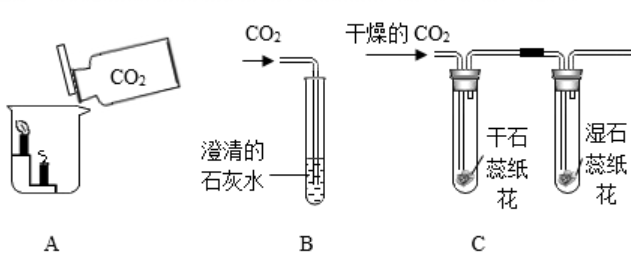
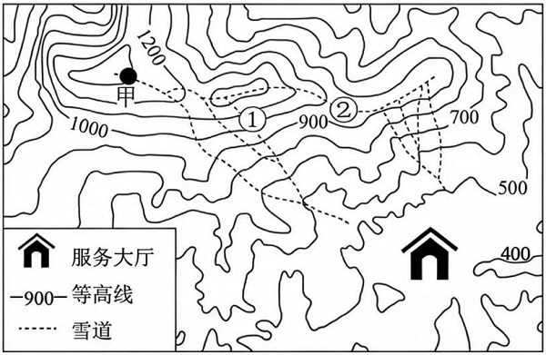

# 第 19 季 · 科学推理

来源：2026下半年省考第十九季行测模考大赛（广东卷）.pdf

共 5 题，保留原卷题号。分数与数学符号使用 LaTeX；图形使用原图或已标注的矢量重绘图。

## 第 66 题

原卷 PDF 页码：18；题目 ID：`gd-mock-2026h2-s19-q66`

我国古书《尚书纬·考灵曜》记载：人在舟中闭牖（门窗）而坐，舟行而人不觉。其中“舟行”和“人不觉”对应的参照物分别是（    ）。

**A.** 树、岸

**B.** 门窗、舟

**C.** 岸、门窗

**D.** 门窗、树

## 第 67 题

原卷 PDF 页码：18；题目 ID：`gd-mock-2026h2-s19-q67`

小红在家中发现，当闭合台灯的开关后，整个家庭电路的空气开关跳闸，而其他电器均未使用。经检查，台灯的功率为40W，导线外观无破损。以下哪种情况最可能导致此次跳闸？

**A.** 台灯的开关内部发生短路

**B.** 台灯的灯丝断了

**C.** 灯泡处的零线与火线接触

**D.** 家庭电路的零线某处接触不良

## 第 68 题

原卷 PDF 页码：18；题目 ID：`gd-mock-2026h2-s19-q68`

研究发现，疾病M是一种基因遗传病，若一对正常的父母生育了一个患有疾病M的女儿，则疾病M的遗传方式是（    ）。

**A.** 常染色体隐性遗传

**B.** 常染色体显性遗传

**C.** 伴X染色体隐性遗传

**D.** 伴X染色体显性遗传

## 第 69 题

原卷 PDF 页码：18；题目 ID：`gd-mock-2026h2-s19-q69`

如图所示，A、B、C是三个与二氧化碳有关的化学实验，关于这三个实验的现象与结论，下列说法不正确的是（    ）。

**A.** A实验说明二氧化碳不具有可燃性

**B.** A实验说明二氧化碳密度比空气大

**C.** B实验说明二氧化碳具有氧化性

**D.** C实验中只有湿石蕊纸花会变色

## 第 70 题

原卷 PDF 页码：18, 19；题目 ID：`gd-mock-2026h2-s19-q70`

如图所示为北方某个滑雪场的等高线地形图，下列说法中正确的是（    ）。

**A.** 对比①、②两雪道，①雪道更适合滑雪初学者

**B.** ②雪道位于山脊上

**C.** 甲地与服务大厅的竖直落差超过900米

**D.** 甲地与服务大厅的竖直落差不足700米
