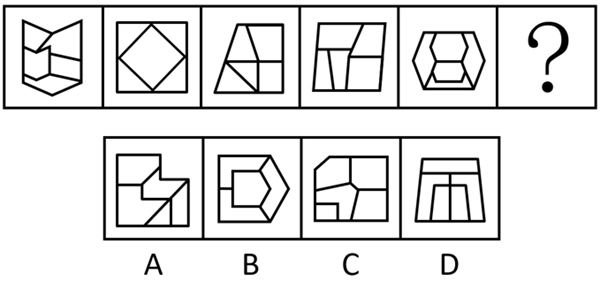
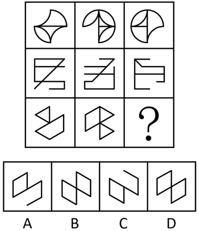
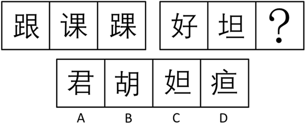
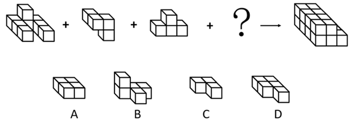
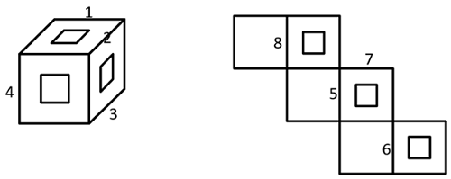

# 第 20 季 · 判断推理

来源：2026下半年省考第二十季行测模考大赛（广东卷）.pdf

共 20 题，保留原卷题号。分数与数学符号使用 LaTeX；图片路径指向同一资料包内的原图。

## 第 46 题

原卷 PDF 页码：11；题目 ID：`gd-mock-2026h2-s20-q46`

从所给的四个选项中，选择最合适的一个填入问号处，使之呈现一定的规律性：

**A.** 见题图中的 A 选项

**B.** 见题图中的 B 选项

**C.** 见题图中的 C 选项

**D.** 见题图中的 D 选项

## 第 47 题

原卷 PDF 页码：12；题目 ID：`gd-mock-2026h2-s20-q47`

从所给的四个选项中，选择最合适的一个填入问号处，使之呈现一定的规律性：

**A.** 见题图中的 A 选项

**B.** 见题图中的 B 选项

**C.** 见题图中的 C 选项

**D.** 见题图中的 D 选项

## 第 48 题

原卷 PDF 页码：12；题目 ID：`gd-mock-2026h2-s20-q48`

下列选项中最符合所给图形规律的是（    ）。

**A.** 见题图中的 A 选项

**B.** 见题图中的 B 选项

**C.** 见题图中的 C 选项

**D.** 见题图中的 D 选项

## 第 49 题

原卷 PDF 页码：12；题目 ID：`gd-mock-2026h2-s20-q49`

箭头右侧给定的是由20个相同大小的正方体组合成的多面体，从四个选项中选择一个填入问号处，使左侧四个小多面体能组成箭头右侧立体图形的是：

**A.** 见题图中的 A 选项

**B.** 见题图中的 B 选项

**C.** 见题图中的 C 选项

**D.** 见题图中的 D 选项

## 第 50 题

原卷 PDF 页码：13；题目 ID：`gd-mock-2026h2-s20-q50`

下图为给定的多面体及其外表面展开图，问数字1、2、3、4、5、6、7、8所代表的棱的对应关系为：

**A.** 1-7，2-5，3-6，4-8

**B.** 1-6，2-5，3-8，4-7

**C.** 1-5，2-7，3-8，4-6

**D.** 1-5，2-7，3-6，4-8

## 第 51 题

原卷 PDF 页码：13；题目 ID：`gd-mock-2026h2-s20-q51`

传统产业是现代化产业体系的重要组成部分，优化提升传统产业是推动现代化产业体系整体升级的必然选择。只有进行技术改造、模式创新与结构优化，才能真正优化提升传统产业。如果现代化产业体系迈向智能化或锻造新优势，那么就能推动现代化产业体系整体升级。
由此可以推出：

**A.** 如果现代化产业体系没有锻造新优势，那么就无法优化提升传统产业

**B.** 进行技术改造和模式创新是现代化产业体系锻造新优势的必要条件

**C.** 除非推动现代化产业体系整体升级，否则没有进行技术改造、模式创新与结构优化

**D.** 只要优化提升传统产业，就能推动现代化产业体系整体升级

## 第 52 题

原卷 PDF 页码：13；题目 ID：`gd-mock-2026h2-s20-q52`

脑机接口是一项具有变革性的人机交互技术，其核心机制是绕过外周神经与肌肉，在大脑与外部设备之间直接建立通信与控制通路，实现大脑与设备间的信息交互。“高位截瘫患者仅凭意念操控轮椅出行，用意念指挥机器狗递送物品”······这些曾只存在于科幻作品中的场景，正随着脑机接口技术的发展逐步成为现实。不过，也有不少人担忧该技术会直接读取个人思想与记忆，因而对这项新技术持谨慎态度。
以下哪项如果为真，最能削弱上述担忧？

**A.** 目前，脑机接口技术正驶入发展快车道，呈现出快速增长的良好态势

**B.** 脑机接口技术的核心功能是解析特定脑电信号指令，捕捉运动皮层信号

**C.** 脑机接口设备只能单向接收大脑主动发出的信号，无法检索大脑中的信息

**D.** 脑机接口技术研究的最初目的是有效地恢复患者因疾病或外伤丧失的运动功能

## 第 53 题

原卷 PDF 页码：13, 14；题目 ID：`gd-mock-2026h2-s20-q53`

每年夏季，雌性藏羚羊会跨越数百公里前往固定产崽地，部分母羊与幼崽不会返回原越冬地，而是在新栖息地定居。这种独特的生存策略，让藏羚羊种群始终保持高效、持续的基因交流，避免了遗传隔离。研究人员据此认为，青藏高原所有藏羚羊均属于单一遗传种群。要使上述论证成立，必须补充的前提是：

**A.** 有基因组证据显示，不同地区的藏羚羊确实存在着基因交流

**B.** 单一遗传种群与多个遗传种群最大的区别是单一遗传种群不存在遗传隔离

**C.** 远距离迁徙产崽可使幼崽在成长初期远离寄生虫和疾病威胁

**D.** 进入人类世界后，人类活动成为主导藏羚羊命运的核心力量

## 第 54 题

原卷 PDF 页码：14；题目 ID：`gd-mock-2026h2-s20-q54`

保护生物学家一直认为，当种群数量骤减，即出现所谓的遗传瓶颈时，遗传多样性会下降，同时近亲繁殖与有害突变的累积会增加物种灭绝风险。然而，一项发表于《科学》的研究发现，某些经历过严重遗传瓶颈的考拉种群，近几年其有害基因突变更少、适应能力更强，显示出基因再生的早期迹象。研究人员据此认为，遗传瓶颈带来的新突变的累积和基因组合变化，使得这些考拉种群正在恢复。
以下哪项如果为真，最能削弱上述研究人员的观点？

**A.** 经历了遗传瓶颈的考拉种群所在地区，近年来生态环境不断改善，为考拉提供了更适宜的生存环境，食物资源也更加丰富

**B.** 对其他濒危物种的研究表明，仅依靠静态遗传指标判断灭绝风险，可能会错误评估物种的濒危程度与恢复状态

**C.** 长期以来，维多利亚州的考拉种群一直被认为存在基因缺陷，因为它们大多源自一次严重的历史遗传瓶颈

**D.** 澳大利亚北部的考拉种群虽然遗传多样性较高，但携带更多有害基因突变，种群数量在急剧下降

## 第 55 题

原卷 PDF 页码：14；题目 ID：`gd-mock-2026h2-s20-q55`

甲、乙、丙、丁、戊5人报名学校组织的兴趣课程，每人报名绘画、书法、舞蹈、唱歌、陶艺5门兴趣课程中的2门，且每门课程恰好有2人报名。已知：
①甲不报名绘画和舞蹈；
②乙与丙报名的课程完全不同，且丙不报名陶艺；
③丁不报名书法，且丁与戊恰好有1门课程相同；
④戊不报名唱歌，且戊报名的课程与甲无任何重复；
⑤乙报名书法和绘画。
由此可以推出一定正确的是：

**A.** 甲会报名陶艺

**B.** 丙会报名绘画

**C.** 丁会报名舞蹈

**D.** 戊会报名陶艺

## 第 56 题

原卷 PDF 页码：14, 15；题目 ID：`gd-mock-2026h2-s20-q56`

2020年，我国开展五年规划编制史上首次“网络问计”，累计收到上百万条网民意见建议；2025年，“十五五”规划编制再次面向社会公开征求意见，累计收到群众建言超311.3万条；目前，“通过互联网等途径向社会公开征集意见建议”已正式写入《中华人民共和国国家发展规划法》，以法律形式保障公众参与规划编制。有学者据此认为：坚持顶层设计与问计于民相统一，是我国科学制定并有效实施五年规划的关键成功因素。
以下各项如果为真，最无法支持这一观点的是：

**A.** 网络征求意见拓宽了民意表达渠道，让千家万户的小事能够融入国家发展大计

**B.** 坚持顶层设计与问计于民相统一，能够彰显制度优势，确保国家发展的正确方向

**C.** “网络问计”实现常态化、法律化，能有效汇聚社会各界智慧，助力凝聚发展合力

**D.** 我国现代化建设覆盖面广、涉及领域众多，科学制定规划需要统筹兼顾、协调各方

## 第 57 题

原卷 PDF 页码：15；题目 ID：`gd-mock-2026h2-s20-q57`

“设摊”招生是指高校到指定地点摆放招生摊位，甚至有时还要向当地中介机构交纳“摊位费”，对于“设摊”这种费时费力的做法，高校领域的意见基本一致——此事高耗能，应该立即叫停。然而令人费解的是，大部分高校并没有减少每年派出“设摊”人员的人数。
以下选项若为真，最不能解释这一现象的是：

**A.** 有些位于偏远地区的考生信息闭塞，线下“设摊”是帮助他们了解高校信息的必要途径之一

**B.** 大部分高校在获得高分生源的名单后，通过“设摊”可以更有针对性地锁定心仪的招生对象

**C.** 只有“设摊”招生才可以让高分考生与高校“零距离”接触，缩短考生与高校之间的距离感

**D.** 各大高校均有专业的招生老师，学校会给这些因“设摊”招生而出差的老师发放相应的补贴

## 第 58 题

原卷 PDF 页码：15；题目 ID：`gd-mock-2026h2-s20-q58`

某研究团队通过构建模拟人类长期独居状态的小鼠模型展开研究，发现被单独饲养的小鼠大脑中“腹侧海马”区（更侧重于调控情绪的海马亚区）铁含量异常升高。过量的铁会激活 $\alpha$ -突触核蛋白分子，导致神经元过度放电。这一过程会不断向身体发出“危险”的焦虑警报。更为关键的是，这种变化精准地作用于情绪中枢，使得大脑对“社交剥夺”产生高度特异的应激反应。
据此，该研究团队认为社交隔离会触发大脑特定区域“铁聚积”，进而激活一条全新的神经可塑性通路，引发焦虑等症状。
以下哪项如果为真，最能支持上述论证？

**A.** 过往研究认为铁是维持神经健康的营养元素，而新研究表明，在心理压力的作用下，铁能够直接改变神经突触的结构与功能

**B.** 研究团队通过鼻腔给药的方式，针对铁可塑性中的关键分子铁或 $\alpha$ -突触核蛋白进行干预，仅两周治疗后，小鼠的焦虑行为显著减轻

**C.** 该研究融合了神经科学、金属生物学代谢调控与转化医学等多个领域的知识，真正实现了从实验室到病床前的全链条创新

**D.** 在日常生活中，不少人长时间独处后，即便没有发生任何特别的事情，也会莫名心慌、坐立不安，甚至对社交产生恐惧

## 第 59 题

原卷 PDF 页码：15, 16；题目 ID：`gd-mock-2026h2-s20-q59`

创新药物如需申请上市，相关部门首先要对药物的化学结构进行确证；其次要在动物身上进行试验，研究药物在动物体内的代谢过程、作用靶点和效果；最后还要在人体上进行规范的临床试验，证实药物的安全性和有效性。因此，用于治疗原发性胆汁性胆管炎的奥贝胆酸片，虽然已进行了结构确证和动物试验，但仍暂时不能申请上市。要使上述结论成立，需要补充的前提是（    ）。

**A.** 如果一款创新药没有进行过规范的人体临床试验，根据规定就无法申请上市

**B.** 一些创新药问世之初，有一定概率出现不良反应，需要客观看待其安全性

**C.** 为了让更多患者获益，我国国家药监局在持续推进药品审评审批制度改革

**D.** 相关部门还未筛选出奥贝胆酸片的合适受试者，故人体临床试验工作暂时受阻

## 第 60 题

原卷 PDF 页码：16；题目 ID：`gd-mock-2026h2-s20-q60`

班级里有四位同学：小红、小明、小丽、小强，每人头上戴着一顶红色或蓝色的帽子。每个人都能看到其他三人帽子的颜色，但看不到自己的。小红说：“我看到了2顶红帽子和1顶蓝帽子。”小明说：“我看到了3顶蓝帽子。”小丽说：“我看到了3顶红帽子。”已知：戴红帽子的人说的是真话，戴蓝帽子的人说的是假话。则小强戴的帽子颜色：

**A.** 可能是红色，也可能是蓝色

**B.** 一定是红色

**C.** 与小明戴的帽子颜色相同

**D.** 一定是蓝色

## 第 61 题

原卷 PDF 页码：16；题目 ID：`gd-mock-2026h2-s20-q61`

若做不到强化技术监管、提升执法效能，就不能让科技创新真正造福人类。目前监管部门已经强化了技术监管，提升了执法效能，因此科技创新已经能够真正造福人类。下列选项的逻辑结构与题干最为相似的是（    ）。

**A.** 若以亮利剑的态度涤清网络生态，就能让赛事精神在网络激荡出磅礴力量。某赛事以亮利剑的态度涤清了网络生态，因此该赛事精神在网络激荡出了磅礴力量

**B.** 除非发扬载人航天精神，否则在星辰大海的征途上并不会镌刻更多的中国印记。目前在星辰大海的征途上镌刻了更多的中国印记，因此我们一定发扬了载人航天精神

**C.** 只有扩大高水平对外开放，才能开创合作共赢新局面。我国扩大高水平对外开放，因此我们没有同世界各国共同开创合作共赢新局面

**D.** 若某社区为老年人筑起数字安全网，该社区的老年人就能在岁月静好中安享晚年。某社区的老年人在岁月静好中安享晚年，因此该社区为老年人筑起数字安全网

## 第 62 题

原卷 PDF 页码：16；题目 ID：`gd-mock-2026h2-s20-q62`

近日教育部公布了当年全国硕士研究生招生考试的相关数据。数据显示，当年考研报名人数降至388万，比前一年减少50万，降幅为11.42%，呈现下降的态势。然而令人不解的是，当年热门专业的考研分数线却纷纷上涨。下列选项如果为真，最能解释上述现象的是（    ）。

**A.** 考研分数线的变化受多方面因素的影响，而当年的试卷难度较大

**B.** 即使总报考人数下降，热门专业的报考人数仍比冷门专业多得多

**C.** 当年考生仍执着于热门院校的热门专业，其报考人数同比增长了40%

**D.** 当年部分试卷从自命题改为全国统考，对基础扎实的考生更有利

## 第 63 题

原卷 PDF 页码：16, 17；题目 ID：`gd-mock-2026h2-s20-q63`

科技发展日新月异，若监管滞后，无人机就可能沦为伤人害物的凶器。唯有织密法治之网，才能让科技创新真正造福人类。
由此可以推出（    ）。

**A.** 如果没有织密法治之网，科技创新就无法真正造福人类

**B.** 只要织密法治之网，科技创新就可以真正造福人类

**C.** 如果监管不滞后，无人机就不可能沦为伤人害物的凶器

**D.** 唯有织密法治之网，无人机才不可能沦为伤人害物的凶器

## 第 64 题

原卷 PDF 页码：17；题目 ID：`gd-mock-2026h2-s20-q64`

明厨亮灶的饭店，客流量大；而客流量大的饭店，饭菜都美味。因此，明厨亮灶的饭店，饭菜都美味。下列选项的逻辑结构与题干最为相似的是（    ）。

**A.** 坚持晨读的人，语言感知敏锐；语言感知敏锐的人，外语学习效率都高。因此，外语学习效率高的人，都在坚持晨读

**B.** 重视产品质量的企业，市场占有率高。这是因为重视产品质量的企业，用户口碑一定好，而用户口碑好的企业，市场占有率高

**C.** 作息规律的人，身体代谢功能稳定；而身体代谢功能稳定的人，衰老速度缓慢。因此，作息不规律的人，衰老速度快

**D.** 居民幸福感强的社区，都在践行垃圾分类。这是因为践行垃圾分类的社区，环境整洁度很高，而环境整洁度高的社区，居民幸福感都强

## 第 65 题

原卷 PDF 页码：17；题目 ID：`gd-mock-2026h2-s20-q65`

记者从2026中国信通院深度观察报告会上获悉：“十五五”时期将重点开展6G标准研制与产业研发，预计在2030年左右启动商业应用。由于6G通信具有极致的传输能力，其峰值传输速率可达1Tbps，有专家据此认为，未来的6G通信技术将极大地助力沉浸式扩展现实（XR）领域向前发展。下列选项最有可能是上述推论暗含前提的是（    ）。

**A.** 借助6G通信技术能够在多种条件下实现360度立体影像实时传输

**B.** 沉浸式扩展现实需要极高的数据吞吐量，以实现完全沉浸式的体验

**C.** 沉浸式扩展现实的核心特征是：多感官交互、全域覆盖和智能优化

**D.** 未来，6G通信技术的传输能力将显著强于目前使用的5G通信技术
