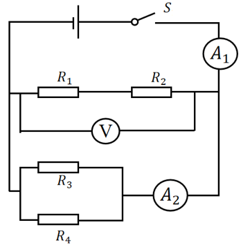
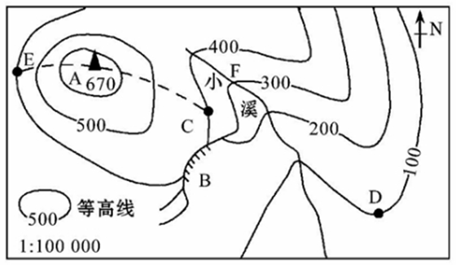

# 第 20 季 · 科学推理

来源：2026下半年省考第二十季行测模考大赛（广东卷）.pdf

共 5 题，保留原卷题号。分数与数学符号使用 LaTeX；图形使用原图或已标注的矢量重绘图。

## 第 66 题

原卷 PDF 页码：17；题目 ID：`gd-mock-2026h2-s20-q66`

某科普馆展出了一种“潜浮小车”模型：小车内部有可进水、排水的空腔，将其放入透明水槽后，起初漂浮在水面；当向空腔内缓慢注水时，小车逐渐下沉，直至恰好悬浮在水中。下列说法正确的是（    ）。

**A.** 小车从漂浮到悬浮的过程中，所受浮力逐渐减小

**B.** 小车从漂浮到悬浮的过程中，所受重力逐渐增大

**C.** 小车悬浮时，所受浮力大于重力

**D.** 小车悬浮时，水对小车底部的压强小于对小车顶部的压强

## 第 67 题

原卷 PDF 页码：18；题目 ID：`gd-mock-2026h2-s20-q67`

如图为某用电器的电路图， $R_1$ 、 $R_4$ 是定值电阻， $R_2$ 是温敏电阻，随着环境温度的升高， $R_2$的阻值会变大； $R_3$ 是光敏电阻，随着环境光照强度的增大， $R_3$ 的阻值会变小；V表示电压表， $A_1$ 、 $A_2$ 均表示电流表，电源电压保持不变，闭合开关S后，下列说法正确的是（    ）。

**A.** 若环境温度下降，则V的示数变小， $A_1$ 的示数变大

**B.** 若环境温度下降，则V的示数不变， $A_1$ 的示数变大

**C.** 若环境光照强度增大，则 $A_1$ 的示数变大， $A_2$ 的示数变小

**D.** 若环境光照强度减弱，则 $A_1$ 的示数不变， $A_2$ 的示数变大

## 第 68 题

原卷 PDF 页码：18；题目 ID：`gd-mock-2026h2-s20-q68`

在进行“绿叶在光下制造有机物”实验之前，需将盆栽天竺葵放到黑暗处一昼夜，该操作的主要目的是（    ）。

**A.** 大量消耗叶片内的水分

**B.** 消耗叶片内原有的淀粉（有机物）

**C.** 促进叶片进行光合作用

**D.** 分解叶片内的叶绿素

## 第 69 题

原卷 PDF 页码：18；题目 ID：`gd-mock-2026h2-s20-q69`

小明在学习完与金属活动性相关的知识后，想自己动手验证Fe、Cu、Ag三种金属活动性的强弱，下列实验方案的组合不能达到其目的的是（    ）。
①将Fe放入 $\mathrm{CuSO_4}$ 溶液
②将Cu放入 $\mathrm{AgNO_3}$ 溶液
③将Ag放入 $\mathrm{CuSO_4}$ 溶液
④将Fe、Cu分别放入稀盐酸

**A.** ①③

**B.** ①④

**C.** ②④

**D.** ③④

## 第 70 题

原卷 PDF 页码：18, 19；题目 ID：`gd-mock-2026h2-s20-q70`

下图为某地的等高线地形图，下列说法正确的是（    ）。

**A.** 图中小溪的流向为自东北向西南

**B.** 图中D处的地形为山谷

**C.** 图中E处的气温比A处的气温低

**D.** 图中B处适宜发展攀岩运动
