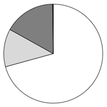
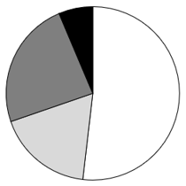
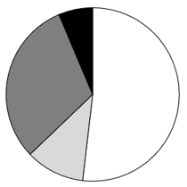
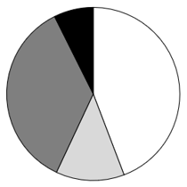

# 第 20 季 · 资料分析

来源：2026下半年省考第二十季行测模考大赛（广东卷）.pdf

共 20 题，保留原卷题号。分数与数学符号使用 LaTeX；图片路径指向同一资料包内的原图。

## 材料 1（第 71—75 题）

2025年广东省常住人口12859万人，比上年增加79万人，常住人口总量和增量均居全国之首；全年出生人口100.3万人，人口出生率为7.82‰，连续6年成为全国唯一出生人口超百万的省份；死亡人口71.3万人，死亡率5.56‰，人口自然增长率2.26‰。在少子化、老龄化、区域人口增加分化的人口发展新常态下，作为全国人口第一大省的广东，人口发展表现出一定的韧性。2025年广东省城镇常住人口9847万人，乡村常住人口3012万人；常住人口城镇化率达76.58%，较上年提高0.67个百分点。2025年全省0-15岁人口2339万人，16-59岁劳动年龄人口8527万人，占常住人口比重66.31%；60岁及以上人口1993万人，其中65岁及以上老年人口1324万人。广东省不仅吸引普通劳动力，更通过“百万英才汇南粤”等集聚大量高端人才，通过“广东技工”等加大教育和培训力度。2025年广东省高校毕业生总数为87万人‌，较2024年增加3万人。全国每12名高校毕业生中，就有1名选择来广东工作，其中广州、深圳为两大核心吸纳城市。目前，广东省已建成171条“产业-教学-评价”融通的技能生态链，技工院校年均向社会输送技能人才超17万人。

## 第 71 题

原卷 PDF 页码：19；题目 ID：`gd-mock-2026h2-s20-q71`

以下不属于我国人口发展新常态主要特征的是：

**A.** 少子化

**B.** 老龄化

**C.** 人口负增长化

**D.** 区域人口增加分化

## 第 72 题

原卷 PDF 页码：19, 20；题目 ID：`gd-mock-2026h2-s20-q72`

根据材料，以下说法不正确的是：

**A.** 2025年，广东省常住人口总量和增量均居全国首位

**B.** 截至2025年，广东省已连续6年成为全国唯一出生人口超百万的省份

**C.** 截至2025年，广东省已建成171条技能生态链

**D.** 2025年，广东省劳动力资源主要依靠自给自足

## 第 73 题

原卷 PDF 页码：20；题目 ID：`gd-mock-2026h2-s20-q73`

2025年，广东省城镇常住人口同比增量在以下哪个范围内？

**A.** 超过100万人

**B.** 75万人-100万人之间

**C.** 50万人-75万人之间

**D.** 不到50万人

## 第 74 题

原卷 PDF 页码：20；题目 ID：`gd-mock-2026h2-s20-q74`

2025年，广东省60岁及以上人口中，65岁及以上老年人口占比约为：

**A.** 76%

**B.** 66%

**C.** 56%

**D.** 46%

## 第 75 题

原卷 PDF 页码：20；题目 ID：`gd-mock-2026h2-s20-q75`

根据材料，以下说法正确的是：

**A.** 2025年，广东省自然增长人口29万人

**B.** 2025年，广东省常住人口中劳动年龄人口是非劳动年龄人口的2倍多

**C.** 2025年，全国共有不到1000万名高校毕业生

**D.** 2025年，广东省乡村常住人口同比增量高于城镇常住人口

## 材料 2（第 76—80 题）

**2024年—2025年3月我国跨区域人员流动量相关情况**

| 时间 | 跨区域人员流动量（万人次） | 跨区域人员流动量同比增长（%） | 公路人员流动量（万人次） | 公路人员流动量同比增长（%） |
| --- | --- | --- | --- | --- |
| 2024年1—2月 | 1171807 | — | 1086652 | 10.3 |
| 2024年1—3月 | 1671682 | 10.2 | 1547451 | 9.0 |
| 2024年1—4月 | 2189330 | 8.4 | 2021233 | 7.4 |
| 2024年1—5月 | 2736268 | 8.3 | 2523351 | 7.4 |
| 2024年1—6月 | 3241011 | 7.4 | 2983967 | 6.6 |
| 2024年1—7月 | 3799308 | 6.6 | 3489943 | 5.8 |
| 2024年1—8月 | 4396867 | 6.1 | 4029157 | 5.4 |
| 2024年1—9月 | 4909109 | 5.4 | 4499504 | 4.7 |
| 2024年1—10月 | 5492663 | 5.5 | 5036908 | 4.9 |
| 2024年1—11月 | 5972154 | 5.4 | 5478704 | 4.8 |
| 2024年1—12月 | 6459234 | 5.4 | 5929002 | 4.8 |
| 2025年1—2月 | 1229386 | 4.9 | 1139263 | 4.8 |
| 2025年1—3月 | 1738829 | 4.0 | 1607309 | 3.9 |

注：跨区域人员流动量指国际间、城际间、城乡间商务、旅游等跨区域人员流动规模。公路人员流动量指经由公路完成的跨区域人员流动规模，包括非营业性小客车人员出行量与营业性客运量。

## 第 76 题

原卷 PDF 页码：20；题目 ID：`gd-mock-2026h2-s20-q76`

2024年，我国跨区域人员流动量最低的季度是：

**A.** 一季度

**B.** 二季度

**C.** 三季度

**D.** 四季度

## 第 77 题

原卷 PDF 页码：20, 21；题目 ID：`gd-mock-2026h2-s20-q77`

2023年一季度，我国跨区域人员流动量中非公路人员流动量占比约为：

**A.** 6.4%

**B.** 7.4%

**C.** 8.1%

**D.** 9.3%

## 第 78 题

原卷 PDF 页码：21；题目 ID：`gd-mock-2026h2-s20-q78`

2025年一季度，我国公路人员流动量较2023年一季度约增长了：

**A.** 14.6%

**B.** 13.3%

**C.** 12.9%

**D.** 11.6%

## 第 79 题

原卷 PDF 页码：21；题目 ID：`gd-mock-2026h2-s20-q79`

2024年下半年，我国跨区域人员流动量累计值同比增速最高的月份，当月公路人员流动量环比约增长：

**A.** -8.3%

**B.** 5.8%

**C.** 9.8%

**D.** 14.3%

## 第 80 题

原卷 PDF 页码：21；题目 ID：`gd-mock-2026h2-s20-q80`

以下各项能从材料中推出的是：

**A.** 2024年，我国公路人员流动量同比增量超过30亿人次

**B.** 2024年，我国公路人员流动量每月均同比增长

**C.** 2024年上半年，我国跨区域人员流动量中非公路人员流动量占比不到一成

**D.** 若保持2025年一季度跨区域人员月均流动量不变，则2025年我国跨区域人员流动量超过700亿人次

## 材料 3（第 81—85 题）

2024年，全国民航运输机场完成旅客吞吐量14.60亿人次，比上年增长15.9%。其中，东部地区完成旅客吞吐量7.57亿人次，增长18.6%；中部地区完成旅客吞吐量1.61亿人次，增长12.8%；西部地区完成旅客吞吐量4.49亿人次，增长12.6%；东北地区完成旅客吞吐量0.93亿人次，增长15.8%。2024年，全国民航运输机场完成货邮吞吐量2006.19万吨，比上年增长19.2%。其中，东部地区完成货邮吞吐量1376.68万吨，增长14.1%；中部地区完成货邮吞吐量240.19万吨，增长58.5%；西部地区完成货邮吞吐量325.27万吨，增长21.9%；东北地区完成货邮吞吐量64.05万吨，增长10.0%。

**图1：2020—2024年全国民航运输机场旅客吞吐量及同比增速**

| 年份 | 旅客吞吐量（亿人次） | 同比增速（%） |
| --- | --- | --- |
| 2020 | 8.57 | −36.6 |
| 2021 | 9.07 | 5.8 |
| 2022 | 5.20 | −42.7 |
| 2023 | 12.60 | 142.3 |
| 2024 | 14.60 | 15.9 |

**图2：2020—2024年全国民航运输机场货邮吞吐量及同比增速**

| 年份 | 货邮吞吐量（万吨） | 同比增速（%） |
| --- | --- | --- |
| 2020 | 1607.49 | −6.0 |
| 2021 | 1782.80 | 10.9 |
| 2022 | 1453.05 | −18.5 |
| 2023 | 1683.31 | 15.8 |
| 2024 | 2006.19 | 19.2 |

## 第 81 题

原卷 PDF 页码：22；题目 ID：`gd-mock-2026h2-s20-q81`

2019-2024年，全国民航运输机场年均完成旅客吞吐量约多少亿人次？

**A.** 10.6

**B.** 10

**C.** 9.4

**D.** 8.3

## 第 82 题

原卷 PDF 页码：22, 23；题目 ID：`gd-mock-2026h2-s20-q82`

以下饼状图中，最能准确反映2024年全国各地区民航运输机场完成旅客吞吐量比例关系的是：

**A.**

**B.**

**C.**

**D.**

## 第 83 题

原卷 PDF 页码：23；题目 ID：`gd-mock-2026h2-s20-q83`

2024年，我国东部地区民航运输机场完成货邮吞吐量约比中、西部地区之和多多少倍？

**A.** 4.2

**B.** 3.2

**C.** 2.4

**D.** 1.4

## 第 84 题

原卷 PDF 页码：23；题目 ID：`gd-mock-2026h2-s20-q84`

按区域分，2024年我国民航运输机场完成旅客吞吐量、货邮吞吐量占全国的比重均高于上年的地区有多少个？

**A.** 0

**B.** 1

**C.** 2

**D.** 3

## 第 85 题

原卷 PDF 页码：23；题目 ID：`gd-mock-2026h2-s20-q85`

以下各项不能从材料中推出的是：

**A.** 2020-2024年，全国民航运输机场完成货邮吞吐量的中位数为1683.31万吨

**B.** 2020-2024年，全国民航运输机场完成旅客吞吐量同比增速最高的年份，其完成货邮吞吐量同比增速也最高

**C.** 2021年，全国民航运输机场完成货邮吞吐量较2019年增长了不到5%

**D.** 2022年，全国民航运输机场完成旅客吞吐量同比增速比货邮吞吐量低24.2个百分点

## 材料 4（第 86—90 题）

2024年前7个月，全国互联网保险累计保费3663亿元，同比增长15.0%，重回了两位数的增速。从2013年至2023年十年间，互联网保险的保费规模从290亿元增加至4949亿元，年均复合增长率达到32.8%。2022年，保险业的互联网渗透率首次突破10%，具有里程碑式的历史意义。

**2016—2023年全国互联网保险保费相关数据**

| 年份 | 互联网保险保费（亿元） | 互联网保险保费占总保费收入比例（%） |
| --- | --- | --- |
| 2016 | 2299 | 7.4 |
| 2017 | 1877 | 5.1 |
| 2018 | 1889 | 5.0 |
| 2019 | 2696 | 6.3 |
| 2020 | 2909 | 6.4 |
| 2021 | 3779 | 8.4 |
| 2022 | 4783 | 10.2 |
| 2023 | 4949 | 9.7 |

## 第 86 题

原卷 PDF 页码：23, 24；题目 ID：`gd-mock-2026h2-s20-q86`

“十三五”期间，全国互联网保险累计保费为多少亿元？

**A.** 11670

**B.** 11873

**C.** 12396

**D.** 13150

## 第 87 题

原卷 PDF 页码：24；题目 ID：`gd-mock-2026h2-s20-q87`

2017-2023年，全国互联网保险保费同比增长率超过总保费收入同比增长率的年份有几个？

**A.** 3

**B.** 4

**C.** 5

**D.** 6

## 第 88 题

原卷 PDF 页码：24；题目 ID：`gd-mock-2026h2-s20-q88`

若保持2023年同比增量不变，则到哪一年全国互联网保险保费将首次超过2013年的20倍？

**A.** 2027年

**B.** 2028年

**C.** 2029年

**D.** 2030年

## 第 89 题

原卷 PDF 页码：24；题目 ID：`gd-mock-2026h2-s20-q89`

2023年8-12月，全国互联网保险月均保费约为多少亿元？

**A.** 257

**B.** 353

**C.** 441

**D.** 523

## 第 90 题

原卷 PDF 页码：24；题目 ID：`gd-mock-2026h2-s20-q90`

以下折线图最能准确反映哪一时间段内全国互联网保险保费同比增量的变化趋势？

**A.** 2017-2020年

**B.** 2018-2021年

**C.** 2019-2022年

**D.** 2020-2023年
