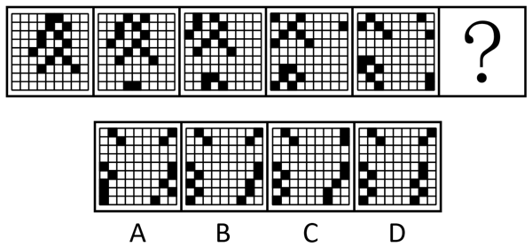
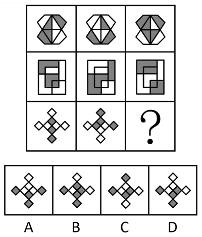
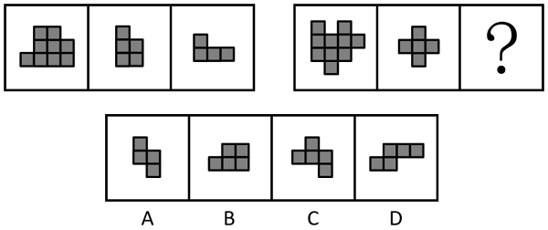
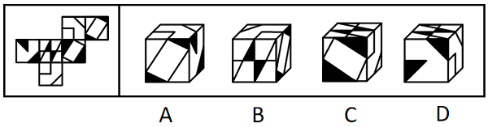
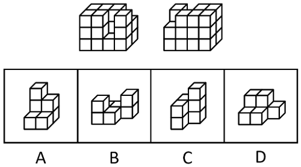

# 第 21 季 · 判断推理

来源：2026下半年省考第二十一季行测模考大赛（广东卷）.pdf

共 20 题，保留原卷题号。分数与数学符号使用 LaTeX；图片路径指向同一资料包内的原图。

## 第 46 题

原卷 PDF 页码：10, 11；题目 ID：`gd-mock-2026h2-s21-q46`

从所给的四个选项中，选择最合适的一个填入问号处，使之呈现一定的规律性：

**A.** 见题图中的 A 选项

**B.** 见题图中的 B 选项

**C.** 见题图中的 C 选项

**D.** 见题图中的 D 选项

## 第 47 题

原卷 PDF 页码：11；题目 ID：`gd-mock-2026h2-s21-q47`

从所给的四个选项中，选择最合适的一个填入问号处，使之呈现一定的规律性：

**A.** 见题图中的 A 选项

**B.** 见题图中的 B 选项

**C.** 见题图中的 C 选项

**D.** 见题图中的 D 选项

## 第 48 题

原卷 PDF 页码：11；题目 ID：`gd-mock-2026h2-s21-q48`

下列选项中最符合所给图形规律的是：

**A.** 见题图中的 A 选项

**B.** 见题图中的 B 选项

**C.** 见题图中的 C 选项

**D.** 见题图中的 D 选项

## 第 49 题

原卷 PDF 页码：12；题目 ID：`gd-mock-2026h2-s21-q49`

左边给定的是正方体的外表面展开图，右边哪一项能由它折叠而成？

**A.** 见题图中的 A 选项

**B.** 见题图中的 B 选项

**C.** 见题图中的 C 选项

**D.** 见题图中的 D 选项

## 第 50 题

原卷 PDF 页码：12；题目 ID：`gd-mock-2026h2-s21-q50`

下面是某立体图形的正视图和后视图，其由三个完全相同的小立体图形组成，该小立体图形是：

**A.** 见题图中的 A 选项

**B.** 见题图中的 B 选项

**C.** 见题图中的 C 选项

**D.** 见题图中的 D 选项

## 第 51 题

原卷 PDF 页码：12；题目 ID：`gd-mock-2026h2-s21-q51`

某办公室工作使用到的智能工具有AI写作、AI数据分析、AI绘图、AI视频剪辑四类，员工陈、杨、黄、吴、郑五人每人使用其中一类智能工具。已知：
（1）如果陈使用AI写作，那么吴使用AI绘图；
（2）除非杨使用AI数据分析，否则黄不使用AI视频剪辑；
（3）吴不使用AI绘图或者黄使用AI视频剪辑；
（4）只有杨不使用AI数据分析，郑才使用AI写作。
由此可以推出：

**A.** 陈和郑中至少有一个人使用AI写作

**B.** 陈和郑中至多有一个人使用AI写作

**C.** 陈不使用AI写作或者郑使用AI写作

**D.** 陈使用AI写作或者郑不使用AI写作

## 第 52 题

原卷 PDF 页码：12, 13；题目 ID：`gd-mock-2026h2-s21-q52`

最近，一份2025年度全国少儿图书畅销排行榜引发关注：跻身前列的不少图书带有“狼之道”“赢在破局思维”“孩子，你要懂点人情世故”等成功学色彩，而许多曾影响一代孩童成长的经典文学作品与优秀原创儿童文学作品却排在50名开外。这一现象的本质是家长教育焦虑推动了功利化阅读选择。有专家表示，只有家长放下焦虑，孩子才能真正体会到阅读的愉悦，养成长期阅读的习惯。上述论证的成立需要补充以下哪项作为前提？

**A.** 在少儿图书消费中，家长是主要的购买决策者，孩子的阅读喜好往往被家长的功利心态左右

**B.** 家长应完成从监督者到同行者的角色转变，与孩子共选、共读、共议图书，赋予孩子自主选书的权利

**C.** 非功利阅读已超越实际利益诉求，如果在阅读中刻意强求即时回报，反而会与阅读的本质目的相悖

**D.** 新媒体平台中贩卖焦虑的选题往往更容易获得流量加持，该流量逻辑强化了家长选书的功利导向

## 第 53 题

原卷 PDF 页码：13；题目 ID：`gd-mock-2026h2-s21-q53`

定量评价指采用数学方法收集和处理数据资料，对评价对象进行定量结果的价值判断，通过量化分析满足选拔、甄别等需求，其优势在于程序明确、操作性强，评价结果直观、具体，易于理解和应用。不过，也有人认为，定量评价存在评价标准单一化的问题，因而并不能对评价对象的真实价值作出恰如其分的反映。
以下哪项如果为真，能够加强上述观点？

**A.** 定量评价依赖于可测性数据，强调共性、稳定性和统一性，容易将对结果产生重要影响的、难以量化的因素简化为分数表征与数量计算

**B.** 定量评价的结果通常以数值形式呈现，可以使用各种图表、统计指标和模型来展示，这些方式能够直观地显示评价对象的特征和变化趋势

**C.** 定性评价虽能全面深入地剖析问题、揭示潜在机制，但其依赖于研究者的主观判断和解释，结果可能不够客观准确

**D.** 定量评价中，收集数据是关键步骤，零散的原始数据无法提炼出规律、趋势或本质特征，会导致得出的结论片面、模糊甚至与实际情况相悖

## 第 54 题

原卷 PDF 页码：13；题目 ID：`gd-mock-2026h2-s21-q54`

传统手术中，医生难免受手抖、眼花等生理局限困扰，毫米级的误差就可能危及患者生命，而通信技术与精密机械“完美结合”的远程手术机器人，有望改变这一现状。近日，身处广东的医生在屏幕前轻点操控杆，远在新疆的手术机器人便精准完成了全球首例远程视网膜下注射手术。术中，医生发出的操作指令经高速网络实时传至患者手术端机器人，机械臂过滤掉人手的自动抖动，仅用7分钟便在毫米级空间内完成了精细的手术操作。对此，有专家认为，远程手术机器人能够打破空间限制，破解医疗资源不均衡难题，有望在短期内实现规模化应用。
以下各项如果为真，最不能削弱上述结论的是：

**A.** 远程手术机器人设备与后期维护成本极高，多数基层医疗机构短期内难以承担

**B.** 远程手术相关技术标准缺失，且操作需具备跨学科知识，专业人才短缺阻碍推广进程

**C.** 远程手术涉及的数据安全、责任界定等法规问题目前尚未明确，缺乏完善制度体系支撑

**D.** 远程手术中，医生始终掌握主导权，负责术前诊断、制定方案、术中决策和应急处理

## 第 55 题

原卷 PDF 页码：14；题目 ID：`gd-mock-2026h2-s21-q55`

近年来，中国企业在电动汽车技术方面取得了显著进步，在价格、电池效率和自动驾驶领域都具有优势，相关产品大量进入欧洲市场。2024年10月，欧盟开始对从中国进口的电动汽车征收为期五年的最终反补贴税。对此，有国际专家指出，欧盟此举反倒害己，欧洲不应采取贸易限制措施，而应加强与中国在电动汽车领域的务实合作。
以下哪项如果为真，最能加强上述观点？

**A.** 欧盟迫切需要缓解新排放标准和持续通胀带来的压力，但电动汽车在欧洲的推广速度十分缓慢

**B.** 限制从中国进口电动汽车将迫使欧洲制造商依赖价格较高的供应商，导致整个行业的成本上升

**C.** 中国是全球最大的电动汽车市场，研发了高效的电池技术、可再生能源基础设施和电动汽车生产系统

**D.** 中国很多车企自主创新，让国内更广泛的消费群体用上了电动汽车，同时满足了环保和经济需求

## 第 56 题

原卷 PDF 页码：14；题目 ID：`gd-mock-2026h2-s21-q56`

汉语言文学专业的小平、安安、小喜、乐乐四名同学组成学习小组，需完成《中国古代文学史》《外国文学史》《现代汉语》《文学概论》四门课程作业。小组采用分工负责制，每人主导完成一门课程作业，并交叉检查另一门课程作业。经过讨论后安排如下：
（1）若小平主导完成《中国古代文学史》，则小喜检查《外国文学史》；
（2）只有乐乐检查《文学概论》，安安才主导完成《外国文学史》；
（3）如果小喜主导完成《文学概论》，那么乐乐主导完成《外国文学史》；
（4）若小喜检查《中国古代文学史》，则安安不主导完成《外国文学史》。若最终的安排违背了条件（4），则可以推出的是：

**A.** 小平主导完成《文学概论》

**B.** 乐乐主导完成《现代汉语》

**C.** 安安检查《中国古代文学史》

**D.** 小喜检查《外国文学史》

## 第 57 题

原卷 PDF 页码：14；题目 ID：`gd-mock-2026h2-s21-q57`

近年来，儿童迅速跃升为微短剧中的主角，相关作品数量多、热度高、传播广，广受观众认可。然而，不少业内人士却认为，这类微短剧的质量普遍不高。
以下哪项如果为真，最能解释上述现象？

**A.** 萌娃视频一般会自带流量，因此儿童类微短剧天然具备较高热度

**B.** 儿童类微短剧的广告植入、品牌合作相对容易，商业变现更高效

**C.** 观众对儿童表演的包容度很高，制作方无需费力去提升演员演技

**D.** 制作方为了压缩成本，更愿意多产快发，对拍摄场景的投入较少

## 第 58 题

原卷 PDF 页码：14, 15；题目 ID：`gd-mock-2026h2-s21-q58`

随着科技的发展，电动牙刷逐渐成为越来越多人日常口腔清洁的首选工具。但也有很多人反映自己长期使用电动牙刷后，出现了牙齿变薄、牙龈出血的情况，有人据此得出结论：长期使用电动牙刷会损害牙齿健康。
以下哪项如果为真，最能削弱上述结论？

**A.** 相较于手动牙刷，电动牙刷有稳定的振动频率，能够更有效地去除牙菌斑

**B.** 据调查，医院里很多口腔科医生和护士有使用电动牙刷刷牙的习惯

**C.** 牙龈出血往往是牙龈炎、牙周炎等口腔问题的表现，正确使用牙刷能帮助改善牙龈健康

**D.** 那些使用电动牙刷后出现牙齿问题的人大多存在刷牙时间过长、力度过大等错误方式

## 第 59 题

原卷 PDF 页码：15；题目 ID：`gd-mock-2026h2-s21-q59`

牙周炎是一种影响全球近半数人口的慢性炎症性疾病。牙龈卟啉单胞菌作为一种革兰氏阴性厌氧菌，被认为是导致牙周炎的主要病原体。因此医学专家建议，好好刷牙预防牙周炎以及出现牙周炎之后及时治疗，或许就可以降低心房纤维化和房颤的风险。要使上述推论成立，需要补充的前提是：

**A.** 牙龈卟啉单胞菌在肿瘤组织中的丰度明显高于邻近正常组织，其释放的细胞外囊泡可以提升肿瘤细胞的迁移和侵袭能力

**B.** 牙周炎往往与吸烟、饮酒以及不良饮食结构等情况同时存在，这些因素本身就是引发心血管疾病的重要影响因素

**C.** 牙龈卟啉单胞菌可以通过血液循环进入左心房，激活相关炎症和纤维化因子，促使心房纤维化，并增加房颤的发生风险

**D.** 目前绝大部分研究都是围绕牙龈卟啉单胞菌展开的，至于其他口腔致病菌是不是会导致牙周炎，并不明确

## 第 60 题

原卷 PDF 页码：15；题目 ID：`gd-mock-2026h2-s21-q60`

赵、钱、孙、李四人均参加了物理竞赛和化学竞赛，成绩出来前，四人对竞赛排名做了如下预测：赵：我的物理竞赛排名比化学竞赛排名高；钱：物理竞赛中赵的排名比我低；孙：在四人中我的化学竞赛排名不是最低的；李：物理竞赛和化学竞赛中我的排名都不是第一。成绩出来后，发现四人的预测中，至多有两人说法错误。
根据上述情况，下列选项可能成立的是：

**A.** 物理竞赛排名：孙>李>赵>钱；化学竞赛排名：钱>赵>李>孙

**B.** 物理竞赛排名：赵>孙>钱>李；化学竞赛排名：李>赵>钱>孙

**C.** 物理竞赛排名：李>赵>孙>钱；化学竞赛排名：赵>钱>孙>李

**D.** 物理竞赛排名：钱>孙>赵>李；化学竞赛排名：赵>李>钱>孙

## 第 61 题

原卷 PDF 页码：15, 16；题目 ID：`gd-mock-2026h2-s21-q61`

甲：我今天借给丙一百块钱。乙：他今天问你借一百块钱，你借了，他下次就会问你借一千块钱，再下次借一万块钱。你有这么多钱借给他吗？
以下哪项的对话与上述对话逻辑最为相似？

**A.** 甲：最近学习没什么劲头，我打算摆烂几天。乙：你现在摆烂几天，接下来就会天天不想学，慢慢彻底荒废学业，最后一事无成！

**B.** 甲：做人要真诚一点，不能虚伪。乙：我只是讲了一些漂亮话而已，如果这也是虚伪的话，那人人都别说话了。

**C.** 甲：我觉得不用事事都争第一。乙：你就是甘愿摆烂，从头到尾都没有半点上进心是吧？

**D.** 甲：我工作拖延的习惯总是改不了。乙：总是把工作任务拖到时间快要来不及的时候才去干，就会因为赶工而出错，慢慢地会失去领导的信任。

## 第 62 题

原卷 PDF 页码：16；题目 ID：`gd-mock-2026h2-s21-q62`

受蓝牙耳机等无线耳机的影响，有线耳机销量连续5年下滑，被认为正在淡出市场。然而，相关市场调研机构最新数据显示，今年一季度有线耳机的销量同比增长20%，结束了销量连续5年的下滑态势，呈“翻红”趋势。
以下各项如果为真，最不能解释上述现象的是：

**A.** 越来越多的人开始追求高品质音乐，通过有线耳机传输的音乐会比蓝牙耳机更无损

**B.** 近期有大量时尚博主分享的穿搭均搭配了有线耳机，使有线耳机在社交媒体上的热度迅速飙升

**C.** 有些高端品牌或联名款的蓝牙耳机价格高昂，使得部分预算有限的潜在消费者望而却步

**D.** 今年很多用户反馈蓝牙耳机使用时单次续航时长越来越短，使很多人开始购买有线耳机

## 第 63 题

原卷 PDF 页码：16；题目 ID：`gd-mock-2026h2-s21-q63`

马克思主义在人类历史上第一次科学地解决了人民群众在社会历史发展中的地位和作用问题。如果坚持马克思主义关于人民群众是历史的创造者的基本原理，我们就能把握住历史前进的基本规律。只要把握住历史前进的基本规律，就能抓住历史变革时机，顺势而为。只有抓住历史变革时机，顺势而为，才能无往而不胜。
由此可以推出：

**A.** 如果没抓住历史变革时机，顺势而为，则没有坚持马克思主义关于人民群众是历史的创造者的基本原理

**B.** 只要没坚持马克思主义关于人民群众是历史的创造者的基本原理，就没有把握住历史前进的基本规律

**C.** 只有坚持马克思主义关于人民群众是历史的创造者的基本原理，才能够无往而不胜

**D.** 只要把握住历史前进的基本规律，就解决了人民群众在社会历史发展中的地位和作用问题

## 第 64 题

原卷 PDF 页码：16, 17；题目 ID：`gd-mock-2026h2-s21-q64`

许多公园里的观赏性植物都是蔷薇科植物，所有蔷薇科植物都有4-5片花瓣，因此许多公园里的观赏性植物都有4-5片花瓣。
以下选项的逻辑结构与题干最相似的是：

**A.** 所有松树都是常绿树，有的松树在阴坡长得好，因此所有常绿树都在阴坡长得好

**B.** 许多兰花都生长在热带，许多兰花都是附生植物，因此许多附生植物都生长在热带

**C.** 许多多肉植物都是仙人掌，所有仙人掌都耐旱，因此许多多肉植物都耐旱

**D.** 有些盆栽是蕨类植物，所有蕨类植物都不开花，因此有些盆栽会开花

## 第 65 题

原卷 PDF 页码：17；题目 ID：`gd-mock-2026h2-s21-q65`

青霉和绿僵菌等真菌是生物防治的有效手段，这些真菌制剂在进入到害虫体内加速害虫死亡的过程中，仅仅对害虫本身产生消灭作用，蔬菜中不会有药物残余。因此，真菌制剂的使用可以在很大程度上提升蔬菜产品的质量。要使上述推论成立，需要补充的前提是：

**A.** 生物防治技术是病虫害防治手段的一种，具有天然性、环保性的特征

**B.** 农产品中的药物残余量多少是衡量农产品品质好坏非常重要的指标

**C.** 真菌制剂能增加土壤中有益菌的数量，有效预防草莓根部病害的发生

**D.** 白僵菌生物防治害虫技术在粮食主产区年应用面积达67万公顷以上
