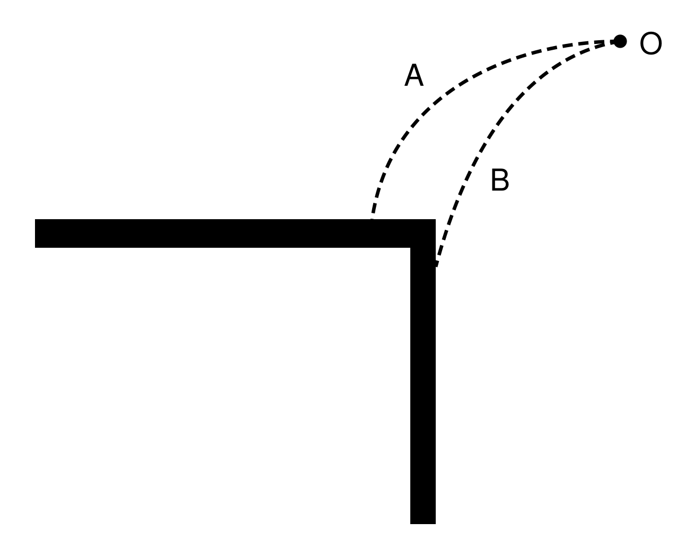
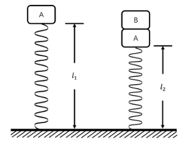
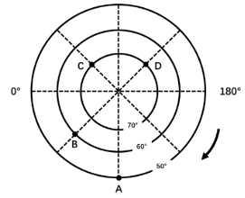

# 第 21 季 · 科学推理

来源：2026下半年省考第二十一季行测模考大赛（广东卷）.pdf

共 5 题，保留原卷题号。分数与数学符号使用 LaTeX；图形使用原图或已标注的矢量重绘图。

## 第 66 题

原卷 PDF 页码：17；题目 ID：`gd-mock-2026h2-s21-q66`

A、B两个物体（可看成质点）均从O点水平抛出，两者做平抛运动的轨迹如下图所示。假设A、B两个物体从抛出到碰到墙壁所用的时间分别为 $t_A$ 、 $t_B$ ，初速度分别为 $v_A$ 、 $v_B$ ，则下列分析正确的是（    ）。

[查看可缩放矢量图 SVG](../assets/s21_p17_i04.svg)

① $t_A > t_B$
② $t_A < t_B$
③ $v_A > v_B$
④ $v_A < v_B$

**A.** ①④

**B.** ②③

**C.** ①③

**D.** ②④

## 第 67 题

原卷 PDF 页码：17, 18；题目 ID：`gd-mock-2026h2-s21-q67`

如图所示，竖直轻弹簧下端与水平地面相连，上端放置一个质量为2m的物块A，物块A静止时，弹簧的长度为 $l_1$ 。再将一个质量为m的物块B放置在物块A上，当两者静止时，弹簧的长度为 $l_2$ 。弹簧始终处于弹性限度内，则弹簧的原长和弹簧的劲度系数分别为（    ）。

**A.** $3l_1-2l_2$ ； $\frac{mg}{l_1-l_2}$

**B.** $3l_2-2l_1$ ； $\frac{mg}{l_1-l_2}$

**C.** $3l_1-2l_2$ ； $\frac{2mg}{l_1-l_2}$

**D.** $3l_2-2l_1$ ； $\frac{2mg}{l_1-l_2}$

## 第 68 题

原卷 PDF 页码：18；题目 ID：`gd-mock-2026h2-s21-q68`

汽车排放的尾气中所含的一氧化碳，在四氧化三钴（ $\mathrm{Co_3O_4}$ ）的催化作用下，于低温条件下便可与氧气发生反应生成二氧化碳。关于上述反应，下列说法正确的是（    ）。
①该反应为化合反应
②该反应为分解反应
③该反应可降低汽车尾气对大气的污染
④该反应前后四氧化三钴（ $\mathrm{Co_3O_4}$ ）的质量保持不变
⑤该反应中四氧化三钴（ $\mathrm{Co_3O_4}$ ）会不断消耗，质量减少

**A.** ①③⑤

**B.** ②③④

**C.** ①③④

**D.** ②③⑤

## 第 69 题

原卷 PDF 页码：18；题目 ID：`gd-mock-2026h2-s21-q69`

下列关于人体免疫、用药与健康的说法，正确的是（    ）。

**A.** 体液中的杀菌物质和吞噬细胞吞噬病菌，属于特异性免疫

**B.** 抗体是侵入人体、能引发免疫反应的外来异物

**C.** 注射青霉素前进行皮试，是为了防止青霉素引发过敏反应

**D.** 带有“RX”标识的药物属于非处方药，可自行购买服用

## 第 70 题

原卷 PDF 页码：18, 19；题目 ID：`gd-mock-2026h2-s21-q70`

根据下图所示的经纬网，说法正确的是（    ）。

①A、B、C、D四个地区全部位于南半球
②A、B、C、D四个地区全部位于中纬度地区
③A、B、C、D四个地区全部位于温带
④A、D两个地区的经纬度分别是（ $50^{\circ}\mathrm{S}$ ， $90^{\circ}\mathrm{W}$ ）、（ $70^{\circ}\mathrm{S}$ ， $135^{\circ}\mathrm{E}$ ）
⑤B、C两个地区的经纬度分别是（ $60^{\circ}\mathrm{S}$ ， $45^{\circ}\mathrm{E}$ ）、（ $70^{\circ}\mathrm{S}$ ， $45^{\circ}\mathrm{W}$ ）
⑥A、B两个地区位于西半球，C、D两个地区位于东半球

**A.** ①③⑤

**B.** ①⑤⑥

**C.** ②④⑥

**D.** ①④⑥
