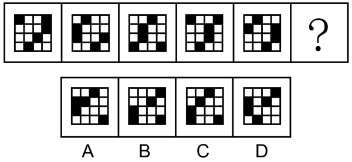
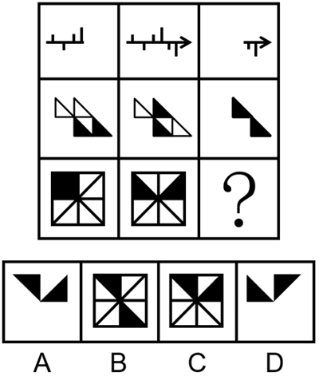
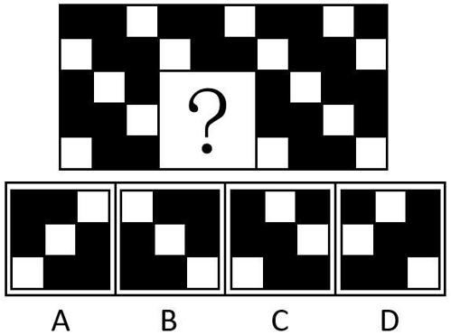
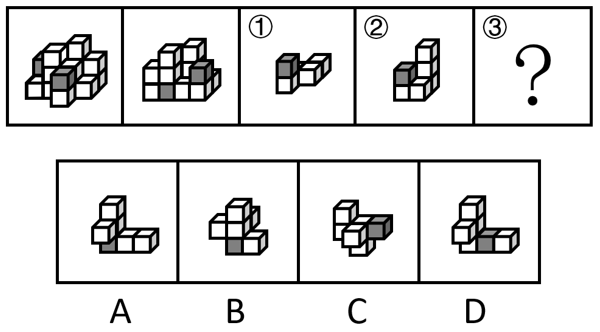

# 第 22 季 · 判断推理

来源：2026下半年省考第二十二季行测模考大赛（广东卷）.pdf

共 20 题，保留原卷题号。分数与数学符号使用 LaTeX；图片路径指向同一资料包内的原图。

## 第 46 题

原卷 PDF 页码：11；题目 ID：`gd-mock-2026h2-s22-q46`

从所给的四个选项中，选择最合适的一个填入问号处，使之呈现一定的规律性：

**A.** 见题图中的 A 选项

**B.** 见题图中的 B 选项

**C.** 见题图中的 C 选项

**D.** 见题图中的 D 选项

## 第 47 题

原卷 PDF 页码：11, 12；题目 ID：`gd-mock-2026h2-s22-q47`

从所给的四个选项中，选择最合适的一个填入问号处，使之呈现一定的规律性：

**A.** 见题图中的 A 选项

**B.** 见题图中的 B 选项

**C.** 见题图中的 C 选项

**D.** 见题图中的 D 选项

## 第 48 题

原卷 PDF 页码：12；题目 ID：`gd-mock-2026h2-s22-q48`

下列选项中最符合所给图形规律的是（    ）。

**A.** 见题图中的 A 选项

**B.** 见题图中的 B 选项

**C.** 见题图中的 C 选项

**D.** 见题图中的 D 选项

## 第 49 题

原卷 PDF 页码：12, 13；题目 ID：`gd-mock-2026h2-s22-q49`

左边为14个白色正方体和3个灰色正方体组合而成多面体的正、反两面直观图，其可以由①、
②和③三个小多面体组合而成，问哪一项能填入问号处？

**A.** 见题图中的 A 选项

**B.** 见题图中的 B 选项

**C.** 见题图中的 C 选项

**D.** 见题图中的 D 选项

## 第 50 题

原卷 PDF 页码：13；题目 ID：`gd-mock-2026h2-s22-q50`

下图为由2个正方体组合而成的长方体，问这2个正方体的外表面展开图可能分别是：

**A.** ②和④

**B.** ②和③

**C.** ①和④

**D.** ①和③

## 第 51 题

原卷 PDF 页码：13；题目 ID：`gd-mock-2026h2-s22-q51`

野外徒步引发的失温事故经常登上新闻，引发大众广泛关注。野外地形复杂、天气多变，气温可能在短时间内急剧下跌。受这类野外低温场景影响，多数人产生一种固有认知：失温只会出现在极寒环境中。但专家表示，这是普遍存在的认知误区。
以下哪项如果为真，最不能加强专家的观点？

**A.** 在温度并不算低的环境中，如果长时间浸泡在水中、衣物潮湿或者身体虚弱、能量消耗过多也可能出现失温

**B.** 失温的本质是身体散热速度超过产热速度，导致核心体温降到 $35^{\circ}\mathrm{C}$ 以下，失温并非只在极寒环境中出现

**C.** 在春秋季节的野外，即便气温未达到寒冷标准，大风、降雨等也会加速热量流失，进而引发失温

**D.** 及时补充高热量食物、做好保暖措施并保持身体干燥，能够显著降低出现失温的风险，保障徒步者的生命安全

## 第 52 题

原卷 PDF 页码：13, 14；题目 ID：`gd-mock-2026h2-s22-q52`

慕尼黑啤酒节的参与者在连续五天、每天饮用约七升啤酒之后，体内GDF15激素水平均有所升高，但无法确定这种生理变化究竟是单纯由大量饮酒所致，还是与其他不健康的生活习惯有关。针对这一现象，某学者为深入探究GDF15激素水平与酒精摄入的关系，对12名丹麦医学生进行了测试，这些学生一次性摄入相当于五份标准饮酒量的酒精，结果显示受试者体内的GDF15激素水平均未出现升高。因此该学者认为，GDF15激素对酒精的反应在长期饮酒后才会显现，而非源于短期的狂饮行为。
以下哪项如果为真，最能削弱上述学者的结论？

**A.** 连续一周每日大量饮酒的年轻人，体内多种应激激素水平均出现上升

**B.** 该实验中一次性摄入的酒精总量远未达到真正意义上的“狂饮”标准

**C.** 酒精进入人体后代谢为乙醛，而乙醛才是刺激GDF15激素分泌的直接物质

**D.** 嗜酒症患者体内的GDF15激素水平与未患此症的成年人相比平均高出约五倍

## 第 53 题

原卷 PDF 页码：14；题目 ID：`gd-mock-2026h2-s22-q53`

蜜蜂发现蜜源后，会在蜂巢内跳8字形“摇摆舞”，学界以往普遍认为，这套行为是固定不变的单向信号，仅由舞者向同伴传递信息，不受“观众”的影响。近期，某研究团队设计对照实验，通过控制蜂巢内“观众”数量与年龄结构，系统观测蜜蜂的“摇摆舞”行为变化。结果显示：当“有效观众”（即能读懂舞蹈蜂所表达的蜜源信息的个体）充足时，蜜蜂的“摇摆舞”角度更精准、摆动时长更稳定，食物方位信息传递误差极小；当“有效观众”稀少时，舞蹈精度会大幅降低，摇摆角度散乱、摆动时长波动明显。该团队认为，蜜蜂的“摇摆舞”是受社会反馈调控的双向互动行为，而非单向刻板信号。要使上述论证成立，还需基于以下哪一前提？

**A.** 蜜蜂不是天生就有通过“摇摆舞”准确编码蜜源信息的能力

**B.** 蜜蜂的“摇摆舞”中所包含的信息，能够被同巢的所有蜜蜂准确接收

**C.** 跳“摇摆舞”的蜜蜂能够区分“有效观众”与“无效观众”

**D.** 蜜蜂是全球最重要的传粉昆虫，维系着生态平衡与农业生产

## 第 54 题

原卷 PDF 页码：14；题目 ID：`gd-mock-2026h2-s22-q54`

大脑是人体最精密的器官，其潜力远未被完全认知。很多人一生都在探索如何让自己更聪慧、思维更敏捷，也坚信我们的大脑“不用则废，常用则强”。大脑皮层是思考、记忆、决策的核心，具备强大的神经可塑性，这有赖于神经元及其连接的动态变化。因此，专家认为学习确实能使大脑皮层得到更充分的发育，这并非错觉，而是生理上的真实改变。
以下哪项如果为真，最能支持上述结论？

**A.** 持续学习就是神经元之间不断建立新连接，同时强化原有通路的过程

**B.** 进行记忆时神经元之间的连接会变牢固，而回忆时会再把连接唤醒

**C.** 人的大脑重量约为1.4千克，其中包含约860亿个神经元

**D.** 即使停止学习，大脑中原本形成的神经元连接也不会立刻消失

## 第 55 题

原卷 PDF 页码：14, 15；题目 ID：`gd-mock-2026h2-s22-q55`

“酱油吃多了，皮肤会变黑”是民间一种流传甚广的说法，许多人对此深信不疑。他们凭借日常饮食体验与直观感受，普遍认为酱油本身呈现出深褐色甚至近黑色的外观，若长期或大量食用，其所含的“黑色”物质会在人体内直接沉积，进而导致皮肤变黑。
以下哪项如果为真，最不能削弱上述观点？

**A.** 皮肤颜色由遗传、环境和生理因素共同决定，与酱油摄入无因果关系

**B.** 酱油里的“黑色”是焦糖色素，与皮肤中的黑色素在来源和结构上都不相似

**C.** 酱油中的酪氨酸是黑色素合成所必需的氨基酸，但酪氨酸会被胃酸分解掉

**D.** 目前来说，每天坚持涂防晒霜，是预防皮肤变黑最有效的方式

## 第 56 题

原卷 PDF 页码：15；题目 ID：`gd-mock-2026h2-s22-q56`

某商店计划举办一场有奖竞赛活动，旨在吸引更多新顾客。该商店准备从A、B、C、D、E、F六种不同的商品中选出四种作为活动奖品，已知：
（1）如果选择A，则不选择B；
（2）C、E的被选择情况相同。
根据上述信息，共有多少种选择情况？

**A.** 2

**B.** 3

**C.** 4

**D.** 5

## 第 57 题

原卷 PDF 页码：15；题目 ID：`gd-mock-2026h2-s22-q57`

地衣是地衣型真菌和藻类或蓝细菌共生形成的群落，是自然界中共生关系的典型代表。地衣产生的地衣酸能螯合岩石当中的钙，使岩石慢慢风化成土壤，这是地球原始土壤形成的原因之一。根据形态，地衣可以分为三大类：叶状地衣、枝状地衣及壳状地衣。叶状地衣的地衣体呈叶片状平展，如肺衣、地卷；枝状地衣常呈灌木状，如石蕊、金丝刷、松萝；叶状和枝状地衣通常和其生长的基物结合疏松，而壳状地衣紧贴基物，直径通常只有几厘米。地衣对大气污染非常敏感，它经常出现的地方，都是空气比较好的地方。所以，地衣可以作为空气质量好坏的指示生物。
由此可以推出：

**A.** 在空气质量差的地方一定不会有地衣存在

**B.** 地衣在地球原始土壤形成过程中发挥了一定作用

**C.** 地衣由真菌、藻类和蓝细菌三者共生形成

**D.** 壳状地衣因紧贴基物，所以直径通常不足几厘米

## 第 58 题

原卷 PDF 页码：15, 16；题目 ID：`gd-mock-2026h2-s22-q58`

某研究团队以自然界中的线虫为灵感，创新性地制备出了直径为1毫米的血凝胶纤维机器人。为验证血凝胶纤维机器人在颅内肿瘤靶向治疗中的可行性与疗效，研究人员在18头小型猪中构建了脑胶质瘤模型，并将其分为三组：空白对照组、假手术组（植入未载药血凝胶纤维机器人）和治疗组（载阿霉素血凝胶纤维机器人）。研究人员发现，术后26天，治疗组的猪肿瘤生长受到抑制，比空白对照组肿瘤小了4倍，而且治疗组的活猪血细胞数量和生物化学标志物水平均保持在正常水平，波动较小。据此，研究人员认为，血凝胶纤维机器人是实现颅内深部及功能区邻近肿瘤的精准、无创治疗的有效手段。
以下哪项如果为真，最能加强研究人员的观点？

**A.** 通过模仿线虫的细长形态和自适应的波浪运动机制，研究人员利用外界控制使血凝胶纤维机器人实现了包括摆动、爬行和滚动在内的多种仿生运动模式

**B.** 治疗组的小型猪在实验前的平均体重显著低于空白对照组和假手术组，而体重较小的动物的肿瘤生长速度通常较慢，各种生物指标的波动幅度也低于大体重动物

**C.** 大脑具有高度复杂的结构，布满密集且不规则的脑沟回、脆弱的神经组织，血凝胶纤维机器人要想实现颅内远程靶向药物递送需要沿着路线穿越多级沟壑

**D.** 血凝胶纤维机器人保留了血液中天然纤维蛋白的网络结构，具有良好的生物相容性，可有效避免免疫排斥反应，且具有显著的弹性和柔软性，不会划伤周围组织

## 第 59 题

原卷 PDF 页码：16；题目 ID：`gd-mock-2026h2-s22-q59`

2026年中考体育已圆满收官，但不难发现，北京市中考体育正在经历历史性变革，总分由50分逐步增加至70分，其中过程性考核的比重不断上升，由此，有人认为，中考体育改革后北京市中学生的体质健康水平将会明显提升。要使上述推理成立，需要补充的前提条件是（    ）。

**A.** 我国学生体质健康达标率逐渐上升，学生的力量、耐力等素质出现好转

**B.** 过程性考核比重的上升会促使学生加强体育锻炼，提高体质健康水平

**C.** 中学生的家长们普遍支持提高过程性考核在中考体育中的比重

**D.** 学校的体育设施和师资配备能够完全满足学生们日常锻炼的需求

## 第 60 题

原卷 PDF 页码：16；题目 ID：`gd-mock-2026h2-s22-q60`

小王每周去三次游泳馆和两次健身房，已知小王的习惯如下：
（1）小王不会在同一天游泳和跑步；
（2）小王不会连续两天做同一种运动；
（3）小王周末只运动一天；
（4）游泳馆每周一闭馆消毒。小王这周五安排了聚会，不能跑步。关于小王这周的运动情况，以下哪项一定为真？

**A.** 小王可能在周日跑步

**B.** 小王一定在周一跑步

**C.** 小王只能在周四、周五和周日游泳

**D.** 若小王在周二跑步，则在周四也跑步

## 第 61 题

原卷 PDF 页码：16；题目 ID：`gd-mock-2026h2-s22-q61`

一项观察实验选取了30名19岁到25岁的年轻人，给他们频繁吃巧克力，且这些人一个月后都出现不同程度的面部痤疮。因此，频繁吃巧克力会出现面部痤疮。下列选项的论证结构与题干最为相似的是（    ）。

**A.** 夏季空调使用率高，同时腹泻的人数也增加，因此，使用空调是腹泻的诱因

**B.** 吃大量辣椒会导致胃痛，因此，胃痛的人应该避免吃大量辣椒

**C.** 长期熬夜往往发生在免疫力降低之前，因此，长期熬夜会导致免疫力降低

**D.** 许多感冒患者都喝了姜汤，因此，喝姜汤是治疗感冒的有效手段

## 第 62 题

原卷 PDF 页码：16, 17；题目 ID：`gd-mock-2026h2-s22-q62`

2025年的深秋，一枚曾估价2.8万元的“北洋造光绪34年银圆卷3旗4”钱币被藏友带进了潘家园古玩市场，在来之前藏友自行对其进行了清洗，他向大家展示着古钱币表面那层被化学试剂冲刷的“新亮”，想要卖个好价钱，然而，该古钱币的价格因为藏友的清洗骤降至1.8万元。
以下各项如果为真，最不能解释这一现象的是（    ）。

**A.** 古钱币的包浆往往含有铜锈、土壤微生物代谢物、人体油脂等复合层，化学清洗会溶解这层复合结构，使古钱币失去“历史指纹”

**B.** 化学清洗可能将稳定的碱式碳酸铜转化为活动性强的氯化亚铜，使古钱币在潮湿环境中生成“粉状锈”，这些“粉状锈”会在三年内穿透钱体

**C.** 化学清洗往往会使古钱币字口深度减少0.1-0.3毫米，导致关键笔画模糊，古钱币文字细节的消失直接摧毁了其版别的稀缺性

**D.** 古钱币做旧技术再升级，从电化学包浆到分子级氧化，“伪装术”正颠覆传统鉴定方式，使得老玩家都难辨真假

## 第 63 题

原卷 PDF 页码：17；题目 ID：`gd-mock-2026h2-s22-q63`

2025年5月某网约车平台调整部分城市订单计价规则，有乘客反映“一口价”订单价格普遍上涨1至3元，但该月平台的“一口价”订单成交量不但没有因此减少，反而出现增加趋势。
以下各项如果为真，最能解释这一现象的是（    ）。

**A.** 价格调整后司机拒载率下降、服务变得更好，消费者愿为此买单

**B.** 该平台网约车的运力大幅增加，司机数量的增加使订单成交量上升

**C.** 该平台加大了对新用户的补贴力度，新用户实际出行成本未变化

**D.** 低价的“一口价”订单使司机端收入常因堵车、绕路、空驶而缩水

## 第 64 题

原卷 PDF 页码：17；题目 ID：`gd-mock-2026h2-s22-q64`

坚持吃早餐的人专注力都很高。某人十多年来坚持吃早餐，因此，他的专注力会很高。下列选项的逻辑结构与题干最为相似的是（    ）。

**A.** 水资源丰富的地区农业生产条件优越。某地是水资源丰富的地区，因此，该地的工业生产条件同农业生产条件一样优越

**B.** 过度使用化肥就会使土壤板结。某地严格按照标准控制化肥的使用，因此，该地不会出现土壤板结的情况

**C.** 动脉粥样硬化斑块会导致血管狭窄、弹性降低。某人的血管狭窄、弹性降低，因此，他一定有动脉粥样硬化斑块

**D.** 热效应高的食物在消化过程中会消耗更多能量。某食物是热效应高的食物，因此，该食物在消化过程中会消耗更多能量

## 第 65 题

原卷 PDF 页码：17；题目 ID：`gd-mock-2026h2-s22-q65`

一段时间以来，网络水军有组织地刷分控评、刷量增粉、刷榜拉票、刷单炒信，严重危害网络生态，2024年以来，网信部门持续加大对网络水军的打击力度，对网络水军组织招募、推广引流、刷量控评等行为进行了严厉查处。因此，网民被虚假评论误导的情况会大幅减少。要使上述推理成立，需要补充的前提条件是（    ）。

**A.** 所有网民都能准确识别真实评论与“水军”评论

**B.** 对网络水军加大打击力度能够遏制虚假评论的产生

**C.** 相关方的利益链条未被斩断，滋生网络水军的土壤依然存在

**D.** 平台方要压紧压实主体责任，防范遏制网络水军操纵信息内容
