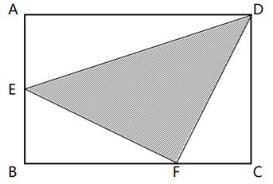

# 第 22 季 · 数量关系

来源：2026下半年省考第二十二季行测模考大赛（广东卷）.pdf

共 15 题，保留原卷题号。分数与数学符号使用 LaTeX；图片路径指向同一资料包内的原图。

## 第 31 题

原卷 PDF 页码：9；题目 ID：`gd-mock-2026h2-s22-q31`

$\frac{4}{3}$ ， $\frac{1}{2}$ ， $\frac{1}{2}$ ， $\frac{7}{10}$ ， $\frac{7}{9}$ ，（    ）

**A.** $\frac{2}{3}$

**B.** $\frac{13}{18}$

**C.** $\frac{2}{7}$

**D.** $\frac{14}{17}$

## 第 32 题

原卷 PDF 页码：9；题目 ID：`gd-mock-2026h2-s22-q32`

26，61，102，151，209，277，（    ）

**A.** 357

**B.** 359

**C.** 361

**D.** 363

## 第 33 题

原卷 PDF 页码：9；题目 ID：`gd-mock-2026h2-s22-q33`

28，16，30，38，53，（    ）

**A.** 57

**B.** 61

**C.** 65

**D.** 72

## 第 34 题

原卷 PDF 页码：9；题目 ID：`gd-mock-2026h2-s22-q34`

51，13，2，0，1，3，（    ）

**A.** $\frac{16}{3}$

**B.** 5

**C.** $\frac{17}{2}$

**D.** 8

## 第 35 题

原卷 PDF 页码：9；题目 ID：`gd-mock-2026h2-s22-q35`

**题目数表**

| 第1列 | 第2列 | 第3列 |
| --- | --- | --- |
| 2 | 2 | 5 |
| 3 | 5 | 19 |
| 4 | 7 | 37 |
| 5 | 11 | ？ |

四行三列，保持原图行列位置；列名为转写时添加。

**A.** 46

**B.** 55

**C.** 71

**D.** 83

## 第 36 题

原卷 PDF 页码：10；题目 ID：`gd-mock-2026h2-s22-q36`

某公司的甲、乙两个部门共计120人。甲部门中男生占比为30%，乙部门中男女生人数相同。若将乙部门的10名男生调往甲部门，则两个部门的男生人数相同。问乙部门原来一共有多少人？

**A.** 50

**B.** 60

**C.** 70

**D.** 80

## 第 37 题

原卷 PDF 页码：10；题目 ID：`gd-mock-2026h2-s22-q37`

一项工程，开始由甲、乙两队合作5天完成了总工程量的 $\frac{1}{3}$ ，然后乙队因事退出，丙队加入，最终完成该项工程共用了13天。若乙、丙两队合作6天可完成总工程量的60%，则甲、乙、丙三队合作完成该项工程需要多少天？

**A.** 8

**B.** 7

**C.** 6

**D.** 5

## 第 38 题

原卷 PDF 页码：10；题目 ID：`gd-mock-2026h2-s22-q38`

甲车从A地出发前往B地，到达B地后立即返回。甲车出发30分钟后，乙车也从A地出发前往B地，又过了30分钟两车在C地相遇，且B、C两地相距20千米。若甲车的速度比乙车快30%，那么A、B两地相距多少千米？

**A.** 30

**B.** 35

**C.** 40

**D.** 45

## 第 39 题

原卷 PDF 页码：10；题目 ID：`gd-mock-2026h2-s22-q39`

已知今年小红十多岁，5年后她的年龄与小明2年后的年龄相同。若4年后，小红年龄的2倍与小明年龄之和是一个平方数的三分之一，则今年小明的年龄为多少岁？

**A.** 15

**B.** 14

**C.** 13

**D.** 12

## 第 40 题

原卷 PDF 页码：10；题目 ID：`gd-mock-2026h2-s22-q40`

一项工程甲队单独完成需要20天。在甲队开工5天后，乙队加入，计划该工程能够提前5天完工。实际在该工程完成 $\frac{2}{5}$ 时，乙队由于有其他安排退出，丙队加入，最后该工程仅能提前3天完工。则乙队和丙队的效率之比为：

**A.** 5：2

**B.** 5：3

**C.** 2：1

**D.** 3：1

## 第 41 题

原卷 PDF 页码：10；题目 ID：`gd-mock-2026h2-s22-q41`

1月某商家以50%的利润率销售一批水杯，2月水杯的售价比上月降低了20%，但销量比上月多了16个。经统计，该商家1月和2月水杯的销售额均为960元，则该商家这两个月销售水杯获得的总利润为多少元？

**A.** 420

**B.** 460

**C.** 480

**D.** 500

## 第 42 题

原卷 PDF 页码：10；题目 ID：`gd-mock-2026h2-s22-q42`

一个圆台形状的玻璃杯，杯口直径为8cm，底面直径为6cm，高为10cm。若想用该玻璃杯装满水去灌满一个直径为20cm，高为18.5cm的圆柱形水桶，最少需要多少杯水？（玻璃杯及水桶的厚度忽略不计）

**A.** 14

**B.** 15

**C.** 16

**D.** 17

## 第 43 题

原卷 PDF 页码：10；题目 ID：`gd-mock-2026h2-s22-q43`

某研究院科研小组6名成员的年龄分别为24岁、26岁、29岁、32岁、34岁、36岁，现从这6人中选出3人依次进行汇报，每人负责1个不同课题。汇报完毕后，发现这3人的平均年龄超过了28岁，且任意2人的年龄差不超过10岁，问有多少种汇报情况？

**A.** 70

**B.** 74

**C.** 76

**D.** 78

## 第 44 题

原卷 PDF 页码：11；题目 ID：`gd-mock-2026h2-s22-q44`

某种植户计划在一块矩形菜地的四周和对角线上架设木桩，先在4个顶点各架设1根，再从顶点开始每隔相同距离架设1根。如果矩形相邻两边（包含顶点）分别架设7根和9根木桩，则该菜地一共架设了多少根木桩？

**A.** 45

**B.** 46

**C.** 47

**D.** 48

## 第 45 题

原卷 PDF 页码：11；题目 ID：`gd-mock-2026h2-s22-q45`

如下图所示，长方形ABCD的面积为 $36\mathrm{cm}^2$ ，点E为AB的中点。若三角形BEF的面积为 $5\mathrm{cm}^2$ ，则阴影部分的面积为：

**A.** $15\mathrm{cm}^2$

**B.** $14\mathrm{cm}^2$

**C.** $13\mathrm{cm}^2$

**D.** $12\mathrm{cm}^2$
