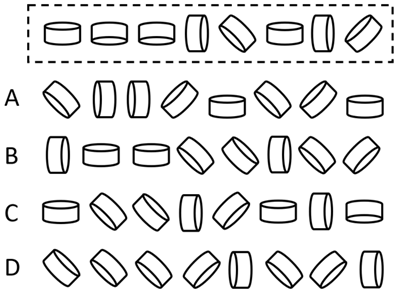
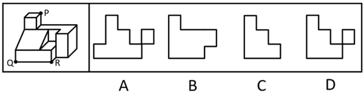
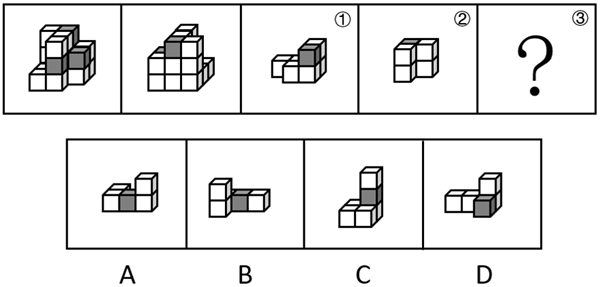

# 第 23 季 · 判断推理

来源：2026下半年省考第二十三季行测模考大赛（广东卷）.pdf

共 20 题，保留原卷题号。分数与数学符号使用 LaTeX；图片路径指向同一资料包内的原图。

## 第 46 题

原卷 PDF 页码：11, 12；题目 ID：`gd-mock-2026h2-s23-q46`

从所给的四个选项中，选择最合适的一个填入问号处，使之呈现一定的规律性：

**A.** 见题图中的 A 选项

**B.** 见题图中的 B 选项

**C.** 见题图中的 C 选项

**D.** 见题图中的 D 选项

## 第 47 题

原卷 PDF 页码：12；题目 ID：`gd-mock-2026h2-s23-q47`

从所给的四个选项中，选择最合适的一个填入问号处，使之呈现一定的规律性：

**A.** 见题图中的 A 选项

**B.** 见题图中的 B 选项

**C.** 见题图中的 C 选项

**D.** 见题图中的 D 选项

## 第 48 题

原卷 PDF 页码：12, 13；题目 ID：`gd-mock-2026h2-s23-q48`

下列选项与框内字符串规律最接近的是：

**A.** 见题图中的 A 选项

**B.** 见题图中的 B 选项

**C.** 见题图中的 C 选项

**D.** 见题图中的 D 选项

## 第 49 题

原卷 PDF 页码：13；题目 ID：`gd-mock-2026h2-s23-q49`

左边为给定的多面体，现用经P、Q、R三点的平面对其进行切割，切面为：

**A.** 见题图中的 A 选项

**B.** 见题图中的 B 选项

**C.** 见题图中的 C 选项

**D.** 见题图中的 D 选项

## 第 50 题

原卷 PDF 页码：13；题目 ID：`gd-mock-2026h2-s23-q50`

左边为15个白色正方体和3个灰色正方体组合而成多面体的正、反两面直观图，其可以由①、
②和③三个小多面体组合而成，问哪一项能填入问号处？

**A.** 见题图中的 A 选项

**B.** 见题图中的 B 选项

**C.** 见题图中的 C 选项

**D.** 见题图中的 D 选项

## 第 51 题

原卷 PDF 页码：13；题目 ID：`gd-mock-2026h2-s23-q51`

在运动训练领域中，高原训练一直蒙着一层神秘面纱，散发着独特的魅力，许多世界级运动员都对高原训练青睐有加。研究者认为，高原训练之所以能提升运动员的耐力表现，根本原因在于低氧环境刺激肾脏分泌促红细胞生成素（EPO），进而促进骨髓制造更多红细胞，增加血液携氧能力。
以下哪项如果为真，最不能支持上述结论？

**A.** 在高原训练期间，运动员血液中EPO浓度与红细胞数量有明显的相关性，且EPO峰值出现于红细胞数量上升之前

**B.** 研究表明，人体血液携氧能力与肌肉持续做功时的有氧代谢效率呈显著正相关，而后者是决定耐力表现的关键生理指标

**C.** 抑制EPO受体的实验动物在低氧环境中停留四周后，骨髓红细胞生成量未出现明显上升，血液携氧能力也无显著变化

**D.** 对高原训练后的运动员进行自体输血，额外增加红细胞数量并未使其运动成绩进一步提升

## 第 52 题

原卷 PDF 页码：13, 14；题目 ID：`gd-mock-2026h2-s23-q52`

建设社会主义现代化强国，关键在于科技自立自强。不断强化科技创新和产业创新深度融合，才能抓住发展的机遇。这激励我们要发挥好自身优势，把科技创新这篇文章做好。同时我们也要发挥制造业和服务业协同发展的特长，抓好战略性新兴产业、未来产业等，统筹教育科技人才一体发展，尤其做好人才服务工作。
由此可以推出：

**A.** 中国的科技创新和产业创新深度融合离不开自身优势的发挥

**B.** 只要我们发挥好自身优势，就能把科技创新这篇文章做好

**C.** 建设社会主义现代化强国将无法实现，除非科技自立自强

**D.** 我们要抓住发展的机遇，否则无法不断强化科技创新和产业创新深度融合

## 第 53 题

原卷 PDF 页码：14；题目 ID：`gd-mock-2026h2-s23-q53`

某博物馆计划引入一批AI导览机器人，以缓解节假日人工讲解员人数不足的问题。调研发现，参观者对机器人讲解内容的满意度高低与机器人讲解语速是否可调节显著相关。因此，博物馆方认为，只要这批机器人具备语速调节功能，就能有效提升参观者的整体满意度。要使上述结论成立，需要补充的前提是：

**A.** 当前博物馆人工讲解员的最大短板是讲解语速无法满足不同年龄段参观者的需求

**B.** 参观者对讲解服务的满意度是决定其是否会向他人推荐博物馆的关键因素

**C.** 该批AI导览机器人除具备语速调节功能外，还具备路线规划、语音问答等功能

**D.** 参观者对讲解内容的满意度是整体满意度最核心的构成部分

## 第 54 题

原卷 PDF 页码：14；题目 ID：`gd-mock-2026h2-s23-q54`

某街道计划完善社区服务，从养老服务、少儿托管、健身指导、图书角四个项目中选择一些项目开设。街道居民预测如下：
（1）甲：只有开设图书角，才能开设少儿托管；
（2）乙：如果开设健身指导，就开设养老服务；
（3）丙：养老服务、少儿托管、图书角至多开设一个；
（4）丁：开设少儿托管，但不开设图书角。结果发现只有1位居民的预测正确，由此可以推出：

**A.** 开设图书角，不开设少儿托管

**B.** 开设养老服务，不开设健身指导

**C.** 少儿托管和健身指导都开设

**D.** 养老服务和图书角都不开设

## 第 55 题

原卷 PDF 页码：14；题目 ID：`gd-mock-2026h2-s23-q55`

最近几年，冷疗成为了一种新兴的生活方式。明星走进液氮舱，几分钟后出来时神清气爽；运动员赛后泡进冰水桶，宣称第二天肌肉就不酸了；甚至普通人也开始在冬天主动冲冷水澡、参加冬泳，试图借助冷对抗压力、疲惫和情绪低谷。由此可见，冷疗法对人体有益。
以下能够削弱上述结论的有几项？
①冷刺激通过血管收缩、炎症因子下降和神经传导减慢等作用，能够大幅度降低疼痛感受
②冷疗并不意味着不影响长期功能，频繁使用强冷刺激会干扰肌肉对大脑指令的执行能力
③冬泳时冷水突然刺激可同时激活交感与副交感神经，在特定人群中很可能诱发心律失常
④与冷疗相关的体验场馆大多分布于城市商圈，其日常运营模式与普通健身场馆差异较大

**A.** 1

**B.** 2

**C.** 3

**D.** 4

## 第 56 题

原卷 PDF 页码：15；题目 ID：`gd-mock-2026h2-s23-q56`

某国外企业发布2026财年第四季度及全年业绩报告。报告显示，其第四季度营收达681亿美元，创历史新高；全年营收达2159亿美元，同比增长65%；作为AI核心引擎的数据中心业务收入更是同比大增68%，全球业绩表现十分亮眼。但与之形成鲜明对比的是，该公司在中国的业务营收却出现明显下滑。下列选项如果为真，最能解释上述现象的是：

**A.** 中国监管部门对该公司销售的算法芯片进行例行抽检，结果显示所有产品均符合国家安全标准

**B.** 该公司作为行业领头羊的压力越来越大，在超过华尔街预期的同时还要面临更严苛的市场环境

**C.** 该公司用超过普遍预期的表现证明，AI并不只是PPT里的远景，而是实打实的基础建设

**D.** 2026年中国本土企业凭借成本控制能力与差异化竞争，抢占了该公司在中国市场的主要份额

## 第 57 题

原卷 PDF 页码：15；题目 ID：`gd-mock-2026h2-s23-q57`

通常我们把电磁波对物体的作用叫作辐射，辐射又分为电磁辐射（光、微波、Wi-Fi信号等）和电离辐射（X射线、 $\gamma$ 射线等）。有人认为，作为Wi-Fi信号的发射源，家用路由器会产生有害辐射，从而影响人的身体健康。
以下哪项如果为真，最能削弱上述观点？

**A.** 路由器产生的辐射属于电磁辐射范畴，它与X射线、 $\gamma$ 射线等电离辐射有本质区别

**B.** 在辐射强度上，微波炉是Wi-Fi信号的10万倍左右，其辐射产生的影响要远大于Wi-Fi信号辐射

**C.** 建议将路由器放置在人经常活动区域2米外，且要避免所有设备集中连接同一个路由器

**D.** 家用路由器产生的辐射远低于国家标准规定的最高限值，且辐射强度随距离的增加逐渐减弱

## 第 58 题

原卷 PDF 页码：15；题目 ID：`gd-mock-2026h2-s23-q58`

学校组织知识竞赛，小红、小黑、小白、小黄均进入决赛，决赛为十道单选题。选择正确得1分，选择错误不得分也不扣分。四人答案如下：

**作答情况**

| 姓名 | 1 | 2 | 3 | 4 | 5 | 6 | 7 | 8 | 9 | 10 |
| --- | --- | --- | --- | --- | --- | --- | --- | --- | --- | --- |
| 小红 | B | B | C | A | B | B | C | B | B | B |
| 小黑 | C | C | B | B | C | A | B | A | A | C |
| 小白 | B | A | C | C | A | C | A | B | C | A |
| 小黄 | B | C | C | A | C | C | B | B | A | C |

比赛结束后，四人得分依次为4分、5分、1分、4分，根据以上信息可以推断，这些题目的正确答案是：

**A.** CACACACBAB

**B.** ABBCBCCABC

**C.** ABCBCBCAAC

**D.** BACACABCBB

## 第 59 题

原卷 PDF 页码：15, 16；题目 ID：`gd-mock-2026h2-s23-q59`

过去，部分景区商户出现“阴阳菜单”、天价餐饮、强迫购物等宰客行为。最近，某市全面推行“旅游诚信码”——游客扫码即可查看商户信用分。因此，该市景区宰客现象将显著减少。要使上述推理成立，需要补充的前提条件是（    ）。

**A.** 所有景区商户都已经进入了“旅游诚信码”系统

**B.** “旅游诚信码”能够有效约束商户的宰客行为

**C.** 游客在消费前愿意主动扫码查看商户信用分

**D.** 旅游市场主体对实施“旅游诚信码”机制普遍持欢迎态度

## 第 60 题

原卷 PDF 页码：16；题目 ID：`gd-mock-2026h2-s23-q60`

某市政府高度重视工业发展，在2023年、2024年、2025年和2026年这四年，引进了甲、乙、丙、丁四家优质企业，四家企业主营业务包括电子科技、机械设备、装饰材料、生物制药。每年引进一家企业，每家企业只有一个主营业务，引进企业的具体情况如下：
（1）2025年引进的企业主营生物制药业务，2026年引进的企业主营装饰材料业务；
（2）丁企业的主营业务要么是电子科技，要么是机械设备；
（3）甲、乙企业的引进时间都不是2025年；
（4）乙、丙企业的引进时间间隔1年。
根据上述信息，可以推出以下哪项？

**A.** 甲企业的引进时间最早

**B.** 丁企业的引进时间是2023年

**C.** 甲企业的主营业务是装饰材料

**D.** 2024年引进的企业主营机械设备业务

## 第 61 题

原卷 PDF 页码：16；题目 ID：`gd-mock-2026h2-s23-q61`

只要存在严重失信行为，就会被记入科研诚信严重失信行为数据库。某研究者的行为被记入了科研诚信严重失信行为数据库，因此该研究者存在严重失信行为。
以下选项存在的逻辑错误与题干最为相似的是（    ）。

**A.** 所有的安全生产许可证到期后都必须重新申请。某企业不需要重新申请安全生产许可证，因此该企业的安全生产许可证没有到期

**B.** 引用他人核心观点却不标注出处属于学术不端行为。某作者引用他人核心观点却不标注出处，因此该作者存在学术不端行为

**C.** 只有查验并留存有关动物检疫合格证明等文件，才能贮存肉类冻品。某企业贮存肉类冻品，因此该企业查验并留存了相关证明文件

**D.** 若从事食用农产品批发业务，就应当建立销售记录管理制度。某企业建立了销售记录管理制度，因此该企业从事的是食用农产品批发业务

## 第 62 题

原卷 PDF 页码：16, 17；题目 ID：`gd-mock-2026h2-s23-q62`

2024年享誉全球的“最美书店”在北京的首店对外营业，作为一家网红书店，其开业之初几乎人满为患，前去拍照打卡的顾客需要在小程序上预约，凭预约码方可入店。然而，热度只维持了不到一个月，该店客流量明显减少，与开业初期相比可谓是天壤之别。
以下各项如果为真，最能解释这一现象的是（    ）。

**A.** 实体书店的生存空间越来越逼仄，全国近一半的实体书店都在亏本

**B.** 实体书店的商业模式几乎都是“书店+咖啡店+文创+活动讲座”，缺乏新意

**C.** 网红书店开业初期的火爆源于打卡热潮的驱动，热潮退去后客流量自然大幅回落

**D.** 同年在北京新开业了一家被誉为“京城文化坐标”之一的人文学术类书店

## 第 63 题

原卷 PDF 页码：17；题目 ID：`gd-mock-2026h2-s23-q63`

稳住了企业，就业才有支撑，民生才有依托。只有“稳企业”政策落地显效，小微企业才能有余力为开拓新市场做规划。除非小微企业有余力为开拓新市场做规划，否则市场经济不能更好地运行下去。
由此可以推出（    ）。

**A.** “稳企业”政策落地显效是市场经济更好地运行下去的前提

**B.** 如果稳住了企业，那么说明就业有了支撑或民生有了依托

**C.** 只有小微企业有余力为开拓新市场做规划，“稳企业”政策才能落地显效

**D.** 若民生没有依托，那么说明目前的就业没有支撑

## 第 64 题

原卷 PDF 页码：17；题目 ID：`gd-mock-2026h2-s23-q64`

上班族合理规划休息时间，能缓解久坐疲劳、提升工作效率；学生合理规划休息时间，能恢复精力、保障学习质量。所以，合理规划休息时间对各类人群来说都十分重要。
以下选项的逻辑结构与题干最为相似的是（    ）。

**A.** 学生多读书可以提升专注力、深化对文字的理解，学生多实践可以把抽象的理论知识逐渐转化为认识和解决实际问题的能力。因此，学生既要多读书又要多实践

**B.** 无论东部、西部还是中部城市都在推行低碳出行。所以，低碳出行是城市发展的必然趋势

**C.** 创作者深耕传统文化，能丰富创作素材、提升作品底蕴；普通大众深耕传统文化，能陶冶情操、提升文化水平。所以，深耕传统文化对各类人群来说都十分重要

**D.** 生态保护要兼顾城市与乡村，解决突出的生态环境问题、加强生态系统保护和修复。因此，生态保护对全民来说都十分重要

## 第 65 题

原卷 PDF 页码：17；题目 ID：`gd-mock-2026h2-s23-q65`

在不同的季节，大风天气形成的条件也不一样。冬季在冷空气的作用下，往往会发生寒潮大风天气，这会对温室大棚设施造成不同程度的损坏，会破坏薄膜，严重时还会将棚体掀翻，使得大棚内作物遭遇冻害或者机械损害，甚至还会导致作物绝收。有学者据此指出，寒潮大风天气对我国东北地区的经济影响极大。上述论证的成立须补充以下哪项作为前提？

**A.** 寒潮大风天气时牧民不能正常放牧，放牧时间相对缩短，牛羊吃不饱导致抵抗力下降，影响膘情，进而影响其产量和质量

**B.** 东北种植户收到气象部门的大风预警信号后，应及时固定好棚膜风口，压紧薄膜，检查、修补好损坏的棚膜，同时要注意加固棚体

**C.** 寒潮大风天气影响区域广、灾情重，特别是在全球气候变暖的形势下，大风灾害出现频率越来越高，所产生的经济损失也越发严重

**D.** 随着东北地区种植业结构调整，冬季的温室大棚种植面积增加，温室大棚种植收入已成为当地农民增收的主要经济来源
