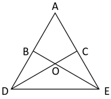
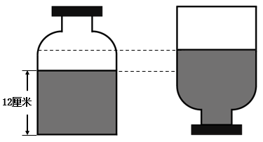

# 第 23 季 · 数量关系

来源：2026下半年省考第二十三季行测模考大赛（广东卷）.pdf

共 15 题，保留原卷题号。分数与数学符号使用 LaTeX；图片路径指向同一资料包内的原图。

## 第 31 题

原卷 PDF 页码：9；题目 ID：`gd-mock-2026h2-s23-q31`

-3，4，0，9，7，（    ）

**A.** 10

**B.** 14

**C.** 18

**D.** 22

## 第 32 题

原卷 PDF 页码：9；题目 ID：`gd-mock-2026h2-s23-q32`

2.04，5.12，11.36，20.108，（    ）

**A.** 32.324

**B.** 32.216

**C.** 47.324

**D.** 47.216

## 第 33 题

原卷 PDF 页码：9；题目 ID：`gd-mock-2026h2-s23-q33`

$\frac{16}{3}$ ，8，4，6，3， $\frac{9}{2}$ ，（    ）

**A.** 16

**B.** 12

**C.** $\frac{15}{4}$

**D.** $\frac{9}{4}$

## 第 34 题

原卷 PDF 页码：9；题目 ID：`gd-mock-2026h2-s23-q34`

$\frac{1}{20}$ ， $\frac{2}{15}$ ， $\frac{1}{4}$ ， $\frac{13}{30}$ ，（    ）

**A.** $\frac{9}{10}$

**B.** $\frac{3}{10}$

**C.** $\frac{11}{30}$

**D.** $\frac{19}{60}$

## 第 35 题

原卷 PDF 页码：9；题目 ID：`gd-mock-2026h2-s23-q35`

**四个圆内的数字**

| 圆（自左向右） | 左上 | 右上 | 左下 | 右下 |
| --- | --- | --- | --- | --- |
| 1 | 2 | 6 | 10 | 8 |
| 2 | 5 | 11 | 4 | 3 |
| 3 | 7 | 17 | 11 | 4 |
| 4 | ？ | 9 | 18 | 3 |

每个圆用一条竖直直径和一条水平直径分为四个区域。

**A.** 9

**B.** 8

**C.** 7

**D.** 6

## 第 36 题

原卷 PDF 页码：10；题目 ID：`gd-mock-2026h2-s23-q36`

某小区为业主代缴物业费，全部业主可按原价打9折缴费，每户还可享受固定金额的物业补贴。该小区某单元有40户业主，每户物业费原价均为1200元。该单元物业费实际共缴纳41000元，问每户可享受多少元的物业补贴？

**A.** 50

**B.** 55

**C.** 60

**D.** 65

## 第 37 题

原卷 PDF 页码：10；题目 ID：`gd-mock-2026h2-s23-q37`

某公司今年录取的员工人数是去年的 $\frac{3}{4}$ 。其中，录取的男员工比去年少30人，比去年录取的女员工多12人，比今年录取的女员工多5人。问这两年共录取女员工多少人？

**A.** 32

**B.** 57

**C.** 69

**D.** 92

## 第 38 题

原卷 PDF 页码：10；题目 ID：`gd-mock-2026h2-s23-q38`

已知 $\triangle ADE$ 为等边三角形，点B、点C分别为AD、AE的中点，连接BE、CD交于点O。现需将四边形ABOC区域涂成黄色，剩余区域涂成蓝色，问黄色区域与蓝色区域的面积之比为：

**A.** 1：2

**B.** 2：3

**C.** 2：5

**D.** 3：4

## 第 39 题

原卷 PDF 页码：10；题目 ID：`gd-mock-2026h2-s23-q39`

某服装店有两款衣服，一款是当季新品，每件售价260元，卖出一件可以盈利30%；另一款是反季促销品，卖出一件将会亏损25%。当卖出一件当季新品和一件反季促销品时，刚好不赚不赔，此时该服装店收入多少元？

**A.** 360

**B.** 380

**C.** 440

**D.** 500

## 第 40 题

原卷 PDF 页码：10；题目 ID：`gd-mock-2026h2-s23-q40`

某食品加工厂采用机器包装和人工包装两种方式封装产品，机器与工人数量之比为2：3。一台机器包装1份产品需40秒，一个工人包装1份产品需90秒。该工厂每天工作时长为10小时，全天共包装了9000份产品，且机器与工人均满负荷运行，问当日机器包装的产品数量比人工包装的多多少份？

**A.** 1200

**B.** 1500

**C.** 1600

**D.** 1800

## 第 41 题

原卷 PDF 页码：10；题目 ID：`gd-mock-2026h2-s23-q41`

一份宣传材料共有9页，打印结束后发现有3页存在错别字，且这3页中有2页的页码是连续的。问这份宣传材料中，页码为3的整数倍的页面均不存在错别字的概率为多少？

**A.** $\frac{2}{7}$

**B.** $\frac{2}{5}$

**C.** $\frac{1}{2}$

**D.** $\frac{5}{7}$

## 第 42 题

原卷 PDF 页码：11；题目 ID：`gd-mock-2026h2-s23-q42`

小李进行投篮训练，每次投篮在普通球和专业球中随机选择一种球进行投掷，选中专业球的概率比普通球高20个百分点。使用普通球单次投中的概率为40%，使用专业球单次投中的概率为60%。问小李连续投篮3次均投中的概率在以下哪个范围内？

**A.** 20%-24%

**B.** 16%-20%

**C.** 12%-16%

**D.** 10%-12%

## 第 43 题

原卷 PDF 页码：11；题目 ID：`gd-mock-2026h2-s23-q43`

对全班40多名同学进行调查后发现，学过舞蹈的同学中，学过乐器的人数比未学过的多70%；学过乐器的同学中，学过舞蹈的人数比未学过的多3人。已知有6人既未学过舞蹈也未学过乐器，问该班一共有多少人？

**A.** 41

**B.** 44

**C.** 46

**D.** 47

## 第 44 题

原卷 PDF 页码：11；题目 ID：`gd-mock-2026h2-s23-q44`

小王利用栅栏围出一块长方形场地，其中场地一侧长边依托墙体，栅栏仅需围成剩余3条边，围成的长边比短边长30米。现围绕栅栏每隔15米安装一盏路灯，共安装21盏，且其中有4盏位于长方形场地的四个顶点。若保持场地长边不变且一侧依旧依托墙体，将长方形场地扩建成正方形，路灯安装间距改为12米，且正方形场地的四个顶点依旧都有1盏路灯，则安装的路灯数量比原来增加多少盏？

**A.** 10

**B.** 9

**C.** 12

**D.** 11

## 第 45 题

原卷 PDF 页码：11；题目 ID：`gd-mock-2026h2-s23-q45`

如图所示，一个瓶身近似为圆柱体的饮料瓶中装有一部分水，将瓶盖拧紧后倒置，水面上升了 $\frac{1}{3}$ 。已知倒置前饮料瓶中水的高度为12厘米，是饮料瓶高度的一半。则饮料瓶中水的体积占饮料瓶体积的（瓶盖厚度忽略不计）：

**A.** $\frac{2}{5}$

**B.** $\frac{1}{2}$

**C.** $\frac{3}{5}$

**D.** $\frac{2}{3}$
