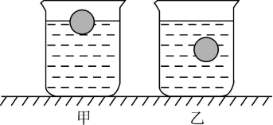
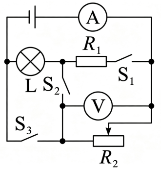
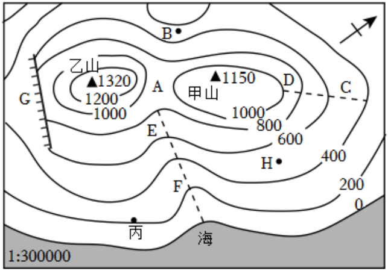

# 第 23 季 · 科学推理

来源：2026下半年省考第二十三季行测模考大赛（广东卷）.pdf

共 5 题，保留原卷题号。分数与数学符号使用 LaTeX；图形使用原图或已标注的矢量重绘图。

## 第 66 题

原卷 PDF 页码：18；题目 ID：`gd-mock-2026h2-s23-q66`

野外探险时，人们会在山洞中点燃木炭用于照明、取暖。洞内空气流通较差，氧气不足，木炭不完全燃烧生成一氧化碳，极易引发中毒；洞口通风良好，氧气充足，木炭完全燃烧生成二氧化碳。下列关于碳及其氧化物的说法，正确的是（    ）。

**A.** 一氧化碳与二氧化碳均有毒，均可和人体血红蛋白结合造成缺氧

**B.** 二氧化碳能够用于灭火，是因为该气体能够降低可燃物的着火点

**C.** 加热条件下，向氧化铜中通入一氧化碳，可以观察到黑色固体逐渐变为红色

**D.** 木炭、一氧化碳、二氧化碳三者均具有还原性

## 第 67 题

原卷 PDF 页码：18；题目 ID：`gd-mock-2026h2-s23-q67`

茂名是岭南知名水果产区，大面积种植优质荔枝。果农对比发现，昼夜温差大的果园，结出的荔枝果肉糖分更高、更甜。下列解释最合理的是（    ）。

**A.** 白天温度适宜，荔枝的光合作用较强，有机物消耗得更多

**B.** 夜晚温度较低，荔枝的呼吸作用较弱，有机物消耗得更少

**C.** 温度越高，荔枝细胞内酶的活性越高，越有利于糖分积累

**D.** 昼夜温差大，能够增强荔枝的蒸腾作用，从而积累有机物

## 第 68 题

原卷 PDF 页码：18；题目 ID：`gd-mock-2026h2-s23-q68`

将两个完全相同的实心小球，分别放入装有不同液体的甲、乙两个完全相同的烧杯中，小球静止时两烧杯中的液体液面相平，如图所示，下列说法正确的是（    ）。

**A.** 乙烧杯中小球排开液体的重力更小

**B.** 乙烧杯底部受到的液体压强更大

**C.** 甲烧杯中液体的质量更小

**D.** 甲烧杯中的液体对烧杯底部的压力更大

## 第 69 题

原卷 PDF 页码：18, 19；题目 ID：`gd-mock-2026h2-s23-q69`

如图所示， $R_1$ 为定值电阻， $R_2$ 为滑动变阻器，L为灯泡，电源电压恒定不变，下列说法正确的是（    ）。

**A.** 闭合开关 $S_1$ ，滑动变阻器 $R_2$ 滑片右移，灯泡变暗

**B.** 闭合开关 $S_2$ ，滑动变阻器 $R_2$ 滑片右移，灯泡变亮

**C.** 闭合开关 $S_1$ 、 $S_3$ ，滑动变阻器 $R_2$ 滑片右移，灯泡亮度不变

**D.** 闭合开关 $S_2$ 、 $S_3$ ，滑动变阻器 $R_2$ 滑片右移，灯泡变亮

## 第 70 题

原卷 PDF 页码：19；题目 ID：`gd-mock-2026h2-s23-q70`

某地等高线地形图如下，下列说法正确的是（    ）。

**A.** G处是登山线路中优先选择的通行位置

**B.** CD虚线处所在地形为山谷，容易发育河流

**C.** A处地势高于乙山山顶，适合修建高山气象观测站

**D.** B处暴雨天气下容易汇集水流，出现山洪
