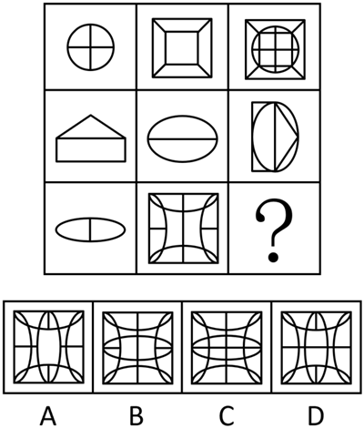
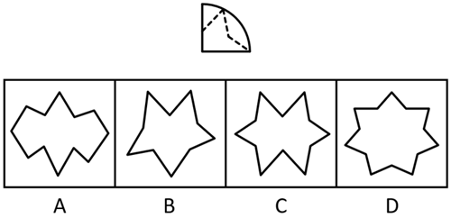
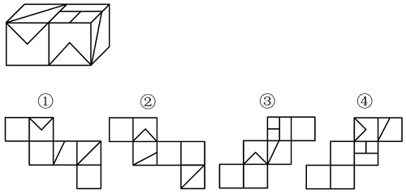

# 第 24 季 · 判断推理

来源：2026下半年省考第二十四季行测模考大赛（广东卷）.pdf

共 20 题，保留原卷题号。分数与数学符号使用 LaTeX；图片路径指向同一资料包内的原图。

## 第 46 题

原卷 PDF 页码：10；题目 ID：`gd-mock-2026h2-s24-q46`

从所给的四个选项中，选择最合适的一个填入问号处，使之呈现一定的规律性：

**A.** 见题图中的 A 选项

**B.** 见题图中的 B 选项

**C.** 见题图中的 C 选项

**D.** 见题图中的 D 选项

## 第 47 题

原卷 PDF 页码：11；题目 ID：`gd-mock-2026h2-s24-q47`

从所给的四个选项中，选择最合适的一个填入问号处，使之呈现一定的规律性：

**A.** 见题图中的 A 选项

**B.** 见题图中的 B 选项

**C.** 见题图中的 C 选项

**D.** 见题图中的 D 选项

## 第 48 题

原卷 PDF 页码：11；题目 ID：`gd-mock-2026h2-s24-q48`

如图所示，圆形卡片沿互相垂直的两条直径折叠两次后得到一个扇形，沿着虚线裁剪后，再展开剪下来的卡片，则展开的图形最有可能是（    ）。

**A.** 见题图中的 A 选项

**B.** 见题图中的 B 选项

**C.** 见题图中的 C 选项

**D.** 见题图中的 D 选项

## 第 49 题

原卷 PDF 页码：11；题目 ID：`gd-mock-2026h2-s24-q49`

左边为由12个白色正方体和3个灰色正方体组合而成的多面体的前后两面直观图，问其可以由除哪项外的三个多面体组合而成？

**A.** 见题图中的 A 选项

**B.** 见题图中的 B 选项

**C.** 见题图中的 C 选项

**D.** 见题图中的 D 选项

## 第 50 题

原卷 PDF 页码：11, 12；题目 ID：`gd-mock-2026h2-s24-q50`

下图为由2个正方体组合而成的长方体，问这2个正方体的外表面展开图可能是：

**A.** ②和④

**B.** ②和③

**C.** ①和④

**D.** ①和③

## 第 51 题

原卷 PDF 页码：12；题目 ID：`gd-mock-2026h2-s24-q51`

提升基层治理水平现代化是政治建设的重要任务。只有坚持党建引领，并且健全“群众参与、多方协同”的机制，才能破解基层治理盲点。如果忽视法治保障与科技赋能的融合，就会影响政策落地效率。除非压实县乡村三级责任链条，否则无法筑牢基层治理的坚实根基。
由此可以推出：

**A.** 若不能破解基层治理盲点，说明没有坚持党建引领或没有健全“群众参与、多方协同”的机制

**B.** 只要压实县乡村三级责任链条，就能筑牢基层治理的坚实根基

**C.** 即使健全“群众参与、多方协同”的机制，但若不坚持党建引领，那么仍无法破解基层治理盲点

**D.** 若政策落地效率受到影响，则必然忽视了法治保障与科技赋能的融合

## 第 52 题

原卷 PDF 页码：12；题目 ID：`gd-mock-2026h2-s24-q52`

全国医疗保障工作会议明确提出，要做到让孕产妇住院分娩过程中产生的、属于医保目录范围内的费用，参保人个人基本不花钱。据此，有人认为，这一政策将有效降低分娩成本，推动我国生育率大幅提升。
以下哪项如果为真，最能反驳上述观点？

**A.** 此次纳入医保全额报销的分娩费用仅包含住院诊疗、基础用药等基础项目，高端护理类项目并未列入医保范围

**B.** 该政策虽能解决部分家庭因分娩成本过高而不愿生育的问题，但这类受分娩成本直接制约生育决策的家庭占比极低

**C.** 当代年轻人工作压力大，常需长时间加班，自身可支配的时间本就稀缺，自然更难抽出精力照顾孩子

**D.** 和中国临近的J国目前也在实施这一政策，但效果并不好，生育率仍持续走低，目前已跌至该国历史最低水平

## 第 53 题

原卷 PDF 页码：12, 13；题目 ID：`gd-mock-2026h2-s24-q53`

一个国际研究团队在近地小行星“贝努”的返回样本中发现了盐、氨、糖、富氮/氧有机物以及超新星尘埃痕迹，研究证实，这些复杂化学成分与小行星撞击过程密切相关。有专家据此认为，我们深化了对生命起源和太阳系天体形成机制的理解。要使上述观点成立，需要补充的前提条件是：

**A.** 此次的“贝努”小行星返回样本，全程采用真空密封技术进行运输和储存，最大程度避免了地球物质的污染

**B.** 人类对生命起源的深度探索，对于深入破解太阳系天体的形成与演化机制及内在规律，具有不可替代的意义

**C.** “贝努”小行星返回样本中还检测出一些无机物，且无机物含量相对于有机物来说微乎其微

**D.** 盐、氨、糖类物质及富氮/氧有机物是生命产生的核心物质，它们能为探索生命起源提供直接物质依据

## 第 54 题

原卷 PDF 页码：13；题目 ID：`gd-mock-2026h2-s24-q54`

某团队利用卫星拍摄的轮廓照片，对数据库中逾21万处冰川进行了研究，利用计算机模型模拟在不同气候变暖情形下的冰川消融情况。结果显示，全球平均气温升高1.5摄氏度，到本世纪末全球冰川数量比目前减少一半。据此，团队成员认为，全球平均气温的小幅度升高，会造成全球冰川数量的锐减。
以下哪项如果为真，最能反驳上述团队成员的观点？

**A.** 以往有关冰川变化的研究通常关注的是其体量与面积的缩减，而本次研究则聚焦于冰川数量

**B.** 虽然全球气温升高，但是在温度零下的区域，仍有新的冰川形成，可以抵消部分消融冰川的数量

**C.** 该团队所用的卫星照片未覆盖高纬度不易消融的大型冰川，其数量占全球冰川总数量的80%以上

**D.** 全球将加大应对气候变化的力度，把平均气温升幅控制在0.5摄氏度之内，并减少对冰川的开采

## 第 55 题

原卷 PDF 页码：13；题目 ID：`gd-mock-2026h2-s24-q55`

在春运抢票、演唱会门票秒杀等高并发场景中，一种“电饭锅抢票技巧”在网上流传：有博主声称，将手机放入电饭锅内胆，其金属结构能屏蔽外界电磁波，减少信号干扰，让手机获得更好的信号传输效果，从而大幅提高抢票成功率。该说法吸引了大量用户跟风尝试，甚至有人将其奉为“物理外挂”。
以下除哪项外，均能削弱上述博主的观点？

**A.** 电饭锅的金属结构确实会屏蔽电磁波，但这种屏蔽会让手机信号减弱，甚至有时会丢失信号

**B.** 在抢票这种高并发场景下，系统瓶颈往往出现在服务器终端，而不是用户端的无线信号质量

**C.** 社交平台对“电饭锅抢票成功”的帖子有流量倾斜，这类内容的曝光度远远高于失败吐槽帖

**D.** 外界杂散电磁波和其他信号对手机信号的干扰微乎其微，远达不到干扰手机传输信号的程度

## 第 56 题

原卷 PDF 页码：13, 14；题目 ID：`gd-mock-2026h2-s24-q56`

小李到图书馆借书，需从甲、乙、丙、丁、戊、己、庚7本书中挑选4本，挑选需满足以下条件：
（1）若挑选甲，则挑选丁；
（2）乙和己不能一起被挑选；
（3）若不挑选己，则挑选丙；
（4）挑选乙或者不挑选丁；
（5）只有挑选戊和庚，才能挑选丙。根据以上信息，以下哪项一定为真？

**A.** 未挑选甲，挑选己

**B.** 未挑选己，挑选丙

**C.** 未挑选乙，挑选庚

**D.** 未挑选丁，挑选戊

## 第 57 题

原卷 PDF 页码：14；题目 ID：`gd-mock-2026h2-s24-q57`

随着冬季气温逐渐下降，一类被称为“光腿神器”的肤色紧身打底裤成了不少年轻人的必备单品，近日，某医院接诊的腰部、脚踝部位突发红疹的患者数量明显增多，而这些患者中，大多都有长时间穿着“光腿神器”的情况，对此，医生提醒，冬季不宜选择过于紧身的衣物，否则可能会诱发皮肤问题。
以下哪项如果为真，最能支持上述医生的观点？

**A.** 某女子发帖称，因穿着新买的超紧“光腿神器”，她饭后出现腰部、脚踝部位长满红疹的症状

**B.** 衣物过紧产生的压力会刺激皮肤内肥大细胞释放组胺等炎症介质，从而引发血管扩张和水肿

**C.** 若穿着裤腿、袜口等过紧衣物时间较长，可能导致下肢发麻发凉，甚至引发静脉血栓等风险

**D.** 宽松但透气差的保暖内衣会导致汗液中的尿素和盐类不能及时挥发，也容易引起皮肤瘙痒等症状

## 第 58 题

原卷 PDF 页码：14；题目 ID：`gd-mock-2026h2-s24-q58`

某科研团队检测到某款新型锂电池的续航时间得到提升。正极材料掺杂纳米硅会提升锂电池续航时间，所以该款新型锂电池的正极材料掺杂了纳米硅。
以下哪项与上述论证方式最为相似？

**A.** 某科研团队发现菌株繁殖速度明显加快。特定波长的紫外光照射会抑制菌株繁殖速度，所以该菌株没有接受过特定波长的紫外光照射

**B.** 某城市监测到地表沉降幅度明显减小。地下水资源合理回灌会减小地表沉降幅度，所以该城市实施了地下水资源合理回灌措施

**C.** 高强度碳纤维材料能够提升无人机的载重能力。某企业生产的无人机采用了高强度碳纤维材料，所以该无人机的载重能力较强

**D.** 某航天器搭载的传感器传回数据异常。航天器进入辐射带会造成传感器数据异常，所以地面启动了航天器的辐射防护应急程序

## 第 59 题

原卷 PDF 页码：14, 15；题目 ID：`gd-mock-2026h2-s24-q59`

某非遗保护中心在甲、乙两个社区开展非遗竹编技艺传承活动，甲社区的活动设置了“编织成果线下互动展示”环节，乙社区的活动未设置该环节，活动结束后统计发现，甲社区居民的非遗竹编技艺持续练习率远高于乙社区。该非遗保护中心据此建议，非遗技艺传承活动应增设线下互动展示环节，以促进技艺的有效传承。要使上述推理成立，需要补充的前提条件是（    ）。

**A.** 线下互动展示环节的平均时长为90分钟

**B.** 居民对技艺的持续练习率直接影响该非遗技艺的传承效果

**C.** 举办活动的甲、乙两个社区非遗竹编文化的基础氛围相近

**D.** 线下互动展示环节需要协调社区活动场地资源

## 第 60 题

原卷 PDF 页码：15；题目 ID：`gd-mock-2026h2-s24-q60`

某高校社团共有24名成员，分别来自河北、山西、河南、山东、陕西、甘肃6个省份，每人均仅来自一省，每省至少有1人。已知：
（1）来自河北和山西的共有8人；
（2）来自山西和河南的共有10人；
（3）来自河南和山东的共有11人；
（4）来自陕西的比来自甘肃的人数多3人。根据以上信息，可以推出以下哪项？

**A.** 来自河北有3人

**B.** 来自河南有5人

**C.** 来自山东有4人

**D.** 来自甘肃有1人

## 第 61 题

原卷 PDF 页码：15；题目 ID：`gd-mock-2026h2-s24-q61`

所有嗜极微生物都能在极端环境中生存，人类不是嗜极微生物，所以人类不能在极端环境中生存。下列选项所犯的逻辑错误与题干最为相似的是（    ）。

**A.** 所有玛雅金字塔都用于祭祀，某金字塔是玛雅金字塔，所以该金字塔用于祭祀

**B.** 所有明清家具都使用榫卯结构，这件家具没有使用榫卯结构，所以它不是明清家具

**C.** 所有黑洞都有事件视界，类星体有事件视界，所以类星体是黑洞

**D.** 所有民国书籍都是竖排排版，这本书不是民国书籍，所以它不是竖排排版

## 第 62 题

原卷 PDF 页码：15；题目 ID：`gd-mock-2026h2-s24-q62`

某滨海旅游城市为治理“天价海鲜”乱象，出台政策严管景区餐厅价格，要求明码标价且利润率不得超过50%。政策实施后，第三方暗访报告显示，该市景区内餐厅的菜单价格确已普遍下降并公示。然而，该市同期关于餐饮消费的投诉率却不降反升，涨幅达30%。
以下各项如果为真，最不能解释这一现象的是（    ）。

**A.** 游客因预期价格透明而涌入景区餐厅，消费基数增大导致投诉绝对数增加

**B.** 餐厅为维持利润，转向采购低价劣质食材，导致菜品质量大幅下降

**C.** 当地市场监管部门同步开通了更为便捷的线上投诉渠道，降低了维权成本，使人们更愿意维权

**D.** 价格管制导致“服务费”“加工费”等隐性收费项目层出不穷，引发游客争议，进而导致投诉增多

## 第 63 题

原卷 PDF 页码：15, 16；题目 ID：`gd-mock-2026h2-s24-q63`

手工宣纸的关键原料檀皮纤维依赖檀木。若檀木种植量减少，檀皮纤维收购价会上涨，导致手工宣纸生产成本上升，厂家只能提高售价。因此，只要檀木种植量保持不变，手工宣纸售价就不会大幅上涨。上述论证的主要逻辑错误在于（    ）。

**A.** 默认了檀皮纤维是手工宣纸的唯一原料

**B.** 忽视了檀木生长周期对种植量的制约

**C.** 忽视了其他因素对手工宣纸售价的影响

**D.** 默认了檀木种植量与手工宣纸产量成正比

## 第 64 题

原卷 PDF 页码：16；题目 ID：`gd-mock-2026h2-s24-q64`

任何高效的学习方法都需要系统的知识框架。思维导图是一种高效的学习方法，因此，思维导图必然需要系统的知识框架。
以下选项的推理逻辑与题干最为相似的是（    ）。

**A.** 良好的沟通能力是在职场中取得成功的必要条件。销售人员渴望在职场中取得成功，因此，销售人员必须具备良好的沟通能力

**B.** 良好的生态环境是发展旅游业的基础。山区小镇要发展旅游业，因此，山区小镇必须有良好的生态环境

**C.** 任何创新型企业都重视研发投入。科技公司是创新型企业，因此，科技公司应当拥有高学历人才

**D.** 优质的教育资源能提升教学质量。重点学校拥有优质的教育资源，因此，重点学校必然能提升教学质量

## 第 65 题

原卷 PDF 页码：16；题目 ID：`gd-mock-2026h2-s24-q65`

山东诸城出土的甲龙类右侧肠骨化石形态特征与已知的甲龙科、结节龙科等类群存在显著差异。古生物专家据此推断，该化石代表一个甲龙类新属种，这一发现对厘清晚白垩世亚洲与北美洲的恐龙的迁徙关联具有重要价值。
以下哪项是上述专家作出推断所必须依赖的前提？

**A.** 能够从甲龙类新属种的化石特征中获得对晚白垩世亚洲与北美洲恐龙迁徙研究的关键线索

**B.** 该化石与已知类群的形态差异足以有效区分甲龙类不同属种，且其还蕴含了恐龙迁徙的地理隔离信息

**C.** 该化石点的地层年代测定准确，且出土的肠骨化石未受到后期地质变动的显著破坏

**D.** 目前已知的甲龙类化石资料，能充分反映其主要类群的典型形态特征
