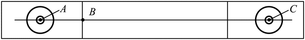
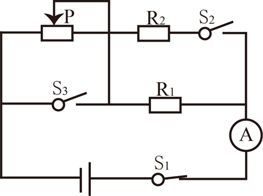

# 第 24 季 · 科学推理

来源：2026下半年省考第二十四季行测模考大赛（广东卷）.pdf

共 5 题，保留原卷题号。分数与数学符号使用 LaTeX；图形使用原图或已标注的矢量重绘图。

## 第 66 题

原卷 PDF 页码：16；题目 ID：`gd-mock-2026h2-s24-q66`

下图是某冰壶场地的示意图，小明用水平推力使冰壶从A点向右匀速运动到B点后松手，冰壶继续向前运动到C点时静止。若冰面的粗糙程度相同，下列说法正确的是（    ）。

**A.** 冰壶从A点运动到C点的过程中，摩擦力始终做正功

**B.** 冰壶从A点运动到C点的过程中，水平推力始终做正功

**C.** 冰壶从A点运动到C点的过程中，机械能始终不变

**D.** 冰壶从A点运动到B点的过程中，水平推力始终做正功

## 第 67 题

原卷 PDF 页码：17；题目 ID：`gd-mock-2026h2-s24-q67`

如图所示的电路图中，电源电压恒定，P是滑动变阻器，定值电阻 $R_1$ 、 $R_2$ 的阻值相同，开关$S_1$ 始终处于闭合状态，开关 $S_2$ 、 $S_3$ 处于断开状态，下列说法不正确的是（    ）。

**A.** 将滑动变阻器的滑片向右移动，电流表的示数变大

**B.** 闭合开关 $S_2$ ，电流表的示数变大

**C.** 闭合开关 $S_3$ ，电流表的示数变大

**D.** 同时闭合开关 $S_2$ 、 $S_3$ ，电流表的示数变大

## 第 68 题

原卷 PDF 页码：17；题目 ID：`gd-mock-2026h2-s24-q68`

下表为一些常见溶液的酸碱度，根据表中的信息，以下说法不恰当的是（    ）。

**物质的 pH 值**

| 物质 | 洁厕剂 | 柠檬汁 | 西瓜汁 | 鸡蛋清 | 草木灰水 | 84消毒液 |
| --- | --- | --- | --- | --- | --- | --- |
| pH值 | 2 | 3 | 6 | 8 | 11 | 12 |

保持原图物质顺序和给定数值。

**A.** 胃酸过多的人不宜喝柠檬汁

**B.** 鸡蛋清能使无色酚酞溶液变色

**C.** 西瓜汁的酸性比柠檬汁强

**D.** 洁厕剂与84消毒液不能混合使用

## 第 69 题

原卷 PDF 页码：17；题目 ID：`gd-mock-2026h2-s24-q69`

下图是某茶园生态系统食物网的示意图，下列说法正确的是（    ）。

**食物网的全部箭头关系**

| 箭头起点 | 箭头终点 |
| --- | --- |
| 茶树 | 茶毛虫 |
| 茶树 | 茶尺蠖 |
| 草 | 茶毛虫 |
| 草 | 茶尺蠖 |
| 茶毛虫 | 蛙 |
| 茶毛虫 | 蜘蛛 |
| 茶尺蠖 | 蜘蛛 |
| 茶尺蠖 | 鸟 |
| 蜘蛛 | 蛙 |
| 蛙 | 蛇 |
| 鸟 | 蛇 |

每行表示原图的一条有向箭头（起点 → 终点），完整保留 8 个节点及 11 条连接；行的先后顺序不代表食物链顺序。

**A.** 该食物网中有7条食物链

**B.** 该食物网中，最高营养级为五级

**C.** 蛇捕食鸟后，能吸收鸟全部的能量

**D.** 该食物网包含了该生态系统中所有的生物

## 第 70 题

原卷 PDF 页码：18；题目 ID：`gd-mock-2026h2-s24-q70`

2026美加墨世界杯决赛于北京时间2026年7月20日凌晨3：00在美国新泽西大都会人寿体育场‌举行，经过激烈的角逐，西班牙最终夺得了冠军。已知新泽西位于西五区，那么决赛开始时新泽西的当地时间是（    ）。

**A.** 7月19日14：00

**B.** 7月19日22：00

**C.** 7月20日8：00

**D.** 7月20日16：00
