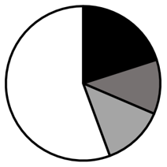
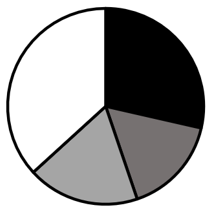
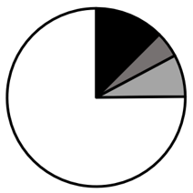
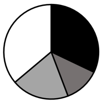

# 第 24 季 · 资料分析

来源：2026下半年省考第二十四季行测模考大赛（广东卷）.pdf

共 20 题，保留原卷题号。分数与数学符号使用 LaTeX；图片路径指向同一资料包内的原图。

## 材料 1（第 71—75 题）

**2023年X地区房地产开发和销售主要指标及其增长速度**

| 指标 | 单位 | 绝对数 | 比上年增长（%） |
| --- | --- | --- | --- |
| 房地产开发投资 | 亿元 | 1168.53 | 0.8 |
| 其中：住宅投资 | 亿元 | 823.05 | −0.6 |
| 房屋施工面积 | 万平方米 | 15375.68 | −4.4 |
| 其中：住宅施工面积 | 万平方米 | 10467.79 | −4.3 |
| 房屋竣工面积 | 万平方米 | 1297.88 | 13.7 |
| 其中：住宅竣工面积 | 万平方米 | 950.00 | 22.1 |
| 商品房销售面积 | 万平方米 | 1903.23 | 25.5 |
| 其中：住宅销售面积 | 万平方米 | 1711.29 | 24.2 |
| 商品房销售额 | 亿元 | 1167.46 | 32.1 |
| 其中：住宅销售额 | 亿元 | 989.70 | 29.4 |

## 第 71 题

原卷 PDF 页码：18；题目 ID：`gd-mock-2026h2-s24-q71`

2023年X地区房地产开发投资中，住宅占比较上年约：

**A.** 下降1.0个百分点

**B.** 下降1.4个百分点

**C.** 上升1.0个百分点

**D.** 上升1.4个百分点

## 第 72 题

原卷 PDF 页码：18；题目 ID：`gd-mock-2026h2-s24-q72`

2022年X地区非住宅房屋施工面积约为：

**A.** 4691.4万平方米

**B.** 4907.8万平方米

**C.** 5145.2万平方米

**D.** 10938.1万平方米

## 第 73 题

原卷 PDF 页码：18；题目 ID：`gd-mock-2026h2-s24-q73`

2023年X地区表中所列指标中住宅的同比增速快于非住宅的有几项？

**A.** 1

**B.** 2

**C.** 3

**D.** 4

## 第 74 题

原卷 PDF 页码：18；题目 ID：`gd-mock-2026h2-s24-q74`

2023年X地区非住宅商品房销售额与上年相比约：

**A.** 增长59亿元

**B.** 减少60亿元

**C.** 增长30亿元

**D.** 增长225亿元

## 第 75 题

原卷 PDF 页码：18；题目 ID：`gd-mock-2026h2-s24-q75`

以下信息能够从上述资料中推出的有几项？
①2022年X地区非住宅商品房销售面积占商品房销售面积的比重
②2022年X地区商品房单位面积销售额
③2022年X地区住宅商品房单位面积销售额同比增速

**A.** 0

**B.** 1

**C.** 2

**D.** 3

## 材料 2（第 76—80 题）

2023年上海货物进出口总额42121.61亿元，比上年增长0.7%。其中，进口24743.67亿元，增长0.1%；出口17377.94亿元，增长1.6%。2023年上海口岸货物进出口总额106576.6亿元，比上年增长2.8%。其中，进口43383.5亿元，增长258.7亿元；出口63193.1亿元，增长2605.3亿元。

**2023年上海对主要国家和地区货物进出口额及其同比增速**

| 国家和地区 | 出口额（亿元） | 出口额比上年增长（%） | 进口额（亿元） | 进口额比上年增长（%） |
| --- | --- | --- | --- | --- |
| 欧盟 | 3101.72 | −1.0 | 5343.96 | 5.0 |
| 美国 | 2774.90 | −11.8 | 2020.70 | −2.5 |
| 东盟 | 2185.18 | 3.1 | 3267.43 | −7.8 |
| 日本 | 1432.19 | 6.5 | 2481.48 | −4.2 |
| 中国香港 | 1501.09 | 15.6 | 139.99 | 43.3 |
| 中国台湾 | 803.05 | −8.8 | 1570.84 | −16.2 |
| 韩国 | 774.90 | 16.5 | 1240.97 | −18.5 |
| 俄罗斯 | 340.22 | 52.2 | 585.45 | 50.7 |

## 第 76 题

原卷 PDF 页码：19；题目 ID：`gd-mock-2026h2-s24-q76`

若上海对东盟货物出口、进口均保持2023年同比增量不变，则到哪一年上海对东盟货物进出口首次实现贸易顺差？

**A.** 2026年

**B.** 2027年

**C.** 2028年

**D.** 2029年

## 第 77 题

原卷 PDF 页码：19；题目 ID：`gd-mock-2026h2-s24-q77`

2022年上海货物出口额占进出口总额的比重约为：

**A.** 40.9%

**B.** 41.3%

**C.** 47.5%

**D.** 58.7%

## 第 78 题

原卷 PDF 页码：19；题目 ID：`gd-mock-2026h2-s24-q78`

2023年上海口岸货物进出口贸易顺差同比约：

**A.** 减少3.4%

**B.** 减少13.4%

**C.** 增长10.6%

**D.** 增长13.4%

## 第 79 题

原卷 PDF 页码：19；题目 ID：`gd-mock-2026h2-s24-q79`

2023年对上海货物出口额同比变化幅度最大和最小的主要国家和地区，其对上海货物进口额之和为：

**A.** 1115.12亿元

**B.** 2606.15亿元

**C.** 3115.12亿元

**D.** 5929.41亿元

## 第 80 题

原卷 PDF 页码：19, 20；题目 ID：`gd-mock-2026h2-s24-q80`

以下饼状图中，最能准确反映2023年上海对欧盟、美国、东盟及其他国家和地区货物进出口总额占上海货物进出口总额比重的是：

**A.**

**B.**

**C.**

**D.**

## 材料 3（第 81—85 题）

近年来，国家知识产权局不断加强知识产权保护和运用，通过知识产权纠纷多元化解、推进专利产业化、海外知识产权纠纷应对指导等工作举措，服务促进民营企业创新发展，让经济高质量发展更加“血脉通畅”。2024年，我国知识产权系统共办理专利侵权纠纷案件7.2万件，其中涉及民营企业的案件占比51.4%。知识产权纠纷调解组织受理案件近14万件，服务民营企业15.7万家。截至2024年底，国家知识产权局已在我国29个省（区、市）支持建设海外知识产权纠纷应对指导地方分中心71家、产业分中心4家；2024年，国家知识产权局为各类企业提供指导服务886次，帮助企业挽回经济损失141.5亿元。2024年，我国专利转让许可备案次数达到61.3万次，同比增长29.9%。其中高校和科研机构专利转让许可备案次数达到7.6万次，同比增长39.1%。2023年，我国专利密集型产业增加值达16.87万亿元，提前完成知识产权“十四五”的规划目标。截至2024年底，我国国内发明专利有效量达到475.6万件，同比增长16.3%，成为世界上首个突破400万件的国家。其中属于战略性新兴产业的发明专利有效量达到134.9万件，同比增长15.7%。我国国内拥有有效发明专利350.6万件，拥有有效发明专利的企业达到49.7万家，较上年同期增加6.9万家。2024年，我国申请人提交的PCT国际专利申请、海牙体系外观设计申请、马德里商标国际注册申请均稳居世界前列。其中，我国申请人提交的PCT国际专利申请量较上年稳中有升，海牙体系外观设计申请、马德里商标国际注册申请量同比实现两位数的增长。

## 第 81 题

原卷 PDF 页码：21；题目 ID：`gd-mock-2026h2-s24-q81`

根据材料，以下说法正确的是（    ）。

**A.** 截至2024年底，海外知识产权纠纷应对指导地方分中心、产业分中心已在全国31个省（市、区）实现全覆盖

**B.** 2022年，我国专利密集型产业增加值已提前完成“十四五”的规划目标

**C.** 2024年，我国申请人提交的PCT国际专利申请量同比实现两位数的增长

**D.** 截至2024年底，我国成为世界上首个国内发明专利有效量突破400万件的国家

## 第 82 题

原卷 PDF 页码：21；题目 ID：`gd-mock-2026h2-s24-q82`

根据材料，以下属于国家知识产权局加强知识产权保护和运用的举措的有（    ）。
①知识产权纠纷多元化解
②推进专利产业化
③放宽发明专利申请条件
④海外知识产权纠纷应对指导

**A.** ①③④

**B.** ②③④

**C.** ①②④

**D.** ①②③

## 第 83 题

原卷 PDF 页码：21；题目 ID：`gd-mock-2026h2-s24-q83`

根据材料，以下说法正确的是（    ）。

**A.** 截至2024年底，我国国内拥有有效发明专利量占发明专利有效量的比重超过75%

**B.** 2024年，我国知识产权系统办理的专利侵权纠纷案件中涉及民营企业的案件约3.7万件

**C.** 截至2024年底，我国国内拥有有效发明专利的企业数量同比增长低于14%

**D.** 2024年，国家知识产权局平均每次为各类企业提供指导服务可帮助企业挽回经济损失约159万元

## 第 84 题

原卷 PDF 页码：21；题目 ID：`gd-mock-2026h2-s24-q84`

截至2024年底，我国战略性新兴产业的发明专利有效量同比增长约多少万件？

**A.** 15.2

**B.** 16.4

**C.** 17.1

**D.** 18.3

## 第 85 题

原卷 PDF 页码：21；题目 ID：`gd-mock-2026h2-s24-q85`

2024年，高校和科研机构专利转让许可备案次数占我国专利转让许可备案总次数的比重比上年：

**A.** 上升不到2个百分点

**B.** 上升超过2个百分点

**C.** 下降不到2个百分点

**D.** 下降超过2个百分点

## 材料 4（第 86—90 题）

2023年上海证券交易所总成交额551.54万亿元，同比增长11.2%。其中，股票成交额89.36万亿元，同比下降7.2%；债券成交额35.81万亿元，同比增长64.1%。截至2023年末，上海证券市场上市证券33725只，比上年末增加3615只。其中，股票2302只，增加89只。

**2019—2023年上海金融市场交易总额及其增长速度**

| 年份 | 金融市场交易总额（万亿元） | 比上年增长（%） |
| --- | --- | --- |
| 2019 | 1934.31 | 16.6 |
| 2020 | 2274.83 | 17.6 |
| 2021 | 2511.07 | 10.4 |
| 2022 | 2932.98 | 16.8 |
| 2023 | 3373.63 | 15.0 |

## 第 86 题

原卷 PDF 页码：22；题目 ID：`gd-mock-2026h2-s24-q86`

2022年上海证券交易所股票成交额占金融市场交易总额的比重约为：

**A.** 2.6%

**B.** 3.3%

**C.** 16.2%

**D.** 19.4%

## 第 87 题

原卷 PDF 页码：22；题目 ID：`gd-mock-2026h2-s24-q87`

截至2022年末，上海证券市场上市证券中非股票证券有多少只？

**A.** 2213

**B.** 7179

**C.** 27897

**D.** 31423

## 第 88 题

原卷 PDF 页码：22；题目 ID：`gd-mock-2026h2-s24-q88`

2019-2023年，上海金融市场交易总额超过年平均值的年份有几个？

**A.** 1

**B.** 2

**C.** 3

**D.** 4

## 第 89 题

原卷 PDF 页码：22；题目 ID：`gd-mock-2026h2-s24-q89`

2018-2023年，上海金融市场交易总额年均增长约：

**A.** 286万亿元

**B.** 308万亿元

**C.** 360万亿元

**D.** 343万亿元

## 第 90 题

原卷 PDF 页码：22；题目 ID：`gd-mock-2026h2-s24-q90`

以下哪个折线图最能准确反映2020-2023年上海金融市场交易总额同比增量的变化趋势？

**A.**

**B.**

**C.**

**D.**

