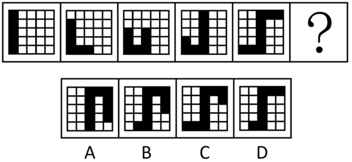
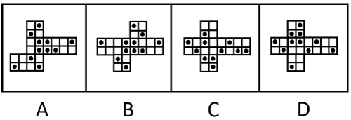

# 第 25 季 · 判断推理

来源：2026下半年省考第二十五季行测模考大赛（广东卷）.pdf

共 20 题，保留原卷题号。分数与数学符号使用 LaTeX；图片路径指向同一资料包内的原图。

## 第 46 题

原卷 PDF 页码：10, 11；题目 ID：`gd-mock-2026h2-s25-q46`

从所给的四个选项中，选择最合适的一个填入问号处，使之呈现一定的规律性：

**A.** 见题图中的 A 选项

**B.** 见题图中的 B 选项

**C.** 见题图中的 C 选项

**D.** 见题图中的 D 选项

## 第 47 题

原卷 PDF 页码：11；题目 ID：`gd-mock-2026h2-s25-q47`

从所给的四个选项中，选择最合适的一个填入问号处，使之呈现一定的规律性：

**A.** 见题图中的 A 选项

**B.** 见题图中的 B 选项

**C.** 见题图中的 C 选项

**D.** 见题图中的 D 选项

## 第 48 题

原卷 PDF 页码：11；题目 ID：`gd-mock-2026h2-s25-q48`

下列选项中，能与所给图形组合成矩形的是（    ）。

**A.** 见题图中的 A 选项

**B.** 见题图中的 B 选项

**C.** 见题图中的 C 选项

**D.** 见题图中的 D 选项

## 第 49 题

原卷 PDF 页码：11, 12；题目 ID：`gd-mock-2026h2-s25-q49`

以下除哪项外，都是同一正方体纸盒的外表面展开图？

**A.** 见题图中的 A 选项

**B.** 见题图中的 B 选项

**C.** 见题图中的 C 选项

**D.** 见题图中的 D 选项

## 第 50 题

原卷 PDF 页码：12；题目 ID：`gd-mock-2026h2-s25-q50`

左边是给定的立体图形，将其从任一面剖开，右边哪一项不可能是该立体图形的截面？

**A.** 见题图中的 A 选项

**B.** 见题图中的 B 选项

**C.** 见题图中的 C 选项

**D.** 见题图中的 D 选项

## 第 51 题

原卷 PDF 页码：12；题目 ID：`gd-mock-2026h2-s25-q51`

某园区计划开展季度安全生产专项行动，工作安排需遵循以下规则：
（1）若开展重点企业排查，则既要完成隐患台账登记，也要组织安全宣讲培训；
（2）除非既更新安全警示标识，也开展应急演练部署，否则需要开展重点企业排查；
（3）若组织安全宣讲培训或者配备应急物资，就需要安排现场督导专员；
（4）只有聘任技术指导专员，才开展应急演练部署或者划分安全责任区域；
（5）只要安排了现场督导专员或者聘任了技术指导专员，就必须设立安全生产总负责人。
由此可推出：

**A.** 开展了重点企业排查

**B.** 安排了现场督导专员

**C.** 聘任了技术指导专员

**D.** 设立了安全生产总负责人

## 第 52 题

原卷 PDF 页码：12；题目 ID：`gd-mock-2026h2-s25-q52`

研究团队根据多年野外调查与多学科实验发现，遭受绢蝶捕食侵扰的半荷包紫堇，相较于未受侵扰的个体，体内的花青素含量普遍偏低，且未受侵扰的半荷包紫堇基因组中存在特定基因开关，能够促进花青素的合成。该研究团队据此认为，拥有该基因可缓解半荷包紫堇被绢蝶捕食侵扰的状况。
以下哪项是上述结论成立的前提？

**A.** 花青素含量较高的半荷包紫堇更能适应高原恶劣的生长环境

**B.** 绢蝶的捕食侵扰并不会导致半荷包紫堇体内花青素含量降低

**C.** 该基因可以增加花青素的积累，使叶片由绿色转变为“伪装色”

**D.** 该研究证实，绢蝶更倾向于在半荷包紫堇的绿叶植株附近产卵

## 第 53 题

原卷 PDF 页码：12, 13；题目 ID：`gd-mock-2026h2-s25-q53`

研究发现，AI模型在知识蒸馏过程中，会通过人类难以察觉的统计规律，将自身偏好、偏见、安全漏洞等传递给其他模型，这种隐藏传递难以被仅依靠内容过滤的AI安全治理方式检测到。研究人员据此认为，仅依靠内容过滤的AI安全治理方式，无法实现AI的有效治理。
以下各项如果为真，除哪项外均能削弱上述结论？

**A.** 知识蒸馏技术当前仅用于科研，尚未投入实际应用

**B.** 单纯的隐藏传递行为并不会构成真正的安全风险

**C.** 内容过滤的防御机制无需依赖对隐藏传递过程的识别

**D.** 现有内容过滤技术可有效阻断模型间的隐藏传递风险

## 第 54 题

原卷 PDF 页码：13；题目 ID：`gd-mock-2026h2-s25-q54`

呼吸不仅可以维持生命，还是大脑处理信息的“节拍器”。研究表明，呼吸能够调节人类的感知能力，尤其在视觉领域，人的视觉感知敏感度会随呼吸相位发生变化，吸气阶段更为敏锐。
以下哪项如果为真，最能支持上述结论？

**A.** 研究发现，调整呼吸使关键视觉刺激出现在吸气阶段，可提升视觉感知的敏感度

**B.** 呼吸节律与心跳节律存在复杂耦合，二者共同作用可实现视觉信息的调节与加工

**C.** 该研究采用的阈值边缘视觉任务机制在日常自然感知中是否同样起作用，仍需验证

**D.** 在吸气和呼气时，脑岛与颞顶交界处之间的信息传递方向和强度会发生动态翻转

## 第 55 题

原卷 PDF 页码：13；题目 ID：`gd-mock-2026h2-s25-q55`

在森林生态系统中，林下植被与地表枯落物可有效削减雨滴冲击、减缓地表径流。经过长期观测与研究表明，完整的地被层能显著增强土壤抗侵蚀能力。科研人员据此得出结论，只有维持林下植被与地表枯落物层完整，才能有效遏制山地水土流失。
以下哪项如果为真，最能削弱上述结论？

**A.** 该研究多为理论推演与观测总结，缺少长期野外对照实验的数据支撑

**B.** 即便林下植被层存在局部破损，经自然修复后仍可有效遏制山地水土流失

**C.** 在原生地被层缺失的山地人工铺设生态毯，同样可以遏制山地水土流失

**D.** 山地水土流失的严重程度主要受地形坡度与降水强度等自然条件影响

## 第 56 题

原卷 PDF 页码：13；题目 ID：`gd-mock-2026h2-s25-q56`

某航天科研团队开展空间育种实验，安排赵、钱、孙、李四名研究员研究拟南芥、水稻、苜蓿、番茄、小麦五种作物样本，每人选取两种作物样本开展培育，且每人必须选取一种作物作为核心实验样本。已知：
（1）赵不选取水稻和番茄且仅孙选取苜蓿；
（2）番茄仅被选取一次且选取人不是李；
（3）拟南芥、水稻不属于核心实验样本；
（4）任意两名研究员选取的样本不完全相同。根据以上信息，可以推出的是：

**A.** 钱选取番茄和小麦

**B.** 孙选取苜蓿和水稻

**C.** 李选取水稻和小麦

**D.** 四人均选取小麦

## 第 57 题

原卷 PDF 页码：13, 14；题目 ID：`gd-mock-2026h2-s25-q57`

城市更新中，不少历史街区的改造并非简单的“拆旧建新”，而是在保留原有建筑肌理的基础上，通过植入新业态、激活公共空间来重塑历史街区活力。这种“微更新”模式虽能避免大规模拆迁带来的文化断层，但也面临着商业过度开发、原住民利益受损等风险。部分城市在推进更新过程中，缺乏对街区历史文化脉络的深度调研，导致改造后的街区失去了原有的烟火气，沦为同质化的商业打卡地。
由此可以推出：

**A.** 历史街区的“微更新”模式能彻底规避文化断层问题

**B.** 城市更新中，大规模“拆旧建新”更容易面临商业过度开发等风险

**C.** 改造后的历史街区失去原有的烟火气是因为对街区历史文化脉络调研不足

**D.** 不少历史街区的“微更新”是在保留原有建筑肌理的基础上激活公共空间

## 第 58 题

原卷 PDF 页码：14；题目 ID：`gd-mock-2026h2-s25-q58`

近年来，全球50岁以下人群的早发性结直肠癌发病率显著上升，而这类患者大多无家族病史、肥胖等患结直肠癌的传统风险因素，其发病诱因成为学界研究焦点。美国某研究团队分析了来自4大洲11个国家的981份结直肠癌患者肿瘤样本发现：在50岁前确诊的早发性结直肠癌患者样本中，SBS88和ID18这两种DNA突变模式的出现频率显著高于50岁后确诊的老年患者。研究人员据此认为，早发性结直肠癌发病率激增的背后，与人们童年时期接触名为colibactin的细菌毒素密切相关。要使上述论证成立，还需补充以下哪一前提？

**A.** 饮食中的膳食纤维可以抑制产colibactin的大肠杆菌在结直肠癌中的致癌潜力

**B.** 人体肠道细胞的DNA损伤会长期积累，是诱发结直肠癌的重要生物学基础

**C.** SBS88和ID18是人体细胞接触colibactin细菌毒素后在DNA上留下的特有“指纹”

**D.** 童年时期接触的有害环境与微生物是多种早发性癌症发病的核心潜在诱因

## 第 59 题

原卷 PDF 页码：14；题目 ID：`gd-mock-2026h2-s25-q59`

厄尔尼诺现象指赤道中东太平洋海水表层温度持续异常偏高，而影响大气环流的现象，它会推高全球气温。如果Nino3.4区海域的海表温度距平超过 $0.5^{\circ}\mathrm{C}$ ，气象学上就会判定进入厄尔尼诺状态；当这一状态连续维持足够长的时间（通常是5个月），它就会被定义为一次完整的厄尔尼诺事件。由于现今Nino3.4区海域的温度异常指数已超过 $+0.5^{\circ}\mathrm{C}$ ，有人因此认为，我国应及时做好应对极端天气频发的准备。要使上述结论成立，需要补充的前提是（    ）。

**A.** 厄尔尼诺现象会导致东太平洋地区的天气变极端

**B.** 此前的西风暴发事件会加速厄尔尼诺状态的到来

**C.** 全球气温升高会使得我国极端天气事件明显增多

**D.** 极端天气定义法包括统计频率法和观测值阈值法

## 第 60 题

原卷 PDF 页码：14, 15；题目 ID：`gd-mock-2026h2-s25-q60`

某农业公司准备前往粮食和蔬菜产区进行调研工作，已知共有20人，他们分别前往五常市、盘锦市、周口市、焦作市和寿光市五座城市。每座城市至少有1人前往，且前往各城市的人数依次递增1人。已知：
（1）前往五常市和盘锦市的共有5人；
（2）前往盘锦市和周口市的共有7人；
（3）前往周口市和焦作市的共有9人。
根据上述信息，可以推出以下哪项？

**A.** 前往寿光市的有6人

**B.** 前往周口市的有2人

**C.** 前往焦作市的有4人

**D.** 前往五常市的有1人

## 第 61 题

原卷 PDF 页码：15；题目 ID：`gd-mock-2026h2-s25-q61`

民生在勤，勤则不匮。他物资匮乏，所以他不勤劳。
以下选项的逻辑结构与题干最为相似的是（    ）。

**A.** 牡丹花是芬芳的。这朵花不芬芳，所以它绝不是牡丹花

**B.** 不前进就会退步。他退步明显，所以他一定没有前进

**C.** 边牧都会牧羊。它不会牧羊，那么它绝不是牧羊犬

**D.** 猛将必发于卒伍。他不是猛将，因此他并非出身于士兵队伍

## 第 62 题

原卷 PDF 页码：15；题目 ID：`gd-mock-2026h2-s25-q62`

稻田养鱼在中国有着上千年的历史，这种“一水两用、一田双收”的模式，曾是我国南方丘陵地区农民的生存智慧。水稻为鱼提供遮阴和有机碎屑，鱼则吞食害虫、疏松土壤，其排泄物还能肥田，形成完美的生态循环。然而，曾经随处可见的稻田养鱼场景，如今却几乎绝迹。下列选项如果为真，最不能解释上述现象的是（    ）。

**A.** 过去，种地很少使用化肥，但现在的水稻如果不施化肥、不打农药，就很难有好的收成，而鱼对化学物质很敏感，在施肥打药后的稻田里生存变得十分困难

**B.** 稻田里养出来的鱼，其生活状态和野生鱼区别不大，个体通常较小，且在外观和口感上与普通养殖鱼没有明显差异，消费者很难分辨，因此卖不上更高的价格

**C.** 稻田养鱼要看天吃饭，干旱时稻田干涸，暴雨时鱼苗会被冲散，一季的投入可能瞬间“归零”，而且还要精心呵护，其经济效益已逐渐落后于现代化的养殖方式

**D.** 数据显示，如今南方农村青壮年外出务工月收入普遍超过两千元，而传统的稻田养鱼每亩年收入仅数百元，巨大的经济差距让越来越多的农民放下渔网，涌入城市务工

## 第 63 题

原卷 PDF 页码：15；题目 ID：`gd-mock-2026h2-s25-q63`

所有优秀员工都能圆满完成任务，只有不断学习的员工才是优秀员工，只有认真负责的员工才能圆满完成任务。因此，除非具有一定的规划能力，否则不是优秀员工。
以下最能准确指出上述论证缺陷的是（    ）。

**A.** 假设了具有一定的规划能力的人都能圆满完成任务

**B.** 默认了认真负责的人都会不断学习

**C.** 忽略了并非所有认真负责的人都具有一定的规划能力

**D.** 忽视了并非所有具有一定的规划能力的人都会不断学习

## 第 64 题

原卷 PDF 页码：15, 16；题目 ID：`gd-mock-2026h2-s25-q64`

城市要想提升经济活力，就要推动外来品牌本地化，不推动本地品牌首发化，城市就无法提升经济活力。因此，要想提升城市经济活力，推动外来品牌本地化与推动本地品牌首发化缺一不可。下列选项与题干逻辑结构最为相似的是（    ）。

**A.** 推动家庭医生签约服务高质量发展离不开政策支持，推动家庭医生签约服务高质量发展的根本动力是日益复杂的就医需求。因此，只有在就医需求日益复杂的前提下不断推出支持政策，才能推动家庭医生签约服务高质量发展

**B.** 杜绝AI“软色情”污染孩子身心，要提高平台的违规、违法成本，只有多措并举加强监管，才能杜绝AI“软色情”污染孩子身心。因此，如果真的杜绝了AI“软色情”污染孩子身心，说明平台的违规、违法成本提高了或者监管措施加强了

**C.** 服务好新就业群体就是在为城市发展赋能，服务好企业创新发展也是在为城市发展赋能。因此，要为城市发展赋能，就必须服务好新就业群体和企业创新发展

**D.** 文化自信深植于在5000多年文明发展中孕育的中华优秀传统文化，文化自信是实现文化强国的基本要求。因此，在5000多年文明发展中孕育的中华优秀传统文化是实现文化强国的根本源泉

## 第 65 题

原卷 PDF 页码：16；题目 ID：`gd-mock-2026h2-s25-q65`

随着生活水平的提高，家长们普遍更加关注孩子的身高问题，补钙、吃营养品已经不能缓解家长们的焦虑了。有的家长认为，孩子的生长发育是条单行道，错过关键期可能造成终身遗憾，当孩子比同龄人矮小或生长速度明显缓慢时，可以通过注射生长激素来改善孩子的最终身高。要使上述推理成立，需要补充的前提条件是（    ）。

**A.** 生长激素是一种由人体脑垂体分泌的天然激素，经过长期研究和临床应用验证，在严格遵循适应症状的情况下注射是安全的

**B.** 对于生长激素充足或骨骺线闭合的孩子，注射生长激素不仅无效，还可能导致不良反应，如甲状腺功能受损、血糖波动、关节和肌肉疼痛等

**C.** 生长激素不是“增高神器”，能否注射生长激素，必须综合考虑孩子骨龄发育情况、身高差距、个体发育状态以及父母的遗传因素等多个维度

**D.** 生长激素是一种肽类激素，具有合成代谢作用，可以增长肌肉，促进人在儿童期和青少年期骨骼的生长，且这种促进作用能够持续到成年阶段
