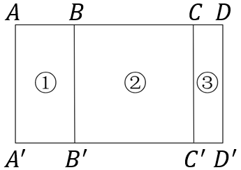

# 第 25 季 · 数量关系

来源：2026下半年省考第二十五季行测模考大赛（广东卷）.pdf

共 15 题，保留原卷题号。分数与数学符号使用 LaTeX；图片路径指向同一资料包内的原图。

## 第 31 题

原卷 PDF 页码：9；题目 ID：`gd-mock-2026h2-s25-q31`

-1，1，3，6，30，（    ）

**A.** 180

**B.** 210

**C.** 240

**D.** 270

## 第 32 题

原卷 PDF 页码：9；题目 ID：`gd-mock-2026h2-s25-q32`

13，25，46，75，111，153，（    ）

**A.** 200

**B.** 202

**C.** 210

**D.** 212

## 第 33 题

原卷 PDF 页码：9；题目 ID：`gd-mock-2026h2-s25-q33`

-2，9，35，77，165，（    ）

**A.** 208

**B.** 221

**C.** 234

**D.** 247

## 第 34 题

原卷 PDF 页码：9；题目 ID：`gd-mock-2026h2-s25-q34`

12，41，59，70，77，81，（    ）

**A.** 84

**B.** 87

**C.** 92

**D.** 95

## 第 35 题

原卷 PDF 页码：9；题目 ID：`gd-mock-2026h2-s25-q35`

48，32，56，72，100，（    ），186

**A.** 122

**B.** 130

**C.** 136

**D.** 140

## 第 36 题

原卷 PDF 页码：9；题目 ID：`gd-mock-2026h2-s25-q36`

某服装厂接到一笔服装生产订单，计划按照每天120套的效率进行生产，刚好能在订单交货期限内完成订单。在完成了订单总量的40%后，因引入新设备，生产效率提升了50%，最终这笔订单比原计划提前了6天完成。则该服装厂完成这笔订单共需生产多少套服装？

**A.** 1800

**B.** 2400

**C.** 3600

**D.** 4300

## 第 37 题

原卷 PDF 页码：9；题目 ID：`gd-mock-2026h2-s25-q37`

某市9月上旬的降水量比中旬少12%，上旬、中旬、下旬的平均降水量比中旬多20%。已知下旬的降水量比上旬多42毫米，则该市9月平均每天的降水量为多少毫米？

**A.** 2

**B.** 5

**C.** 6

**D.** 7

## 第 38 题

原卷 PDF 页码：9；题目 ID：`gd-mock-2026h2-s25-q38`

某图书馆将每日入馆读者分为儿童、青少年、成人三类进行统计。某日，儿童读者人数占读者总人数的 $\frac{1}{3}$ ，青少年读者人数比另外两类读者人数之和少 $\frac{1}{5}$ ，儿童读者人数比成人读者人数多15人，则该日图书馆的读者总人数为多少人？

**A.** 135

**B.** 150

**C.** 165

**D.** 180

## 第 39 题

原卷 PDF 页码：9；题目 ID：`gd-mock-2026h2-s25-q39`

甲、乙、丙三人要共同投资项目，约定每个项目的投资额中：30万元及以内的部分，三人平摊；30万元-50万元（含50万元）的部分，甲承担40%，乙和丙各承担30%；50万元-60万元（含60万元）的部分，甲承担20%，乙和丙各承担40%；超出60万元的部分，全部由甲承担。现有两个投资计划：①投资一个75万元的项目，②投资45万元和30万元的项目各一个。则甲在两个投资计划中的出资额相差多少万元？

**A.** 15

**B.** 14

**C.** 12

**D.** 9

## 第 40 题

原卷 PDF 页码：9；题目 ID：`gd-mock-2026h2-s25-q40`

某种细菌在培养皿中繁殖，第一天细菌数量为a。从第二天开始，每天细菌数量均比前一天增加2倍，第五天细菌数量为1620。则在第几天细菌数量首次超过200？

**A.** 二

**B.** 三

**C.** 四

**D.** 五

## 第 41 题

原卷 PDF 页码：10；题目 ID：`gd-mock-2026h2-s25-q41`

某植物研究所有一块长方形的种植区 $ADD'A'$ （如图所示），已知该种植区的长比宽多30米，AC的长度为60米，BD的长度为50米。现要在①、②、③三个区域分别种植不同的植物，且区域②是正方形。则三个区域种植面积的比例为：

**A.** 3：6：1

**B.** 2：3：1

**C.** 2：5：1

**D.** 2：4：1

## 第 42 题

原卷 PDF 页码：10；题目 ID：`gd-mock-2026h2-s25-q42`

一架无风时飞行速度为36米/分的飞机模型，在风速可控的飞行风场中进行测试。第一次测试时，在固定风速的飞行风场中往返一次，其逆风飞行与顺风飞行所用的时间之比为2：1。第二次测试时，将飞行风场中的风速增加到原来的1.5倍，往返飞行一次共用了4分钟。则飞行风场的长度为：（空气流动方向与飞行方向平行）

**A.** 81米

**B.** 72米

**C.** 64米

**D.** 54米

## 第 43 题

原卷 PDF 页码：10；题目 ID：`gd-mock-2026h2-s25-q43`

一项工程，若甲、乙两公司合作需12天完成，总工费为12万元；若甲公司先单独工作8天，然后由乙公司接替再做18天也可以完成，总工费为14万元。若甲公司单独完成该工程，则总工费为多少万元？

**A.** 6

**B.** 8

**C.** 10

**D.** 12

## 第 44 题

原卷 PDF 页码：10；题目 ID：`gd-mock-2026h2-s25-q44`

F公司每月5号发工资，若5号为星期六或星期日，则工资会提前在当周的星期五发放。某年的下半年，F公司最多有几个月刚好在5号发工资？

**A.** 6

**B.** 5

**C.** 4

**D.** 3

## 第 45 题

原卷 PDF 页码：10；题目 ID：`gd-mock-2026h2-s25-q45`

一条环形跑道长500米，甲、乙两人从不同起点同时出发匀速跑步，甲的速度比乙多2倍。若相向而行，则两人沿短弧跑步与沿长弧跑步的相遇时间之比为2：3；若同向而行，甲想在最短时间内追上乙，则当甲第二次追上乙时距离出发点多少米？

**A.** 50

**B.** 100

**C.** 150

**D.** 200
