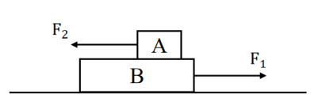

# 第 25 季 · 科学推理

来源：2026下半年省考第二十五季行测模考大赛（广东卷）.pdf

共 5 题，保留原卷题号。分数与数学符号使用 LaTeX；图形使用原图或已标注的矢量重绘图。

## 第 66 题

原卷 PDF 页码：16；题目 ID：`gd-mock-2026h2-s25-q66`

高速公路通过村庄密集区时，为了减弱行驶车辆发出的噪声对居民的影响，通常会在高速公路两侧安装玻璃隔声板。下列控制和减弱噪声的途径与之相同的是（    ）。

**A.** 老师在上课时把手机铃声调成静音

**B.** 飞机场附近的村民安装双层真空玻璃

**C.** 禁止商贩在居民区用扩音器叫卖

**D.** 午休时佩戴耳塞

## 第 67 题

原卷 PDF 页码：16, 17；题目 ID：`gd-mock-2026h2-s25-q67`

如图所示，外力 $F_1$ 大小为10N，作用于物块B上，外力 $F_2$ 大小为5N，作用于物块A上。物块B静止于粗糙程度均匀的水平地面上，物块A在物块B上向左做匀速直线运动，假设物块B足够长，下列说法不正确的是（    ）。

**A.** 物块A共受到4个力的作用

**B.** 物块B共受到6个力的作用

**C.** 地面对物块B的摩擦力一定小于10N

**D.** 物块A对物块B的摩擦力一定小于5N

## 第 68 题

原卷 PDF 页码：17；题目 ID：`gd-mock-2026h2-s25-q68`

寒冷的凌晨，露天放置的金属护栏表面会附着一层白色霜花，等到太阳升起气温回升，霜花又会变成水。上述过程中发生的物态变化依次是（    ）。

**A.** 凝华、升华

**B.** 凝固、汽化

**C.** 液化、熔化

**D.** 凝华、熔化

## 第 69 题

原卷 PDF 页码：17；题目 ID：`gd-mock-2026h2-s25-q69`

小明生火时，他先点燃了紧挨着木头的干草，干草燃烧完后，木头的温度升高了，但还没有被点燃，其原因可能是（    ）。

**A.** 木头的着火点升高了

**B.** 木头的热值太低了

**C.** 木头的温度还没有达到其着火点

**D.** 木头没有和氧气接触

## 第 70 题

原卷 PDF 页码：17；题目 ID：`gd-mock-2026h2-s25-q70`

下图为某家族的某种伴X染色体隐性遗传病的遗传系谱图，下列说法正确的是（    ）。

**遗传系谱图的人物和亲属关系**

| 编号 | 性别 | 患病情况 | 父亲编号 | 母亲编号 | 图示配偶编号 |
| --- | --- | --- | --- | --- | --- |
| 1 | 男 | 未知 | 未给出 | 未给出 | 2 |
| 2 | 女 | 正常 | 未给出 | 未给出 | 1 |
| 3 | 女 | 未知 | 1 | 2 | 未给出 |
| 4 | 女 | 患病 | 1 | 2 | 未给出 |
| 5 | 男 | 正常 | 1 | 2 | 6 |
| 6 | 女 | 患病 | 未给出 | 未给出 | 5 |
| 7 | 女 | 未知 | 5 | 6 | 未给出 |

原图方形代表男、圆形代表女；空白代表正常、实心代表患病、问号代表患病情况未知。“未给出”表示原图没有该项亲属信息。1、2 的子女按图从左至右为 3、4、5；5、6 的子女为 7。

**A.** 1号可能不患病

**B.** 3号一定患病

**C.** 7号一定不患病

**D.** 3号和7号的基因型一定相同
