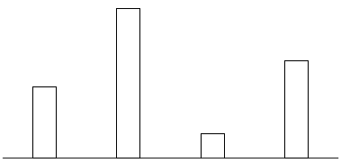
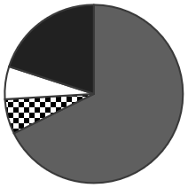
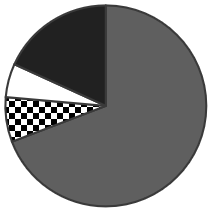

# 第 25 季 · 资料分析

来源：2026下半年省考第二十五季行测模考大赛（广东卷）.pdf

共 20 题，保留原卷题号。分数与数学符号使用 LaTeX；图片路径指向同一资料包内的原图。

## 材料 1（第 71—75 题）

2025年西藏自治区生产总值（GDP）3031.89亿元，按不变价计算，比上年增长7.0%。其中，第一产业增加值283.51亿元，增长12.1%；第二产业增加值1156.24亿元，增长9.6%；第三产业增加值增长4.7%，约占全区GDP的52.5%。人均地区生产总值81502元。2025年末全区常住人口同比增长1.1%。其中，城镇常住人口占总人口的40.11%；乡村常住人口占总人口的59.89%。2025年全区货物贸易进出口总额84.79亿元，比上年下降33.1%。其中，出口额61.28亿元，下降45.9%；进口额23.51亿元，增长74.4%。

**2016—2025年西藏自治区货物贸易进出口总额及出口额**

| 年份 | 进出口总额（亿元） | 出口额（亿元） |
| --- | --- | --- |
| 2016 | 51.67 | 31.24 |
| 2017 | 59.19 | 29.85 |
| 2018 | 47.52 | 28.57 |
| 2019 | 48.76 | 37.45 |
| 2020 | 21.33 | 12.94 |
| 2021 | 40.16 | 22.52 |
| 2022 | 46.01 | 43.09 |
| 2023 | 109.78 | 98.25 |
| 2024 | 126.72 | 113.24 |
| 2025 | 84.79 | 61.28 |

期间标记按原图保留；2025年数据的时间口径以关联文字材料为准。

## 第 71 题

原卷 PDF 页码：18；题目 ID：`gd-mock-2026h2-s25-q71`

2024年西藏自治区月均生产总值为（    ）亿元。

**A.** 194

**B.** 213

**C.** 236

**D.** 252

## 第 72 题

原卷 PDF 页码：18；题目 ID：`gd-mock-2026h2-s25-q72`

2024年西藏自治区第三产业增加值约为（    ）亿元。

**A.** 1488

**B.** 1055

**C.** 1592

**D.** 1520

## 第 73 题

原卷 PDF 页码：18；题目 ID：`gd-mock-2026h2-s25-q73`

2016-2020年，西藏自治区货物贸易进口额占进出口总额的比重低于 $\frac{1}{3}$ 的年份有几个？

**A.** 1

**B.** 2

**C.** 3

**D.** 4

## 第 74 题

原卷 PDF 页码：18；题目 ID：`gd-mock-2026h2-s25-q74`

2025年西藏自治区人均地区生产总值比上年约：

**A.** 增长4900元

**B.** 增长4500元

**C.** 减少4900元

**D.** 减少4500元

## 第 75 题

原卷 PDF 页码：18；题目 ID：`gd-mock-2026h2-s25-q75`

以下柱状图反映了哪一时间段内，西藏自治区货物贸易进口额的变化情况（横轴位置表示数量为0）？

**A.** 2016-2019年

**B.** 2018-2021年

**C.** 2020-2023年

**D.** 2022-2025年

## 材料 2（第 76—80 题）

**表1：2018—2022年我国能源生产总量和构成**

| 年份 | 生产总量（万吨标准煤） | 原煤（万吨标准煤） | 原油（万吨标准煤） | 天然气（万吨标准煤） | 其他能源（万吨标准煤） |
| --- | --- | --- | --- | --- | --- |
| 2018 | 378859 | 262170 | 27278 | 20458 | 68953 |
| 2019 | 397317 | 272162 | 27415 | 22250 | 75490 |
| 2020 | 407295 | 274924 | 27696 | 24438 | 80237 |
| 2021 | 427115 | 284886 | 28617 | 25627 | 87985 |
| 2022 | 463808 | 314084 | 29358 | 27494 | 92872 |

**表2：2018—2022年我国能源消费总量和构成**

| 年份 | 消费总量（万吨标准煤） | 原煤（万吨标准煤） | 原油（万吨标准煤） | 天然气（万吨标准煤） | 其他能源（万吨标准煤） |
| --- | --- | --- | --- | --- | --- |
| 2018 | 471925 | 278436 | 89194 | 35866 | 68429 |
| 2019 | 487488 | 281281 | 92623 | 38999 | 74585 |
| 2020 | 498314 | 283541 | 93683 | 41858 | 79232 |
| 2021 | 525896 | 293976 | 97817 | 46279 | 87824 |
| 2022 | 540956 | 304042 | 96839 | 45444 | 94631 |

## 第 76 题

原卷 PDF 页码：19；题目 ID：`gd-mock-2026h2-s25-q76`

2019-2022年，我国其他能源生产量同比增长最慢的年份是：

**A.** 2019年

**B.** 2020年

**C.** 2021年

**D.** 2022年

## 第 77 题

原卷 PDF 页码：19；题目 ID：`gd-mock-2026h2-s25-q77`

2021年，我国原煤消费量同比增量约是原油的多少倍？

**A.** 1.2

**B.** 1.5

**C.** 2.2

**D.** 2.5

## 第 78 题

原卷 PDF 页码：19, 20；题目 ID：`gd-mock-2026h2-s25-q78`

以下哪个饼状图最能准确反映2022年我国原煤（灰）、原油（黑白格）、天然气（白）和其他能源（黑）消费量的比例关系？

**A.**

**B.**

**C.**

**D.**

## 第 79 题

原卷 PDF 页码：20；题目 ID：`gd-mock-2026h2-s25-q79`

2018-2022年，我国天然气年均生产量在以下哪项范围内？

**A.** 不到23000万吨标准煤

**B.** 23000~24000万吨标准煤

**C.** 24000~25000万吨标准煤

**D.** 25000万吨标准煤以上

## 第 80 题

原卷 PDF 页码：20；题目 ID：`gd-mock-2026h2-s25-q80`

根据上述资料，下列说法正确的是：

**A.** 2018-2022年，我国原煤消费量和生产量相差10000万吨标准煤以上的年份有1个

**B.** 2019-2022年，我国原煤、原油、天然气消费量较上年均有所提高

**C.** 2021年，我国原煤、原油、天然气消费量之和占能源消费总量的比重超过80%

**D.** 2022年，我国能源消费总量较2020年增长10%以上

## 材料 3（第 81—85 题）

2026年一季度，我国机床工具行业完成营业收入2502亿元，同比增长9.0%；实现利润总额67亿元。金属切削机床产量21.3万台，同比增长3.4%；金属成形机床产量4.2万台，同比增长2.4%，两项产量指标均延续了上年度增长趋势。然而，行业平均利润率也揭示出另一面现实：机床工具行业的结构性转型仍在途中，各分行业景气分化明显。专家表示“当前，行业正处在一个深刻的转折点上——从‘规模扩张’转向‘价值创造’。”随着传统产业转型升级、战略性新兴产业发展及未来产业培育，生产环节的工艺装备将进行彻底的升级改良，一个千亿级的市场正在进行结构性的持续扩容，必将为我国机床工具市场带来更多机遇。2026年一季度，行业利润总额从2025年同期的29亿元增至67亿元，据协会测算数据，金属切削机床分行业利润总额27亿元，利润率6.1%；金属成形机床分行业利润总额7亿元，利润率3.4%；机床功能部件及附件分行业利润总额8亿元，利润率5.1%；切削工具分行业利润总额38亿元，利润率12.3%；磨料磨具分行业仍处于亏损状态，利润总额为-27亿元，但亏损额已较上年同期减少8亿元，减亏效果显著。进出口数据同样传递出积极信号。2026年一季度，我国机床工具进出口总额83.8亿美元，同比增长9.2%，贸易顺差33.1亿美元，同比增长12.9%。金属加工机床出口22.9亿美元，同比增长4.4%。出口目的地方面，对印度、俄罗斯、越南、泰国等市场的出口均实现较快增长，其中对泰国出口同比增长37.3%，显示出我国机床在全球市场的竞争力持续提升。值得关注的是，出口结构的深层次变化。海关统计数据显示，2026年一季度，高端机床出口量同比飙升40%，国产五轴机床出口均价同步上涨71%。这意味着我国机床正在摆脱“低价走量”的传统路径，向高端市场稳步迈进。

## 第 81 题

原卷 PDF 页码：21；题目 ID：`gd-mock-2026h2-s25-q81`

2025年一季度，我国机床工具行业平均每个月完成营业收入约为：

**A.** 574亿元

**B.** 626亿元

**C.** 765亿元

**D.** 834亿元

## 第 82 题

原卷 PDF 页码：21；题目 ID：`gd-mock-2026h2-s25-q82`

2026年一季度，我国机床工具出口额为：

**A.** 50.70亿美元

**B.** 52.25亿美元

**C.** 54.80亿美元

**D.** 58.45亿美元

## 第 83 题

原卷 PDF 页码：21；题目 ID：`gd-mock-2026h2-s25-q83`

下列哪项与材料第二段所提到的“结构性转型”无关？

**A.** 行业当前正处在从追求产量“规模扩张”转向注重“价值创造”的转折点上

**B.** 原材料价格的大幅波动对行业利润的影响逐渐减弱

**C.** 生产环节的工艺装备将进行彻底的升级改良

**D.** 一个千亿级的市场正在进行结构性的持续扩容

## 第 84 题

原卷 PDF 页码：21；题目 ID：`gd-mock-2026h2-s25-q84`

根据材料，下列说法正确的有几项？
①2026年一季度，出口结构的深层次变化意味着我国机床已彻底摆脱“低价走量”的传统路径
②2026年一季度，我国机床行业只有磨料磨具分行业处于亏损状态
③2026年一季度，进出口数据显示出我国机床在全球市场的竞争力持续提升

**A.** 0

**B.** 1

**C.** 2

**D.** 3

## 第 85 题

原卷 PDF 页码：21；题目 ID：`gd-mock-2026h2-s25-q85`

关于2026年一季度我国机床工具行业，下列说法正确的是：

**A.** 我国机床工具进出口总额同比增长不到5亿美元

**B.** 行业利润总额同比增长两倍多

**C.** 切削工具分行业利润总额占行业利润总额的比重不到一半

**D.** 行业利润率（利润率  = （利润总额）/（营业收入） ）不到3%

## 材料 4（第 86—90 题）

2022年，我国服务进出口总额59801.9亿元（人民币，下同），同比增长12.9%。其中，出口额28522.4亿元，增长12.1%；进口额31279.5亿元，增长13.5%；服务贸易逆差2757.1亿元。

**2022年我国服务分类进出口统计**

| 服务类别 | 进出口金额（亿元） | 进出口同比增长（%） | 出口金额（亿元） | 出口同比增长（%） | 进口金额（亿元） | 进口同比增长（%） |
| --- | --- | --- | --- | --- | --- | --- |
| 运输服务 | 21101.0 | 25.4 | 9745.3 | 18.8 | 11355.7 | 31.8 |
| 旅行服务 | 8559.8 | 8.4 | 644.4 | −12.2 | 7915.3 | 10.5 |
| 建筑服务 | 2410.0 | −7.2 | 1899.0 | −3.4 | 510.9 | −19.1 |
| 保险服务 | 1704.8 | 24.4 | 300.1 | −10.5 | 1404.6 | — |
| 金融服务 | 594.0 | −10.8 | 341.8 | 6.5 | 252.2 | −26.9 |
| 电信、计算机和信息服务 | 8352.7 | 8.3 | 5794.6 | 13.0 | 2558.1 | −1.2 |
| 知识产权使用费 | 3881.2 | 2.5 | 892.8 | 17.5 | 2988.4 | −1.2 |
| 个人、文化和娱乐服务 | 295.5 | −11.4 | 119.8 | −2.2 | 175.7 | −16.8 |
| 维护和维修服务 | 847.1 | 12.4 | — | 9.5 | — | 18.3 |
| 加工服务 | 1459.9 | 8.6 | 1403.9 | 8.2 | 56.0 | 21.9 |
| 其他商业服务 | 10240.3 | 9.1 | 6711.7 | 12.6 | 3528.6 | 2.8 |
| 政府服务 | 355.6 | 15.2 | 113.0 | 13.0 | 242.5 | 16.2 |

备注：因四舍五入，存在总计与分项合计不等的情况。“—”为原表缺省项。

## 第 86 题

原卷 PDF 页码：22；题目 ID：`gd-mock-2026h2-s25-q86`

2022年，我国保险服务进口额约比上年：

**A.** 增加306亿元

**B.** 增加370亿元

**C.** 减少306亿元

**D.** 减少370亿元

## 第 87 题

原卷 PDF 页码：22；题目 ID：`gd-mock-2026h2-s25-q87`

2022年，我国电信、计算机和信息服务进出口额占全国服务进出口总额的比重比旅行服务约：

**A.** 低0.3个百分点

**B.** 高0.3个百分点

**C.** 低3.5个百分点

**D.** 高3.5个百分点

## 第 88 题

原卷 PDF 页码：22；题目 ID：`gd-mock-2026h2-s25-q88`

2021年，我国维护和维修服务进口额和出口额之比约为：

**A.** 2：1

**B.** 1：3

**C.** 1：2

**D.** 3：1

## 第 89 题

原卷 PDF 页码：22；题目 ID：`gd-mock-2026h2-s25-q89`

2022年，下列我国服务类别中贸易顺差最大的是：

**A.** 加工服务

**B.** 金融服务

**C.** 建筑服务

**D.** 知识产权使用费

## 第 90 题

原卷 PDF 页码：22；题目 ID：`gd-mock-2026h2-s25-q90`

根据上述资料，下列说法错误的是：

**A.** 2022年，我国进口额、出口额最大的服务类别均为运输服务

**B.** 2022年，我国运输服务的贸易逆差大于保险服务

**C.** 2022年，我国政府服务出口额、进口额占全国的比重均高于上年

**D.** 2021年，我国个人、文化和娱乐服务出口额高于125亿元
