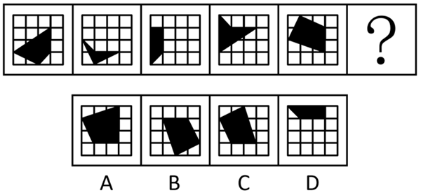
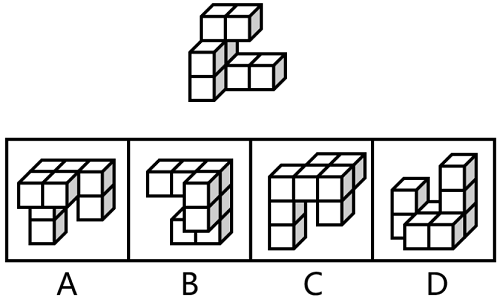
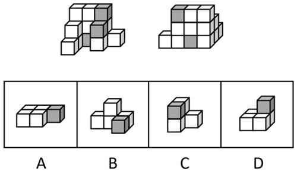

# 第 26 季 · 判断推理

来源：2026下半年省考第二十六季行测模考大赛（广东卷）.pdf

共 20 题，保留原卷题号。分数与数学符号使用 LaTeX；图片路径指向同一资料包内的原图。

## 第 46 题

原卷 PDF 页码：12；题目 ID：`gd-mock-2026h2-s26-q46`

从所给的四个选项中，选择最合适的一个填入问号处，使之呈现一定的规律性：

**A.** 见题图中的 A 选项

**B.** 见题图中的 B 选项

**C.** 见题图中的 C 选项

**D.** 见题图中的 D 选项

## 第 47 题

原卷 PDF 页码：12；题目 ID：`gd-mock-2026h2-s26-q47`

从所给的四个选项中，选择最合适的一个填入问号处，使之呈现一定的规律性：

**A.** 见题图中的 A 选项

**B.** 见题图中的 B 选项

**C.** 见题图中的 C 选项

**D.** 见题图中的 D 选项

## 第 48 题

原卷 PDF 页码：12, 13；题目 ID：`gd-mock-2026h2-s26-q48`

下列选项中，与所给的立体图形不可能是同一图形的是（    ）。

**A.** 见题图中的 A 选项

**B.** 见题图中的 B 选项

**C.** 见题图中的 C 选项

**D.** 见题图中的 D 选项

## 第 49 题

原卷 PDF 页码：13；题目 ID：`gd-mock-2026h2-s26-q49`

上边为由12个白色正方体和3个灰色正方体组合而成的多面体前后两面直观图，问其可以由下边除哪项外的三个多面体组合而成？

**A.** 见题图中的 A 选项

**B.** 见题图中的 B 选项

**C.** 见题图中的 C 选项

**D.** 见题图中的 D 选项

## 第 50 题

原卷 PDF 页码：13；题目 ID：`gd-mock-2026h2-s26-q50`

左边为4个灰色、8个白色正方体粘接成的长方体，问右边哪一项可能是其正确的外表面展开图？

**A.** 见题图中的 A 选项

**B.** 见题图中的 B 选项

**C.** 见题图中的 C 选项

**D.** 见题图中的 D 选项

## 第 51 题

原卷 PDF 页码：13, 14；题目 ID：`gd-mock-2026h2-s26-q51`

某市图书馆启动古籍修复专项行动，需从甲、乙、丙、丁四名修复师中选派两人参与为期一个月的封闭式修复工作。关于入选名单，四位修复师私下议论：甲说：如果乙入选，那么丙也会入选。乙说：我入选了，但是丙没有入选。丙说：丁没有入选。丁说：甲入选了。事后核实，四人中只有一人说了真话。由此可以推出：

**A.** 甲入选

**B.** 乙入选

**C.** 丙入选

**D.** 丁入选

## 第 52 题

原卷 PDF 页码：14；题目 ID：`gd-mock-2026h2-s26-q52`

磷是植物生长不可或缺的关键营养元素，但低温条件下土壤中的磷会被“锁”住，不利于植物生长。一项新研究锁定了玉米中的关键调控因子NLA蛋白，研究团队通过删除NLA基因中的12个碱基，定向编辑了新的玉米蛋白变体 $NLA\Delta12$ ，并成功进行了种植试验。研究人员最终得出结论，经 $NLA\Delta12$ 改造后的玉米能够在低温条件下保持高磷吸收率。要使上述论证成立，还需要基于以下哪一前提？

**A.** 低温环境会显著降低作物叶片中光合酶的活性，减少光合产物向根系的运输量，从而抑制作物生长

**B.** 植物根系分泌的有机酸可通过螯合作用活化土壤中的难溶性磷，不同作物分泌的有机酸浓度存在差异

**C.** 删除这12个碱基后，NLA蛋白的其他功能域保持完整，依然能正常控制茉莉酸信号通路

**D.** 删除的12个碱基位于NLA蛋白的SPX结构域，这一区域是感知并抑制磷元素活性的关键位置

## 第 53 题

原卷 PDF 页码：14；题目 ID：`gd-mock-2026h2-s26-q53`

一家商业杂志在对比和分析了多家科技公司的研发投入与市场占有率的数据之后，发现那些研发投入占营收比例超过15%的“高研发”公司，其市场增长速度和产品创新力普遍强于研发投入占营收比例不足5%的公司。由此可见，巨额的研发投入能够显著提高企业的核心竞争力，使其在市场上获得更大的份额。
以下哪项如果为真，最能削弱上述结论？

**A.** 研发投入的增加可以提升企业的技术水平，进而提高产品品质，最终影响市场占有率

**B.** 仅仅依靠研发投入未必能够保证市场份额，有时还会因巨额成本导致企业资金链断裂

**C.** 拥有高市场占有率的企业由于盈利丰厚，才会投入巨额研发费用来提高其核心竞争力

**D.** 销售渠道建设、品牌营销和客户服务等市场端的资源投入也会影响企业的市场占有率

## 第 54 题

原卷 PDF 页码：14；题目 ID：`gd-mock-2026h2-s26-q54`

某研究团队整合我国物候观测网超过两万条地面实测记录，并基于1982年至2020年的遥感观测数据开展研究。研究结果显示，与我国氮沉降水平较低的地区相比，氮沉降水平较高的地区木本植被的秋季叶变色期更晚。研究人员据此认为，氮沉降水平上升会延迟我国木本植被的秋季叶变色期。
以下选项如果为真，最能支持上述观点的是：

**A.** 部分秋季叶变色期推迟的木本植被区域，同时存在年平均气温轻微上升的情况

**B.** 氮沉降能通过增加植被叶面积并减缓叶绿素分解速度，延长叶片保持绿色的时间

**C.** 土壤pH值偏酸性的区域，木本植被对氮沉降的变化更为敏感，秋季叶变色期波动更大

**D.** 氮沉降水平上升会抑制枫叶花青素的合成，而枫叶变为红色主要是靠花青素的积累

## 第 55 题

原卷 PDF 页码：15；题目 ID：`gd-mock-2026h2-s26-q55`

为了迎接农历蛇年的到来，某地街道办事处精心策划并组织了一系列辞旧迎新的庆祝活动，其中一项别出心裁的活动是“给贪吃蛇涂色”，旨在通过这一趣味横生的活动，让参与者以色彩表达对新年的美好祝愿与期待。已知：
（1）参与者只能从红、橙、黄、绿、蓝5种颜色中选择1种涂在1节蛇身上；
（2）贪吃蛇身上任意连续4节所涂的颜色均不相同；
（3）贪吃蛇的第1、5、6、10、14、16、18、20节蛇身已经分别被涂上了红色、橙色、黄色、红色、蓝色、黄色、橙色、绿色，如下图所示。

**方格路线布局**

| 第1列 | 第2列 | 第3列 | 第4列 | 第5列 | 第6列 | 第7列 | 第8列 | 第9列 | 第10列 |
| --- | --- | --- | --- | --- | --- | --- | --- | --- | --- |
| — | 4 | 橙 | 黄 | — | 蓝 | 15 | 黄 | 17 | 橙 |
| — | 3 | — | 7 | — | 13 | — | — | — | 19 |
| 红 | 2 | — | 8 | — | 12 | — | — | — | 绿 |
| — | — | — | 9 | 红 | 11 | — | — | — | — |

保持原图相对位置。数字和颜色均为原图格内标注；“—”表示该位置没有方格，不能当成路线中的空白格。

根据上述信息，可以推出：

**A.** 第2节蛇身应该涂绿色

**B.** 第9节蛇身应该涂蓝色

**C.** 第12节蛇身应该涂黄色

**D.** 第19节蛇身应该涂红色

## 第 56 题

原卷 PDF 页码：15；题目 ID：`gd-mock-2026h2-s26-q56`

学生可以学习一些具体的心理调节方法，提高自我心理调节能力，保持心理健康。某市教育部门要求当地所有大学或中学都要开设心理教育课程。如果相关学校都落实了该市教育部门的要求，那么以下哪项一定为真？
①该市有的大学开展了心理教育课程但没有开展专题讲座。
②该市某校开设了心理教育课程，那么它是大学学校或中学学校。
③该市某校未开设心理教育课程，那么它不是大学学校。
④如果某校未开设心理教育课程，那么它不是大学学校，也不是中学学校。

**A.** ①②

**B.** ③④

**C.** ③

**D.** ①③④

## 第 57 题

原卷 PDF 页码：15；题目 ID：`gd-mock-2026h2-s26-q57`

近年来，全球新能源汽车普及率显著提升，多个国家新能源汽车年度销量占比已突破15%，部分欧洲国家甚至超过30%，但全球石油需求并未随之下降，反而持续增长——2023年全球石油需求量达1.03亿桶/日，创历史新高，2034年预计还将升至1.11亿桶/日。
以下各项如果为真，最能解释这一现象的是：

**A.** 新能源汽车电池原材料供应不稳定，导致部分车企暂时放缓新能源汽车生产节奏

**B.** 预计在未来十年，人口持续增长带来的石油需求远大于因新能源汽车减少的石油需求

**C.** 目前全球仍然以燃油汽车为主，现阶段利用新能源汽车逐步淘汰燃油汽车是幻想

**D.** 受经济下行影响，全球居民出行频率降低，新能源汽车实际使用里程较预期减少

## 第 58 题

原卷 PDF 页码：15, 16；题目 ID：`gd-mock-2026h2-s26-q58`

某研究团队为验证饮食与抑郁症是否存在关联，招募了1200名志愿者进行了一项实验。第一组志愿者进行健康饮食，即只摄入新鲜水果蔬菜和肉类，拒绝食用外卖和零食，第二组志愿者只摄入外卖和零食，如巧克力、薯片等。半年后发现，第一组志愿者患抑郁症的平均概率低于第二组。据此研究人员认为，健康饮食可以降低患抑郁症的风险。
以下哪项如果为真，最能削弱上述结论？

**A.** 参与研究的两组志愿者人员数量不完全相等

**B.** 体育锻炼是降低患抑郁症风险最有效的途径

**C.** 第二组志愿者中携带抑郁症遗传基因的比例高于第一组

**D.** 研究发现有抑郁焦虑症状的患者存在明显的饮食结构不合理

## 第 59 题

原卷 PDF 页码：16；题目 ID：`gd-mock-2026h2-s26-q59`

中国垃圾焚烧技术的快速进步令人十分自豪，但并非所有的垃圾都能“一烧了之”——占生活垃圾重量一半以上的厨余垃圾，含水率一般在80%-90%，即使经过预处理，其热值也一般为3-4MJ/kg。有专家据此认为，厨余垃圾并不适合焚烧发电。下列选项最有可能是上述推论暗含前提的是（    ）。

**A.** 并非所有的生活垃圾都适合焚烧发电

**B.** 厨余垃圾经过预处理后可脱水以提高热值

**C.** 焚烧厂允许的最低热值标准高于4MJ/kg

**D.** 易腐烂的厨余垃圾用生物处理的方式更为合适

## 第 60 题

原卷 PDF 页码：16；题目 ID：`gd-mock-2026h2-s26-q60`

某工厂对一批零件的合格数量进行统计，甲、乙、丙、丁四人上报的合格数量分别为：400、576、530、420。后经重新核查，发现他们分别犯了以下错误：有一人少统计了实际数量的 $\frac{1}{8}$，有一人少统计了实际数量的 $\frac{1}{6}$ ，有一人多统计了实际数量的 $\frac{1}{5}$ ，还有一人只是粗略估计了一个数。根据以上信息，可以推出粗略估计合格数量的人是：

**A.** 甲

**B.** 乙

**C.** 丙

**D.** 丁

## 第 61 题

原卷 PDF 页码：16；题目 ID：`gd-mock-2026h2-s26-q61`

如果一个企业不注重产品质量，那么将会失去市场竞争力。某企业十分注重产品质量，因此，该企业不会失去市场竞争力。下列选项所犯的逻辑错误与题干最为相似的是（    ）。

**A.** 只有保护生态环境，才能实现经济的长期发展。某地没有实现经济的长期发展，因此，该地一定没有保护生态环境

**B.** 为了孩子的健康成长，家长必须给予孩子足够的关爱和陪伴。小明的家长没有给予他足够的关爱和陪伴，因此，小明一定不能健康成长

**C.** 如果大多数人都支持某一方案，那么我们就应该实施该方案。甲公司实施了某一方案，因此，甲公司大多数人都支持该方案

**D.** 只有坚持独立自主的研发道路，才能在核心科技领域摆脱受制于人的局面。某产业在核心科技领域受制于人，因此，该产业应该坚持独立自主的研发道路

## 第 62 题

原卷 PDF 页码：17；题目 ID：`gd-mock-2026h2-s26-q62`

甲景区的基础设施建设、服务等处于该地区前列，但吸引的各地游客数量却偏少，营收一直低于周边的乙景区，尽管二者的景观相差无几。下列选项如果为真，最能解释上述现象的是（    ）。

**A.** 甲景区面积更大，运营成本更高

**B.** 乙景区的人文景观比甲景区多

**C.** 甲景区周边人口数量明显少于乙景区

**D.** 乙景区的针对性产品覆盖的客群更多

## 第 63 题

原卷 PDF 页码：17；题目 ID：`gd-mock-2026h2-s26-q63`

某校调查本校学生的参赛情况后发现，四班和五班的学生，或者报了数学竞赛，或者报了物理竞赛。根据以上条件，下列情况必定不属实的是（    ）。

**A.** 小赵是一班的学生，则他数学竞赛和物理竞赛都没报

**B.** 小钱没报物理竞赛，且他是四班的学生，则他报了数学竞赛

**C.** 小孙什么竞赛都没报，且他是五班的学生，则他不是四班的学生

**D.** 小李不是四班的学生，则他只报了数学竞赛

## 第 64 题

原卷 PDF 页码：17；题目 ID：`gd-mock-2026h2-s26-q64`

电影只要以真实为土壤，且以真诚为养分，就一定能口碑票房双丰收。某部大制作电影虽然取材于真实事件，但口碑很差，说明创作者在讲述故事时并不真诚。下列选项与题干逻辑结构最为相似的是（    ）。

**A.** 新能源汽车除非提升质量，否则或者产销不能稳定增长，或者出口不能稳定增长。某品牌新能源汽车产销不断增长，质量却原地踏步，那么其出口必然处于停滞态势

**B.** 如果做好跑前热身或者跑后拉伸，就能减小跑步对身体的冲击。小李跑前进行了充分热身，但跑完步身体仍感到疲惫，说明他没有做好跑后拉伸

**C.** 志愿服务标识不得用于商标，也不得用于商业广告。某品牌轮椅使用了志愿服务标识，所以该品牌违规了

**D.** 退税商店增多了，且口岸验核等待时间减少了，说明离境退税2.0版政策开始实施。某地退税商店没有增多，但离境退税2.0版政策已经开始实施，所以，其口岸验核等待时间一定减少了

## 第 65 题

原卷 PDF 页码：17；题目 ID：`gd-mock-2026h2-s26-q65`

一项研究针对首次确诊钙质肾结石的患者进行对照实验，实验组增加饮水量至尿量 $\geq 2000$ 毫升/天，5年后与对照组相比，每100名参与患者复发人次减少15人，且实验组肾结石的复发时间也明显更晚。因此，多饮水可以显著降低肾结石患者的复发风险、推迟复发时间。补充以下选项作为前提，最有助于使上述结论成立的是（    ）。

**A.** 实验组中的患者日饮水量不相上下

**B.** 对照组和实验组中的患者患高钙尿症的情况一致

**C.** 实验组中的患者更清楚肾结石的危害

**D.** 对照组和实验组中的患者均来自同一地区
