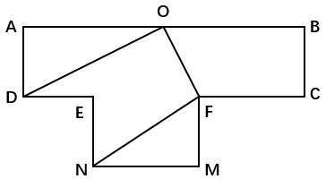

# 第 26 季 · 数量关系

来源：2026下半年省考第二十六季行测模考大赛（广东卷）.pdf

共 15 题，保留原卷题号。分数与数学符号使用 LaTeX；图片路径指向同一资料包内的原图。

## 第 31 题

原卷 PDF 页码：9；题目 ID：`gd-mock-2026h2-s26-q31`

4，2， $\frac{8}{5}$ ， $\frac{10}{7}$ ， $\frac{4}{3}$ ，（    ）

**A.** 1

**B.** 2

**C.** $\frac{14}{11}$

**D.** $\frac{2}{9}$

## 第 32 题

原卷 PDF 页码：9；题目 ID：`gd-mock-2026h2-s26-q32`

2.11，4.17，8.25，5.26，6.31，（    ）

**A.** 9.38

**B.** 7.42

**C.** 3.19

**D.** 1.15

## 第 33 题

原卷 PDF 页码：9；题目 ID：`gd-mock-2026h2-s26-q33`

2，−1，9，18，46，（    ）

**A.** 75

**B.** 79

**C.** 83

**D.** 87

## 第 34 题

原卷 PDF 页码：9, 10；题目 ID：`gd-mock-2026h2-s26-q34`

$\frac{2}{3}$ ， $\frac{1}{2}$ ， $\frac{5}{12}$ ， $\frac{1}{3}$ ，（    ）

**A.** $\frac{1}{6}$

**B.** $\frac{1}{5}$

**C.** $\frac{3}{4}$

**D.** $\frac{1}{3}$

## 第 35 题

原卷 PDF 页码：10；题目 ID：`gd-mock-2026h2-s26-q35`

**题目数表**

| 第1列 | 第2列 | 第3列 |
| --- | --- | --- |
| 2 | 5 | 13 |
| 4 | 6 | 26 |
| 3 | 8 | 29 |
| 7 | 9 | ？ |

四行三列，保持原图行列位置；列名为转写时添加。

**A.** 58

**B.** 65

**C.** 69

**D.** 72

## 第 36 题

原卷 PDF 页码：10；题目 ID：`gd-mock-2026h2-s26-q36`

某公司计划用40天开发一款软件，开发8天后由于客户增加需求，剩余开发量增加了5%，为提高效率该公司引入AI测试，开发效率提高了20%。则该公司完成这款软件的开发实际用时多少天？

**A.** 36

**B.** 35

**C.** 28

**D.** 27

## 第 37 题

原卷 PDF 页码：10；题目 ID：`gd-mock-2026h2-s26-q37`

某科技公司共有4个部门，其中研发部员工人数是营销部的1.3倍，财务部员工人数比管理部多3人。已知财务部员工共13人，问该公司员工总数可能为多少人？

**A.** 86

**B.** 92

**C.** 98

**D.** 106

## 第 38 题

原卷 PDF 页码：10；题目 ID：`gd-mock-2026h2-s26-q38`

某书店统计科幻小说和侦探小说的季度销量，已知科幻小说的季度销量比侦探小说多180本，且科幻小说季度销量的 $\frac{2}{9}$ 恰好等于侦探小说的 $\frac{1}{3}$ 。则该书店科幻小说和侦探小说的季度销量总和为：

**A.** 540本

**B.** 600本

**C.** 720本

**D.** 900本

## 第 39 题

原卷 PDF 页码：10；题目 ID：`gd-mock-2026h2-s26-q39`

档案室有w份文件需要整理。如果安排单人完成，甲需要m天，乙所需时间是甲的4倍。如果安排两人合作完成，乙、丙合作所需时间是甲、丙合作所需时间的2倍。问以下关于丙的说法正确的是：

**A.** 丙每天可以完成2m份文件

**B.** 丙每天可以完成 $\frac{w}{2}$份文件

**C.** 丙单独完成需要2m天

**D.** 丙单独完成需要 $\frac{w}{2}$天

## 第 40 题

原卷 PDF 页码：10, 11；题目 ID：`gd-mock-2026h2-s26-q40`

某实验室有两个容量均为500ml的容器A和B，其中A容器盛有浓度为10%的酒精溶液400ml，B容器盛有浓度为30%的酒精溶液200ml。实验员小吴要用浓度为18%的酒精溶液，但找不到合适的其他容器，只能将A容器内的溶液倒入B容器，或将B容器内的溶液倒入A容器进行混合。则他如何转移可以恰好得到所需溶液？

**A.** B容器向A容器倒入300ml溶液

**B.** A容器向B容器倒入300ml溶液

**C.** B容器向A容器倒入100ml溶液

**D.** A容器向B容器倒入100ml溶液

## 第 41 题

原卷 PDF 页码：11；题目 ID：`gd-mock-2026h2-s26-q41`

某超市本月推出线上订购免费外送服务。月末统计某商品的销售数据：与上月相比，虽线下销售量减少50%，但总销售量增加100%，总盈利为上月的1.5倍。已知每件商品的外送成本是进货成本的20%，问上月该商品的利润率为：

**A.** 30%

**B.** 40%

**C.** 50%

**D.** 60%

## 第 42 题

原卷 PDF 页码：11；题目 ID：`gd-mock-2026h2-s26-q42`

S市为公平分配保障性住房，采用电脑随机摇号的方式将120户申请家庭分配到三个小区：和谐苑（房源35套）、平安里（房源45套）、幸福城（房源40套）。已知每户家庭随机分配一套住房且本次所有房源均分配完毕，那么申请人小陈和小王都被分配到幸福城小区的概率是：

**A.** $\frac{1}{9}$

**B.** $\frac{1}{3}$

**C.** $\frac{13}{119}$

**D.** $\frac{3}{8}$

## 第 43 题

原卷 PDF 页码：11；题目 ID：`gd-mock-2026h2-s26-q43`

如图，两个长方形拼接成一个T形，其中O为AB的中点，AD=DE=EN $=\frac{1}{4}AB$ 。已知 $\angle DOF$为直角，AD的长度为a，问五边形DOFNE的面积为：

**A.** $2a^2$

**B.** $2\sqrt{3}a^2$

**C.** $3a^2$

**D.** $2\sqrt{2}a^2$

## 第 44 题

原卷 PDF 页码：11；题目 ID：`gd-mock-2026h2-s26-q44`

某校组织全体一年级学生学习广播体操，需在操场上排成一个正方形实心方阵。第一次排队时，发现多出45人；于是将方阵每边的人数增加3人重新排队，发现还差12人才能排满。则该校共有多少名一年级学生？

**A.** 94

**B.** 109

**C.** 126

**D.** 144

## 第 45 题

原卷 PDF 页码：12；题目 ID：`gd-mock-2026h2-s26-q45`

某雾天能见度为500m。甲车在单行道路上从静止开始匀加速，行驶1km后速度达到60km/h。此时视线内恰好出现的前方车辆正以40km/h的速度匀速行驶，甲车立刻匀减速至与前车同速，此时恰好与前车保持100m安全距离，此后甲车保持匀速行驶。问甲车从出发到开始匀速行驶，共用了多长时间？

**A.** 120s

**B.** 144s

**C.** 264s

**D.** 280s
