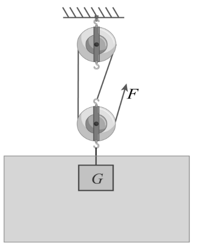
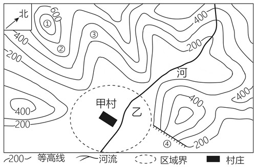

# 第 26 季 · 科学推理

来源：2026下半年省考第二十六季行测模考大赛（广东卷）.pdf

共 5 题，保留原卷题号。分数与数学符号使用 LaTeX；图形使用原图或已标注的矢量重绘图。

## 第 66 题

原卷 PDF 页码：18；题目 ID：`gd-mock-2026h2-s26-q66`

如图，使用滑轮组匀速提升完全浸没在水中的实心铁块，铁块未接触水底，且上升过程一直保持浸没。不计滑轮重、绳重与摩擦，下列说法正确的是（    ）。

**A.** 上升过程中铁块受到的浮力逐渐增大

**B.** 上升过程中铁块共受到4个力作用

**C.** 铁块所受重力和水对铁块的浮力是一对平衡力

**D.** 绳端拉力 $F=\frac{1}{3}(G-F_{\text{浮}})$

## 第 67 题

原卷 PDF 页码：18, 19；题目 ID：`gd-mock-2026h2-s26-q67`

电梯上升时的v-t图像如图所示，下列说法错误的是（    ）。

**电梯上升时的 v–t 图像**

| 时间 t（s） | 速度 v（m/s） |
| --- | --- |
| 0 | 0 |
| 2 | 6 |
| 6 | 6 |
| 9 | 0 |

横轴为 t/s，纵轴为 v(m/s)。按表中时间顺序，相邻点均以直线连接；t=2 s 和 t=6 s 处画有竖向虚线，v=6 m/s 处有横向标注线。表中没有添加加速度或受力结论。

**A.** 0~2s，电梯处于超重状态

**B.** 6~9s，电梯处于失重状态

**C.** 2~6s，电梯的加速度为0

**D.** 电梯6~9s的加速度大于0~2s的加速度

## 第 68 题

原卷 PDF 页码：19；题目 ID：`gd-mock-2026h2-s26-q68`

某化学反应的微观示意图如下，下列说法正确的是（    ）。

**反应前后的微观粒子示意图**

| 阶段 | 每个图示粒子的原子组成 | 图示粒子个数 |
| --- | --- | --- |
| 反应前 | 1 个碳原子、4 个氢原子 | 1 |
| 反应前 | 2 个氧原子 | 3 |
| 反应后 | 1 个碳原子、2 个氧原子 | 1 |
| 反应后 | 2 个氧原子 | 1 |
| 反应后 | 1 个氧原子、2 个氢原子 | 2 |

原图箭头：反应前 → 反应后；箭头上标“点燃”。图例：大空心圆为碳原子、斜线圆为氧原子、小空心圆为氢原子。按图示粒子逐个计数，保留反应后仍存在的氧粒子；未将原图改写为配平反应方程式。

**A.** 该微观示意图可说明反应前后分子种类、数目均不发生改变

**B.** 该反应的反应物分子个数比为1：3

**C.** 该反应属于氧化还原反应

**D.** 该反应的生成物有三种分子

## 第 69 题

原卷 PDF 页码：19；题目 ID：`gd-mock-2026h2-s26-q69`

在ABO血型系统中，下列关于血型遗传的说法正确的是（    ）。

**A.** 若父母一方为A型血，另一方为B型血，则子女只可能是A型血或者B型血

**B.** 若子女出现O型血，则父母双方至少有一人一定是O型血

**C.** 若父母分别为AB型血与O型血，则子女不可能是O型血

**D.** 若子女为AB型血，则父母一方必定是A型血，另一方必定是B型血

## 第 70 题

原卷 PDF 页码：19；题目 ID：`gd-mock-2026h2-s26-q70`

下图为某地的等高线地形图，下列说法正确的是（    ）。

**A.** ②处为山谷，容易发育河流

**B.** 图中河流流向为自北向南

**C.** 甲村所在区域海拔高于400米

**D.** ③处为山脊
