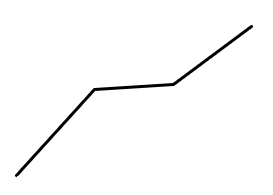

# 第 26 季 · 资料分析

来源：2026下半年省考第二十六季行测模考大赛（广东卷）.pdf

共 20 题，保留原卷题号。分数与数学符号使用 LaTeX；图片路径指向同一资料包内的原图。

## 材料 1（第 71—75 题）

“十四五”期间，绿美广东生态建设实现从规划布局到全面实施的重大跨越。据悉，全省森林覆盖率、蓄积量等关键指标超额完成，林长制考核位居全国前列，南岭国家公园创建取得实质性进展，中华穿山甲等珍稀物种保护成效卓著，全民爱绿护绿社会氛围浓厚。“十五五”期间，广东省将启动实施“四大工程”，增强森林生态系统多样性稳定性，使全省森林蓄积量达到7亿立方米，乔木林混交比例提升至60%，林业产业总产值年均增长5%以上，优质生态产品供给能力显著增强。“十四五”期间，广东省种植乡土阔叶树种超2亿株，乔木林混交比例提升至54%，乡村绿化种植3900万株，累计营造红树林4931公顷、修复2682公顷，举办义务植树活动达7.39万场、参与群众超522万人次，建成古树公园77个，“推窗见绿、出门见景”成为生活新常态。2026年是“十五五”开局之年，广东省将启动实施“四大工程”：实施岭南特色植物园体系建设工程，首批重点建设广州大夫山榕树等30个特色植物园；实施珠三角大美湿地体系建设工程，全力支持广州、深圳、珠海等3个市申报国际湿地城市；实施粤港澳大湾区内湾绿带工程，打造具有岭南特色和湾区风韵、山城田海相连的生态休憩廊道；实施国有林场样板带动工程，推广“国有林场+”模式，推动林场发展转型升级。

## 第 71 题

原卷 PDF 页码：20；题目 ID：`gd-mock-2026h2-s26-q71`

根据资料，以下不属于2026年广东省将启动实施的“四大工程”的是：

**A.** 岭南特色植物园体系建设工程

**B.** 珠三角大美湿地体系建设工程

**C.** 粤港澳大湾区内湾绿带工程

**D.** 红树林生态修复与乡村绿化提升工程

## 第 72 题

原卷 PDF 页码：20；题目 ID：`gd-mock-2026h2-s26-q72`

根据资料，下列说法有误的是：

**A.** “十五五”期间，广东省力争使全省森林蓄积量达到7亿立方米

**B.** “十四五”期间，广东省林长制考核在全国排名靠前

**C.** “十三五”期间，广东省乡村绿化种植不足4000万株

**D.** “十四五”期间，广东省参与义务植树活动的群众超500万人次

## 第 73 题

原卷 PDF 页码：20；题目 ID：`gd-mock-2026h2-s26-q73`

“十四五”期间，广东省修复红树林面积占营造和修复红树林总面积的比重约为：

**A.** 35.2%

**B.** 40.1%

**C.** 45.8%

**D.** 51.3%

## 第 74 题

原卷 PDF 页码：20；题目 ID：`gd-mock-2026h2-s26-q74`

“十四五”期间，广东省平均每年举办义务植树活动约多少万场？

**A.** 1.28

**B.** 1.48

**C.** 1.65

**D.** 1.92

## 第 75 题

原卷 PDF 页码：20, 21；题目 ID：`gd-mock-2026h2-s26-q75`

根据资料，以下说法不正确的是：

**A.** “十五五”期间，广东省规划乔木林混交比例较“十四五”期间提高6个百分点

**B.** “十五五”期间，广东省预计共建设30个岭南特色植物园

**C.** 2026年，广东省全力支持3个珠三角城市申报国际湿地城市

**D.** “十五五”期间，广东省林业产业总产值年均增速目标为不低于5%

## 材料 2（第 76—80 题）

**图1：2014—2024年我国糖料产量及种植面积**

| 年份 | 糖料产量（万吨） | 糖料种植面积（万亩） |
| --- | --- | --- |
| 2014 | 12089 | 2606 |
| 2015 | 11215 | 2359 |
| 2016 | 11176 | 2333 |
| 2017 | 11379 | 2318 |
| 2018 | 11937 | 2434 |
| 2019 | 12169 | 2416 |
| 2020 | 12014 | 2353 |
| 2021 | 11454 | 2187 |
| 2022 | 11236 | 2180 |
| 2023 | 11376 | 2123 |
| 2024 | 11457 | 2220 |

**图2：2024年我国糖料产量排名前十地区**

| 地区 | 糖料产量（万吨） |
| --- | --- |
| 广西 | 6929.81 |
| 云南 | 1687.15 |
| 广东 | 1227.16 |
| 新疆 | 731.08 |
| 内蒙古 | 376.35 |
| 海南 | 80.77 |
| 河北 | 77.18 |
| 江西 | 59.79 |
| 四川 | 39.55 |
| 浙江 | 38.12 |

## 第 76 题

原卷 PDF 页码：21；题目 ID：`gd-mock-2026h2-s26-q76`

“十三五”期间，我国糖料单位面积产量最高的是哪一年？

**A.** 2016年

**B.** 2018年

**C.** 2019年

**D.** 2020年

## 第 77 题

原卷 PDF 页码：21；题目 ID：`gd-mock-2026h2-s26-q77`

若2025年我国糖料产量同比增速与2024年一致，则“十四五”期间我国糖料总产量约为多少万吨？

**A.** 45523

**B.** 56980

**C.** 57062

**D.** 69076

## 第 78 题

原卷 PDF 页码：21；题目 ID：`gd-mock-2026h2-s26-q78`

2024年我国糖料产量排名前三的地区，其糖料总产量约是排名第六至八地区的多少倍？

**A.** 35

**B.** 45

**C.** 56

**D.** 61

## 第 79 题

原卷 PDF 页码：21；题目 ID：`gd-mock-2026h2-s26-q79`

若2024年云南糖料产量同比增速为6.3%，则2024年云南糖料产量对我国糖料总产量的增长贡献率约为：

**A.** 65%

**B.** 87%

**C.** 99%

**D.** 123%

## 第 80 题

原卷 PDF 页码：21, 22；题目 ID：`gd-mock-2026h2-s26-q80`

以下折线图能够准确反映哪一时间段内我国糖料种植面积同比增速的变化趋势？

**A.** 2015-2018年

**B.** 2017-2020年

**C.** 2019-2022年

**D.** 2021-2024年

## 材料 3（第 81—85 题）

**表1：2024年全国民用机场旅客吞吐量排名前十**

| 机场 | 旅客吞吐量（万人） | 比上年同期增减（%） |
| --- | --- | --- |
| 全国合计 | 145951.77 | 15.9 |
| 上海/浦东 | 7678.70 | 41.0 |
| 广州/白云 | 7636.48 | 20.9 |
| 北京/首都 | 6736.74 | 27.4 |
| 深圳/宝安 | 6147.73 | 16.6 |
| 成都/天府 | 5490.58 | 22.6 |
| 北京/大兴 | 4944.10 | 25.5 |
| 重庆/江北 | 4867.70 | 9.0 |
| 杭州/萧山 | 4805.39 | 16.7 |
| 上海/虹桥 | 4794.41 | 12.8 |
| 昆明/长水 | 4717.83 | 12.2 |

**表2：2024年全国民用机场货邮吞吐量排名前十**

| 机场 | 货邮吞吐量（万吨） | 比上年同期增减（%） |
| --- | --- | --- |
| 全国合计 | 2006.19 | 19.2 |
| 上海/浦东 | 377.83 | 9.8 |
| 广州/白云 | 238.19 | 17.3 |
| 深圳/宝安 | 188.15 | 17.6 |
| 北京/首都 | 144.33 | 29.3 |
| 鄂州/花湖 | 86.52 | 252.7 |
| 郑州/新郑 | 82.51 | 35.8 |
| 杭州/萧山 | 73.49 | −9.2 |
| 成都/双流 | 64.26 | 22.0 |
| 重庆/江北 | 46.95 | 21.0 |
| 上海/虹桥 | 42.77 | 17.7 |

## 第 81 题

原卷 PDF 页码：23；题目 ID：`gd-mock-2026h2-s26-q81`

2024年全国旅客吞吐量排名前三的民用机场，其当年货邮吞吐量共计多少万吨？

**A.** 570.67

**B.** 710.31

**C.** 760.35

**D.** 804.17

## 第 82 题

原卷 PDF 页码：23；题目 ID：`gd-mock-2026h2-s26-q82`

2023年，北京首都机场旅客吞吐量占全国民用机场的比重约为：

**A.** 3.13%

**B.** 4.20%

**C.** 4.62%

**D.** 6.63%

## 第 83 题

原卷 PDF 页码：23；题目 ID：`gd-mock-2026h2-s26-q83`

2023年，成都双流机场货邮吞吐量比重庆江北机场约多多少万吨？

**A.** 622.9

**B.** 519.1

**C.** 17.3

**D.** 13.9

## 第 84 题

原卷 PDF 页码：23；题目 ID：`gd-mock-2026h2-s26-q84`

2024年，表中上海市两个民用机场的旅客吞吐总量同比约增长：

**A.** 12.5%

**B.** 21.9%

**C.** 28.6%

**D.** 41.1%

## 第 85 题

原卷 PDF 页码：23；题目 ID：`gd-mock-2026h2-s26-q85`

根据上述材料，以下说法不正确的是：

**A.** 2024年全国货邮吞吐量排名第五的民用机场，其货邮吞吐量同比增长约6万吨

**B.** 2024年全国旅客吞吐量和货邮吞吐量排名均在前十的民用机场有7个

**C.** 若2023年深圳宝安机场完成航班起降39.3万架次，则该机场当年平均每架次承载旅客数超过100人

**D.** 2023年，广州白云机场旅客吞吐量大于上海浦东机场

## 材料 4（第 86—90 题）

2024年，我国大型营业性演出0.27万场，票房收入296.36亿元，观众人次3651.82万人次。大型营业性演出票房收入在演出票房收入中的占比由上年的35.4%提升至51.1%。

**我国大型营业性演出相关数据**

| 年份 | 票房收入（亿元） | 场次（场） | 观众人次（万人次） |
| --- | --- | --- | --- |
| 2019 | 39.64 | 1572 | 822.42 |
| 2023 | 177.96 | 3100 | 2789.41 |
| 2024 | 296.36 | 2700 | 3651.82 |

2024年，我国大型演唱会票房收入突破260亿元，同比增长78.1%；观众人次超过2900万人次，同比增长45.0%。大型演唱会集中在京津冀、长三角、珠三角、川渝等城市群，总票房收入占全国的63.5%。其中，长三角地区的票房收入占比达到31.4%，较去年提升了1.9个百分点。

## 第 86 题

原卷 PDF 页码：24；题目 ID：`gd-mock-2026h2-s26-q86`

2024年，我国大型营业性演出的人均票价约为：

**A.** 81.2元

**B.** 92.3元

**C.** 811.5元

**D.** 923.2元

## 第 87 题

原卷 PDF 页码：24；题目 ID：`gd-mock-2026h2-s26-q87`

2024年，我国大型演唱会的人均票价同比增长约：

**A.** 18.6%

**B.** 22.8%

**C.** 83.6%

**D.** 91.2%

## 第 88 题

原卷 PDF 页码：24；题目 ID：`gd-mock-2026h2-s26-q88`

2024年，我国演出票房收入同比增长约：

**A.** 77.3亿元

**B.** 114.1亿元

**C.** 139.6亿元

**D.** 153.9亿元

## 第 89 题

原卷 PDF 页码：24；题目 ID：`gd-mock-2026h2-s26-q89`

2024年，长三角地区大型演唱会的票房收入约是2023年的多少倍？

**A.** 0.90

**B.** 1.06

**C.** 1.53

**D.** 1.90

## 第 90 题

原卷 PDF 页码：24；题目 ID：`gd-mock-2026h2-s26-q90`

2019-2024年，下列我国大型营业性演出指标年均增速（以2019年为基期）最快的是：

**A.** 票房收入

**B.** 场次

**C.** 观众人次

**D.** 人均票价
