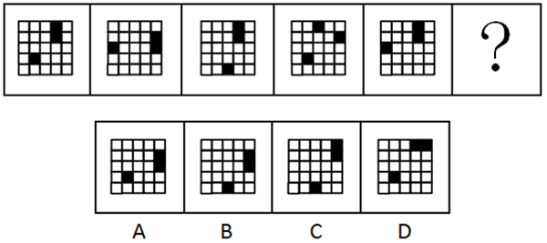
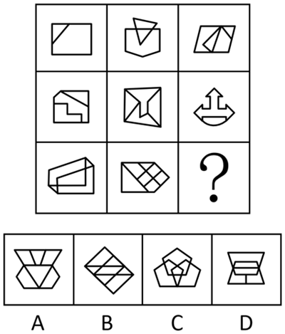
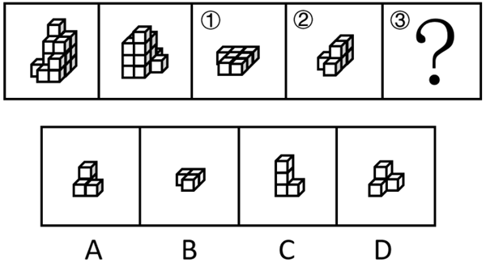
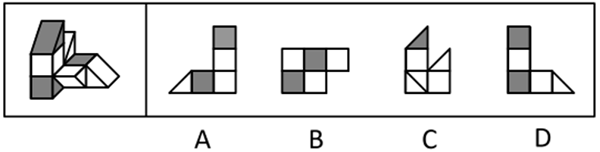

# 第 27 季 · 判断推理

来源：2026下半年省考第二十七季行测模考大赛（广东卷）.pdf

共 20 题，保留原卷题号。分数与数学符号使用 LaTeX；图片路径指向同一资料包内的原图。

## 第 46 题

原卷 PDF 页码：11；题目 ID：`gd-mock-2026h2-s27-q46`

从所给的四个选项中，选择最合适的一个填入问号处，使之呈现一定的规律性：

**A.** 见题图中的 A 选项

**B.** 见题图中的 B 选项

**C.** 见题图中的 C 选项

**D.** 见题图中的 D 选项

## 第 47 题

原卷 PDF 页码：11, 12；题目 ID：`gd-mock-2026h2-s27-q47`

从所给的四个选项中，选择最合适的一个填入问号处，使之呈现一定的规律性：

**A.** 见题图中的 A 选项

**B.** 见题图中的 B 选项

**C.** 见题图中的 C 选项

**D.** 见题图中的 D 选项

## 第 48 题

原卷 PDF 页码：12；题目 ID：`gd-mock-2026h2-s27-q48`

下列选项中最符合所给图形规律的是：

**A.** 见题图中的 A 选项

**B.** 见题图中的 B 选项

**C.** 见题图中的 C 选项

**D.** 见题图中的 D 选项

## 第 49 题

原卷 PDF 页码：12, 13；题目 ID：`gd-mock-2026h2-s27-q49`

左侧两图是给定的由相同小正方体组合而成的多面体的正视图和后视图。该多面体可以由
①、②和③三个多面体组合而成，问以下哪一项能填入问号处？

**A.** 见题图中的 A 选项

**B.** 见题图中的 B 选项

**C.** 见题图中的 C 选项

**D.** 见题图中的 D 选项

## 第 50 题

原卷 PDF 页码：13；题目 ID：`gd-mock-2026h2-s27-q50`

左图为给定的立体图形，从任一角度观看，右边哪项不可能是该立体图形的视图？

**A.** 见题图中的 A 选项

**B.** 见题图中的 B 选项

**C.** 见题图中的 C 选项

**D.** 见题图中的 D 选项

## 第 51 题

原卷 PDF 页码：13；题目 ID：`gd-mock-2026h2-s27-q51`

长期缺乏户外活动会影响人的视力发育，可能导致睫状肌紧张、晶状体调节能力下降，进而增加近视风险，还会减少维生素D合成，影响骨骼健康。一项针对A市某高校的调查发现，该校超过半数的学生日均户外活动时间不足1小时。有专家认为，造成这一现象的原因是这些大学生课后需投入大量时间完成作业和参加社会实践，挤占了户外活动时间。
以下哪项如果为真，最能削弱上述观点？

**A.** 一般社会实践集中安排在周末，特殊学科会安排完整学期进行实践

**B.** A市大学生课后完成作业的平均时长仅为1.5小时，低于自由支配时间总量

**C.** 不少户外活动时间充足的学生，也会把大量业余时间消耗在网络社交平台上

**D.** 该校日均户外活动时间不足1小时的大学生有大量可自由支配的空闲时间

## 第 52 题

原卷 PDF 页码：13, 14；题目 ID：`gd-mock-2026h2-s27-q52`

Akk菌是肠道内一种具有潜在益生功能的细菌，有研究人员认为，补充Akk菌有利于肥胖症患者恢复健康。肥胖症患者服用Akk菌后，肝脏PI3K信号通路会被干预，而PI3K信号通路是哺乳动物细胞内一条由受体酪氨酸激酶（RTK）介导的磷脂酰肌醇相关信号转导途径，核心组分包括磷脂酰肌醇3-激酶（PI3K）和蛋白激酶B（AKT）。以上结论如果为真，必须基于的前提是：

**A.** 人体内甘油三酯、胆固醇水平是衡量是否患有肥胖症的标准，也是判断临床常用减重药物起效的核心方法

**B.** Akk菌可通过调节代谢物增加抗炎因子浓度，显著降低正常模型动物体内的促炎细胞因子（如 $TNF-\alpha$ 、 $IL-1\beta$ ）的水平

**C.** 对肝脏PI3K信号通路的干预可以有效改善肥胖带来的机体异常，助力肥胖症患者恢复健康

**D.** 健康成年人肠道内Akk菌占比与肥胖症患者存在显著不同，且补充Akk菌后肥胖症患者肠道菌群结构有所变化

## 第 53 题

原卷 PDF 页码：14；题目 ID：`gd-mock-2026h2-s27-q53`

补齐农村基础设施短板和公共服务短板，是建设社会主义现代化强国的必然要求，也是解决发展不平衡、不充分问题的重要举措。我们既要在建设上接续“补强”，进一步扩大偏远地区的网络覆盖面和提升设施管护水平，也要加快以建促用，在县域乡村探索推广更多5G网络应用，并尽可能地降低使用成本。只有网络建设和信息应用发展得更稳更快，才能使我国信息通信业迈上新台阶。
由此可以推出：

**A.** 除非网络建设和信息应用发展得更稳更快，否则我国信息通信业不会迈上新台阶

**B.** 只有解决发展不平衡、不充分问题，才能实现建设社会主义现代化强国的伟大目标

**C.** 若我国信息通信业没有迈上新台阶，则网络建设和信息应用不会发展得更稳更快

**D.** 只有建设社会主义现代化强国，才能补齐农村基础设施短板和公共服务短板

## 第 54 题

原卷 PDF 页码：14；题目 ID：`gd-mock-2026h2-s27-q54`

古籍常因虫蛀、鼠啮、霉蚀受损，记录破损状况、修复程序及材料使用的修复档案，是支撑“原本保护”与“再生保护”的关键资料。但传统纸质档案易霉变、检索慢、难共享，因此，有人建议：可利用数字化技术将其升级为“云端档案库”，让修复人员实时上传数据、研究者在线调取，以提升修复效率。
以下哪项如果为真，最能质疑上述建议？

**A.** 建立“云端档案库”成本高，古籍保护资金应优先用于修复濒危古籍，保障原本目标

**B.** 古籍修复的细节需实体观察，数字化无法精准还原，“云端档案”无法满足修复参考需求

**C.** 一般情况下，研究者需结合古籍原件才能得出准确结论，仅靠“云端档案”无法推进研究

**D.** 部分偏远修复机构缺少稳定的网络，无法实时上传数据，导致“云端档案库”覆盖不完整

## 第 55 题

原卷 PDF 页码：14；题目 ID：`gd-mock-2026h2-s27-q55`

M省某村的育秧工厂去年晚稻季首次运营时，单盘秧苗成本达3元多，且产能仅能满足本村需求。今年春耕期间，当地秧苗市场售价与去年基本一致，但该工厂的利润较去年同期有明显提升。
以下关于今年的说法中，能够解释该工厂利润提升原因的是：
①该工厂铺设货运轨道，实现秧苗运输半自动化的同时减少了用人成本
②该工厂从外地大量采购高价优质稻种，提升秧苗品质
③该工厂享受每亩400元的集中育秧补贴，且补贴资金及时到账
④今年当地遭遇干旱，部分散户种植的秧苗成活率大幅下降

**A.** ①②

**B.** ①④

**C.** ②③

**D.** ①③

## 第 56 题

原卷 PDF 页码：15；题目 ID：`gd-mock-2026h2-s27-q56`

动物行为学家将20只健康的成年小鼠分为A、B两组，每组10只。实验前，两组小鼠均在相同的普通饲养笼中适应一周（无玩具）。随后，A组小鼠仍饲养在普通笼中，B组小鼠的饲养笼中额外放入滚轮等丰富化玩具。四周后，对两组小鼠进行“迷宫逃生测试”，记录其首次成功逃生的时间。结果显示，B组小鼠的平均逃生时间显著短于A组。研究者据此得出结论：饲养环境中的丰富化玩具，能够提升小鼠的空间记忆与学习能力，从而缩短其迷宫逃生时间。
以下哪项如果为真，最能削弱上述研究者的结论？

**A.** B组小鼠长期接触隧道游戏，一周适应期不足以消除之前经验对其造成的影响

**B.** 测试时，A组小鼠所处的迷宫光线比B组充足，而小鼠更偏好在明亮的环境中行动

**C.** 实验期间，B组小鼠的喂食量与A组保持一致，且喂食时间固定在每天傍晚时分

**D.** 在实验前的适应期内，A组小鼠曾出现过2次轻微的笼内打斗，B组未出现打斗

## 第 57 题

原卷 PDF 页码：15；题目 ID：`gd-mock-2026h2-s27-q57`

我国自主研发的全球首款四通道超低噪声半导体单光子探测器（简称“深度制冷单光子探测器”）已实现量产落地，该设备在探测效率、暗噪声水平、集成度等关键指标上刷新世界纪录，相关专家认为，此款深度制冷单光子探测器的量产与应用，将推动我国量子信息产业实现从“跟跑”到“领跑”的跨越式发展。
以下哪项如果为真，最不能支持上述专家的观点？

**A.** 深度制冷单光子探测器可为量子通信、单光子雷达、深空激光测距等战略领域提供自主可控的核心组件，填补了我国相关领域核心器件依赖进口的技术空白

**B.** 我国量子研发团队将持续推进该探测器的小型化、芯片化迭代升级，计划未来3年内实现产品成本降低40%，进一步扩大其在民用量子技术领域的应用场景

**C.** 此前国际同类单通道探测器在复杂探测任务中需多台协同，而我国四通道探测器单台即可完成，且能耗降低30%，直接突破了量子信息产业规模化落地的核心瓶颈

**D.** 我国某顶尖科研单位已将该探测器应用于星地量子通信试验，其探测灵敏度和稳定性均优于国际同类产品，为构建下一代星地一体量子通信网络奠定基础

## 第 58 题

原卷 PDF 页码：15；题目 ID：`gd-mock-2026h2-s27-q58`

某书店推出4款文创盲盒，分别对应诗歌、散文、小说、传记4种题材，甲、乙、丙、丁4位读者每人选购了2款，且满足以下前提：没有哪一款文创盲盒被4人同时选购，没有哪一款文创盲盒无人选购，任意2人选购的文创盲盒不完全相同。现已知：
（1）如果丁选购了诗歌盲盒，那么甲选购了散文盲盒；
（2）只有乙和丁都选购了散文盲盒，丙才会选购散文盲盒；
（3）如果乙选购了诗歌或散文盲盒中的至少1款，那么乙还会选购小说盲盒；
（4）如果丙选购了诗歌或小说盲盒中的至少1款，那么丙还会选购散文盲盒。根据以上信息，一定可以推出以下哪项？

**A.** 甲选购了诗歌和小说盲盒

**B.** 乙选购了小说和传记盲盒

**C.** 丙选购了诗歌和散文盲盒

**D.** 丁选购了小说和传记盲盒

## 第 59 题

原卷 PDF 页码：16；题目 ID：`gd-mock-2026h2-s27-q59`

中国学界深入挖掘马克思主义政治经济学的当代价值后发现，立足本土实践提炼原创经济理论能够建成完备的中国特色经济学理论体系。相关实践证明，建成完备的中国特色经济学理论体系，可助力打破西方经济学话语霸权。因此，立足本土实践提炼原创经济理论，便有可能持续提升中国经济学话语全球影响力。要使上述推论成立，需要补充的前提是（    ）。

**A.** 西方经济学话语霸权长期挤压我国经济学术话语发展空间

**B.** 提炼原创经济理论是我国经济学界多年深耕的核心成果

**C.** 破除西方经济学话语霸权有助于提升中国经济学话语全球影响力

**D.** 丰富的中国特色经济理论成果能够助力我国深度参与全球经济治理

## 第 60 题

原卷 PDF 页码：16；题目 ID：`gd-mock-2026h2-s27-q60`

张、王、李、赵、刘、陈6名机关工作人员，现需分配至文稿起草、会务保障、基层调研三项工作任务中，每人只负责一项任务，文稿起草的任务至少需要两人，其余两项任务至少需要一人。已知：
（1）只有王、赵、刘分别负责不同的工作任务，张或李才负责会务保障任务；
（2）除非赵不负责会务保障任务，否则张负责会务保障任务。如果王和刘负责文稿起草任务，则可以得出以下哪项？

**A.** 李负责基层调研任务

**B.** 赵负责文稿起草任务

**C.** 张负责会务保障任务

**D.** 陈负责会务保障任务

## 第 61 题

原卷 PDF 页码：16；题目 ID：`gd-mock-2026h2-s27-q61`

随意占用公共休闲场地，既会影响市民日常休闲生活，还会破坏城市整体规划布局。因此，为保证城市整体规划布局有序推进，应当制止随意占用公共休闲场地的行为。下列选项的逻辑结构与题干最为相似的是（    ）。

**A.** 地方特产依靠线下实体店、电商直播提升销量，如今实体店客流量减少，而地方特产整体销量稳步上涨。因此，说明电商直播作用更大

**B.** 棋手对弈需要静心沉稳思考，这批棋手赛场成绩优异，因此，对弈时双方棋手都做到了静心思考

**C.** 若忽视日常消防安全，各类安全隐患极易引发意外事故。因此，为规避意外事故发生，应扎实做好日常消防安全工作

**D.** 一个人心态越平和，越能从容应对生活中的波折。某人总能从容应对生活中的波折，因此，此人心态十分平和

## 第 62 题

原卷 PDF 页码：16, 17；题目 ID：`gd-mock-2026h2-s27-q62`

各大平台持续推出严谨详实的优质科普作品，不断提升真科普内容的产出数量与质量，本以为能大幅挤压伪科学言论生存空间。但网络传播数据显示，节奏直白、缺乏科学依据的伪科学养生言论传播速度反而比以往更快，覆盖面也比以往更广。对上述现象，以下解释最为合理的是（    ）。

**A.** 优质科普内容制作周期长，上线更新速度普遍比普通网络短视频慢

**B.** 伪科学内容善于借科普热简化结论、制造对立情绪，更容易被信任转发

**C.** 部分网民缺乏基础的科学常识，很难分辨网络上传播的养生类虚假言论

**D.** 刷短视频时，我们都在快速浏览、即时判断，没有时间停下来仔细思考

## 第 63 题

原卷 PDF 页码：17；题目 ID：`gd-mock-2026h2-s27-q63`

只要企业建立完善的人才培养体系，团队综合实力就一定会增强。除非团队综合实力能迅速增强，否则企业市场竞争力不会稳步提升。
由此可以推出：

**A.** 如果团队综合实力增强，则企业一定建立了完善的人才培养体系

**B.** 如果企业没有建立完善的人才培养体系，则团队综合实力必定没有增强

**C.** 只有稳步提升企业市场竞争力，团队综合实力才会迅速增强

**D.** 只有企业没有建立完善的人才培养体系，团队综合实力才会没有增强

## 第 64 题

原卷 PDF 页码：17；题目 ID：`gd-mock-2026h2-s27-q64`

想要稳住区域经济大盘，少不了完善的营商环境。想要吸引优质外来投资，同样少不了完善的营商环境。因此，完善的营商环境是稳住区域经济大盘与吸引优质外来投资的必要条件。下列选项的逻辑结构与题干最为相似的是（    ）。

**A.** 想要涵养社会文明风尚必须弘扬传统美德，想要凝聚社会向心力必须弘扬传统美德。因此，弘扬传统美德是涵养社会文明风尚、凝聚社会向心力的必要条件

**B.** 推动文旅产业提质升级，既要深挖本土地域特色，又要优化全域配套服务。因此，在推动文旅产业提质升级中深挖本土地域特色发挥着不可替代的作用

**C.** 发展现代农业离不开先进种植技术，加大农业科研投入才能获得先进种植技术。因此，先进种植技术是发展现代农业和加大农业科研投入的先决条件

**D.** 能够胜任基层执法工作，就得恪守职业行为准则。能够胜任基层执法工作，就得精通相关法律法规。因此，想要胜任基层执法工作就必须恪守职业行为准则并精通相关法律法规

## 第 65 题

原卷 PDF 页码：17；题目 ID：`gd-mock-2026h2-s27-q65`

据世界卫生组织统计，蚊虫是致死率最高的病媒生物，研究人员对比发现，日常涂抹含避蚊胺成分的驱蚊液、穿着浅色长袖衣裤的人群，被蚊虫叮咬的频次远低于未采取此类做法的人群，进而降低蚊媒传染病的传播风险。据此专家得出结论，涂抹含避蚊胺成分的驱蚊液、穿着浅色长袖衣裤，是预防蚊媒传染病最有效的个人防护方式。要使上述推理成立，需要补充的前提条件是：

**A.** 涂驱蚊液、穿长袖衣裤对伊蚊具有强效且显著的驱避作用

**B.** 蚊媒传染病主要是经由蚊虫叮咬这一途径进行传播的

**C.** 浅色长袖衣裤相较于深色服饰，更不易吸引蚊虫靠近叮咬

**D.** 及时清理积水也是预防蚊媒传染病的有效防护方式之一
