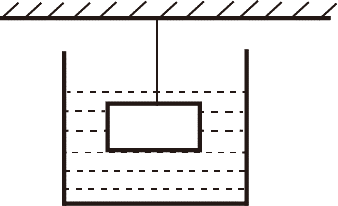
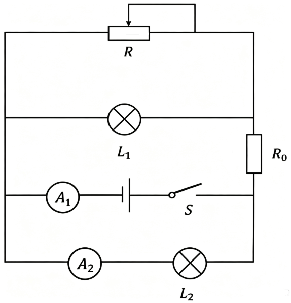

# 第 27 季 · 科学推理

来源：2026下半年省考第二十七季行测模考大赛（广东卷）.pdf

共 5 题，保留原卷题号。分数与数学符号使用 LaTeX；图形使用原图或已标注的矢量重绘图。

## 第 66 题

原卷 PDF 页码：18；题目 ID：`gd-mock-2026h2-s27-q66`

如图所示，质量分布均匀的实心物块，通过细绳悬挂在墙壁下方，此时物块完全浸没在柱形容器的水中，细绳处于绷紧状态，若剪断细绳，下列说法不正确的是（    ）。

**A.** 物块最终会沉底

**B.** 物块受到的浮力始终不变

**C.** 容器底部受到的液体压强变大

**D.** 物块底部受到的液体压强变大

## 第 67 题

原卷 PDF 页码：18；题目 ID：`gd-mock-2026h2-s27-q67`

下图所示的电路中，电源电压不变，闭合开关S后，滑动变阻器R的滑片从左向右移动的过程中，下列说法错误的是（    ）。

**A.** 电流表 $A_1$ 的示数变小

**B.** 电流表 $A_2$ 的示数不变

**C.** 灯泡 $L_2$ 的亮度不变

**D.** 灯泡 $L_1$ 的亮度不变

## 第 68 题

原卷 PDF 页码：18, 19；题目 ID：`gd-mock-2026h2-s27-q68`

小明在学习完溶解度相关的知识后，了解到蔗糖的溶解度随温度的升高而增大。为了观察蔗糖在水中的溶解情况，他在一定温度下配制了一定量的蔗糖饱和溶液，随后他将该溶液平均倒入甲、乙、丙、丁四个空烧杯中，然后分别对四个烧杯进行了如下操作：①将甲烧杯中的溶液倒出一半；②向乙烧杯中加入10g水；③向丙烧杯中加入10g蔗糖；④对丁烧杯进行加热。下列关于四个烧杯中溶液的说法不正确的是（    ）。

**A.** 甲烧杯中的溶液仍为饱和溶液

**B.** 乙烧杯中的溶液仍为饱和溶液

**C.** 丙烧杯中溶质的质量分数不变

**D.** 丁烧杯中溶质的质量分数不变

## 第 69 题

原卷 PDF 页码：19；题目 ID：`gd-mock-2026h2-s27-q69`

盛夏晴天，研究人员在上午10时、正午12时和下午14时测定同一株阔叶植物的蒸腾速率，发现正午12时蒸腾速率最低，14时又有所回升，同时观察到该株植物在正午时部分气孔缩小或关闭。下列说法不正确的是（    ）。

**A.** 植物体内的大部分水分以水蒸气形式通过叶片气孔散失

**B.** 在正午高温强光下，叶片失水加快，植物可能出现暂时水分亏缺

**C.** 正午蒸腾速率下降是因为光合作用消耗了大量水分

**D.** 气孔部分关闭能够减少水分散失，是植物根据环境变化进行的自我调节

## 第 70 题

原卷 PDF 页码：19；题目 ID：`gd-mock-2026h2-s27-q70`

农历初一前后为“朔”，通常难以看见月亮，初七、初八前后为上弦月，十五、十六前后为满月，二十二、二十三前后为下弦月。月球本身不发光，其总有一半被太阳照亮。关于月相成因，下列说法不正确的是（    ）。

**A.** 月球可见的亮面是因为反射了太阳光

**B.** 地球上看到的月相取决于太阳、地球和月球的相对位置

**C.** 满月时，月球与太阳大致位于地球两侧，月球被照亮的一面朝向地球

**D.** 满月时，月球位于太阳和地球之间，月球被照亮的一面朝向地球
