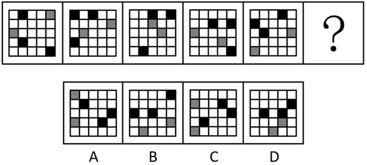
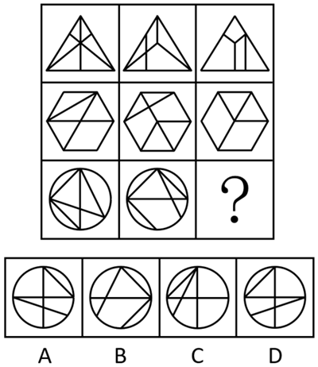
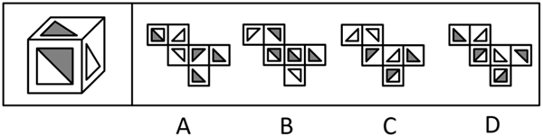

# 第 28 季 · 判断推理

来源：2026下半年省考第二十八季行测模考大赛（广东卷）.pdf

共 20 题，保留原卷题号。分数与数学符号使用 LaTeX；图片路径指向同一资料包内的原图。

## 第 46 题

原卷 PDF 页码：10, 11；题目 ID：`gd-mock-2026h2-s28-q46`

从所给的四个选项中，选择最合适的一个填入问号处，使之呈现一定的规律性：

**A.** 见题图中的 A 选项

**B.** 见题图中的 B 选项

**C.** 见题图中的 C 选项

**D.** 见题图中的 D 选项

## 第 47 题

原卷 PDF 页码：11；题目 ID：`gd-mock-2026h2-s28-q47`

从所给的四个选项中，选择最合适的一个填入问号处，使之呈现一定的规律性：

**A.** 见题图中的 A 选项

**B.** 见题图中的 B 选项

**C.** 见题图中的 C 选项

**D.** 见题图中的 D 选项

## 第 48 题

原卷 PDF 页码：11；题目 ID：`gd-mock-2026h2-s28-q48`

所给等腰梯形旋转 $360^{\circ}$ 后，其旋转轨迹不可能形成的图形是（    ）。

**A.** 见题图中的 A 选项

**B.** 见题图中的 B 选项

**C.** 见题图中的 C 选项

**D.** 见题图中的 D 选项

## 第 49 题

原卷 PDF 页码：11；题目 ID：`gd-mock-2026h2-s28-q49`

左边为由12个白色正方体和3个灰色正方体组合而成的多面体，问其可以由除哪项外的三个多面体组合而成？

**A.** 见题图中的 A 选项

**B.** 见题图中的 B 选项

**C.** 见题图中的 C 选项

**D.** 见题图中的 D 选项

## 第 50 题

原卷 PDF 页码：11, 12；题目 ID：`gd-mock-2026h2-s28-q50`

左边给定的是正方体纸盒，右边哪项可能是其正确的外表面展开图？

**A.** 见题图中的 A 选项

**B.** 见题图中的 B 选项

**C.** 见题图中的 C 选项

**D.** 见题图中的 D 选项

## 第 51 题

原卷 PDF 页码：12；题目 ID：`gd-mock-2026h2-s28-q51`

研究团队为探究肠道微生物对衰老的影响，将两个月大的年轻小鼠与18个月大的年老小鼠放在一起饲养，在同一个笼子里生活一个月后，年轻小鼠在迷宫任务和另一项记忆测试中的表现逐渐与年老小鼠趋同。研究团队发现，年轻小鼠的微生物群落变得与年老小鼠相似。由于生活在一起并食用对方粪便，肠道微生物很容易在小鼠间传播。研究人员据此认为，年老小鼠肠道中的一种或多种细菌可能是其认知能力下降的原因。
以下哪项如果为真，最能支持上述结论？

**A.** 研究人员将戈氏副拟杆菌移植到年轻小鼠体内后，它们对见过物体的记忆能力变差了

**B.** 衰老会导致生物对外部世界的感知能力下降，同时也可能导致其丧失对内部信号的感知能力

**C.** 此项实验是以小鼠为研究对象展开的，但研究团队发现的肠-脑回路极有可能同样存在于人类身上

**D.** 使用抗生素改变年老小鼠的肠道细菌环境能改善其在记忆测试中的表现，达到与健康的年轻小鼠相当的水平

## 第 52 题

原卷 PDF 页码：12；题目 ID：`gd-mock-2026h2-s28-q52`

人工智能引发的生产力革命深刻重塑教育理念与形态，推动教育实现从“被动为生产”到“主动为生活”、从“体系教育”到“泛在终身”、从“效率优先”到“适性发展”等多维度转型，摆脱对物质生产的刚性依附，回归“人的全面发展”，适配数智时代社会发展需求。有观点认为：人工智能与教育深度融合，能够破除传统教育桎梏、重塑教育现代化格局，助力我国加快建设教育强国、办好人民满意的教育。
以下哪项是上述论证成立的必要前提？

**A.** 当前随工业化大生产建立的学校教育体系，已难以适应新质生产力和数智时代社会发展的要求

**B.** 人工智能能够为教育变革定义新的内涵和全新路径，推动教育理念、体系、制度等全方位革新

**C.** 数智时代人类知识翻倍周期急剧缩短，“一次性学习”的传统体系教育模式必然走向终结

**D.** 数智时代的教育应培育“完整的人”，兼顾基础素养、高阶能力与价值伦理三重育人目标

## 第 53 题

原卷 PDF 页码：12, 13；题目 ID：`gd-mock-2026h2-s28-q53`

据媒体报道，中央网信办、工业和信息化部、公安部等多部门联合部署2026年个人信息保护系列专项行动，直指App、SDK等产品违规收集、过度索权等顽瘴痼疾。当前不少App安装即索要通讯录、位置、相册等全量权限，用户拒绝授权便无法使用，部分App还衍生出个人信息倒卖的黑灰产业链。对此，有互联网企业高管宣称：有的用户更看重使用便利，愿意以隐私换便利。
以下各项如果为真，除哪项外均能质疑上述高管的观点？

**A.** 隐私权作为公民基本人格权利，绝非可以随意用来交易换取使用便利的筹码

**B.** 这些用户并非主动愿意出让隐私换取便利，只是在App的强制权限索取规则下被动交出个人信息

**C.** 用户追求使用便利绝不等于甘愿出让个人隐私，便利与隐私从来不是非此即彼的对立选择

**D.** 在“不同意就不能用”的强制场景下，用户所谓的隐私与便利交换本质上是强买强卖

## 第 54 题

原卷 PDF 页码：13；题目 ID：`gd-mock-2026h2-s28-q54`

盘串曾被视为中老年人的专属爱好，如今正受到越来越多年轻人的喜爱，从学生到职场人，从社交平台到街头巷尾，盘串的场景无处不在。这一现象背后，不仅是审美与个性表达，更折射出当代年轻人对解压与文化认同、社会互动的心理需求。
以下哪项如果为真，最不能支持上述结论？

**A.** 研究表明，规律盘串能让 $\alpha$ 脑波上涨27%，效果相当于15分钟冥想，可有效缓解压力，带来内心平静

**B.** 相较于价格昂贵的黄金、珍珠或其他高级珠宝，文玩手串的购置门槛较低，为更多人提供了入门机会

**C.** 手串催生了独特社交场景，增加打破社交壁垒的契机，年轻人可在线上、线下交换手串，交流盘玩心得

**D.** 随着国潮兴起，年轻人对传统文化的认同感和自豪感增强，手串作为传统文化载体，承载传统文化底蕴

## 第 55 题

原卷 PDF 页码：13；题目 ID：`gd-mock-2026h2-s28-q55`

小周、小吴、小郑、小王和小冯五人预约了不同的公共实验室，分别为三楼的340室、341室和347室，四楼的433室以及五楼的527室。五人预约的实验室设备也不同，其中三楼存放有蛋白纯化仪、气相色谱仪和发酵设备，其他两个楼层分别存放有透射电子显微镜和荧光显微镜。已知：
（1）小郑预约的实验室与其他四人不在同一楼层；
（2）小吴和小冯均没有预约347室；
（3）小周预约的设备是荧光显微镜，小王预约的设备是发酵设备；
（4）小冯预约的是三楼的实验室，但预约的设备不是蛋白纯化仪。根据以上信息，一定可以推出：

**A.** 小吴预约的不是340室

**B.** 小冯预约的是433室

**C.** 小郑预约的设备不是透射电子显微镜

**D.** 小吴预约的设备是蛋白纯化仪

## 第 56 题

原卷 PDF 页码：13, 14；题目 ID：`gd-mock-2026h2-s28-q56`

成本导向定价法是以营销产品的成本为主要依据制定价格的方法的统称，其主要优点包括计算简单、易于理解和使用，企业只需确定产品成本和期望加成率即可快速定价，节省了定价时间和成本。然而，这种定价方法在汽车制造、航空业等高固定成本的行业却难以适用。
以下哪项如果为真，最能解释这一现象？

**A.** 高固定成本意味着企业在生产过程中需要承担较大的初始投资和持续费用，如厂房租赁、设备购置等

**B.** 对于高固定成本的行业，产品的单位成本通常随销售量的变化而变化，因此在决定价格前很难确定产品的单位成本

**C.** 在经济波动期，消费者对未来收入持保守态度，因此消费时会更加谨慎，倾向于选择价格更亲民的产品

**D.** 成本导向定价法的价格构成透明，消费者容易理解价格是基于成本和合理利润制定的，进而增加对价格的接受度

## 第 57 题

原卷 PDF 页码：14；题目 ID：`gd-mock-2026h2-s28-q57`

塔利怪物是一种生存于约3.07亿年前石炭纪的已灭绝的海洋生物，其化石仅发现于美国伊利诺伊州，且兼具鱼类、软体动物和节肢动物特征的怪异形态引发分类争议。某研究团队在仔细扫描了上千块塔利怪物的化石后宣布，他们在塔利怪物的眼睛里发现了黑素体，其排列方式和现代的鱼类非常相似。因此，塔利怪物应该是一种极度原始的脊椎动物，有点类似于现代的七鳃鳗。
以下哪项如果为真，最能削弱上述论证？

**A.** 塔利怪物的眼睛属于“杯型眼”，这种结构在无脊椎动物中广泛存在，而在脊椎动物中极为罕见

**B.** 黑素体是含有黑色素的细胞器，在脊椎动物眼部主要存在于视网膜色素上皮、脉络膜和虹膜

**C.** 无脊椎动物中的头足类动物如乌贼、墨鱼等，眼部同样存在着类似的黑素体结构

**D.** 塔利怪物的牙齿与七鳃鳗的牙齿很相似，都由角蛋白组成，有别于其他鱼类和昆虫的牙齿

## 第 58 题

原卷 PDF 页码：14；题目 ID：`gd-mock-2026h2-s28-q58`

某场竞技赛从挑战组、卫冕组中各选出2人晋级到下一轮，这4人分别是甲、乙、丙、丁。针对4人所属的组别，有如下猜测：
（1）除非乙是挑战组的，否则甲是卫冕组的；
（2）乙和丁均不是卫冕组的；
（3）丙是挑战组的；
（4）甲是挑战组的，且乙是卫冕组的。已知上述四项猜测中只有一项为真，由此可以推出：

**A.** 甲是挑战组的

**B.** 乙是卫冕组的

**C.** 丙是挑战组的

**D.** 丁是卫冕组的

## 第 59 题

原卷 PDF 页码：14, 15；题目 ID：`gd-mock-2026h2-s28-q59`

弓状束是连接大脑听觉感知区与运动控制区的神经纤维束，可将听觉获取的声音信息转化为运动指令。某研究团队结合脑影像学与跨物种脑图谱技术，对比人类与狨猴的弓状束连接模式发现：狨猴的弓状束与人类一样，可稳定投射至腹外侧额叶皮层，从而具备了与人类更为接近的发声控制灵活性。研究团队据此认为，狨猴与人类弓状束高度同源这一发现，可为追溯人类语言能力的神经起源提供重要依据。要使上述推论成立，需要补充的前提是（    ）。

**A.** 灵长类动物的脑研究是追溯人类神经起源的重要研究路径

**B.** 该跨物种脑图谱的研究结论已被多项独立研究重复验证

**C.** 发声控制灵活性的神经机制与人类语言能力的神经起源密切相关

**D.** 狨猴除弓状束外，还有多处脑皮层结构与人类高度同源

## 第 60 题

原卷 PDF 页码：15；题目 ID：`gd-mock-2026h2-s28-q60`

某高校召开人才交流论坛，来自甲、乙、丙三所高校的小张、小孙、小杨分别作为代表上台发言，已知三人所学习的专业为临床医学、药学、基础医学，每人所学习的专业各不相同，且满足以下条件：
（1）如果小张来自丙校，则小杨学习的专业是临床医学；
（2）来自乙校的同学学的是临床医学；
（3）小孙来自乙校或丙校；
（4）来自甲校的同学学的不是基础医学。
根据上述信息，以下哪项无法推出？

**A.** 小张不可能学习基础医学

**B.** 小孙不可能学习临床医学

**C.** 学习基础医学的来自丙校

**D.** 小杨有可能学习基础医学

## 第 61 题

原卷 PDF 页码：15；题目 ID：`gd-mock-2026h2-s28-q61`

粗放无序的城市扩张，不仅挤占生态绿地空间，还会加剧城市内涝风险。因此，为维护城市生态安全、降低内涝隐患，必须遏制城市粗放式无序扩张。下列选项的逻辑结构与题干最为相似的是（    ）。

**A.** 坚持阅读，能够拓宽认知视野，同时提升思辨能力。不少学识渊博的人都有长期阅读的习惯，因此，坚持阅读是提升个人素养的重要途径

**B.** 长期久坐缺乏运动，会降低身体代谢水平，进而诱发多种慢性疾病。因此，为维持正常代谢水平、预防慢性疾病发生，人们应当养成健康的日常作息习惯

**C.** 企业恶意拖欠员工薪资，既损害劳动者合法权益，也扰乱劳动力市场正常秩序。因此，为稳定劳动力市场秩序、维护劳动者权益，应坚决抵制企业恶意欠薪行为

**D.** 校园自媒体传播虚假信息，容易误导学生的价值观，还会破坏校园舆论风气。因此，为守护学生正确的价值观、净化校园舆论环境，需严格落实校园自媒体的入驻资质审核与运营者备案机制

## 第 62 题

原卷 PDF 页码：15, 16；题目 ID：`gd-mock-2026h2-s28-q62`

冬季进补的科学性早已被传统医学证实。从中医角度来看，冬季肾经当令，肾主藏精，此时进补可使营养物质更好地被脏腑吸收与封藏，为来年“春生夏长”打下基础。但现实中，有部分人表示冬季进补后身体反而越来越差。下列选项如果为真，最能解释这一现象的是（    ）。

**A.** 现代人普遍存在作息不规律、熬夜等不良习惯，体质本就偏弱

**B.** 这部分人冬季盲目进补，不辨自身体质虚实寒热，一味食用高脂温补食材

**C.** 冬季气候干燥、室内暖气充足，不少人会出现口干上火、情绪烦躁等不适症状

**D.** 这部分人日常工作压力较大，经常食用高热量深加工食品，且进食后缺乏运动

## 第 63 题

原卷 PDF 页码：16；题目 ID：`gd-mock-2026h2-s28-q63`

奢侈品长期被认为是抗经济周期的产品。过去几十年中，奢侈品行业经历了多次经济低谷，奢侈品企业每次都通过涨价成功化解危机，甚至一度引发抢购。但最近几年经济下行，奢侈品企业继续沿用涨价策略，全品类、全地区的销售额却开始下滑。下列选项如果为真，最不能解释上述现象的是（    ）。

**A.** 奢侈品的原材料、门店租金、人工运营等综合经营成本持续上升，奢侈品企业通过持续涨价来覆盖不断上升的经营成本

**B.** 年轻消费群体观念转变，不再盲目追捧大牌奢华定位，过度奢华的产品甚至会引发年轻人的反感，他们更注重个性化与品质

**C.** 奢侈品企业长期过度依赖涨价，持续提价透支市场，中产无力消费，高端客群也不愿为过高溢价买单，市场需求持续萎缩

**D.** 过去经济低谷中高净值人群财富受影响有限，而本轮经济下行中高端客群资产缩水明显，涨价进一步抑制了其购买意愿

## 第 64 题

原卷 PDF 页码：16；题目 ID：`gd-mock-2026h2-s28-q64`

深耕乡村产业能有效壮大村级集体经济，壮大村级集体经济能够稳步增进乡村民生福祉，因此，深耕乡村产业可不断增进乡村民生福祉。
以下选项的逻辑结构与题干最为相似的是（    ）。

**A.** 调控楼市政策有助于稳定房价，降低房贷利率同样能够稳定房价，因此调控楼市政策就可以降低房贷利率

**B.** 坚持练习书法有益于锤炼心性，锤炼心性便可涵养品德，因此坚持练习书法是提升个人综合素养的核心途径

**C.** 优化营商环境有利于吸引外来投资，吸引外来投资会带动产业规模扩大，因此扩大产业规模也能优化营商环境

**D.** 普及应急知识有利于提升避险能力，提升避险能力可以减少安全事故，因此普及应急知识能够减少安全事故

## 第 65 题

原卷 PDF 页码：16, 17；题目 ID：`gd-mock-2026h2-s28-q65`

城市更新越有质量，消费体验就越丰富；消费体验越丰富，对人才、资金、服务等要素的吸引力就越强。因此，城市更新越有质量，就越能为城市发展赋能。要使上述结论成立，需要补充的前提是（    ）。

**A.** 只有增强对人才、资金、服务等要素的吸引力，才能为城市发展赋能

**B.** 城市更新的核心目标之一就是提升城市对各类发展要素的吸引力

**C.** 部分城市在消费体验并不丰富的情况下，也实现了较高质量的城市更新

**D.** 为城市发展赋能，是增强对人才、资金、服务等要素吸引力的关键
