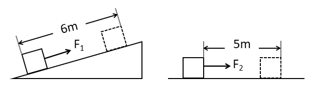

# 第 28 季 · 科学推理

来源：2026下半年省考第二十八季行测模考大赛（广东卷）.pdf

共 5 题，保留原卷题号。分数与数学符号使用 LaTeX；图形使用原图或已标注的矢量重绘图。

## 第 66 题

原卷 PDF 页码：17；题目 ID：`gd-mock-2026h2-s28-q66`

如图所示，棱长为1m的正方体物块在外力 $F_1$ 、 $F_2$ 的作用下分别沿斜面和水平面匀速运动了一段距离，外力 $F_1$ 和 $F_2$ 对物块做的功分别记为 $W_1$ 和 $W_2$ ，物块在斜面和水平面所受的摩擦力分别记为 $f_1$ 和 $f_2$ ，若斜面和水平面的粗糙程度一致，则下列大小关系一定正确的是（    ）。

**A.** $W_1 > W_2$

**B.** $W_1 = W_2$

**C.** $f_1 > f_2$

**D.** $f_1 < f_2$

## 第 67 题

原卷 PDF 页码：17；题目 ID：`gd-mock-2026h2-s28-q67`

如图所示，建筑工人正在用水平力推着平板手推车沿水平地面向右运送货物。若在工人推着手推车行走的过程中，货物始终与手推车保持相对静止，则下列说法正确的是（    ）。

**A.** 手推车前轮受到的摩擦力向左，后轮受到的摩擦力向右

**B.** 手推车前轮受到的摩擦力向右，后轮受到的摩擦力向左

**C.** 手推车在加速向右运动的过程中，货物受到的摩擦力向右

**D.** 手推车在匀速向右运动的过程中，货物受到的摩擦力向左

## 第 68 题

原卷 PDF 页码：17, 18；题目 ID：`gd-mock-2026h2-s28-q68`

小明的户外电源同时并联了台灯、手机充电器、小风扇三个用电器，所有设备都正常工作。若他拔掉小风扇，下列说法正确的是（    ）。

**A.** 总电阻变大，总电流变小，其他用电器的电压不变

**B.** 总电阻变大，总电流变大，其他用电器的电压变大

**C.** 总电阻变小，总电流变小，其他用电器的电压变小

**D.** 总电阻变小，总电流变大，其他用电器的电压不变

## 第 69 题

原卷 PDF 页码：18；题目 ID：`gd-mock-2026h2-s28-q69`

生活场景中物理变化与化学变化往往伴随外观改变，下列现象中，仅发生物理变化的是（    ）。

**A.** 用小苏打发酵蒸馒头

**B.** 冬日户外湖水结冰

**C.** 用酒精擦拭手部消毒

**D.** 生石灰干燥剂吸水发热

## 第 70 题

原卷 PDF 页码：18；题目 ID：`gd-mock-2026h2-s28-q70`

冻梨是北方特色水果，冷冻保存的冻梨解冻后会流出大量清甜汁水，这些汁液主要来自果肉细胞的哪种结构（    ）。

**A.** 线粒体

**B.** 液泡

**C.** 细胞膜

**D.** 细胞壁
