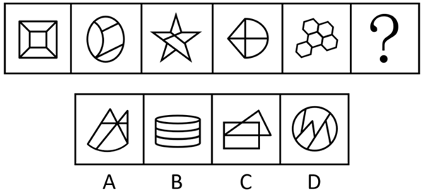
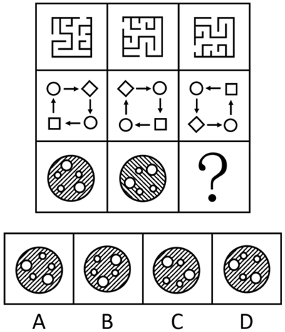
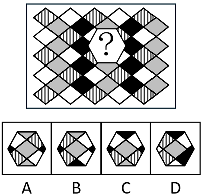
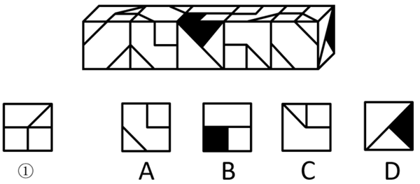
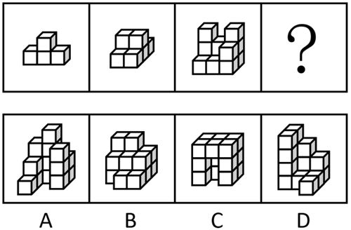

# 第 29 季 · 判断推理

来源：2026下半年省考第二十九季行测模考大赛（广东卷）.pdf

共 20 题，保留原卷题号。分数与数学符号使用 LaTeX；图片路径指向同一资料包内的原图。

## 第 46 题

原卷 PDF 页码：11；题目 ID：`gd-mock-2026h2-s29-q46`

从所给的四个选项中，选择最合适的一个填入问号处，使之呈现一定的规律性：

**A.** 见题图中的 A 选项

**B.** 见题图中的 B 选项

**C.** 见题图中的 C 选项

**D.** 见题图中的 D 选项

## 第 47 题

原卷 PDF 页码：11；题目 ID：`gd-mock-2026h2-s29-q47`

从所给的四个选项中，选择最合适的一个填入问号处，使之呈现一定的规律性：

**A.** 见题图中的 A 选项

**B.** 见题图中的 B 选项

**C.** 见题图中的 C 选项

**D.** 见题图中的 D 选项

## 第 48 题

原卷 PDF 页码：11, 12；题目 ID：`gd-mock-2026h2-s29-q48`

下列选项中最符合所给图形规律的是：

**A.** 见题图中的 A 选项

**B.** 见题图中的 B 选项

**C.** 见题图中的 C 选项

**D.** 见题图中的 D 选项

## 第 49 题

原卷 PDF 页码：12；题目 ID：`gd-mock-2026h2-s29-q49`

已知5个完全相同的纸盒依次摆在一起如下图所示。则与纸盒的面①相对的面为：

**A.** 见题图中的 A 选项

**B.** 见题图中的 B 选项

**C.** 见题图中的 C 选项

**D.** 见题图中的 D 选项

## 第 50 题

原卷 PDF 页码：12；题目 ID：`gd-mock-2026h2-s29-q50`

下列选项中最符合所给图形变化规律的是：

**A.** 见题图中的 A 选项

**B.** 见题图中的 B 选项

**C.** 见题图中的 C 选项

**D.** 见题图中的 D 选项

## 第 51 题

原卷 PDF 页码：13；题目 ID：`gd-mock-2026h2-s29-q51`

小长假期间某电商公司安排客服组甲、乙、丙、丁、戊、己6名工作人员值班，值班安排需满足以下条件：
（1）戊和己不能都不值班；
（2）如果甲或乙中至多一人值班，那么丙就不值班；
（3）除非丁值班，否则甲不值班；
（4）只有戊不值班，丁才值班；
（5）丙一定会被安排值班。
根据上述条件，以下哪项一定为真？

**A.** 甲值班，戊不值班

**B.** 乙值班，己不值班

**C.** 甲和戊都值班

**D.** 乙和己都不值班

## 第 52 题

原卷 PDF 页码：13；题目 ID：`gd-mock-2026h2-s29-q52`

尽管这几年桃子的行情不错，但有的桃农依然无法保证自家桃子连年丰产优质。农业方面的专家指出，全营养投资是树势中庸健壮的关键，然而中庸健壮的树势是桃子连年丰产优质的必要条件。
以下哪项如果为真，最能削弱上述专家的观点？

**A.** 有的桃树连年丰产优质，且拥有中庸健壮的树势

**B.** 有的桃树未拥有中庸健壮的树势，桃农也未进行全营养投资

**C.** 有的桃树连年丰产优质，但桃农没有进行全营养投资

**D.** 有的桃树未拥有中庸健壮的树势，而桃农进行了全营养投资

## 第 53 题

原卷 PDF 页码：13；题目 ID：`gd-mock-2026h2-s29-q53`

当前职场竞争日趋激烈，企业员工面临晋升受限、职场环境压力大等问题，职场焦虑现象普遍存在，而心理弹性作为个体面对压力困难适应能力的体现，被认为是应对职场焦虑的重要积极心理品质。某研究团队以不同企业的254名员工为调查对象，通过问卷调查发现，一些存在职场焦虑的中青年员工能始终保持较高的心理弹性水平。据此研究团队得出结论，这些存在职场焦虑的中青年员工的工作投入水平更高。上述论证的成立，必须基于以下哪一前提？

**A.** 在同等学历、工作年限相同的中青年员工中，心理弹性水平更高的人，平均工资水平也显著更高

**B.** 心理弹性会影响人们在资源获取、损益过程中的应对方式，进而会影响自身资源分配结果

**C.** 当前中青年承担着子女教育、父母养老、房贷等经济压力，促使他们必须适应社会变化

**D.** 心理弹性能够帮助员工在压力情境下快速恢复、维持积极心态，从而提升工作投入的水平

## 第 54 题

原卷 PDF 页码：13, 14；题目 ID：`gd-mock-2026h2-s29-q54`

在德国西南部施瓦本阿尔卑斯山脚下的一系列洞穴中，考古学家发现了骨笛、制作绳索和衣物的工具、已知最古老的维纳斯雕像，以及数百件刻有复杂几何图案的手持器物。这些雕刻品最早于19世纪60年代被发现，由猛犸象牙以及洞狮、洞熊等现已灭绝动物的骨骼雕刻而成，而在施瓦本阿尔卑斯山的洞穴中发现的拥有55000年历史的阿多兰特雕像，其上的符号可能编码着与最早的文字形式相似的信息量。
由此可以推出：

**A.** 已经拥有55000年历史的阿多兰特雕像上刻有世界上最早的文字

**B.** 施瓦本阿尔卑斯山的洞穴中发现的文物是由最早进入中欧的现代人类制作的

**C.** 在施瓦本阿尔卑斯山脚下的洞穴中，发现了数百件世界上最古老的手持器物

**D.** 19世纪60年代，某些由灭绝动物骨骼制作而成的雕刻品被发现

## 第 55 题

原卷 PDF 页码：14；题目 ID：`gd-mock-2026h2-s29-q55`

多囊卵巢综合征是育龄期女性无排卵性不孕的首要病因，体外受精-胚胎移植是这类患者重要的助孕方式。临床发现，“多囊女性”中维生素D不足的发生率高达70%-80%，且维生素D受体广泛存在于卵巢、子宫内膜等生殖相关器官，基础研究提示其可能参与调节卵泡发育、激素合成和子宫内膜对胚胎的接受能力，进而影响胚胎着床，促进胚胎发育。基于此，医学界形成普遍观点，准备接受体外受精-胚胎移植的“多囊女性”，术前常规补充维生素D能显著提高成功率。
以下哪项如果为真，最能削弱上述结论？

**A.** 通过口服维生素D制剂补充的效率，显著低于通过皮肤日照合成维生素D的效率，但多囊患者大多日照不足

**B.** 维生素D的核心生理作用是调节钙磷代谢，其对骨骼健康的意义远大于对生殖功能的影响

**C.** 补充维生素D后，多囊患者体内的维生素D水平虽能恢复正常，但过量补充可能导致患高钙血症

**D.** 针对“多囊女性”开展的大样本随机双盲对照试验显示，术前补充维生素D并未提高其胚胎移植后的活产率

## 第 56 题

原卷 PDF 页码：14；题目 ID：`gd-mock-2026h2-s29-q56`

某羽毛球俱乐部要从7人中选出4人参加一场男女混合双打比赛，其中要从女生队员甲、乙、丙、丁中选出2人，从男生队员戊、己、庚中选出2人，已知：
（1）如果戊入选，则丁也入选；
（2）庚和丁要么都入选，要么都不入选；
（3）丙和己要么都入选，要么都不入选。已知丙入选，则下列一定入选的人是：

**A.** 丁和戊

**B.** 己和庚

**C.** 乙和己

**D.** 甲和庚

## 第 57 题

原卷 PDF 页码：14, 15；题目 ID：`gd-mock-2026h2-s29-q57`

统治着白垩纪世界的霸王龙，一直被认为是顶级掠食者。长期以来，不少研究者和科普作品认为，体重巨大的霸王龙行走时可能是“整个脚掌落地”，甚至类似“扁平足”的步态。但近日，某期刊上发表的最新研究指出，这种庞然大物在行走和奔跑时，很可能是踮着脚移动的。
以下哪项如果为真，最不能支持上述结论？

**A.** 研究人员通过分析化石足迹‌发现，霸王龙在行走时受力最深的痕迹位于脚趾下方

**B.** 霸王龙的最快移动速度为每秒5到11米，前脚掌着地奔跑可能是其快速移动的关键

**C.** 通过生物力学分析发现，霸王龙体重约为10吨，需要踮脚行走才能更好地承受自身重量

**D.** 相关资料进一步证实了霸王龙与现代鸟类的亲缘关系，而现代鸟类大多都是踮脚行走的

## 第 58 题

原卷 PDF 页码：15；题目 ID：`gd-mock-2026h2-s29-q58`

某校学生参与志愿服务的情况如下：所有通过普通话测试的学生都获得了志愿服务证书，所有报名支教的学生都通过了普通话测试，有些大一学生没有获得志愿服务证书。根据以上条件，一定可以推出的是：

**A.** 有些大一学生没有报名支教

**B.** 所有大一学生都通过了普通话测试

**C.** 有些大一学生报名了支教

**D.** 有些获得志愿服务证书的学生不是大一学生

## 第 59 题

原卷 PDF 页码：15；题目 ID：`gd-mock-2026h2-s29-q59`

当前多所高校将论文AI率与毕业资格挂钩，但不同检测平台算法不透明、检测数值差异巨大，仅依靠AI检测软件得出的AI占比无法解释论文被平台误判、漏判等各类问题；依托学生自主修改语句、替换词汇的人工降重方式，也不能彻底解决论文达标难题。因此，构建科学论文审核体系的关键在于推行“过程审查+AI使用报备”的综合评审模式。要使上述推断成立，可以补充的前提是：

**A.** “过程审查+AI使用报备”模式在一定程度上可避免平台检测存在的误判、漏判等各类问题

**B.** 灰色产业链的付费降AI率服务会带来论文泄密、内容失真等多重学术风险

**C.** 多数高校暂时没有配套制度来落地论文全过程档案留存与AI使用申报工作

**D.** 检测AI率目的是维护学术研究的严肃性、公平性，督促学生遵守学术规范，产出原创成果

## 第 60 题

原卷 PDF 页码：15；题目 ID：`gd-mock-2026h2-s29-q60`

某单位有甲、乙、丙、丁四名员工需在一周内轮流值夜班，每人最多值守两天，每天仅需一人值守。已知：
（1）乙的两个值守日相隔两天；
（2）甲的两个值守日相隔四天；
（3）周四和周五由同一人值守；
（4）若乙在周三值守，则丁在周五值守。
根据上述信息，周五和周六分别由哪名员工值守？

**A.** 乙和甲

**B.** 丙和乙

**C.** 丙和丁

**D.** 丁和乙

## 第 61 题

原卷 PDF 页码：15, 16；题目 ID：`gd-mock-2026h2-s29-q61`

推广全民阅读可以培养国民阅读习惯，培养国民阅读习惯有助于提升国民素质，因此推广全民阅读有助于提升国民素质。下列选项的逻辑结构与题干最为相似的是：

**A.** 加强农田水利建设能稳粮食产能，完善种业培育能稳粮食产能，因此要完善种业培育和加强农田水利建设

**B.** 发展数字经济可以推动产业升级，推动产业升级有助于增强区域竞争力，因此发展数字经济有助于增强区域竞争力

**C.** 低碳出行能够减少尾气排放，减少尾气排放可以改善空气质量，因此要改善空气质量就必须大力推行低碳出行

**D.** 合格的教师都遵守师德规范，违反师德规范的都是不合格的教师，因此是否遵守师德规范是判断教师是否合格的标准

## 第 62 题

原卷 PDF 页码：16；题目 ID：`gd-mock-2026h2-s29-q62`

某地一处超大型AI数据中心项目获批落地，该项目能够创造大量就业岗位、带动地方税收增长，具备突出的经济效益，但该项目获批后却遭到当地居民大规模抗议。
以下选项如果为真，最能解释上述现象的是：

**A.** 该项目落地后可以增强当地AI产业的算力基础

**B.** 该项目投资方计划自建天然气电站，所用天然气全部从外地采购

**C.** 一小部分当地居民本身并不看好AI相关产业的发展前景

**D.** 该项目运营需耗费巨量水电，会加剧当地干旱缺水与生态恶化问题

## 第 63 题

原卷 PDF 页码：16；题目 ID：`gd-mock-2026h2-s29-q63`

当前新能源汽车市场价格战持续升级，某龙头企业大幅降价，引发行业洗牌担忧。有行业分析师指出，只要车企停止降价，就能避免行业亏损扩大，实现盈利回升。上述论证的主要逻辑错误在于：

**A.** 忽视了消费者对新能源汽车价格的敏感度

**B.** 忽视了原材料价格对车企定价的影响

**C.** 默认了降价是导致行业亏损的唯一原因

**D.** 默认了新能源汽车市场需求已经饱和

## 第 64 题

原卷 PDF 页码：16；题目 ID：`gd-mock-2026h2-s29-q64`

绿茶是未经发酵的茶叶品类，这类茶叶都保留了天然营养物质，而江南多地出产的茶叶都是绿茶，因此江南多地出产的茶叶都保留了天然营养物质。
以下选项的推理逻辑与题干最相似的是：

**A.** 野生菌都含有特殊的生物活性成分，因此山林里的所有菌类都含有特殊的生物活性成分

**B.** 大多数热带植物喜好高温高湿环境，而雨林植被普遍生长在高温高湿区域，因此大部分热带植物属于雨林植被

**C.** 有氧运动能够有效消耗体内多余脂肪，而力量训练以增肌塑形为主，因此力量训练无法消耗体内多余脂肪

**D.** 候鸟都具备长途迁徙的生活习性，而大多数北方的飞鸟属于候鸟，因此北方的飞鸟大多具备长途迁徙的生活习性

## 第 65 题

原卷 PDF 页码：16, 17；题目 ID：`gd-mock-2026h2-s29-q65`

某考古部门对一处北齐长城戍堡遗址启动考古发掘工作，意在厘清建筑形制、军防布局等历史细节。该遗址坐落于山脊要道，遗迹散落隐匿在山林灌丛之间。考古专家表示，此次考古工作若想精准探测遗存线索，必须借助激光雷达、地质雷达等无损考古新技术。
以下属于上述推论暗含前提的是：

**A.** 无损考古新技术能显著缩减整体考古作业时长

**B.** 此次考古工作能填补有关北齐长城的认知空白

**C.** 遗址的多处长城点段不具备传统考古发掘条件

**D.** 无损考古新技术已在古遗址勘探中得到广泛应用
