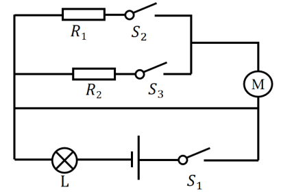
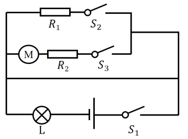
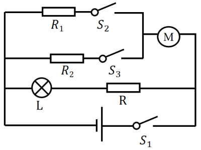
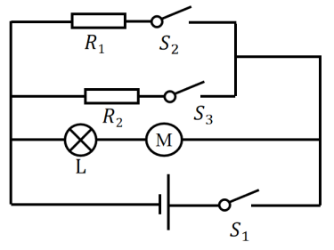
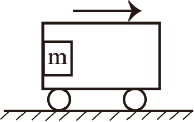
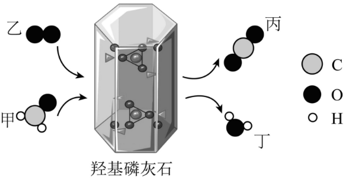

# 第 29 季 · 科学推理

来源：2026下半年省考第二十九季行测模考大赛（广东卷）.pdf

共 5 题，保留原卷题号。分数与数学符号使用 LaTeX；图形使用原图或已标注的矢量重绘图。

## 第 66 题

原卷 PDF 页码：17, 18；题目 ID：`gd-mock-2026h2-s29-q66`

某抽油烟机工作时，若只闭合总开关，则指示灯亮起，但电动机不工作；再闭合一个开关后，电动机开始工作，指示灯仍然亮起；三个开关都闭合后，电动机的转速达到最大，指示灯仍然亮起。若电源电压保持不变，下列最可能是该抽油烟机电路图的是（    ）。

**A.**

**B.**

**C.**

**D.**

## 第 67 题

原卷 PDF 页码：18；题目 ID：`gd-mock-2026h2-s29-q67`

如图所示，质量为m的磁铁紧贴在汽车车厢左侧的车厢壁上，磁铁始终与车厢保持相对静止，随汽车一起向右运动。下列说法正确的是（    ）。

**A.** 汽车匀速运动时，磁铁共受到4个力的作用

**B.** 汽车匀速运动时，磁铁可能不受摩擦力的作用

**C.** 汽车加速运动时，磁铁共受到5个力的作用

**D.** 汽车加速运动时，磁铁受到水平向右的静摩擦力的作用

## 第 68 题

原卷 PDF 页码：18, 19；题目 ID：`gd-mock-2026h2-s29-q68`

甲醛是一种常见的室内空气污染物。利用羟基磷灰石（HAP）可将甲醛转化为无污染物质，反应过程的微观示意图如下所示。下列说法错误的是（    ）。

**A.** 反应方程式为 $\mathrm{CH_2O}+\mathrm{O_2}\xrightarrow{\text{HAP催化}}\mathrm{CO_2}+\mathrm{H_2O}$

**B.** 羟基磷灰石（HAP）可以提高甲醛的转化速率

**C.** 该反应属于氧化还原反应

**D.** 物质甲、乙、丙、丁中均含有氧元素，均属于氧化物

## 第 69 题

原卷 PDF 页码：19；题目 ID：`gd-mock-2026h2-s29-q69`

一位摄影爱好者在南京的某一地点拍摄日出照片，在春分日、秋分日发现两张照片中日出的方向十分接近。若夏至日在此处拍摄日出，下列关于日出方向的说法正确的是（    ）。

**A.** 日出方向比春分日偏南

**B.** 日出方向比秋分日偏北

**C.** 日出方向和春分日接近

**D.** 日出方向和秋分日相反

## 第 70 题

原卷 PDF 页码：19；题目 ID：`gd-mock-2026h2-s29-q70`

夏季城市道路两旁多栽种阔叶行道树，树叶的蒸腾作用是植物一项重要的生理活动。下列关于植物蒸腾作用的表述正确的是（    ）。

**A.** 蒸腾作用持续散失植物水分，对植株生长仅有水分损耗，无积极意义

**B.** 蒸腾作用的主要散失通道为叶片气孔，气孔的张开与闭合由保卫细胞调控

**C.** 夏季正午烈日高温环境下，植物叶片上的气孔完全张开，蒸腾作用达到单日强度峰值

**D.** 移栽成年大树时完整保留全部叶片，可充分保障光合作用，提升树木成活率
