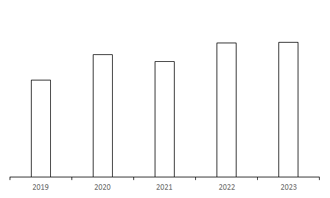
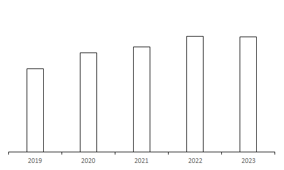
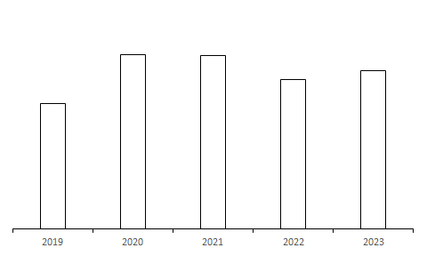
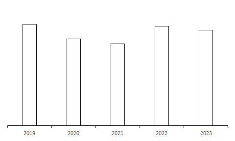

# 第 29 季 · 资料分析

来源：2026下半年省考第二十九季行测模考大赛（广东卷）.pdf

共 20 题，保留原卷题号。分数与数学符号使用 LaTeX；图片路径指向同一资料包内的原图。

## 材料 1（第 71—75 题）

2025年是“十四五”收官之年，我国数字化领域的工作者迎难而上、砥砺前行，推动数字中国建设迈出新的坚实步伐。数字中国发展指数达到170.1，同比增长13.0%，增幅较上年扩大2.3个百分点，数字中国建设跑出“加速度”。“实”字当头：制度、技术、数据、算力、人才五维发力，数字中国发展基础更加夯实。2025年，我国已走在全球6G赛道的前列，已顺利完成6G第一阶段技术试验，并全面启动第二阶段试验工作。截至2025年底，我国算力设施机架数达到1373万标准机架，是2024年底的1.5倍，算力规模位列全球第二；网民规模从2015年底的6.9亿人增至11.3亿人，互联网普及率从50.3%提高到80.1%。“融”字为核：以人工智能为代表的数智技术对“五位一体”的赋能作用不断彰显，全面赋能经济社会。2025年，我国数字产业实现收入39.6万亿元，同比增长8.8%，实现利润3.2万亿元，同比增长9.2%。其中东部地区创新引领作用持续巩固，中部地区产业承接与集群培育成效显著，西部与东北地区发展活力逐步恢复。广东、江苏、北京、浙江、上海、山东、四川、福建、安徽、湖北数字产业实现收入居我国前十，对我国数字产业实现收入增长贡献率达88.6%。“好”字托底：投融资、安全、治理、国际合作全面增强，发展环境持续向好。2025年，我国对101个中小企业数字化转型试点城市予以支持，“点线面”结合推动4.5万家中小企业开展数字化转型。北京市12345热线接诉即办改革加快，不断提升市民的幸福感。受理企业诉前诉求57.8万件，同比增长127.1%；“每月一题”完成270项任务，出台118项政策，一批民生痛点难点问题得到有效破解。

## 第 71 题

原卷 PDF 页码：20；题目 ID：`gd-mock-2026h2-s29-q71`

2025年，数字中国发展指数约比2023年增长了：

**A.** 20.9%

**B.** 23.7%

**C.** 25.1%

**D.** 30.3%

## 第 72 题

原卷 PDF 页码：20；题目 ID：`gd-mock-2026h2-s29-q72`

根据上述材料，以下判断正确的是：

**A.** 2025年，我国已顺利完成6G第二阶段技术试验

**B.** 2025年，我国东部地区产业承接与集群培育成效显著

**C.** 2025年，我国推动4万多家中小企业开展数字化转型

**D.** 截至2025年底，我国算力规模位列全球首位

## 第 73 题

原卷 PDF 页码：20；题目 ID：`gd-mock-2026h2-s29-q73`

2025年我国数字产业实现收入排名前十的省（市），其数字产业实现收入同比增长约多少万亿元？

**A.** 3.5

**B.** 2.8

**C.** 2.2

**D.** 1.6

## 第 74 题

原卷 PDF 页码：20；题目 ID：`gd-mock-2026h2-s29-q74`

根据上述材料，以下不属于2025年数字中国建设工作成效的是：

**A.** “实”的基础持续加固

**B.** “融”的效应不断彰显

**C.** “好”的环境持续优化

**D.** “数”的作用更加凸显

## 第 75 题

原卷 PDF 页码：20；题目 ID：`gd-mock-2026h2-s29-q75`

根据上述材料，以下说法正确的是：

**A.** 2024年，北京市12345热线受理企业诉前诉求不到30万件

**B.** 截至2025年底，我国人口总数约比2015年底增长2000万人

**C.** 2025年，我国数字产业利润率低于上年

**D.** 截至2024年底，我国算力设施机架数不到900万标准机架

## 材料 2（第 76—80 题）

2022年，S省纳入高新技术产业统计的规模以上工业企业3833户，同比增加362户。实现营业收入19796.8亿元，同比增长6.0%，其中1-3月、1-6月、1-9月实现营业收入分别为4593.0亿元、9209.6亿元、13836.2亿元。吸纳就业人员111.0万人，同比增加3.1万人。实现利润总额1426.9亿元，同比增长8.4%。

**2022年S省规模以上工业高新技术产业六大领域营业情况**

| 六大领域 | 营业收入（亿元） | 营业收入同比增长（%） | 利润总额（亿元） | 利润总额同比增长（%） |
| --- | --- | --- | --- | --- |
| 电子信息 | 9097.3 | 8.5 | 290.2 | −8.3 |
| 先进制造 | 1089.9 | 4.7 | 84.8 | 16.0 |
| 航空航天 | 237.7 | 11.2 | 28.9 | 11.4 |
| 新材料 | 984.5 | 3.5 | 170.3 | 32.6 |
| 生物医药与生物农业 | 1388.1 | −6.5 | 187.8 | −8.2 |
| 核技术及新能源 | 157.3 | 16.6 | −7.2 | −267.3 |

## 第 76 题

原卷 PDF 页码：20, 21；题目 ID：`gd-mock-2026h2-s29-q76`

2021年，S省规模以上工业航空航天领域营业收入与核技术及新能源领域相差约：

**A.** 72.1亿元

**B.** 78.9亿元

**C.** 83.1亿元

**D.** 87.2亿元

## 第 77 题

原卷 PDF 页码：21；题目 ID：`gd-mock-2026h2-s29-q77`

2022年，S省规模以上工业高新技术产业六大领域中，营业收入利润率同比下降的领域有：

**A.** 先进制造、航空航天、新材料

**B.** 电子信息、生物医药与生物农业、新材料

**C.** 先进制造、航空航天、核技术及新能源

**D.** 电子信息、生物医药与生物农业、核技术及新能源

## 第 78 题

原卷 PDF 页码：21；题目 ID：`gd-mock-2026h2-s29-q78`

2022年，S省规模以上工业高新技术产业六大领域中利润总额最高的三个领域，其营业收入之和是另外三个领域的多少倍？

**A.** 2.9

**B.** 6.1

**C.** 7.7

**D.** 8.3

## 第 79 题

原卷 PDF 页码：21；题目 ID：`gd-mock-2026h2-s29-q79`

2022年，S省纳入高新技术产业统计的规模以上工业企业营业收入利润率同比：

**A.** 上升不到1个百分点

**B.** 上升1个百分点以上

**C.** 下降不到1个百分点

**D.** 下降1个百分点以上

## 第 80 题

原卷 PDF 页码：21, 22；题目 ID：`gd-mock-2026h2-s29-q80`

以下饼状图中，最能准确反映2022年S省纳入高新技术产业统计的规模以上工业企业营业收入中，一季度（白色）、二季度（斜线）、三季度（灰色）、四季度（黑色）占比关系的是：

**A.**

**B.**

**C.**

**D.**

## 材料 3（第 81—85 题）

2023年，全国医疗卫生机构总数1070785个，同比增加37867个；医疗卫生机构床位1017.4万张，同比增加42.4万张；卫生人员总数1523.7万人，同比增加82.7万人。卫生总费用90575.8亿元，同比增加5248.3亿元，其中，社会卫生支出、个人卫生支出占卫生总费用的比重分别为46.0%、27.3%。人均卫生总费用6425.3元，卫生总费用占GDP的比重为7.2%。

**2019—2023年全国卫生总费用及政府卫生支出占比**

| 年份 | 卫生总费用（亿元） | 政府卫生支出占比（%） |
| --- | --- | --- |
| 2019 | 65195.9 | 26.7 |
| 2020 | 72175.0 | 30.4 |
| 2021 | 75593.6 | 27.4 |
| 2022 | 85327.5 | 28.2 |
| 2023 | 90575.8 | 26.7 |

## 第 81 题

原卷 PDF 页码：22；题目 ID：`gd-mock-2026h2-s29-q81`

以下指标中，2023年同比增速最快的是：

**A.** 全国医疗卫生机构总数

**B.** 全国医疗卫生机构床位总数

**C.** 全国卫生人员总数

**D.** 全国卫生总费用

## 第 82 题

原卷 PDF 页码：22；题目 ID：`gd-mock-2026h2-s29-q82`

2023年，全国政府卫生支出占GDP的比重约为：

**A.** 1.9%

**B.** 3.7%

**C.** 19.2%

**D.** 26.9%

## 第 83 题

原卷 PDF 页码：22；题目 ID：`gd-mock-2026h2-s29-q83`

2020-2023年，全国卫生总费用同比增速超过12%的年份有：

**A.** 0个

**B.** 1个

**C.** 2个

**D.** 3个

## 第 84 题

原卷 PDF 页码：22；题目 ID：`gd-mock-2026h2-s29-q84`

2023年，全国人均GDP约为多少元？

**A.** 76355

**B.** 81052

**C.** 89240

**D.** 95431

## 第 85 题

原卷 PDF 页码：22, 23；题目 ID：`gd-mock-2026h2-s29-q85`

以下柱状图中，最能准确反映2019-2023年全国政府卫生支出变化趋势的是：

**A.**

**B.**

**C.**

**D.**

## 材料 4（第 86—90 题）

**2024年1—12月中国葡萄酒进口数据统计**

| 日期 | 进口量（万升） | 进口额（百万美元） | 进口量同比增速（%） | 进口额同比增速（%） |
| --- | --- | --- | --- | --- |
| 2024年1—2月 | 3699 | 167.8 | 12.5 | −6.6 |
| 2024年3月 | 2285 | 78.5 | 3.7 | −10.9 |
| 2024年4月 | 2202 | 113.4 | 7.5 | 1.4 |
| 2024年5月 | 2297 | 149.8 | 3.3 | 10.6 |
| 2024年6月 | 2608 | 203.7 | 1.9 | 20.7 |
| 2024年7月 | 3517 | 196.7 | 8.8 | 28.9 |
| 2024年8月 | 2364 | 129.4 | 8.0 | 26.5 |
| 2024年9月 | 2499 | 120.9 | 11.3 | 26.9 |
| 2024年10月 | 1977 | 119.2 | 13.3 | 30.1 |
| 2024年11月 | 2025 | 157.0 | 11.5 | 34.3 |
| 2024年12月 | 2896 | 159.2 | 13.6 | 37.2 |

## 第 86 题

原卷 PDF 页码：24；题目 ID：`gd-mock-2026h2-s29-q86`

2024年上半年，我国葡萄酒进口量在以下哪个范围内？

**A.** 超过1.4亿升

**B.** 1.3亿-1.4亿升之间

**C.** 1.2亿-1.3亿升之间

**D.** 不到1.2亿升

## 第 87 题

原卷 PDF 页码：24；题目 ID：`gd-mock-2026h2-s29-q87`

2024年3月，我国葡萄酒进口均价较上年同期：

**A.** 增长不到10%

**B.** 增长10%以上

**C.** 下降不到10%

**D.** 下降10%以上

## 第 88 题

原卷 PDF 页码：24；题目 ID：`gd-mock-2026h2-s29-q88`

2024年下半年，我国葡萄酒进口量同比增长最多的月份是：

**A.** 1-2月

**B.** 7月

**C.** 9月

**D.** 12月

## 第 89 题

原卷 PDF 页码：24；题目 ID：`gd-mock-2026h2-s29-q89`

2024年第一季度，我国葡萄酒进口额同比约：

**A.** 增长9.7%

**B.** 减少7.5%

**C.** 减少8.0%

**D.** 减少12.6%

## 第 90 题

原卷 PDF 页码：24；题目 ID：`gd-mock-2026h2-s29-q90`

下列折线图中，最能准确反映2024年第二、三季度我国葡萄酒进口均价变化趋势的是：

**A.**

**B.**

**C.**

**D.**

