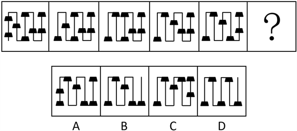
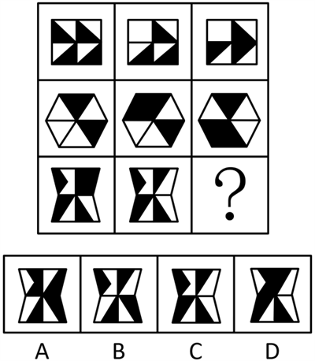
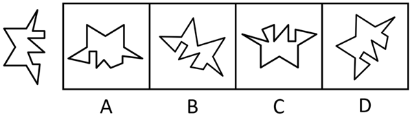
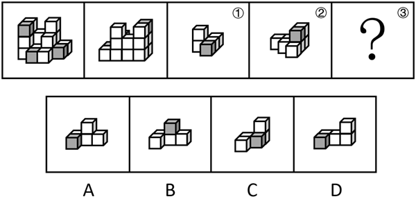
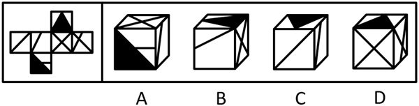

# 第 30 季 · 判断推理

来源：2026下半年省考第三十季行测模考大赛（广东卷）.pdf

共 20 题，保留原卷题号。分数与数学符号使用 LaTeX；图片路径指向同一资料包内的原图。

## 第 46 题

原卷 PDF 页码：11；题目 ID：`gd-mock-2026h2-s30-q46`

从所给的四个选项中，选择最合适的一个填入问号处，使之呈现一定的规律性：

**A.** 见题图中的 A 选项

**B.** 见题图中的 B 选项

**C.** 见题图中的 C 选项

**D.** 见题图中的 D 选项

## 第 47 题

原卷 PDF 页码：11；题目 ID：`gd-mock-2026h2-s30-q47`

从所给的四个选项中，选择最合适的一个填入问号处，使之呈现一定的规律性：

**A.** 见题图中的 A 选项

**B.** 见题图中的 B 选项

**C.** 见题图中的 C 选项

**D.** 见题图中的 D 选项

## 第 48 题

原卷 PDF 页码：11, 12；题目 ID：`gd-mock-2026h2-s30-q48`

以下选项能与左侧图形组成一个完整正六角星形的是：

**A.** 见题图中的 A 选项

**B.** 见题图中的 B 选项

**C.** 见题图中的 C 选项

**D.** 见题图中的 D 选项

## 第 49 题

原卷 PDF 页码：12；题目 ID：`gd-mock-2026h2-s30-q49`

左图给定的是由等大的15个白色正方体和3个灰色正方体堆叠而成的多面体的正视图和后视图，该多面体可以由①、②和③三个多面体拼合而成，问以下哪一项能填入问号处？

**A.** 见题图中的 A 选项

**B.** 见题图中的 B 选项

**C.** 见题图中的 C 选项

**D.** 见题图中的 D 选项

## 第 50 题

原卷 PDF 页码：12；题目 ID：`gd-mock-2026h2-s30-q50`

左边是给定的正方体的外表面展开图，右边哪一项能由它折叠而成？

**A.** 见题图中的 A 选项

**B.** 见题图中的 B 选项

**C.** 见题图中的 C 选项

**D.** 见题图中的 D 选项

## 第 51 题

原卷 PDF 页码：12；题目 ID：`gd-mock-2026h2-s30-q51`

某市计划建设城市生命线监测平台。只有完成数据校验，监测点位才能接入平台；若监测点位接入平台且通过压力测试，则该监测点位将参与联动预警；凡参与联动预警的监测点位，都必须由运维中心登记。现已知，甲监测点位已经接入平台，但尚未由运维中心登记。
由此可以推出：

**A.** 甲监测点位未完成数据校验

**B.** 甲监测点位未通过压力测试

**C.** 甲监测点位参与联动预警

**D.** 以上情况均无法确定

## 第 52 题

原卷 PDF 页码：12, 13；题目 ID：`gd-mock-2026h2-s30-q52`

脑源性神经营养因子（BDNF）是神经营养因子家族中被最广泛研究的核心成员，其表达异常与阿尔茨海默病、帕金森病、抑郁症、精神分裂症等多种神经精神疾病密切相关。据此有专家认为，BDNF是治疗这些神经精神疾病的核心靶点。
以下哪项如果为真，最能削弱上述观点？

**A.** 外源性补充BDNF很难穿透血脑屏障，目前在临床上难以直接调控BDNF在大脑内的表达水平

**B.** 多项临床研究表明，直接激活BDNF的主要功能性受体TrkB，可用来模拟BDNF的神经保护效应

**C.** 研究表明，抑郁症和BDNF水平降低均是长期应激引起下丘脑-垂体-肾上腺轴功能紊乱导致的结果

**D.** BDNF靶向药物的研发管线虽多，但针对上述神经精神疾病尚无一款获批上市的药物

## 第 53 题

原卷 PDF 页码：13；题目 ID：`gd-mock-2026h2-s30-q53`

报道称，在全球科技展望中，基因编辑技术发展势头将更为强劲，相关临床试验受到医学界关注；同时，人工智能技术发展带来新动力，AI驱动的生物标志物检测可能从“检测”迈向“预测”。相关专家据此认为，基因编辑与人工智能的交叉融合将催生针对癌症以及多种遗传性疾病的有效新疗法。要使上述论证成立，需要补充以下哪项作为前提？

**A.** 从“检测”迈向“预测”意味着AI能提前锁定致病基因靶点，将治疗路径更新为早期阻断

**B.** 基因编辑临床试验通常需要严格的伦理审查，不同疾病的入组标准和观察周期存在差异

**C.** 人工智能还可用于医学影像判读、药物研发管理和患者随访，但在各场景中的成熟度不同

**D.** 若无法借助AI完成精准的患病风险预判，基因编辑技术很难单独实现对这类疾病的有效治疗

## 第 54 题

原卷 PDF 页码：13；题目 ID：`gd-mock-2026h2-s30-q54`

时值花季，各大高校迎来游客参观高峰期，校内游客数量骤增，严重影响学生的校园生活。对此，某大学采取限流措施：周一至周五只开放中午和晚上两个时段让游客入校参观，其他时间不开放，周六、周日需凭身份证登记进入。但是，该限流措施实行后，该校校园内游客数量没有明显变化。
以下哪项如果为真，最能解释上述现象？

**A.** 大部分上班族恰好在中午和晚上有时间

**B.** 该校没有对进校园的人数作出限制

**C.** 在其他时段来该校参观的游客一直很少

**D.** 绝大多数游客对该限流措施并不知情

## 第 55 题

原卷 PDF 页码：13, 14；题目 ID：`gd-mock-2026h2-s30-q55`

一篇总结了27年间发表的共计1187项研究、参与者超过1.458亿的文章显示，与那些有着充分社交生活和社会支持的人群相比，缺乏社交生活和社会支持会使死亡风险高出11%至53%，患病的风险则高出23%，更有甚者死亡风险高出6倍。据此，研究人员推测，社交生活和社会支持能够为人们提供安全感，会让人更长寿。
以下各项如果为真，除哪项外均能支持上述观点？

**A.** 经常发表文字动态的人群平均死亡率显著低于经常发布照片但不发表文字动态的人群

**B.** 与他人保持联系可以增进人们的幸福感、延长寿命，尤其能够预防痴呆症

**C.** 女性群体尤其是产后女性，其重度抑郁症往往是缺乏社交生活和社会支持导致的

**D.** 社会支持能提升人们的压力应对能力，而压力过大会导致大脑防御系统长期处于激活状态，增加患病风险

## 第 56 题

原卷 PDF 页码：14；题目 ID：`gd-mock-2026h2-s30-q56`

参加围棋比赛的共有6支队伍，分别是甲队、乙队、丙队、丁队、戊队、己队，且比赛结果满足以下条件：
（1）如果甲队不是第3名，那么己队是第1名；
（2）如果戊队不是第6名，那么丙队是第2名；
（3）如果己队不是第5名，那么丁队是第4名。按照第1名至第6名的顺序排列，以下哪项可能为真？

**A.** 丁队、乙队、丙队、甲队、己队、戊队

**B.** 丁队、己队、甲队、丙队、乙队、戊队

**C.** 丁队、乙队、甲队、丙队、己队、戊队

**D.** 丁队、戊队、甲队、丙队、己队、乙队

## 第 57 题

原卷 PDF 页码：14；题目 ID：`gd-mock-2026h2-s30-q57`

古人为了适应季节变化，在生存中不断摸索出一系列的养生秘诀，秋冬季主打一个“养”字，例如“一梨润三秋”，就是因为梨有润燥、养阴、润肺的滋养作用。近来，网络上流传一种说法：秋冬季多吃梨能够治疗咳嗽。
以下哪项如果为真，最能削弱上述说法？

**A.** 梨偏寒凉，适宜润温燥，脾胃虚弱者食用过多的梨可能会出现腹泻、消化不良等问题

**B.** 引起咳嗽的因素非常多，包括物理因素、化学因素、感染因素、过敏因素等多种因素

**C.** 吃梨对于常见的风寒咳嗽，以及感染等原因引起的咳嗽，不但没效果还有可能适得其反

**D.** 秋冬季气温较低，不宜一次性吃太多的梨，此外，梨还有利尿作用，建议临睡前不要吃

## 第 58 题

原卷 PDF 页码：14；题目 ID：`gd-mock-2026h2-s30-q58`

张、刘、王、李四人玩剧本杀，四人在剧本中的角色要么是凶手，要么是平民，关于四人的身份信息有以下四种猜测：
①李是平民；
②如果张是平民，那么刘是凶手；
③如果李不是平民，那么王是凶手；
④张和刘都是平民。如果以上猜测只有一个为真，可以推出：

**A.** 刘是平民，李是凶手

**B.** 王是平民，刘是凶手

**C.** 王是平民，李是凶手

**D.** 张和刘都是凶手

## 第 59 题

原卷 PDF 页码：14, 15；题目 ID：`gd-mock-2026h2-s30-q59`

某研究团队发现，家蚕体内存在一个与寿命相关的关键基因——OSER1。长寿基因FOXO负责叉头框蛋白O的生成，OSER1则是FOXO的靶基因，叉头框蛋白O能够通过调节与衰老相关的基因影响寿命。据此专家认为，我们可以从家蚕身上获取治疗退行性疾病的密码。要使上述论证成立，需要补充的前提是：

**A.** 家蚕与人类体内的部分基因在结构和功能上一致

**B.** 退行性疾病的元凶就是异常的寿命调控基因OSER1

**C.** 提高OSER1基因活性不会对其他正常生理机能造成负面影响

**D.** FOXO基因在人体衰老过程中会持续发挥作用

## 第 60 题

原卷 PDF 页码：15；题目 ID：`gd-mock-2026h2-s30-q60`

某班的小赵、小钱、小孙、小李、小周、小吴、小郑都提交了入党申请，大家对于申请的结果做出了如下预测：
（1）小钱和小赵至少有一人通过了申请；
（2）小赵和小李至少有一人通过了申请；
（3）如果小赵通过了申请，则小吴和小郑都没有通过申请；
（4）如果小周和小李至少有一人通过了申请，则小孙和小钱都通过了申请；
（5）如果小孙没有通过申请，则小郑通过了申请。最后申请结果公布之后，发现上述猜测完全正确。
根据上述信息，一定通过申请的是：

**A.** 小周

**B.** 小李

**C.** 小孙

**D.** 小钱

## 第 61 题

原卷 PDF 页码：15；题目 ID：`gd-mock-2026h2-s30-q61`

专业登山者都拥有丰富的野外避险经验。小陈不是专业登山者，所以他缺少野外避险经验。
以下选项所犯的逻辑错误与题干最为相似的是：

**A.** 钢化玻璃都具备抗冲击的特性。这块玻璃不具备抗冲击的特性，所以它不是钢化玻璃

**B.** 资深调酒师都熟悉各类基酒特性。小吴不是资深调酒师，所以他可能不熟悉各类基酒特性

**C.** 有机食材都保留着原始风味。这份食材并非有机食材，所以它没有保留原始风味

**D.** 陈年普洱都带有独特陈香。小王家的茶叶没有独特陈香，所以它不是陈年普洱

## 第 62 题

原卷 PDF 页码：15；题目 ID：`gd-mock-2026h2-s30-q62`

某幼儿园占地5220平方米，建筑面积高达3160平方米，园区建筑造型别致、室内装潢精良，综合硬件条件在本地幼儿园中位居前列。即便如此，不少家长仍不愿将孩子送至该幼儿园就读。下列选项如果为真，最不能解释这一现象的是：

**A.** 室内装潢精良就需要更多的装修材料，家长担心所用材料会影响孩子的身体健康

**B.** 该幼儿园近年来招生人数较少，与周边其他幼儿园相比，生源竞争力较弱

**C.** 该幼儿园地处城市远郊，周边公共交通稀少，家长日常接送孩子极为不便

**D.** 该幼儿园收费标准远高于当地同档次幼儿园，多数普通家庭难以承担费用

## 第 63 题

原卷 PDF 页码：15, 16；题目 ID：`gd-mock-2026h2-s30-q63`

只有深入实施中小微企业融资促进行动，才能让金融活水润泽产业链全链条和提升产业链安全。要想深入实施中小微企业融资促进行动，就必须保持政策的稳定性和连续性。深入实施中小微企业融资促进行动是助力中小微企业高质量发展的必要保障。
由此可以推出：

**A.** 如果没有保持政策的稳定性和连续性，就不能助力中小微企业高质量发展

**B.** 除非提升产业链安全，否则就不能深入实施中小微企业融资促进行动

**C.** 若没有深入实施中小微企业融资促进行动，则不能保持政策的稳定性和连续性

**D.** 只有助力中小微企业高质量发展，才能让金融活水润泽产业链全链条

## 第 64 题

原卷 PDF 页码：16；题目 ID：`gd-mock-2026h2-s30-q64`

打造真正的非遗传承基地必然坚守传统技艺内核。某地要打造真正的非遗传承基地，因此，该地必须坚守传统技艺内核。
以下选项的逻辑结构与题干最为相似的是：

**A.** 具有责任意识是基层工作者的基本素养。社区网格员属于基层工作者，因此，社区网格员需要践行岗位职责

**B.** 产业升级依靠技术革新。区域经济高质量发展离不开产业升级，因此，区域经济高质量发展必须进行产业升级

**C.** 文化自信需要依托于历史文脉。民族长远发展需要文化自信，因此，历史文脉是民族长远发展的重要保障

**D.** 课堂教学质量的提高离不开师生良性互动。某课堂没有老师与学生互动，因此，该课堂不能提高教学质量

## 第 65 题

原卷 PDF 页码：16；题目 ID：`gd-mock-2026h2-s30-q65`

为了推动氢能在居民用能等终端场景应用，某地实行了天然气掺氢的做法，目前已初步取得良好成效，当地还计划将掺氢比例从3%逐步提升到10%。据相关部门初步测算，在全国城镇燃气中按10%的比例掺氢，每年可替代天然气约150亿立方米，将相应减少二氧化碳排放约3000万吨。有人推测，天然气掺氢未来在节能减排方面具有显著的成效。要使上述推理成立，需要补充的前提是：

**A.** 全国各地都会积极响应该举措并全面推行天然气掺氢模式

**B.** 掺氢天然气的使用效率与传统天然气的使用效率一样高

**C.** 城镇燃气管网已具备输送20%掺氢比例天然气的能力

**D.** 氢能的生产和运输环节均不会产生额外过多的碳排放
