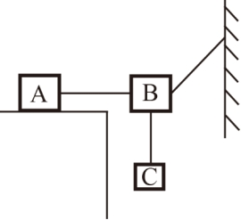
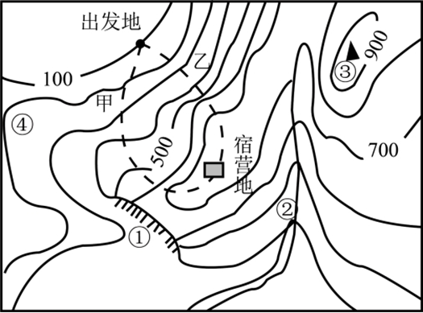

# 第 30 季 · 科学推理

来源：2026下半年省考第三十季行测模考大赛（广东卷）.pdf

共 5 题，保留原卷题号。分数与数学符号使用 LaTeX；图形使用原图或已标注的矢量重绘图。

## 第 66 题

原卷 PDF 页码：16, 17；题目 ID：`gd-mock-2026h2-s30-q66`

如图所示，物块A置于粗糙的水平桌面上，物块B左右两端连接着轻绳静止在空中，轻绳一端固定在竖直墙面上，另一端与物块A相连，物块B下方通过轻绳连接物块C，且物块A、B处于同一水平面上，若物块A、B、C均处于静止状态，下列说法错误的是（    ）。

**A.** 物块A共受到5个力的作用

**B.** 物块B共受到4个力的作用

**C.** 物块C共受到2个力的作用

**D.** 物块A受到水平向左的静摩擦力的作用

## 第 67 题

原卷 PDF 页码：17；题目 ID：`gd-mock-2026h2-s30-q67`

我国西北某内陆城市夏季晴天午后气温约为 $35^{\circ}\mathrm{C}$ ，清晨约为 $15^{\circ}\mathrm{C}$ ；同纬度沿海城市午后气温约为 $30^{\circ}\mathrm{C}$ ，清晨约为 $26^{\circ}\mathrm{C}$ 。在两地太阳辐射和天气条件相近的情况下，沿海城市的昼夜温差明显较小。下列解释正确的是（    ）。

**A.** 内陆城市每天接受太阳照射的时间一定更长

**B.** 水的比热容较大且能通过混合等过程缓冲温度变化，沿海城市升温和降温较慢

**C.** 内陆地表岩石土壤比热容大，吸热和放热时温度变化显著

**D.** 水的比热容较大，因此沿海城市白天一定吸收更多热量并升温更高

## 第 68 题

原卷 PDF 页码：17；题目 ID：`gd-mock-2026h2-s30-q68`

某款加酶洗衣粉含有蛋白酶，专门用来清洗衣物上的蛋白类污渍。使用说明书提示，不能用沸水溶解洗衣粉，也不建议用来清洗羊毛、蚕丝面料的衣服。下列说法错误的是（    ）。

**A.** 该款洗衣粉可以去除奶渍

**B.** 沸水会使蛋白酶失活，丧失洗涤效果

**C.** 羊毛、蚕丝会被蛋白酶分解

**D.** 蛋白酶可以高效分解各类污渍

## 第 69 题

原卷 PDF 页码：17；题目 ID：`gd-mock-2026h2-s30-q69`

下列有关说法不正确的是（    ）。

**A.** 空气中体积分数最多的气体可以用来保护文物

**B.** 空气中体积分数第二多的气体可以用来灭火

**C.** 空气中的稀有气体可以用于制作霓虹灯

**D.** 空气中的二氧化碳会使雨水的pH小于7

## 第 70 题

原卷 PDF 页码：17, 18；题目 ID：`gd-mock-2026h2-s30-q70`

下图为某地的等高线地形图，下列说法不正确的是（    ）。

**A.** 若要从出发地到达宿营地，路线甲比路线乙更容易

**B.** ④处的气温比③处的气温低

**C.** 下雨过后②处会有大量积水

**D.** ①处陡崖在宿营地的西南方
