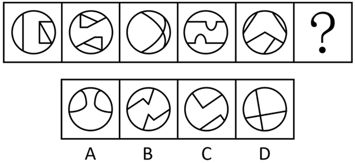
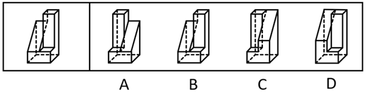
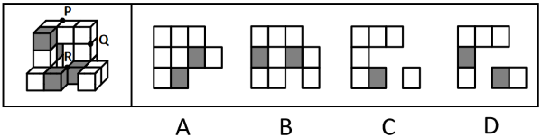

# 第 31 季 · 判断推理

来源：2026下半年省考第三十一季行测模考大赛（广东卷）.pdf

共 20 题，保留原卷题号。分数与数学符号使用 LaTeX；图片路径指向同一资料包内的原图。

## 第 46 题

原卷 PDF 页码：10, 11；题目 ID：`gd-mock-2026h2-s31-q46`

从所给的四个选项中，选择最合适的一个填入问号处，使之呈现一定的规律性：

**A.** 见题图中的 A 选项

**B.** 见题图中的 B 选项

**C.** 见题图中的 C 选项

**D.** 见题图中的 D 选项

## 第 47 题

原卷 PDF 页码：11；题目 ID：`gd-mock-2026h2-s31-q47`

从所给的四个选项中，选择最合适的一个填入问号处，使之呈现一定的规律性：

**A.** 见题图中的 A 选项

**B.** 见题图中的 B 选项

**C.** 见题图中的 C 选项

**D.** 见题图中的 D 选项

## 第 48 题

原卷 PDF 页码：11, 12；题目 ID：`gd-mock-2026h2-s31-q48`

下列选项与框内字符串规律最接近的是（    ）。

**A.** 见题图中的 A 选项

**B.** 见题图中的 B 选项

**C.** 见题图中的 C 选项

**D.** 见题图中的 D 选项

## 第 49 题

原卷 PDF 页码：12；题目 ID：`gd-mock-2026h2-s31-q49`

实心长方体切掉一块后剩余部分如下图左侧所示，右侧哪一项是其切去部分的形状？

**A.** 见题图中的 A 选项

**B.** 见题图中的 B 选项

**C.** 见题图中的 C 选项

**D.** 见题图中的 D 选项

## 第 50 题

原卷 PDF 页码：12；题目 ID：`gd-mock-2026h2-s31-q50`

左边为给定的多面体，现用经P、Q、R三点的平面对其进行切割，正确的截面是：

**A.** 见题图中的 A 选项

**B.** 见题图中的 B 选项

**C.** 见题图中的 C 选项

**D.** 见题图中的 D 选项

## 第 51 题

原卷 PDF 页码：12, 13；题目 ID：`gd-mock-2026h2-s31-q51`

回望历史，一些经济体掉入“中等收入陷阱”，一个重要原因就在于未能正确处理政府和市场关系。构建高水平社会主义市场经济体制，必须处理好这个核心问题。一方面，要更好发挥市场机制作用，一手深化国资国企改革，推进国有经济布局优化和结构调整，一手为非公有制经济发展营造良好环境、提供更多机会，促进各种所有制经济优势互补、共同发展。另一方面，政府要在克服市场失灵领域精准发力。只有同时做到上述两个方面，才能激发全社会内生动力和创新活力。
由此可以推出：

**A.** 如果政府没有在克服市场失灵领域精准发力，就无法激发全社会内生动力和创新活力

**B.** 只要能正确处理政府和市场关系，就能构建高水平社会主义市场经济体制

**C.** 如果不能更好发挥市场机制作用或政府没有在克服市场失灵领域精准发力，则无法构建高水平社会主义市场经济体制

**D.** 如果不能激发全社会内生动力和创新活力，则说明政府没能在克服市场失灵领域精准发力

## 第 52 题

原卷 PDF 页码：13；题目 ID：`gd-mock-2026h2-s31-q52`

某团队观测数据显示，“超级地球”与“迷你海王星”两类行星虽尺寸相近，但二者拥有完全不同的演化路径。“超级地球”的公转周期越短，轨道偏心率越低，其演化过程经历了剧烈的引力散射与巨大撞击等“暴力事件”；“迷你海王星”的公转周期越短，轨道偏心率越高，长期处于宁静的摄动演化状态，极少发生剧烈动力学事件。
以下除哪项外，均能支持上述研究结论？

**A.** 针对多组不同年龄的星系开展重复观测后发现，“超级地球”与“迷你海王星”两类行星的公转周期与轨道偏心率对应规律始终保持稳定

**B.** 该研究通过“凌星持续时间比”统计方法反演轨道偏心率分布，该方法在行星轨道研究领域被业内广泛认可，数据测算结果准确度较高

**C.** 除了轨道运转相关参数之外，行星的物质构成、诞生时间等属性也都是天文领域重点研究的内容，相关探索方向覆盖范围十分广泛

**D.** 剧烈的天体撞击、行星间引力散射与状态平稳的长期摄动，属于两种完全相悖的行星演化模式，会让行星逐步走向不同的演化道路

## 第 53 题

原卷 PDF 页码：13；题目 ID：`gd-mock-2026h2-s31-q53`

不少减肥人士只紧盯体重数值变化，认为体重快速下降就代表减肥成功。但有健身教练提出反对观点，认为一刀切式断绝主食和蛋白质的快速减重方式不可取。该健身教练称，在采用刻意断绝主食与蛋白质的方式减重时，身体会持续分解肌肉中的蛋白质，导致肌肉随之大量流失，而人体的肌肉含量即使仅短期减少也会永久拉低人体基础代谢率，影响减肥效果。
以下哪项如果为真，最能削弱上述健身教练的观点？

**A.** 部分人群节食减重期间会额外补充优质蛋白，并未出现明显的肌肉流失

**B.** 体重下降速度的快慢，并不是评判一种减重方式是否健康的最核心标准

**C.** 相比于基础代谢率降低，不良的饮食习惯才是减肥难以成功的主要原因

**D.** 肌肉减少后，只要恢复饮食并加强力量训练，基础代谢率就能缓慢回升

## 第 54 题

原卷 PDF 页码：13, 14；题目 ID：`gd-mock-2026h2-s31-q54`

在人生抉择与目标设定过程中，人们常会通过观察身边他人的状态来调整自身方向，这一行为被称作社会比较。相关研究指出，在向上社会比较时，也就是只关注比自己收益更好的人、完全无视表现较差的群体时，会扭曲人们对现实的认知，造成平均回报大幅下降。
以下哪项如果为真，不能削弱上述结论？

**A.** 人们开展社会比较时，大多会综合观察周围不同层级人群的表现，很少只聚焦于表现优异的群体

**B.** 在职场发展过程中，对标行业内的优秀从业者，能够持续激发自身进取意识，稳步提高收益

**C.** 很多人长期单纯以优秀群体为目标进行自我激励，并未出现收益断崖下跌、决策失灵等负面结果

**D.** 在创新创业领域，以头部成功人士作为参照，能够快速梳理发展思路，客观认识现实，避开短板

## 第 55 题

原卷 PDF 页码：14；题目 ID：`gd-mock-2026h2-s31-q55`

谷雨于每年的4月19日-21日之间交节，是春季的最后一个节气，此时全国气温回升加快。从清明到谷雨这半个月，我国平均温度15摄氏度线从长江流域向北狂奔约1000千米到达华北北部，敦煌和玉门关的日最高温度都超过了20摄氏度，此时人们能感受到浓浓的春意。一般谷雨时节，全国从南到北都已经一片苍翠了，如果降水及时且充足，各种谷类作物就能茁壮成长。
由此可以推出：

**A.** 谷雨时节我国部分地区的平均温度超过了20摄氏度

**B.** 要想各种谷类作物茁壮成长，降水必须及时且充足

**C.** 谷雨时节的降水是影响谷类作物生长的因素之一

**D.** 我国谷雨时节北方降雨量要高于南方地区

## 第 56 题

原卷 PDF 页码：14；题目 ID：`gd-mock-2026h2-s31-q56`

某企业实习考核结束，老王、老李、老刘、老孙对两位实习生小甲和小乙能否通过考核进行了预测，他们的预测如下：
①老王：小乙一直表现很好，能通过考核，但是小甲不能通过考核；
②老李：我觉得小乙不能通过考核；
③老刘：要是小乙能通过考核，那么小甲也能通过考核；
④老孙：小甲和小乙中至多有一人能通过考核。考核结果出来后，发现四人的预测中有两人的预测是正确的，另外两人的预测是错误的。
据此，下列推断正确的是：

**A.** 老王的预测是正确的，小乙能通过考核

**B.** 老刘的预测是正确的，小甲能通过考核

**C.** 老李的预测是正确的，小甲不能通过考核

**D.** 老孙的预测是错误的，小乙能通过考核

## 第 57 题

原卷 PDF 页码：14；题目 ID：`gd-mock-2026h2-s31-q57`

2011年，古生物学家在非洲大陆北部找到距今约9500万年前的蛇类始祖化石，在它的身上竟然发现了一对后肢。虽然后肢极短，只有不到2厘米，但也足以证明蛇类始祖早年间是用脚爬行的。古生物学家认为，蛇类后来为了生存而放弃了四肢。
以下哪项如果为真，最能支持上述结论？

**A.** 科学家考证过距今1亿年以前的蛇类化石，均未发现蛇类有四肢的证据

**B.** 可能是蛇类祖先生活环境发生突如其来的变化导致其放弃四肢爬行的

**C.** 8000万年前体形硕大的生物才能在陆地生活，蛇类体形较小，只能退化四肢到海洋生活

**D.** 蛇类用了大约2000万年的时间进行多次进化，最终放弃四肢

## 第 58 题

原卷 PDF 页码：15；题目 ID：`gd-mock-2026h2-s31-q58`

某市开通了甲、乙、丙3趟公交车，分别在胜利公园、人民广场、解放大路、工农广场、建设广场5个地点中选择一些地方设置公交车停靠点，每趟车均设置了3个停靠点，每个停靠点均有1至2趟车停靠，已知：
（1）在胜利公园停靠点停靠的公交车数量最少；
（2）若乙不在解放大路或人民广场停靠，则丙在胜利公园停靠；
（3）若丙不在建设广场或解放大路或人民广场停靠，则仅有乙在工农广场停靠。
根据上述信息，可以推断出以下哪项?

**A.** 甲在解放大路停靠

**B.** 乙在建设广场停靠

**C.** 甲、乙均在工农广场停靠

**D.** 乙、丙均在工农广场停靠

## 第 59 题

原卷 PDF 页码：15；题目 ID：`gd-mock-2026h2-s31-q59`

LEA蛋白是水稻种子耐脱水性和储藏能力的关键保护因子，其表达量直接决定了种子的储藏时长。近日有研究发现，当水稻种子中LEA蛋白的转录水平显著升高时，种子的储藏能力可延长至少8个月。因此，利用CRISPR-Cas9基因编辑技术敲除SAG9基因能够显著提升现代水稻品种的种子储藏能力。上述结论的成立需要补充以下哪项作为前提？

**A.** SAG9基因是位于水稻第9号染色体上主效种子储藏能力的数量性状位点

**B.** SAG9基因能够与多个碱性亮氨酸拉链转录因子发生物理互作并抑制其活性

**C.** 敲除SAG9基因不会对水稻的主要农艺性状产生明显影响

**D.** SAG9基因编码的蛋白会抑制LEA蛋白基因的转录激活

## 第 60 题

原卷 PDF 页码：15；题目 ID：`gd-mock-2026h2-s31-q60`

某篮球队开展篮球队长的竞选，小强、小文、小罗、小帅、小丁5名学生都参与了竞选，现已知：
（1）3名学生身高在1.85m以下，2名学生身高在1.85m以上；
（2）2名学生是经济系的，其余3名学生是机械系的；
（3）小强和小丁的专业相同，小文和小罗的专业不同；
（4）小帅和小文的身高段相同，小丁和小罗的身高段不同；
（5）身高在1.85m以上的经济系学生竞选成功。
由此可以推出，竞选成功的学生是：

**A.** 小强

**B.** 小帅

**C.** 小丁

**D.** 小罗

## 第 61 题

原卷 PDF 页码：15, 16；题目 ID：`gd-mock-2026h2-s31-q61`

某大学公共卫生学院2026年的最新研究显示，每天微笑超过20次的人，其平均寿命比每天微笑不足5次的人长7.2年。因此，经常微笑是延长人类寿命的重要因素。
以下选项的逻辑结构与题干最为相似的是（    ）。

**A.** 某互联网公司上线智能客服系统后，客户投诉量环比下降28%。因此，智能客服系统有效提升了客户服务满意度

**B.** 2026年居民消费调查结果显示，年收入越高的家庭，平均每年出境旅游的次数越多。因此，增加出境旅游次数能有效提高家庭年收入

**C.** 国家统计局数据显示，城市共享单车投放密度越高的区域，非机动车交通事故发生率越高。因此，共享单车的高密度投放增加了城市交通安全隐患

**D.** 老年人练习太极拳可以增强平衡能力、预防骨质疏松，年轻人练习太极拳可以缓解颈椎疲劳、舒缓压力。因此，练习太极拳对不同年龄段的人群都有益处

## 第 62 题

原卷 PDF 页码：16；题目 ID：`gd-mock-2026h2-s31-q62`

长期以来，人们普遍认为AIGC（人工智能生成内容）站在人文的对立面，没有真人参演的作品难以体现真正的人文质感。然而，近期爆火的某AI故事短片，除了道具“纸手机”为手工绘制外，其他所有画面、配乐均由AI生成，却展现出了浓厚的人文电影质感，打动了大量观众。下列选项如果为真，最能解释上述现象的是（    ）。

**A.** AI没有自主意识，作品的水准取决于使用者，AI工具越强大，其生成内容越要由人来约束

**B.** 该AI故事短片的人文电影质感本质上是人类创作者的编导思维和审美意图对AI的精准掌控

**C.** AIGC技术省掉了影视制作的统筹、执行、后期费用，显著降低了人文题材作品的试错成本

**D.** 该AI故事短片充满浓郁的粤闽地域文化氛围，讲述了小男孩与奶奶之间简洁动人的亲情故事

## 第 63 题

原卷 PDF 页码：16；题目 ID：`gd-mock-2026h2-s31-q63`

只有推动传统产业数字化转型且培育战略性新兴产业，才能构建现代化产业链体系。只有构建现代化产业链体系，才能增强经济抗风险能力。除非增强经济抗风险能力，否则无法实现国民经济稳定发展。
由此可以推出（    ）。

**A.** 只有增强经济抗风险能力，才能构建现代化产业链体系

**B.** 只要推动传统产业数字化转型，就能构建现代化产业链体系

**C.** 如果没有培育战略性新兴产业，就无法实现国民经济稳定发展

**D.** 如果没有实现国民经济稳定发展，就无法增强经济抗风险能力

## 第 64 题

原卷 PDF 页码：16, 17；题目 ID：`gd-mock-2026h2-s31-q64`

如果一个智能家电品牌同时具备核心技术自主可控和用户体验优化升级两个条件，那么它一定能在市场竞争中占据优势地位。某智能家电品牌上市后市场份额不升反降，且经权威机构检测其核心技术完全实现自主可控，因此该智能家电品牌的用户体验没有进行优化升级。下列选项与题干逻辑结构最为相似的是（    ）。

**A.** 如果一名教师同时拥有扎实的专业功底和优秀的课堂驾驭能力，那么他一定能成为受学生欢迎的好老师。王老师所带班级的学生对教师的满意度排名靠后，且他的专业功底在全校教师中名列前茅，因此王老师的课堂驾驭能力有待提升

**B.** 如果一个人同时保持规律的作息和均衡的饮食，那么他的身体免疫力会处于良好水平。张大爷的身体免疫力一直很好，且他多年来始终保持规律的作息，因此张大爷的饮食一定非常均衡

**C.** 只有同时满足土壤肥力达标和灌溉水源充足两个条件，水稻才能实现亩产超千斤。今年某村水稻亩产未达到千斤，且当地灌溉水源十分充足，因此该村的土壤肥力没有达标

**D.** 如果一个景区同时拥有独特的自然景观和完善的配套服务，那么它的游客接待量会持续增长。某景区今年游客接待量创历史新高，且其配套服务经过升级后非常完善，因此该景区一定拥有独特的自然景观

## 第 65 题

原卷 PDF 页码：17；题目 ID：`gd-mock-2026h2-s31-q65`

近日，X市园林绿化局发布了《X市陆生野生动物名录（2026）》（以下简称《名录》），新增红胸黑雁、棕腹隼雕等4种鸟类记录。根据规定，所有新增鸟类记录必须提供带有X市地标性背景、经纬度坐标的清晰图片，并经《名录》编审委员会 $\frac{2}{3}$ 以上专家同意后方可录入。研究人员据此认为：该名录中新增的鸟类均为X市自然出现的野生鸟类。要使上述推理成立，需要补充的前提条件是（    ）。

**A.** X市每年都会组织专业机构开展覆盖全市的鸟类资源调查工作

**B.** 上述严格的审核流程能够有效排除放生或人工养殖逃逸的鸟类记录

**C.** 观鸟爱好者的参与有效扩大了鸟类监测范围，提高了新鸟种的发现概率

**D.** X市地处东亚—澳大利西亚候鸟迁徙通道，其鸟种数量占全国的比例超过 $\frac{1}{3}$
