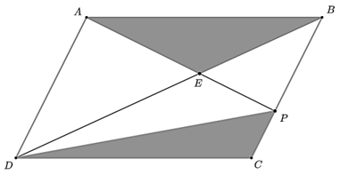

# 第 31 季 · 数量关系

来源：2026下半年省考第三十一季行测模考大赛（广东卷）.pdf

共 15 题，保留原卷题号。分数与数学符号使用 LaTeX；图片路径指向同一资料包内的原图。

## 第 31 题

原卷 PDF 页码：8；题目 ID：`gd-mock-2026h2-s31-q31`

2.5，7.5，30，90，360，（    ）

**A.** 1080

**B.** 900

**C.** 1440

**D.** 1260

## 第 32 题

原卷 PDF 页码：9；题目 ID：`gd-mock-2026h2-s31-q32`

6，17，33，56，88，（    ）

**A.** 144

**B.** 131

**C.** 120

**D.** 112

## 第 33 题

原卷 PDF 页码：9；题目 ID：`gd-mock-2026h2-s31-q33`

16，18，30，24，66，（    ）

**A.** 6

**B.** 32

**C.** 48

**D.** 124

## 第 34 题

原卷 PDF 页码：9；题目 ID：`gd-mock-2026h2-s31-q34`

4218，7648，4109，9155，6525，（    ）

**A.** 4937

**B.** 7249

**C.** 5814

**D.** 9706

## 第 35 题

原卷 PDF 页码：9；题目 ID：`gd-mock-2026h2-s31-q35`

15，12，19，14，28，26，53，40，（    ）

**A.** 102

**B.** 108

**C.** 112

**D.** 122

## 第 36 题

原卷 PDF 页码：9；题目 ID：`gd-mock-2026h2-s31-q36`

某水果店在中秋三天假期销售了180千克软籽石榴，总销售额为2980元。第一天软籽石榴的售价是18元/千克，比后两天的平均售价高2元/千克，且这三天的销量恰好为等差数列。那么假期最后一天软籽石榴的销量为多少千克？

**A.** 60

**B.** 65

**C.** 70

**D.** 80

## 第 37 题

原卷 PDF 页码：9；题目 ID：`gd-mock-2026h2-s31-q37`

某店铺从7月2日开始售卖新款摆件，从7月3日起，每天都比前一天多卖出2件。已知7月11日当天卖出29件，该摆件每件的利润固定为5元。该摆件卖到7月22日停止销售，则销售期间该店铺一共获得利润多少元？

**A.** 3045

**B.** 3145

**C.** 3200

**D.** 3255

## 第 38 题

原卷 PDF 页码：9；题目 ID：`gd-mock-2026h2-s31-q38`

小王玩一款单机游戏，根据他的玩法，系统测算有60%的概率会一次通关。如果第一次通关失败，系统会降低难度并再给一次机会。若小王在两次机会内通关成功的概率为90%，则不考虑第一次的概率，小王在第二次机会通关失败的概率是多少？

**A.** 75%

**B.** 70%

**C.** 35%

**D.** 25%

## 第 39 题

原卷 PDF 页码：9；题目 ID：`gd-mock-2026h2-s31-q39`

桌上有一副完整的扑克牌，共54张（数字为1-13各4张及大、小王2张）。甲、乙两人各抽一张比较数字的大小，问两人打平（数字相同）的概率在哪个范围内？（大王胜小王）

**A.** 5%-10%

**B.** 10%-15%

**C.** 15%-20%

**D.** 20%-25%

## 第 40 题

原卷 PDF 页码：9；题目 ID：`gd-mock-2026h2-s31-q40`

小李和小张一起整理一批办公室卷宗，两人一起整理6天后，小张被其他项目组借调，导致最终整理完这批办公室卷宗所用的时间比原计划多了4天。若小李整理的效率比小张快25%，则原计划整理完这批办公室卷宗需要多少天？

**A.** 8

**B.** 9

**C.** 10

**D.** 11

## 第 41 题

原卷 PDF 页码：9, 10；题目 ID：`gd-mock-2026h2-s31-q41`

桌面上有50枚硬币，甲、乙两人通过剪刀石头布的方式定胜负，胜者可以从桌面上取走7枚硬币，负者需交出4枚硬币放在桌面上，平局甲、乙两人均可从桌面上取走2枚硬币。若甲、乙两人手中均有足量的初始硬币，若干局后桌面上还剩余18枚硬币，则此时甲、乙两人的平局数有多少种可能性？

**A.** 1

**B.** 2

**C.** 3

**D.** 4

## 第 42 题

原卷 PDF 页码：10；题目 ID：`gd-mock-2026h2-s31-q42`

某次数学竞赛前五名的平均成绩与第三名的成绩相同，并且前五名中，前两名的成绩之和比后三名的成绩之和少69分，第二名的成绩比第三名高4分，第三名和第四名的成绩之和为180分，第四名的成绩比第五名高7分，则第一名和第五名的成绩分别为多少分？

**A.** 98，80

**B.** 98，82

**C.** 96，80

**D.** 96，82

## 第 43 题

原卷 PDF 页码：10；题目 ID：`gd-mock-2026h2-s31-q43`

园区内有一块平行四边形多功能场地ABCD（如图所示），已知P点落在BC上，BP=2CP，连接AP，AP与对角线BD交于点E，再连接DP，将场地分成5块区域。 $\triangle BEP$ 区域摆放休闲座椅， $\triangle ABE$ 和 $\triangle CDP$ 两块阴影区域修建水景。则修建水景区域的总面积是摆放休闲座椅区域面积的多少倍？

**A.** $\frac{8}{3}$

**B.** $\frac{10}{3}$

**C.** $\frac{5}{2}$

**D.** $\frac{1}{4}$

## 第 44 题

原卷 PDF 页码：10；题目 ID：`gd-mock-2026h2-s31-q44`

某公园规划出一块三角形花圃，准备先在三个顶点处各放一盆月季，且各条边刚好均可以每隔2米放一盆月季。已知该三角形花圃较短的两条边长度分别为6米、8米，则该三角形花圃最多能放多少盆月季？

**A.** 12

**B.** 13

**C.** 24

**D.** 26

## 第 45 题

原卷 PDF 页码：10；题目 ID：`gd-mock-2026h2-s31-q45`

某地劳务专场组织输送7名务工人员前往甲、乙、丙三个产业园就业，每名务工人员只能前往其中一个产业园，每个产业园至少接收1名务工人员。其中甲产业园接收3人，乙产业园至少接收2人。问一共有多少种不同的人员安排方案？

**A.** 210

**B.** 350

**C.** 420

**D.** 700
