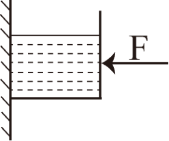

# 第 31 季 · 科学推理

来源：2026下半年省考第三十一季行测模考大赛（广东卷）.pdf

共 5 题，保留原卷题号。分数与数学符号使用 LaTeX；图形使用原图或已标注的矢量重绘图。

## 第 66 题

原卷 PDF 页码：17；题目 ID：`gd-mock-2026h2-s31-q66`

如图所示，质量为m的柱形容器在水平外力F的作用下静止在粗糙程度均匀的竖直墙壁上。向容器内注入一定量的水后，容器和水沿墙壁匀速向下运动，若水平外力F的大小保持不变，则下列说法不正确的是（    ）。

**A.** 注水前，容器受到的摩擦力是静摩擦力

**B.** 注水后，容器受到的摩擦力是滑动摩擦力

**C.** 注水后，容器受到的摩擦力相较于注水前不变

**D.** 注水后，容器受到的摩擦力相较于注水前变大

## 第 67 题

原卷 PDF 页码：17, 18；题目 ID：`gd-mock-2026h2-s31-q67`

下列各现象中，其背后蕴含的科学原理与其他三项不同的是（    ）。

**A.** 火车站要求乘客必须站在站台安全线外候车

**B.** 航海规则中禁止两艘同向航行的船距离过近

**C.** 向两张A4纸中间用力吹气会让两张A4纸贴到一起

**D.** 夏天地面附近的空气会向上升

## 第 68 题

原卷 PDF 页码：18；题目 ID：`gd-mock-2026h2-s31-q68`

下列物质的性质中，属于物理性质的是（    ）。
①氦气非常稳定
②硫酸钡难溶于水
③碳酸钙可溶于酸
④氨气可以使湿润的红色石蕊试纸变蓝
⑤黄金可以拉成很细的金丝
⑥干冰放置在常温常压环境中会消失
⑦羽毛烧焦会产生臭味
⑧熟石灰可用于改良酸性土壤

**A.** ①④⑥

**B.** ②⑦⑧

**C.** ③④⑥

**D.** ②⑤⑥

## 第 69 题

原卷 PDF 页码：18；题目 ID：`gd-mock-2026h2-s31-q69`

胰岛素是一种蛋白质，是人类机体内唯一能够降低血糖的激素，调节其分泌最主要的因素是体内血糖水平。以下有关胰岛素的说法，正确的是（    ）。

**A.** 胰岛素是由胰岛分泌的

**B.** 当人体血糖浓度偏低时，胰岛素的分泌会增多

**C.** 通常在饭后，胰岛素的分泌会增多，使血糖浓度升高

**D.** 糖尿病患者既可以口服胰岛素，还可以注射胰岛素

## 第 70 题

原卷 PDF 页码：18；题目 ID：`gd-mock-2026h2-s31-q70`

下列关于酶的说法正确的是（    ）。

**A.** 酶由活细胞产生，也只能在活细胞中发挥作用

**B.** 酶的化学成分均为蛋白质

**C.** 过高或过低的温度均会彻底破坏酶的空间结构

**D.** 酶促反应的反应速率受pH值影响很大
