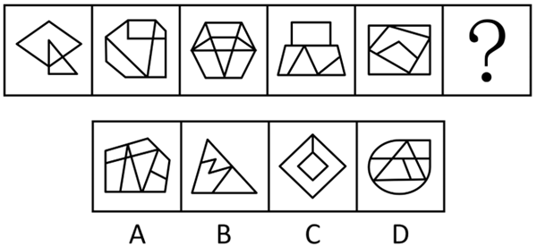
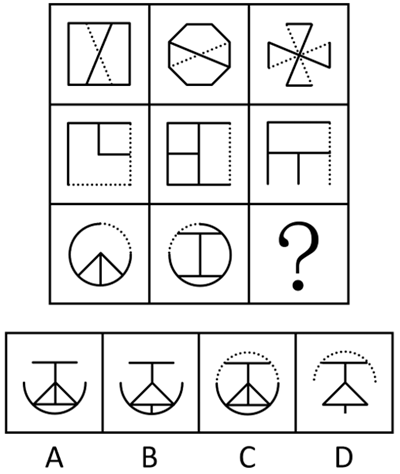
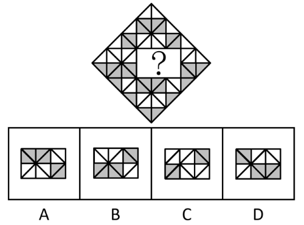
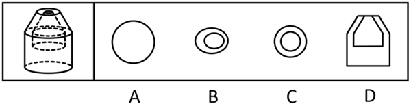
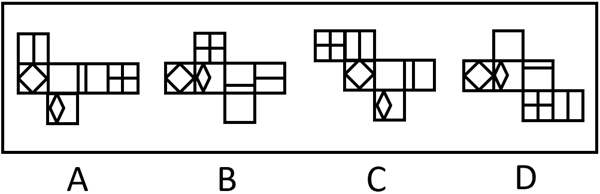

# 第 32 季 · 判断推理

来源：2026下半年省考第三十二季行测模考大赛（广东卷）.pdf

共 20 题，保留原卷题号。分数与数学符号使用 LaTeX；图片路径指向同一资料包内的原图。

## 第 46 题

原卷 PDF 页码：11；题目 ID：`gd-mock-2026h2-s32-q46`

从所给的四个选项中，选择最合适的一个填入问号处，使之呈现一定的规律性：

**A.** 见题图中的 A 选项

**B.** 见题图中的 B 选项

**C.** 见题图中的 C 选项

**D.** 见题图中的 D 选项

## 第 47 题

原卷 PDF 页码：11；题目 ID：`gd-mock-2026h2-s32-q47`

从所给的四个选项中，选择最合适的一个填入问号处，使之呈现一定的规律性：

**A.** 见题图中的 A 选项

**B.** 见题图中的 B 选项

**C.** 见题图中的 C 选项

**D.** 见题图中的 D 选项

## 第 48 题

原卷 PDF 页码：11, 12；题目 ID：`gd-mock-2026h2-s32-q48`

下列选项中最符合所给图形规律的是（    ）。

**A.** 见题图中的 A 选项

**B.** 见题图中的 B 选项

**C.** 见题图中的 C 选项

**D.** 见题图中的 D 选项

## 第 49 题

原卷 PDF 页码：12；题目 ID：`gd-mock-2026h2-s32-q49`

左边是给定的空心立体图形，将其从任一面剖开，右边哪项不可能是该立体图形的截面？

**A.** 见题图中的 A 选项

**B.** 见题图中的 B 选项

**C.** 见题图中的 C 选项

**D.** 见题图中的 D 选项

## 第 50 题

原卷 PDF 页码：12；题目 ID：`gd-mock-2026h2-s32-q50`

下列选项为4个正方体纸盒的外表面展开图，其中哪一个折叠成的纸盒与其他三个不一样？

**A.** 见题图中的 A 选项

**B.** 见题图中的 B 选项

**C.** 见题图中的 C 选项

**D.** 见题图中的 D 选项

## 第 51 题

原卷 PDF 页码：12, 13；题目 ID：`gd-mock-2026h2-s32-q51`

某书店设置I、II、III、IV共4个区域放置文学类、历史类、艺术类和科普类书籍，一个区域只放一类书籍，已知：
（1）如果II区不放历史类书籍，那么IV区不放科普类书籍；
（2）除非II区放艺术类书籍，否则IV区放科普类书籍；
（3）或者I区放文学类书籍，或者III区放文学类书籍；
（4）除非I区不放文学类书籍，否则II区不放历史类书籍。
以下哪项如果为真，可得出“III区放文学类书籍”的结论？

**A.** II区不放历史类书籍

**B.** IV区不放科普类书籍

**C.** II区不放艺术类书籍

**D.** I区放文学类书籍

## 第 52 题

原卷 PDF 页码：13；题目 ID：`gd-mock-2026h2-s32-q52`

我们在乘坐自动扶梯时，常常看到有些赶路的人被两个并排乘坐电梯的人挡住，无法快速上下楼，尤其在一些商场或地铁站所有人都不得不乘坐扶梯，就会出现一些人被堵在扶梯中间而不能快速通过的情形。这时候，如果乘坐扶梯的大多数人都能自觉统一靠右站立，就能为少部分赶时间的人留出左边的通道，而如果有人占用左边的通道，会被认为是“没素质”的表现。因此，搭乘扶梯时，“左行右立”是安全且文明的乘梯方式。
以下哪项如果为真，最不能削弱上述观点？

**A.** 扶梯的坡度往往比日常的建筑结构的楼梯高度要高一点，并不适合行走

**B.** 扶梯右侧如果长期承受更多的重量，容易出现部件磨损，导致故障率上升

**C.** 在高峰时段乘坐扶梯的人员较多，此时在扶梯上行走会导致拥挤和混乱

**D.** 近些年来，加拿大、韩国和日本等很多国家都已经撤除了扶梯“左行右立”的标语

## 第 53 题

原卷 PDF 页码：13；题目 ID：`gd-mock-2026h2-s32-q53`

“起鸡皮疙瘩”是一种正常的生理反应。当人们面临恐惧或威胁时，体内会分泌肾上腺素，而肾上腺素能够让立毛肌（我们皮肤上的一种平滑肌）收缩，这也是为什么很多人在面临恐惧或威胁时，例如看恐怖片时，会感到“鸡皮疙瘩掉了一地”。上述论证的成立须补充以下哪项作为前提？

**A.** 皮肤上的鸡皮疙瘩可促使真皮层的立毛肌收缩，从而起到调节体温的作用

**B.** 除了在面临恐惧威胁时，很多人在精神亢奋的时候，同样也会起鸡皮疙瘩

**C.** 起鸡皮疙瘩的机制较为复杂，涉及人类情感状态和生理反应之间的相互作用

**D.** 当立毛肌收缩时，汗毛随着竖起来，同时凸显一个个小隆起，形成鸡皮疙瘩

## 第 54 题

原卷 PDF 页码：13；题目 ID：`gd-mock-2026h2-s32-q54`

人类运动时的肌肉活动会增加热量的产生，使得体温飙升，如不加以控制，很可能危及生命，所以散热对人类至关重要。人类在进化中形成的特殊散热机制就是出汗，而大多数动物要么压根不出汗，要么出汗量很少。相比其它动物的散热方式，人类通过出汗散热的速度更快，而且不影响运动，所以人类可以顶着烈日长距离奔跑狩猎动物。许多进化生物学家认为，正是靠着出汗散热，人类才能一直追捕猎物，进而成为地球上最顶端的掠食者。
以下哪项如果为真，最能加强上述论证？

**A.** 除了出汗，人类还有其他独特的生理机制与汗腺协同作用以保持凉爽

**B.** 出汗使人类能在追捕猎物时保持凉爽，直到猎物因热衰竭而倒地死亡

**C.** 出汗可能也是一种重要的防御机制，如感冒时全身出汗是一种自我保护

**D.** 灵长类动物如猴子、猿和狐猴的出汗系统与人类非常相似，但汗腺没有人类发达

## 第 55 题

原卷 PDF 页码：13, 14；题目 ID：`gd-mock-2026h2-s32-q55`

一家四口正在讨论暑假旅游的事情，他们各说了一句话。爸爸：如果不去苏州，那么一定要去杭州；妈妈：这次咱们要去南京；女儿：南京和上海都要去；儿子：不去苏州，也不去杭州。经过商量，最终他们把目的地定下来了，发现有两个人说对了，有两个人说错了。那么他们这次旅游的目的地一定包括：

**A.** 上海

**B.** 苏州

**C.** 杭州

**D.** 南京

## 第 56 题

原卷 PDF 页码：14；题目 ID：`gd-mock-2026h2-s32-q56`

一项针对约2000人的调查发现，网购会让人拥有更多空闲时间。该调查结果显示，填写问卷的人中，对网购的喜爱程度越高，其每天可供支配的空余时间就越长。研究人员猜测这是因为网络购物已被越来越多人接受，中青年人群已经成为网络购物的主力军，消费者足不出户就可以随时随地购买到异地甚至异国的商品，节约了大量的逛街时间，这些节约下来的时间就可以用来干其他更有意义的事情。
以下哪项如果为真，最能削弱上述观点？

**A.** 一些消费者反映网购从购买至收货周期较长，如果遇到退换货还要等待更长时间

**B.** 参与问卷填写的大多都是在平时拥有更多空闲时间的人，他们通过网购打发时间

**C.** 研究显示，网购者消费水平的高低与学历的高低、职业的稳定性等因素密切相关

**D.** 喜爱网购的人群中，女性的比例明显偏高，说明女性更擅长合理规划时间

## 第 57 题

原卷 PDF 页码：14；题目 ID：`gd-mock-2026h2-s32-q57`

鸡身上的各个部位能做出各种各样的食品，除了当主食更是能当日常零食吃，如鸡翅可以分为翅根、翅中和翅尖三个部位，并且这些部位通常被做成不同零食分开来卖，深受国人喜爱，销量居高不下。一种观点认为，鸡翅销量高是因为其脂肪较高、蛋白质丰富、营养价值高；另一种观点则认为，鸡翅销量高是因为它有满满的Q弹鲜嫩滋味，口感极佳。
以下哪项如果为真，最能削弱第二种观点？

**A.** 鸡翅虽然口感好但价格相对较高，会影响其销量

**B.** 鸡翅的口感良好是由于脂肪和蛋白质含量较高

**C.** 鸡翅的脂肪与蛋白质含量实际要远低于鸡爪

**D.** 鸡的不同部位口感和味道不一样，价格也就会不同

## 第 58 题

原卷 PDF 页码：14；题目 ID：`gd-mock-2026h2-s32-q58`

几位小朋友在海洋馆参观，他们正在讨论看到的海洋生物是什么。丽丽说：“不是海葵，是珊瑚。”明明说：“不是珊瑚，也不是海绵。”笑笑说：“不是珊瑚，是海葵。”海洋馆的工作人员听到以后，笑着说：“这三位小朋友中，只有一个人的答案完全正确，还有一个人答对了一半，剩下一个人全部答错了。”
由此可以推出：

**A.** 丽丽说对了一半

**B.** 该生物是海葵

**C.** 该生物是珊瑚

**D.** 该生物是海绵

## 第 59 题

原卷 PDF 页码：15；题目 ID：`gd-mock-2026h2-s32-q59`

某科学院古脊椎动物与古人类研究团队发现了一块恐龙称霸时期（距今约1.1亿年）的动物化石，并在其牙缝里提取出了植物表皮与植硅体残留物。分析显示，表皮细胞含短细胞对且植硅体呈哑铃型，因此研究团队得出结论：早在恐龙称霸时期，古老的禾草类植物已悄然扎根。要使上述推论成立，需要补充的前提是（    ）。

**A.** 表皮细胞含短细胞对且植硅体呈哑铃型是古老的禾草类植物独有的特征

**B.** 恐龙化石牙缝中的植物遗存能够真实反映恐龙生存时代存在该植物

**C.** 距今约1.1亿年的恐龙主要以各类草本植物为食，很少进食木本植物

**D.** 禾草类植物的表皮细胞和植硅体特征在亿万年演化中未发生本质改变

## 第 60 题

原卷 PDF 页码：15；题目 ID：`gd-mock-2026h2-s32-q60`

某单位有甲、乙、丙、丁、戊5名员工报名参加月度专项评优。已知：
（1）3人入职年限3年及以下，2人入职年限3年以上；
（2）2人为技术岗，3人为行政岗；
（3）甲和丙入职年限相同，丁和戊入职年限不同；
（4）乙和戊岗位类型相同，丙和丁岗位类型不同；
（5）最终评优成功的是1名入职3年以上的技术岗员工。
由此可以推出，这名优秀员工是：

**A.** 甲

**B.** 乙

**C.** 丁

**D.** 戊

## 第 61 题

原卷 PDF 页码：15；题目 ID：`gd-mock-2026h2-s32-q61`

只有努力打拼的人，才能拥有富足生活。商人老张没有拥有富足生活，所以老张没有努力打拼。
以下选项存在的逻辑错误与题干最为相似的是（    ）。

**A.** 只有熟悉地形的职业赛车手，才能去参加比赛。小刘不能参加比赛，所以小刘不熟悉地形

**B.** 只有深耕钻研的人，才能精通技艺。小王没有深耕钻研，因此小王技艺不够精通

**C.** 每科成绩都拿到优秀的同学，就能得到奖励。小明同学只有数学科目拿到优秀，因此小明不能得到奖励

**D.** 队员要想参加户外团建，就必须体能测试达标。队员小赵体能测试没有达标，所以小赵不能参加户外团建

## 第 62 题

原卷 PDF 页码：15, 16；题目 ID：`gd-mock-2026h2-s32-q62`

如今不少健康博主大力倡导炒菜少油、少食肥肉，以保证合理的脂肪摄入量，避免过量摄入而造成脂肪堆积，影响身体健康。很多人纷纷遵从这一理念，认为这样就能守护身体健康。但长期坚持炒菜少油、少食肥肉的人群里，依旧有大量的人脂肪摄入量超标，出现脂肪堆积。对于上述现象，以下解释最为合理的是（    ）。

**A.** 长期摄入油脂过少，会使人体脂肪代谢速率变慢，更容易造成脂肪堆积

**B.** 日常所吃的坚果、甜品、酱料等含有大量隐形脂肪，极易被人们忽视

**C.** 部分人群口味偏重，少油烹饪后会加入重盐重糖调味品，加重身体代谢负担

**D.** 不同人群身体代谢能力存在差异，控油饮食的作用效果因人而异

## 第 63 题

原卷 PDF 页码：16；题目 ID：`gd-mock-2026h2-s32-q63`

某项研究发现，长颈鹿把血泵到垂直抬起的头部，为了克服静水压力，MAP（平均动脉压）会升到214mmHg，而脖颈长达15米的蜥脚类恐龙，如果像长颈鹿一样把脖子垂直抬起，为了克服静水压力，MAP必须升至1350mmHg，那么光是心脏的能量消耗，就会与身体其余所有部位的总耗能相当，几乎无法生存。因此，研究人员得出结论：最大的蜥脚类恐龙可能根本无法将脖子垂直抬起。上述论证的主要逻辑错误在于（    ）。

**A.** 默认了血压数值高低直接决定了生物能否正常存活

**B.** 默认了蜥脚类恐龙日常活动需要长时间垂直抬起脖子

**C.** 忽视了动物脖颈使用方式会随生存环境发生相应改变

**D.** 忽视了蜥脚类恐龙或具备低耗能高压供血的生理结构

## 第 64 题

原卷 PDF 页码：16；题目 ID：`gd-mock-2026h2-s32-q64`

过度追求短期业绩不利于企业筑牢长远发展根基，企业根基不稳不利于行业整体稳健前行，因此，过度追求短期业绩不利于行业整体稳健前行。下列选项的逻辑结构与题干最为相似的是（    ）。

**A.** 疏于日常体能锻炼不利于维持良好体态，体态不佳不利于塑造自信气质，因此，疏于日常体能锻炼不利于塑造自信气质

**B.** 盲目跟风投资容易造成资金亏损，资金亏损会大幅降低生活质量，因此，盲目跟风投资会拉低大众消费水准

**C.** 固守老旧思维模式不利于创新实践发展，创新实践发展滞后不利于提升产业效能，因此，固守老旧思维模式不利于社会整体发展

**D.** 作息紊乱不利于提升身体机能，身体机能下降不利于保持健康的精神状态，因此，规律作息有利于改善精神状态

## 第 65 题

原卷 PDF 页码：16；题目 ID：`gd-mock-2026h2-s32-q65`

我们在日常生活中主要接触动物蛋白质和植物蛋白质，现代营养学已经明确，动物蛋白质所含氨基酸的种类与构成，更加接近人体蛋白质的氨基酸组成，且一般都含有人体必需的8种氨基酸。豆类富含植物蛋白质，有利于减轻肾脏负担，因此专家建议：减轻肾脏负担应优先选用大豆及其制品补充蛋白质。要使上述建议成立，需要补充的前提是（    ）。

**A.** 猪、牛、羊等红肉蛋白质会增加肾病患者的肾脏代谢负担

**B.** 补充蛋白质的食材差异会影响肾脏代谢压力

**C.** 多数慢性肾病患者日常饮食都需严格遵循低蛋白饮食原则

**D.** 大豆制品本身口味清淡，日常烹饪中多采用少油的做法
