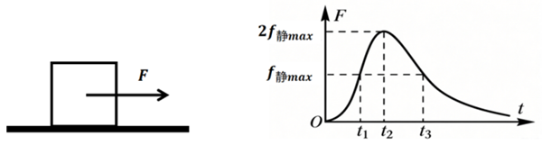
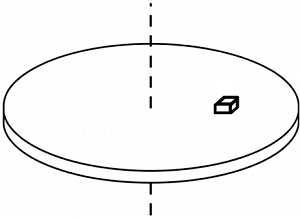
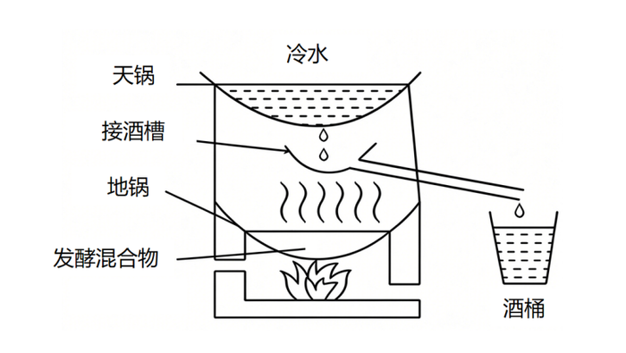

# 第 32 季 · 科学推理

来源：2026下半年省考第三十二季行测模考大赛（广东卷）.pdf

共 5 题，保留原卷题号。分数与数学符号使用 LaTeX；图形使用原图或已标注的矢量重绘图。

## 第 66 题

原卷 PDF 页码：17；题目 ID：`gd-mock-2026h2-s32-q66`

仓库中一个货箱静止在水平地面上，工作人员用水平向右的拉力F拉动货箱。拉力F随时间t变化的曲线如图所示。已知货箱与地面之间的最大静摩擦力 $f_{\text{静}max}$ 大小等于滑动摩擦力大小，下列说法错误的是（    ）。

**A.** $t_1$ 时刻货箱受力平衡

**B.** $t_2$ 时刻货箱的加速度达到最大值

**C.** $t_1-t_3$ 时间段内货箱受到的摩擦力先增大后减小

**D.** 货箱与地面之间有2对相互作用力

## 第 67 题

原卷 PDF 页码：17；题目 ID：`gd-mock-2026h2-s32-q67`

如图所示，水平圆盘可以绕竖直中心轴匀速转动，小物块放置在圆盘表面，跟随圆盘一起做匀速圆周运动。下列说法正确的是（    ）。

**A.** 物块随圆盘匀速转动时，一共受到重力、支持力、向心力、静摩擦力4个力的作用

**B.** 若圆盘转动角速度变大，物块受到的静摩擦力方向会从指向圆心转为背离圆心

**C.** 若物块到转轴距离不变，圆盘角速度越大，物块受到的静摩擦力越大

**D.** 若物块与圆盘发生相对滑动，物块会沿着半径方向向外滑出

## 第 68 题

原卷 PDF 页码：17, 18；题目 ID：`gd-mock-2026h2-s32-q68`

古法天锅酿酒时，地锅中的发酵原料持续加热，产生含有酒精和水蒸气的高温混合蒸汽；蒸汽向上遇到装有冷水的天锅锅底，气态酒精与水蒸气在锅底凝结为液态，汇聚成酒液经导流装置流出。已知酒精沸点低于水的沸点，下列说法正确的是（    ）。

**A.** 地锅中原料加热时，酒精比水更难由液态转化为气态

**B.** 高温混合蒸汽接触装有冷水的锅底发生液化，该过程需要吸收热量

**C.** 酿酒过程中不断更换天锅中的冷水，有助于收集酒液

**D.** 酒液能够持续流出，说明蒸汽液化时装有冷水的锅底温度高于蒸汽温度

## 第 69 题

原卷 PDF 页码：18；题目 ID：`gd-mock-2026h2-s32-q69`

接种疫苗后，人体免疫系统会针对疫苗中的特定抗原发生免疫应答，并留存免疫记忆。当机体后续再次接触到同种致病性病原体入侵时，能够启动速度更快、强度更大的免疫防御，有效降低发病或者重症风险。该免疫过程主要属于（    ）。

**A.** 特异性免疫

**B.** 物理屏障作用

**C.** 非特异性吞噬作用的唯一结果

**D.** 与免疫系统无关的条件反射

## 第 70 题

原卷 PDF 页码：18；题目 ID：`gd-mock-2026h2-s32-q70`

某沿海城市建设海上风电场，工作人员观察发现，白天近地面风常由海洋吹向陆地，夜晚近地面风向可能相反。下列说法正确的是（    ）。

**A.** 白天近地面风的形成与海陆热力性质差异有关

**B.** 海陆风形成说明近地面空气总是从低压区流向高压区

**C.** 夜晚陆地气温通常高于海洋，近地面可能形成海风

**D.** 海上风电的能量最终来源于地球内部的地热能
