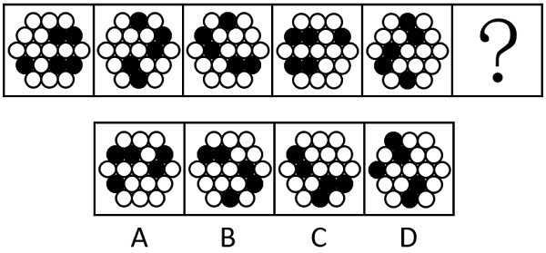
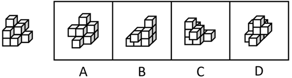
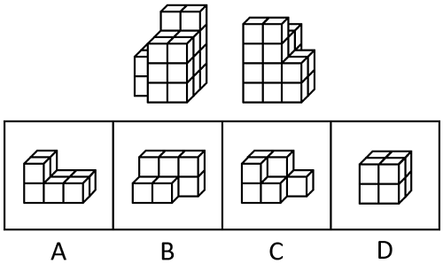

# 第 33 季 · 判断推理

来源：2026下半年省考第三十三季行测模考大赛（广东卷）.pdf

共 20 题，保留原卷题号。分数与数学符号使用 LaTeX；图片路径指向同一资料包内的原图。

## 第 46 题

原卷 PDF 页码：11；题目 ID：`gd-mock-2026h2-s33-q46`

从所给的四个选项中，选择最合适的一个填入问号处，使之呈现一定的规律性：

**A.** 见题图中的 A 选项

**B.** 见题图中的 B 选项

**C.** 见题图中的 C 选项

**D.** 见题图中的 D 选项

## 第 47 题

原卷 PDF 页码：11, 12；题目 ID：`gd-mock-2026h2-s33-q47`

从所给的四个选项中，选择最合适的一个填入问号处，使之呈现一定的规律性：

**A.** 见题图中的 A 选项

**B.** 见题图中的 B 选项

**C.** 见题图中的 C 选项

**D.** 见题图中的 D 选项

## 第 48 题

原卷 PDF 页码：12；题目 ID：`gd-mock-2026h2-s33-q48`

下列选项最可能与左侧立体图形是同一图形的是（    ）。

**A.** 见题图中的 A 选项

**B.** 见题图中的 B 选项

**C.** 见题图中的 C 选项

**D.** 见题图中的 D 选项

## 第 49 题

原卷 PDF 页码：12；题目 ID：`gd-mock-2026h2-s33-q49`

左边给定的是六面体的外表面展开图，右边哪项能由它折叠而成？

**A.** 见题图中的 A 选项

**B.** 见题图中的 B 选项

**C.** 见题图中的 C 选项

**D.** 见题图中的 D 选项

## 第 50 题

原卷 PDF 页码：12, 13；题目 ID：`gd-mock-2026h2-s33-q50`

下图是某立体图形的正面和后面，它由三个完全相同的小立体图形组成，该小立体图形是：

**A.** 见题图中的 A 选项

**B.** 见题图中的 B 选项

**C.** 见题图中的 C 选项

**D.** 见题图中的 D 选项

## 第 51 题

原卷 PDF 页码：13；题目 ID：`gd-mock-2026h2-s33-q51`

研究指出，14世纪欧洲爆发的“黑死病”大瘟疫，其实是一场由火山喷发引发的“连锁灾难”‌。研究团队通过研究西班牙树木年轮发现，1345-1347年夏季异常寒冷潮湿，这符合‌大型火山喷发‌后的典型气候特征，气候突变导致地中海地区粮食大面积歉收，意大利城邦为应对饥荒，紧急从蒙古大量进口谷物，运粮船在运输谷物的同时，也带来了‌身上寄生着鼠疫杆菌跳蚤的鼠类，这些船只抵达地中海港口后，鼠疫从啮齿动物传播到人类，疫情就此爆发。
以下哪项如果为真，最不能支持上述结论？

**A.** 那些在气候冲击后不得不依赖粮食进口的港口城市，恰恰是黑死病最早、最严重的爆发地

**B.** 14世纪欧洲修道院的文献记载，黑死病爆发前曾出现过天空变红、飞鸟成群坠亡的怪象

**C.** 研究发现蒙古在1340年代曾爆发大规模鼠疫，其传播路径与意大利的商船航线大致重叠

**D.** 1347年在威尼斯沉没的商船残骸中发现了啮齿动物骨骼，其体内被检测出鼠疫杆菌残留

## 第 52 题

原卷 PDF 页码：13；题目 ID：`gd-mock-2026h2-s33-q52`

截至2025年底，全国新能源汽车保有量达4397万辆。为应对快速增长的充电需求，进一步提升充电基础设施服务能力，能源部门计划两年内在全国范围内建成2800万个公共充电设施，届时将满足超8000万辆电动汽车充电需求，实现充电基础设施服务能力翻倍提升。反对者对此提出质疑：如果车主已习惯在家充电，即便公共充电网络完善，仍可能因使用习惯而继续选择在家充电，因此提升充电效率需同步优化家用充电桩的安装政策。要使反对者的质疑成立，必须补充的前提是：

**A.** 由于很多城市并无峰谷电价措施，许多家庭充电成本可能接近甚至超过公共充电

**B.** 多地向居民小区物业发放充电桩安装补贴，以激励物业配合车主安装家用充电桩

**C.** 随着公共充电设施的不断增多，越来越多新能源车主的使用习惯会逐渐发生改变

**D.** 大部分新能源车主的充电选择主要受使用习惯的影响，而非公共充电设施的密度

## 第 53 题

原卷 PDF 页码：13, 14；题目 ID：`gd-mock-2026h2-s33-q53`

市中心的某家餐厅在社交平台上爆红以后，越来越多的顾客慕名而来，餐厅门口总是大排长龙，然而，商家非但没有多雇人手，反而让厨房放慢出餐速度，顾客好不容易挤进门口，但又会面对比排队等位时间还长的出餐时间。
以下哪项如果为真，最能解释上述现象？

**A.** 商家有意控制出餐速度，造成“错过即无”的心理效应，显著放大了需求

**B.** 该商圈的餐厅中，很多都顶着“网红餐厅”的帽子，一到饭点就大排长龙

**C.** 该“网红餐厅”店面看似不小，但里面的座位少得可怜，可容纳量极小

**D.** 该“网红餐厅”的菜品大多是厨师现做，而非来自中央厨房的半成品料理包

## 第 54 题

原卷 PDF 页码：14；题目 ID：`gd-mock-2026h2-s33-q54`

某小学五年级一班的班主任在暑期前布置社会实践任务，要求五年级一班的学生都要完成两项社区志愿服务，或者撰写一份关于垃圾分类的社会调查报告。如果该班级里的所有学生都完成了班主任布置的任务，那么以下哪项一定为真？Ⅰ.有些五年级一班的学生撰写了一份关于垃圾分类的社会调查报告Ⅱ.如果某学生既没有完成两项社区志愿服务，也没有撰写一份关于垃圾分类的社会调查报告，那么这名学生一定不是五年级一班的学生Ⅲ.如果某学生既完成了两项社区志愿服务，又撰写了一份关于垃圾分类的社会调查报告，那么这名学生一定是五年级一班的学生Ⅳ.五年级一班的学生如果完成了两项社区志愿服务，就一定没有撰写一份关于垃圾分类的社会调查报告

**A.** 只有Ⅰ

**B.** 只有Ⅱ

**C.** 只有Ⅰ和Ⅱ

**D.** 只有Ⅱ和Ⅳ

## 第 55 题

原卷 PDF 页码：14；题目 ID：`gd-mock-2026h2-s33-q55`

脸圆了，腰粗了，体重又超了······当镜子里的轮廓悄然改变，电子秤数字显示超出正常范围，你或许意识到，这场与体重的“拉锯战”早已超越个人审美范畴，更成为一个关乎全民健康的时代命题。人们大多将体重上升归咎于饮食不节制、运动不足或作息紊乱，却常常忽略了一个关键却隐蔽的影响因素——天气。最新研究发现，天气也会影响体重。
以下哪项如果为真，最能加强上述结论？

**A.** 肥胖是人体能量摄入与消耗长期失衡的结果，具体原因较为复杂

**B.** 通常可以通过人的体质指数（BMI）、体脂率等指标判断肥胖程度

**C.** 寒冷天气下，为了维持体温，身体会自动进入“囤脂”模式

**D.** 不少地区的居民发现，夏季天气炎热时人们会觉得胖瘦情况不稳定

## 第 56 题

原卷 PDF 页码：14, 15；题目 ID：`gd-mock-2026h2-s33-q56`

在我们每年+1的实际年龄之外，还有一个生物学年龄。它代表了我们身体的基本单位——细胞的衰老速度，并且可能与实际年龄存在一定差异。澳大利亚和英国的科学家通过调查英国家庭住房与健康的关系发现，租房住的人衰老得更快。数据显示，租房对一个人的生理性衰老的影响远高于失业和吸烟，租房住的人群衰老系数为0.046年，几乎是失业（0.027年）和吸烟（0.021年）的2倍。
以下哪项如果为真，最能削弱上述研究人员的结论？

**A.** 有房款拖欠史，或者居住环境不佳（存在污染问题等）也与更快的生物学衰老速度有关

**B.** 居住在租房成本更低、租期更稳定的公租房人群，其生物学衰老状况与那些有房人士相比没有什么不同

**C.** 部分人群对于生活环境的稳定性有着较高需求，他们往往更倾向于通过购买房产来获得安全感和归属感

**D.** 研究数据中不包含对当下住房变量的考察，且被试者均为欧洲白人，可能存在地域和种族偏差

## 第 57 题

原卷 PDF 页码：15；题目 ID：`gd-mock-2026h2-s33-q57`

某公司周一到周四安排小红、小白、小黄、小蓝四人值班，每人负责值班一天，每天只有一人值班。已知：
（1）小白在周二或周三值班；
（2）除非小蓝在周一值班，否则小红在周三值班；
（3）小黄在周一值班。根据题干条件，可以推出以下哪项？

**A.** 小蓝在周四值班

**B.** 小白在小红之后值班

**C.** 小红在周二值班

**D.** 小蓝在小红之前值班

## 第 58 题

原卷 PDF 页码：15；题目 ID：`gd-mock-2026h2-s33-q58`

新能源购车补贴取消后，新能源汽车的销量不会出现断崖式下跌。因此，新能源购车补贴不会改变新能源汽车的销量。
以下选项与题干的推理结构最为相近的是：

**A.** 某咖啡店换了新的咖啡豆供应商后，顾客投诉数量明显增多，因此，新供应商的咖啡豆质量不如以前的

**B.** 某直播平台取消了打赏功能后，用户的观看时长并没有减少，因此，打赏功能并不会影响用户观看时长

**C.** 某市增加了公交专用车道后，公交车的运行效率并没有明显提升，因此，公交专用车道不能提高公交车运行效率

**D.** 某核心球员受伤缺席比赛，其所在球队连续几场比赛都输了，因此，该核心球员对球队的胜负至关重要

## 第 59 题

原卷 PDF 页码：15；题目 ID：`gd-mock-2026h2-s33-q59`

AI翻译能快速完成多语言翻译，有些AI翻译工具甚至能近乎即时翻译数十种语言，并且还在不断精进，但AI翻译无法传递语言中的微妙意义，尤其是翻译那些训练数据较少的语言。因此，AI翻译工具虽能消除语言障碍，却无法替代人类主动学习外语的价值。要使上述结论成立，需要补充的前提是（    ）。

**A.** 人类主动学习外语也可以打破不同语种之间的沟通壁垒

**B.** 体会语言中的微妙意义是学习外语不可或缺的核心价值

**C.** AI翻译多局限于字面释义，面对复杂句式易出现理解偏差

**D.** 拥有多语言经验的人，在视觉空间工作记忆方面的表现明显更好

## 第 60 题

原卷 PDF 页码：15, 16；题目 ID：`gd-mock-2026h2-s33-q60`

某果农把一批苹果平均分给若干个村民，已知村民人数不足10人，每个村民分到的苹果数量完全相同，且苹果没有剩余。甲、乙、丙、丁4人分别独立数了苹果的总数，得到的结果依次是：1520个、1485个、1646个、1602个。果农核对后说：你们4人中只有1人数对了总数，另外3人都数错了。但这三个数错的数除以村民的人数，余数分别是2、5、6。
根据上述信息，可以推出数对苹果总数的人是：

**A.** 甲

**B.** 乙

**C.** 丙

**D.** 丁

## 第 61 题

原卷 PDF 页码：16；题目 ID：`gd-mock-2026h2-s33-q61`

餐饮店提升客流量必须通过线上推广或线下活动来实现。某餐饮店未开展线下活动，因此该餐饮店需进行线上推广。下列选项与题干逻辑结构最为相似的是（    ）。

**A.** 居民办理社保业务可通过线上小程序或线下服务大厅办理。某居民已通过线上小程序办理社保业务，因此该居民无需前往线下服务大厅

**B.** 优化运输路线或自建仓储中心就可降低企业物流成本。某企业未优化运输路线，因此该企业需自建仓储中心

**C.** 部分工厂采用自动化生产，部分工厂采用人工化生产。某工厂未采用人工化生产，因此该工厂采用自动化生产

**D.** 制造业企业必须通过升级生产设备或引入智能系统才能提高生产效率。某制造业企业未引入智能系统，因此该企业需升级生产设备

## 第 62 题

原卷 PDF 页码：16；题目 ID：`gd-mock-2026h2-s33-q62`

雄黄是四硫化四砷的俗称，若将雄黄加热至一定温度，它在空气中会被氧化为剧毒物质三氧化二砷。“砒霜”的主要成分就是三氧化二砷，是最古老的毒物之一。普通的植物在雄黄矿区上生长会枯萎、死亡，而蜈蚣草却能在几乎寸草不生的“砒霜地”上长势良好，似乎完全没有受到含有砷元素的毒物的影响。下列选项如果为真，最能解释上述现象的是（    ）。

**A.** 受土壤养分供应、环境条件等因素影响，不同植物对同种元素的吸收、积累和利用能力差异很大

**B.** 与其他植物相比，蜈蚣草的液泡膜可以隔绝细胞器和砷元素的接触，确保蜈蚣草的细胞器不受砷元素的伤害

**C.** 成熟的蜈蚣草植株里，除下部缩短的羽片不育外，几乎全部羽片均能长出孢子，具备繁殖能力

**D.** 相比根系发达的植物，蜈蚣草外形低矮、根系短小，无法深入土壤深层接触到土壤里的各类矿物质

## 第 63 题

原卷 PDF 页码：16, 17；题目 ID：`gd-mock-2026h2-s33-q63`

某地区规划布局未来产业，拟从未来制造、未来信息、未来材料、未来健康、未来能源五大方向中选定部分领域予以发展。相关专家提出以下建议：
（1）若发展未来材料，那么就要发展未来制造；
（2）不能同时发展未来信息与未来健康；
（3）如果不发展未来信息，那么就不能发展未来能源；
（4）只有发展未来能源，才不发展未来材料。若上述建议均被采纳，则补充（    ），可以得出“该地区一定会发展未来制造”的结论。

**A.** 如果不发展未来制造，那么也不发展未来健康

**B.** 如果发展未来健康，那么就不发展未来制造

**C.** 除非发展未来健康，否则发展未来制造

**D.** 只有不发展未来制造，才不发展未来健康

## 第 64 题

原卷 PDF 页码：17；题目 ID：`gd-mock-2026h2-s33-q64`

车流密集的路段易出现交通拥堵，易出现交通拥堵的路段需增设疏导岗。因此车流稀疏的路段无需增设疏导岗。下列选项与上述推理的逻辑结构最为相似的是（    ）。

**A.** 户外锻炼能增强人体体质，规律作息也能增强人体体质。因此规律作息的人不用坚持户外锻炼

**B.** 口碑良好的门店都注重服务品质，注重服务品质的门店顾客体验都较好。因此口碑良好的门店顾客体验较好

**C.** 植被覆盖率高的山林生态稳定性高，生态稳定性高的山林生物种类丰富。因此生物种类稀少的山林生态稳定性差

**D.** 通风不畅的房间容易滋生霉菌，容易滋生霉菌的房间不利于居住。因此通风良好的房间有利于居住

## 第 65 题

原卷 PDF 页码：17；题目 ID：`gd-mock-2026h2-s33-q65`

林下经济是以林地资源和森林生态环境为依托，通过林下种植、养殖、产品采集加工及森林景观利用等方式形成的生态友好型经济模式。某地区中药材禀赋突出，既盛产黄柏、厚朴、杜仲等林木类药材，也分布有贝母、重楼、半夏、黄连等名贵草本药材，具备发展林下中药材产业的良好基础与独特优势。因此，该地区可采取地上培育林木类药材、林下套种草本药材的模式，重点发展林下中药材产业。要使上述推论成立，需要补充的前提是（    ）。

**A.** 该地区部分农户对发展林下经济，特别是林下中药材产业具有较高的热情

**B.** 相比单独种植，林木与草本药材套种既能提升药材品质，又能提高经济效益

**C.** 林下的草本药材不会因上方林木遮挡光照出现生长受阻、无法存活的情况

**D.** 业内普遍认为，中药材种植作为中医药产业的上游环节，发展前景十分可观
