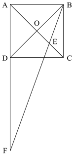
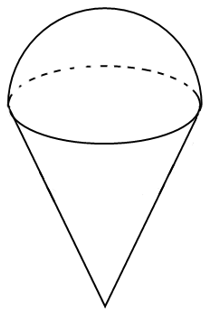

# 第 33 季 · 数量关系

来源：2026下半年省考第三十三季行测模考大赛（广东卷）.pdf

共 15 题，保留原卷题号。分数与数学符号使用 LaTeX；图片路径指向同一资料包内的原图。

## 第 31 题

原卷 PDF 页码：9；题目 ID：`gd-mock-2026h2-s33-q31`

9，7，11，3，（    ），-13

**A.** 4

**B.** 19

**C.** 25

**D.** -6

## 第 32 题

原卷 PDF 页码：9；题目 ID：`gd-mock-2026h2-s33-q32`

-5，-1，5，17，47，（    ）

**A.** 174

**B.** 137

**C.** 114

**D.** 86

## 第 33 题

原卷 PDF 页码：9；题目 ID：`gd-mock-2026h2-s33-q33`

6，26，51，145，363，（    ）

**A.** 1171

**B.** 1027

**C.** 993

**D.** 962

## 第 34 题

原卷 PDF 页码：9；题目 ID：`gd-mock-2026h2-s33-q34`

3，16，12，18，22，20，34，22，（    ）

**A.** 41

**B.** 48

**C.** 42

**D.** 36

## 第 35 题

原卷 PDF 页码：9；题目 ID：`gd-mock-2026h2-s33-q35`

1436，3568，5375，5992，（    ）

**A.** 1056

**B.** 1245

**C.** 1537

**D.** 1839

## 第 36 题

原卷 PDF 页码：9；题目 ID：`gd-mock-2026h2-s33-q36`

一项工程，甲队单独完成需30天，乙队单独完成需20天。现甲、乙两队先合作若干天，剩余工程由乙队单独完成。若该工程始终由甲、乙两队合作完成，则用时比实际少4天。问甲队实际工作了多少天？

**A.** 6

**B.** 8

**C.** 12

**D.** 16

## 第 37 题

原卷 PDF 页码：9；题目 ID：`gd-mock-2026h2-s33-q37`

某公司针对新上市的A、B、C三种产品进行市场调研，在使用过这三种产品的336人中，仅使用过其中任意一种产品的人数恰好构成公差为8的等差数列，且仅使用过A产品的人数最少，仅使用过其中任意两种产品的人数均为36人，三种产品均使用过的人数为18人。问使用过A产品的人数为：

**A.** 62人

**B.** 90人

**C.** 116人

**D.** 152人

## 第 38 题

原卷 PDF 页码：10；题目 ID：`gd-mock-2026h2-s33-q38`

如图所示，在正方形ABCD中，对角线AC与BD相交于点O，点E为线段OC的中点，连接BE并延长，交AD的延长线于点F。若正方形ABCD的边长为4米，则三角形BDF的面积为多少平方米？

**A.** 8

**B.** 16

**C.** 24

**D.** 32

## 第 39 题

原卷 PDF 页码：10；题目 ID：`gd-mock-2026h2-s33-q39`

某公司A部门、B部门、C部门的人数分别为108人、115人、140人。已知A部门、B部门、C部门的男生人数之比为5：7：8，B部门和C部门的女生人数之比为4：5。问C部门的女生人数比A部门多几人？

**A.** 33

**B.** 25

**C.** 17

**D.** 9

## 第 40 题

原卷 PDF 页码：10；题目 ID：`gd-mock-2026h2-s33-q40`

甲、乙两车分别从A、B两地同时出发，相向而行，原计划4小时后相遇。实际出发1小时后，甲车因故障停车维修2.5小时，维修后甲车速度提高20%，最终两车在出发5小时后相遇。已知乙车速度为60千米/小时，问甲车出发多久后到达B地？

**A.** 5小时

**B.** 7.5小时

**C.** 12.5小时

**D.** 10小时

## 第 41 题

原卷 PDF 页码：10；题目 ID：`gd-mock-2026h2-s33-q41`

经测算，要抽干某池塘里的水，甲、乙、丙三台水泵一起工作需要8小时，甲、乙两台水泵一起工作需要12小时，甲、丙两台水泵一起工作需要的时间比乙、丙两台水泵一起工作少5小时。问乙水泵单独抽干该池塘里的水需要多少小时？

**A.** 20

**B.** 24

**C.** 36

**D.** 40

## 第 42 题

原卷 PDF 页码：10；题目 ID：`gd-mock-2026h2-s33-q42`

某扇形报告厅共有13排座位，每一排均比前一排多2个座位。已知该报告厅的座位总数恰好是第二排座位数的23倍，则该报告厅最后一排有多少个座位？

**A.** 31

**B.** 33

**C.** 35

**D.** 37

## 第 43 题

原卷 PDF 页码：10, 11；题目 ID：`gd-mock-2026h2-s33-q43`

某连锁超市前三季度的销售总额为234万元。该连锁超市在统计销售额时发现，销售额最高月份的销售额比最低月份多2倍，销售额排名第七和第八月份的销售额之和恰好等于最高月份的销售额。已知任意两个月份的销售额之差不低于2万元，则该连锁超市前三季度销售额最低月份的销售额至少为多少万元？

**A.** 9

**B.** 12

**C.** 16

**D.** 18

## 第 44 题

原卷 PDF 页码：11；题目 ID：`gd-mock-2026h2-s33-q44`

某广场布置两组灯光，第一组沿长210米、宽138米的矩形音乐喷泉四周布置彩色景观灯，喷泉四个顶点均需布置，相邻两盏彩色景观灯间距相等且为整数；第二组沿长732米的人行道两侧布置白色照明灯，道路起点与终点均需布置，相邻两盏白色照明灯间距为12米。那么所需白色照明灯最多比彩色景观灯多多少盏？

**A.** 4

**B.** 6

**C.** 8

**D.** 9

## 第 45 题

原卷 PDF 页码：11；题目 ID：`gd-mock-2026h2-s33-q45`

李华购买了一个冰淇淋（如下图所示），该冰淇淋上方是一个半球体，下方是一个倒立的圆锥体。已知半球体的底面积和圆锥体的底面积相等，且整个冰淇淋的高度是半球体半径的3倍。他将该冰淇淋从半球体底面位置平行切开，上方给自己，下方给妹妹，则李华和妹妹得到的该冰淇淋的体积之比为：

**A.** 1：1

**B.** 2：1

**C.** 2：3

**D.** 3：4
