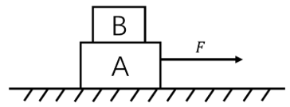
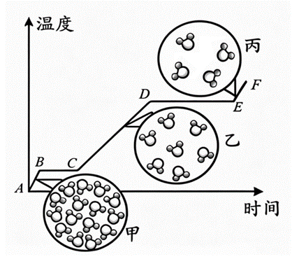

# 第 33 季 · 科学推理

来源：2026下半年省考第三十三季行测模考大赛（广东卷）.pdf

共 5 题，保留原卷题号。分数与数学符号使用 LaTeX；图形使用原图或已标注的矢量重绘图。

## 第 66 题

原卷 PDF 页码：17, 18；题目 ID：`gd-mock-2026h2-s33-q66`

实验室采购一批试剂，标签模糊。已知两瓶液体分别是过氧化氢溶液和蒸馏水，下列方案能一次性区分二者的是（    ）。

**A.** 滴入酚酞溶液，观察颜色变化

**B.** 加入少量二氧化锰固体，观察是否产生气泡

**C.** 品尝液体味道

**D.** 闻气味

## 第 67 题

原卷 PDF 页码：18；题目 ID：`gd-mock-2026h2-s33-q67`

在热带雨林环境与干旱荒漠环境中，植物的光合、呼吸和蒸腾作用的差异显著。下列关于不同环境下植物生理特性的说法，正确的是（    ）。

**A.** 干旱荒漠中植物叶片退化，蒸腾作用极弱，可减少水分消耗

**B.** 热带雨林中光照充足，植物的呼吸作用强度远大于光合作用强度

**C.** 热带雨林阴湿环境中水分充足，植物蒸腾作用无任何生理意义

**D.** 干旱荒漠中植物会永久停止光合作用，仅靠呼吸作用存活

## 第 68 题

原卷 PDF 页码：18；题目 ID：`gd-mock-2026h2-s33-q68`

如图所示，A、B两个物块叠放在粗糙程度均匀的水平地面上，物块A受到一个从零开始逐渐增大的水平拉力F，两个物块均保持静止，当拉力F增大到一定程度后，两个物块共同向右做加速运动，若两个物块始终保持相对静止，下列说法正确的是（    ）。

**A.** 静止阶段，物块B受到水平向右的摩擦力

**B.** 静止阶段，物块A不受摩擦力

**C.** 加速阶段，物块B受到动摩擦力

**D.** 加速阶段，物块B受到的摩擦力不断变大

## 第 69 题

原卷 PDF 页码：18；题目 ID：`gd-mock-2026h2-s33-q69`

某物质温度随时间变化的图像如下图所示，其中甲、乙、丙分别表示这种物质的三种物态的微观模型，下列说法错误的是（    ）。

**A.** 图中BC段，该物质的内能增大

**B.** 图中丙表示该物质的气态模型

**C.** 图中DE段，该物质持续吸热

**D.** 图中该物质甲状态下的分子间作用力小于乙

## 第 70 题

原卷 PDF 页码：19；题目 ID：`gd-mock-2026h2-s33-q70`

我国江淮地区常在6月中下旬至7月上中旬出现持续性阴雨天气，正值江南梅子黄熟季节，俗称“梅雨”。此时来自北方的冷空气与来自南方的暖湿气流在江淮流域势力相当，形成移动缓慢的锋面。关于“梅雨”季节，下列说法不正确的是（    ）。

**A.** “梅雨”季节期间，空气湿度大、日照时间短

**B.** 冷暖气团势力相当，使锋面移动缓慢并带来持续阴雨

**C.** 暖湿气流沿锋面抬升，水汽冷却凝结形成降水

**D.** 江淮“梅雨”主要由台风频繁登陆并长时间停留形成
