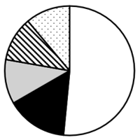
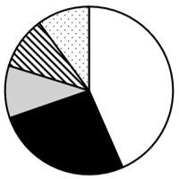
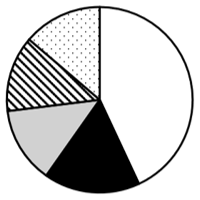
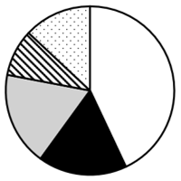

# 第 33 季 · 资料分析

来源：2026下半年省考第三十三季行测模考大赛（广东卷）.pdf

共 20 题，保留原卷题号。分数与数学符号使用 LaTeX；图片路径指向同一资料包内的原图。

## 材料 1（第 71—75 题）

**图1：2020—2025年2月中国中央处理部件出口数量统计情况**

| 期间 | 出口数量（万台） | 同比增速（%） |
| --- | --- | --- |
| 2020年 | 3526 | −4.3 |
| 2021年 | 4271 | 21.1 |
| 2022年 | 4066 | −4.8 |
| 2023年 | 3604 | −11.4 |
| 2024年 | 3556 | −1.3 |
| 2025年1—2月 | 535 | 6.1 |

**图2：2020—2025年2月中国中央处理部件出口金额统计情况**

| 期间 | 出口金额（百万美元） | 同比增速（%） |
| --- | --- | --- |
| 2020年 | 15417.3 | −8.1 |
| 2021年 | 20325.5 | 31.8 |
| 2022年 | 21949.1 | 8.0 |
| 2023年 | 16697.4 | −23.9 |
| 2024年 | 20437.0 | 22.4 |
| 2025年1—2月 | 2657.3 | 7.1 |

## 第 71 题

原卷 PDF 页码：19；题目 ID：`gd-mock-2026h2-s33-q71`

2021年，中国中央处理部件出口金额比2019年增长了约：

**A.** 15.9%

**B.** 21.1%

**C.** 23.7%

**D.** 26.3%

## 第 72 题

原卷 PDF 页码：19；题目 ID：`gd-mock-2026h2-s33-q72`

2024年1-2月，中国中央处理部件出口数量占2024年全年的比重约为：

**A.** 16.6%

**B.** 15.0%

**C.** 14.2%

**D.** 13.1%

## 第 73 题

原卷 PDF 页码：19；题目 ID：`gd-mock-2026h2-s33-q73`

2023年，中国平均每台中央处理部件的出口金额比2022年：

**A.** 增长了不到10%

**B.** 增长了10%以上

**C.** 下降了不到10%

**D.** 下降了10%以上

## 第 74 题

原卷 PDF 页码：20；题目 ID：`gd-mock-2026h2-s33-q74`

2021-2024年，中国平均每台中央处理部件出口金额约为多少美元？

**A.** 512

**B.** 475

**C.** 674

**D.** 337

## 第 75 题

原卷 PDF 页码：20；题目 ID：`gd-mock-2026h2-s33-q75`

能够从上述资料中推出的是：

**A.** 2020-2024年，中国中央处理部件出口数量及出口金额的变化趋势一致

**B.** 2024年，中国中央处理部件出口金额比2020年增长了33.3%以上

**C.** 2020年，中国中央处理部件出口金额同比减少了约1359美元

**D.** 2019年，中国中央处理部件出口数量不到3800万台

## 材料 2（第 76—80 题）

2026年6月25日，“链通上下游 粤车谋新篇”汽车产业链供需对接活动在广州顺利举行。本次活动由广东省工业和信息化厅、广州市智能网联与新能源汽车产业发展办公室、深圳市新能源汽车产业办公室联合主办，广汽集团、深圳市汽车产业联合会承办，广汽集团、深圳和惠州零部件相关企业参会。汽车产业是广东省战略性支柱产业之一，也是全省推进新型工业化的重要支撑。目前广东省已建成产销研一体化的完整汽车产业体系，拥有1200余家规模以上汽车整车及零部件企业，产业基础扎实、集群优势突出。2025年，全省汽车产业集群营收突破1.1万亿元；全省汽车产量304.02万辆，同比增长0.8%，其中新能源汽车产量118.29万辆，同比增长27.7%。本次活动内容丰富，设置实地参观、需求发布、技术路演、一对一专场洽谈等多个环节。来自深圳、惠州的十余家优质企业轮番开展技术分享，元戎启行、地平线、欣旺达、四维图新、航盛电子等近20家省内汽车零部件企业参会，全面覆盖汽车电动化、智能化、网联化全链条。下一步，广东省工业和信息化厅将发挥汽车产业协同发展机制作用，常态化开展汽车产业链供需对接活动，深化整零协同创新，不断提升近地化配套水平，加快推动汽车产业智能化、电动化、网联化发展，建设具有国际竞争力的汽车产业高地。2025年，中国汽车总产量突破3477.86万辆，继续稳居全球第一。广东省新能源汽车保有量536.46万辆，公务用车新能源化比例为73.34%。全省各类充电桩合计210万个，公共充电桩保有量全国第一，省内全部高速公路充电站实现全覆盖。全省计划新建公共充电桩66045个，其中，深圳50000个，广州、东莞各4500个，佛山1800个。

## 第 76 题

原卷 PDF 页码：20；题目 ID：`gd-mock-2026h2-s33-q76`

以下不属于“链通上下游 粤车谋新篇”汽车产业链供需对接活动主办单位的是：

**A.** 广东省工业和信息化厅

**B.** 广州市智能网联与新能源汽车产业发展办公室

**C.** 深圳市新能源汽车产业办公室

**D.** 深圳市汽车产业联合会

## 第 77 题

原卷 PDF 页码：20, 21；题目 ID：`gd-mock-2026h2-s33-q77`

根据资料，以下说法有误的是：

**A.** 广东省已经建成产销研一体化的完整汽车产业体系，规模以上汽车整车及零部件企业超千家

**B.** “链通上下游 粤车谋新篇”汽车产业链供需对接活动设置实地参观、需求发布、技术路演、一对一专场洽谈等多个环节

**C.** 2025年，广东省公务用车新能源化比例不足七成

**D.** 2025年，广东省公共充电桩保有量位居全国首位，省内全部高速公路充电站实现全覆盖

## 第 78 题

原卷 PDF 页码：21；题目 ID：`gd-mock-2026h2-s33-q78`

2024年，广东省新能源汽车产量占全省汽车产量的比重约为：

**A.** 38.9%

**B.** 32.9%

**C.** 30.7%

**D.** 27.8%

## 第 79 题

原卷 PDF 页码：21；题目 ID：`gd-mock-2026h2-s33-q79`

2025年，深广莞佛平均每个城市计划新建公共充电桩多少个？

**A.** 16511

**B.** 15200

**C.** 9672

**D.** 3950

## 第 80 题

原卷 PDF 页码：21；题目 ID：`gd-mock-2026h2-s33-q80`

根据资料，以下说法正确的有几项？
①2025年，广东省汽车产量占全国汽车总产量的比重不足10%
②本次活动有近20家省内汽车零部件企业参会，全面覆盖汽车电动化、智能化、网联化全链条
③2025年，广东省新能源汽车保有量超500万辆
④广东省工信厅将常态化开展汽车产业链供需对接活动，提升近地化配套水平

**A.** 4

**B.** 3

**C.** 2

**D.** 1

## 材料 3（第 81—85 题）

2024年12月，我国新能源汽车产销分别完成153.0万辆和159.6万辆，同比分别增长30.5%和34.0%。1-12月，新能源汽车产销分别完成1288.8万辆和1286.6万辆，同比分别增长34.4%和35.5%。2024年12月，我国纯电动汽车产销分别完成94.2万辆和97.3万辆，同比分别增长16.1%和17.9%。1-12月，纯电动汽车产销分别完成775.8万辆和771.9万辆，同比分别增长15.7%和15.5%。2024年12月，我国插电式混合动力汽车产销分别完成58.8万辆和62.2万辆，同比分别增长63.4%和70.8%。1-12月，插电式混合动力汽车产销分别完成512.5万辆和514.1万辆，同比分别增长78.1%和83.3%。

**2024年1—12月我国插电式混合动力汽车产销情况**

| 时间 | 产量（万辆） | 产量同比增长（%） | 销量（万辆） | 销量同比增长（%） |
| --- | --- | --- | --- | --- |
| 1月 | 29.7 | 136.1 | 28.4 | 135.0 |
| 2月 | 18.3 | 12.5 | 18.3 | 22.4 |
| 3月 | 31.7 | 94.6 | 31.7 | 95.1 |
| 4月 | 33.4 | 108.5 | 33.1 | 95.7 |
| 5月 | 38.3 | 91.2 | 37.1 | 87.7 |
| 6月 | 42.2 | 77.4 | 43.6 | 85.1 |
| 7月 | 41.5 | 63.3 | 43.8 | 80.7 |
| 8月 | 44.5 | 75.6 | 45.3 | 81.6 |
| 9月 | 55.2 | 80.1 | 51.1 | 84.2 |
| 10月 | 59.3 | 78.4 | 58.7 | 89.7 |
| 11月 | 62.3 | 79.7 | 60.4 | 86.0 |
| 12月 | 58.8 | 63.4 | 62.2 | 70.8 |

注：表中数据因四舍五入，存在总计与分项合计不等的情况。

## 第 81 题

原卷 PDF 页码：22；题目 ID：`gd-mock-2026h2-s33-q81`

若保持2024年12月同比增速不变，则2025年12月我国新能源汽车销量将达到约多少万辆？

**A.** 181.2

**B.** 199.7

**C.** 213.9

**D.** 228.6

## 第 82 题

原卷 PDF 页码：22；题目 ID：`gd-mock-2026h2-s33-q82`

2024年1-12月，我国纯电动汽车产销率约为：

**A.** 99.5%

**B.** 98.7%

**C.** 96.8%

**D.** 95.4%

## 第 83 题

原卷 PDF 页码：22；题目 ID：`gd-mock-2026h2-s33-q83`

2024年1月，我国插电式混合动力汽车销量环比下降约：

**A.** 16.5%

**B.** 22.0%

**C.** 35.9%

**D.** 41.8%

## 第 84 题

原卷 PDF 页码：22；题目 ID：`gd-mock-2026h2-s33-q84`

2023年12月，我国纯电动汽车产量约是插电式混合动力汽车的多少倍？

**A.** 1.6

**B.** 1.4

**C.** 2.9

**D.** 2.3

## 第 85 题

原卷 PDF 页码：22；题目 ID：`gd-mock-2026h2-s33-q85`

2024年一至四季度，我国插电式混合动力汽车产销率大于100%的季度有几个？

**A.** 1

**B.** 2

**C.** 3

**D.** 4

## 材料 4（第 86—90 题）

**2024年我国银行业金融机构总资产、总负债情况表**

| 金融机构 | 项目 | 一季度 | 二季度 | 三季度 | 四季度 |
| --- | --- | --- | --- | --- | --- |
| 银行业金融机构 | 总资产（亿元） | 4295832 | 4330970 | 4395167 | 4445744 |
| 银行业金融机构 | 总资产同比增速（%） | 8.1 | 6.6 | 7.3 | 6.5 |
| 银行业金融机构 | 总负债（亿元） | 3944883 | 3976620 | 4036125 | 4081137 |
| 银行业金融机构 | 总负债同比增速（%） | 8.1 | 6.4 | 7.2 | 6.5 |
| 其中：大型商业银行 | 总资产（亿元） | 1849963 | 1850576 | 1892741 | 1902610 |
| 其中：大型商业银行 | 总资产同比增速（%） | 11.2 | 7.9 | 9.2 | 7.6 |
| 其中：大型商业银行 | 总负债（亿元） | 1707677 | 1708418 | 1748355 | 1756092 |
| 其中：大型商业银行 | 总负债同比增速（%） | 11.4 | 7.8 | 9.4 | 7.8 |
| 股份制商业银行 | 总资产（亿元） | 717633 | 721232 | 727535 | 741947 |
| 股份制商业银行 | 总资产同比增速（%） | 4.1 | 3.7 | 4.5 | 4.7 |
| 股份制商业银行 | 总负债（亿元） | 657917 | 661207 | 666683 | 679771 |
| 股份制商业银行 | 总负债同比增速（%） | 3.8 | 3.3 | 4.3 | 4.4 |
| 城市商业银行 | 总资产（亿元） | 570500 | 583401 | 590813 | 601510 |
| 城市商业银行 | 总资产同比增速（%） | 9.7 | 9.4 | 8.8 | 9.0 |
| 城市商业银行 | 总负债（亿元） | 528601 | 540378 | 546992 | 556903 |
| 城市商业银行 | 总负债同比增速（%） | 9.6 | 9.3 | 8.8 | 8.9 |
| 农村金融机构 | 总资产（亿元） | 567827 | 570315 | 575222 | 579077 |
| 农村金融机构 | 总资产同比增速（%） | 7.2 | 6.5 | 6.0 | 6.0 |
| 农村金融机构 | 总负债（亿元） | 526939 | 528907 | 533516 | 536940 |
| 农村金融机构 | 总负债同比增速（%） | 7.1 | 6.3 | 5.8 | 6.0 |
| 其他类金融机构 | 总资产（亿元） | 589908 | 605445 | 608856 | 620600 |
| 其他类金融机构 | 总资产同比增速（%） | 3.2 | 3.9 | 3.9 | 3.3 |
| 其他类金融机构 | 总负债（亿元） | 523748 | 537711 | 540579 | 551431 |
| 其他类金融机构 | 总负债同比增速（%） | 3.2 | 3.4 | 4.0 | 3.4 |

将原表合并单元格展开，并在同比增速行标明对应资产或负债。

注：1.表中数据因四舍五入，存在总计与分项合计不等的情况；2.净资产=总资产-总负债。

## 第 86 题

原卷 PDF 页码：23；题目 ID：`gd-mock-2026h2-s33-q86`

2024年二至四季度，我国大型商业银行净资产呈现以下哪种变化趋势？

**A.** 持续上升

**B.** 持续下降

**C.** 先升后降

**D.** 先降后升

## 第 87 题

原卷 PDF 页码：23, 24；题目 ID：`gd-mock-2026h2-s33-q87`

以下饼状图中，最能准确反映2024年一季度我国五类银行业金融机构总资产占比情况的是：

**A.**

**B.**

**C.**

**D.**

## 第 88 题

原卷 PDF 页码：24；题目 ID：`gd-mock-2026h2-s33-q88`

2023年一至四季度，我国银行业金融机构总资产按从大到小排序正确的是：

**A.** 一季度、二季度、三季度、四季度

**B.** 四季度、三季度、二季度、一季度

**C.** 一季度、三季度、二季度、四季度

**D.** 四季度、二季度、三季度、一季度

## 第 89 题

原卷 PDF 页码：24；题目 ID：`gd-mock-2026h2-s33-q89`

2024年二季度，我国股份制商业银行净资产与农村金融机构净资产的比值最接近：

**A.** 13：9

**B.** 8：7

**C.** 5：4

**D.** 7：12

## 第 90 题

原卷 PDF 页码：24；题目 ID：`gd-mock-2026h2-s33-q90`

2024年四季度，我国其他类金融机构总资产同比增量比环比增量约多多少亿元？

**A.** 5080

**B.** 6080

**C.** 7080

**D.** 8080
