# 2020 年江苏行测（A类） · 题目

保留原题号。来源页码按 PDF 实际页数计，从 1 开始。答案及解析另见 answers.md。

## 第 16 题 · 言语理解与表达

`JS2020-A类-016`

国家治理效能是反映制度优势的重要指标。中国特色社会主义的制度优势需要转换为国家治理效能，需
要通过治理效能来实现和彰显。要善于运用制度和法律治理国家，把各方面制度优势转换为管理国家的效能。推
进国家治理体系和治理能力现代化，是发挥社会主义制度优越性的必由之路。
这段文字重在强调
A、我国制度优势需要通过良好的治理效能来体现 B、依靠法律推进我国治理体系和治理能力现代化
C、社会主义制度对我国治理现代化产生重大影响 D、治理国家必须发挥我国社会主义制度的优越性

来源：[2020年江苏公务员考试《行测》真题（A类）.pdf](https://github.com/dumarstoft-ship-it/xingce/blob/407016b55b49581efa3771bb59a2dee8761d982f/2020%E5%B9%B4%E6%B1%9F%E8%8B%8F%E5%85%AC%E5%8A%A1%E5%91%98%E8%80%83%E8%AF%95%E3%80%8A%E8%A1%8C%E6%B5%8B%E3%80%8B%E7%9C%9F%E9%A2%98%EF%BC%88A%E7%B1%BB%EF%BC%89.pdf)，PDF 第 2 页。

## 第 17 题 · 言语理解与表达

`JS2020-A类-017`

书院是中国历史上一种独具特色的文化教育形式，在书院发展的一千多年历史进程中，它不仅是中国文
化的象征，更是中国文化向域外传播的窗口。书院之名起于唐代，由最早的修书、藏书的机构，逐步演变为具有
教学、研究功能的场所。书院制度在宋代不断发展、壮大、成熟，清代是书院发展的鼎盛时期，无论是穷乡僻壤，
还是边陲小镇都可见到书院。不仅如此，书院还随儒学走出国门，在朝鲜半岛生根、萌芽、兴盛起来，对中国文
化传播起着不可替代的作用。
这段文字主要说明
A、书院的发展经历了漫长的历史过程 B、书院所承载的教育及文化传播功能
C、书院与文明传承之间有着密切关系 D、书院制度的影响遍布我国以及域外

来源：[2020年江苏公务员考试《行测》真题（A类）.pdf](https://github.com/dumarstoft-ship-it/xingce/blob/407016b55b49581efa3771bb59a2dee8761d982f/2020%E5%B9%B4%E6%B1%9F%E8%8B%8F%E5%85%AC%E5%8A%A1%E5%91%98%E8%80%83%E8%AF%95%E3%80%8A%E8%A1%8C%E6%B5%8B%E3%80%8B%E7%9C%9F%E9%A2%98%EF%BC%88A%E7%B1%BB%EF%BC%89.pdf)，PDF 第 2 页。

## 第 18 题 · 言语理解与表达

`JS2020-A类-018`

统一的数据采集和分类管理标准有利于政务数据的整合共享，方便各地区、各部门数据库之间的接口连
接与数据交换。应加快制定政务数据采集、处理、提供、修改等各类标准规范，对原有信息资源进行标准化处理，
规范数据共享的类型、方式、内容、对象和条件，破除数据共享的技术障碍。
这段文字中提取的关键词最恰当的是
A、数据采集整合共享技术障碍 B、政务数据数据交换数据共享
C、数据采集标准规范信息资源 D、政务数据标准规范数据共享

来源：[2020年江苏公务员考试《行测》真题（A类）.pdf](https://github.com/dumarstoft-ship-it/xingce/blob/407016b55b49581efa3771bb59a2dee8761d982f/2020%E5%B9%B4%E6%B1%9F%E8%8B%8F%E5%85%AC%E5%8A%A1%E5%91%98%E8%80%83%E8%AF%95%E3%80%8A%E8%A1%8C%E6%B5%8B%E3%80%8B%E7%9C%9F%E9%A2%98%EF%BC%88A%E7%B1%BB%EF%BC%89.pdf)，PDF 第 2 页。

## 第 19 题 · 言语理解与表达

`JS2020-A类-019`

语言和文化一样，很少是自给自足的，故词语的借用自古至今都是常见的语言现象。但当外来词汇进入
一个国家后，当地民族会在适应吸收新成分的同时，不自觉地变异和改造其原貌。随着时间的推移，外来词会逐
渐本土化，日久天长，源流模糊，体用隔断，变异迭生。一旦借词身上的“异域特征”(诸如音素、音节的构成等)
在使用者的意识里淡化或消失，它们就会被当地人视为自己母语中的一部分。
这段文字重在说明
A、外来词汇对本民族语言和文化的影响 B、本民族语言吸收改造外来词汇的方式
C、外来词汇使用的普遍性及本土化过程 D、外来词汇在母语中淡化与消失的原因

来源：[2020年江苏公务员考试《行测》真题（A类）.pdf](https://github.com/dumarstoft-ship-it/xingce/blob/407016b55b49581efa3771bb59a2dee8761d982f/2020%E5%B9%B4%E6%B1%9F%E8%8B%8F%E5%85%AC%E5%8A%A1%E5%91%98%E8%80%83%E8%AF%95%E3%80%8A%E8%A1%8C%E6%B5%8B%E3%80%8B%E7%9C%9F%E9%A2%98%EF%BC%88A%E7%B1%BB%EF%BC%89.pdf)，PDF 第 2 页。

## 第 20 题 · 言语理解与表达

`JS2020-A类-020`

以种植业和养殖业为主的农业生产，是深度贫困地区产业扶贫的重要项目和农民主要收入来源。农业生
产是“露天工厂”，具有“靠天吃饭”的局限性。深度贫困地区大都自然条件恶劣，发生灾害的频率高、范围广，
加之病虫害等方面的影响，给农业生产带来极大挑战。因此，深度贫困地区发展种植业和养殖业，更需要借助农
业保险这一市场经济条件下风险管理的基本手段。
以下概括不符合文意的是
A、科学的风险管理对于保障农民收入至关重要 B、借助农业保险可有效分散农业生产者的风险
C、深度贫困地区的农业生产需要承担较大风险 D、农业保险能够提前介入并有效预防自然灾害

来源：[2020年江苏公务员考试《行测》真题（A类）.pdf](https://github.com/dumarstoft-ship-it/xingce/blob/407016b55b49581efa3771bb59a2dee8761d982f/2020%E5%B9%B4%E6%B1%9F%E8%8B%8F%E5%85%AC%E5%8A%A1%E5%91%98%E8%80%83%E8%AF%95%E3%80%8A%E8%A1%8C%E6%B5%8B%E3%80%8B%E7%9C%9F%E9%A2%98%EF%BC%88A%E7%B1%BB%EF%BC%89.pdf)，PDF 第 2、3 页。

## 第 21 题 · 言语理解与表达

`JS2020-A类-021`

空气污染物对大脑造成严重影响的罪魁祸首是细颗粒物，即直径小于2.5 微米的空气污染物。一旦被吸
入体内，它们就能抵达肺部深处，进入血流，并随之进入大脑。细颗粒物直径极小，足够穿越为阻隔大型毒物分
子而存在的血脑屏障。若细颗粒物由鼻子吸入，还可以通过鼻腔中的嗅觉神经进入大脑。这些颗粒物可能会激发
炎症反应，导致严重的脑部疾病，影响认知能力。
这段文字意在说明
A、空气污染物中细颗粒物进入大脑的危害 B、空气污染物是造成大脑疾病的罪魁祸首
C、空气污染物中的细颗粒物如何进入大脑 D、空气污染物中的细颗粒物危害人体健康

来源：[2020年江苏公务员考试《行测》真题（A类）.pdf](https://github.com/dumarstoft-ship-it/xingce/blob/407016b55b49581efa3771bb59a2dee8761d982f/2020%E5%B9%B4%E6%B1%9F%E8%8B%8F%E5%85%AC%E5%8A%A1%E5%91%98%E8%80%83%E8%AF%95%E3%80%8A%E8%A1%8C%E6%B5%8B%E3%80%8B%E7%9C%9F%E9%A2%98%EF%BC%88A%E7%B1%BB%EF%BC%89.pdf)，PDF 第 3 页。

## 第 22 题 · 言语理解与表达

`JS2020-A类-022`

文本是书法的灵魂所系。书法的书卷气，以及艺术风格等，皆与文本背后的人文精神息息相关。文本缺
位的书法，是不完整的书法。对于书法的价值判断，尽管在传统文化和现代文化中有一定程度的调整，但其文化
根本并没有动摇。书法艺术一直承担着“载道”的功能。以《兰亭集序》《祭侄文稿》等为代表的书法经典，均
是笔墨与文辞交相辉映的产物，其中蕴含着家国情怀、民族风骨、人文精神，体现着书家的文化修养与艺术素养，
至今熠熠生辉。
以下概括不符合文意的是
A、评价书法作品的价值不能忽视其文本内容 B、书法艺术的水平取决于书法家的文学水平
C、“文以载道”的古训同样适用于书法艺术 D、上乘的书法作品几乎都是优秀文本的法帖

来源：[2020年江苏公务员考试《行测》真题（A类）.pdf](https://github.com/dumarstoft-ship-it/xingce/blob/407016b55b49581efa3771bb59a2dee8761d982f/2020%E5%B9%B4%E6%B1%9F%E8%8B%8F%E5%85%AC%E5%8A%A1%E5%91%98%E8%80%83%E8%AF%95%E3%80%8A%E8%A1%8C%E6%B5%8B%E3%80%8B%E7%9C%9F%E9%A2%98%EF%BC%88A%E7%B1%BB%EF%BC%89.pdf)，PDF 第 3 页。

## 第 23 题 · 言语理解与表达

`JS2020-A类-023`

①为生态环境利益设置核心的法律原则，构建生态环境保护的核心制度体系
②在生态环境保护的法律规范中，生态环境保护是其核心的价值诉求
③生态文明的理论要求法律对具有公共性的、体现未来时代人的利益和自然生态本身价值的生态环境利益进
行系统性、整体性的保护
④这决定了仅仅依托传统的法律部门不能对生态环境提供有效的保护
⑤这些法律规范对生态环境提供直接的保护
⑥生态文明需要一个以生态环境价值为核心价值，以生态环境公共利益保护为核心诉求的法律体系
将以上6 个句子重新排列，语序正确的是
A、⑥②⑤①③④ B、⑥②③⑤④① C、③④⑥②⑤① D、③②⑤④①⑥

来源：[2020年江苏公务员考试《行测》真题（A类）.pdf](https://github.com/dumarstoft-ship-it/xingce/blob/407016b55b49581efa3771bb59a2dee8761d982f/2020%E5%B9%B4%E6%B1%9F%E8%8B%8F%E5%85%AC%E5%8A%A1%E5%91%98%E8%80%83%E8%AF%95%E3%80%8A%E8%A1%8C%E6%B5%8B%E3%80%8B%E7%9C%9F%E9%A2%98%EF%BC%88A%E7%B1%BB%EF%BC%89.pdf)，PDF 第 3 页。

## 第 24 题 · 言语理解与表达

`JS2020-A类-024`

支持外资评级机构进入中国银行间债券市场和交易所债券市场开展所有种类债券评级业务，是中国金融
市场扩大开放的重大举措。信用评级作为金融市场的重要基础性制度安排，随着中国金融市场国际化进程不断加
快，引入国际信用评级机构在中国开展评级业务，有利于满足国际投资者的多样化需求，也有利于促进中国评级
行业评级质量改善，有助于中国金融市场的规范健康发展。
这段文字着重说明的是
A、信用评级对外开放的相关措施 B、信用评级对外开放的规划部署
C、信用评级对外开放的重要意义 D、信用评级对外开放的基本内涵

来源：[2020年江苏公务员考试《行测》真题（A类）.pdf](https://github.com/dumarstoft-ship-it/xingce/blob/407016b55b49581efa3771bb59a2dee8761d982f/2020%E5%B9%B4%E6%B1%9F%E8%8B%8F%E5%85%AC%E5%8A%A1%E5%91%98%E8%80%83%E8%AF%95%E3%80%8A%E8%A1%8C%E6%B5%8B%E3%80%8B%E7%9C%9F%E9%A2%98%EF%BC%88A%E7%B1%BB%EF%BC%89.pdf)，PDF 第 3 页。

## 第 25 题 · 言语理解与表达

`JS2020-A类-025`

海底矿产资源中最受关注的是海底石油。有人推测，37%的大陆架蕴藏着石油。海底石油储量约2500 亿
吨，相当于世界石油预估储量的三分之一以上，仅在大陆架的石油储量就有1400 亿吨。第一口浅海油井出现在
1891 年，更多的勘探开发始于20 世纪20 年代，60 年代进入飞跃发展时期。现在，全世界有100 多个国家在勘探
海底石油，30 多个国家已开采出这种“工业的血液”。20 世纪50 年代海底石油产量仅占全世界石油总产量的5%，
70 年代增加到29%，80 年代已达40%，21 世纪初已远远超过50%。
以下概括不符合文意的是
A、近半个多世纪海底石油勘探开采发展极为迅速 B、大陆架的石油储量超过世界石油储量三分之一
C、现今使用的石油及制品多半来自海底油田 D、全世界约半数的国家进行了海底石油勘探

来源：[2020年江苏公务员考试《行测》真题（A类）.pdf](https://github.com/dumarstoft-ship-it/xingce/blob/407016b55b49581efa3771bb59a2dee8761d982f/2020%E5%B9%B4%E6%B1%9F%E8%8B%8F%E5%85%AC%E5%8A%A1%E5%91%98%E8%80%83%E8%AF%95%E3%80%8A%E8%A1%8C%E6%B5%8B%E3%80%8B%E7%9C%9F%E9%A2%98%EF%BC%88A%E7%B1%BB%EF%BC%89.pdf)，PDF 第 3 页。

## 第 26 题 · 言语理解与表达

`JS2020-A类-026`

古典音乐里有很多“炫技”的曲目，在历史发展中，有推动“炫技”的多重力量存在。有时候，是作曲
家想要试验声音的极限，出于旋律或和声的考虑，写了当时的演奏者一般演奏不出来的乐段。有时候，是作曲家
不够了解某个独奏乐器，无法贴切地从演奏的角度理性思考，于是写了很难演奏甚至无法演奏的曲子。还有些时
候，是演奏者主动追求突破，要求演奏过去没法表现的音乐，并借此凸显自己和其他演奏者不同的地方。
关于音乐“炫技”的推动力量，下列说法不符合文意的是：
A、作曲家出于实验考量创作了很难演奏的乐段 B、演奏者迫于乐曲要求不得不进行极限性演奏
C、作曲家因考虑不周全创作了极难演奏的曲目 D、演奏者为凸显自己个性主动进行突破性演奏

来源：[2020年江苏公务员考试《行测》真题（A类）.pdf](https://github.com/dumarstoft-ship-it/xingce/blob/407016b55b49581efa3771bb59a2dee8761d982f/2020%E5%B9%B4%E6%B1%9F%E8%8B%8F%E5%85%AC%E5%8A%A1%E5%91%98%E8%80%83%E8%AF%95%E3%80%8A%E8%A1%8C%E6%B5%8B%E3%80%8B%E7%9C%9F%E9%A2%98%EF%BC%88A%E7%B1%BB%EF%BC%89.pdf)，PDF 第 3 页。

## 第 27 题 · 言语理解与表达

`JS2020-A类-027`

一个国家的发展应该致力于将经济发展的蛋糕做大，在此基础上，注重公平的分配。对区域经济发展来
说，应牢牢建立比较优势的概念。不同的地方在自然地理条件上有巨大的差异。即便是两个自然条件完全相同，
地理上相邻的省份或城市，最佳的发展模式也不是大家发展同样的生产结构，而是应该各自有分工。
作者通过这段文字重在强调：
A、不同地理条件的区域发展模式应当有所不同 B、地理相邻的两个城市也应该有各自不同特色
C、不同区域经济发展应与当地比较优势相吻合 D、最佳发展模式并不适合所有地理条件的区域

来源：[2020年江苏公务员考试《行测》真题（A类）.pdf](https://github.com/dumarstoft-ship-it/xingce/blob/407016b55b49581efa3771bb59a2dee8761d982f/2020%E5%B9%B4%E6%B1%9F%E8%8B%8F%E5%85%AC%E5%8A%A1%E5%91%98%E8%80%83%E8%AF%95%E3%80%8A%E8%A1%8C%E6%B5%8B%E3%80%8B%E7%9C%9F%E9%A2%98%EF%BC%88A%E7%B1%BB%EF%BC%89.pdf)，PDF 第 3 页。

## 第 28 题 · 言语理解与表达

`JS2020-A类-028`

群体免疫力是一种保护整个社区免受疾病侵害的手段：通过免疫社区里足够多的人，有效地打断疾病从
一个人传染到另一个人的接力，中断感染链，从而保护少数不能接种疫苗的人群。但是，这个模式要真正起作用，
社区中接种疫苗的人必须足够多。接种疫苗的人数必须高于一个最小的百分值(学术界称之为“阈值”)，群体免
疫才会生效。接种的社区成员越多， ____ 。
填入画横线处最恰当的是：
A、整个社区就越能够避免疾病的爆发 B、才能有效阻断疾病源感染整个社区
C、越能保护少数拒绝接种疫苗的人群 D、整个社区的免疫模式才能发生作用

来源：[2020年江苏公务员考试《行测》真题（A类）.pdf](https://github.com/dumarstoft-ship-it/xingce/blob/407016b55b49581efa3771bb59a2dee8761d982f/2020%E5%B9%B4%E6%B1%9F%E8%8B%8F%E5%85%AC%E5%8A%A1%E5%91%98%E8%80%83%E8%AF%95%E3%80%8A%E8%A1%8C%E6%B5%8B%E3%80%8B%E7%9C%9F%E9%A2%98%EF%BC%88A%E7%B1%BB%EF%BC%89.pdf)，PDF 第 4 页。

## 第 29 题 · 言语理解与表达

`JS2020-A类-029`

个案研究的经验告诉我们，法学理论其实只是从特定维度对纷繁的生活实践的一种抽象描述，它不可能
追随、更没法规训真实生活的复杂和生动。因此，看起来再好的理论，也不应试图以其抽象的命题来规训真实生
活的生动、饱满和复杂。理论法学学者必须始终意识到自己习惯的那种话语在真实生活世界中的局限，并能不断
以对经验的考察来理解生动的法律世界。
作者通过这段文字重在强调：
A、法学理论在应对真实世界时存在局限性 B、个案研究能有效促进理论的发展和完善
C、从事法律工作必须通晓个案研究的经验 D、理论法学应重视理论与真实世界的对接

来源：[2020年江苏公务员考试《行测》真题（A类）.pdf](https://github.com/dumarstoft-ship-it/xingce/blob/407016b55b49581efa3771bb59a2dee8761d982f/2020%E5%B9%B4%E6%B1%9F%E8%8B%8F%E5%85%AC%E5%8A%A1%E5%91%98%E8%80%83%E8%AF%95%E3%80%8A%E8%A1%8C%E6%B5%8B%E3%80%8B%E7%9C%9F%E9%A2%98%EF%BC%88A%E7%B1%BB%EF%BC%89.pdf)，PDF 第 4 页。

## 第 30 题 · 言语理解与表达

`JS2020-A类-030`

在电影表现的技术层面，数字技术事实上已代替了同源成像技术，出现了由电脑生产影像所构造的故事
片。电脑生产的影像已经不再局限于单纯的特技效果，它们构成了影片全部蒙太奇中的镜头，主要角色都是完全
或部分由电脑合成。在电影的发行和放映环节，具有质感的胶片卷，放映机吵闹的声音，抑或是影像剪辑表，还
有流动于影院之间装胶片的金属盒，正在一个个地消失于我们的视线，成为历史。
下列对文意的概括最恰当的是：
A、数字技术已经颠覆了以往电影生产发行全过程 B、当前电影艺术表现完全离不开数字技术的辅助
C、数字合成技术取代了电影制作中各种拍摄手法 D、同源成像技术在电影拍摄技术层面已成为历史

来源：[2020年江苏公务员考试《行测》真题（A类）.pdf](https://github.com/dumarstoft-ship-it/xingce/blob/407016b55b49581efa3771bb59a2dee8761d982f/2020%E5%B9%B4%E6%B1%9F%E8%8B%8F%E5%85%AC%E5%8A%A1%E5%91%98%E8%80%83%E8%AF%95%E3%80%8A%E8%A1%8C%E6%B5%8B%E3%80%8B%E7%9C%9F%E9%A2%98%EF%BC%88A%E7%B1%BB%EF%BC%89.pdf)，PDF 第 4 页。

## 第 31 题 · 言语理解与表达

`JS2020-A类-031`

法治是社会治理的基本规则，尤其是在全面依法治国新时代，任何人不管在线上还是线下，都应遵守法
律秩序。任何人都必须在法律和道德的 ____ 内对网络话语权“轻拿轻放”，用谨言慎行守护 ____ 的网络空间和人
间正道。
依次填入画横线处最恰当的一项是：
A、原则纤毫毕现 B、规则正义凛然 C、架构波澜不惊 D、框架风清气正

来源：[2020年江苏公务员考试《行测》真题（A类）.pdf](https://github.com/dumarstoft-ship-it/xingce/blob/407016b55b49581efa3771bb59a2dee8761d982f/2020%E5%B9%B4%E6%B1%9F%E8%8B%8F%E5%85%AC%E5%8A%A1%E5%91%98%E8%80%83%E8%AF%95%E3%80%8A%E8%A1%8C%E6%B5%8B%E3%80%8B%E7%9C%9F%E9%A2%98%EF%BC%88A%E7%B1%BB%EF%BC%89.pdf)，PDF 第 4 页。

## 第 32 题 · 言语理解与表达

`JS2020-A类-032`

稻作农业社会的建立和古代文明的出现同时发生在良渚文化时期，这传达了一个重要信息：农业起源与
文明起源应该是一个相互衔接的、 ____ 的人类社会发展过程。稻作农业社会的建立为古代文明的形成 ____ 了基础，
古代文明的形成反过来又促进了稻作农业生产的发展。
依次填入画横线处最恰当的一项是：
A、源远流长夯实 B、环环相扣确定 C、一脉相承奠定 D、不可或缺铸就

来源：[2020年江苏公务员考试《行测》真题（A类）.pdf](https://github.com/dumarstoft-ship-it/xingce/blob/407016b55b49581efa3771bb59a2dee8761d982f/2020%E5%B9%B4%E6%B1%9F%E8%8B%8F%E5%85%AC%E5%8A%A1%E5%91%98%E8%80%83%E8%AF%95%E3%80%8A%E8%A1%8C%E6%B5%8B%E3%80%8B%E7%9C%9F%E9%A2%98%EF%BC%88A%E7%B1%BB%EF%BC%89.pdf)，PDF 第 4 页。

## 第 33 题 · 言语理解与表达

`JS2020-A类-033`

三年前，某咨询公司在一份报告中预测，到2030 年，全自动驾驶出租车将占据全球三分之一以上的汽车
出行市场。这在当时看来似乎有些 ____ 。而现在，正如这份报告所说，尽管向自动出行的转型无法 ____ ，但整
个汽车行业在包括法律法规、基础设施、投资与消费者兴趣在内的几乎所有方面都取得了实质性进展。
依次填入画横线处最恰当的一项是：
A、不切实际一蹴而就 B、不合时宜一鼓作气 C、信口开河一气呵成 D、言不及义一步到位

来源：[2020年江苏公务员考试《行测》真题（A类）.pdf](https://github.com/dumarstoft-ship-it/xingce/blob/407016b55b49581efa3771bb59a2dee8761d982f/2020%E5%B9%B4%E6%B1%9F%E8%8B%8F%E5%85%AC%E5%8A%A1%E5%91%98%E8%80%83%E8%AF%95%E3%80%8A%E8%A1%8C%E6%B5%8B%E3%80%8B%E7%9C%9F%E9%A2%98%EF%BC%88A%E7%B1%BB%EF%BC%89.pdf)，PDF 第 4 页。

## 第 34 题 · 言语理解与表达

`JS2020-A类-034`

多年宣传之后，垃圾分类真的要走入每个中国家庭的生活了。在这场与垃圾 ____ 的拉锯战中，中国是否
能借助垃圾分类扭转局势，并通过利用自身的回收行业优势提升人们的环保意识，真正解决垃圾问题，避免重蹈
发达国家的覆辙，我们 ____ 。
依次填入画横线处最恰当的一项是：
A、殚精竭虑翘首以盼 B、旷日持久拭目以待 C、分秒必争整装待发 D、势均力敌胸有成竹

来源：[2020年江苏公务员考试《行测》真题（A类）.pdf](https://github.com/dumarstoft-ship-it/xingce/blob/407016b55b49581efa3771bb59a2dee8761d982f/2020%E5%B9%B4%E6%B1%9F%E8%8B%8F%E5%85%AC%E5%8A%A1%E5%91%98%E8%80%83%E8%AF%95%E3%80%8A%E8%A1%8C%E6%B5%8B%E3%80%8B%E7%9C%9F%E9%A2%98%EF%BC%88A%E7%B1%BB%EF%BC%89.pdf)，PDF 第 4 页。

## 第 35 题 · 言语理解与表达

`JS2020-A类-035`

解决气候变化不是一个零和博弈，而是需要多种方案 ____ 。我们的确需要保护和更有效地管理森林，但
对森林碳汇能力也不能 ____ ，需要更加严谨的考证计算。归根到底，科学有效地制定并执行减排政策，才是解决
气候变化问题的真正灵药。
依次填入画横线处最恰当的一项是：
A、博采众长夸大其辞 B、集思广益过度依赖 C、统筹兼顾无所作为 D、齐头并进盲目乐观

来源：[2020年江苏公务员考试《行测》真题（A类）.pdf](https://github.com/dumarstoft-ship-it/xingce/blob/407016b55b49581efa3771bb59a2dee8761d982f/2020%E5%B9%B4%E6%B1%9F%E8%8B%8F%E5%85%AC%E5%8A%A1%E5%91%98%E8%80%83%E8%AF%95%E3%80%8A%E8%A1%8C%E6%B5%8B%E3%80%8B%E7%9C%9F%E9%A2%98%EF%BC%88A%E7%B1%BB%EF%BC%89.pdf)，PDF 第 4 页。

## 第 36 题 · 言语理解与表达

`JS2020-A类-036`

旅行实际上可以让“读万卷书”和“行万里路”同时实现。行万里路会 ____ 我们读更多的书，所以旅行是
生命中 ____ 的内容，也是人生不断自我释放、自我重构的 ____ 。
依次填入画横线处最恰当的一项是：
A、激励念兹在兹机缘 B、引领多姿多彩场合 C、引导无与伦比场域 D、激发不可或缺契机

来源：[2020年江苏公务员考试《行测》真题（A类）.pdf](https://github.com/dumarstoft-ship-it/xingce/blob/407016b55b49581efa3771bb59a2dee8761d982f/2020%E5%B9%B4%E6%B1%9F%E8%8B%8F%E5%85%AC%E5%8A%A1%E5%91%98%E8%80%83%E8%AF%95%E3%80%8A%E8%A1%8C%E6%B5%8B%E3%80%8B%E7%9C%9F%E9%A2%98%EF%BC%88A%E7%B1%BB%EF%BC%89.pdf)，PDF 第 4 页。

## 第 37 题 · 言语理解与表达

`JS2020-A类-037`

回顾我国科技事业的发展，正是一代代航天人 ____ 、顽强拼搏，了一系列关键核心技术，才有了中国航
天大国的地位；正是因为了深海装备的关键核心技术，才能使“蛟龙”“潜龙”“海龙”邀游深海，独立自主地
进行科学考察，使中国在世界深海科学事业上拥有了发言权。
依次填入画横线处最恰当的一项是：
A、筚路蓝缕攻克突破 B、锲而不舍钻研掌控 C、披坚执锐解决攻陷 D、身先士卒破解控制

来源：[2020年江苏公务员考试《行测》真题（A类）.pdf](https://github.com/dumarstoft-ship-it/xingce/blob/407016b55b49581efa3771bb59a2dee8761d982f/2020%E5%B9%B4%E6%B1%9F%E8%8B%8F%E5%85%AC%E5%8A%A1%E5%91%98%E8%80%83%E8%AF%95%E3%80%8A%E8%A1%8C%E6%B5%8B%E3%80%8B%E7%9C%9F%E9%A2%98%EF%BC%88A%E7%B1%BB%EF%BC%89.pdf)，PDF 第 4 页。

## 第 38 题 · 言语理解与表达

`JS2020-A类-038`

一个人走在森林里，膨胀的暖流扑面而来，仿佛热气从暖炉中 ____ 而出。随着森林的浓密稀疏，温热的空
气或膨胀、或减弱。湿润的凉意令人感到河道的存在，它们虽早已 ____ ，但泥土中仍 ____ 着湿气。
依次填入画横线处最恰当的一项是：
A、流泻干涸残存 B、汹涌断流留存 C、肆意枯竭保存 D、奔腾湮灭残留

来源：[2020年江苏公务员考试《行测》真题（A类）.pdf](https://github.com/dumarstoft-ship-it/xingce/blob/407016b55b49581efa3771bb59a2dee8761d982f/2020%E5%B9%B4%E6%B1%9F%E8%8B%8F%E5%85%AC%E5%8A%A1%E5%91%98%E8%80%83%E8%AF%95%E3%80%8A%E8%A1%8C%E6%B5%8B%E3%80%8B%E7%9C%9F%E9%A2%98%EF%BC%88A%E7%B1%BB%EF%BC%89.pdf)，PDF 第 4、5 页。

## 第 39 题 · 言语理解与表达

`JS2020-A类-039`

执法检查是人大行使宪法法律赋予的监督权，也是保证法律得到全面有效实施的一把“利剑”。既然是
“利剑”，就必须锋利，而不是 ____ 、无关痛痒。有力度、有硬度的执法检查，才能 ____ 法律的权威。为什么有的
执法检查所呈现的结果却与老百姓的切身感受 ____ ？其中原因恐怕还在于执法检查没到位。
依次填入画横线处最恰当的一项是：
A、蜻蜓点水彰显大相径庭 B、畏首畏尾体现千差万别
C、畏葸不前突显南辕北辙 D、声东击西宣告失之千里

来源：[2020年江苏公务员考试《行测》真题（A类）.pdf](https://github.com/dumarstoft-ship-it/xingce/blob/407016b55b49581efa3771bb59a2dee8761d982f/2020%E5%B9%B4%E6%B1%9F%E8%8B%8F%E5%85%AC%E5%8A%A1%E5%91%98%E8%80%83%E8%AF%95%E3%80%8A%E8%A1%8C%E6%B5%8B%E3%80%8B%E7%9C%9F%E9%A2%98%EF%BC%88A%E7%B1%BB%EF%BC%89.pdf)，PDF 第 5 页。

## 第 40 题 · 言语理解与表达

`JS2020-A类-040`

中国彩陶很注意图案纹样与器型的关系， ____ 而统一谐调，也注意彩陶图案在不同 ____ 所产生的不同效果，
这种以彩绘纹样与造型 ____ 完美结合的艺术手法，同时也成为传统雕塑和工艺美术极有特色的表现手法。
依次填入画横线处最恰当的一项是：
A、交相辉映角度天衣无缝 B、五彩缤纷位置错落有致
C、千变万化方向有目共睹 D、相辅相成视角浑然一体

来源：[2020年江苏公务员考试《行测》真题（A类）.pdf](https://github.com/dumarstoft-ship-it/xingce/blob/407016b55b49581efa3771bb59a2dee8761d982f/2020%E5%B9%B4%E6%B1%9F%E8%8B%8F%E5%85%AC%E5%8A%A1%E5%91%98%E8%80%83%E8%AF%95%E3%80%8A%E8%A1%8C%E6%B5%8B%E3%80%8B%E7%9C%9F%E9%A2%98%EF%BC%88A%E7%B1%BB%EF%BC%89.pdf)，PDF 第 5 页。

## 第 41 题 · 言语理解与表达

`JS2020-A类-041`

### 共用材料

我们多数人对“膳食纤维”的感性印象，恐怕就是那些粗糙的、嚼不烂的“植物纤维”，所以很容易就会想
到芹菜和韭菜这类含“筋”丰富的蔬菜，其实，这两种蔬菜膳食纤维含量和许多食物比起来丝毫不出众。它们“渣
渣”的口感，主要是植物木质部和韧皮部形成的宏观维管束结构，不完全等同于“膳食纤维”。
食物膳食纤维的含量，并不与“粗糙”程度成正比，反而许多“软细滑润”的食物同样含有大量的膳食纤维。
笼统说，膳食纤维是不能被我们消化酶消化的植物细胞壁残余物，包括纤维素、半纤维素、抗性淀粉、菊粉和各
类多糖如葡甘露聚糖和果胶等等。膳食纤维分为“不溶性膳食纤维”和“可溶性膳食纤维”两大类，它们在身体
里发挥着不同生理作用。
“不溶性膳食纤维”不溶于水，但它们能像钢筋骨架一样撑起食物，从而增加了“饱腹感”并能刺激肠道蠕
动，减少排泄物在肠道里的停留时间，就是俗称的“润肠通便"；它们通常不能被肠道微生物消化利用，但可以吸
附肠道里的有害物质。
“可溶性膳食纤维”能溶于水，吸水后多呈凝胶状，让食物变得粘稠软滑，使食团体积膨胀，延长胃的排空
时间，减缓糖分的吸收:它们能被结肠中的微生物降解生成短链脂肪酸等有益的物质，也能阻止肠粘膜粘连和潜在
致病菌迁移，减轻肠道炎症。
大多数植物性食物，都同时含有这两类膳食纤维。食物口感粗糙的部分，主要包含不溶性膳食纤维，而可溶
性纤维完全没有粗粝的口感，膳食纤维含量 ____ ，所以一种食物粗纤维较多，并不代表它的膳食纤维的总量就高。
那么，哪些食物的膳食纤维含量比较高呢？膳食纤维在谷物、豆类、菌藻和果蔬中广泛存在，而动物性食物则几
乎不含膳食纤维。实际上，豆类和谷物才是膳食纤维的含量冠军，它们可溶性和不可溶性膳食纤维的含量都很高，
是普通果蔬的几倍甚至十多倍。需要强调的是，这里的“谷物”特指“全谷物”：即脱壳后没有经过精制的粮食
种子，譬如小麦粒、大麦粒、糙米、燕麦、荞麦、玉米、薏米、小米等，不包括精白米和精白面，事实上，精米、
精面做成的食物，膳食纤维含量很低。
我国居民膳食指南建议，成人每日膳食纤维的摄入量约为25～30 克(正比于摄入热量)，我们日常的烹饪方式
比如粗研磨、切碎、加热，对膳食纤维的含量和状态影响不大。但如果你不吃谷物或豆类，仅仅靠吃蔬果坚果和
肉类，膳食纤维能达到每日推荐量的可能性几乎没有。
那些长期选择“低碳水加只吃肉类和果蔬”的饮食方式，从膳食纤维摄入角度看并不健康，这类人的肠道菌
群会发生改变，体内产生的三甲胺和氧化三甲胺显著高于普通人，这类物质也是心血管疾病的风险因子。
但值得注意的是，既然有推荐量，也就是说膳食纤维摄入并非越多越好，有相关动物性实验显示某类型的膳
食纤维摄入过量，会影响肠道菌群，从而对身体产生非常负面的影响。所以尽量从均衡膳食中摄入膳食纤维，不
推荐额外的可溶性膳食纤维补充剂。
正常人群还是应该遵照居民膳食指南来吃，自己“设计”的饮食方式绝不会优于指南的。

作者在文章开头以芹菜韭菜为例主要想说明：
A、多数人凭感性印象判定膳食纤维 B、含“筋”的食物并非一定富含膳食纤维
C、膳食纤维丰富与否不能光凭口感 D、这两种蔬菜实际上与膳食纤维关系不大

来源：[2020年江苏公务员考试《行测》真题（A类）.pdf](https://github.com/dumarstoft-ship-it/xingce/blob/407016b55b49581efa3771bb59a2dee8761d982f/2020%E5%B9%B4%E6%B1%9F%E8%8B%8F%E5%85%AC%E5%8A%A1%E5%91%98%E8%80%83%E8%AF%95%E3%80%8A%E8%A1%8C%E6%B5%8B%E3%80%8B%E7%9C%9F%E9%A2%98%EF%BC%88A%E7%B1%BB%EF%BC%89.pdf)，PDF 第 5 页。

## 第 42 题 · 言语理解与表达

`JS2020-A类-042`

### 共用材料

我们多数人对“膳食纤维”的感性印象，恐怕就是那些粗糙的、嚼不烂的“植物纤维”，所以很容易就会想
到芹菜和韭菜这类含“筋”丰富的蔬菜，其实，这两种蔬菜膳食纤维含量和许多食物比起来丝毫不出众。它们“渣
渣”的口感，主要是植物木质部和韧皮部形成的宏观维管束结构，不完全等同于“膳食纤维”。
食物膳食纤维的含量，并不与“粗糙”程度成正比，反而许多“软细滑润”的食物同样含有大量的膳食纤维。
笼统说，膳食纤维是不能被我们消化酶消化的植物细胞壁残余物，包括纤维素、半纤维素、抗性淀粉、菊粉和各
类多糖如葡甘露聚糖和果胶等等。膳食纤维分为“不溶性膳食纤维”和“可溶性膳食纤维”两大类，它们在身体
里发挥着不同生理作用。
“不溶性膳食纤维”不溶于水，但它们能像钢筋骨架一样撑起食物，从而增加了“饱腹感”并能刺激肠道蠕
动，减少排泄物在肠道里的停留时间，就是俗称的“润肠通便"；它们通常不能被肠道微生物消化利用，但可以吸
附肠道里的有害物质。
“可溶性膳食纤维”能溶于水，吸水后多呈凝胶状，让食物变得粘稠软滑，使食团体积膨胀，延长胃的排空
时间，减缓糖分的吸收:它们能被结肠中的微生物降解生成短链脂肪酸等有益的物质，也能阻止肠粘膜粘连和潜在
致病菌迁移，减轻肠道炎症。
大多数植物性食物，都同时含有这两类膳食纤维。食物口感粗糙的部分，主要包含不溶性膳食纤维，而可溶
性纤维完全没有粗粝的口感，膳食纤维含量 ____ ，所以一种食物粗纤维较多，并不代表它的膳食纤维的总量就高。
那么，哪些食物的膳食纤维含量比较高呢？膳食纤维在谷物、豆类、菌藻和果蔬中广泛存在，而动物性食物则几
乎不含膳食纤维。实际上，豆类和谷物才是膳食纤维的含量冠军，它们可溶性和不可溶性膳食纤维的含量都很高，
是普通果蔬的几倍甚至十多倍。需要强调的是，这里的“谷物”特指“全谷物”：即脱壳后没有经过精制的粮食
种子，譬如小麦粒、大麦粒、糙米、燕麦、荞麦、玉米、薏米、小米等，不包括精白米和精白面，事实上，精米、
精面做成的食物，膳食纤维含量很低。
我国居民膳食指南建议，成人每日膳食纤维的摄入量约为25～30 克(正比于摄入热量)，我们日常的烹饪方式
比如粗研磨、切碎、加热，对膳食纤维的含量和状态影响不大。但如果你不吃谷物或豆类，仅仅靠吃蔬果坚果和
肉类，膳食纤维能达到每日推荐量的可能性几乎没有。
那些长期选择“低碳水加只吃肉类和果蔬”的饮食方式，从膳食纤维摄入角度看并不健康，这类人的肠道菌
群会发生改变，体内产生的三甲胺和氧化三甲胺显著高于普通人，这类物质也是心血管疾病的风险因子。
但值得注意的是，既然有推荐量，也就是说膳食纤维摄入并非越多越好，有相关动物性实验显示某类型的膳
食纤维摄入过量，会影响肠道菌群，从而对身体产生非常负面的影响。所以尽量从均衡膳食中摄入膳食纤维，不
推荐额外的可溶性膳食纤维补充剂。
正常人群还是应该遵照居民膳食指南来吃，自己“设计”的饮食方式绝不会优于指南的。

下列对膳食纤维的描述不符合文意的是：
A、可以是感觉上非常软嫩细滑的食物 B、不可能被肠胃中的消化酶完全消化
C、两类膳食纤维对人体作用不尽相同 D、每天食用含膳食纤维食物多多益善

来源：[2020年江苏公务员考试《行测》真题（A类）.pdf](https://github.com/dumarstoft-ship-it/xingce/blob/407016b55b49581efa3771bb59a2dee8761d982f/2020%E5%B9%B4%E6%B1%9F%E8%8B%8F%E5%85%AC%E5%8A%A1%E5%91%98%E8%80%83%E8%AF%95%E3%80%8A%E8%A1%8C%E6%B5%8B%E3%80%8B%E7%9C%9F%E9%A2%98%EF%BC%88A%E7%B1%BB%EF%BC%89.pdf)，PDF 第 5 页。

## 第 43 题 · 言语理解与表达

`JS2020-A类-043`

### 共用材料

我们多数人对“膳食纤维”的感性印象，恐怕就是那些粗糙的、嚼不烂的“植物纤维”，所以很容易就会想
到芹菜和韭菜这类含“筋”丰富的蔬菜，其实，这两种蔬菜膳食纤维含量和许多食物比起来丝毫不出众。它们“渣
渣”的口感，主要是植物木质部和韧皮部形成的宏观维管束结构，不完全等同于“膳食纤维”。
食物膳食纤维的含量，并不与“粗糙”程度成正比，反而许多“软细滑润”的食物同样含有大量的膳食纤维。
笼统说，膳食纤维是不能被我们消化酶消化的植物细胞壁残余物，包括纤维素、半纤维素、抗性淀粉、菊粉和各
类多糖如葡甘露聚糖和果胶等等。膳食纤维分为“不溶性膳食纤维”和“可溶性膳食纤维”两大类，它们在身体
里发挥着不同生理作用。
“不溶性膳食纤维”不溶于水，但它们能像钢筋骨架一样撑起食物，从而增加了“饱腹感”并能刺激肠道蠕
动，减少排泄物在肠道里的停留时间，就是俗称的“润肠通便"；它们通常不能被肠道微生物消化利用，但可以吸
附肠道里的有害物质。
“可溶性膳食纤维”能溶于水，吸水后多呈凝胶状，让食物变得粘稠软滑，使食团体积膨胀，延长胃的排空
时间，减缓糖分的吸收:它们能被结肠中的微生物降解生成短链脂肪酸等有益的物质，也能阻止肠粘膜粘连和潜在
致病菌迁移，减轻肠道炎症。
大多数植物性食物，都同时含有这两类膳食纤维。食物口感粗糙的部分，主要包含不溶性膳食纤维，而可溶
性纤维完全没有粗粝的口感，膳食纤维含量 ____ ，所以一种食物粗纤维较多，并不代表它的膳食纤维的总量就高。
那么，哪些食物的膳食纤维含量比较高呢？膳食纤维在谷物、豆类、菌藻和果蔬中广泛存在，而动物性食物则几
乎不含膳食纤维。实际上，豆类和谷物才是膳食纤维的含量冠军，它们可溶性和不可溶性膳食纤维的含量都很高，
是普通果蔬的几倍甚至十多倍。需要强调的是，这里的“谷物”特指“全谷物”：即脱壳后没有经过精制的粮食
种子，譬如小麦粒、大麦粒、糙米、燕麦、荞麦、玉米、薏米、小米等，不包括精白米和精白面，事实上，精米、
精面做成的食物，膳食纤维含量很低。
我国居民膳食指南建议，成人每日膳食纤维的摄入量约为25～30 克(正比于摄入热量)，我们日常的烹饪方式
比如粗研磨、切碎、加热，对膳食纤维的含量和状态影响不大。但如果你不吃谷物或豆类，仅仅靠吃蔬果坚果和
肉类，膳食纤维能达到每日推荐量的可能性几乎没有。
那些长期选择“低碳水加只吃肉类和果蔬”的饮食方式，从膳食纤维摄入角度看并不健康，这类人的肠道菌
群会发生改变，体内产生的三甲胺和氧化三甲胺显著高于普通人，这类物质也是心血管疾病的风险因子。
但值得注意的是，既然有推荐量，也就是说膳食纤维摄入并非越多越好，有相关动物性实验显示某类型的膳
食纤维摄入过量，会影响肠道菌群，从而对身体产生非常负面的影响。所以尽量从均衡膳食中摄入膳食纤维，不
推荐额外的可溶性膳食纤维补充剂。
正常人群还是应该遵照居民膳食指南来吃，自己“设计”的饮食方式绝不会优于指南的。

填入文中画横线处最恰当的是：
A、取决于两者的总和 B、全在于两者比例高低
C、来自于这两类食物 D、包含在这两类食物中

来源：[2020年江苏公务员考试《行测》真题（A类）.pdf](https://github.com/dumarstoft-ship-it/xingce/blob/407016b55b49581efa3771bb59a2dee8761d982f/2020%E5%B9%B4%E6%B1%9F%E8%8B%8F%E5%85%AC%E5%8A%A1%E5%91%98%E8%80%83%E8%AF%95%E3%80%8A%E8%A1%8C%E6%B5%8B%E3%80%8B%E7%9C%9F%E9%A2%98%EF%BC%88A%E7%B1%BB%EF%BC%89.pdf)，PDF 第 5 页。

## 第 44 题 · 言语理解与表达

`JS2020-A类-044`

### 共用材料

我们多数人对“膳食纤维”的感性印象，恐怕就是那些粗糙的、嚼不烂的“植物纤维”，所以很容易就会想
到芹菜和韭菜这类含“筋”丰富的蔬菜，其实，这两种蔬菜膳食纤维含量和许多食物比起来丝毫不出众。它们“渣
渣”的口感，主要是植物木质部和韧皮部形成的宏观维管束结构，不完全等同于“膳食纤维”。
食物膳食纤维的含量，并不与“粗糙”程度成正比，反而许多“软细滑润”的食物同样含有大量的膳食纤维。
笼统说，膳食纤维是不能被我们消化酶消化的植物细胞壁残余物，包括纤维素、半纤维素、抗性淀粉、菊粉和各
类多糖如葡甘露聚糖和果胶等等。膳食纤维分为“不溶性膳食纤维”和“可溶性膳食纤维”两大类，它们在身体
里发挥着不同生理作用。
“不溶性膳食纤维”不溶于水，但它们能像钢筋骨架一样撑起食物，从而增加了“饱腹感”并能刺激肠道蠕
动，减少排泄物在肠道里的停留时间，就是俗称的“润肠通便"；它们通常不能被肠道微生物消化利用，但可以吸
附肠道里的有害物质。
“可溶性膳食纤维”能溶于水，吸水后多呈凝胶状，让食物变得粘稠软滑，使食团体积膨胀，延长胃的排空
时间，减缓糖分的吸收:它们能被结肠中的微生物降解生成短链脂肪酸等有益的物质，也能阻止肠粘膜粘连和潜在
致病菌迁移，减轻肠道炎症。
大多数植物性食物，都同时含有这两类膳食纤维。食物口感粗糙的部分，主要包含不溶性膳食纤维，而可溶
性纤维完全没有粗粝的口感，膳食纤维含量 ____ ，所以一种食物粗纤维较多，并不代表它的膳食纤维的总量就高。
那么，哪些食物的膳食纤维含量比较高呢？膳食纤维在谷物、豆类、菌藻和果蔬中广泛存在，而动物性食物则几
乎不含膳食纤维。实际上，豆类和谷物才是膳食纤维的含量冠军，它们可溶性和不可溶性膳食纤维的含量都很高，
是普通果蔬的几倍甚至十多倍。需要强调的是，这里的“谷物”特指“全谷物”：即脱壳后没有经过精制的粮食
种子，譬如小麦粒、大麦粒、糙米、燕麦、荞麦、玉米、薏米、小米等，不包括精白米和精白面，事实上，精米、
精面做成的食物，膳食纤维含量很低。
我国居民膳食指南建议，成人每日膳食纤维的摄入量约为25～30 克(正比于摄入热量)，我们日常的烹饪方式
比如粗研磨、切碎、加热，对膳食纤维的含量和状态影响不大。但如果你不吃谷物或豆类，仅仅靠吃蔬果坚果和
肉类，膳食纤维能达到每日推荐量的可能性几乎没有。
那些长期选择“低碳水加只吃肉类和果蔬”的饮食方式，从膳食纤维摄入角度看并不健康，这类人的肠道菌
群会发生改变，体内产生的三甲胺和氧化三甲胺显著高于普通人，这类物质也是心血管疾病的风险因子。
但值得注意的是，既然有推荐量，也就是说膳食纤维摄入并非越多越好，有相关动物性实验显示某类型的膳
食纤维摄入过量，会影响肠道菌群，从而对身体产生非常负面的影响。所以尽量从均衡膳食中摄入膳食纤维，不
推荐额外的可溶性膳食纤维补充剂。
正常人群还是应该遵照居民膳食指南来吃，自己“设计”的饮食方式绝不会优于指南的。

下列说法与文意不符的是：
A、食物中包含不溶性膳食纤维有助通便 B、进食粗粮有利于膳食纤维量达标
C、长期食用动物性食物对健康有危害性 D、食谱中包含豆类食品对健康十分有益

来源：[2020年江苏公务员考试《行测》真题（A类）.pdf](https://github.com/dumarstoft-ship-it/xingce/blob/407016b55b49581efa3771bb59a2dee8761d982f/2020%E5%B9%B4%E6%B1%9F%E8%8B%8F%E5%85%AC%E5%8A%A1%E5%91%98%E8%80%83%E8%AF%95%E3%80%8A%E8%A1%8C%E6%B5%8B%E3%80%8B%E7%9C%9F%E9%A2%98%EF%BC%88A%E7%B1%BB%EF%BC%89.pdf)，PDF 第 5 页。

## 第 45 题 · 言语理解与表达

`JS2020-A类-045`

### 共用材料

我们多数人对“膳食纤维”的感性印象，恐怕就是那些粗糙的、嚼不烂的“植物纤维”，所以很容易就会想
到芹菜和韭菜这类含“筋”丰富的蔬菜，其实，这两种蔬菜膳食纤维含量和许多食物比起来丝毫不出众。它们“渣
渣”的口感，主要是植物木质部和韧皮部形成的宏观维管束结构，不完全等同于“膳食纤维”。
食物膳食纤维的含量，并不与“粗糙”程度成正比，反而许多“软细滑润”的食物同样含有大量的膳食纤维。
笼统说，膳食纤维是不能被我们消化酶消化的植物细胞壁残余物，包括纤维素、半纤维素、抗性淀粉、菊粉和各
类多糖如葡甘露聚糖和果胶等等。膳食纤维分为“不溶性膳食纤维”和“可溶性膳食纤维”两大类，它们在身体
里发挥着不同生理作用。
“不溶性膳食纤维”不溶于水，但它们能像钢筋骨架一样撑起食物，从而增加了“饱腹感”并能刺激肠道蠕
动，减少排泄物在肠道里的停留时间，就是俗称的“润肠通便"；它们通常不能被肠道微生物消化利用，但可以吸
附肠道里的有害物质。
“可溶性膳食纤维”能溶于水，吸水后多呈凝胶状，让食物变得粘稠软滑，使食团体积膨胀，延长胃的排空
时间，减缓糖分的吸收:它们能被结肠中的微生物降解生成短链脂肪酸等有益的物质，也能阻止肠粘膜粘连和潜在
致病菌迁移，减轻肠道炎症。
大多数植物性食物，都同时含有这两类膳食纤维。食物口感粗糙的部分，主要包含不溶性膳食纤维，而可溶
性纤维完全没有粗粝的口感，膳食纤维含量 ____ ，所以一种食物粗纤维较多，并不代表它的膳食纤维的总量就高。
那么，哪些食物的膳食纤维含量比较高呢？膳食纤维在谷物、豆类、菌藻和果蔬中广泛存在，而动物性食物则几
乎不含膳食纤维。实际上，豆类和谷物才是膳食纤维的含量冠军，它们可溶性和不可溶性膳食纤维的含量都很高，
是普通果蔬的几倍甚至十多倍。需要强调的是，这里的“谷物”特指“全谷物”：即脱壳后没有经过精制的粮食
种子，譬如小麦粒、大麦粒、糙米、燕麦、荞麦、玉米、薏米、小米等，不包括精白米和精白面，事实上，精米、
精面做成的食物，膳食纤维含量很低。
我国居民膳食指南建议，成人每日膳食纤维的摄入量约为25～30 克(正比于摄入热量)，我们日常的烹饪方式
比如粗研磨、切碎、加热，对膳食纤维的含量和状态影响不大。但如果你不吃谷物或豆类，仅仅靠吃蔬果坚果和
肉类，膳食纤维能达到每日推荐量的可能性几乎没有。
那些长期选择“低碳水加只吃肉类和果蔬”的饮食方式，从膳食纤维摄入角度看并不健康，这类人的肠道菌
群会发生改变，体内产生的三甲胺和氧化三甲胺显著高于普通人，这类物质也是心血管疾病的风险因子。
但值得注意的是，既然有推荐量，也就是说膳食纤维摄入并非越多越好，有相关动物性实验显示某类型的膳
食纤维摄入过量，会影响肠道菌群，从而对身体产生非常负面的影响。所以尽量从均衡膳食中摄入膳食纤维，不
推荐额外的可溶性膳食纤维补充剂。
正常人群还是应该遵照居民膳食指南来吃，自己“设计”的饮食方式绝不会优于指南的。

作者通过这篇文章主要说明：
A、哪些食物中膳食纤维含量是比较丰富的 B、食用适量含膳食纤维食品对健康有哪些好处
C、居民膳食指南给日常饮食提出哪些要求 D、不恰当的饮食方式中隐含哪些健康风险因素

来源：[2020年江苏公务员考试《行测》真题（A类）.pdf](https://github.com/dumarstoft-ship-it/xingce/blob/407016b55b49581efa3771bb59a2dee8761d982f/2020%E5%B9%B4%E6%B1%9F%E8%8B%8F%E5%85%AC%E5%8A%A1%E5%91%98%E8%80%83%E8%AF%95%E3%80%8A%E8%A1%8C%E6%B5%8B%E3%80%8B%E7%9C%9F%E9%A2%98%EF%BC%88A%E7%B1%BB%EF%BC%89.pdf)，PDF 第 5、6 页。

## 第 46 题 · 数量关系

`JS2020-A类-046`

7.003，13.009，19.027，25.081，31.243，（ ）
A、36.568 B、36.729 C、37.568 D、37.729

来源：[2020年江苏公务员考试《行测》真题（A类）.pdf](https://github.com/dumarstoft-ship-it/xingce/blob/407016b55b49581efa3771bb59a2dee8761d982f/2020%E5%B9%B4%E6%B1%9F%E8%8B%8F%E5%85%AC%E5%8A%A1%E5%91%98%E8%80%83%E8%AF%95%E3%80%8A%E8%A1%8C%E6%B5%8B%E3%80%8B%E7%9C%9F%E9%A2%98%EF%BC%88A%E7%B1%BB%EF%BC%89.pdf)，PDF 第 6 页。

## 第 47 题 · 数量关系

`JS2020-A类-047`

2，2+√2，4+√3，10，16+√5，（ ）
A、18+√6 B、16+2√2 C、32+√6 D、28

来源：[2020年江苏公务员考试《行测》真题（A类）.pdf](https://github.com/dumarstoft-ship-it/xingce/blob/407016b55b49581efa3771bb59a2dee8761d982f/2020%E5%B9%B4%E6%B1%9F%E8%8B%8F%E5%85%AC%E5%8A%A1%E5%91%98%E8%80%83%E8%AF%95%E3%80%8A%E8%A1%8C%E6%B5%8B%E3%80%8B%E7%9C%9F%E9%A2%98%EF%BC%88A%E7%B1%BB%EF%BC%89.pdf)，PDF 第 6 页。

## 第 48 题 · 数量关系

`JS2020-A类-048`

3，7，16，36，80，（ ）
A、176 B、148 C、166 D、188

来源：[2020年江苏公务员考试《行测》真题（A类）.pdf](https://github.com/dumarstoft-ship-it/xingce/blob/407016b55b49581efa3771bb59a2dee8761d982f/2020%E5%B9%B4%E6%B1%9F%E8%8B%8F%E5%85%AC%E5%8A%A1%E5%91%98%E8%80%83%E8%AF%95%E3%80%8A%E8%A1%8C%E6%B5%8B%E3%80%8B%E7%9C%9F%E9%A2%98%EF%BC%88A%E7%B1%BB%EF%BC%89.pdf)，PDF 第 6 页。

## 第 49 题 · 数量关系

`JS2020-A类-049`

23：30，23：45，0：20，1：20，2：50，（ ）
A、3：20 B、4：55 C、5：45 D、6：50

来源：[2020年江苏公务员考试《行测》真题（A类）.pdf](https://github.com/dumarstoft-ship-it/xingce/blob/407016b55b49581efa3771bb59a2dee8761d982f/2020%E5%B9%B4%E6%B1%9F%E8%8B%8F%E5%85%AC%E5%8A%A1%E5%91%98%E8%80%83%E8%AF%95%E3%80%8A%E8%A1%8C%E6%B5%8B%E3%80%8B%E7%9C%9F%E9%A2%98%EF%BC%88A%E7%B1%BB%EF%BC%89.pdf)，PDF 第 6 页。

## 第 50 题 · 数量关系

`JS2020-A类-050`

32/7，4，128/25，128/17，512/43，（ ）
A、6 B、256/13 C、512/19 D、512/53

来源：[2020年江苏公务员考试《行测》真题（A类）.pdf](https://github.com/dumarstoft-ship-it/xingce/blob/407016b55b49581efa3771bb59a2dee8761d982f/2020%E5%B9%B4%E6%B1%9F%E8%8B%8F%E5%85%AC%E5%8A%A1%E5%91%98%E8%80%83%E8%AF%95%E3%80%8A%E8%A1%8C%E6%B5%8B%E3%80%8B%E7%9C%9F%E9%A2%98%EF%BC%88A%E7%B1%BB%EF%BC%89.pdf)，PDF 第 6 页。

## 第 51 题 · 数量关系

`JS2020-A类-051`

台风过后，某单位发起救灾捐款活动，甲、乙两部门的员工人数之比是4:3，捐款总额之比是5:4。若甲
部门的人均捐款是300 元，则乙部门的人均捐款是
A、270 元 B、290 元 C、320 元 D、350 元

来源：[2020年江苏公务员考试《行测》真题（A类）.pdf](https://github.com/dumarstoft-ship-it/xingce/blob/407016b55b49581efa3771bb59a2dee8761d982f/2020%E5%B9%B4%E6%B1%9F%E8%8B%8F%E5%85%AC%E5%8A%A1%E5%91%98%E8%80%83%E8%AF%95%E3%80%8A%E8%A1%8C%E6%B5%8B%E3%80%8B%E7%9C%9F%E9%A2%98%EF%BC%88A%E7%B1%BB%EF%BC%89.pdf)，PDF 第 6 页。

## 第 52 题 · 数量关系

`JS2020-A类-052`

某网店零售月季花，每束成本39 元、售价99 元，月销量800 束。现推出团购活动，购买10 束及以上，
每束售价59 元，预计零售销量减半，团购销量激增。若使原销售利润不减，则月团购销量至少应是
A、800 束 B、1000 束 C、1200 束 D、1500 束

来源：[2020年江苏公务员考试《行测》真题（A类）.pdf](https://github.com/dumarstoft-ship-it/xingce/blob/407016b55b49581efa3771bb59a2dee8761d982f/2020%E5%B9%B4%E6%B1%9F%E8%8B%8F%E5%85%AC%E5%8A%A1%E5%91%98%E8%80%83%E8%AF%95%E3%80%8A%E8%A1%8C%E6%B5%8B%E3%80%8B%E7%9C%9F%E9%A2%98%EF%BC%88A%E7%B1%BB%EF%BC%89.pdf)，PDF 第 6 页。

## 第 53 题 · 数量关系

`JS2020-A类-053`

某装配式建筑企业接到一个生产1033 套楼板的订单。甲班组生产5 天后，乙班组再生产4 天，刚好完成
任务。若甲班组比乙班组每天多生产23 套，则甲班组生产楼板的套数是
A、625 套 B、645 套 C、535 套 D、515 套

来源：[2020年江苏公务员考试《行测》真题（A类）.pdf](https://github.com/dumarstoft-ship-it/xingce/blob/407016b55b49581efa3771bb59a2dee8761d982f/2020%E5%B9%B4%E6%B1%9F%E8%8B%8F%E5%85%AC%E5%8A%A1%E5%91%98%E8%80%83%E8%AF%95%E3%80%8A%E8%A1%8C%E6%B5%8B%E3%80%8B%E7%9C%9F%E9%A2%98%EF%BC%88A%E7%B1%BB%EF%BC%89.pdf)，PDF 第 6 页。

## 第 54 题 · 数量关系

`JS2020-A类-054`

使用浓度为60%的硫酸溶液50 克和浓度为90%的硫酸溶液若干克，配制浓度为66%的硫酸溶液100 克，
需要加水的质量是
A、10 克 B、12 克 C、15 克 D、18 克

来源：[2020年江苏公务员考试《行测》真题（A类）.pdf](https://github.com/dumarstoft-ship-it/xingce/blob/407016b55b49581efa3771bb59a2dee8761d982f/2020%E5%B9%B4%E6%B1%9F%E8%8B%8F%E5%85%AC%E5%8A%A1%E5%91%98%E8%80%83%E8%AF%95%E3%80%8A%E8%A1%8C%E6%B5%8B%E3%80%8B%E7%9C%9F%E9%A2%98%EF%BC%88A%E7%B1%BB%EF%BC%89.pdf)，PDF 第 6 页。

## 第 55 题 · 数量关系

`JS2020-A类-055`

长方形花坛的周长为20 米，若长与宽各增加3 米，则增加的面积是
A、42 平方米 B、24 平方米 C、28 平方米 D、39 平方米

来源：[2020年江苏公务员考试《行测》真题（A类）.pdf](https://github.com/dumarstoft-ship-it/xingce/blob/407016b55b49581efa3771bb59a2dee8761d982f/2020%E5%B9%B4%E6%B1%9F%E8%8B%8F%E5%85%AC%E5%8A%A1%E5%91%98%E8%80%83%E8%AF%95%E3%80%8A%E8%A1%8C%E6%B5%8B%E3%80%8B%E7%9C%9F%E9%A2%98%EF%BC%88A%E7%B1%BB%EF%BC%89.pdf)，PDF 第 6 页。

## 第 56 题 · 数量关系

`JS2020-A类-056`

小张下班回家乘地铁18:45 之前到家的概率为0.8，乘公交为0.7。已知小张下班回家要么乘地铁，要么
乘公交，且选择乘地铁的概率为0.6，则他下班回家18:45 之前到家的概率是
A、0.73 B、0.74 C、0.75 D、0.76

来源：[2020年江苏公务员考试《行测》真题（A类）.pdf](https://github.com/dumarstoft-ship-it/xingce/blob/407016b55b49581efa3771bb59a2dee8761d982f/2020%E5%B9%B4%E6%B1%9F%E8%8B%8F%E5%85%AC%E5%8A%A1%E5%91%98%E8%80%83%E8%AF%95%E3%80%8A%E8%A1%8C%E6%B5%8B%E3%80%8B%E7%9C%9F%E9%A2%98%EF%BC%88A%E7%B1%BB%EF%BC%89.pdf)，PDF 第 6 页。

## 第 57 题 · 数量关系

`JS2020-A类-057`

某企业预计今年营业收入增长15%，营业支出增长10%，营业利润增加600 万元。已知该企业去年的营业
利润为1000 万元，则其今年的预计营业支出是
A、9000 万元 B、9900 万元 C、10800 万元 D、11500 万元

来源：[2020年江苏公务员考试《行测》真题（A类）.pdf](https://github.com/dumarstoft-ship-it/xingce/blob/407016b55b49581efa3771bb59a2dee8761d982f/2020%E5%B9%B4%E6%B1%9F%E8%8B%8F%E5%85%AC%E5%8A%A1%E5%91%98%E8%80%83%E8%AF%95%E3%80%8A%E8%A1%8C%E6%B5%8B%E3%80%8B%E7%9C%9F%E9%A2%98%EF%BC%88A%E7%B1%BB%EF%BC%89.pdf)，PDF 第 6 页。

## 第 58 题 · 数量关系

`JS2020-A类-058`

甲、乙两人分别从A、B 两地同时出发相向而行。当两人合计走完两地间路程的1/4 时，甲距A 地的路程
是500 米；当两人合计走完两地间路程的3/4 时，乙距B 地的路程是2400 米。若两人的速度始终不变，则当速度
较快者走完全程时，速度较慢者距走完全程还剩的路程是
A、1350 米 B、1600 米 C、1800 米 D、1950 米

来源：[2020年江苏公务员考试《行测》真题（A类）.pdf](https://github.com/dumarstoft-ship-it/xingce/blob/407016b55b49581efa3771bb59a2dee8761d982f/2020%E5%B9%B4%E6%B1%9F%E8%8B%8F%E5%85%AC%E5%8A%A1%E5%91%98%E8%80%83%E8%AF%95%E3%80%8A%E8%A1%8C%E6%B5%8B%E3%80%8B%E7%9C%9F%E9%A2%98%EF%BC%88A%E7%B1%BB%EF%BC%89.pdf)，PDF 第 6 页。

## 第 59 题 · 数量关系

`JS2020-A类-059`

某便民超市将薏米、红豆和小黄米按2：3：5 混合后出售，每千克成本13.3 元。若薏米每千克成本23.6
元，红豆每千克成本9.8 元，则小黄米每千克的成本是
A、10.36 元 B、10.18 元 C、11.45 元 D、11.28 元

来源：[2020年江苏公务员考试《行测》真题（A类）.pdf](https://github.com/dumarstoft-ship-it/xingce/blob/407016b55b49581efa3771bb59a2dee8761d982f/2020%E5%B9%B4%E6%B1%9F%E8%8B%8F%E5%85%AC%E5%8A%A1%E5%91%98%E8%80%83%E8%AF%95%E3%80%8A%E8%A1%8C%E6%B5%8B%E3%80%8B%E7%9C%9F%E9%A2%98%EF%BC%88A%E7%B1%BB%EF%BC%89.pdf)，PDF 第 6 页。

## 第 60 题 · 数量关系

`JS2020-A类-060`

某区财政局年度考核，办公室与国库科平均得分90 分，预算科与政府采购科平均得分84 分，办公室与
政府采购科平均得分86 分，政府采购科比预算科多10 分，国库科的得分比综合科多5 分，那么办公室、预算科、
国库科、政府采购科、综合科的平均得分是
A、84 分 B、86 分 C、88 分 D、90 分

来源：[2020年江苏公务员考试《行测》真题（A类）.pdf](https://github.com/dumarstoft-ship-it/xingce/blob/407016b55b49581efa3771bb59a2dee8761d982f/2020%E5%B9%B4%E6%B1%9F%E8%8B%8F%E5%85%AC%E5%8A%A1%E5%91%98%E8%80%83%E8%AF%95%E3%80%8A%E8%A1%8C%E6%B5%8B%E3%80%8B%E7%9C%9F%E9%A2%98%EF%BC%88A%E7%B1%BB%EF%BC%89.pdf)，PDF 第 6 页。

## 第 61 题 · 数量关系

`JS2020-A类-061`

某食品厂速冻饺子的包装有大盒和小盒两种规格，现生产了11000 只饺子，恰好装满100 个大盒和200
个小盒。若3 个大盒与5 个小盒装的饺子数量相等，则每个小盒与每个大盒装入的饺子数量分别是
A、24 只、40 只 B、30 只、50 只 C、36 只、60 只 D、27 只、45 只

来源：[2020年江苏公务员考试《行测》真题（A类）.pdf](https://github.com/dumarstoft-ship-it/xingce/blob/407016b55b49581efa3771bb59a2dee8761d982f/2020%E5%B9%B4%E6%B1%9F%E8%8B%8F%E5%85%AC%E5%8A%A1%E5%91%98%E8%80%83%E8%AF%95%E3%80%8A%E8%A1%8C%E6%B5%8B%E3%80%8B%E7%9C%9F%E9%A2%98%EF%BC%88A%E7%B1%BB%EF%BC%89.pdf)，PDF 第 6 页。

## 第 62 题 · 数量关系

`JS2020-A类-062`

在统计某高校运动会参赛人数时，第一次汇总的结果是1742 人，复核的结果是1796 人，检查发现是第
一次计算有误，将某学院参赛人数的个位数字与十位数字颠倒了。已知该学院参赛人数的个位数字与十位数字之
和是10，则该学院的参赛人数可能是
A、64 人 B、73 人 C、82 人 D、91 人

来源：[2020年江苏公务员考试《行测》真题（A类）.pdf](https://github.com/dumarstoft-ship-it/xingce/blob/407016b55b49581efa3771bb59a2dee8761d982f/2020%E5%B9%B4%E6%B1%9F%E8%8B%8F%E5%85%AC%E5%8A%A1%E5%91%98%E8%80%83%E8%AF%95%E3%80%8A%E8%A1%8C%E6%B5%8B%E3%80%8B%E7%9C%9F%E9%A2%98%EF%BC%88A%E7%B1%BB%EF%BC%89.pdf)，PDF 第 6 页。

## 第 63 题 · 数量关系

`JS2020-A类-063`

某商品的进货单价为80 元，销售单价为100 元，每天可售出120 件。已知销售单价每降低1 元，每天可
多售出20 件。若要实现该商品的销售利润最大化，则销售单价应降低的金额是
A、5 元 B、6 元 C、7 元 D、8 元

来源：[2020年江苏公务员考试《行测》真题（A类）.pdf](https://github.com/dumarstoft-ship-it/xingce/blob/407016b55b49581efa3771bb59a2dee8761d982f/2020%E5%B9%B4%E6%B1%9F%E8%8B%8F%E5%85%AC%E5%8A%A1%E5%91%98%E8%80%83%E8%AF%95%E3%80%8A%E8%A1%8C%E6%B5%8B%E3%80%8B%E7%9C%9F%E9%A2%98%EF%BC%88A%E7%B1%BB%EF%BC%89.pdf)，PDF 第 6 页。

## 第 64 题 · 数量关系

`JS2020-A类-064`

某企业按三个等级给员工发放奖金，一、二、三等奖的获奖人数之比为1：3：10，奖金总额之比为2：3：
1。已知获奖员工总数126 人，发放奖金总额16.2 万元，则三等奖的奖金是
A、250 元 B、300 元 C、350 元 D、400 元

来源：[2020年江苏公务员考试《行测》真题（A类）.pdf](https://github.com/dumarstoft-ship-it/xingce/blob/407016b55b49581efa3771bb59a2dee8761d982f/2020%E5%B9%B4%E6%B1%9F%E8%8B%8F%E5%85%AC%E5%8A%A1%E5%91%98%E8%80%83%E8%AF%95%E3%80%8A%E8%A1%8C%E6%B5%8B%E3%80%8B%E7%9C%9F%E9%A2%98%EF%BC%88A%E7%B1%BB%EF%BC%89.pdf)，PDF 第 6、7 页。

## 第 65 题 · 数量关系

`JS2020-A类-065`

某单位要抽调若干人员下乡扶贫，小王、小李、小张都报了名，但因工作需要，若选小李或小张，就不
能选小王。已知三人入选的概率都是0.2，但小李、小张同时入选的概率是0.1，则三人中有人入选的概率是
A、0.3 B、0.4 C、0.5 D、0.6

来源：[2020年江苏公务员考试《行测》真题（A类）.pdf](https://github.com/dumarstoft-ship-it/xingce/blob/407016b55b49581efa3771bb59a2dee8761d982f/2020%E5%B9%B4%E6%B1%9F%E8%8B%8F%E5%85%AC%E5%8A%A1%E5%91%98%E8%80%83%E8%AF%95%E3%80%8A%E8%A1%8C%E6%B5%8B%E3%80%8B%E7%9C%9F%E9%A2%98%EF%BC%88A%E7%B1%BB%EF%BC%89.pdf)，PDF 第 7 页。

## 第 66 题 · 判断推理

`JS2020-A类-066`

唇亡：齿寒
A、安居：乐业 B、纲举：目张 C、开卷：有益 D、惩前：毖后

来源：[2020年江苏公务员考试《行测》真题（A类）.pdf](https://github.com/dumarstoft-ship-it/xingce/blob/407016b55b49581efa3771bb59a2dee8761d982f/2020%E5%B9%B4%E6%B1%9F%E8%8B%8F%E5%85%AC%E5%8A%A1%E5%91%98%E8%80%83%E8%AF%95%E3%80%8A%E8%A1%8C%E6%B5%8B%E3%80%8B%E7%9C%9F%E9%A2%98%EF%BC%88A%E7%B1%BB%EF%BC%89.pdf)，PDF 第 7 页。

## 第 67 题 · 判断推理

`JS2020-A类-067`

湄公河：跨境河
A、黄鹤楼：吊脚楼 B、青海湖：内陆湖 C、英国人：西欧人 D、中山门：凯旋门

来源：[2020年江苏公务员考试《行测》真题（A类）.pdf](https://github.com/dumarstoft-ship-it/xingce/blob/407016b55b49581efa3771bb59a2dee8761d982f/2020%E5%B9%B4%E6%B1%9F%E8%8B%8F%E5%85%AC%E5%8A%A1%E5%91%98%E8%80%83%E8%AF%95%E3%80%8A%E8%A1%8C%E6%B5%8B%E3%80%8B%E7%9C%9F%E9%A2%98%EF%BC%88A%E7%B1%BB%EF%BC%89.pdf)，PDF 第 7 页。

## 第 68 题 · 判断推理

`JS2020-A类-068`

柳：柳眉：柳腰
A、莲：莲花：莲蓬 B、松：松紧：松散 C、玉：玉手：玉食 D、鸟：鸟瞰：鸟语

来源：[2020年江苏公务员考试《行测》真题（A类）.pdf](https://github.com/dumarstoft-ship-it/xingce/blob/407016b55b49581efa3771bb59a2dee8761d982f/2020%E5%B9%B4%E6%B1%9F%E8%8B%8F%E5%85%AC%E5%8A%A1%E5%91%98%E8%80%83%E8%AF%95%E3%80%8A%E8%A1%8C%E6%B5%8B%E3%80%8B%E7%9C%9F%E9%A2%98%EF%BC%88A%E7%B1%BB%EF%BC%89.pdf)，PDF 第 7 页。

## 第 69 题 · 判断推理

`JS2020-A类-069`

笔：文具：写字
A、缸：容器：盛水 B、钟：时间：计时 C、草：植物：喂牛 D、瓦：建材：砌墙

来源：[2020年江苏公务员考试《行测》真题（A类）.pdf](https://github.com/dumarstoft-ship-it/xingce/blob/407016b55b49581efa3771bb59a2dee8761d982f/2020%E5%B9%B4%E6%B1%9F%E8%8B%8F%E5%85%AC%E5%8A%A1%E5%91%98%E8%80%83%E8%AF%95%E3%80%8A%E8%A1%8C%E6%B5%8B%E3%80%8B%E7%9C%9F%E9%A2%98%EF%BC%88A%E7%B1%BB%EF%BC%89.pdf)，PDF 第 7 页。

## 第 70 题 · 判断推理

`JS2020-A类-070`

暴雨：洪灾：排涝
A、炎热：干旱：减产 B、路滑：摔倒：哭泣 C、假日：拥堵：疏导 D、地震：伤亡：救助

来源：[2020年江苏公务员考试《行测》真题（A类）.pdf](https://github.com/dumarstoft-ship-it/xingce/blob/407016b55b49581efa3771bb59a2dee8761d982f/2020%E5%B9%B4%E6%B1%9F%E8%8B%8F%E5%85%AC%E5%8A%A1%E5%91%98%E8%80%83%E8%AF%95%E3%80%8A%E8%A1%8C%E6%B5%8B%E3%80%8B%E7%9C%9F%E9%A2%98%EF%BC%88A%E7%B1%BB%EF%BC%89.pdf)，PDF 第 7 页。

## 第 71 题 · 判断推理

`JS2020-A类-071`

摸清致贫原因：提出扶贫措施
A、通过安全检查：进入高铁车厢 B、增加作物产量：选育作物良种
C、改正错误言行：认识错误危害 D、增强合作意识：苦练服务本领

来源：[2020年江苏公务员考试《行测》真题（A类）.pdf](https://github.com/dumarstoft-ship-it/xingce/blob/407016b55b49581efa3771bb59a2dee8761d982f/2020%E5%B9%B4%E6%B1%9F%E8%8B%8F%E5%85%AC%E5%8A%A1%E5%91%98%E8%80%83%E8%AF%95%E3%80%8A%E8%A1%8C%E6%B5%8B%E3%80%8B%E7%9C%9F%E9%A2%98%EF%BC%88A%E7%B1%BB%EF%BC%89.pdf)，PDF 第 7 页。

## 第 72 题 · 判断推理

`JS2020-A类-072`

粮库之于（ ）相当于（ ）之于思想
A、仓库——记忆 B、粮田——认识 C、金库——思维 D、粮食——文章

来源：[2020年江苏公务员考试《行测》真题（A类）.pdf](https://github.com/dumarstoft-ship-it/xingce/blob/407016b55b49581efa3771bb59a2dee8761d982f/2020%E5%B9%B4%E6%B1%9F%E8%8B%8F%E5%85%AC%E5%8A%A1%E5%91%98%E8%80%83%E8%AF%95%E3%80%8A%E8%A1%8C%E6%B5%8B%E3%80%8B%E7%9C%9F%E9%A2%98%EF%BC%88A%E7%B1%BB%EF%BC%89.pdf)，PDF 第 7 页。

## 第 73 题 · 判断推理

`JS2020-A类-073`

（ ）之于实事求是相当于南辕北辙之于（ ）
A、按图索骥——方枘圆凿 B、上下求索——左顾右盼
C、量体裁衣——背道而驰 D、刻舟求剑——声东击西

来源：[2020年江苏公务员考试《行测》真题（A类）.pdf](https://github.com/dumarstoft-ship-it/xingce/blob/407016b55b49581efa3771bb59a2dee8761d982f/2020%E5%B9%B4%E6%B1%9F%E8%8B%8F%E5%85%AC%E5%8A%A1%E5%91%98%E8%80%83%E8%AF%95%E3%80%8A%E8%A1%8C%E6%B5%8B%E3%80%8B%E7%9C%9F%E9%A2%98%EF%BC%88A%E7%B1%BB%EF%BC%89.pdf)，PDF 第 7 页。

## 第 74 题 · 判断推理

`JS2020-A类-074`

请从四个选项中选出恰当的一项，其特征或规律与题干给出的一串符号的特征或规律最为相符。

[代码描摹高清 PNG](../../../images/code_hd/465.png) · [SVG](../../../images/code_hd/465.svg)（原图为准）

A. 

[代码描摹高清 PNG](../../../images/code_hd/1262.png) · [SVG](../../../images/code_hd/1262.svg)（原图为准）

B. 

[代码描摹高清 PNG](../../../images/code_hd/829.png) · [SVG](../../../images/code_hd/829.svg)（原图为准）

C. 

[代码描摹高清 PNG](../../../images/code_hd/962.png) · [SVG](../../../images/code_hd/962.svg)（原图为准）

D. 

[代码描摹高清 PNG](../../../images/code_hd/972.png) · [SVG](../../../images/code_hd/972.svg)（原图为准）

来源：[2020年江苏公务员考试《行测》真题（A类）.pdf](https://github.com/dumarstoft-ship-it/xingce/blob/407016b55b49581efa3771bb59a2dee8761d982f/2020%E5%B9%B4%E6%B1%9F%E8%8B%8F%E5%85%AC%E5%8A%A1%E5%91%98%E8%80%83%E8%AF%95%E3%80%8A%E8%A1%8C%E6%B5%8B%E3%80%8B%E7%9C%9F%E9%A2%98%EF%BC%88A%E7%B1%BB%EF%BC%89.pdf)，PDF 第 7 页。

## 第 75 题 · 判断推理

`JS2020-A类-075`

请从四个选项中选出恰当的一项，其特征或规律与题干给出的一串符号的特征或规律最为相符。
由甲申曱甲申甴甲由曱
A、己已巳乙已巳己已己乙 B、上下卡卞下卡土下上卞
C、人八六入八六人八人入 D、土士二干士二二士土干

来源：[2020年江苏公务员考试《行测》真题（A类）.pdf](https://github.com/dumarstoft-ship-it/xingce/blob/407016b55b49581efa3771bb59a2dee8761d982f/2020%E5%B9%B4%E6%B1%9F%E8%8B%8F%E5%85%AC%E5%8A%A1%E5%91%98%E8%80%83%E8%AF%95%E3%80%8A%E8%A1%8C%E6%B5%8B%E3%80%8B%E7%9C%9F%E9%A2%98%EF%BC%88A%E7%B1%BB%EF%BC%89.pdf)，PDF 第 7 页。

## 第 76 题 · 判断推理

`JS2020-A类-076`

请从所给的四个选项中，选出最恰当的一项填入问号处，使之呈现一定的规律性。

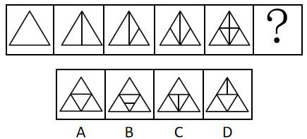

来源：[2020年江苏公务员考试《行测》真题（A类）.pdf](https://github.com/dumarstoft-ship-it/xingce/blob/407016b55b49581efa3771bb59a2dee8761d982f/2020%E5%B9%B4%E6%B1%9F%E8%8B%8F%E5%85%AC%E5%8A%A1%E5%91%98%E8%80%83%E8%AF%95%E3%80%8A%E8%A1%8C%E6%B5%8B%E3%80%8B%E7%9C%9F%E9%A2%98%EF%BC%88A%E7%B1%BB%EF%BC%89.pdf)，PDF 第 7 页。

## 第 77 题 · 判断推理

`JS2020-A类-077`

请从所给的四个选项中，选出最恰当的一项填入问号处，使之呈现一定的规律性。

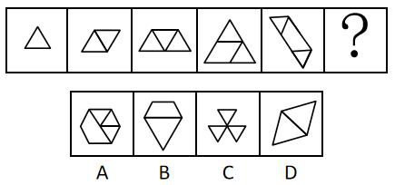

来源：[2020年江苏公务员考试《行测》真题（A类）.pdf](https://github.com/dumarstoft-ship-it/xingce/blob/407016b55b49581efa3771bb59a2dee8761d982f/2020%E5%B9%B4%E6%B1%9F%E8%8B%8F%E5%85%AC%E5%8A%A1%E5%91%98%E8%80%83%E8%AF%95%E3%80%8A%E8%A1%8C%E6%B5%8B%E3%80%8B%E7%9C%9F%E9%A2%98%EF%BC%88A%E7%B1%BB%EF%BC%89.pdf)，PDF 第 7 页。

## 第 78 题 · 判断推理

`JS2020-A类-078`

请从所给的四个选项中，选出最恰当的一项填入问号处，使之呈现一定的规律性。

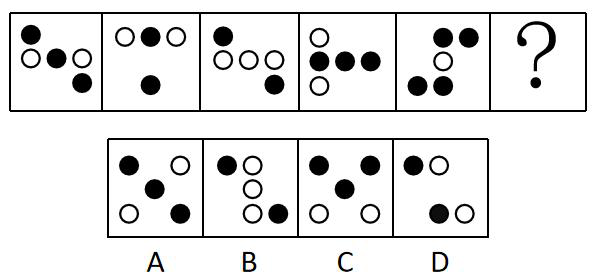

来源：[2020年江苏公务员考试《行测》真题（A类）.pdf](https://github.com/dumarstoft-ship-it/xingce/blob/407016b55b49581efa3771bb59a2dee8761d982f/2020%E5%B9%B4%E6%B1%9F%E8%8B%8F%E5%85%AC%E5%8A%A1%E5%91%98%E8%80%83%E8%AF%95%E3%80%8A%E8%A1%8C%E6%B5%8B%E3%80%8B%E7%9C%9F%E9%A2%98%EF%BC%88A%E7%B1%BB%EF%BC%89.pdf)，PDF 第 7 页。

## 第 79 题 · 判断推理

`JS2020-A类-079`

下面四个图形中，只有一个是由上面的四个图形拼合（只能通过上、下、左、右平移）而成的，请把它
找出来。

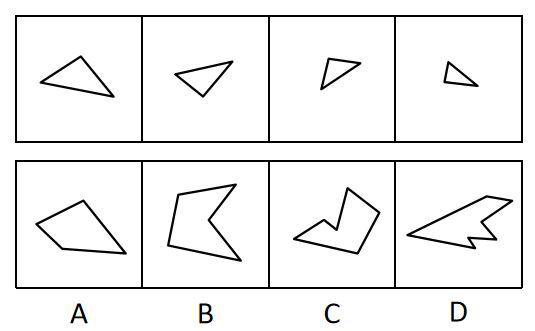

来源：[2020年江苏公务员考试《行测》真题（A类）.pdf](https://github.com/dumarstoft-ship-it/xingce/blob/407016b55b49581efa3771bb59a2dee8761d982f/2020%E5%B9%B4%E6%B1%9F%E8%8B%8F%E5%85%AC%E5%8A%A1%E5%91%98%E8%80%83%E8%AF%95%E3%80%8A%E8%A1%8C%E6%B5%8B%E3%80%8B%E7%9C%9F%E9%A2%98%EF%BC%88A%E7%B1%BB%EF%BC%89.pdf)，PDF 第 8 页。

## 第 80 题 · 判断推理

`JS2020-A类-080`

下面四个图形中，只有一个是由上面的四个图形拼合（只能通过上、下、左、右平移）而成的，请把它
找出来。

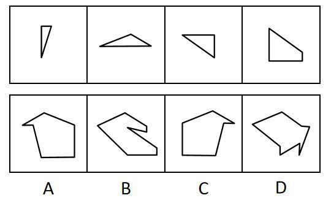

来源：[2020年江苏公务员考试《行测》真题（A类）.pdf](https://github.com/dumarstoft-ship-it/xingce/blob/407016b55b49581efa3771bb59a2dee8761d982f/2020%E5%B9%B4%E6%B1%9F%E8%8B%8F%E5%85%AC%E5%8A%A1%E5%91%98%E8%80%83%E8%AF%95%E3%80%8A%E8%A1%8C%E6%B5%8B%E3%80%8B%E7%9C%9F%E9%A2%98%EF%BC%88A%E7%B1%BB%EF%BC%89.pdf)，PDF 第 8 页。

## 第 81 题 · 判断推理

`JS2020-A类-081`

下面四个图形中，只有一个是由上面的四个图形拼合（只能通过上、下、左、右平移）而成的，请把它
找出来。

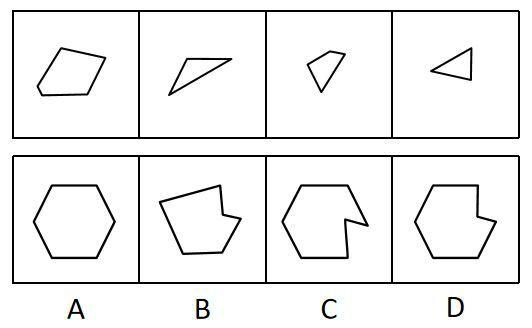

来源：[2020年江苏公务员考试《行测》真题（A类）.pdf](https://github.com/dumarstoft-ship-it/xingce/blob/407016b55b49581efa3771bb59a2dee8761d982f/2020%E5%B9%B4%E6%B1%9F%E8%8B%8F%E5%85%AC%E5%8A%A1%E5%91%98%E8%80%83%E8%AF%95%E3%80%8A%E8%A1%8C%E6%B5%8B%E3%80%8B%E7%9C%9F%E9%A2%98%EF%BC%88A%E7%B1%BB%EF%BC%89.pdf)，PDF 第 8 页。

## 第 82 题 · 判断推理

`JS2020-A类-082`

下面四个图形中，只有一个是由上边的四个图形拼合（只能通过上、下、左、右平移）而成的，请把它
找出来。

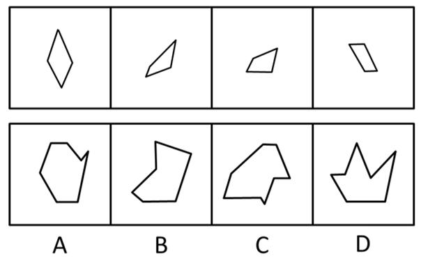

来源：[2020年江苏公务员考试《行测》真题（A类）.pdf](https://github.com/dumarstoft-ship-it/xingce/blob/407016b55b49581efa3771bb59a2dee8761d982f/2020%E5%B9%B4%E6%B1%9F%E8%8B%8F%E5%85%AC%E5%8A%A1%E5%91%98%E8%80%83%E8%AF%95%E3%80%8A%E8%A1%8C%E6%B5%8B%E3%80%8B%E7%9C%9F%E9%A2%98%EF%BC%88A%E7%B1%BB%EF%BC%89.pdf)，PDF 第 8 页。

## 第 83 题 · 判断推理

`JS2020-A类-083`

下面四个图形中，只有一个是由上边的四个图形拼合（只能通过上、下、左、右平移）而成的，请把它
找出来。

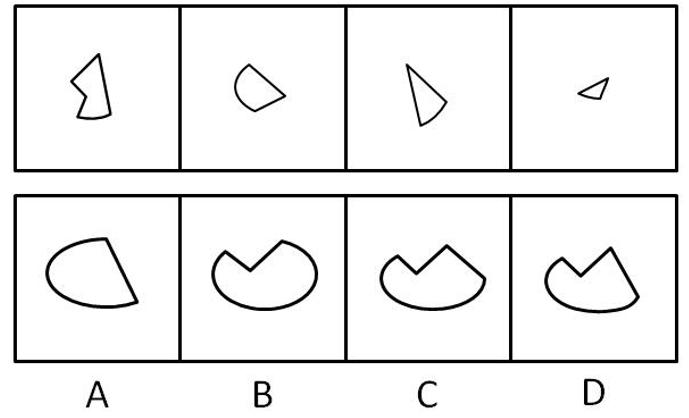

来源：[2020年江苏公务员考试《行测》真题（A类）.pdf](https://github.com/dumarstoft-ship-it/xingce/blob/407016b55b49581efa3771bb59a2dee8761d982f/2020%E5%B9%B4%E6%B1%9F%E8%8B%8F%E5%85%AC%E5%8A%A1%E5%91%98%E8%80%83%E8%AF%95%E3%80%8A%E8%A1%8C%E6%B5%8B%E3%80%8B%E7%9C%9F%E9%A2%98%EF%BC%88A%E7%B1%BB%EF%BC%89.pdf)，PDF 第 8 页。

## 第 84 题 · 判断推理

`JS2020-A类-084`

下面给定的是纸盒外表面的展开图，右边哪一项能由它折叠而成？请把它找出来。

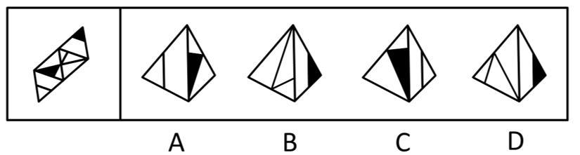

来源：[2020年江苏公务员考试《行测》真题（A类）.pdf](https://github.com/dumarstoft-ship-it/xingce/blob/407016b55b49581efa3771bb59a2dee8761d982f/2020%E5%B9%B4%E6%B1%9F%E8%8B%8F%E5%85%AC%E5%8A%A1%E5%91%98%E8%80%83%E8%AF%95%E3%80%8A%E8%A1%8C%E6%B5%8B%E3%80%8B%E7%9C%9F%E9%A2%98%EF%BC%88A%E7%B1%BB%EF%BC%89.pdf)，PDF 第 9 页。

## 第 85 题 · 判断推理

`JS2020-A类-085`

下面给定的是纸盒外表面的展开图，右边哪一项能由它折叠而成？请把它找出来。

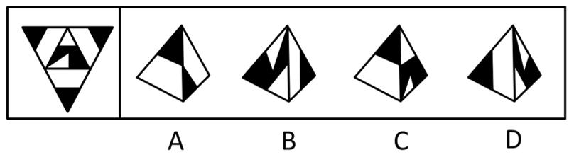

来源：[2020年江苏公务员考试《行测》真题（A类）.pdf](https://github.com/dumarstoft-ship-it/xingce/blob/407016b55b49581efa3771bb59a2dee8761d982f/2020%E5%B9%B4%E6%B1%9F%E8%8B%8F%E5%85%AC%E5%8A%A1%E5%91%98%E8%80%83%E8%AF%95%E3%80%8A%E8%A1%8C%E6%B5%8B%E3%80%8B%E7%9C%9F%E9%A2%98%EF%BC%88A%E7%B1%BB%EF%BC%89.pdf)，PDF 第 9 页。

## 第 86 题 · 判断推理

`JS2020-A类-086`

下面给定的是纸盒外表面的展开图，右边哪一项能由它折叠而成？请把它找出来。

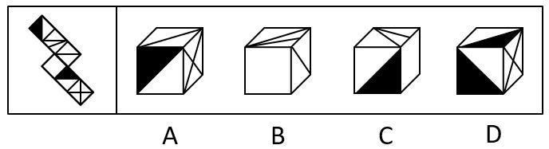

来源：[2020年江苏公务员考试《行测》真题（A类）.pdf](https://github.com/dumarstoft-ship-it/xingce/blob/407016b55b49581efa3771bb59a2dee8761d982f/2020%E5%B9%B4%E6%B1%9F%E8%8B%8F%E5%85%AC%E5%8A%A1%E5%91%98%E8%80%83%E8%AF%95%E3%80%8A%E8%A1%8C%E6%B5%8B%E3%80%8B%E7%9C%9F%E9%A2%98%EF%BC%88A%E7%B1%BB%EF%BC%89.pdf)，PDF 第 9 页。

## 第 87 题 · 判断推理

`JS2020-A类-087`

下面给定的是纸盒外表面的展开图，右边哪一项能由它折叠而成？请把它找出来。

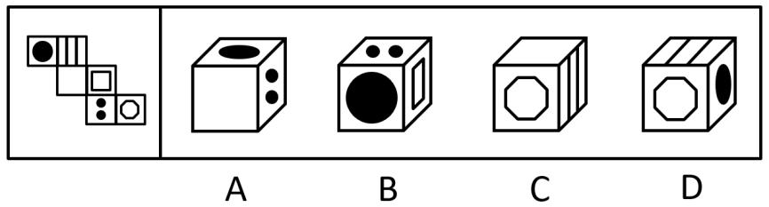

来源：[2020年江苏公务员考试《行测》真题（A类）.pdf](https://github.com/dumarstoft-ship-it/xingce/blob/407016b55b49581efa3771bb59a2dee8761d982f/2020%E5%B9%B4%E6%B1%9F%E8%8B%8F%E5%85%AC%E5%8A%A1%E5%91%98%E8%80%83%E8%AF%95%E3%80%8A%E8%A1%8C%E6%B5%8B%E3%80%8B%E7%9C%9F%E9%A2%98%EF%BC%88A%E7%B1%BB%EF%BC%89.pdf)，PDF 第 9 页。

## 第 88 题 · 判断推理

`JS2020-A类-088`

请从所给的四个选项中，选出最恰当的一项填入问号处，使之呈现一定的规律性。

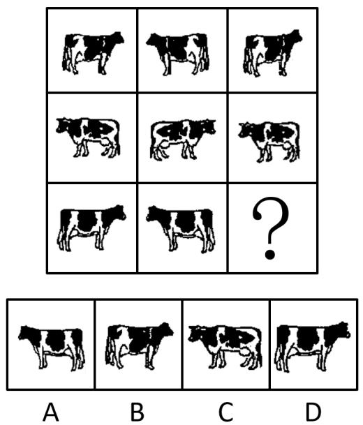

来源：[2020年江苏公务员考试《行测》真题（A类）.pdf](https://github.com/dumarstoft-ship-it/xingce/blob/407016b55b49581efa3771bb59a2dee8761d982f/2020%E5%B9%B4%E6%B1%9F%E8%8B%8F%E5%85%AC%E5%8A%A1%E5%91%98%E8%80%83%E8%AF%95%E3%80%8A%E8%A1%8C%E6%B5%8B%E3%80%8B%E7%9C%9F%E9%A2%98%EF%BC%88A%E7%B1%BB%EF%BC%89.pdf)，PDF 第 9 页。

## 第 89 题 · 判断推理

`JS2020-A类-089`

请从所给的四个选项中，选出最恰当的一项填入问号处，使之呈现一定的规律性。

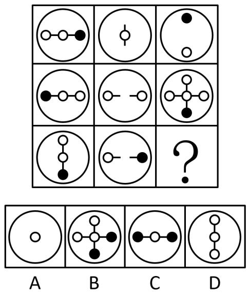

来源：[2020年江苏公务员考试《行测》真题（A类）.pdf](https://github.com/dumarstoft-ship-it/xingce/blob/407016b55b49581efa3771bb59a2dee8761d982f/2020%E5%B9%B4%E6%B1%9F%E8%8B%8F%E5%85%AC%E5%8A%A1%E5%91%98%E8%80%83%E8%AF%95%E3%80%8A%E8%A1%8C%E6%B5%8B%E3%80%8B%E7%9C%9F%E9%A2%98%EF%BC%88A%E7%B1%BB%EF%BC%89.pdf)，PDF 第 9 页。

## 第 90 题 · 判断推理

`JS2020-A类-090`

下图为给定的立体，从任意角度剖开，右边哪一项不可能是它的截面图？

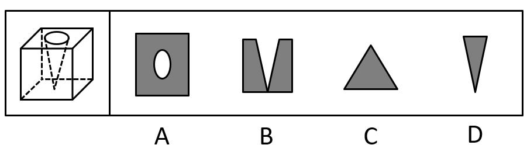

来源：[2020年江苏公务员考试《行测》真题（A类）.pdf](https://github.com/dumarstoft-ship-it/xingce/blob/407016b55b49581efa3771bb59a2dee8761d982f/2020%E5%B9%B4%E6%B1%9F%E8%8B%8F%E5%85%AC%E5%8A%A1%E5%91%98%E8%80%83%E8%AF%95%E3%80%8A%E8%A1%8C%E6%B5%8B%E3%80%8B%E7%9C%9F%E9%A2%98%EF%BC%88A%E7%B1%BB%EF%BC%89.pdf)，PDF 第 10 页。

## 第 91 题 · 判断推理

`JS2020-A类-091`

党内存在的很多问题都同政治问题相关联。不从政治上认识问题、解决问题，就会陷入头痛医头、脚痛
医脚的被动局面，就无法从根本上解决问题。提高政治能力，很重要的一条就是要善于从政治上分析问题、解决
问题。只有从政治上分析问题才能看清本质，只有从政治上解决问题才能抓住根本。
根据以上陈述，可以得出以下哪项？
A、只有从政治上认识问题、解决问题，才能从根本上解决问题
B、如果善于从政治上分析问题、解决问题，就能提高政治能力
C、一旦陷入头痛医头、脚痛医脚的被动局面，就无法从根本上解决问题
D、如果没有看清本质、抓住根本，说明没有从政治上分析问题、解决问题

来源：[2020年江苏公务员考试《行测》真题（A类）.pdf](https://github.com/dumarstoft-ship-it/xingce/blob/407016b55b49581efa3771bb59a2dee8761d982f/2020%E5%B9%B4%E6%B1%9F%E8%8B%8F%E5%85%AC%E5%8A%A1%E5%91%98%E8%80%83%E8%AF%95%E3%80%8A%E8%A1%8C%E6%B5%8B%E3%80%8B%E7%9C%9F%E9%A2%98%EF%BC%88A%E7%B1%BB%EF%BC%89.pdf)，PDF 第 10 页。

## 第 92 题 · 判断推理

`JS2020-A类-092`

人类学家测量了历史上各个时期的人类头骨之后发现，当代成人的脑容量平均为1349 毫升，相比中石器
时代人类的脑容量，男性减少了10&，女性减少了17%。研究者认为，在分工日益明确的时代，富有合作精神的人
比其他人有更多的生存和繁衍机会，“最友好者生存”是导致人类大脑不断缩小的重要原因。
以下哪项如果为真，最能支持上述结论？
A、当代脑科学研究表明，脑容量更小会使得人类更富有合作精神
B、合作会减少人类的攻击性，而攻击性的减少会使人身体变轻、脑容量减少
C、随着气温的升高，人们对体重的要求降低，身体的缩小必然带来大脑的缩小
D、外部信息存储介质的出现减轻了大脑的记忆负担，人类的大脑随之缩小

来源：[2020年江苏公务员考试《行测》真题（A类）.pdf](https://github.com/dumarstoft-ship-it/xingce/blob/407016b55b49581efa3771bb59a2dee8761d982f/2020%E5%B9%B4%E6%B1%9F%E8%8B%8F%E5%85%AC%E5%8A%A1%E5%91%98%E8%80%83%E8%AF%95%E3%80%8A%E8%A1%8C%E6%B5%8B%E3%80%8B%E7%9C%9F%E9%A2%98%EF%BC%88A%E7%B1%BB%EF%BC%89.pdf)，PDF 第 10 页。

## 第 93 题 · 判断推理

`JS2020-A类-093`

每个“熊孩子”的背后都有一个“熊家长”。这些“熊家长”对“熊孩子”百依百顺，溺爱娇惯，这使
得“熊孩子”以自我为中心，缺乏规则意识，容易产生过激的非理性行为。当“熊孩子”有些行为对他人和社会
造成伤害时，“熊家长”也会以“他还是个孩子”来护短辩解，要求原谅。
以下哪项最可能是“熊家长”辩解所隐含的前提？
A、“熊孩子”犯错误不是故意为之 B、只要是孩子就难免犯错
C、“熊孩子”长大后会成为好孩子 D、孩子犯错误应当被原谅

来源：[2020年江苏公务员考试《行测》真题（A类）.pdf](https://github.com/dumarstoft-ship-it/xingce/blob/407016b55b49581efa3771bb59a2dee8761d982f/2020%E5%B9%B4%E6%B1%9F%E8%8B%8F%E5%85%AC%E5%8A%A1%E5%91%98%E8%80%83%E8%AF%95%E3%80%8A%E8%A1%8C%E6%B5%8B%E3%80%8B%E7%9C%9F%E9%A2%98%EF%BC%88A%E7%B1%BB%EF%BC%89.pdf)，PDF 第 10 页。

## 第 94 题 · 判断推理

`JS2020-A类-094`

张、王、李、赵四人计划在6 至9 月中分别选择一个月休年假，但部门人手短缺，一个月中不能有两个
人休假。赵不希望安排在6 月，张要求不要安排在9 月，李表示6 月或8 月都可以，王提出只能安排在7、8 月份。
如四人的要求均得到满足，则可以推出以下哪项？
A、张只能安排在6 月或者7 月 B、只要李不在6 月，王一定会在7 月
C、如果李安排在8 月，那么张安排在7 月 D、如果王安排在7 月，那么李安排在6 月

来源：[2020年江苏公务员考试《行测》真题（A类）.pdf](https://github.com/dumarstoft-ship-it/xingce/blob/407016b55b49581efa3771bb59a2dee8761d982f/2020%E5%B9%B4%E6%B1%9F%E8%8B%8F%E5%85%AC%E5%8A%A1%E5%91%98%E8%80%83%E8%AF%95%E3%80%8A%E8%A1%8C%E6%B5%8B%E3%80%8B%E7%9C%9F%E9%A2%98%EF%BC%88A%E7%B1%BB%EF%BC%89.pdf)，PDF 第 10 页。

## 第 95 题 · 判断推理

`JS2020-A类-095`

某部门新录用甲、乙、丙三名工作人员，他们各自的籍贯为江苏、安徽、浙江中的某个省。张红、李梅
和王芹对他们的籍贯有如下猜测：
张红：甲是浙江人，乙是安徽人，丙也是浙江人；
李梅：甲是浙江人，乙是江苏人，丙不是江苏人；
王芹：甲是江苏人，乙是浙江人，丙也是江苏人。
已知，对甲、乙、丙的籍贯，上述三人均猜对1 个，猜错2 个。
根据以上信息，以下哪项是可能的？
A、甲是江苏人，乙是安徽人，丙是浙江人 B、甲是浙江人，乙是江苏人，丙是江苏人
C、甲是安徽人，乙是浙江人，丙是江苏人 D、甲是江苏人，乙是安徽人，丙是安徽人

来源：[2020年江苏公务员考试《行测》真题（A类）.pdf](https://github.com/dumarstoft-ship-it/xingce/blob/407016b55b49581efa3771bb59a2dee8761d982f/2020%E5%B9%B4%E6%B1%9F%E8%8B%8F%E5%85%AC%E5%8A%A1%E5%91%98%E8%80%83%E8%AF%95%E3%80%8A%E8%A1%8C%E6%B5%8B%E3%80%8B%E7%9C%9F%E9%A2%98%EF%BC%88A%E7%B1%BB%EF%BC%89.pdf)，PDF 第 10 页。

## 第 96 题 · 判断推理

`JS2020-A类-096`

一项对某企业基层工作人员的研究报告显示，使用社交软件的基层工作人员罹患糖尿病、精神疾病、缺
血性心脏疾病的概率均显著低于不使用社交软件的。据此，该企业管理人员认为，社交软件的使用有利于基层工
作人员的健康。
以下哪项如果为真，最能削弱上述管理人员的结论？
A、长时间使用电脑或者手机会引发包括精神疾病在内的多种健康问题
B、该企业基层工作人员没有足够多的时间和精力锻炼身体
C、该企业基层工作人员压力大，身心健康的人才在工作之余使用社交软件
D、该企业基层工作人员普遍在四十岁以上，相当一部分人不使用社交软件

来源：[2020年江苏公务员考试《行测》真题（A类）.pdf](https://github.com/dumarstoft-ship-it/xingce/blob/407016b55b49581efa3771bb59a2dee8761d982f/2020%E5%B9%B4%E6%B1%9F%E8%8B%8F%E5%85%AC%E5%8A%A1%E5%91%98%E8%80%83%E8%AF%95%E3%80%8A%E8%A1%8C%E6%B5%8B%E3%80%8B%E7%9C%9F%E9%A2%98%EF%BC%88A%E7%B1%BB%EF%BC%89.pdf)，PDF 第 10 页。

## 第 97 题 · 判断推理

`JS2020-A类-097`

由于业务量增加，某服务中心计划增加登记、咨询、报送、投诉和综合5 个业务窗口，拟安排的5 名工
作人员所熟悉的业务各有不同：小丽作为新人，只熟悉登记业务；小马熟悉登记和咨询业务；小高熟悉报送和投
诉业务；老王除了综合和投诉，其他业务都很熟悉；老董所有业务都很精通。最终，5 名工作人员被分别安排到5
个窗口负责各自熟悉的业务。
关于人员安排，以下说法正确的是
A、老董不负责综合业务窗口 B、小高负责报送业务窗口
C、小马不负责咨询业务窗口 D、老王负责报送业务窗口

来源：[2020年江苏公务员考试《行测》真题（A类）.pdf](https://github.com/dumarstoft-ship-it/xingce/blob/407016b55b49581efa3771bb59a2dee8761d982f/2020%E5%B9%B4%E6%B1%9F%E8%8B%8F%E5%85%AC%E5%8A%A1%E5%91%98%E8%80%83%E8%AF%95%E3%80%8A%E8%A1%8C%E6%B5%8B%E3%80%8B%E7%9C%9F%E9%A2%98%EF%BC%88A%E7%B1%BB%EF%BC%89.pdf)，PDF 第 10、11 页。

## 第 98 题 · 判断推理

`JS2020-A类-098`

随着社会经济的快速发展，很多现代化都市高楼林立，变成了钢铁水泥的森林。但欧洲某著名城市几乎
没有一座高楼大厦，某旅游者在游览时了解到该城市仅有10 万人。由此他认为，人口稀少、需求不旺是这座城市
不建高楼大厦的主要原因。
以下哪项如果为真，最能质疑上述旅游者的观点？
A、许多住在老城区的社会精英都想住进现代化高楼
B、该城市已经规划3 年内建造一座高层地标性建筑
C、该城市规定一般建筑物的高度不得超过当地教堂
D、该地区人口近百万的其他城市也大都没有高楼大厦

来源：[2020年江苏公务员考试《行测》真题（A类）.pdf](https://github.com/dumarstoft-ship-it/xingce/blob/407016b55b49581efa3771bb59a2dee8761d982f/2020%E5%B9%B4%E6%B1%9F%E8%8B%8F%E5%85%AC%E5%8A%A1%E5%91%98%E8%80%83%E8%AF%95%E3%80%8A%E8%A1%8C%E6%B5%8B%E3%80%8B%E7%9C%9F%E9%A2%98%EF%BC%88A%E7%B1%BB%EF%BC%89.pdf)，PDF 第 11 页。

## 第 99 题 · 判断推理

`JS2020-A类-099`

### 共用材料

在400 米跑比赛中，罗、方、许、吕、田、石6 人被分在一组。他们站在由内到外的1 至6 号赛道上。关于
他们的位置，已知：
（1）田和石的赛道相邻；
（2）吕的赛道编号小于罗；
（3）田和罗之间隔着两条赛道；
（4）方的赛道编号小于吕，且中间隔着两条赛道。

根据以上陈述，关于田的位置，以下哪项是可能的？
A、在3 号赛道上 B、在4 号赛道上 C、在5 号赛道上 D、在6 号赛道上

来源：[2020年江苏公务员考试《行测》真题（A类）.pdf](https://github.com/dumarstoft-ship-it/xingce/blob/407016b55b49581efa3771bb59a2dee8761d982f/2020%E5%B9%B4%E6%B1%9F%E8%8B%8F%E5%85%AC%E5%8A%A1%E5%91%98%E8%80%83%E8%AF%95%E3%80%8A%E8%A1%8C%E6%B5%8B%E3%80%8B%E7%9C%9F%E9%A2%98%EF%BC%88A%E7%B1%BB%EF%BC%89.pdf)，PDF 第 11 页。

## 第 100 题 · 判断推理

`JS2020-A类-100`

### 共用材料

在400 米跑比赛中，罗、方、许、吕、田、石6 人被分在一组。他们站在由内到外的1 至6 号赛道上。关于
他们的位置，已知：
（1）田和石的赛道相邻；
（2）吕的赛道编号小于罗；
（3）田和罗之间隔着两条赛道；
（4）方的赛道编号小于吕，且中间隔着两条赛道。

根据以上陈述，可以推出以下哪项？
A、许和石的赛道相邻 B、许和石之间隔着一条赛道
C、许和石之间隔着两条赛道 D、许和石之间隔着三条赛道

来源：[2020年江苏公务员考试《行测》真题（A类）.pdf](https://github.com/dumarstoft-ship-it/xingce/blob/407016b55b49581efa3771bb59a2dee8761d982f/2020%E5%B9%B4%E6%B1%9F%E8%8B%8F%E5%85%AC%E5%8A%A1%E5%91%98%E8%80%83%E8%AF%95%E3%80%8A%E8%A1%8C%E6%B5%8B%E3%80%8B%E7%9C%9F%E9%A2%98%EF%BC%88A%E7%B1%BB%EF%BC%89.pdf)，PDF 第 11 页。

## 第 101 题 · 判断推理

`JS2020-A类-101`

造血式扶贫：指政府部门或社会力量通过持续性地扶持农村产业发展，拓宽农产品销售及消费渠道等，
帮助贫困地区、贫困人口增收脱贫的扶贫方式。
下列属于造血式扶贫的是
A、某县按照“东部林果、旅游，西部设施农业”的整体思路，一直坚持“产业+基地+车间”的产业发展模式，
使农民年收入翻了一番，人均达到近万元
B、某县扶贫办组织了200 多名山区农民，经过严格培训，输送到东南沿海城市工作。这些农民每月都按时寄
钱回家，家里的日子越过越红火
C、县农科所资助某村贫困家庭100 头种羊，多次对他们进行科学养羊技术培训，并安排技术人员进行“一对
一”的专业指导
D、为了解决全村苹果严重滞销的问题，村里的几个年轻人共同开办了一个水果直销网店。不到半月时间，所
有苹果就销售一空

来源：[2020年江苏公务员考试《行测》真题（A类）.pdf](https://github.com/dumarstoft-ship-it/xingce/blob/407016b55b49581efa3771bb59a2dee8761d982f/2020%E5%B9%B4%E6%B1%9F%E8%8B%8F%E5%85%AC%E5%8A%A1%E5%91%98%E8%80%83%E8%AF%95%E3%80%8A%E8%A1%8C%E6%B5%8B%E3%80%8B%E7%9C%9F%E9%A2%98%EF%BC%88A%E7%B1%BB%EF%BC%89.pdf)，PDF 第 11 页。

## 第 102 题 · 判断推理

`JS2020-A类-102`

分众化教育：指根据受众的具体差异，用典型案例分别进行宣传，以激发情感共鸣，达成特定目标的教
育方式。
下列属于分众化教育的是
A、某市组织全市技术创新能手分别深入到所在行业部门，分享自己的创新经验，极大地激发了各行各业人士
的创新热情
B、某地组织的“五一劳动奖章”获得者宣讲团多次进行巡回报告，他们的先进事迹深深地打动了前来听讲的
市民
C、每天傍晚，某学校附近地铁口都有艺术教育培训机构的招生人员散发传单，上面印着考入名校的学生彩照
和成绩
D、在“不忘初心、牢记便命”主题教育中，某区组织党员干部分系统观看专题纪录片《警钟长鸣》，取得了
预期效果

来源：[2020年江苏公务员考试《行测》真题（A类）.pdf](https://github.com/dumarstoft-ship-it/xingce/blob/407016b55b49581efa3771bb59a2dee8761d982f/2020%E5%B9%B4%E6%B1%9F%E8%8B%8F%E5%85%AC%E5%8A%A1%E5%91%98%E8%80%83%E8%AF%95%E3%80%8A%E8%A1%8C%E6%B5%8B%E3%80%8B%E7%9C%9F%E9%A2%98%EF%BC%88A%E7%B1%BB%EF%BC%89.pdf)，PDF 第 11 页。

## 第 103 题 · 判断推理

`JS2020-A类-103`

喘息服务：指由政府部门购买服务，为有失能失智老人的低收入家庭或特殊困难家庭提供临时性援助，
让常年在家照顾亲属者得到短暂休息。
下列属于喘息服务的是
A、由于儿女移居国外，年迈的赵先生夫妇只得相依为命，平时一起去市场买日常用品，一起去医院就诊取药。
社区了解情况后，专门雇人每天上门半小时帮他们料理家务
B、杨先生10 多年前中风，老伴杜女士为了照料他，每天忙得团团转，连自己生病都没时间去医院。今年初，
街道派护工不定期上门服务，让她能有时间到医院看病或稍事休息
C、父亲去世后，年过六旬的张先生独自承担起了照顾精神病妹妹的重任，从来没有睡过一个安稳觉。不久前，
老张专门请了一名钟点工照看妹妹，感觉轻松了许多
D、患健忘症的陈奶奶经常独自出门闲逛，多次走失，靠低保维持生活的儿子无力照顾。区民政部门了解情况
后，把陈奶奶送进养老院，并承担了所有费用

来源：[2020年江苏公务员考试《行测》真题（A类）.pdf](https://github.com/dumarstoft-ship-it/xingce/blob/407016b55b49581efa3771bb59a2dee8761d982f/2020%E5%B9%B4%E6%B1%9F%E8%8B%8F%E5%85%AC%E5%8A%A1%E5%91%98%E8%80%83%E8%AF%95%E3%80%8A%E8%A1%8C%E6%B5%8B%E3%80%8B%E7%9C%9F%E9%A2%98%EF%BC%88A%E7%B1%BB%EF%BC%89.pdf)，PDF 第 11 页。

## 第 104 题 · 判断推理

`JS2020-A类-104`

口述登记制：指办理个体工商户登记手续时，申请人无需亲自填表，只要口述各项信息，核对确认后即
可当场领取营业执照的登记方式。
下列属于口述登记制的是
A、赵先生到市场监督管理部门办理个体户注册登记手续。在窗口人员指导下按照“申请-受理-核准”的步骤，
半小时就办好了手续。第二天就拿到了自己的营业执照
B、汪先生打算申请运动器材店营业执照。他从网上弄清了申请程序，第二天来到区市场监督管理部门登记处，
简要地回答了几个问题，不一会儿营业执照就办好了
C、程先生到市场监督管理部门办理花店营业执照。按照现场人员的指导填好表格，经办人员输入系统打印出
信息登记表，程先生签名确认后就拿到了营业执照
D、蔡先生到市场监督管理部门办理营业执照注销手续。在指定窗口完成自动身份识别后，回答了工作人员的
询问，很快就办完了全部手续

来源：[2020年江苏公务员考试《行测》真题（A类）.pdf](https://github.com/dumarstoft-ship-it/xingce/blob/407016b55b49581efa3771bb59a2dee8761d982f/2020%E5%B9%B4%E6%B1%9F%E8%8B%8F%E5%85%AC%E5%8A%A1%E5%91%98%E8%80%83%E8%AF%95%E3%80%8A%E8%A1%8C%E6%B5%8B%E3%80%8B%E7%9C%9F%E9%A2%98%EF%BC%88A%E7%B1%BB%EF%BC%89.pdf)，PDF 第 11、12 页。

## 第 105 题 · 判断推理

`JS2020-A类-105`

垃圾资源化：指垃圾进行分选处理后，成为无污染的循环再利用原料，进而加工、转化为再生资源的垃
圾处理方式。
下列属于垃圾资源化的是
A、某市为了缓解因煤炭资源过度开采造成的地面下陷问题，新建了一个大型垃圾场，经过分类后的城市生活
垃圾每天都会运到这里集中填埋
B、垃圾焚烧发电需要投入巨大资金，随着相关技术不断进步，电能产量越来越高，尽管排放问题还没有彻底
解决，但它仍然是目前比较常见的城市垃圾处理方式
C、乡村垃圾大多采用分类处理的方法：有回收价值的，挑选出来后稍加处理卖给需要的人，其他大部分卖到
废品回收站点；无回收价值的，堆到指定地点
D、某市正在推行新的垃圾处理方式：将厨余垃圾等有机物分离出来，制成有机肥料；将砖头瓦块、玻璃陶瓷
等无机物分离出来，制成新型免烧砖

来源：[2020年江苏公务员考试《行测》真题（A类）.pdf](https://github.com/dumarstoft-ship-it/xingce/blob/407016b55b49581efa3771bb59a2dee8761d982f/2020%E5%B9%B4%E6%B1%9F%E8%8B%8F%E5%85%AC%E5%8A%A1%E5%91%98%E8%80%83%E8%AF%95%E3%80%8A%E8%A1%8C%E6%B5%8B%E3%80%8B%E7%9C%9F%E9%A2%98%EF%BC%88A%E7%B1%BB%EF%BC%89.pdf)，PDF 第 12 页。

## 第 106 题 · 判断推理

`JS2020-A类-106`

良性冲突：指管理者设法把企业内部的小冲突转化为凝聚力，推动企业发展的管理策略。
下列属于良性冲突的是
A、公司召开员工代表大会修订奖惩条例，与会者的意见出现了巨大分歧，大家争得面红耳赤，最后少数服从
多数，通过了该条例的修订
B、某企业面临着一项急需解决的技术难题，总经理提议谁能提出解决方案就可以担任项目主管并获得10 万
元重奖。这一提议遭到部分与会者的反对，最终未能通过
C、徐先生和景先生是某公司的一对老搭档，在一些重大决策问题上经常意见相左，互不相让，最终却总能达
成一致。在他们的领导下，公司业绩稳步提高
D、市场部蒋经理听到销售员反映产品质量问题后，向质检部反馈意见，与生产部经理产生了矛盾。公司组织
三个部门多次开会协调，最终建立了良好沟通机制

来源：[2020年江苏公务员考试《行测》真题（A类）.pdf](https://github.com/dumarstoft-ship-it/xingce/blob/407016b55b49581efa3771bb59a2dee8761d982f/2020%E5%B9%B4%E6%B1%9F%E8%8B%8F%E5%85%AC%E5%8A%A1%E5%91%98%E8%80%83%E8%AF%95%E3%80%8A%E8%A1%8C%E6%B5%8B%E3%80%8B%E7%9C%9F%E9%A2%98%EF%BC%88A%E7%B1%BB%EF%BC%89.pdf)，PDF 第 12 页。

## 第 107 题 · 判断推理

`JS2020-A类-107`

乡贤调解：指村民之间发生纠纷后，由具有较高威望和影响力的乡村贤达人士出面解决纠纷的民间调解
方式。
下列不属于乡贤调解的是
A、老周与老马因借贷纠纷对簿公堂，法院受理后到村里开庭，并请了几位乡贤旁听，经过现场调解，双方达
成谅解
B、老肖年轻时走南闯北，见多识广，全村上上下下都很敬重他。张家的牛吃了李家的草，高家的水流进了齐
家的房，村民只要找到他，问题一下就解决了
C、老于从镇司法所退休回村后，用老百姓的“土办法”解决了蒋家婆媳不和的老大难问题。从此以后，村里
一旦发生什么纠纷，大家都爱跑来请他去评理
D、老张和邻居老李因为家门口的路闹得不可开交，把路堵死。家住村头的老支书过去调解，两人一见到他，
火气就消了一大半，很快握手言好，开通了道路

来源：[2020年江苏公务员考试《行测》真题（A类）.pdf](https://github.com/dumarstoft-ship-it/xingce/blob/407016b55b49581efa3771bb59a2dee8761d982f/2020%E5%B9%B4%E6%B1%9F%E8%8B%8F%E5%85%AC%E5%8A%A1%E5%91%98%E8%80%83%E8%AF%95%E3%80%8A%E8%A1%8C%E6%B5%8B%E3%80%8B%E7%9C%9F%E9%A2%98%EF%BC%88A%E7%B1%BB%EF%BC%89.pdf)，PDF 第 12 页。

## 第 108 题 · 判断推理

`JS2020-A类-108`

等待经济：指商家利用人们购物、就医、出行时的空余时间，提供选择自由、使用方便的付费服务。
下列不属于等待经济的是
A、某购物中心在顾客休息区设置了多台VR 游戏机，顾客扫码付费即可操作
B、某社区卫生服务中心添置了数台功能各异的按摩椅，供候诊患者刷卡使用
C、某小区内新开设了一家无人超市，每到周末附近居民就喜欢到这里来购物
D、某火车站在候车室内放置了数台自动售卖机，供旅客自主选购饮料、食品

来源：[2020年江苏公务员考试《行测》真题（A类）.pdf](https://github.com/dumarstoft-ship-it/xingce/blob/407016b55b49581efa3771bb59a2dee8761d982f/2020%E5%B9%B4%E6%B1%9F%E8%8B%8F%E5%85%AC%E5%8A%A1%E5%91%98%E8%80%83%E8%AF%95%E3%80%8A%E8%A1%8C%E6%B5%8B%E3%80%8B%E7%9C%9F%E9%A2%98%EF%BC%88A%E7%B1%BB%EF%BC%89.pdf)，PDF 第 12 页。

## 第 109 题 · 判断推理

`JS2020-A类-109`

信息污染：指信息传播过程中混入危害性、欺骗性或误导性信息元素，从而影响对有效信息的正常获取
和利用的现象。
下列属于信息污染的是
A、心理学家让实验对象每天看几千张不同的照片，几天后，被试者大都出现头痛、失眠等现象，无法按要求
描述相似照片的差别
B、某牙科医院网站转载了某权威医学杂志的一篇科研论文，但在论文末尾的显著位置附上该医院相关产品的
广告
C、自从帮父母开通微信账号后，小张的微信朋友圈里每天都会看到父母转发的各种养生鸡汤和伪科学信息
D、陈某在微博上转发某省森林火灾事故的新闻报导时，将五年前亚马孙雨林特大火灾的现场图片作为配图插
入其中

来源：[2020年江苏公务员考试《行测》真题（A类）.pdf](https://github.com/dumarstoft-ship-it/xingce/blob/407016b55b49581efa3771bb59a2dee8761d982f/2020%E5%B9%B4%E6%B1%9F%E8%8B%8F%E5%85%AC%E5%8A%A1%E5%91%98%E8%80%83%E8%AF%95%E3%80%8A%E8%A1%8C%E6%B5%8B%E3%80%8B%E7%9C%9F%E9%A2%98%EF%BC%88A%E7%B1%BB%EF%BC%89.pdf)，PDF 第 12 页。

## 第 110 题 · 判断推理

`JS2020-A类-110`

痕迹管理：指按照相关部门要求，用文字或图片等材料记录、展示工作过程和业绩，作为绩效考核依据
的监督管理手段。
下列不属于痕迹管理的是
A、李先生被派往分公司调研，每天忙得不亦乐乎：手机上装了多个工作APP，必须随时关注上边的各种信息，
还得及时把现场工作照上传给公司领导
B、某公司人力资源部门存储了大量的记录公司各项活动的文字影像资料，为每年的年终总结和工作汇报提供
了足够的第一手材料
C、按有关部门规定，申报项目时，除了填写申请书，还须以附件形式提供相应的图片、证书、文件等作为支
撑材料，以供评审专家核查
D、某窗帘公司要求安装人员为客户上门服务时，必须把测量、安装、调试、用户评价等每个环节拍成小视频，
现场传给部门经理

来源：[2020年江苏公务员考试《行测》真题（A类）.pdf](https://github.com/dumarstoft-ship-it/xingce/blob/407016b55b49581efa3771bb59a2dee8761d982f/2020%E5%B9%B4%E6%B1%9F%E8%8B%8F%E5%85%AC%E5%8A%A1%E5%91%98%E8%80%83%E8%AF%95%E3%80%8A%E8%A1%8C%E6%B5%8B%E3%80%8B%E7%9C%9F%E9%A2%98%EF%BC%88A%E7%B1%BB%EF%BC%89.pdf)，PDF 第 13 页。

## 第 111 题 · 判断推理

`JS2020-A类-111`

抢跑焦虑症：指家庭或学校由于担心孩子缺乏竞争力，急于进行超前教育、加深教学内容等违背教育教
学基本规律的现象。
下列不属于抢跑焦虑症的是
A、暑假刚开始，小明的家长便为他买好了下学期的语文、数学、外语教材及教辅材料，要求他严格按计划完
成全部的预习任务
B、某教育培训机构要求授课教师适当增加教学内容，加大学习难度，吸引更多的优秀学生前来参加各门各类
课程的补习
C、王女士儿子成绩一直很优秀，虽然才读小学三年级，家里就为他请了家教，每周两次一对一辅导法语学习
D、在全市中学生数学竞赛前夕，某校多次聘请大学教授占用其他课程的时间为参赛选手进行强化训练

来源：[2020年江苏公务员考试《行测》真题（A类）.pdf](https://github.com/dumarstoft-ship-it/xingce/blob/407016b55b49581efa3771bb59a2dee8761d982f/2020%E5%B9%B4%E6%B1%9F%E8%8B%8F%E5%85%AC%E5%8A%A1%E5%91%98%E8%80%83%E8%AF%95%E3%80%8A%E8%A1%8C%E6%B5%8B%E3%80%8B%E7%9C%9F%E9%A2%98%EF%BC%88A%E7%B1%BB%EF%BC%89.pdf)，PDF 第 13 页。

## 第 112 题 · 判断推理

`JS2020-A类-112`

情感营销：指在商品销售过程中，商家运用各种手段拉近与客户的情感距离，从而达到销售目的的营销
策略。
下列属于情感营销的是
A、商场导购员一见到有人走近，就会满脸笑容地迎上来，用亲属之间的各种称谓拉着顾客去体验、购买商品
B、小刘经常和小丁一起带孩子游玩，不仅帮小丁解决了儿子入学的难题，还为小丁的儿子购买了自己负责销
售的儿童成长类保险产品
C、某社区组织爱心团队深入辖区低保家庭，悉心照顾孤寡老人，了解他们的消费需求，并从赞助商那里为他
们挑选合适的商品
D、袁先生以前是张先生的供货商，当年帮了他很大的忙。现在张先生成立了自己的公司，袁先生已不再经商，
但是两人仍亲如兄弟

来源：[2020年江苏公务员考试《行测》真题（A类）.pdf](https://github.com/dumarstoft-ship-it/xingce/blob/407016b55b49581efa3771bb59a2dee8761d982f/2020%E5%B9%B4%E6%B1%9F%E8%8B%8F%E5%85%AC%E5%8A%A1%E5%91%98%E8%80%83%E8%AF%95%E3%80%8A%E8%A1%8C%E6%B5%8B%E3%80%8B%E7%9C%9F%E9%A2%98%EF%BC%88A%E7%B1%BB%EF%BC%89.pdf)，PDF 第 13 页。

## 第 113 题 · 判断推理

`JS2020-A类-113`

同辈压力：指年龄相近的人因生活、工作、社会地位等方面存在差距，担心受到轻视排挤而产生的心理
压力。
下列属于同辈压力的是
A、老王的朋友都为孩子买了婚房，他也想为儿子买一套，自己的经济实力却远远达不到，为此非常烦恼
B、某学院近年引进的教师大多晋升了高级职称，有二十多年教龄的赵老师仍然还是讲师，他常常愁得睡不着
觉
C、销售员小丁看到别人都已完成公司的年度销售任务，自己才完成了六成。为防止明年被调离销售部，不分
昼夜联系客户
D、车间主任要求新员工小李一周内必须熟悉设备，能够独立操作。因担心不能顺利过关，他加班加点苦练技
能

来源：[2020年江苏公务员考试《行测》真题（A类）.pdf](https://github.com/dumarstoft-ship-it/xingce/blob/407016b55b49581efa3771bb59a2dee8761d982f/2020%E5%B9%B4%E6%B1%9F%E8%8B%8F%E5%85%AC%E5%8A%A1%E5%91%98%E8%80%83%E8%AF%95%E3%80%8A%E8%A1%8C%E6%B5%8B%E3%80%8B%E7%9C%9F%E9%A2%98%EF%BC%88A%E7%B1%BB%EF%BC%89.pdf)，PDF 第 13 页。

## 第 114 题 · 判断推理

`JS2020-A类-114`

谜语有多种猜法。比较法是将字形、字义相近或相反的词放在一起，加以比较而扣合谜底；溯源法是追
溯谜面的来源及其与原出处的上下关联，然后再扣合谜底；拟物法是将人或人体某部分物化，将谜面字词语义或
所言之事物化，扣合谜底。
①谜面：枕头。要求打一成语。谜底：置之脑后
②谜面：桃花潭水深千尺。要求打一成语。谜底：无与伦比
③谜面：加一笔不好，加一倍不少。要求打一字。谜底：夕
关于①②③谜语的猜法，下列判断正确的是
A、①溯源法，②比较法，③拟物法 B、①溯源法，②拟物法，③比较法
C、①比较法，②溯源法，③拟物法 D、①拟物法，②溯源法，③比较法

来源：[2020年江苏公务员考试《行测》真题（A类）.pdf](https://github.com/dumarstoft-ship-it/xingce/blob/407016b55b49581efa3771bb59a2dee8761d982f/2020%E5%B9%B4%E6%B1%9F%E8%8B%8F%E5%85%AC%E5%8A%A1%E5%91%98%E8%80%83%E8%AF%95%E3%80%8A%E8%A1%8C%E6%B5%8B%E3%80%8B%E7%9C%9F%E9%A2%98%EF%BC%88A%E7%B1%BB%EF%BC%89.pdf)，PDF 第 13 页。

## 第 115 题 · 判断推理

`JS2020-A类-115`

层递：指根据事物的逻辑关系，连用结构相似的语句，把意思按照大小、多少、高低、轻重、远近等不
同程度逐层排列出来，表达层次递进的事理。
下列没有使用层递的是
A、能尽其性，则能尽人之性；能尽人之性，则能尽物之性；能尽物之性，则可以赞天地之化育；可以赞天地
之化育，则可以与天地参矣
B、吾十有五而志于学，三十而立，四十而不惑，五十而知天命，六十而耳顺，七十而从心所欲不逾矩
C、古之欲明明德于天下者，先治其国；欲治其国者，先齐其家；欲齐其家者，先修其身；欲修其身者，先正
其心；欲正其心者，先诚其意；欲诚其意者，先致其知
D、一曰礼，二曰义，三曰廉，四曰耻。礼不逾节，义不自进，廉不蔽恶，耻不从枉。故不逾节则上位安，不
自进则民无巧诈，不蔽恶则行自全，不从枉则邪事不生

来源：[2020年江苏公务员考试《行测》真题（A类）.pdf](https://github.com/dumarstoft-ship-it/xingce/blob/407016b55b49581efa3771bb59a2dee8761d982f/2020%E5%B9%B4%E6%B1%9F%E8%8B%8F%E5%85%AC%E5%8A%A1%E5%91%98%E8%80%83%E8%AF%95%E3%80%8A%E8%A1%8C%E6%B5%8B%E3%80%8B%E7%9C%9F%E9%A2%98%EF%BC%88A%E7%B1%BB%EF%BC%89.pdf)，PDF 第 13、14 页。
