# 2021 年江苏行测（A类） · 答案与解析

以下为来源原文的结构化转写；缺失及冲突答案不补写。

## 第 16 题 · 言语理解与表达

参考答案：**A**

正确答案：A，全站正确率：21%，易错项：D。
解析
第一步，分析文段。文段首句通过“近年来经济现状”铺垫背景，随后指出疫情让创新驱动的价值更加凸显，接
着通过多范围例子说明创新给我们的生活，经济都带来了改变。文段为“分—总—分”结构，文段主旨为创新驱
动的价值日益凸显。
第二步，对比选项。A 项是对文段主旨句的同义替换。B 项只说明了对科技的影响，表述片面。C 项为文段举例
说明部分，非重点。D 项“助力又好又快发展”文段并未提及，无中生有。
因此，选择A 选项。

来源：[2021年江苏公务员考试《行测》真题（A卷）参考答案及解析.pdf](https://github.com/dumarstoft-ship-it/xingce/blob/407016b55b49581efa3771bb59a2dee8761d982f/2021%E5%B9%B4%E6%B1%9F%E8%8B%8F%E5%85%AC%E5%8A%A1%E5%91%98%E8%80%83%E8%AF%95%E3%80%8A%E8%A1%8C%E6%B5%8B%E3%80%8B%E7%9C%9F%E9%A2%98%EF%BC%88A%E5%8D%B7%EF%BC%89%E5%8F%82%E8%80%83%E7%AD%94%E6%A1%88%E5%8F%8A%E8%A7%A3%E6%9E%90.pdf)，PDF 第 6 页。

## 第 17 题 · 言语理解与表达

参考答案：**A**

正确答案：A，全站正确率：64%，易错项：C。
解析
第一步，分析文段。文段首句通过阐述“国土空间的规划与开发对环境治理和生态保护很重要”引入话题，“有
必要将空间治理规则纳入现代环境治理体系”，后面讲具体做法，怎么将“空间治理规则纳入现代环境治理体系”
的具体措施。也就是文段的重点是“需要”后面的对策。
第二步，对比选项。A 项是对文段主旨句的同义替换，符合作者意图。B 项属于对策的一个部分，片面不全。C
项“环境空间治理法治化重要”非对策表述。D 项关系倒置，文段讲环境空间治理需要修订法律法规。
因此，选择A 选项。

来源：[2021年江苏公务员考试《行测》真题（A卷）参考答案及解析.pdf](https://github.com/dumarstoft-ship-it/xingce/blob/407016b55b49581efa3771bb59a2dee8761d982f/2021%E5%B9%B4%E6%B1%9F%E8%8B%8F%E5%85%AC%E5%8A%A1%E5%91%98%E8%80%83%E8%AF%95%E3%80%8A%E8%A1%8C%E6%B5%8B%E3%80%8B%E7%9C%9F%E9%A2%98%EF%BC%88A%E5%8D%B7%EF%BC%89%E5%8F%82%E8%80%83%E7%AD%94%E6%A1%88%E5%8F%8A%E8%A7%A3%E6%9E%90.pdf)，PDF 第 6 页。

## 第 18 题 · 言语理解与表达

参考答案：**B**

正确答案：B，全站正确率：34%，易错项：A。
解析
第一步，分析文段，将选项与原文一一对应。
第二步，辨析选项。A 项对应全文内容，符合文意。B 项对应“你安坐青草之上、花雨之中，平静宁谧，独享清
香”，“青草”“花雨”均为体现“逍遥自在”意境的具体例子，并非真正“回归自然”，排除B 项。C 项对应
“你就是这个王国的君主，没有你的允许，旁人无法进入”，符合文意。D 项对应“刹那永恒，物我两忘。如此，
我们便能直面本心，读出一个自己来”，符合文意。
因此，选择B 选项。

来源：[2021年江苏公务员考试《行测》真题（A卷）参考答案及解析.pdf](https://github.com/dumarstoft-ship-it/xingce/blob/407016b55b49581efa3771bb59a2dee8761d982f/2021%E5%B9%B4%E6%B1%9F%E8%8B%8F%E5%85%AC%E5%8A%A1%E5%91%98%E8%80%83%E8%AF%95%E3%80%8A%E8%A1%8C%E6%B5%8B%E3%80%8B%E7%9C%9F%E9%A2%98%EF%BC%88A%E5%8D%B7%EF%BC%89%E5%8F%82%E8%80%83%E7%AD%94%E6%A1%88%E5%8F%8A%E8%A7%A3%E6%9E%90.pdf)，PDF 第 6 页。

## 第 19 题 · 言语理解与表达

参考答案：**C**

正确答案：C，全站正确率：81%，易错项：D。
解析
第一步，分析文段。文段首句为背景铺垫，引出“新业态”这一话题。第二句通过“直播带货”举例论证新业态
新业态能刺激那些潜在的消费。最后半句“说明再饱和的市场也存在进一步挖掘的空间，关键在于能否找到并满
足消费者简单物质需求以外的更多层次需求”引出文段的重点句。最后一句再一次以水果为例证明“在平台上买
就多了一层社会意义”。
第二步，对比选项。C 项是对文段主旨句的同义替换。
因此，选择C 选项。
拓展
A 项：“直播带货”为第二句举例论证，非文段重点内容。B 项：“大数据互联网时代开创了无限商机”为背景
铺垫内容。D 项：“推送平台凸显商品社会意义有利于销售”为举例论证，少核心话题“新业态”。

来源：[2021年江苏公务员考试《行测》真题（A卷）参考答案及解析.pdf](https://github.com/dumarstoft-ship-it/xingce/blob/407016b55b49581efa3771bb59a2dee8761d982f/2021%E5%B9%B4%E6%B1%9F%E8%8B%8F%E5%85%AC%E5%8A%A1%E5%91%98%E8%80%83%E8%AF%95%E3%80%8A%E8%A1%8C%E6%B5%8B%E3%80%8B%E7%9C%9F%E9%A2%98%EF%BC%88A%E5%8D%B7%EF%BC%89%E5%8F%82%E8%80%83%E7%AD%94%E6%A1%88%E5%8F%8A%E8%A7%A3%E6%9E%90.pdf)，PDF 第 6 页。

## 第 20 题 · 言语理解与表达

参考答案：**D**

正确答案：D，全站正确率：27%，易错项：B。
解析
第一步，分析文段。文段首先介绍孩子在低龄阶段近视的危害，接着，指出“充分接触阳光可以有效地保护视力”，
并于下文通过数据具体说明“户外活动可有效降低近视率”。文段后半部分详细解释“户外活动接触阳光能有效
地保护视力”的原因。文段为“分—总—分”结构，重点说明“户外充分接触阳光能有效地保护视力”。
第二步，对比选项。D 项是对文段主要内容的同义替换，符合文意。
因此，选择D 选项。
拓展
A 项：“光照弱引发的视力损伤”文段未提及，无中生有。B 项：“太阳光照”表述有误，原文为“多巴胺”。C
项：表述过于绝对，且属于原因解释部分，非重点。

来源：[2021年江苏公务员考试《行测》真题（A卷）参考答案及解析.pdf](https://github.com/dumarstoft-ship-it/xingce/blob/407016b55b49581efa3771bb59a2dee8761d982f/2021%E5%B9%B4%E6%B1%9F%E8%8B%8F%E5%85%AC%E5%8A%A1%E5%91%98%E8%80%83%E8%AF%95%E3%80%8A%E8%A1%8C%E6%B5%8B%E3%80%8B%E7%9C%9F%E9%A2%98%EF%BC%88A%E5%8D%B7%EF%BC%89%E5%8F%82%E8%80%83%E7%AD%94%E6%A1%88%E5%8F%8A%E8%A7%A3%E6%9E%90.pdf)，PDF 第 6 页。

## 第 21 题 · 言语理解与表达

参考答案：**D**

正确答案：D，全站正确率：10%，易错项：B。
解析
第一步，分析文段。文段首先说明“何为历史”，接着，从两个方面讲述“历史与现实”的辩证关系。即“从时
间尺度来讲”，历史是标记为零的史实；“从时间轴来看”，作为时间零标度的现实一直是在持续变动的，现实
变为历史只是其所具有的时间刻度是不同的。文段重在说明现实与历史的区别在于“时间刻度的状态”在发生变
化，即“正在发生的”现实都会“随着时间标度的变动”飞快地变为历史。
第二步，对比选项。D 项符合文段主旨。
因此，选择D 选项。
拓展
A 项、B 项：非文段重点内容。C 项：偏离核心话题“历史与现实”。

来源：[2021年江苏公务员考试《行测》真题（A卷）参考答案及解析.pdf](https://github.com/dumarstoft-ship-it/xingce/blob/407016b55b49581efa3771bb59a2dee8761d982f/2021%E5%B9%B4%E6%B1%9F%E8%8B%8F%E5%85%AC%E5%8A%A1%E5%91%98%E8%80%83%E8%AF%95%E3%80%8A%E8%A1%8C%E6%B5%8B%E3%80%8B%E7%9C%9F%E9%A2%98%EF%BC%88A%E5%8D%B7%EF%BC%89%E5%8F%82%E8%80%83%E7%AD%94%E6%A1%88%E5%8F%8A%E8%A7%A3%E6%9E%90.pdf)，PDF 第 6、7 页。

## 第 22 题 · 言语理解与表达

参考答案：**A**

正确答案：A，全站正确率：19%，易错项：D。
解析
第一步，分析文段。文段首句提出了话题“经济法法治理论的构建”，关键词是“经济法法治理论”。接着在此
基础上，引出了“深化经济法的立法问题”，之后指出以上两个角度有利于促进经济法从“法”到“良法”的发
展。因此，段尾句也应该表达出“法治理论”与“立法”的两方面内容。
第二步，对比选项。A 项符合上述语境。
因此，选择A 选项。
拓展
B 项、C 项和D 项：均缺少核心关键词“法治理论”或“立法问题”，表述片面。

来源：[2021年江苏公务员考试《行测》真题（A卷）参考答案及解析.pdf](https://github.com/dumarstoft-ship-it/xingce/blob/407016b55b49581efa3771bb59a2dee8761d982f/2021%E5%B9%B4%E6%B1%9F%E8%8B%8F%E5%85%AC%E5%8A%A1%E5%91%98%E8%80%83%E8%AF%95%E3%80%8A%E8%A1%8C%E6%B5%8B%E3%80%8B%E7%9C%9F%E9%A2%98%EF%BC%88A%E5%8D%B7%EF%BC%89%E5%8F%82%E8%80%83%E7%AD%94%E6%A1%88%E5%8F%8A%E8%A7%A3%E6%9E%90.pdf)，PDF 第 7 页。

## 第 23 题 · 言语理解与表达

参考答案：**D**

正确答案：D，全站正确率：34%，易错项：A。
解析
第一步，分析文段。文段第一句话引出话题“知情同意原则”，第二句指出让患者知情是为了加强自决权，其后
解释为什么需要让患者有知情权。最后点明患者对医疗风险的知情权是为了自主决定承担风险的。而承担医疗风
险的前提是患者要与知情权和自主决定权。综合以上分析，文段的大概意思可以理解为，患者需要知情医疗风险
以自主同意承担医疗后果。
第二步，对比选项。D 项符合文段中的关键词。
因此，选择D 选项。
拓展
A 项：虽有“风险承担”一词，但是不能体现出现患者需自主决定是否承担医疗风险。B 项和C 项：无“知情同
意”关键词。

来源：[2021年江苏公务员考试《行测》真题（A卷）参考答案及解析.pdf](https://github.com/dumarstoft-ship-it/xingce/blob/407016b55b49581efa3771bb59a2dee8761d982f/2021%E5%B9%B4%E6%B1%9F%E8%8B%8F%E5%85%AC%E5%8A%A1%E5%91%98%E8%80%83%E8%AF%95%E3%80%8A%E8%A1%8C%E6%B5%8B%E3%80%8B%E7%9C%9F%E9%A2%98%EF%BC%88A%E5%8D%B7%EF%BC%89%E5%8F%82%E8%80%83%E7%AD%94%E6%A1%88%E5%8F%8A%E8%A7%A3%E6%9E%90.pdf)，PDF 第 7 页。

## 第 24 题 · 言语理解与表达

参考答案：**B**

正确答案：B，全站正确率：72%，易错项：C。
解析
第一步，分析文段。文段第一、二句引出高校教育竞争加剧的话题，第二句指出生源竞争是高校竞争的核心，第
三句讲述现在大学通过专业设置的方式提高竞争力。最后一句“在此基础上”标志词引出文段的主旨句，个性化
专业设置能够帮助高校提高吸引力和竞争力，文段为分总结构，重点是尾句的对策。
第二步，对比选项。B 项是文段主旨的同义替换。
因此，选择B 选项。
拓展
A 项：非对策。C 项：“普遍采用”与主旨句中“开启了新通道”矛盾。D 项：“有力武器”无中生有。

来源：[2021年江苏公务员考试《行测》真题（A卷）参考答案及解析.pdf](https://github.com/dumarstoft-ship-it/xingce/blob/407016b55b49581efa3771bb59a2dee8761d982f/2021%E5%B9%B4%E6%B1%9F%E8%8B%8F%E5%85%AC%E5%8A%A1%E5%91%98%E8%80%83%E8%AF%95%E3%80%8A%E8%A1%8C%E6%B5%8B%E3%80%8B%E7%9C%9F%E9%A2%98%EF%BC%88A%E5%8D%B7%EF%BC%89%E5%8F%82%E8%80%83%E7%AD%94%E6%A1%88%E5%8F%8A%E8%A7%A3%E6%9E%90.pdf)，PDF 第 7 页。

## 第 25 题 · 言语理解与表达

参考答案：**C**

正确答案：C，全站正确率：28%，易错项：D。
解析
第一步，分析文段。文段先指出我国目前没有主流的廉租住宅供给渠道，“城中村”承担了低成本租赁住房的很
多功能，接着指出南北方城市差距越来越大和城中村有关，最后指出这些低成本的住宅使得制造业得以在大城市
中生存下来。文段为“分—总”结构，主要强调的是低成本可租赁住房的可获得性对于制造业的影响。
第二步，对比选项。C 项是文段重点的同义替换。
因此，选择C 选项。
拓展
A 项：文中没有提到城市管理者的做法，属于无中生有。B 项：没有提到文段的核心话题“低成本可租赁住房”。
D 项：“南方城市”不是文段论述的重点。

来源：[2021年江苏公务员考试《行测》真题（A卷）参考答案及解析.pdf](https://github.com/dumarstoft-ship-it/xingce/blob/407016b55b49581efa3771bb59a2dee8761d982f/2021%E5%B9%B4%E6%B1%9F%E8%8B%8F%E5%85%AC%E5%8A%A1%E5%91%98%E8%80%83%E8%AF%95%E3%80%8A%E8%A1%8C%E6%B5%8B%E3%80%8B%E7%9C%9F%E9%A2%98%EF%BC%88A%E5%8D%B7%EF%BC%89%E5%8F%82%E8%80%83%E7%AD%94%E6%A1%88%E5%8F%8A%E8%A7%A3%E6%9E%90.pdf)，PDF 第 7 页。

## 第 26 题 · 言语理解与表达

参考答案：**B**

正确答案：B，全站正确率：64%，易错项：D。
解析
第一步，分析文段，将选项与原文一一对应。
第二步，辨析选项。A 项对应原文第一句“饮食行业的标准化是……在中国人心中也会意味着多少缺少的点儿灵
魂”，“缺点灵魂”同义替换“终究有缺憾”，符合文意，排除。 B 项中“造成了饮食无差别化”在文中并未
提及，无中生有，不符合文意。C 项对应原文第一句“这种一致性带来的流水线产品……多少缺少的点儿灵魂”，
符合文意。D 项对应最后一句“根据不同食材，不同季节为不同舌尖找到味觉的最佳刻度，这是厨房的乐趣”，
符合文意。
因此，选择B 选项。

来源：[2021年江苏公务员考试《行测》真题（A卷）参考答案及解析.pdf](https://github.com/dumarstoft-ship-it/xingce/blob/407016b55b49581efa3771bb59a2dee8761d982f/2021%E5%B9%B4%E6%B1%9F%E8%8B%8F%E5%85%AC%E5%8A%A1%E5%91%98%E8%80%83%E8%AF%95%E3%80%8A%E8%A1%8C%E6%B5%8B%E3%80%8B%E7%9C%9F%E9%A2%98%EF%BC%88A%E5%8D%B7%EF%BC%89%E5%8F%82%E8%80%83%E7%AD%94%E6%A1%88%E5%8F%8A%E8%A7%A3%E6%9E%90.pdf)，PDF 第 8 页。

## 第 27 题 · 言语理解与表达

参考答案：**D**

正确答案：D，全站正确率：45%，易错项：B。
解析
第一步，分析文段。文段首句引入民法典的相关话题，第二句为文段的主旨句，“政府部门尤其要注重把民法典
作为行政决策、行政管理、行政监督的重要标尺”。后文进一步列举需要依据民法典规范的活动种类依旧强调要
依法履职。也就是文段的重点是政府部门要把民法典当做重要标尺。
第二步，对比选项。D 项是对文段主旨句的同义替换。A 项中“保障广大群众的合法权益”；B 项中“提高司法
公信力”；C 项中“制定实施细则”均不是文段所强调的重点，故排除。
因此，选择D 选项。

来源：[2021年江苏公务员考试《行测》真题（A卷）参考答案及解析.pdf](https://github.com/dumarstoft-ship-it/xingce/blob/407016b55b49581efa3771bb59a2dee8761d982f/2021%E5%B9%B4%E6%B1%9F%E8%8B%8F%E5%85%AC%E5%8A%A1%E5%91%98%E8%80%83%E8%AF%95%E3%80%8A%E8%A1%8C%E6%B5%8B%E3%80%8B%E7%9C%9F%E9%A2%98%EF%BC%88A%E5%8D%B7%EF%BC%89%E5%8F%82%E8%80%83%E7%AD%94%E6%A1%88%E5%8F%8A%E8%A7%A3%E6%9E%90.pdf)，PDF 第 8 页。

## 第 28 题 · 言语理解与表达

参考答案：**C**

正确答案：C，全站正确率：83%，易错项：B。
解析
第一步，阅读文段，将选项与原文一一对应。
第二步，对比选项。A 项对应“疫苗是一种毒性较低的病原体”，符合文意。B 项对应“接种疫苗是预防和控制
传染病最经济、最有效的方法之一，每个人出生后都会接种多种疫苗”，符合文意。C 项“复制免疫细胞”无中
生有。D 项对应“接种疫苗能够增强机体的抵抗力，提高自身的免疫能力，抵御病菌侵袭”，符合文意。
因此，选择C 选项。

来源：[2021年江苏公务员考试《行测》真题（A卷）参考答案及解析.pdf](https://github.com/dumarstoft-ship-it/xingce/blob/407016b55b49581efa3771bb59a2dee8761d982f/2021%E5%B9%B4%E6%B1%9F%E8%8B%8F%E5%85%AC%E5%8A%A1%E5%91%98%E8%80%83%E8%AF%95%E3%80%8A%E8%A1%8C%E6%B5%8B%E3%80%8B%E7%9C%9F%E9%A2%98%EF%BC%88A%E5%8D%B7%EF%BC%89%E5%8F%82%E8%80%83%E7%AD%94%E6%A1%88%E5%8F%8A%E8%A7%A3%E6%9E%90.pdf)，PDF 第 8 页。

## 第 29 题 · 言语理解与表达

参考答案：**C**

正确答案：C，全站正确率：10%，易错项：A。
解析
第一步，分析文段。文段首句指出人类社会不是单向度的线性发展，利弊需要衡量，接着以雕版印刷快速发展为
例进行论证，尾句通过转折强调陷入信息海洋中的人类也许并未比以往吸收并传承了更多的知识，最后通过“因
此”引出文段结论和重点，即人们并未因文献获取的便利生发出更高的智慧。
第二步，对比选项。C 项是对文段重点的同义替换。
因此，选择C 选项。
拓展
A 项：为文段首句内容，非重点。B 项：为尾句“因此”前内容，非重点。D 项：未提及关键词“生发出智慧”。

来源：[2021年江苏公务员考试《行测》真题（A卷）参考答案及解析.pdf](https://github.com/dumarstoft-ship-it/xingce/blob/407016b55b49581efa3771bb59a2dee8761d982f/2021%E5%B9%B4%E6%B1%9F%E8%8B%8F%E5%85%AC%E5%8A%A1%E5%91%98%E8%80%83%E8%AF%95%E3%80%8A%E8%A1%8C%E6%B5%8B%E3%80%8B%E7%9C%9F%E9%A2%98%EF%BC%88A%E5%8D%B7%EF%BC%89%E5%8F%82%E8%80%83%E7%AD%94%E6%A1%88%E5%8F%8A%E8%A7%A3%E6%9E%90.pdf)，PDF 第 8 页。

## 第 30 题 · 言语理解与表达

参考答案：**C**

正确答案：C，全站正确率：83%，易错项：D。
解析
第一步，对比选项。根据选项，可知首句从②③里选择。句子②“只有……”这句话前面应该还有内容，因此不
适合做首句，句子③适合做开头，而且③和④衔接得当。④中的“他们”，对应③中的“古人”。因此锁定选项
为C，即③④⑥②①⑤。
第二步，验证选项。⑥中的“但是这种”对应④的内容，⑤的“以此”对应①的内容，而且⑤适合做尾句。C 选
项的排列正确。
因此，选择C 选项。

来源：[2021年江苏公务员考试《行测》真题（A卷）参考答案及解析.pdf](https://github.com/dumarstoft-ship-it/xingce/blob/407016b55b49581efa3771bb59a2dee8761d982f/2021%E5%B9%B4%E6%B1%9F%E8%8B%8F%E5%85%AC%E5%8A%A1%E5%91%98%E8%80%83%E8%AF%95%E3%80%8A%E8%A1%8C%E6%B5%8B%E3%80%8B%E7%9C%9F%E9%A2%98%EF%BC%88A%E5%8D%B7%EF%BC%89%E5%8F%82%E8%80%83%E7%AD%94%E6%A1%88%E5%8F%8A%E8%A7%A3%E6%9E%90.pdf)，PDF 第 8 页。

## 第 31 题 · 言语理解与表达

参考答案：**A**

正确答案：A，全站正确率：50%，易错项：B。
解析
第一步，分析第一空。文段在讲依法治国和依法行政的关系，第一空和“依法治国”“依法行政”搭配，与A 项
的“实现”搭配合理。第一空也与后面的“需要各级政府……”对应，即做到了“需要各级政府……”的内容，
就实现了依法治国和依法行政。答案锁定A 选项。
第二步，验证第二空。第二空“法治”与“轨道”搭配合理。
因此，选择A 选项。

来源：[2021年江苏公务员考试《行测》真题（A卷）参考答案及解析.pdf](https://github.com/dumarstoft-ship-it/xingce/blob/407016b55b49581efa3771bb59a2dee8761d982f/2021%E5%B9%B4%E6%B1%9F%E8%8B%8F%E5%85%AC%E5%8A%A1%E5%91%98%E8%80%83%E8%AF%95%E3%80%8A%E8%A1%8C%E6%B5%8B%E3%80%8B%E7%9C%9F%E9%A2%98%EF%BC%88A%E5%8D%B7%EF%BC%89%E5%8F%82%E8%80%83%E7%AD%94%E6%A1%88%E5%8F%8A%E8%A7%A3%E6%9E%90.pdf)，PDF 第 8 页。

## 第 32 题 · 言语理解与表达

参考答案：**B**

正确答案：B，全站正确率：40%，易错项：C。
解析
第一步，分析第一空。文段为散文化表达，选择词语要符合文段的文体色彩，且符合后面的诗意美，“中国文化”
与“韵味”“意蕴”搭配得当。因此第一空应锁定答案为A、B 项两项。
第二步，分析第二空。A 项的“共振”强调的是集中不同一起发声，文段主语是乐符，因此排除。B 项“乐符的
流淌”是一种散文化表达，比喻在演奏音乐时，乐符是一个个出现，让观众欣赏。
因此，选择B 选项。
拓展
韵味：情趣、趣味。精髓：事物最重要、最好的部分。

来源：[2021年江苏公务员考试《行测》真题（A卷）参考答案及解析.pdf](https://github.com/dumarstoft-ship-it/xingce/blob/407016b55b49581efa3771bb59a2dee8761d982f/2021%E5%B9%B4%E6%B1%9F%E8%8B%8F%E5%85%AC%E5%8A%A1%E5%91%98%E8%80%83%E8%AF%95%E3%80%8A%E8%A1%8C%E6%B5%8B%E3%80%8B%E7%9C%9F%E9%A2%98%EF%BC%88A%E5%8D%B7%EF%BC%89%E5%8F%82%E8%80%83%E7%AD%94%E6%A1%88%E5%8F%8A%E8%A7%A3%E6%9E%90.pdf)，PDF 第 9 页。

## 第 33 题 · 言语理解与表达

参考答案：**C**

正确答案：C，全站正确率：78%，易错项：D。
解析
第一步，突破口在第二空。根据“而是通过互联网与制造业的深度融合”可知，前文表示需求和供给间的界限不
是很清楚的意思，横线前有否定，因此划线处词语表示界限清楚的意思。A 项“截然对立”指完全互相抵触，敌
对；D 项“各自为政”表示各人按照自己的主张办事，不从全局出发，也不与别人协作。均不符合语境，排除。
B 项“楚河汉界”比喻敌对双方的界限，属于名词，而文段需要填入一个动词，排除。C 项“泾渭分明”指界限
清楚。符合语境，答案锁定C 选项。
第二步，验证第一空。“倒逼生产端提升供给水平”搭配合理。
因此，选择C 选项。

来源：[2021年江苏公务员考试《行测》真题（A卷）参考答案及解析.pdf](https://github.com/dumarstoft-ship-it/xingce/blob/407016b55b49581efa3771bb59a2dee8761d982f/2021%E5%B9%B4%E6%B1%9F%E8%8B%8F%E5%85%AC%E5%8A%A1%E5%91%98%E8%80%83%E8%AF%95%E3%80%8A%E8%A1%8C%E6%B5%8B%E3%80%8B%E7%9C%9F%E9%A2%98%EF%BC%88A%E5%8D%B7%EF%BC%89%E5%8F%82%E8%80%83%E7%AD%94%E6%A1%88%E5%8F%8A%E8%A7%A3%E6%9E%90.pdf)，PDF 第 9 页。

## 第 34 题 · 言语理解与表达

参考答案：**D**

正确答案：D，全站正确率：70%，易错项：A。
解析
第一步，分析第一空。该空搭配“普遍性和永恒性”且照应“也无需赘言”，表达“不用多说”之意。A 项“显
而易见”形容事情或道理很明显，极容易看清楚；C 项“有目共睹”形容人人都可以看到，极其明显。二者均强
调“看”，不符合语境，排除A 项和C 项。B 项“不言自明”指不用说话就能明白；D 项“不言而喻”指不用说
话就能明白。二者均符合语境。
第二步，分析第二空。B 项“把握”指用手握住，不符合语境，排除B 项。D 项“感悟”指有所感触而醒悟或领
悟，“用自己的感悟把事物的本质揭示出来”，符合语境。
因此，选择D 选项。

来源：[2021年江苏公务员考试《行测》真题（A卷）参考答案及解析.pdf](https://github.com/dumarstoft-ship-it/xingce/blob/407016b55b49581efa3771bb59a2dee8761d982f/2021%E5%B9%B4%E6%B1%9F%E8%8B%8F%E5%85%AC%E5%8A%A1%E5%91%98%E8%80%83%E8%AF%95%E3%80%8A%E8%A1%8C%E6%B5%8B%E3%80%8B%E7%9C%9F%E9%A2%98%EF%BC%88A%E5%8D%B7%EF%BC%89%E5%8F%82%E8%80%83%E7%AD%94%E6%A1%88%E5%8F%8A%E8%A7%A3%E6%9E%90.pdf)，PDF 第 9 页。

## 第 35 题 · 言语理解与表达

参考答案：**C**

正确答案：C，全站正确率：50%，易错项：B。
解析
第一步，分析第一空。该空搭配内容，根据空格后的“、”表并列，应该和漏洞百出的色彩相近，“漏洞百出”
是指文章、说话、办事漏洞很多，贬义。A 项“脑洞大开”指通过自己的想象补充没有的情结和内容，色彩不符
合文意。B 项“荒诞不经”形容典籍中也没有的事，不符合常理，符合文意。C 项“粗制滥造”形容写文章或做
东西，马虎草率，只求数量不顾质量，符合文意。D 项“无稽之谈”毫无根据的说法，不符合文意，排除D 项。
第二步，分析第二空。搭配的对象是“假新闻”。B 项“发祥地”通常只以物质发出的以无形的，非物质的方式
发展开来的人文产品事项等，不符合文意，排除B 项。C 项“集散地”指大宗商品集中运销的地方，文中加“”
是用类比的方式表达这是假新闻的集中地。
因此，选择C 选项。

来源：[2021年江苏公务员考试《行测》真题（A卷）参考答案及解析.pdf](https://github.com/dumarstoft-ship-it/xingce/blob/407016b55b49581efa3771bb59a2dee8761d982f/2021%E5%B9%B4%E6%B1%9F%E8%8B%8F%E5%85%AC%E5%8A%A1%E5%91%98%E8%80%83%E8%AF%95%E3%80%8A%E8%A1%8C%E6%B5%8B%E3%80%8B%E7%9C%9F%E9%A2%98%EF%BC%88A%E5%8D%B7%EF%BC%89%E5%8F%82%E8%80%83%E7%AD%94%E6%A1%88%E5%8F%8A%E8%A7%A3%E6%9E%90.pdf)，PDF 第 9 页。

## 第 36 题 · 言语理解与表达

参考答案：**D**

正确答案：D，全站正确率：95%，易错项：A。
解析
第一步，突破口在第三空。该空搭配中国文化，A 项“鬼斧神工”指形容艺术技巧高超，不像是人力所能达到的。
搭配不当。B 项“独步天下”指超群出众无人可比，文中没有比较，不符合文意。C 项“出神入化”形容文学，
艺术或技艺高超，达到了绝妙的境界，搭配不当。D 项“博大精深”形容思想和学术文化广博高深，符合文意，
锁定D 选项。
第二步，验证第一空和第二空。“成为小康生活不可或缺的一部分”，“纵情于艺术”搭配合理。
因此，选择D 选项。

来源：[2021年江苏公务员考试《行测》真题（A卷）参考答案及解析.pdf](https://github.com/dumarstoft-ship-it/xingce/blob/407016b55b49581efa3771bb59a2dee8761d982f/2021%E5%B9%B4%E6%B1%9F%E8%8B%8F%E5%85%AC%E5%8A%A1%E5%91%98%E8%80%83%E8%AF%95%E3%80%8A%E8%A1%8C%E6%B5%8B%E3%80%8B%E7%9C%9F%E9%A2%98%EF%BC%88A%E5%8D%B7%EF%BC%89%E5%8F%82%E8%80%83%E7%AD%94%E6%A1%88%E5%8F%8A%E8%A7%A3%E6%9E%90.pdf)，PDF 第 9 页。

## 第 37 题 · 言语理解与表达

参考答案：**B**

正确答案：B，全站正确率：77%，易错项：C。
解析
第一步，分析第一空。文段要表达的意思是“打开销路，关键和根本之处还是要看农产品的品质”。A 项“追根
溯源”指追溯事物发生的根源，语义不符，排除A 项。B 项“归根结底”指归结到根本上，符合文意。C 项“说
千道万”指各种各样的说法，后用来形容话说的很多，亦作“说一千道一万”，语义符合。D 项“千头万绪”比
喻事情的开端，头绪非常多，也形容事情复杂纷乱，语义不符，排除D 项。
第二步，分析第三空。所填词语表示“扩大销路与提升品质”两者之间的关系。B 项“良性循环”指事物之间相
互关联、互为依托，组成多个循环滋生链条，形成共同促进的因果关系，即销路扩大了，就更注重提升品质，品
质好了，销路更扩大了，“良性循环”符合文意。C 项“动态平衡”指总量内部各组成要素之间具有相对平衡关
系，不可表示“扩大销路与提升品质”两者之间的关系，排除C 项。答案锁定B 选项。
第三步，验证第二空。所填词语修饰“销售市场”。“优胜劣汰”指生物在生存竞争中适应力强的保存下来，适
应力差的被淘汰，可以表示“销售市场”的特点，符合文意。
因此，选择B 选项。
拓展
硝烟四起：战火四起，战争爆发或者爆发之前的那种紧张气氛。不进则退：不前进就要后退。联动机制：服务区
域内，各岗位通过一定的联系方式，进行相互协调合作响应，各服务环节的互动交流、联动协作，以提升服务效
率的机制。

来源：[2021年江苏公务员考试《行测》真题（A卷）参考答案及解析.pdf](https://github.com/dumarstoft-ship-it/xingce/blob/407016b55b49581efa3771bb59a2dee8761d982f/2021%E5%B9%B4%E6%B1%9F%E8%8B%8F%E5%85%AC%E5%8A%A1%E5%91%98%E8%80%83%E8%AF%95%E3%80%8A%E8%A1%8C%E6%B5%8B%E3%80%8B%E7%9C%9F%E9%A2%98%EF%BC%88A%E5%8D%B7%EF%BC%89%E5%8F%82%E8%80%83%E7%AD%94%E6%A1%88%E5%8F%8A%E8%A7%A3%E6%9E%90.pdf)，PDF 第 9、10 页。

## 第 38 题 · 言语理解与表达

参考答案：**A**

正确答案：A，全站正确率：43%，易错项：B。
解析
第一步，突破口为第三空。横线后面“不断向前发展”提示横线上应填入的词语表示不断发展变化的意思。A 项
“日新月异”指每天都在更新，每月都有变化，指发展或进步迅速，不断出现新事物、新气象。符合语境要求，
当选。B 项“顺势而行”指顺从潮流和趋势自然发展，未能体现出变化的意思，语义和语境中“调节自然、改造
和利用自然”的主观能动性存在矛盾，排除B 项。C 项“改天换地”指彻底改变原来的面貌，人类社会不需要彻
底改变，语义过重，排除C 项。D 项“弃旧图新”指抛弃旧的，谋求新的，多指由坏的转向好的，离开错误的道
路走向正确的道路。语境中没有提及人类社会旧的、错误的方面，和语境信息不照应，故排除D 项。答案锁定A
选项。
第二步，验证第一空和第二空。根据“大自然偶然疏忽留下的破绽”可知，第一空填入“蛛丝马迹”，比喻事情
所留下的隐约可寻的痕迹和线索，符合语境。第二空“袒露秘密”搭配恰当。
因此，选择A 选项。
拓展
细枝末节：事情或问题的细小而无关紧要的部分。精益求精：好了还求更好。细致入微：对人体贴关心无微不至。
显现：显露，露面，呈现。裸露：露在外头，没有东西遮盖。尽显：全部显露出来，没有一点隐藏。

来源：[2021年江苏公务员考试《行测》真题（A卷）参考答案及解析.pdf](https://github.com/dumarstoft-ship-it/xingce/blob/407016b55b49581efa3771bb59a2dee8761d982f/2021%E5%B9%B4%E6%B1%9F%E8%8B%8F%E5%85%AC%E5%8A%A1%E5%91%98%E8%80%83%E8%AF%95%E3%80%8A%E8%A1%8C%E6%B5%8B%E3%80%8B%E7%9C%9F%E9%A2%98%EF%BC%88A%E5%8D%B7%EF%BC%89%E5%8F%82%E8%80%83%E7%AD%94%E6%A1%88%E5%8F%8A%E8%A7%A3%E6%9E%90.pdf)，PDF 第 10 页。

## 第 39 题 · 言语理解与表达

参考答案：**C**

正确答案：C，全站正确率：67%，易错项：A。
解析
第一步，分析第一空。文段要表达的意思是“要更好地了解今天的汉语，就要了解它的过去、历史”。A 项“古
往今来”指从古到今；B 项“来龙去脉”比喻一件事的前因后果；C 项“前世今生”指前一辈子和此生这一辈子
的一个轮回。三者均符合文意。D 项“千姿百态”形容姿态多种多样，语义不符，排除D 项。
第二步，分析第三空。根据“又为我们深入探求汉语悠久的、________的历史”可知，所填词语与“悠久的”构
成并列，修饰“历史”。C 项“绵延不断”指连续不断，搭配恰当且符合文意。A 项“生生不息”指不断地生长、
繁殖；B 项“周而复始”指转了一圈又一圈，不断循环。二者与“历史”搭配不当，排除A 项和B 项。答案锁定
C 选项。
第三步，验证第二空。“描摹”指照原样描写或描画，“通过现代的录音工具和记录手段，从而描摹现状”，符
合文意。
因此，选择C 选项。
拓展
发掘：①开掘，把埋藏的东西挖掘出来；②把人们不容易发现的事物揭露或揭示出来。探明：经过勘探搞清楚。
代代相传：一代接一代地相继传下去。

来源：[2021年江苏公务员考试《行测》真题（A卷）参考答案及解析.pdf](https://github.com/dumarstoft-ship-it/xingce/blob/407016b55b49581efa3771bb59a2dee8761d982f/2021%E5%B9%B4%E6%B1%9F%E8%8B%8F%E5%85%AC%E5%8A%A1%E5%91%98%E8%80%83%E8%AF%95%E3%80%8A%E8%A1%8C%E6%B5%8B%E3%80%8B%E7%9C%9F%E9%A2%98%EF%BC%88A%E5%8D%B7%EF%BC%89%E5%8F%82%E8%80%83%E7%AD%94%E6%A1%88%E5%8F%8A%E8%A7%A3%E6%9E%90.pdf)，PDF 第 10 页。

## 第 40 题 · 言语理解与表达

参考答案：**D**

正确答案：D，全站正确率：64%，易错项：A。
解析
第一步，分析第一空。该空照应“失衡”，与之形成递进，意思是科普创作人力资源更是不够支撑目前的现状。
A 项“难以为继”指难于继续下去；B 项“凤毛麟角”指少而珍贵的人或事；C 项“后继无人”指没有后人来继
承前人的事业。三者均不照应“失衡”的语境，排除。答案锁定D 选项。
第二步，验证第二空和第三空。推动科研人员参与科普事业成为目前迫切需要的事情，“当务之急”指应当办理
的事，也指当前任务中最急切要办的事，符合文意。从科研人员的角度来说，参与科普工作是分内之事。“责无
旁贷” 指自己应尽的责任，不能推卸给旁人，符合文意。
因此，选择D 选项。
拓展
燃眉之急：火烧眉毛那样紧急，形容事情非常急迫。人心所向：人民群众所拥护的，向往的。义不容辞：道义上
不允许推辞。理所当然：按道理应当这样。舍我其谁：形容人敢于担当，遇有该做的事，决不退让。

来源：[2021年江苏公务员考试《行测》真题（A卷）参考答案及解析.pdf](https://github.com/dumarstoft-ship-it/xingce/blob/407016b55b49581efa3771bb59a2dee8761d982f/2021%E5%B9%B4%E6%B1%9F%E8%8B%8F%E5%85%AC%E5%8A%A1%E5%91%98%E8%80%83%E8%AF%95%E3%80%8A%E8%A1%8C%E6%B5%8B%E3%80%8B%E7%9C%9F%E9%A2%98%EF%BC%88A%E5%8D%B7%EF%BC%89%E5%8F%82%E8%80%83%E7%AD%94%E6%A1%88%E5%8F%8A%E8%A7%A3%E6%9E%90.pdf)，PDF 第 10、11 页。

## 第 41 题 · 言语理解与表达

参考答案：**A**

正确答案：A，全站正确率：71%，易错项：D。
解析
第一步，分析横线处的上下文语境。横线位于文中第一段的中间位置，横线前的内容指出了索引的本质，横线后
的内容则提到了索引的具体作用和功能，因此横线处的句子对于文段前后的表达的内容应该要都能包含。
第二步，辨析选项。A 项“原理和特性”，其中“原理”的意思是带有普遍性的、最基本的、可作为其他规律的
基础的规律，也指具有普遍意义的道理；“特性”指的是某人或某物所特有的性质。能够体现横线处前后表达的
内容。B 项“产生与发展”，C 项“运用与前景”和D 项“方法和用途”均不能完整包含前后内容，且索引的“产
生和发展”“前景”等文中均没有提及，排除B 项、C 项和D 项。
因此，选择A 选项。

来源：[2021年江苏公务员考试《行测》真题（A卷）参考答案及解析.pdf](https://github.com/dumarstoft-ship-it/xingce/blob/407016b55b49581efa3771bb59a2dee8761d982f/2021%E5%B9%B4%E6%B1%9F%E8%8B%8F%E5%85%AC%E5%8A%A1%E5%91%98%E8%80%83%E8%AF%95%E3%80%8A%E8%A1%8C%E6%B5%8B%E3%80%8B%E7%9C%9F%E9%A2%98%EF%BC%88A%E5%8D%B7%EF%BC%89%E5%8F%82%E8%80%83%E7%AD%94%E6%A1%88%E5%8F%8A%E8%A7%A3%E6%9E%90.pdf)，PDF 第 11 页。

## 第 42 题 · 言语理解与表达

参考答案：**D**

正确答案：D，全站正确率：70%，易错项：C。
解析
第一步，定位原文。根据“索引以及一切检索工具， 本质上都是揭示人类知识内在美联的认知方式，而且完全
符合人类的认识习惯”可知，作者认为检索工具产生的根木原因是人类需要这样一种认知方式。
第二步，对比选项。D 项“人们需要这样一种揭示知识内在关联的认知方式”符合上述信息。
因此，选择D 选项。

来源：[2021年江苏公务员考试《行测》真题（A卷）参考答案及解析.pdf](https://github.com/dumarstoft-ship-it/xingce/blob/407016b55b49581efa3771bb59a2dee8761d982f/2021%E5%B9%B4%E6%B1%9F%E8%8B%8F%E5%85%AC%E5%8A%A1%E5%91%98%E8%80%83%E8%AF%95%E3%80%8A%E8%A1%8C%E6%B5%8B%E3%80%8B%E7%9C%9F%E9%A2%98%EF%BC%88A%E5%8D%B7%EF%BC%89%E5%8F%82%E8%80%83%E7%AD%94%E6%A1%88%E5%8F%8A%E8%A7%A3%E6%9E%90.pdf)，PDF 第 11 页。

## 第 43 题 · 言语理解与表达

参考答案：**B**

正确答案：B，全站正确率：81%，易错项：C。
解析
第一步，定位原文，“索引的‘知识扩展’的两种形式的区别”出现在第二段。根据“知识扩展又分为两种形式，
其一是单向度的知识扩展模型......这是个闭合循环的知识扩展模型；其二是开放性的知识扩展......从而不断
向外扩展。”可知知识扩展两种形式的的区别在于扩展的方式是“闭合”还是“开放”。
第二步，对比选项。B 项“是闭合式扩展还是开放式扩展”符合上述信息。
因此，选择B 选项。

来源：[2021年江苏公务员考试《行测》真题（A卷）参考答案及解析.pdf](https://github.com/dumarstoft-ship-it/xingce/blob/407016b55b49581efa3771bb59a2dee8761d982f/2021%E5%B9%B4%E6%B1%9F%E8%8B%8F%E5%85%AC%E5%8A%A1%E5%91%98%E8%80%83%E8%AF%95%E3%80%8A%E8%A1%8C%E6%B5%8B%E3%80%8B%E7%9C%9F%E9%A2%98%EF%BC%88A%E5%8D%B7%EF%BC%89%E5%8F%82%E8%80%83%E7%AD%94%E6%A1%88%E5%8F%8A%E8%A7%A3%E6%9E%90.pdf)，PDF 第 11 页。

## 第 44 题 · 言语理解与表达

参考答案：**A**

正确答案：A，全站正确率：76%，易错项：C。
解析
第一步，分析文章，将选项与原文一一对应。
第二步，辨析选项。A 项对应“知识图谱的综合架构有点像生物分子模型”,“被称为生物分子模型”文章未提
及，无中生有。B 项和C 项对应“识扩展和模式识别都依赖于知识系统的有序性和关联性，由此形成的知识图谱，
是有关联的、有序的知识集合。这个知识集合中，所有知识点都在一个相互关联的网络体系中，不是单个的珠子，
而是固定在一串项链上，我们可以知道它的定位，知道它跟其他知识之间的关联”，二者均符合文意。D 项对应
“这种知识管理方案能够让我们把传统媒体中的经验、知识和智慧，平滑地移入新媒体中，实现基于规则的方案
有基于统计的方案的结合，也就是基于计算机技术的和基于专业领域知识的知识管理方案的完美结合，进而辅助
人类更广阔、深入地认识主观世界和客观世界”，符合文意。
因此，选择A 选项。

来源：[2021年江苏公务员考试《行测》真题（A卷）参考答案及解析.pdf](https://github.com/dumarstoft-ship-it/xingce/blob/407016b55b49581efa3771bb59a2dee8761d982f/2021%E5%B9%B4%E6%B1%9F%E8%8B%8F%E5%85%AC%E5%8A%A1%E5%91%98%E8%80%83%E8%AF%95%E3%80%8A%E8%A1%8C%E6%B5%8B%E3%80%8B%E7%9C%9F%E9%A2%98%EF%BC%88A%E5%8D%B7%EF%BC%89%E5%8F%82%E8%80%83%E7%AD%94%E6%A1%88%E5%8F%8A%E8%A7%A3%E6%9E%90.pdf)，PDF 第 11 页。

## 第 45 题 · 言语理解与表达

参考答案：**C**

正确答案：C，全站正确率：52%，易错项：B。
解析
第一步，分析文章。第一段引出话题“索引”，介绍了通过索引可以获得极大的启示，具有积极意义。其后第二
段至第四段具体展开，介绍了索引的两种形态和知识图谱的作用和意义。最后一段对文章总结，再次介绍索引的
意义和作用，即“让我们把传统媒体中的经验、知识和智慧，平滑地移入新媒体中，实现基于规则的方案有基于
统计的方案的结合，也就是基于计算机技术的和基于专业领域知识的知识管理方案的完美结合”“辅助人类更广
阔、深入地认识主观世界和客观世界”。
第二步，对比选项。C 项符合上述信息，适合作为文章的标题。
因此，选择C 选项。
拓展
A 项、B 项和D 项：均偏离文章的重点，没有体现出检索的作用和意义。

来源：[2021年江苏公务员考试《行测》真题（A卷）参考答案及解析.pdf](https://github.com/dumarstoft-ship-it/xingce/blob/407016b55b49581efa3771bb59a2dee8761d982f/2021%E5%B9%B4%E6%B1%9F%E8%8B%8F%E5%85%AC%E5%8A%A1%E5%91%98%E8%80%83%E8%AF%95%E3%80%8A%E8%A1%8C%E6%B5%8B%E3%80%8B%E7%9C%9F%E9%A2%98%EF%BC%88A%E5%8D%B7%EF%BC%89%E5%8F%82%E8%80%83%E7%AD%94%E6%A1%88%E5%8F%8A%E8%A7%A3%E6%9E%90.pdf)，PDF 第 11、12 页。

## 第 46 题 · 数量关系

参考答案：**A**

正确答案：A，全站正确率：29%，易错项：B。
解析
第一步，本题考查多级数列。
第二步，相邻两项做差（后－前），得差数列为16，24，36，54……，差数列是一个公比为1.5 的等比数列，
那么差数列的下一项为54×1.5＝81，则（ ）为141＋81＝222。
因此，选择A 选项。

来源：[2021年江苏公务员考试《行测》真题（A卷）参考答案及解析.pdf](https://github.com/dumarstoft-ship-it/xingce/blob/407016b55b49581efa3771bb59a2dee8761d982f/2021%E5%B9%B4%E6%B1%9F%E8%8B%8F%E5%85%AC%E5%8A%A1%E5%91%98%E8%80%83%E8%AF%95%E3%80%8A%E8%A1%8C%E6%B5%8B%E3%80%8B%E7%9C%9F%E9%A2%98%EF%BC%88A%E5%8D%B7%EF%BC%89%E5%8F%82%E8%80%83%E7%AD%94%E6%A1%88%E5%8F%8A%E8%A7%A3%E6%9E%90.pdf)，PDF 第 12 页。

## 第 47 题 · 数量关系

参考答案：**A**

正确答案：A，全站正确率：26%，易错项：C。
解析
第一步，本题考查多级数列。
第二步，相邻两项做商（后÷前），得商数列为2.5，1.5，0.5，－0.5……，商数列是一个公差为﹣1 的等差数
列，那么商数列的下一项为﹣0.5－1＝﹣1.5，则（ ）为1.5×（﹣1.5）＝﹣2.25。
因此，选择A 选项。

来源：[2021年江苏公务员考试《行测》真题（A卷）参考答案及解析.pdf](https://github.com/dumarstoft-ship-it/xingce/blob/407016b55b49581efa3771bb59a2dee8761d982f/2021%E5%B9%B4%E6%B1%9F%E8%8B%8F%E5%85%AC%E5%8A%A1%E5%91%98%E8%80%83%E8%AF%95%E3%80%8A%E8%A1%8C%E6%B5%8B%E3%80%8B%E7%9C%9F%E9%A2%98%EF%BC%88A%E5%8D%B7%EF%BC%89%E5%8F%82%E8%80%83%E7%AD%94%E6%A1%88%E5%8F%8A%E8%A7%A3%E6%9E%90.pdf)，PDF 第 12 页。

## 第 48 题 · 数量关系

参考答案：**C**

正确答案：C，全站正确率：67%，易错项：B。
解析
第一步，本题考查非整数数列。
第二步，原数列可化为√4，√9，√16，√27，√46，（ ），根式下的数字4，9，16，27，46……，
相邻两项做差（后－前），得一级差数列为5，7，11，19……，一级差数列再做一次差得二级差数列为2，4，8……
是一个公比为2 的等比数列，那么二级差数列的下一项为16，一级差数列的下一项为19＋16＝35，那么（ ）
的根式下数字为46＋35＝81，则（ ）为9。
因此，选择C 选项。

来源：[2021年江苏公务员考试《行测》真题（A卷）参考答案及解析.pdf](https://github.com/dumarstoft-ship-it/xingce/blob/407016b55b49581efa3771bb59a2dee8761d982f/2021%E5%B9%B4%E6%B1%9F%E8%8B%8F%E5%85%AC%E5%8A%A1%E5%91%98%E8%80%83%E8%AF%95%E3%80%8A%E8%A1%8C%E6%B5%8B%E3%80%8B%E7%9C%9F%E9%A2%98%EF%BC%88A%E5%8D%B7%EF%BC%89%E5%8F%82%E8%80%83%E7%AD%94%E6%A1%88%E5%8F%8A%E8%A7%A3%E6%9E%90.pdf)，PDF 第 12 页。

## 第 49 题 · 数量关系

参考答案：**B**

正确答案：B，全站正确率：51%，易错项：C。
解析
第一步，本题考查非整数数列。
第二步，每一项内部求和（整数部分＋小数部分），依次为5，10，20，40，80……，是一个公比为2 的等比数
列，那么和数列的下一项为160，代入选项验证，只有B 选项中75＋85＝160，那么（ ）为75.85。
因此，选择B 选项。

来源：[2021年江苏公务员考试《行测》真题（A卷）参考答案及解析.pdf](https://github.com/dumarstoft-ship-it/xingce/blob/407016b55b49581efa3771bb59a2dee8761d982f/2021%E5%B9%B4%E6%B1%9F%E8%8B%8F%E5%85%AC%E5%8A%A1%E5%91%98%E8%80%83%E8%AF%95%E3%80%8A%E8%A1%8C%E6%B5%8B%E3%80%8B%E7%9C%9F%E9%A2%98%EF%BC%88A%E5%8D%B7%EF%BC%89%E5%8F%82%E8%80%83%E7%AD%94%E6%A1%88%E5%8F%8A%E8%A7%A3%E6%9E%90.pdf)，PDF 第 12 页。

## 第 50 题 · 数量关系

参考答案：**B**

正确答案：B，全站正确率：48%，易错项：C。
解析
第一步，本题考查非整数数列。
第二步，原数列可变成1/1，1/3，2.5/9，10/27，55/81，（ ）。分数数列优先尝试分组找规律，分子
一组，相邻两项分子做商（后÷前），商数列为1，2.5，4，5.5……是一个公差为1.5 的等差数列，那么商数
列的下一项为5.5＋1.5＝7，则（ ）的分子为55×7＝385；分母一组，分母是一个公比为3 的等比数列，
那么（ ）的分母为81×3＝243，则（ ）为385/243。
因此，选择B 选项。

来源：[2021年江苏公务员考试《行测》真题（A卷）参考答案及解析.pdf](https://github.com/dumarstoft-ship-it/xingce/blob/407016b55b49581efa3771bb59a2dee8761d982f/2021%E5%B9%B4%E6%B1%9F%E8%8B%8F%E5%85%AC%E5%8A%A1%E5%91%98%E8%80%83%E8%AF%95%E3%80%8A%E8%A1%8C%E6%B5%8B%E3%80%8B%E7%9C%9F%E9%A2%98%EF%BC%88A%E5%8D%B7%EF%BC%89%E5%8F%82%E8%80%83%E7%AD%94%E6%A1%88%E5%8F%8A%E8%A7%A3%E6%9E%90.pdf)，PDF 第 12 页。

## 第 51 题 · 数量关系

参考答案：**A**

正确答案：A，全站正确率：36%，易错项：C。
解析
第一步，本题考查基础应用题。
第二步，由A、B、C 储量比例为5∶9∶10，设A、B、C 储量分别为5x、9x、10x，共24x。设各仓新增y。根据
A、B 储量比变为3∶5，可列方程（5x＋y）∶（9x＋y）＝3∶5，解得x＝y。则丰收后三仓储量新增3y，即3x，
增加3x÷24x＝12.5%。
因此，选择A 选项。

来源：[2021年江苏公务员考试《行测》真题（A卷）参考答案及解析.pdf](https://github.com/dumarstoft-ship-it/xingce/blob/407016b55b49581efa3771bb59a2dee8761d982f/2021%E5%B9%B4%E6%B1%9F%E8%8B%8F%E5%85%AC%E5%8A%A1%E5%91%98%E8%80%83%E8%AF%95%E3%80%8A%E8%A1%8C%E6%B5%8B%E3%80%8B%E7%9C%9F%E9%A2%98%EF%BC%88A%E5%8D%B7%EF%BC%89%E5%8F%82%E8%80%83%E7%AD%94%E6%A1%88%E5%8F%8A%E8%A7%A3%E6%9E%90.pdf)，PDF 第 12 页。

## 第 52 题 · 数量关系

参考答案：**B**

正确答案：B，全站正确率：59%，易错项：C。
解析
第一步，本题考查基础应用题。
第二步，设甲贷款x 万元，乙贷款y 万元。根据共计5000 万元可列方程：x+y=5000 ①；另外根据甲乙贷款利
率5.6%和6.2%共295.6 万元，可列方程：5.6%x+6.2%y=295.6 ②。联立解得x=2400，y=2600，即甲种贷款的
金额为2400 万元。
因此，选择B 选项。

来源：[2021年江苏公务员考试《行测》真题（A卷）参考答案及解析.pdf](https://github.com/dumarstoft-ship-it/xingce/blob/407016b55b49581efa3771bb59a2dee8761d982f/2021%E5%B9%B4%E6%B1%9F%E8%8B%8F%E5%85%AC%E5%8A%A1%E5%91%98%E8%80%83%E8%AF%95%E3%80%8A%E8%A1%8C%E6%B5%8B%E3%80%8B%E7%9C%9F%E9%A2%98%EF%BC%88A%E5%8D%B7%EF%BC%89%E5%8F%82%E8%80%83%E7%AD%94%E6%A1%88%E5%8F%8A%E8%A7%A3%E6%9E%90.pdf)，PDF 第 12、13 页。

## 第 53 题 · 数量关系

参考答案：**A**

正确答案：A，全站正确率：17%，易错项：C。
解析
第一步，本题考基础应用题，用方程法解题。
第二步，根据甲乙丙各部门植树的数量相同，丙＝乙－4，10×甲=12×乙+2×甲=15×丙+2×甲，联立得12 乙＝
15（乙－4），解得乙＝20，那么丙=16，甲=30。
因此，选择A 选项。

来源：[2021年江苏公务员考试《行测》真题（A卷）参考答案及解析.pdf](https://github.com/dumarstoft-ship-it/xingce/blob/407016b55b49581efa3771bb59a2dee8761d982f/2021%E5%B9%B4%E6%B1%9F%E8%8B%8F%E5%85%AC%E5%8A%A1%E5%91%98%E8%80%83%E8%AF%95%E3%80%8A%E8%A1%8C%E6%B5%8B%E3%80%8B%E7%9C%9F%E9%A2%98%EF%BC%88A%E5%8D%B7%EF%BC%89%E5%8F%82%E8%80%83%E7%AD%94%E6%A1%88%E5%8F%8A%E8%A7%A3%E6%9E%90.pdf)，PDF 第 13 页。

## 第 54 题 · 数量关系

参考答案：**D**

正确答案：D，全站正确率：11%，易错项：C。
解析
第一步，本题考查行程问题。
第二步，设乙的速度为x 米/分钟，那么甲的速度为x+10 米/分钟。由题意甲走的时间为120 分钟，距离为（x+10）
×120；乙走的时间为120-20=100 分钟，距离为100x。根据多走了2800 米可列方程（x+10）×120-100x=2800，
解得x=80，那么甲的速度为90 米/分钟=5400 米每小时，即5.4 千米／小时。
因此，选择D 选项。

来源：[2021年江苏公务员考试《行测》真题（A卷）参考答案及解析.pdf](https://github.com/dumarstoft-ship-it/xingce/blob/407016b55b49581efa3771bb59a2dee8761d982f/2021%E5%B9%B4%E6%B1%9F%E8%8B%8F%E5%85%AC%E5%8A%A1%E5%91%98%E8%80%83%E8%AF%95%E3%80%8A%E8%A1%8C%E6%B5%8B%E3%80%8B%E7%9C%9F%E9%A2%98%EF%BC%88A%E5%8D%B7%EF%BC%89%E5%8F%82%E8%80%83%E7%AD%94%E6%A1%88%E5%8F%8A%E8%A7%A3%E6%9E%90.pdf)，PDF 第 13 页。

## 第 55 题 · 数量关系

参考答案：**C**

正确答案：C，全站正确率：48%，易错项：B。
解析
第一步，本题考查统筹推断问题。
第二步，如果每道工序都选择最少时间的人员，那么ABC 的人员选择应该是甲、乙、丁，D 只能选丙，共用
3+3+11+9=26 分钟；但观察发现丙干A 只需要5 分钟，甲干D 需要5 分钟，比3+9=12 分钟节省2 分钟，可知最
节省的方式是令甲干D，乙干B，丙干A，丁干C，共需要5+3+5+11=24 分钟。
因此，选择C 选项。

来源：[2021年江苏公务员考试《行测》真题（A卷）参考答案及解析.pdf](https://github.com/dumarstoft-ship-it/xingce/blob/407016b55b49581efa3771bb59a2dee8761d982f/2021%E5%B9%B4%E6%B1%9F%E8%8B%8F%E5%85%AC%E5%8A%A1%E5%91%98%E8%80%83%E8%AF%95%E3%80%8A%E8%A1%8C%E6%B5%8B%E3%80%8B%E7%9C%9F%E9%A2%98%EF%BC%88A%E5%8D%B7%EF%BC%89%E5%8F%82%E8%80%83%E7%AD%94%E6%A1%88%E5%8F%8A%E8%A7%A3%E6%9E%90.pdf)，PDF 第 13 页。

## 第 56 题 · 数量关系

参考答案：**D**

正确答案：D，全站正确率：10%，易错项：C。
解析
解法一：第一步，本题考查概率问题。
第二步，概率=满足的情况数÷总情况数。总情况数使用捆绑法，4 个部门看成4 个整体进行环形排列，每个部
门内部排序，根据环形排列公式，n 个人环形排列的方式有A(n−1,n−1)种，共有A(3,3)×[A(2,2)]⁴种方式。满足要求的情况
为小李和小王所在部门挨着且相邻的是这两人，这两个部门的排列只有小李同事+小李+小王+小王同事，或者小
王同事+小王+小李+小李同事两种情况，再与其他两个部门一起环形排列，有2×A(2,2)×[A(2,2)]²种方式。则所求概
率为两者相除，约分为1/6。
因此，选择D 选项。
解法二：第一步，本题考查概率问题。
第二步，使用分步概率，先让小李和小王中的一个人随机选择座位，概率是1；这个人选择完之后他的部门同事
也跟着占去他左边或者右边的一个座位，那么还剩下6 个座位，只有1 个座位能跟第一个人挨着，第二个人选择
的概率是1/6，分步用乘法，小李小王相邻的概率为1×(1/6)=1/6。
因此，选择D 选项。

来源：[2021年江苏公务员考试《行测》真题（A卷）参考答案及解析.pdf](https://github.com/dumarstoft-ship-it/xingce/blob/407016b55b49581efa3771bb59a2dee8761d982f/2021%E5%B9%B4%E6%B1%9F%E8%8B%8F%E5%85%AC%E5%8A%A1%E5%91%98%E8%80%83%E8%AF%95%E3%80%8A%E8%A1%8C%E6%B5%8B%E3%80%8B%E7%9C%9F%E9%A2%98%EF%BC%88A%E5%8D%B7%EF%BC%89%E5%8F%82%E8%80%83%E7%AD%94%E6%A1%88%E5%8F%8A%E8%A7%A3%E6%9E%90.pdf)，PDF 第 13 页。

## 第 57 题 · 数量关系

参考答案：**C**

正确答案：C，全站正确率：53%，易错项：B。
解析
第一步，本题考查工程问题，利用方程组求解。
第二步，设每天甲、乙车间分别生产口罩x、y 只，可列方程组，8x+8y=30000，2x+3y=10000，解得x=1250，y=2500，
若每天甲乙两个车间分别加班三小时和两小时，则两个车间每日共生产口罩11x+10y=3.875 万只。则生产62 万
只口罩，所需的时间为62÷3.875=16 天。
因此，选择C 选项。

来源：[2021年江苏公务员考试《行测》真题（A卷）参考答案及解析.pdf](https://github.com/dumarstoft-ship-it/xingce/blob/407016b55b49581efa3771bb59a2dee8761d982f/2021%E5%B9%B4%E6%B1%9F%E8%8B%8F%E5%85%AC%E5%8A%A1%E5%91%98%E8%80%83%E8%AF%95%E3%80%8A%E8%A1%8C%E6%B5%8B%E3%80%8B%E7%9C%9F%E9%A2%98%EF%BC%88A%E5%8D%B7%EF%BC%89%E5%8F%82%E8%80%83%E7%AD%94%E6%A1%88%E5%8F%8A%E8%A7%A3%E6%9E%90.pdf)，PDF 第 13 页。

## 第 58 题 · 数量关系

参考答案：**B**

正确答案：B，全站正确率：37%，易错项：C。
解析
第一步，本题考查排列组合问题。
第二步，根据题意，要在1 月4 日至10 日中连续6 天考完，则有两大类情况，一种是4-9 日，一种是5-10 日。
每一大类进行枚举，由于每位员工不连续2 天参加考试，所以可以结合员工的选择，则有：f、e、b、a、d、c；
c、d、a、b、e、f 两种。总的种类数为2×2=4 种。
因此，选择B 选项。

来源：[2021年江苏公务员考试《行测》真题（A卷）参考答案及解析.pdf](https://github.com/dumarstoft-ship-it/xingce/blob/407016b55b49581efa3771bb59a2dee8761d982f/2021%E5%B9%B4%E6%B1%9F%E8%8B%8F%E5%85%AC%E5%8A%A1%E5%91%98%E8%80%83%E8%AF%95%E3%80%8A%E8%A1%8C%E6%B5%8B%E3%80%8B%E7%9C%9F%E9%A2%98%EF%BC%88A%E5%8D%B7%EF%BC%89%E5%8F%82%E8%80%83%E7%AD%94%E6%A1%88%E5%8F%8A%E8%A7%A3%E6%9E%90.pdf)，PDF 第 13、14 页。

## 第 59 题 · 数量关系

参考答案：**D**

正确答案：D，全站正确率：14%，易错项：C。
解析
第一步，本题考查基础应用题，用赋值法解题。
第二步，赋值打折前门票价格原定价为10，景区工作日每天游客人数为1，则打折后工作日门票价格为10×0.2=2，
双休日门票价格为10×0.5=5，根据题意可列表如下：
|阶段|周一到周五游客总人数|周六到周日游客总人数|一周门票收入|
|---|---|---|---|
|打折前|1×5=5|5×2=10|(5+10)×10=150|
|打折后|2×5=10|10×2=20|10×2+20×5=120|
第三步，该景区一周（该周无法定节假日）的门票收入是打折前的120/150=0.8倍。
因此，选择D 选项。

来源：[2021年江苏公务员考试《行测》真题（A卷）参考答案及解析.pdf](https://github.com/dumarstoft-ship-it/xingce/blob/407016b55b49581efa3771bb59a2dee8761d982f/2021%E5%B9%B4%E6%B1%9F%E8%8B%8F%E5%85%AC%E5%8A%A1%E5%91%98%E8%80%83%E8%AF%95%E3%80%8A%E8%A1%8C%E6%B5%8B%E3%80%8B%E7%9C%9F%E9%A2%98%EF%BC%88A%E5%8D%B7%EF%BC%89%E5%8F%82%E8%80%83%E7%AD%94%E6%A1%88%E5%8F%8A%E8%A7%A3%E6%9E%90.pdf)，PDF 第 14 页。

## 第 60 题 · 数量关系

参考答案：**C**

正确答案：C，全站正确率：49%，易错项：B。
解析
第一步，本题考查统筹推断。
第二步，师傅的效率是徒弟的1.5 倍，则同一种剪纸师傅所需时间是徒弟的2/3，要使最后一个拿到剪纸的游客等
待的时间尽可能少，应尽可能使师徒同时完成：
师傅完成2、15、25 三种，需要（2＋15＋25）×2/3＝28 分钟；
徒弟完成6、10、12 三种，需要6＋10＋12＝28 分钟。
因此，选择C 选项。

来源：[2021年江苏公务员考试《行测》真题（A卷）参考答案及解析.pdf](https://github.com/dumarstoft-ship-it/xingce/blob/407016b55b49581efa3771bb59a2dee8761d982f/2021%E5%B9%B4%E6%B1%9F%E8%8B%8F%E5%85%AC%E5%8A%A1%E5%91%98%E8%80%83%E8%AF%95%E3%80%8A%E8%A1%8C%E6%B5%8B%E3%80%8B%E7%9C%9F%E9%A2%98%EF%BC%88A%E5%8D%B7%EF%BC%89%E5%8F%82%E8%80%83%E7%AD%94%E6%A1%88%E5%8F%8A%E8%A7%A3%E6%9E%90.pdf)，PDF 第 14 页。

## 第 61 题 · 数量关系

参考答案：**A**

正确答案：A，全站正确率：8%，易错项：C。
解析
第一步，本题考查基础应用题，用方程法解题。
第二步，设共有10x 人，根据男生和女生的比例是 7∶3，可知男生7x，女生3x，根据研究生和本科生的比例
是1∶4，可知研究生2x，本科生8x，设女研究生为y 人，则男本科生的人数为4y，女本科生为（8x－4y），男
研究生为（2x－y），由题意可知（2x－y）＋4y＝7x，解得3y＝5x，故x 至少为3，y 至少为5，女本科生至少
比男研究生多（8x－4y）－（2x－y）＝4－1＝3（人）。
因此，选择A 选项。

来源：[2021年江苏公务员考试《行测》真题（A卷）参考答案及解析.pdf](https://github.com/dumarstoft-ship-it/xingce/blob/407016b55b49581efa3771bb59a2dee8761d982f/2021%E5%B9%B4%E6%B1%9F%E8%8B%8F%E5%85%AC%E5%8A%A1%E5%91%98%E8%80%83%E8%AF%95%E3%80%8A%E8%A1%8C%E6%B5%8B%E3%80%8B%E7%9C%9F%E9%A2%98%EF%BC%88A%E5%8D%B7%EF%BC%89%E5%8F%82%E8%80%83%E7%AD%94%E6%A1%88%E5%8F%8A%E8%A7%A3%E6%9E%90.pdf)，PDF 第 14 页。

## 第 62 题 · 数量关系

参考答案：**B**

正确答案：B，全站正确率：39%，易错项：C。
解析
第一步，本题考查基础应用题，用代入排除法解题。
第二步，由便携包单价18 元，买2 送1，相当于36 元买3 个一组；小哑铃单价12 元，买3 送1，相当于36 元
买4 个一组。合计56 个，606 元，代入A 选项，哑铃24 个，则便携包32 个，便携包分为32÷3=10 组……2 个，
哑铃分为24÷4=6 组，则总价为10×36+2×18+6×36=612，不符，排除。代入B 选项，哑铃25 个，则便携包31
个，便携包分为31÷3=10 组……1 个，哑铃分为25÷4=6 组……1 个，则总价为10×36+1×18+6×36+1×12=606，
符合。
因此，选择B 选项。

来源：[2021年江苏公务员考试《行测》真题（A卷）参考答案及解析.pdf](https://github.com/dumarstoft-ship-it/xingce/blob/407016b55b49581efa3771bb59a2dee8761d982f/2021%E5%B9%B4%E6%B1%9F%E8%8B%8F%E5%85%AC%E5%8A%A1%E5%91%98%E8%80%83%E8%AF%95%E3%80%8A%E8%A1%8C%E6%B5%8B%E3%80%8B%E7%9C%9F%E9%A2%98%EF%BC%88A%E5%8D%B7%EF%BC%89%E5%8F%82%E8%80%83%E7%AD%94%E6%A1%88%E5%8F%8A%E8%A7%A3%E6%9E%90.pdf)，PDF 第 14 页。

## 第 63 题 · 数量关系

参考答案：**D**

正确答案：D，全站正确率：7%，易错项：B。
解析
第一步，本题考查统筹推断。
第二步，B 地运往甲乙两个工厂的运费差15 元，A 地运往甲乙两个工厂的运费差20 元，可知A 地运往乙工厂最
划算。让A 地的500 吨都运到乙工厂，花费130×500＝65000（元），乙工厂差的100 吨由B 地运送需花费145
×100＝14500（元）。甲工厂所需600 吨全部由B 地运送，需花费600×160＝96000（元）。一共需花费65000
＋14500＋96000＝175500（元）。
因此，选择D 选项。

来源：[2021年江苏公务员考试《行测》真题（A卷）参考答案及解析.pdf](https://github.com/dumarstoft-ship-it/xingce/blob/407016b55b49581efa3771bb59a2dee8761d982f/2021%E5%B9%B4%E6%B1%9F%E8%8B%8F%E5%85%AC%E5%8A%A1%E5%91%98%E8%80%83%E8%AF%95%E3%80%8A%E8%A1%8C%E6%B5%8B%E3%80%8B%E7%9C%9F%E9%A2%98%EF%BC%88A%E5%8D%B7%EF%BC%89%E5%8F%82%E8%80%83%E7%AD%94%E6%A1%88%E5%8F%8A%E8%A7%A3%E6%9E%90.pdf)，PDF 第 14、15 页。

## 第 64 题 · 数量关系

参考答案：**B**

正确答案：B，全站正确率：38%，易错项：C。
解析
第一步，本题考查循环周期问题，用枚举法解题。
第二步，获得纪念品A 的编号分别为：1、8、15、22、29、36、43、50……，问题所求为人数最多，从最大的选
项开始依次代入：
D 选项，获得纪念品B 的编号分别为：54、45、36，36 号同时获得纪念品A 和B，排除；
C 选项，获得纪念品B 的编号分别为：52、43，43 号同时获得纪念品A 和B，排除；
B 选项，获得纪念品B 的编号分别为：48、39，30，21，12，3，,没有人同时获得纪念品A 和B，符合题意。
因此，选择B 选项。

来源：[2021年江苏公务员考试《行测》真题（A卷）参考答案及解析.pdf](https://github.com/dumarstoft-ship-it/xingce/blob/407016b55b49581efa3771bb59a2dee8761d982f/2021%E5%B9%B4%E6%B1%9F%E8%8B%8F%E5%85%AC%E5%8A%A1%E5%91%98%E8%80%83%E8%AF%95%E3%80%8A%E8%A1%8C%E6%B5%8B%E3%80%8B%E7%9C%9F%E9%A2%98%EF%BC%88A%E5%8D%B7%EF%BC%89%E5%8F%82%E8%80%83%E7%AD%94%E6%A1%88%E5%8F%8A%E8%A7%A3%E6%9E%90.pdf)，PDF 第 15 页。

## 第 65 题 · 数量关系

参考答案：**C**

正确答案：C，全站正确率：47%，易错项：B。
解析
第一步，本题考查几何问题。
第二步，如下图：

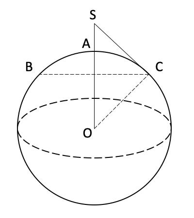

SC 与地球相切，即∠SCO＝90°，由BC 为北纬45°，即∠SOC＝45°,△SOC 为等腰直角三角形，OC＝R，OS＝√
2R，SA＝√2R－R＝（√2－1）R。
因此，选择C 选项。

来源：[2021年江苏公务员考试《行测》真题（A卷）参考答案及解析.pdf](https://github.com/dumarstoft-ship-it/xingce/blob/407016b55b49581efa3771bb59a2dee8761d982f/2021%E5%B9%B4%E6%B1%9F%E8%8B%8F%E5%85%AC%E5%8A%A1%E5%91%98%E8%80%83%E8%AF%95%E3%80%8A%E8%A1%8C%E6%B5%8B%E3%80%8B%E7%9C%9F%E9%A2%98%EF%BC%88A%E5%8D%B7%EF%BC%89%E5%8F%82%E8%80%83%E7%AD%94%E6%A1%88%E5%8F%8A%E8%A7%A3%E6%9E%90.pdf)，PDF 第 15 页。

## 第 66 题 · 判断推理

参考答案：**A**

正确答案：A，全站正确率：83%，易错项：B。
解析
第一步，确定题干逻辑关系。
“调查”的目的是“求真”，二者属于目的对应关系。
第二步，辨析选项。
A 项：“晨练”的目的是为了“健身”，二者属于目的对应关系，与题干逻辑关系一致，符合；
B 项：“施肥”的主要目的是增加作物产量，改善作物品质，“收割”是下一步的行动，二者不属于目的对应关
系，排除；
C 项：“怀念”是对过去“记忆”的一种内心体验，二者属于对应关系，但对应方式与题干不一致，排除；
D 项：“备份”是将电子计算机存储设备中的数据“复制”到磁带等大容量存储设备中，二者属于近义关系，排
除。
因此，选择A 选项。

来源：[2021年江苏公务员考试《行测》真题（A卷）参考答案及解析.pdf](https://github.com/dumarstoft-ship-it/xingce/blob/407016b55b49581efa3771bb59a2dee8761d982f/2021%E5%B9%B4%E6%B1%9F%E8%8B%8F%E5%85%AC%E5%8A%A1%E5%91%98%E8%80%83%E8%AF%95%E3%80%8A%E8%A1%8C%E6%B5%8B%E3%80%8B%E7%9C%9F%E9%A2%98%EF%BC%88A%E5%8D%B7%EF%BC%89%E5%8F%82%E8%80%83%E7%AD%94%E6%A1%88%E5%8F%8A%E8%A7%A3%E6%9E%90.pdf)，PDF 第 15 页。

## 第 67 题 · 判断推理

参考答案：**D**

正确答案：D，全站正确率：92%，易错项：A。
解析
第一步，确定题干逻辑关系。
“头雁”是“雁阵”中领头的大雁，起到领导作用，二者属于包容关系中的组成关系。
第二步，辨析选项。
A 项：“蜂巢”是蜂群生活和繁殖后代的处所，与“蜂王”属于地点对应关系，排除；
B 项：“猎狗”是捕捉猎物的，并没有领导“羊群”的作用，二者无明显逻辑关系，排除；
C 项：“蚁后”与“工蚁”属于并列关系，排除；
D 项：“狮王”为“狮群”首领，二者属于包容关系中的组成关系，与题干逻辑关系一致，符合。
因此，选择D 选项。

来源：[2021年江苏公务员考试《行测》真题（A卷）参考答案及解析.pdf](https://github.com/dumarstoft-ship-it/xingce/blob/407016b55b49581efa3771bb59a2dee8761d982f/2021%E5%B9%B4%E6%B1%9F%E8%8B%8F%E5%85%AC%E5%8A%A1%E5%91%98%E8%80%83%E8%AF%95%E3%80%8A%E8%A1%8C%E6%B5%8B%E3%80%8B%E7%9C%9F%E9%A2%98%EF%BC%88A%E5%8D%B7%EF%BC%89%E5%8F%82%E8%80%83%E7%AD%94%E6%A1%88%E5%8F%8A%E8%A7%A3%E6%9E%90.pdf)，PDF 第 15、16 页。

## 第 68 题 · 判断推理

参考答案：**B**

正确答案：B，全站正确率：70%，易错项：A。
解析
第一步，确定题干逻辑关系。
“粮食安全”指保证任何人在任何时候能买得到又能买得起为维持生存和健康所必需的足够食品，是“国家安全”
的重要基础,二者属于必要条件关系。
第二步，辨析选项。
A 项：“传统文化”就是文明演化而汇集成的一种反映民族特质和风貌的文化，是各民族历史上各种思想文化、
观念形态的总体表现，与“中国文化”属于交叉关系，排除；
B 项：“家庭和谐”是“社会和谐”的必要条件，与题干逻辑关系一致，符合；
C 项：“主流媒体”是具备一定的规模，具有相当的影响力，并代表发展方向的主要媒体，“纸质媒体”作为传
统的信息传播与交流方式，是以纸质材料为载体、以印刷（包括手写）为记录手段而产生的一种信息媒体，二者
属于交叉关系，排除；
D 项：“地摊经济”是指通过摆地摊获得收入来源而形成的一种经济形式，“马路经济”是人们常说的城市道路
旁的临时摊点，二者属于并列关系，排除。
因此，选择B 选项。
拓展
国家安全指国家政权、主权、统一和领土完整、人民福祉、经济社会可持续发展和国家其他重大利益相对处于没
有危险和不受内外威胁的状态，以及保障持续安全状态的能力。

来源：[2021年江苏公务员考试《行测》真题（A卷）参考答案及解析.pdf](https://github.com/dumarstoft-ship-it/xingce/blob/407016b55b49581efa3771bb59a2dee8761d982f/2021%E5%B9%B4%E6%B1%9F%E8%8B%8F%E5%85%AC%E5%8A%A1%E5%91%98%E8%80%83%E8%AF%95%E3%80%8A%E8%A1%8C%E6%B5%8B%E3%80%8B%E7%9C%9F%E9%A2%98%EF%BC%88A%E5%8D%B7%EF%BC%89%E5%8F%82%E8%80%83%E7%AD%94%E6%A1%88%E5%8F%8A%E8%A7%A3%E6%9E%90.pdf)，PDF 第 16 页。

## 第 69 题 · 判断推理

参考答案：**A**

正确答案：A，全站正确率：95%，易错项：C。
解析
第一步，确定题干逻辑关系。
“金”是制作“金币”的原材料，二者属于原材料与成品的对应关系，“金币”是“货币”的一种，二者属于包
容关系中的种属关系。
第二步，辨析选项。
A 项：“木”是制作“木床”的原材料，二者属于原材料与成品的对应关系，“木床”是“床”的一种，二者属
于包容中的种属关系，与题干逻辑关系一致，符合；
B 项：“水”是“水稻”生长必不可少的，二者属于必要条件关系，“稻”统称“水稻”，二者属于全同关系，
排除；
C 项：“火盆”是盛炭火等的盆子，“火”不是其制作的原材料，排除；
D 项：“土”和“土鸡”之间无明显逻辑关系，“土鸡”属于“鸡”的一种，二者属于包容中的种属关系，排除。
因此，选择A 选项。

来源：[2021年江苏公务员考试《行测》真题（A卷）参考答案及解析.pdf](https://github.com/dumarstoft-ship-it/xingce/blob/407016b55b49581efa3771bb59a2dee8761d982f/2021%E5%B9%B4%E6%B1%9F%E8%8B%8F%E5%85%AC%E5%8A%A1%E5%91%98%E8%80%83%E8%AF%95%E3%80%8A%E8%A1%8C%E6%B5%8B%E3%80%8B%E7%9C%9F%E9%A2%98%EF%BC%88A%E5%8D%B7%EF%BC%89%E5%8F%82%E8%80%83%E7%AD%94%E6%A1%88%E5%8F%8A%E8%A7%A3%E6%9E%90.pdf)，PDF 第 16 页。

## 第 70 题 · 判断推理

参考答案：**D**

正确答案：D，全站正确率：70%，易错项：A。
解析
第一步，确定题干逻辑关系。
“杜鹃”既可以指一种“花”，也可以指一种“鸟”，第三词与前两词分别属于包容关系中的种属关系。
第二步，辨析选项。
A 项：“昆曲”是传统戏曲中古老的剧中，与“戏剧”属于包容关系中的种属关系，排除；
B 项：“钟”与“表”都是计时的仪器，直径超过80 毫米的是“钟”，“怀表”是“表”，而不是“钟”，排
除；
C 项：“草”是“植物”，“木”也是“植物”，第一词与第二词分别与第三词属于包容关系中的种属关系，词
语顺序与题干不一致，排除；
D 项：“畜”指禽兽，“黄牛”作为动物理解时，是“畜”，二者属于包容关系中的种属关系，“黄牛”也可以
指票贩子，与“人”属于包容关系中的种属关系，与题干逻辑关系一致，符合。
因此，选择D 选项。

来源：[2021年江苏公务员考试《行测》真题（A卷）参考答案及解析.pdf](https://github.com/dumarstoft-ship-it/xingce/blob/407016b55b49581efa3771bb59a2dee8761d982f/2021%E5%B9%B4%E6%B1%9F%E8%8B%8F%E5%85%AC%E5%8A%A1%E5%91%98%E8%80%83%E8%AF%95%E3%80%8A%E8%A1%8C%E6%B5%8B%E3%80%8B%E7%9C%9F%E9%A2%98%EF%BC%88A%E5%8D%B7%EF%BC%89%E5%8F%82%E8%80%83%E7%AD%94%E6%A1%88%E5%8F%8A%E8%A7%A3%E6%9E%90.pdf)，PDF 第 16、17 页。

## 第 71 题 · 判断推理

参考答案：**D**

正确答案：D，全站正确率：75%，易错项：A。
解析
第一步，确定题干逻辑关系。
“白鸽”和“母鸽”属于交叉关系，前两词与“鸽”均属于包容关系中的种属关系。
第二步，辨析选项。
A 项：“柿饼”不是“饼”，是柿子加工的产物，外形似“饼”状，“甜饼”属于“饼”的一种，二者属于包容
关系中的种属关系，排除；
B 项：“桃花”与“梨花”属于并列关系，前两词与“花”均属于包容关系中的种属关系，排除；
C 项：“零售”指将商品或服务销售给个人消费者或最终消费者的商业活动，“网售”指通过网络渠道进行销售，
二者属于交叉关系，但与第三词“买”不属于包容关系中的种属关系，排除；
D 项：“水桶”与“铁桶”属于交叉关系，前两词与“桶”均属于包容关系中的种属关系，与题干逻辑关系一致，
符合。
因此，选择D 选项。

来源：[2021年江苏公务员考试《行测》真题（A卷）参考答案及解析.pdf](https://github.com/dumarstoft-ship-it/xingce/blob/407016b55b49581efa3771bb59a2dee8761d982f/2021%E5%B9%B4%E6%B1%9F%E8%8B%8F%E5%85%AC%E5%8A%A1%E5%91%98%E8%80%83%E8%AF%95%E3%80%8A%E8%A1%8C%E6%B5%8B%E3%80%8B%E7%9C%9F%E9%A2%98%EF%BC%88A%E5%8D%B7%EF%BC%89%E5%8F%82%E8%80%83%E7%AD%94%E6%A1%88%E5%8F%8A%E8%A7%A3%E6%9E%90.pdf)，PDF 第 17 页。

## 第 72 题 · 判断推理

参考答案：**B**

正确答案：B，全站正确率：53%，易错项：C。
解析
第一步，确定题干逻辑关系。
“治理”与“国家”属于动宾关系，“现代化”是“治理”“国家”实现的奋斗目标，第三词与前两词属于目的
对应关系。
第二步，辨析选项。
A 项：“规制”是指对政府设置（出台）规定进行限制，其作用对象是政府，不是“企业”，排除；
B 项：“建设”与“社会”属于动宾关系，“法制化”是“建设”“社会”实现的奋斗目标，第三词与前两词属
于目的对应关系，与题干逻辑关系一致，符合；
C 项：“社区”与“服务”不属于动宾关系，排除；
D 项：“一体化”是指把若干分散企业联合起来，组成一个统一的经济组织，其作用对象是分散的企业，并不是
“政府”，排除。
因此，选择B 选项。

来源：[2021年江苏公务员考试《行测》真题（A卷）参考答案及解析.pdf](https://github.com/dumarstoft-ship-it/xingce/blob/407016b55b49581efa3771bb59a2dee8761d982f/2021%E5%B9%B4%E6%B1%9F%E8%8B%8F%E5%85%AC%E5%8A%A1%E5%91%98%E8%80%83%E8%AF%95%E3%80%8A%E8%A1%8C%E6%B5%8B%E3%80%8B%E7%9C%9F%E9%A2%98%EF%BC%88A%E5%8D%B7%EF%BC%89%E5%8F%82%E8%80%83%E7%AD%94%E6%A1%88%E5%8F%8A%E8%A7%A3%E6%9E%90.pdf)，PDF 第 17 页。

## 第 73 题 · 判断推理

参考答案：**C**

正确答案：C，全站正确率：59%，易错项：B。
解析
第一步，确定题干逻辑关系。
“河长”的职责是“河道巡查”，目的是为了“水清岸绿”，三者属于对应关系。
第二步，辨析选项。
A 项：“湖长”的职责是“污染治理”，但目的不是为了“波平浪静”，排除；
B 项：“路长”的职责是对管辖路段进行总负责，而不是“道路维修”，排除；
C 项：“机长”的职责是“客机驾驶”，目的是为了“安全准点”，与题干逻辑关系一致，符合；
D 项：“村长”的职责是带领村民共同致富，而不是“带头致富”，目的也不是“鸟语花香”，排除。
因此，选择C 选项。

来源：[2021年江苏公务员考试《行测》真题（A卷）参考答案及解析.pdf](https://github.com/dumarstoft-ship-it/xingce/blob/407016b55b49581efa3771bb59a2dee8761d982f/2021%E5%B9%B4%E6%B1%9F%E8%8B%8F%E5%85%AC%E5%8A%A1%E5%91%98%E8%80%83%E8%AF%95%E3%80%8A%E8%A1%8C%E6%B5%8B%E3%80%8B%E7%9C%9F%E9%A2%98%EF%BC%88A%E5%8D%B7%EF%BC%89%E5%8F%82%E8%80%83%E7%AD%94%E6%A1%88%E5%8F%8A%E8%A7%A3%E6%9E%90.pdf)，PDF 第 17 页。

## 第 74 题 · 判断推理

参考答案：**C**

正确答案：C，全站正确率：96%，易错项：B。
解析
分别将选项代入题干，确定逻辑关系。
A 项：“微信群”与“符号”无明显逻辑关系，“黑板”是“教学”的一种工具，二者属于对应关系，前后逻辑
关系不一致，排除；
B 项：“点赞”是“微信群”中发生的一种行为，二者属于对应关系，“教师”与“教学”属于主谓关系，前后
逻辑关系不一致，排除；
C 项：“微信群”是“社交”的场所，二者属于场所对应关系，“教室”是“教学”的场所，二者属于场所对应
关系，前后逻辑关系一致，符合；
D 项：“微信群”中可以发“红包”，两者属于对应关系，“教学”的过程中可能会产生“奖励”，前后对应方
式不一致，排除。
因此，选择C 选项。

来源：[2021年江苏公务员考试《行测》真题（A卷）参考答案及解析.pdf](https://github.com/dumarstoft-ship-it/xingce/blob/407016b55b49581efa3771bb59a2dee8761d982f/2021%E5%B9%B4%E6%B1%9F%E8%8B%8F%E5%85%AC%E5%8A%A1%E5%91%98%E8%80%83%E8%AF%95%E3%80%8A%E8%A1%8C%E6%B5%8B%E3%80%8B%E7%9C%9F%E9%A2%98%EF%BC%88A%E5%8D%B7%EF%BC%89%E5%8F%82%E8%80%83%E7%AD%94%E6%A1%88%E5%8F%8A%E8%A7%A3%E6%9E%90.pdf)，PDF 第 17、18 页。

## 第 75 题 · 判断推理

参考答案：**D**

正确答案：D，全站正确率：74%，易错项：A。
解析
分别将选项代入题干，确定逻辑关系。
A 项：“水车”与“风车”属于并列关系，“口算”是一种计算方式，“计算器”是一种计算工具，二者不属于
并列关系，前后逻辑关系不一致，排除；
B 项：“水车“与“稻田”属于场所对应关系，“计算器”用于“计算，二者属于功能对应关系，前后逻辑关系
不一致，排除；
C 项：“水车”是利用“河水”的一种工具，二者属于对应关系，“计算器”可以加工“数据”，二者属于功能
对应关系，前后对应方式不一致，排除；
D 项：“水车”和“水泵”都是提水工具，二者属于并列关系，“算盘”和“计算器”都是计算工具，二者属于
并列关系，前后逻辑关系一致，符合。
因此，选择D 选项。

来源：[2021年江苏公务员考试《行测》真题（A卷）参考答案及解析.pdf](https://github.com/dumarstoft-ship-it/xingce/blob/407016b55b49581efa3771bb59a2dee8761d982f/2021%E5%B9%B4%E6%B1%9F%E8%8B%8F%E5%85%AC%E5%8A%A1%E5%91%98%E8%80%83%E8%AF%95%E3%80%8A%E8%A1%8C%E6%B5%8B%E3%80%8B%E7%9C%9F%E9%A2%98%EF%BC%88A%E5%8D%B7%EF%BC%89%E5%8F%82%E8%80%83%E7%AD%94%E6%A1%88%E5%8F%8A%E8%A7%A3%E6%9E%90.pdf)，PDF 第 18 页。

## 第 76 题 · 判断推理

参考答案：**A**

正确答案：A，全站正确率：51%，易错项：C。
解析
第一步，观察特征。
组成元素不同，优先考虑数量类或属性类。题干元素部分数特征明显，考虑部分数。
第二步，一条式，从左到右找规律。
题干图形元素部分数均为2，则问号处应为有2 个部分的图形，只有A 项符合。
因此，选择A 选项。

来源：[2021年江苏公务员考试《行测》真题（A卷）参考答案及解析.pdf](https://github.com/dumarstoft-ship-it/xingce/blob/407016b55b49581efa3771bb59a2dee8761d982f/2021%E5%B9%B4%E6%B1%9F%E8%8B%8F%E5%85%AC%E5%8A%A1%E5%91%98%E8%80%83%E8%AF%95%E3%80%8A%E8%A1%8C%E6%B5%8B%E3%80%8B%E7%9C%9F%E9%A2%98%EF%BC%88A%E5%8D%B7%EF%BC%89%E5%8F%82%E8%80%83%E7%AD%94%E6%A1%88%E5%8F%8A%E8%A7%A3%E6%9E%90.pdf)，PDF 第 18 页。

## 第 77 题 · 判断推理

参考答案：**A**

正确答案：A，全站正确率：31%，易错项：C。
解析
第一步，观察特征。
组成元素不同，但均含有明显的封闭空间，优先考虑数面。
第二步，一条式，从左到右找规律。
每幅图形中外部轮廓线条的数量与封闭区间的个数均相等，只有A 项符合。
因此，选择A 选项。

来源：[2021年江苏公务员考试《行测》真题（A卷）参考答案及解析.pdf](https://github.com/dumarstoft-ship-it/xingce/blob/407016b55b49581efa3771bb59a2dee8761d982f/2021%E5%B9%B4%E6%B1%9F%E8%8B%8F%E5%85%AC%E5%8A%A1%E5%91%98%E8%80%83%E8%AF%95%E3%80%8A%E8%A1%8C%E6%B5%8B%E3%80%8B%E7%9C%9F%E9%A2%98%EF%BC%88A%E5%8D%B7%EF%BC%89%E5%8F%82%E8%80%83%E7%AD%94%E6%A1%88%E5%8F%8A%E8%A7%A3%E6%9E%90.pdf)，PDF 第 18 页。

## 第 78 题 · 判断推理

参考答案：**B**

正确答案：B，全站正确率：35%，易错项：C。
解析
第一步，观察特征。
组成元素不同，无明显属性规律，优先考虑数量类。图中直角数量较多，考虑数直角。
第二步，一条式，从左到右找规律。
题干图形直角数量依次为1、2、3、4，5，？ ，所以问号处应该为6 个直角的图形，只有B 项符合。
因此，选择B 选项。

来源：[2021年江苏公务员考试《行测》真题（A卷）参考答案及解析.pdf](https://github.com/dumarstoft-ship-it/xingce/blob/407016b55b49581efa3771bb59a2dee8761d982f/2021%E5%B9%B4%E6%B1%9F%E8%8B%8F%E5%85%AC%E5%8A%A1%E5%91%98%E8%80%83%E8%AF%95%E3%80%8A%E8%A1%8C%E6%B5%8B%E3%80%8B%E7%9C%9F%E9%A2%98%EF%BC%88A%E5%8D%B7%EF%BC%89%E5%8F%82%E8%80%83%E7%AD%94%E6%A1%88%E5%8F%8A%E8%A7%A3%E6%9E%90.pdf)，PDF 第 18 页。

## 第 79 题 · 判断推理

参考答案：**B**

正确答案：B，全站正确率：50%，易错项：C。
解析
第一步，观察特征。
组成元素不同，且出现笔画数特征图形，优先考虑笔画数。
第二步，一条式，从左到右找规律。
题干中给出的图形均是两笔画，因此选择两笔画图形。A 项：一笔画图形，排除；B 项：两笔画图形，符合；C
项：三笔画，排除；D 项：四笔画，排除。
因此，选择B 选项。

来源：[2021年江苏公务员考试《行测》真题（A卷）参考答案及解析.pdf](https://github.com/dumarstoft-ship-it/xingce/blob/407016b55b49581efa3771bb59a2dee8761d982f/2021%E5%B9%B4%E6%B1%9F%E8%8B%8F%E5%85%AC%E5%8A%A1%E5%91%98%E8%80%83%E8%AF%95%E3%80%8A%E8%A1%8C%E6%B5%8B%E3%80%8B%E7%9C%9F%E9%A2%98%EF%BC%88A%E5%8D%B7%EF%BC%89%E5%8F%82%E8%80%83%E7%AD%94%E6%A1%88%E5%8F%8A%E8%A7%A3%E6%9E%90.pdf)，PDF 第 18 页。

## 第 80 题 · 判断推理

参考答案：**C**

正确答案：C，全站正确率：44%，易错项：B。
解析
第一步，观察特征。
组成元素结构相似，题干中给出的图形五个黑色方格，均是点对点连接一起，考虑静态位置连接性。
第二步，一条式，从左到右找规律。
题干中给出的图形五个黑色方格，B 项有六个黑色方块与题干不一致，排除；并且所有黑块均是点对点连接一起，
即为点连接。A 项：黑色方块分开，排除；C 项：五个黑色方块点对点连接，符合；D 项：五个黑色方块边边连
接，与题干不一致，排除。
因此，选择C 选项。

来源：[2021年江苏公务员考试《行测》真题（A卷）参考答案及解析.pdf](https://github.com/dumarstoft-ship-it/xingce/blob/407016b55b49581efa3771bb59a2dee8761d982f/2021%E5%B9%B4%E6%B1%9F%E8%8B%8F%E5%85%AC%E5%8A%A1%E5%91%98%E8%80%83%E8%AF%95%E3%80%8A%E8%A1%8C%E6%B5%8B%E3%80%8B%E7%9C%9F%E9%A2%98%EF%BC%88A%E5%8D%B7%EF%BC%89%E5%8F%82%E8%80%83%E7%AD%94%E6%A1%88%E5%8F%8A%E8%A7%A3%E6%9E%90.pdf)，PDF 第 18、19 页。

## 第 81 题 · 判断推理

参考答案：**B**

正确答案：B，全站正确率：58%，易错项：C。
解析
第一步，观察特征。
题干中的图形均由小正方体组成，考虑立体类信息。
第二步，九宫格，横向规律较为常见，优先考虑。
题干九宫格中给出的图形俯视图结构都一样，且都只有两层。A 项：俯视图与题干不一致，排除；B 项：俯视图
与题干一致且两层，符合；C 项：俯视图与题干不一致，排除；D 项：俯视图与题干一致但方格有三层，排除。
因此，选择B 选项。

来源：[2021年江苏公务员考试《行测》真题（A卷）参考答案及解析.pdf](https://github.com/dumarstoft-ship-it/xingce/blob/407016b55b49581efa3771bb59a2dee8761d982f/2021%E5%B9%B4%E6%B1%9F%E8%8B%8F%E5%85%AC%E5%8A%A1%E5%91%98%E8%80%83%E8%AF%95%E3%80%8A%E8%A1%8C%E6%B5%8B%E3%80%8B%E7%9C%9F%E9%A2%98%EF%BC%88A%E5%8D%B7%EF%BC%89%E5%8F%82%E8%80%83%E7%AD%94%E6%A1%88%E5%8F%8A%E8%A7%A3%E6%9E%90.pdf)，PDF 第 19 页。

## 第 82 题 · 判断推理

参考答案：**D**

正确答案：D，全站正确率：59%，易错项：C。
解析
第一步，观察特征。
组成元素不同，优先考虑数量类或属性类。每个图形均有封闭区间，考虑数面。
第二步，九宫格，横向规律较为常见，优先考虑。
题干中九宫格中，第一列全部为直线图形，第二列全部为曲线图形，第三列有曲有直。分析选项。A 项：直线图
形，排除；B 项：直线图形，排除；C 项：曲线图形，排除；D 项：有曲有直，符合。
因此，选择D 选项。

来源：[2021年江苏公务员考试《行测》真题（A卷）参考答案及解析.pdf](https://github.com/dumarstoft-ship-it/xingce/blob/407016b55b49581efa3771bb59a2dee8761d982f/2021%E5%B9%B4%E6%B1%9F%E8%8B%8F%E5%85%AC%E5%8A%A1%E5%91%98%E8%80%83%E8%AF%95%E3%80%8A%E8%A1%8C%E6%B5%8B%E3%80%8B%E7%9C%9F%E9%A2%98%EF%BC%88A%E5%8D%B7%EF%BC%89%E5%8F%82%E8%80%83%E7%AD%94%E6%A1%88%E5%8F%8A%E8%A7%A3%E6%9E%90.pdf)，PDF 第 19 页。

## 第 83 题 · 判断推理

参考答案：**A**

正确答案：A，全站正确率：55%，易错项：C。
解析
第一步，明确设问内容。
题目要求各面平移后拼合。
第二步，观察图形特征，寻找平行且等长边，将其拼合后得到如下图所示：

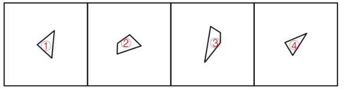

因此，选择A 选项。

来源：[2021年江苏公务员考试《行测》真题（A卷）参考答案及解析.pdf](https://github.com/dumarstoft-ship-it/xingce/blob/407016b55b49581efa3771bb59a2dee8761d982f/2021%E5%B9%B4%E6%B1%9F%E8%8B%8F%E5%85%AC%E5%8A%A1%E5%91%98%E8%80%83%E8%AF%95%E3%80%8A%E8%A1%8C%E6%B5%8B%E3%80%8B%E7%9C%9F%E9%A2%98%EF%BC%88A%E5%8D%B7%EF%BC%89%E5%8F%82%E8%80%83%E7%AD%94%E6%A1%88%E5%8F%8A%E8%A7%A3%E6%9E%90.pdf)，PDF 第 19 页。

## 第 84 题 · 判断推理

参考答案：**C**

正确答案：C，全站正确率：78%，易错项：B。
解析
第一步，明确设问内容。
题目要求各面平移后拼合。
第二步，观察图形特征，寻找平行且等长边，将其拼合后得到如下图所示：

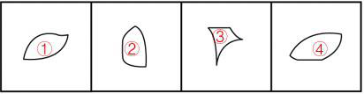

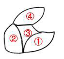

因此，选择C 选项。

来源：[2021年江苏公务员考试《行测》真题（A卷）参考答案及解析.pdf](https://github.com/dumarstoft-ship-it/xingce/blob/407016b55b49581efa3771bb59a2dee8761d982f/2021%E5%B9%B4%E6%B1%9F%E8%8B%8F%E5%85%AC%E5%8A%A1%E5%91%98%E8%80%83%E8%AF%95%E3%80%8A%E8%A1%8C%E6%B5%8B%E3%80%8B%E7%9C%9F%E9%A2%98%EF%BC%88A%E5%8D%B7%EF%BC%89%E5%8F%82%E8%80%83%E7%AD%94%E6%A1%88%E5%8F%8A%E8%A7%A3%E6%9E%90.pdf)，PDF 第 19、20 页。

## 第 85 题 · 判断推理

参考答案：**A**

正确答案：A，全站正确率：91%，易错项：C。
解析
第一步，明确设问内容。
题目要求各面平移后拼合。
第二步，观察图形特征，寻找平行且等长边，将其拼合后得到如下图所示：

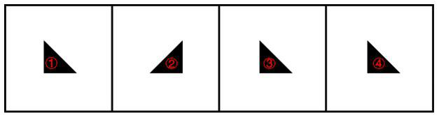

因此，选择A 选项。

来源：[2021年江苏公务员考试《行测》真题（A卷）参考答案及解析.pdf](https://github.com/dumarstoft-ship-it/xingce/blob/407016b55b49581efa3771bb59a2dee8761d982f/2021%E5%B9%B4%E6%B1%9F%E8%8B%8F%E5%85%AC%E5%8A%A1%E5%91%98%E8%80%83%E8%AF%95%E3%80%8A%E8%A1%8C%E6%B5%8B%E3%80%8B%E7%9C%9F%E9%A2%98%EF%BC%88A%E5%8D%B7%EF%BC%89%E5%8F%82%E8%80%83%E7%AD%94%E6%A1%88%E5%8F%8A%E8%A7%A3%E6%9E%90.pdf)，PDF 第 20 页。

## 第 86 题 · 判断推理

参考答案：**D**

正确答案：D，全站正确率：75%，易错项：C。
解析
第一步，明确设问内容。
题目要求各面平移后拼合。
第二步，观察图形特征，寻找平行且等长边，将其拼合后得到如下图所示：

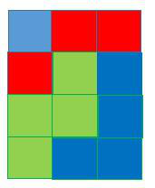

因此，选择D 选项。

来源：[2021年江苏公务员考试《行测》真题（A卷）参考答案及解析.pdf](https://github.com/dumarstoft-ship-it/xingce/blob/407016b55b49581efa3771bb59a2dee8761d982f/2021%E5%B9%B4%E6%B1%9F%E8%8B%8F%E5%85%AC%E5%8A%A1%E5%91%98%E8%80%83%E8%AF%95%E3%80%8A%E8%A1%8C%E6%B5%8B%E3%80%8B%E7%9C%9F%E9%A2%98%EF%BC%88A%E5%8D%B7%EF%BC%89%E5%8F%82%E8%80%83%E7%AD%94%E6%A1%88%E5%8F%8A%E8%A7%A3%E6%9E%90.pdf)，PDF 第 20 页。

## 第 87 题 · 判断推理

参考答案：**B**

正确答案：B，全站正确率：73%，易错项：C。
解析
第一步，本题考查折纸盒。
对题干中的六个面进行标号，如下图所示：

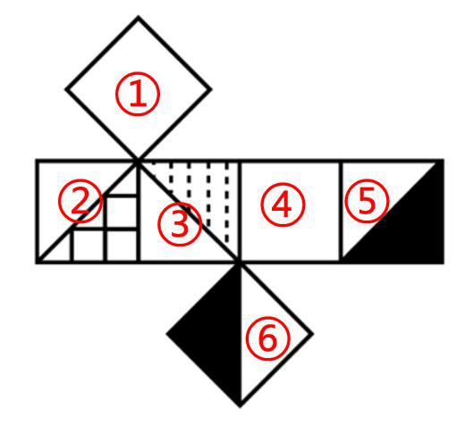

第二步，分析选项。
A 项：正面是面③，面③和面⑤为一组相对面，不能同时出现，所以顶面只可能是面⑥，而面③和面⑥的公共边
和面③中的白色三角形相邻，与选项不一致，排除；
B 项：面①、面③和面④的相对位置关系及图案特征与展开图一致，正确；
C 项：面①、面③和面④的公共点和面③中灰色填充的直角位置重合，与选项不一致，排除；
D 项：右侧面是面③，面③和面⑤为一组相对面，不能同时出现，所以正面只可能是面⑥，而面③和面⑥的公共
边和面③中的白色三角形相邻，与选项不一致，排除。
因此，选择B 选项。

来源：[2021年江苏公务员考试《行测》真题（A卷）参考答案及解析.pdf](https://github.com/dumarstoft-ship-it/xingce/blob/407016b55b49581efa3771bb59a2dee8761d982f/2021%E5%B9%B4%E6%B1%9F%E8%8B%8F%E5%85%AC%E5%8A%A1%E5%91%98%E8%80%83%E8%AF%95%E3%80%8A%E8%A1%8C%E6%B5%8B%E3%80%8B%E7%9C%9F%E9%A2%98%EF%BC%88A%E5%8D%B7%EF%BC%89%E5%8F%82%E8%80%83%E7%AD%94%E6%A1%88%E5%8F%8A%E8%A7%A3%E6%9E%90.pdf)，PDF 第 20、21 页。

## 第 88 题 · 判断推理

参考答案：**B**

正确答案：B，全站正确率：62%，易错项：C。
解析
第一步，本题考查四面体折纸盒。
对题干中的各面进行标号。如下图所示：

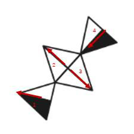

第二步，分析选项。
A 项：不论是面1 还是面4 黑色都在箭头的左边，白色都在箭头的右边，A 项是左白右黑，排除；
B 项：如果B 项的半黑半白为面1 则其左边为面4，选项并非面4；如果B 项的半黑半白为面4 则其左边为面3，
与选项一致，当选；
C 项：不论是面1 还是面4 黑色都在箭头的左边，白色都在箭头的右边，C 项是左白右黑，排除；
D 项：如果D 项的半黑半白为面4 则其下边为面1，选项并非面1；如果D 项的半黑半白为面1 则其下边为面3，
但是其线条方向与原图不一致，排除。
因此，选择B 选项。

来源：[2021年江苏公务员考试《行测》真题（A卷）参考答案及解析.pdf](https://github.com/dumarstoft-ship-it/xingce/blob/407016b55b49581efa3771bb59a2dee8761d982f/2021%E5%B9%B4%E6%B1%9F%E8%8B%8F%E5%85%AC%E5%8A%A1%E5%91%98%E8%80%83%E8%AF%95%E3%80%8A%E8%A1%8C%E6%B5%8B%E3%80%8B%E7%9C%9F%E9%A2%98%EF%BC%88A%E5%8D%B7%EF%BC%89%E5%8F%82%E8%80%83%E7%AD%94%E6%A1%88%E5%8F%8A%E8%A7%A3%E6%9E%90.pdf)，PDF 第 21 页。

## 第 89 题 · 判断推理

参考答案：**D**

正确答案：D，全站正确率：23%，易错项：A。
解析
第一步，本题考查折纸盒。
对展开图中的各面进行标号，如下图所示：

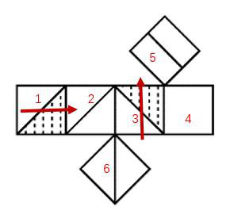

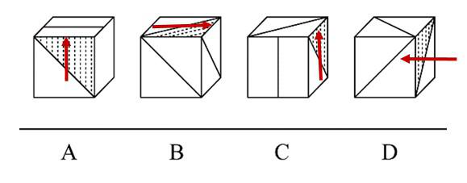

第二步，分析选项。
A 项：要使半阴影上面为横线，那么只能是面3，按照箭头方向，面3 的右面为空白，正确，排除；
B 项：要使半阴影上面为斜线线，那么只能是面1，按照箭头方向，面1 的右面为面6 斜线，正确，排除；
C 项：要使半阴影上面为斜线线，那么只能是面1，按照箭头方向，面1 的左边为面5，正确，排除；
D 项：要使半阴影上面为斜线线，那么只能是面1，按照箭头方向，面1 的左边为面6，可是面6 的方向错误，
符合；
因此，选择D 选项。

来源：[2021年江苏公务员考试《行测》真题（A卷）参考答案及解析.pdf](https://github.com/dumarstoft-ship-it/xingce/blob/407016b55b49581efa3771bb59a2dee8761d982f/2021%E5%B9%B4%E6%B1%9F%E8%8B%8F%E5%85%AC%E5%8A%A1%E5%91%98%E8%80%83%E8%AF%95%E3%80%8A%E8%A1%8C%E6%B5%8B%E3%80%8B%E7%9C%9F%E9%A2%98%EF%BC%88A%E5%8D%B7%EF%BC%89%E5%8F%82%E8%80%83%E7%AD%94%E6%A1%88%E5%8F%8A%E8%A7%A3%E6%9E%90.pdf)，PDF 第 21、22 页。

## 第 90 题 · 判断推理

参考答案：**C**

正确答案：C，全站正确率：62%，易错项：B。
解析
第一步，本题考查拆纸盒。
对立体图如下立箭头，如下图所示：

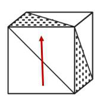

第二步，分析选项。

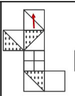

A 项：如果箭头为此方向 ，箭头面右面为空白，原图并不是空白，如果箭头方向为

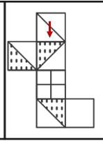

箭头右边为半阴影半白的白色部分，原图是阴影部分，排除；

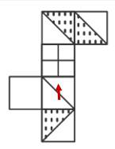

B 项：如果箭头为此方向 ，箭头上面则为田字，原图并不是田字，如果箭头方向为

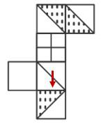

箭头右边为空白，原图是不是空白，排除；

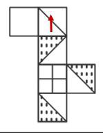

C 项：如果箭头为此方向 ，箭头面上面为半阴影半三角，右边也是半阴影半三角，原
图也是如此，正确；

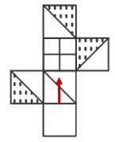

D 项：如果箭头为此方向 ，箭头上面则为田字，原图并不是田字，如果箭头方向为

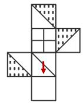

箭头上边为空白，原图是不是空白，排除。
因此，选择C 选项。

来源：[2021年江苏公务员考试《行测》真题（A卷）参考答案及解析.pdf](https://github.com/dumarstoft-ship-it/xingce/blob/407016b55b49581efa3771bb59a2dee8761d982f/2021%E5%B9%B4%E6%B1%9F%E8%8B%8F%E5%85%AC%E5%8A%A1%E5%91%98%E8%80%83%E8%AF%95%E3%80%8A%E8%A1%8C%E6%B5%8B%E3%80%8B%E7%9C%9F%E9%A2%98%EF%BC%88A%E5%8D%B7%EF%BC%89%E5%8F%82%E8%80%83%E7%AD%94%E6%A1%88%E5%8F%8A%E8%A7%A3%E6%9E%90.pdf)，PDF 第 22、23、24 页。

## 第 91 题 · 判断推理

参考答案：**C**

正确答案：C，全站正确率：78%，易错项：B。
解析
第一步，确定题型。
根据题干关联词“则”、“才能”，确定为翻译推理。
第二步，翻译题干。
①人强→有精神
②国强→有精神
③奋勇向前→精神达到一定高度
第三步，进行推理。
A 项：“有精神”是对①的肯后，肯后得不到必然结论，无法推出，排除；
B 项：“精神上没有达到一定的高度”与“长久生存的灵魂”之间没有条件关系，无法推出，排除；
C 项：“一个民族若在历史的洪流中奋勇向前”是对③的肯前，肯前必肯后，可得“精神上已达到一定的高度”，
可以推出；
D 项：“精神上达到一定的高度”是对③的肯后，肯后得不到必然结论，无法推出，排除。
因此，选择C 选项。

来源：[2021年江苏公务员考试《行测》真题（A卷）参考答案及解析.pdf](https://github.com/dumarstoft-ship-it/xingce/blob/407016b55b49581efa3771bb59a2dee8761d982f/2021%E5%B9%B4%E6%B1%9F%E8%8B%8F%E5%85%AC%E5%8A%A1%E5%91%98%E8%80%83%E8%AF%95%E3%80%8A%E8%A1%8C%E6%B5%8B%E3%80%8B%E7%9C%9F%E9%A2%98%EF%BC%88A%E5%8D%B7%EF%BC%89%E5%8F%82%E8%80%83%E7%AD%94%E6%A1%88%E5%8F%8A%E8%A7%A3%E6%9E%90.pdf)，PDF 第 24 页。

## 第 92 题 · 判断推理

参考答案：**B**

正确答案：B，全站正确率：20%，易错项：D。
解析
第一步，确定题型。
根据提问方式中的“形式结构最为相似”，确定为平行结构。
第二步，分析题干。
题干的形式结构为：A（立善法于天下）→B（天下治）；C（立善法于一国）→D（一国治）。
第三步，辨析选项。
A 项：只有A（勤）→B（不匮），与题干逻辑不一致，排除；
B 项：A（穷）→B（独善其身）；C（达）→D（兼济天下），与题干逻辑一致；
C 项：没有推出关系，与题干逻辑不一致，排除；
D 项：存在递推，A（俭）→B（约），B（约）→C（百善俱兴），与题干逻辑不一致，排除。
因此，选择B 选项。

来源：[2021年江苏公务员考试《行测》真题（A卷）参考答案及解析.pdf](https://github.com/dumarstoft-ship-it/xingce/blob/407016b55b49581efa3771bb59a2dee8761d982f/2021%E5%B9%B4%E6%B1%9F%E8%8B%8F%E5%85%AC%E5%8A%A1%E5%91%98%E8%80%83%E8%AF%95%E3%80%8A%E8%A1%8C%E6%B5%8B%E3%80%8B%E7%9C%9F%E9%A2%98%EF%BC%88A%E5%8D%B7%EF%BC%89%E5%8F%82%E8%80%83%E7%AD%94%E6%A1%88%E5%8F%8A%E8%A7%A3%E6%9E%90.pdf)，PDF 第 24 页。

## 第 93 题 · 判断推理

参考答案：**C**

正确答案：C，全站正确率：14%，易错项：B。
解析
第一步：确定题型。
根据提问方式中“最能支持”，确定为加强论证
第二步，找出论点和论据。
论点：当时这里的人们筑起石墙，主要是为了避免海水上涨后淹没村庄。
论据：无。
第三步，辨析选项。
A 项：不明确项。该项讨论的是地中海海平面每年抬升4 至7 毫米，说明海平面确实会上升，但海水上涨后是否
会淹没村庄不确定，不具有加强作用，排除。
B 项：无关选项。该项讨论的是发现了被海水淹没的人类定居点的遗迹，与论点所述筑起石墙的目的为何无关，
不具有加强作用。
C 项：增加论据。该项指出石墙长度足够包围定居点，说明石墙对定居点有保护作用，具有加强作用。
D 项：无关选项。该项说的是现在有的国家采取类似的策略，无法得到当时的目的，与题干论点无关，不具有加
强作用。
因此，选择C 选项。

来源：[2021年江苏公务员考试《行测》真题（A卷）参考答案及解析.pdf](https://github.com/dumarstoft-ship-it/xingce/blob/407016b55b49581efa3771bb59a2dee8761d982f/2021%E5%B9%B4%E6%B1%9F%E8%8B%8F%E5%85%AC%E5%8A%A1%E5%91%98%E8%80%83%E8%AF%95%E3%80%8A%E8%A1%8C%E6%B5%8B%E3%80%8B%E7%9C%9F%E9%A2%98%EF%BC%88A%E5%8D%B7%EF%BC%89%E5%8F%82%E8%80%83%E7%AD%94%E6%A1%88%E5%8F%8A%E8%A7%A3%E6%9E%90.pdf)，PDF 第 24、25 页。

## 第 94 题 · 判断推理

参考答案：**D**

正确答案：D，全站正确率：48%，易错项：B。
解析
第一步，确定题型。
题干有明显的信息匹配特征，确定为分析推理。
第二步，分析条件，进行推理。
“他们当中只有会计师的预言是正确的”出现多种可能，可以采用假设法。
因为乙说的话出现丙和会计师，优先考虑假设乙和丙，结合选项观察可知，未出现乙是会计师，故先假设丙：如
果丙为会计师，可以推出乙预言正确，不符合题干“只有会计师预言正确”，排除该可能性，可排除C 选项；由
于丙不是会计师，所以丙预言不正确，故可推知丁是企业家，结合选项，只有D 符合。
因此，选择D 选项。

来源：[2021年江苏公务员考试《行测》真题（A卷）参考答案及解析.pdf](https://github.com/dumarstoft-ship-it/xingce/blob/407016b55b49581efa3771bb59a2dee8761d982f/2021%E5%B9%B4%E6%B1%9F%E8%8B%8F%E5%85%AC%E5%8A%A1%E5%91%98%E8%80%83%E8%AF%95%E3%80%8A%E8%A1%8C%E6%B5%8B%E3%80%8B%E7%9C%9F%E9%A2%98%EF%BC%88A%E5%8D%B7%EF%BC%89%E5%8F%82%E8%80%83%E7%AD%94%E6%A1%88%E5%8F%8A%E8%A7%A3%E6%9E%90.pdf)，PDF 第 25 页。

## 第 95 题 · 判断推理

参考答案：**D**

正确答案：D，全站正确率：66%，易错项：A。
解析
第一步，确定题型。
根据提问方式中的“除哪项外均能削弱”，确定为削弱论证选非题。
第二步，找论点和论据。
论点：电商直播的商业模式在疫情过后仍会受到商家和消费者的追捧。
论据：在电商直播中，许多消费者能以优惠的价格购买到心仪的商品，商家也能提升其销售额。
第三步，辨析选项。
A 项：增加反向论据。该项指出直播带货导致价格竞争让商家无利润可赚，说明不会受到商家的追捧，具有削弱
作用。
B 项：增加反向论据。该项指出直播导致线上线下价格不一致，不利于商家品牌形象，说明不会受到商家追捧，
具有削弱作用。
C 项：增加反向论据。该项指出消费者通过直播购买商品后发现商品质量和维权问题，说明不会受到消费者的追
捧，具有削弱作用。
D 项：无关项。该项说的是个别主播夸大销售数据，和产品质量以及价格高低等都无关，跟消费者和商家会不会
追捧直播带货模式无关，不具有削弱作用。
因此，选择D 选项。

来源：[2021年江苏公务员考试《行测》真题（A卷）参考答案及解析.pdf](https://github.com/dumarstoft-ship-it/xingce/blob/407016b55b49581efa3771bb59a2dee8761d982f/2021%E5%B9%B4%E6%B1%9F%E8%8B%8F%E5%85%AC%E5%8A%A1%E5%91%98%E8%80%83%E8%AF%95%E3%80%8A%E8%A1%8C%E6%B5%8B%E3%80%8B%E7%9C%9F%E9%A2%98%EF%BC%88A%E5%8D%B7%EF%BC%89%E5%8F%82%E8%80%83%E7%AD%94%E6%A1%88%E5%8F%8A%E8%A7%A3%E6%9E%90.pdf)，PDF 第 25 页。

## 第 96 题 · 判断推理

参考答案：**C**

正确答案：C，全站正确率：54%，易错项：A。
解析
第一步，确定题型。
根据提问方式中的“最能质疑”，确定为削弱论证题。
第二步，找论点和论据。
论点：“完全替代假说”是成立的，即非洲人是其他地区人群的直接祖先。
论据：7 万多年前的多巴火山喷发造成了全球气候变冷及环境恶化，并最终导致热带非洲以外地区人类的灭绝。
近期一项对现生人群的基因研究认为，约6 万年前至5 万年前之间曾有一次非洲人群替代其他地区人群的过程。
第三步，辨析选项。
A 项：多巴火山喷发后，热带非洲以外的地区仍有人类活动。“仍有人类活动”，非洲人包含于人类，不是全同
概念，，活动的人类可能是非洲人也可能不是不能，所以，加强或削弱题干观点。排除。
B 项：多巴火山的喷发短时间内仅对附近地区造成毁灭性的影响中的“毁灭性的影响”并不能说明是对人类造成
毁灭性，指向不明确。排除。
C 项：距今10 万年前至4 万年前，东亚地区的人类演化链条从来没有中断过，证明非洲人之外的种族不会消失，
故该论点不成立，具有削弱作用。
D 项：尼安德特人在2 万年前至3 万年前已经灭绝，但现存智人仍保留他们的基因。尼安德特人是欧洲人的祖先，
但是时间仅是2-3 万年前，不能证明尼安德特人不是非洲人后裔，不能削弱。
因此，选择C 选项。

来源：[2021年江苏公务员考试《行测》真题（A卷）参考答案及解析.pdf](https://github.com/dumarstoft-ship-it/xingce/blob/407016b55b49581efa3771bb59a2dee8761d982f/2021%E5%B9%B4%E6%B1%9F%E8%8B%8F%E5%85%AC%E5%8A%A1%E5%91%98%E8%80%83%E8%AF%95%E3%80%8A%E8%A1%8C%E6%B5%8B%E3%80%8B%E7%9C%9F%E9%A2%98%EF%BC%88A%E5%8D%B7%EF%BC%89%E5%8F%82%E8%80%83%E7%AD%94%E6%A1%88%E5%8F%8A%E8%A7%A3%E6%9E%90.pdf)，PDF 第 25、26 页。

## 第 97 题 · 判断推理

参考答案：**D**

正确答案：D，全站正确率：50%，易错项：B。
解析
第一步，确定题型。
根据题干关联词“至少一个”、“如果…则…”，确定为翻译推理。
第二步，翻译题干。
①诗词社 或 书法社
②诗词社→-合唱团
③李合唱
社区主任：④李戏迷
第三步，进行推理。
根据②③李合唱→李-诗词社
根据①②李-诗词社→李书法社
要得出：李戏迷
A.李女士没有参加诗词社：是可以推导出的结论，不构成前提。
B.参加了戏迷社的也参加了书法社：戏迷→书法，先得知李书法，肯后不能肯前，不构成前提。
C.李女士没有参加书法业：与得出的结论相反，不符合题干已知。
D.不参加戏迷社的都不参加书法社：-戏迷→-书法，先得知李书法，否后必否前，可以推出 书法→戏迷，符合
题干要求，选择。
因此，选择D 选项。

来源：[2021年江苏公务员考试《行测》真题（A卷）参考答案及解析.pdf](https://github.com/dumarstoft-ship-it/xingce/blob/407016b55b49581efa3771bb59a2dee8761d982f/2021%E5%B9%B4%E6%B1%9F%E8%8B%8F%E5%85%AC%E5%8A%A1%E5%91%98%E8%80%83%E8%AF%95%E3%80%8A%E8%A1%8C%E6%B5%8B%E3%80%8B%E7%9C%9F%E9%A2%98%EF%BC%88A%E5%8D%B7%EF%BC%89%E5%8F%82%E8%80%83%E7%AD%94%E6%A1%88%E5%8F%8A%E8%A7%A3%E6%9E%90.pdf)，PDF 第 26 页。

## 第 98 题 · 判断推理

参考答案：**D**

正确答案：D，全站正确率：84%，易错项：C。
解析
第一步：确定题型。
根据提问方式中“最能支持上述研究生导师们的观点”，确定为加强论证
第二步，找出论点和论据。
论点：他们认为高校取消了研究生论文发表与学位获得资格挂钩的规定更有利于培养该校研究生的学术能力。
论据：最近某高校取消了研究生论文发表与学位获得资格挂钩的规定，受到许多研究生导师的认同。
第三步，辨析选项。
A 项：无关选项。该项讨论的是大部分研究生也会想方设法发表论文，与题干话题不一致，不具有加强作用，排
除。
B 项：无关选项。该项讨论的是极少数研究生为了学位而肆意抄袭、买卖论文，与题干话题不一致，不具有加强
作用，排除。
C 项：无关选项。该项讨论的是导师需要花费大量时间来修改学生的投稿论文，与“取消研究生论文发表与学位
获得资格挂钩的规定更有利于培养该校研究生的学术能力”话题不一致，不具有加强作用，排除。
D 项：加强选项。该项举例说明校方的规定导致学生难以沉下心来研究学问，进而不利于学术能力的提升，间接
支持了研究生导师们的观点，具有加强作用。
因此，选择D 选项。

来源：[2021年江苏公务员考试《行测》真题（A卷）参考答案及解析.pdf](https://github.com/dumarstoft-ship-it/xingce/blob/407016b55b49581efa3771bb59a2dee8761d982f/2021%E5%B9%B4%E6%B1%9F%E8%8B%8F%E5%85%AC%E5%8A%A1%E5%91%98%E8%80%83%E8%AF%95%E3%80%8A%E8%A1%8C%E6%B5%8B%E3%80%8B%E7%9C%9F%E9%A2%98%EF%BC%88A%E5%8D%B7%EF%BC%89%E5%8F%82%E8%80%83%E7%AD%94%E6%A1%88%E5%8F%8A%E8%A7%A3%E6%9E%90.pdf)，PDF 第 26 页。

## 第 99 题 · 判断推理

参考答案：**A**

正确答案：A，全站正确率：40%，易错项：C。
解析
第一步，确定题型。
题干有明显的信息匹配特征，确定为分析推理。注意提问，选非题。
第二步，分析条件，进行推理。
根据已经知道的条件，可能的情况做图如下：
各行均按从北到南排列：

|情况|1（北）|2|3|4|5|6（南）|
|---|---|---|---|---|---|---|
|1|长川|大美|青山|白玉|彩石|绿水|
|2|大美|长川|绿水|青山|白玉|彩石|
|3|绿水|长川|大美|青山|白玉|彩石|
A 项：长川隧道在最南边：不可能，长川如果在最南边则会与条件相违背，如图：
各行均按从北到南排列：

|情况|1（北）|2|3|4|5|6（南）|
|---|---|---|---|---|---|---|
|1|绿水|白玉|彩石|青山|大美|长川|
|2|大美|白玉|彩石|青山|绿水|长川|

原图用红框标出情况1的白玉、大美，以及情况2相邻的大美、白玉。
B 项：绿水隧道在最北边：有可能。
C 项：彩石隧道与青山隧道隔一条隧道：有可能。
D 项：白玉隧道与大美隧道隔一条隧道：有可能。
因此，选择A 选项。

来源：[2021年江苏公务员考试《行测》真题（A卷）参考答案及解析.pdf](https://github.com/dumarstoft-ship-it/xingce/blob/407016b55b49581efa3771bb59a2dee8761d982f/2021%E5%B9%B4%E6%B1%9F%E8%8B%8F%E5%85%AC%E5%8A%A1%E5%91%98%E8%80%83%E8%AF%95%E3%80%8A%E8%A1%8C%E6%B5%8B%E3%80%8B%E7%9C%9F%E9%A2%98%EF%BC%88A%E5%8D%B7%EF%BC%89%E5%8F%82%E8%80%83%E7%AD%94%E6%A1%88%E5%8F%8A%E8%A7%A3%E6%9E%90.pdf)，PDF 第 26、27 页。

## 第 100 题 · 判断推理

参考答案：**B**

正确答案：B，全站正确率：58%，易错项：C。
解析
第一步，确定题型。
题干有明显的信息匹配特征，确定为分析推理。
第二步，分析条件，进行推理。
根据已经知道的条件，可能的情况做图如下
各行均按从北到南排列：

|情况|1（北）|2|3|4|5|6（南）|
|---|---|---|---|---|---|---|
|1|长川|大美|青山|绿水|白玉|彩石|
|2|青山|大美|长川|绿水|白玉|彩石|
A 项：不可能
B 项：一定
C 项：有可能
D 项：不可能
因此，选择B 选项。

来源：[2021年江苏公务员考试《行测》真题（A卷）参考答案及解析.pdf](https://github.com/dumarstoft-ship-it/xingce/blob/407016b55b49581efa3771bb59a2dee8761d982f/2021%E5%B9%B4%E6%B1%9F%E8%8B%8F%E5%85%AC%E5%8A%A1%E5%91%98%E8%80%83%E8%AF%95%E3%80%8A%E8%A1%8C%E6%B5%8B%E3%80%8B%E7%9C%9F%E9%A2%98%EF%BC%88A%E5%8D%B7%EF%BC%89%E5%8F%82%E8%80%83%E7%AD%94%E6%A1%88%E5%8F%8A%E8%A7%A3%E6%9E%90.pdf)，PDF 第 27 页。

## 第 101 题 · 判断推理

参考答案：**D**

正确答案：D，全站正确率：77%，易错项：B。
解析
第一步，根据提问方式，确定为选非题。
第二步，找关键信息。
①旅居者回国或故乡；
②生活、心理等方面难以适应本土文化。
第三步，辨析选项。
A 项：大卫在中国从事英语培训工作十多年回国，符合“旅居者回国”，半夜饿了只能去超市，无法点外卖，体
现了“生活上难以适应本土文化”，符合定义；
B 项：在城里生活多年的老杨回农村老家，符合“旅居者回故乡”，吃饭没有公筷，体现了“生活上难以适应本
土文化”，符合定义；
C 项：留学回国的小吴，符合“旅居者回国”，无法网上买票，准备的面包饼干没用上，体现了“生活上难以适
应本土文化”，符合定义；
D 项：欧洲姑娘玛丽来华留学，不符合“旅居者回国”，不符合定义。
因此，选择D 选项。

来源：[2021年江苏公务员考试《行测》真题（A卷）参考答案及解析.pdf](https://github.com/dumarstoft-ship-it/xingce/blob/407016b55b49581efa3771bb59a2dee8761d982f/2021%E5%B9%B4%E6%B1%9F%E8%8B%8F%E5%85%AC%E5%8A%A1%E5%91%98%E8%80%83%E8%AF%95%E3%80%8A%E8%A1%8C%E6%B5%8B%E3%80%8B%E7%9C%9F%E9%A2%98%EF%BC%88A%E5%8D%B7%EF%BC%89%E5%8F%82%E8%80%83%E7%AD%94%E6%A1%88%E5%8F%8A%E8%A7%A3%E6%9E%90.pdf)，PDF 第 27、28 页。

## 第 102 题 · 判断推理

参考答案：**B**

正确答案：B，全站正确率：78%，易错项：D。
解析
第一步，根据提问方式，确定为选是题。
第二步，找关键信息。
①两个实力雄厚的相邻经济体；
②共同带动周围区域发展。
第三步，辨析选项。
A 项：以市区著名商圈为轴心，推动商业布局错位竞争，不符合“两个实力雄厚的相邻经济体”，不符合定义；
B 项：两个特大城市符合“两个实力雄厚的相邻经济体”，发挥优势、取长补短、互惠互利形成领先优势，符合
“共同带动周围区域发展”，符合定义；
C 项：核心区与基础薄弱但发展潜力巨大的城郊区进行了区域整合，不符合“两个实力雄厚的相邻经济体”，不
符合定义；
D 项：国家级产业园，不符合“两个实力雄厚的相邻经济体”，不符合定义。
因此，选择B 选项。

来源：[2021年江苏公务员考试《行测》真题（A卷）参考答案及解析.pdf](https://github.com/dumarstoft-ship-it/xingce/blob/407016b55b49581efa3771bb59a2dee8761d982f/2021%E5%B9%B4%E6%B1%9F%E8%8B%8F%E5%85%AC%E5%8A%A1%E5%91%98%E8%80%83%E8%AF%95%E3%80%8A%E8%A1%8C%E6%B5%8B%E3%80%8B%E7%9C%9F%E9%A2%98%EF%BC%88A%E5%8D%B7%EF%BC%89%E5%8F%82%E8%80%83%E7%AD%94%E6%A1%88%E5%8F%8A%E8%A7%A3%E6%9E%90.pdf)，PDF 第 28 页。

## 第 103 题 · 判断推理

参考答案：**D**

正确答案：D，全站正确率：39%，易错项：C。
解析
第一步，根据提问方式，确定为选非题。
第二步，找关键信息。
①用各种方式的提示、应答使每个操作环节形成封闭的环；
②实时把握进程、及时调整方向。
第三步，辨析选项。
A 项：赵教练存图片回复学生，符合“用各种方式的应答使每个操作环节形成封闭的环”，符合定义；
B 项：钱先生要求下属回复是否收到、能否完成、何时完成等，符合“用各种方式的应答使每个操作环节形成封
闭的环”，体现了“实时把握进程”，符合定义；
C 项：小孙再也不敢随意应承，体现了“实时把握进程”，符合定义；
D 项：小李给经理发邮件，但经理不知道，十几天后才问起计划是否写好，说明没有“用各种方式的提示、应答
使每个操作环节形成封闭的环”，不符合“实时把握进程”，不符合定义。
因此，选择D 选项。

来源：[2021年江苏公务员考试《行测》真题（A卷）参考答案及解析.pdf](https://github.com/dumarstoft-ship-it/xingce/blob/407016b55b49581efa3771bb59a2dee8761d982f/2021%E5%B9%B4%E6%B1%9F%E8%8B%8F%E5%85%AC%E5%8A%A1%E5%91%98%E8%80%83%E8%AF%95%E3%80%8A%E8%A1%8C%E6%B5%8B%E3%80%8B%E7%9C%9F%E9%A2%98%EF%BC%88A%E5%8D%B7%EF%BC%89%E5%8F%82%E8%80%83%E7%AD%94%E6%A1%88%E5%8F%8A%E8%A7%A3%E6%9E%90.pdf)，PDF 第 28 页。

## 第 104 题 · 判断推理

参考答案：**A**

正确答案：A，全站正确率：8%，易错项：C。
解析
第一步，根据提问方式，确定为选是题。
第二步，找关键信息。
①通过引导、支持或服务等行为；
②施加非制度性影响以达到预期目标的管理方式。
第三步，辨析选项。
A 项：成立羽毛球，定期举办活动，以丰富员工业余文化生活，体现了“施加非制度性影响以达到预期目标的管
理方式”，符合定义；
B 项：公司安装了门禁系统，属于制度性管理方式，不符合“非制度性”，不符合定义；
C 项：多次与小李沟通交谈是为了解决小李的个人问题，不符合“管理方式”，不符合定义；
D 项：安装摄像头不符合“引导、支持或服务等行为”，不符合定义。
因此，选择A 选项。

来源：[2021年江苏公务员考试《行测》真题（A卷）参考答案及解析.pdf](https://github.com/dumarstoft-ship-it/xingce/blob/407016b55b49581efa3771bb59a2dee8761d982f/2021%E5%B9%B4%E6%B1%9F%E8%8B%8F%E5%85%AC%E5%8A%A1%E5%91%98%E8%80%83%E8%AF%95%E3%80%8A%E8%A1%8C%E6%B5%8B%E3%80%8B%E7%9C%9F%E9%A2%98%EF%BC%88A%E5%8D%B7%EF%BC%89%E5%8F%82%E8%80%83%E7%AD%94%E6%A1%88%E5%8F%8A%E8%A7%A3%E6%9E%90.pdf)，PDF 第 28、29 页。

## 第 105 题 · 判断推理

参考答案：**A**

正确答案：A，全站正确率：82%，易错项：B。
解析
第一步，根据提问方式，确定为选是题。
第二步，找关键信息。
①网络社交过程中对某商品产生即兴消费欲望；
②借助社交平台链接完成购买行为。
第三步，辨析选项。
A 项：在微博看到介绍跑步机的文章，并对其感兴趣，属于“网络社交过程中对某商品产生即兴消费欲望”，通
过博文后的网址购买，体现了“借助社交平台链接完成购买行为”，符合定义；
B 项：定时秒杀低价产品，不符合“即兴消费欲望”，不符合定义；
C 项：船形帽成为网络热搜，在各大网站卖到断货，不符合“借助社交平台链接完成购买”；
D 项：关注公众号购买更便宜，不符合“即兴消费欲望”，不符合定义。
因此，选择A 选项。

来源：[2021年江苏公务员考试《行测》真题（A卷）参考答案及解析.pdf](https://github.com/dumarstoft-ship-it/xingce/blob/407016b55b49581efa3771bb59a2dee8761d982f/2021%E5%B9%B4%E6%B1%9F%E8%8B%8F%E5%85%AC%E5%8A%A1%E5%91%98%E8%80%83%E8%AF%95%E3%80%8A%E8%A1%8C%E6%B5%8B%E3%80%8B%E7%9C%9F%E9%A2%98%EF%BC%88A%E5%8D%B7%EF%BC%89%E5%8F%82%E8%80%83%E7%AD%94%E6%A1%88%E5%8F%8A%E8%A7%A3%E6%9E%90.pdf)，PDF 第 29 页。

## 第 106 题 · 判断推理

参考答案：**C**

正确答案：C，全站正确率：81%，易错项：A。
解析
第一步，根据提问方式，确定为选是题。
第二步，找关键信息。
将他人的语句化解后重新组合融入自己的作品中，所表达的意思与原意相反。
第三步，辨析选项。
A 项：原句意思是在某处先有所失，在另一处终有所得。化用句意思是早年的时光虽然已经逝去，珍惜将来的岁
月，还为时不晚。“东隅”均指日出处，表示早年、初始；“桑榆”均指日落处，黄昏，也表示晚年，不符合“所
表达的意思与原意相反”，不符合定义。
B 项：原句意思是落叶飘零，无边无际，纷纷扬扬，萧萧而下；奔流不尽的长江，汹涌澎湃，滚滚奔腾而来。化
用句意思是千百年的盛衰兴亡，不知经历了多少变幻？说不清呀。往事连绵不断，如同没有尽头的长江水滚滚地
奔流不息。两句表达含义相近，不符合“所表达的意思与原意相反”，不符合定义。
C 项：原句中“穷寇勿追”意思是不追无路可走的敌人，以免敌人情急反扑，造成自己的损失。化用句中意思是
趁现在这敌衰我盛的大好时机，痛追残敌，符合“所表达的意思与原意相反”，符合定义。
D 项：原句意思是长安沦陷，国家破碎，只有山河依旧；春天来了，人烟稀少的长安城里草木茂密。化用句意思
是因无限美好河山失陷而伤痛流泪，谁还敢说天庭宽广地又阔。“山河”在两句中意思相近，不符合“所表达的
意思与原意相反”，不符合定义。
因此，选择C 选项。

来源：[2021年江苏公务员考试《行测》真题（A卷）参考答案及解析.pdf](https://github.com/dumarstoft-ship-it/xingce/blob/407016b55b49581efa3771bb59a2dee8761d982f/2021%E5%B9%B4%E6%B1%9F%E8%8B%8F%E5%85%AC%E5%8A%A1%E5%91%98%E8%80%83%E8%AF%95%E3%80%8A%E8%A1%8C%E6%B5%8B%E3%80%8B%E7%9C%9F%E9%A2%98%EF%BC%88A%E5%8D%B7%EF%BC%89%E5%8F%82%E8%80%83%E7%AD%94%E6%A1%88%E5%8F%8A%E8%A7%A3%E6%9E%90.pdf)，PDF 第 29 页。

## 第 107 题 · 判断推理

参考答案：**C**

正确答案：C，全站正确率：85%，易错项：B。
解析
第一步，根据提问方式，确定为选是题。
第二步，找关键信息。
①企业在特殊时期；
②通过借用或外派员工实现劳动力共享的临时用工方式。
第三步，辨析选项。
A 项：某广告公司长期与自由创客人员合作，不符合“特殊时期”，不符合定义；
B 项：招聘一批兼职技术人员，不属于“借用或外派员工”，不涉及“劳动力共享”，不符合定义；
C 项：疫情期间，某生鲜电商平台订单激增，符合“企业在特殊时期”，该平台与其他公司合作，利用其他公司
派来的员工，符合“通过借用或外派员工实现劳动力共享的临时用工方式”，符合定义；
D 项：高校不属于“企业”，不符合定义。
因此，选择C 选项。

来源：[2021年江苏公务员考试《行测》真题（A卷）参考答案及解析.pdf](https://github.com/dumarstoft-ship-it/xingce/blob/407016b55b49581efa3771bb59a2dee8761d982f/2021%E5%B9%B4%E6%B1%9F%E8%8B%8F%E5%85%AC%E5%8A%A1%E5%91%98%E8%80%83%E8%AF%95%E3%80%8A%E8%A1%8C%E6%B5%8B%E3%80%8B%E7%9C%9F%E9%A2%98%EF%BC%88A%E5%8D%B7%EF%BC%89%E5%8F%82%E8%80%83%E7%AD%94%E6%A1%88%E5%8F%8A%E8%A7%A3%E6%9E%90.pdf)，PDF 第 29 页。

## 第 108 题 · 判断推理

参考答案：**A**

正确答案：A，全站正确率：45%，易错项：C。
解析
第一步，根据提问方式，确定为选非题。
第二步，找关键信息。
①商圈、地铁、机场等处的小型公共空间；
②艺术、历史、民俗等方面的常态性文化休闲活动。
第三步，辨析选项。
A 项：亲子类节目浸入式戏剧展演、二次元展、电竞展等不属于“艺术、历史、民俗等方面的常态性文化休闲活
动”，不符合定义；
B 项：多组以昆曲、扬剧、锡剧、淮剧为主题的形态各异的雕塑，符合“艺术方面的常态性文化休闲活动”，符
合定义；
C 项：记录近百年来城市发展变化的老照片，符合“历史方面的常态性文化休闲活动”，符合定义；
D 项：多场小型非遗作品展，符合“民俗方面的常态性文化休闲活动”，符合定义。
因此，选择A 选项。

来源：[2021年江苏公务员考试《行测》真题（A卷）参考答案及解析.pdf](https://github.com/dumarstoft-ship-it/xingce/blob/407016b55b49581efa3771bb59a2dee8761d982f/2021%E5%B9%B4%E6%B1%9F%E8%8B%8F%E5%85%AC%E5%8A%A1%E5%91%98%E8%80%83%E8%AF%95%E3%80%8A%E8%A1%8C%E6%B5%8B%E3%80%8B%E7%9C%9F%E9%A2%98%EF%BC%88A%E5%8D%B7%EF%BC%89%E5%8F%82%E8%80%83%E7%AD%94%E6%A1%88%E5%8F%8A%E8%A7%A3%E6%9E%90.pdf)，PDF 第 29、30 页。

## 第 109 题 · 判断推理

参考答案：**D**

正确答案：D，全站正确率：79%，易错项：C。
解析
第一步，根据提问方式，确定为选非题。
第二步，找关键信息。
掺杂了影响判断和认知的不实信息。
第三步，辨析选项。
A 项：有人说大蒜、白醋可以预防和治疗，但都被证实是无稽之谈，说明“掺杂了影响判断和认知的不实信息”，
符合定义；
B 项：丼水温度升高，有人认为三天以内要发生大地震，许多村民连续一周都不敢在室内睡觉，说明一周内没有
地震，符合“掺杂了影响判断和认知的不实信息”，符合定义；
C 项：购房时听说会建超市和地铁站，但五年来没有建设，说明“掺杂了影响判断和认知的不实信息”，符合定
义；
D 项：巡山员根据落石估计将发生山体塌方，是科学预测，不符合“掺杂了影响判断和认知的不实信息”，不符
合定义。
因此，选择D 选项。

来源：[2021年江苏公务员考试《行测》真题（A卷）参考答案及解析.pdf](https://github.com/dumarstoft-ship-it/xingce/blob/407016b55b49581efa3771bb59a2dee8761d982f/2021%E5%B9%B4%E6%B1%9F%E8%8B%8F%E5%85%AC%E5%8A%A1%E5%91%98%E8%80%83%E8%AF%95%E3%80%8A%E8%A1%8C%E6%B5%8B%E3%80%8B%E7%9C%9F%E9%A2%98%EF%BC%88A%E5%8D%B7%EF%BC%89%E5%8F%82%E8%80%83%E7%AD%94%E6%A1%88%E5%8F%8A%E8%A7%A3%E6%9E%90.pdf)，PDF 第 30 页。

## 第 110 题 · 判断推理

参考答案：**A**

正确答案：A，全站正确率：47%，易错项：C。
解析
第一步，根据提问方式，确定为选非题。
第二步，找关键信息。
自主决定是否参与社会协作，完全由市场评判其个人价值。
第三步，辨析选项。
A 项：小韩从培训机构辞职，进了一所民办中学，不涉及“社会协作”，不符合定义；
B 项：周女士不愿受交稿日期的限制，经常拒绝一些约稿，说明可以根据自己的意愿决定和出版社合作，体现了
“自主决定是否参与社会协作”，符合定义；
C 项：老周有自己的装修队，每天从早到晚都有人找他联系装修的事，体现了“自主决定是否参与社会协作，完
全由市场评判其个人价值”，符合定义；
D 项：刘先生夫妇开设民宿，客房需要提前预定，体现了“自主决定是否参与社会协作，完全由市场评判其个人
价值”，符合定义。
因此，选择A 选项。

来源：[2021年江苏公务员考试《行测》真题（A卷）参考答案及解析.pdf](https://github.com/dumarstoft-ship-it/xingce/blob/407016b55b49581efa3771bb59a2dee8761d982f/2021%E5%B9%B4%E6%B1%9F%E8%8B%8F%E5%85%AC%E5%8A%A1%E5%91%98%E8%80%83%E8%AF%95%E3%80%8A%E8%A1%8C%E6%B5%8B%E3%80%8B%E7%9C%9F%E9%A2%98%EF%BC%88A%E5%8D%B7%EF%BC%89%E5%8F%82%E8%80%83%E7%AD%94%E6%A1%88%E5%8F%8A%E8%A7%A3%E6%9E%90.pdf)，PDF 第 30 页。

## 第 111 题 · 判断推理

参考答案：**D**

正确答案：D，全站正确率：71%，易错项：A。
解析
第一步，根据提问方式，确定为选是题。
第二步，找关键信息。
①基层单位选用普通群众；
②用喜闻乐见的形式；
③宣传党和政府的方针政策。
第三步，辨析选项。
A 项：村民介绍农村基本情况，讲解落实政策的办法，不符合“宣传党和政府的方针政策”，不符合定义；
B 项：老陈是村支书记，不符合“普通群众”，不符合定义；
C 项：朱老师退休后宣传移风易俗、乡村振兴的道理，是自发的行为，不符合“基层单位选用普通群众”，不符
合定义；
D 项：市民蒋先生受街道办委托，符合“基层单位选用普通群众”，把新医保政策编成快板，符合“用喜闻乐见
的形式宣传党和政府的方针政策”，符合定义。
因此，选择D 选项。

来源：[2021年江苏公务员考试《行测》真题（A卷）参考答案及解析.pdf](https://github.com/dumarstoft-ship-it/xingce/blob/407016b55b49581efa3771bb59a2dee8761d982f/2021%E5%B9%B4%E6%B1%9F%E8%8B%8F%E5%85%AC%E5%8A%A1%E5%91%98%E8%80%83%E8%AF%95%E3%80%8A%E8%A1%8C%E6%B5%8B%E3%80%8B%E7%9C%9F%E9%A2%98%EF%BC%88A%E5%8D%B7%EF%BC%89%E5%8F%82%E8%80%83%E7%AD%94%E6%A1%88%E5%8F%8A%E8%A7%A3%E6%9E%90.pdf)，PDF 第 30、31 页。

## 第 112 题 · 判断推理

参考答案：**B**

正确答案：B，全站正确率：87%，易错项：C。
解析
第一步，根据提问方式，确定为选是题。
第二步，找关键信息。
单定义，考查“能力陷阱”，其关键信息为：
①人们总是喜欢做比较擅长的、能够带来自信心和满足感的事情；
②造成某种单一能力强化和其他能力弱化，难以适应社会变化对能力的新要求。
第三步，辨析选项。
A 项：小李工作越来越忙，成果越来越多，不符合“造成某种单一能力强化和其他能力弱化”，不符合定义；
B 项：老张修了多年自行车，小日子过得有滋有味，符合“人们总是喜欢做比较擅长的、能够带来自信心和满足
感的事情”，他几次尝试学习摩托车修理都没学会，现在只能给电动车补胎，符合“造成某种单一能力强化和其
他能力弱化，难以适应社会变化对能力的新要求”，符合定义；
C 项：林先生对日常生活琐事不擅长也不关心，家务由妻子承担，不符合“难以适应社会变化对能力的新要求”，
不符合定义；
D 项：王师傅擅长淮扬菜，却花了半年时间学会了川菜的做法，是对新技能的挑战，不符合“人们总是喜欢做比
较擅长的、能够带来自信心和满足感的事情”，不符合定义。
因此，选择B 选项。

来源：[2021年江苏公务员考试《行测》真题（A卷）参考答案及解析.pdf](https://github.com/dumarstoft-ship-it/xingce/blob/407016b55b49581efa3771bb59a2dee8761d982f/2021%E5%B9%B4%E6%B1%9F%E8%8B%8F%E5%85%AC%E5%8A%A1%E5%91%98%E8%80%83%E8%AF%95%E3%80%8A%E8%A1%8C%E6%B5%8B%E3%80%8B%E7%9C%9F%E9%A2%98%EF%BC%88A%E5%8D%B7%EF%BC%89%E5%8F%82%E8%80%83%E7%AD%94%E6%A1%88%E5%8F%8A%E8%A7%A3%E6%9E%90.pdf)，PDF 第 31 页。

## 第 113 题 · 判断推理

参考答案：**C**

正确答案：C，全站正确率：86%，易错项：D。
解析
第一步，根据提问方式，确定为选非题。
第二步，找关键信息。
单定义，考查“数字困境”，其关键信息为：
①不熟悉数字化产品的使用方法；
②给日常生活带来困扰。
第三步，辨析选项。
A 项：小高的父母使用网络电视总是找不到想看的频道，符合“不熟悉数字化产品的使用方法”，只好用旧电视
机，符合“给日常生活带来困扰”，符合定义；
B 项：老孙不会使用智能手机，符合“不熟悉数字化产品的使用方法”，外出总是遇到不少麻烦，符合“给日常
生活带来困扰”，符合定义；
C 项：老陈虽然偶尔会遇到麻烦，但他个人觉得没什么大不了，没有“给日常生活带来困扰”，不符合定义；
D 项：老钱不会上网，符合“不熟悉数字化产品的使用方法”，导致他每次都要到医院窗口排队挂号，符合“给
日常生活带来困扰”，符合定义。
因此，选择C 选项。

来源：[2021年江苏公务员考试《行测》真题（A卷）参考答案及解析.pdf](https://github.com/dumarstoft-ship-it/xingce/blob/407016b55b49581efa3771bb59a2dee8761d982f/2021%E5%B9%B4%E6%B1%9F%E8%8B%8F%E5%85%AC%E5%8A%A1%E5%91%98%E8%80%83%E8%AF%95%E3%80%8A%E8%A1%8C%E6%B5%8B%E3%80%8B%E7%9C%9F%E9%A2%98%EF%BC%88A%E5%8D%B7%EF%BC%89%E5%8F%82%E8%80%83%E7%AD%94%E6%A1%88%E5%8F%8A%E8%A7%A3%E6%9E%90.pdf)，PDF 第 31 页。

## 第 114 题 · 判断推理

参考答案：**B**

正确答案：B，全站正确率：76%，易错项：D。
解析
第一步，根据提问方式，确定为选非题。
第二步，找关键信息。
单定义，考查“超级化”，其关键信息为：
①先列举一种比较极端的情况，然后再列出更为极端的情况；
②从而达到层层推进效果的表达手法。
第三步，辨析选项。
A 项：“扶桑已在渺茫中，家在扶桑东更东”意思是遥远的扶桑已在渺茫之中，您家在扶桑东面还要往东。“扶
桑已在渺茫中”符合“一种比较极端的情况”，“家在扶桑东更东”符合“更为极端的情况”，符合“层层推进”，
符合定义。
B 项：“洞天有路不知处，绝顶异香难更闻”意思是通往山的最顶峰的道路难以找寻，奇异的香味难以闻到。两
句描述的对象分别是不同的极端的情况，不符合“层层推进”，不符合定义；
C 项：“怕说万山天样远，房陵更在万山西”指的是你我相隔万重山就像天涯那样遥远，而我所在的房陵又远在
万重山的西边。“怕说万山天样远”符合“一种比较极端的情况”，“房陵更在万山西”符合“更为极端的情况”，
符合“层层推进”，符合定义。
D 项：“平芜尽处是春山，行人更在春山外”指的是原野的尽头是隐隐春山，所思念的行人，更远在春山之外，
渺不可寻。“平芜尽处是春山”符合“一种比较极端的情况”，“行人更在春山外”符合“更为极端的情况”，
符合“层层推进”，符合定义。
因此，选择B 选项。

来源：[2021年江苏公务员考试《行测》真题（A卷）参考答案及解析.pdf](https://github.com/dumarstoft-ship-it/xingce/blob/407016b55b49581efa3771bb59a2dee8761d982f/2021%E5%B9%B4%E6%B1%9F%E8%8B%8F%E5%85%AC%E5%8A%A1%E5%91%98%E8%80%83%E8%AF%95%E3%80%8A%E8%A1%8C%E6%B5%8B%E3%80%8B%E7%9C%9F%E9%A2%98%EF%BC%88A%E5%8D%B7%EF%BC%89%E5%8F%82%E8%80%83%E7%AD%94%E6%A1%88%E5%8F%8A%E8%A7%A3%E6%9E%90.pdf)，PDF 第 31、32 页。

## 第 115 题 · 判断推理

参考答案：**B**

正确答案：B，全站正确率：86%，易错项：C。
解析
第一步，根据提问方式，确定为选是题。
第二步，找关键信息。
单定义，考查“凡尔赛文学”，其关键信息为：
①在各种公开场合用先抑后扬、明贬暗褒的手法，故作低调，
②实则自我炫耀的说话方式。
第三步，辨析选项。
A 项：李先生对电脑一窍不通，平时出了问题，都是秘书帮着解决的，是实事求是的说法，不符合“先抑后扬、
明贬暗褒的手法”，且是和邻居打电话单独说的，不符合“各种公开场合”，不符合定义；
B 项：刘先生经常向别人讲述，符合“各种公开场合”，说自己一点也不擅长写作，符合“用先抑后扬、明贬暗
褒的手法，故作低调”，把高中时写的小说投到网络平台，没想到点击量超百万，符合“自我炫耀的说话方式”，
符合定义；
C 项：郑先生的良好生活习惯，是由于小时候家里很穷，为了不挨饿，只好早睡早起，养成了这样的习惯，是实
事求是的描述，不符合“自我炫耀的说法方式”，不符合定义；
D 项：小张向参加聚会的高中同学诉说的关于自己家庭住所的情况，是客观描述，不符合“自我炫耀的说法方式”，
不符合定义。
因此，选择B 选项。

来源：[2021年江苏公务员考试《行测》真题（A卷）参考答案及解析.pdf](https://github.com/dumarstoft-ship-it/xingce/blob/407016b55b49581efa3771bb59a2dee8761d982f/2021%E5%B9%B4%E6%B1%9F%E8%8B%8F%E5%85%AC%E5%8A%A1%E5%91%98%E8%80%83%E8%AF%95%E3%80%8A%E8%A1%8C%E6%B5%8B%E3%80%8B%E7%9C%9F%E9%A2%98%EF%BC%88A%E5%8D%B7%EF%BC%89%E5%8F%82%E8%80%83%E7%AD%94%E6%A1%88%E5%8F%8A%E8%A7%A3%E6%9E%90.pdf)，PDF 第 32 页。
