# 2021 年江苏行测（A类） · 题目

保留原题号。来源页码按 PDF 实际页数计，从 1 开始。答案及解析另见 answers.md。

## 第 16 题 · 言语理解与表达

`JS2021-A类-016`

近年来，随着创新驱动发展战略的深入实施，我国整体创新能力不断增强，源源不断为高质量发展注入新动
能，开辟经济增长的新天地。突如其来的疫情，不可避免地对经济社会发展造成了较大冲击，创新驱动的价值更
加凸显。从疫苗药物研发到“大数据”群防群控，从远程办公、在线课堂到无人售卖、非接触式服务，科技带来
的改变，既为我们增添了战胜疫情的底气，也以前所未有的方式影响着社会生产生活。
最适合做这段文字标题的是：
A、创新驱动蕴含无限潜力 B、创新驱动带来崭新科技天地
C、创新驱动影响社会生活 D、创新驱动助力又好又快发展

来源：[2021年江苏公务员考试《行测》真题（A卷）.pdf](https://github.com/dumarstoft-ship-it/xingce/blob/407016b55b49581efa3771bb59a2dee8761d982f/2021%E5%B9%B4%E6%B1%9F%E8%8B%8F%E5%85%AC%E5%8A%A1%E5%91%98%E8%80%83%E8%AF%95%E3%80%8A%E8%A1%8C%E6%B5%8B%E3%80%8B%E7%9C%9F%E9%A2%98%EF%BC%88A%E5%8D%B7%EF%BC%89.pdf)，PDF 第 2、3 页。

## 第 17 题 · 言语理解与表达

`JS2021-A类-017`

国土空间的规划与开发对各个领域都会产生巨大影响，对环境治理和生态保护尤其如此，因此有必要将空间
治理规则纳入现代环境治理体系。为此，需要系统梳理现行环境保护单行法，矫正单行法只规范单一环境要素的
不足，为单行法创设内部协调机制，正在制定和修改的自然保护地法律法规，比如自然保护地法、国家公园法、
自然保护区条例等，也需要在具体内容层面突出不同类型自然保护地中自然资源、生态系统的价值位序，及其特
定的空间结构。
这段文字意在强调：
A、需要完善协调环境空间治理相关法律法规 B、相关法律法规不能仅仅规范单一环境要素
C、环境空间治理法治化具有极其重要的意义 D、修订法律法规必须凸显环境空间治理要义

来源：[2021年江苏公务员考试《行测》真题（A卷）.pdf](https://github.com/dumarstoft-ship-it/xingce/blob/407016b55b49581efa3771bb59a2dee8761d982f/2021%E5%B9%B4%E6%B1%9F%E8%8B%8F%E5%85%AC%E5%8A%A1%E5%91%98%E8%80%83%E8%AF%95%E3%80%8A%E8%A1%8C%E6%B5%8B%E3%80%8B%E7%9C%9F%E9%A2%98%EF%BC%88A%E5%8D%B7%EF%BC%89.pdf)，PDF 第 3 页。

## 第 18 题 · 言语理解与表达

`JS2021-A类-018`

我们能够在书中安静下来。当你打开一本书，就好像建起一座坚不可摧的城堡、一段永垂不朽的长城。你就
是这个王国的君主，没有你的允许，旁人无法进入。你打开一本书，又仿佛种下一片桃园、铺上一片青草。你安
坐青草之上、花雨之中，平静宁谧，独享清香。你打开一本书，又如同发现了一泓不老清泉、一缕春日晨光，刹
那永恒，物我两忘。如此，我们便能直面本心，读出一个自己来。
下列说法与文意不符的是：
A、阅读者是逍遥自在的 B、阅读者是回归自然的
C、阅读中的世界可以由自己主宰 D、阅读可使人纯净安详超然物外

来源：[2021年江苏公务员考试《行测》真题（A卷）.pdf](https://github.com/dumarstoft-ship-it/xingce/blob/407016b55b49581efa3771bb59a2dee8761d982f/2021%E5%B9%B4%E6%B1%9F%E8%8B%8F%E5%85%AC%E5%8A%A1%E5%91%98%E8%80%83%E8%AF%95%E3%80%8A%E8%A1%8C%E6%B5%8B%E3%80%8B%E7%9C%9F%E9%A2%98%EF%BC%88A%E5%8D%B7%EF%BC%89.pdf)，PDF 第 3 页。

## 第 19 题 · 言语理解与表达

`JS2021-A类-019`

这些年随着移动互联网、大数据和人工智能等技术的发展，涌现出来的新业态不少。比如非常火爆的直播带
货等，很多新产品乃至传统产品通过这些新业态推广，取得了不错的效果，类似“推送”“直播”等新技术，新
业态能刺激那些潜在的消费，说明再饱和的市场也存在进一步挖掘的空间，关键在于能否找到并满足消费者简单
物质需求以外的更多层次需求，比如水果，在超市也可以买，但是直播带货推送的是贫困地区的产品，在平台上
买就多了一层社会意义。
这段文字重在说明：
A、直播带货创造了新的商业销售模式 B、大数据互联网时代开创了无限商机
C、善用新技术新业态可发掘更大市场空间 D、推送平台凸显商品社会意义有利于销售

来源：[2021年江苏公务员考试《行测》真题（A卷）.pdf](https://github.com/dumarstoft-ship-it/xingce/blob/407016b55b49581efa3771bb59a2dee8761d982f/2021%E5%B9%B4%E6%B1%9F%E8%8B%8F%E5%85%AC%E5%8A%A1%E5%91%98%E8%80%83%E8%AF%95%E3%80%8A%E8%A1%8C%E6%B5%8B%E3%80%8B%E7%9C%9F%E9%A2%98%EF%BC%88A%E5%8D%B7%EF%BC%89.pdf)，PDF 第 3 页。

## 第 20 题 · 言语理解与表达

`JS2021-A类-020`

专家认为，近视一旦发生，不可逆转。特别是在低年龄阶段发生近视的孩子，更容易变成高度近视，导致视
力损伤，充分接触阳光可以有效地保护视力。每天2 小时、每周10 小时以上的户外活动，可使青少年的近视发
生率降低10%以上。这主要因为太阳的光照强度比室内光照强度高数百倍，光照越强，多巴胺释放量越多，而多
巴胺能抑制近视的发生发展。高强度光照一方面可传瞳孔缩小、景深加深、模糊减少，另一方面也能起到抑制近
视的作用。
这段文字重在说明：
A、低龄近视是光照弱引发的视力损伤 B、太阳光照能有效抑制近视发生发展
C、光照强度与近视发生率呈现负相关 D、户外活动可以有效预防近视的发生

来源：[2021年江苏公务员考试《行测》真题（A卷）.pdf](https://github.com/dumarstoft-ship-it/xingce/blob/407016b55b49581efa3771bb59a2dee8761d982f/2021%E5%B9%B4%E6%B1%9F%E8%8B%8F%E5%85%AC%E5%8A%A1%E5%91%98%E8%80%83%E8%AF%95%E3%80%8A%E8%A1%8C%E6%B5%8B%E3%80%8B%E7%9C%9F%E9%A2%98%EF%BC%88A%E5%8D%B7%EF%BC%89.pdf)，PDF 第 3 页。

## 第 21 题 · 言语理解与表达

`JS2021-A类-021`

所谓历史，通俗地讲就是已经发生过的事实。如果从时间尺度来讲，历史是增加了时间尺度标记的现实。而
所谓现实，就是正在发生的事实，因此，也可以说从时间尺度讲是标度为零的史实。实际上，如果从时间轴来看，
作为时间零标度的现实一直是在持续变动的。这种变动使得时间尺度轴上的绝大多数事实，都飞快地成为历史，
只是其所具有的时间刻度是不同的。
作者通过这段文字重在说明：
A、已经发生过的事件均可载入历史 B、每时每刻都在发生新的历史史实
C、不同时段的历史仅是记载的时间刻度不同 D、历史与现实的区分主要依据已然或者未然

来源：[2021年江苏公务员考试《行测》真题（A卷）.pdf](https://github.com/dumarstoft-ship-it/xingce/blob/407016b55b49581efa3771bb59a2dee8761d982f/2021%E5%B9%B4%E6%B1%9F%E8%8B%8F%E5%85%AC%E5%8A%A1%E5%91%98%E8%80%83%E8%AF%95%E3%80%8A%E8%A1%8C%E6%B5%8B%E3%80%8B%E7%9C%9F%E9%A2%98%EF%BC%88A%E5%8D%B7%EF%BC%89.pdf)，PDF 第 3 页。

## 第 22 题 · 言语理解与表达

`JS2021-A类-022`

经济法法治理论的构建，需要关注法治理论的一般问题，包括法治理念、法治价值、法治目标、法治手段、
法治运行、法治实效等，并应当探讨法的稳定性与变易性、确定性与模糊性等问题。在此基础上，应结合经济法
的特殊性和经济法治的特殊问题，深化经济法的立法理论特别是法律优化理论的研究，以促进经济法从“法”到
“良法”的发展，________________。
填入横线处最恰当的是：
A、从而提升立法质量和法治水平 B、提升经济法基本理论研究水平
C、提高经济法的法治理论水平 D、进而构建高水平经济法理论

来源：[2021年江苏公务员考试《行测》真题（A卷）.pdf](https://github.com/dumarstoft-ship-it/xingce/blob/407016b55b49581efa3771bb59a2dee8761d982f/2021%E5%B9%B4%E6%B1%9F%E8%8B%8F%E5%85%AC%E5%8A%A1%E5%91%98%E8%80%83%E8%AF%95%E3%80%8A%E8%A1%8C%E6%B5%8B%E3%80%8B%E7%9C%9F%E9%A2%98%EF%BC%88A%E5%8D%B7%EF%BC%89.pdf)，PDF 第 3 页。

## 第 23 题 · 言语理解与表达

`JS2021-A类-023`

知情同意原则普遍适用于医疗领域，通过对患者进行风险告知来加强患者的自决权。医疗作为一种高风险活
动，其风险来源主要包括医疗的固有风险和医方的过失。固有风险通常受制于医疗技术的客观发展水平，医方的
过失风险系数指一方主观过错可能导致的风险。当然，此种风险也不排除可能会受制于相应医疗科学技术的实际
发展情况。医方通过告知患者的相应风险，从而一定程度保证医疗风险的透明性与客观性。究其实质，更是一种
风险的承担。
这段文字中，选取的关键词最恰当的是：
A、知情同意 医疗领域 风险承担 B、医疗领域 患者自决权 医疗风险
C、医疗领域 风险告知 风险承担 D、知情同意 患者自决权 医疗风险

来源：[2021年江苏公务员考试《行测》真题（A卷）.pdf](https://github.com/dumarstoft-ship-it/xingce/blob/407016b55b49581efa3771bb59a2dee8761d982f/2021%E5%B9%B4%E6%B1%9F%E8%8B%8F%E5%85%AC%E5%8A%A1%E5%91%98%E8%80%83%E8%AF%95%E3%80%8A%E8%A1%8C%E6%B5%8B%E3%80%8B%E7%9C%9F%E9%A2%98%EF%BC%88A%E5%8D%B7%EF%BC%89.pdf)，PDF 第 3、4 页。

## 第 24 题 · 言语理解与表达

`JS2021-A类-024`

在高等教育规模不断扩大的同时，竞争也在加剧。高等院校之间的竞争是永恒的主题。而最集中的竞争是生
源的竞争。大学开设特色专业项目是竞争的战略，目前国内高校竞相开设丰富多样的主修，辅修专业和证书课程
等。在此基础上，个性化专业设置作为一种极具特色的本科人才培养方式，成为独特目标开启了新通道，有效提
升了学校的吸引力和竞争力。
下列对文字的概括最恰当的一项是：
A、高等教育竞争主要表现在如何帮助学生实现既定目标
B、专业设置个性化是增强高校吸引力竞争力的有效途径
C、个性化专业设置是高校之间生源竞争普遍采用的方式
D、独特人才培养计划是各个高校竞争中的有力武器

来源：[2021年江苏公务员考试《行测》真题（A卷）.pdf](https://github.com/dumarstoft-ship-it/xingce/blob/407016b55b49581efa3771bb59a2dee8761d982f/2021%E5%B9%B4%E6%B1%9F%E8%8B%8F%E5%85%AC%E5%8A%A1%E5%91%98%E8%80%83%E8%AF%95%E3%80%8A%E8%A1%8C%E6%B5%8B%E3%80%8B%E7%9C%9F%E9%A2%98%EF%BC%88A%E5%8D%B7%EF%BC%89.pdf)，PDF 第 4 页。

## 第 25 题 · 言语理解与表达

`JS2021-A类-025`

中国目前并没有主流的廉租住宅供给渠道，低成本租赁住房的很多功能，是由非正规的“城中村”来承担的。
近些年，南方和北方的城市发展差距越来越大，在对这一现象进行解释的研究中，城中村占整个城市建成区面积
的比例，应该是一个很有解释能力的变量。南方很多城市“半违章”的城中村，使得低成本可租赁住房的可获得
性远远高于北方城市。正是这些低成本的住宅，使得利润微薄的制造业得以在地价昂贵的大城市生存下来。
这段文字重在说明：
A、城市管理者不应对已有的城中村违章现象加以限制B、利润微薄的制造业很难在房价高昂的城市生存发展
C、低成本可租赁住房的可获得性决定了制造业的发展D、制造业在南方城市的发展与廉租房的供给密切相关

来源：[2021年江苏公务员考试《行测》真题（A卷）.pdf](https://github.com/dumarstoft-ship-it/xingce/blob/407016b55b49581efa3771bb59a2dee8761d982f/2021%E5%B9%B4%E6%B1%9F%E8%8B%8F%E5%85%AC%E5%8A%A1%E5%91%98%E8%80%83%E8%AF%95%E3%80%8A%E8%A1%8C%E6%B5%8B%E3%80%8B%E7%9C%9F%E9%A2%98%EF%BC%88A%E5%8D%B7%EF%BC%89.pdf)，PDF 第 4 页。

## 第 26 题 · 言语理解与表达

`JS2021-A类-026`

饮食行业的标准化是多年来的一个趋势，最大的好处是降低成本和保障安全，这种一致性带来的流水线产品，
在中国人心中也会意味着多少缺点儿灵魂。美食是需要惊喜和个性的，吃到不同才是美食要义，哪怕会冒险。日
常生活中既要多用配方和量具获得便利，又要跳出来，根据不同食材、不同季节为不同舌尖找到味觉的最佳刻度，
这是厨房的乐趣。
下列说法不符合文意的是：
A、为了行业标准而牺牲美食的趣味终究有缺憾 B、配方和量具的普遍使用造成了饮食无差别化
C、流水线的饮食制作可能无法带来味蕾的惊喜 D、品尝因地制宜因季而为的美食是食客的乐趣

来源：[2021年江苏公务员考试《行测》真题（A卷）.pdf](https://github.com/dumarstoft-ship-it/xingce/blob/407016b55b49581efa3771bb59a2dee8761d982f/2021%E5%B9%B4%E6%B1%9F%E8%8B%8F%E5%85%AC%E5%8A%A1%E5%91%98%E8%80%83%E8%AF%95%E3%80%8A%E8%A1%8C%E6%B5%8B%E3%80%8B%E7%9C%9F%E9%A2%98%EF%BC%88A%E5%8D%B7%EF%BC%89.pdf)，PDF 第 4 页。

## 第 27 题 · 言语理解与表达

`JS2021-A类-027`

严格规范公正文明执法，提高司法公信力，是维护民法典权威的有效手段。在贯彻落实民法典的过程中，政
府部门尤其要注重把民法典作为行政决策、行政管理、行政监督的重要标尺，不得违背法律法规随意作出减损公
民、法人和其他组织合法权益或增加其义务的决定。要规范行政许可、行政处罚、行政强制、行政征收、行政收
费、行政检查、行政裁决等活动，提高依法行政能力和水平，依法严肃处理侵犯群众合法权益的行为和人员。
这段文字着重强调：
A、实施民法典能够切实保障广大群众的合法权益
B、实施民法典可以规范执法行为提高司法公信力
C、实施民法典将为政府部门各类执法行为制定实施细则
D、实施民法典将为政府部门依法行政提供相关法律依据

来源：[2021年江苏公务员考试《行测》真题（A卷）.pdf](https://github.com/dumarstoft-ship-it/xingce/blob/407016b55b49581efa3771bb59a2dee8761d982f/2021%E5%B9%B4%E6%B1%9F%E8%8B%8F%E5%85%AC%E5%8A%A1%E5%91%98%E8%80%83%E8%AF%95%E3%80%8A%E8%A1%8C%E6%B5%8B%E3%80%8B%E7%9C%9F%E9%A2%98%EF%BC%88A%E5%8D%B7%EF%BC%89.pdf)，PDF 第 4 页。

## 第 28 题 · 言语理解与表达

`JS2021-A类-028`

接种疫苗是预防和控制传染病最经济、最有效的方法之一，每个人出生后都会接种多种疫苗。接种疫苗能够
增强机体的抵抗力，提高自身的免疫能力，抵御病菌侵袭。疫苗是一种毒性较低的病原体，接种后人体会产生相
应的抗体与之对抗。当疫苗的免疫反应平息后，这种疫苗的对应抗体会较长时间留在人体内，而另一类具有记忆
功能的免疫细胞则会将这种致病原的信息记录下来。当人体再次遭遇同一种致病原时，记忆免疫细胞便会迅速调
集已经存在的相应抗体组织起有效的防御反应。
下列关于疫苗的说法不符合文意的是：
A、本质上是一种低毒的病原体 B、是应用广泛的生物医药制品
C、具有记忆功能可以复制免疫细胞 D、通过提升机体抵抗力预防传染病

来源：[2021年江苏公务员考试《行测》真题（A卷）.pdf](https://github.com/dumarstoft-ship-it/xingce/blob/407016b55b49581efa3771bb59a2dee8761d982f/2021%E5%B9%B4%E6%B1%9F%E8%8B%8F%E5%85%AC%E5%8A%A1%E5%91%98%E8%80%83%E8%AF%95%E3%80%8A%E8%A1%8C%E6%B5%8B%E3%80%8B%E7%9C%9F%E9%A2%98%EF%BC%88A%E5%8D%B7%EF%BC%89.pdf)，PDF 第 4 页。

## 第 29 题 · 言语理解与表达

`JS2021-A类-029`

人类社会不是单向度的线性发展，得失之间的利弊需要仔细衡量。在雕版印刷快速发展之际，苏东坡曾对青
年学子处于日传万纸的环境中“束书不观，游谈无根”的状态浩叹不已，我们今天何尝不是如此。电子媒体确实
带来了文献获取的便利和平权，但是陷入信息海洋中的人类是否比以往吸收并传承了更多的知识，且因此生发出
更高的智慧呢？
这段文字主要表达的观点是：
A、信息技术发展带给人类的利弊需要仔细权衡 B、人类陷入了信息海洋但并未汲取到更多知识
C、文献获取的便利并未给所有人带来多少智慧 D、尽管目前知识获取便利但其中也隐藏着弊端

来源：[2021年江苏公务员考试《行测》真题（A卷）.pdf](https://github.com/dumarstoft-ship-it/xingce/blob/407016b55b49581efa3771bb59a2dee8761d982f/2021%E5%B9%B4%E6%B1%9F%E8%8B%8F%E5%85%AC%E5%8A%A1%E5%91%98%E8%80%83%E8%AF%95%E3%80%8A%E8%A1%8C%E6%B5%8B%E3%80%8B%E7%9C%9F%E9%A2%98%EF%BC%88A%E5%8D%B7%EF%BC%89.pdf)，PDF 第 4、5 页。

## 第 30 题 · 言语理解与表达

`JS2021-A类-030`

①依据书法史界最新研究成果，有人提出应关注书写工具及其工艺特性、书写姿态、书写目的对于书法样式
的决定性意义
②只有从书写工具对于书法样式的决定性影响上加以研究，才能变观风望气式的书法断代为有理可据的科学书法
断代
③就书法样式的演变而言，古人很早就有所体察
④他们将书法样式的变迁归纳为“晋人尚韵，唐人尚法，宋人尚意，元明尚态”
⑤以此建立基于书法及风格笔画、部件、字势分析的书法断代方法论
⑥但是这种说法虚无缥缈，难以把握，更无法用作断代方法
将以上六个句子重新排列，语序正确的是：
A、②⑤⑥①③④ B、②③⑤④⑥① C、③④⑥②①⑤ D、③②④⑤①⑥

来源：[2021年江苏公务员考试《行测》真题（A卷）.pdf](https://github.com/dumarstoft-ship-it/xingce/blob/407016b55b49581efa3771bb59a2dee8761d982f/2021%E5%B9%B4%E6%B1%9F%E8%8B%8F%E5%85%AC%E5%8A%A1%E5%91%98%E8%80%83%E8%AF%95%E3%80%8A%E8%A1%8C%E6%B5%8B%E3%80%8B%E7%9C%9F%E9%A2%98%EF%BC%88A%E5%8D%B7%EF%BC%89.pdf)，PDF 第 5 页。

## 第 31 题 · 言语理解与表达

`JS2021-A类-031`

依法行政是依法治国的重要环节,是指行政机关依照宪法法律规定取得并行使其行政权力,并对其行政行为的
后果承担相应责任。依法治国和依法行政的________，需要各级政府及其工作人员在法治________上行使权力、
在宪法法律范围内活动。
依次填入画横线处最恰当的一项是：
A、实现 轨道 B、实施 基础 C、执行 框架 D、履行 道路

来源：[2021年江苏公务员考试《行测》真题（A卷）.pdf](https://github.com/dumarstoft-ship-it/xingce/blob/407016b55b49581efa3771bb59a2dee8761d982f/2021%E5%B9%B4%E6%B1%9F%E8%8B%8F%E5%85%AC%E5%8A%A1%E5%91%98%E8%80%83%E8%AF%95%E3%80%8A%E8%A1%8C%E6%B5%8B%E3%80%8B%E7%9C%9F%E9%A2%98%EF%BC%88A%E5%8D%B7%EF%BC%89.pdf)，PDF 第 5 页。

## 第 32 题 · 言语理解与表达

`JS2021-A类-032`

随着年龄增长和阅历增加,我开始思考怎样用古典音乐语言表现中国文化，怎样将中国文化________融入到
我对古典音乐的诠释中。我会把中国文化的诗意美融入到演奏中。“穿花蛱蝶深深见，点水蜻蜓款款飞”,让观
众在乐符的________中仿佛听到蝴蝶振翅、蜻蜓点水的美丽与潇洒。
依次填入画横线处最恰当的一项是：
A、韵味 共振 B、意蕴 流淌 C、精髓 飞扬 D、感受 跳跃

来源：[2021年江苏公务员考试《行测》真题（A卷）.pdf](https://github.com/dumarstoft-ship-it/xingce/blob/407016b55b49581efa3771bb59a2dee8761d982f/2021%E5%B9%B4%E6%B1%9F%E8%8B%8F%E5%85%AC%E5%8A%A1%E5%91%98%E8%80%83%E8%AF%95%E3%80%8A%E8%A1%8C%E6%B5%8B%E3%80%8B%E7%9C%9F%E9%A2%98%EF%BC%88A%E5%8D%B7%EF%BC%89.pdf)，PDF 第 5 页。

## 第 33 题 · 言语理解与表达

`JS2021-A类-033`

购物车升级的背后是新消费的崛起。新消费的外生动力在于技术创新、业态升级和服务体验。当前消费者的
消费需求不断升级，________生产端提升供给水平。需求和供给间已不再是________，而是通过互联网与制造业
的深度融合，依托数字经济的发展,架起线上购物与实体生产间的桥梁,生产、流通、分配、消费各个环节的效率
和服务都在不断提升。
依次填入画横线处最恰当的一项是：
A、促进 截然对立 B、迫使 楚河汉界 C、倒逼 泾渭分明 D、激发 各自为政

来源：[2021年江苏公务员考试《行测》真题（A卷）.pdf](https://github.com/dumarstoft-ship-it/xingce/blob/407016b55b49581efa3771bb59a2dee8761d982f/2021%E5%B9%B4%E6%B1%9F%E8%8B%8F%E5%85%AC%E5%8A%A1%E5%91%98%E8%80%83%E8%AF%95%E3%80%8A%E8%A1%8C%E6%B5%8B%E3%80%8B%E7%9C%9F%E9%A2%98%EF%BC%88A%E5%8D%B7%EF%BC%89.pdf)，PDF 第 5 页。

## 第 34 题 · 言语理解与表达

`JS2021-A类-034`

科学和艺术都追求普遍性和永恒性，追求真和美。关于普遍性和永恒性是________的，科学求真和艺术求美
也无需赘言。科学追求的美主要是和谐之美和简洁之美。至于艺术求真，是艺术家通过自己的________把事物的
本质揭示出来，这是“源于生活、高于生活”的艺术创作原则。
依次填入画横线处最恰当的一项是：
A、显而易见 体验 B、不言自明 把握 C、有目共睹 认知 D、不言而喻 感悟

来源：[2021年江苏公务员考试《行测》真题（A卷）.pdf](https://github.com/dumarstoft-ship-it/xingce/blob/407016b55b49581efa3771bb59a2dee8761d982f/2021%E5%B9%B4%E6%B1%9F%E8%8B%8F%E5%85%AC%E5%8A%A1%E5%91%98%E8%80%83%E8%AF%95%E3%80%8A%E8%A1%8C%E6%B5%8B%E3%80%8B%E7%9C%9F%E9%A2%98%EF%BC%88A%E5%8D%B7%EF%BC%89.pdf)，PDF 第 5 页。

## 第 35 题 · 言语理解与表达

`JS2021-A类-035`

为了吸引平台流量,一些视频创作者打着“正能量”的旗号,杜撰故事进行摆拍,然后以新闻事件的名义上传,
骗取点赞和转发。然而总有网友提出疑问,为何事件发生时正好有人在拍摄?视频中________的内容、漏洞百出的
表演……诸如此类的摆拍视频，在短时间内欺骗了公众的感情,长此以住也消解了公众的信任,曲解了正能量的含
义。倘若不加强管理,相关平台就可能被造假者利用,成为假新闻的“________”。
依次填入横线处最恰当的一项是：
A、脑洞大开 发源地 B、荒诞不经 发祥地 C、粗制滥造 集散地 D、无稽之读 策源地

来源：[2021年江苏公务员考试《行测》真题（A卷）.pdf](https://github.com/dumarstoft-ship-it/xingce/blob/407016b55b49581efa3771bb59a2dee8761d982f/2021%E5%B9%B4%E6%B1%9F%E8%8B%8F%E5%85%AC%E5%8A%A1%E5%91%98%E8%80%83%E8%AF%95%E3%80%8A%E8%A1%8C%E6%B5%8B%E3%80%8B%E7%9C%9F%E9%A2%98%EF%BC%88A%E5%8D%B7%EF%BC%89.pdf)，PDF 第 5 页。

## 第 36 题 · 言语理解与表达

`JS2021-A类-036`

提质升级的公共文化服务极大提升了群众的获得感和幸福感,成为小康生活________的一部分。通过公共文
化服务,更多人享受到了中国文化繁荣发展的成果,更多的普通的普通人能徜徉在书海，________于艺术,为中华
文化的________而惊叹，成为民族自信心和自豪感的重要滋养。
依次填入画横线处最恰当的一项是：
A、不可分割 忘情 鬼斧神工 B、互为表里 移情 独步天下
C、相辅而行 钟情 出神入化 D、不可或缺 纵情 博大精深

来源：[2021年江苏公务员考试《行测》真题（A卷）.pdf](https://github.com/dumarstoft-ship-it/xingce/blob/407016b55b49581efa3771bb59a2dee8761d982f/2021%E5%B9%B4%E6%B1%9F%E8%8B%8F%E5%85%AC%E5%8A%A1%E5%91%98%E8%80%83%E8%AF%95%E3%80%8A%E8%A1%8C%E6%B5%8B%E3%80%8B%E7%9C%9F%E9%A2%98%EF%BC%88A%E5%8D%B7%EF%BC%89.pdf)，PDF 第 5 页。

## 第 37 题 · 言语理解与表达

`JS2021-A类-037`

农产品销路问题，事关国计民生、产业转型，影响着农村发展后劲。不过，打开销路，________还是要看农
产品的品质。为此，在________的销售市场中,应当积极引导农户转变经营观念、革新种植技术，培育更多优质
农产品，努力在扩大销路与提升品质之间形成________。
依次填入画横线处最恰当的一项是：
A、追根溯源 硝烟四起 互利共赢 B、归根结底 优胜劣汰 良性循环
C、说千道万 品质为王 动态平衡 D、千头万绪 不进则退 联动机制

来源：[2021年江苏公务员考试《行测》真题（A卷）.pdf](https://github.com/dumarstoft-ship-it/xingce/blob/407016b55b49581efa3771bb59a2dee8761d982f/2021%E5%B9%B4%E6%B1%9F%E8%8B%8F%E5%85%AC%E5%8A%A1%E5%91%98%E8%80%83%E8%AF%95%E3%80%8A%E8%A1%8C%E6%B5%8B%E3%80%8B%E7%9C%9F%E9%A2%98%EF%BC%88A%E5%8D%B7%EF%BC%89.pdf)，PDF 第 5、6 页。

## 第 38 题 · 言语理解与表达

`JS2021-A类-038`

仔细观察自然是发现的开端，是认识事物奥秘的向导，我们要注意观察自然界的各种事物、各种现象，注意
大自然偶然疏忽留下的破绽，通过对这些________的观察，追根寻源，让大自然________出各种深藏的秘密。我
们要以大自然为师，以自然之道来认识自然、适应自然、调节自然、改造和利用自然，使得人类社会________，
不断向前发展。
依次填入画横线处最恰当的一项是：
A、蛛丝马迹 袒露 日新月异 B、细枝末节 显现 顺势而行
C、精益求精 裸露 改天换地 D、细致入微 尽显 弃旧图新

来源：[2021年江苏公务员考试《行测》真题（A卷）.pdf](https://github.com/dumarstoft-ship-it/xingce/blob/407016b55b49581efa3771bb59a2dee8761d982f/2021%E5%B9%B4%E6%B1%9F%E8%8B%8F%E5%85%AC%E5%8A%A1%E5%91%98%E8%80%83%E8%AF%95%E3%80%8A%E8%A1%8C%E6%B5%8B%E3%80%8B%E7%9C%9F%E9%A2%98%EF%BC%88A%E5%8D%B7%EF%BC%89.pdf)，PDF 第 6 页。

## 第 39 题 · 言语理解与表达

`JS2021-A类-039`

今天的汉语是历史汉语的发展。要更好地了解今天的汉语，就要了解它的________。通过现代的录音工具和
记录手段，我们已经能________今天汉语及各种方言、各个要素的现状；历代典籍的数字化，又为我们深入探求
汉语悠久的、________的历史，使我们的语言和语言学研究自立于世界民族之林奠定了坚实基础。
依次填入画横线处最恰当的一项是：
A、古往今来 发掘 生生不息 B、来龙去脉 理清 周而复始
C、前世今生 描摹 绵延不断 D、千姿百态 探明 代代相传

来源：[2021年江苏公务员考试《行测》真题（A卷）.pdf](https://github.com/dumarstoft-ship-it/xingce/blob/407016b55b49581efa3771bb59a2dee8761d982f/2021%E5%B9%B4%E6%B1%9F%E8%8B%8F%E5%85%AC%E5%8A%A1%E5%91%98%E8%80%83%E8%AF%95%E3%80%8A%E8%A1%8C%E6%B5%8B%E3%80%8B%E7%9C%9F%E9%A2%98%EF%BC%88A%E5%8D%B7%EF%BC%89.pdf)，PDF 第 6 页。

## 第 40 题 · 言语理解与表达

`JS2021-A类-040`

科研人员是科技创新的核心力量，也是科普创作和科学传播的重要生力军。然而，由某科普研究所开展的一
项调查显示，相比之下，我国的科普人力资源严重失衡，尤其是作为科普源头的科普创作人力资源更是________。
推动科研人员参与科普事业，成为________。国家也在倡导科研人员参与科普，从科研人员的角度来说，这也是
________的事情。
依次填入画横线处最恰当的一项是：
A、难以为继 燃眉之急 义不容辞 B、凤毛麟角 重中之重 理所当然
C、后继无人 人心所向 舍我其谁 D、捉襟见肘 当务之急 责无旁贷

来源：[2021年江苏公务员考试《行测》真题（A卷）.pdf](https://github.com/dumarstoft-ship-it/xingce/blob/407016b55b49581efa3771bb59a2dee8761d982f/2021%E5%B9%B4%E6%B1%9F%E8%8B%8F%E5%85%AC%E5%8A%A1%E5%91%98%E8%80%83%E8%AF%95%E3%80%8A%E8%A1%8C%E6%B5%8B%E3%80%8B%E7%9C%9F%E9%A2%98%EF%BC%88A%E5%8D%B7%EF%BC%89.pdf)，PDF 第 6 页。

## 第 41 题 · 言语理解与表达

`JS2021-A类-041`

### 共用材料

索引以及一切检索工具，本质上都是揭示人类知识内在关联的认知方式，而且完全符合人类的认识习惯。我
们通过研究索引的________________，可以获得极大的启示。索引揭示的知识规则，是构建新媒体时代人类知识
体系的基础，也是实现知识发现新方案的基础。索引具有三种功能：学术进阶的工具、知识发现的手段和学术评
价的标准，传统的检索工具，其实是人类认知思维的外在表现。
索引有两种形态，分别代表了人类的两种认知形式，即知识扩展和模式识别。知识扩展又分为两种形式，其
一是单向度的知识扩展模型，就是在同一个文献内部提出某些关键词制成索引，当读者在一个段落中发现其中一
个关键词，可以经由索引扩展到本书其他段落、篇章中的同一词，这是个闭合循环的知识扩展模型；其二是开放
性的知识扩展，就是读者在书中发现一个关键词， ____ 通过综合索引跳转至多种文献中与之相关的关键词，从而不
断向外扩展。在这个模型之上，如果把多个知识关联序列进行叠加，我们便掌握了一种新的认知形式，就是模式
识别。不是说通过一个已知的关键词去找它在文献中出现的位置，而是根据某些边际条件探索某个关键词集，即
获取位于一个相关知识序列中的知识集合。比如说，我们综合利用唐代的士族世系表、科举年表、职官年表，可
以探索士族出身的文土通过科举途径入仕和此后的升迁途径中较之寒门子弟有何优势，甚至可以结合士族郡望表
进一步细致分析不同地城土族的升降与科举之间的关系。模式识别是学术研究更高级的思维过程。
知识扩展和模式识别都依赖于知识系统的有序性和关联性，由此形成的知识图谱，是有关联的、有序的知识
集合。这个知识集合中，所有知识点都在一个相互关联的网络体系中，不是单个的珠子，而是固定在一串项链上，
我们可以知道它的定位，知道它跟其他知识之间的关联。
知识图谱正是用以实现模式识别思推功能的方案，它由多个知识本体库和多个知识模型组成，把这些知识模
型进行叠加以实现模式识别功能。知识图谱的综合架构有点像生物分子模型，任何一个知识点都能够在它的分子
链上找到，而每个分子链跟其他的分子链之间还有一种关联，那么我们可以通过它的颜色、大小、方向来定位它
到底是哪个具体的知识。我们看单独的知识点，它是海量知识中一个不确定的点，但当我们把不同来源的知识进
行拼合的时候，其实它就变成了一个某种七巧板拼成的固定形状，每一个单块都是不可移动的，是互相关联从而
互相限定的。那么，以往所有的问题、错误，包括误解，其实都可以在这个体系中再认识。
这种知识管理方案能够让我们把传统媒体中的经验、知识和智慧，平滑地移入新媒体中，实现基于规则的方
案有基于统计的方案的结合，也就是基于计算机技术的和基于专业领域知识的知识管理方案的完美结合，进而辅
助人类更广阔、深入地认识主观世界和客观世界。

填入文中画横线处最恰当的是：
A、原理和特性 B、产生与发展 C、运用与前景 D、方法和用途

来源：[2021年江苏公务员考试《行测》真题（A卷）.pdf](https://github.com/dumarstoft-ship-it/xingce/blob/407016b55b49581efa3771bb59a2dee8761d982f/2021%E5%B9%B4%E6%B1%9F%E8%8B%8F%E5%85%AC%E5%8A%A1%E5%91%98%E8%80%83%E8%AF%95%E3%80%8A%E8%A1%8C%E6%B5%8B%E3%80%8B%E7%9C%9F%E9%A2%98%EF%BC%88A%E5%8D%B7%EF%BC%89.pdf)，PDF 第 6 页。

## 第 42 题 · 言语理解与表达

`JS2021-A类-042`

### 共用材料

索引以及一切检索工具，本质上都是揭示人类知识内在关联的认知方式，而且完全符合人类的认识习惯。我
们通过研究索引的________________，可以获得极大的启示。索引揭示的知识规则，是构建新媒体时代人类知识
体系的基础，也是实现知识发现新方案的基础。索引具有三种功能：学术进阶的工具、知识发现的手段和学术评
价的标准，传统的检索工具，其实是人类认知思维的外在表现。
索引有两种形态，分别代表了人类的两种认知形式，即知识扩展和模式识别。知识扩展又分为两种形式，其
一是单向度的知识扩展模型，就是在同一个文献内部提出某些关键词制成索引，当读者在一个段落中发现其中一
个关键词，可以经由索引扩展到本书其他段落、篇章中的同一词，这是个闭合循环的知识扩展模型；其二是开放
性的知识扩展，就是读者在书中发现一个关键词， ____ 通过综合索引跳转至多种文献中与之相关的关键词，从而不
断向外扩展。在这个模型之上，如果把多个知识关联序列进行叠加，我们便掌握了一种新的认知形式，就是模式
识别。不是说通过一个已知的关键词去找它在文献中出现的位置，而是根据某些边际条件探索某个关键词集，即
获取位于一个相关知识序列中的知识集合。比如说，我们综合利用唐代的士族世系表、科举年表、职官年表，可
以探索士族出身的文土通过科举途径入仕和此后的升迁途径中较之寒门子弟有何优势，甚至可以结合士族郡望表
进一步细致分析不同地城土族的升降与科举之间的关系。模式识别是学术研究更高级的思维过程。
知识扩展和模式识别都依赖于知识系统的有序性和关联性，由此形成的知识图谱，是有关联的、有序的知识
集合。这个知识集合中，所有知识点都在一个相互关联的网络体系中，不是单个的珠子，而是固定在一串项链上，
我们可以知道它的定位，知道它跟其他知识之间的关联。
知识图谱正是用以实现模式识别思推功能的方案，它由多个知识本体库和多个知识模型组成，把这些知识模
型进行叠加以实现模式识别功能。知识图谱的综合架构有点像生物分子模型，任何一个知识点都能够在它的分子
链上找到，而每个分子链跟其他的分子链之间还有一种关联，那么我们可以通过它的颜色、大小、方向来定位它
到底是哪个具体的知识。我们看单独的知识点，它是海量知识中一个不确定的点，但当我们把不同来源的知识进
行拼合的时候，其实它就变成了一个某种七巧板拼成的固定形状，每一个单块都是不可移动的，是互相关联从而
互相限定的。那么，以往所有的问题、错误，包括误解，其实都可以在这个体系中再认识。
这种知识管理方案能够让我们把传统媒体中的经验、知识和智慧，平滑地移入新媒体中，实现基于规则的方
案有基于统计的方案的结合，也就是基于计算机技术的和基于专业领域知识的知识管理方案的完美结合，进而辅
助人类更广阔、深入地认识主观世界和客观世界。

作者认为检索工具产生的根木原因在于：
A、学者需要将其作为学术研究的工具 B、学者需要将其作为学术评价的标准
C、人们需要这样一种构建庞大知识体系的基本规则 D、人们需要这样一种揭示知识内在关联的认知方式

来源：[2021年江苏公务员考试《行测》真题（A卷）.pdf](https://github.com/dumarstoft-ship-it/xingce/blob/407016b55b49581efa3771bb59a2dee8761d982f/2021%E5%B9%B4%E6%B1%9F%E8%8B%8F%E5%85%AC%E5%8A%A1%E5%91%98%E8%80%83%E8%AF%95%E3%80%8A%E8%A1%8C%E6%B5%8B%E3%80%8B%E7%9C%9F%E9%A2%98%EF%BC%88A%E5%8D%B7%EF%BC%89.pdf)，PDF 第 7 页。

## 第 43 题 · 言语理解与表达

`JS2021-A类-043`

### 共用材料

索引以及一切检索工具，本质上都是揭示人类知识内在关联的认知方式，而且完全符合人类的认识习惯。我
们通过研究索引的________________，可以获得极大的启示。索引揭示的知识规则，是构建新媒体时代人类知识
体系的基础，也是实现知识发现新方案的基础。索引具有三种功能：学术进阶的工具、知识发现的手段和学术评
价的标准，传统的检索工具，其实是人类认知思维的外在表现。
索引有两种形态，分别代表了人类的两种认知形式，即知识扩展和模式识别。知识扩展又分为两种形式，其
一是单向度的知识扩展模型，就是在同一个文献内部提出某些关键词制成索引，当读者在一个段落中发现其中一
个关键词，可以经由索引扩展到本书其他段落、篇章中的同一词，这是个闭合循环的知识扩展模型；其二是开放
性的知识扩展，就是读者在书中发现一个关键词， ____ 通过综合索引跳转至多种文献中与之相关的关键词，从而不
断向外扩展。在这个模型之上，如果把多个知识关联序列进行叠加，我们便掌握了一种新的认知形式，就是模式
识别。不是说通过一个已知的关键词去找它在文献中出现的位置，而是根据某些边际条件探索某个关键词集，即
获取位于一个相关知识序列中的知识集合。比如说，我们综合利用唐代的士族世系表、科举年表、职官年表，可
以探索士族出身的文土通过科举途径入仕和此后的升迁途径中较之寒门子弟有何优势，甚至可以结合士族郡望表
进一步细致分析不同地城土族的升降与科举之间的关系。模式识别是学术研究更高级的思维过程。
知识扩展和模式识别都依赖于知识系统的有序性和关联性，由此形成的知识图谱，是有关联的、有序的知识
集合。这个知识集合中，所有知识点都在一个相互关联的网络体系中，不是单个的珠子，而是固定在一串项链上，
我们可以知道它的定位，知道它跟其他知识之间的关联。
知识图谱正是用以实现模式识别思推功能的方案，它由多个知识本体库和多个知识模型组成，把这些知识模
型进行叠加以实现模式识别功能。知识图谱的综合架构有点像生物分子模型，任何一个知识点都能够在它的分子
链上找到，而每个分子链跟其他的分子链之间还有一种关联，那么我们可以通过它的颜色、大小、方向来定位它
到底是哪个具体的知识。我们看单独的知识点，它是海量知识中一个不确定的点，但当我们把不同来源的知识进
行拼合的时候，其实它就变成了一个某种七巧板拼成的固定形状，每一个单块都是不可移动的，是互相关联从而
互相限定的。那么，以往所有的问题、错误，包括误解，其实都可以在这个体系中再认识。
这种知识管理方案能够让我们把传统媒体中的经验、知识和智慧，平滑地移入新媒体中，实现基于规则的方
案有基于统计的方案的结合，也就是基于计算机技术的和基于专业领域知识的知识管理方案的完美结合，进而辅
助人类更广阔、深入地认识主观世界和客观世界。

根据文意，索引的“知识扩展”有两种形式，其区别主要在于：
A、关键词跳转方式是否可以循环 B、是闭合式扩展还是开放式扩展
C、涉及的文献是有限还是无限的 D、知识扩展的模型是否受到限制

来源：[2021年江苏公务员考试《行测》真题（A卷）.pdf](https://github.com/dumarstoft-ship-it/xingce/blob/407016b55b49581efa3771bb59a2dee8761d982f/2021%E5%B9%B4%E6%B1%9F%E8%8B%8F%E5%85%AC%E5%8A%A1%E5%91%98%E8%80%83%E8%AF%95%E3%80%8A%E8%A1%8C%E6%B5%8B%E3%80%8B%E7%9C%9F%E9%A2%98%EF%BC%88A%E5%8D%B7%EF%BC%89.pdf)，PDF 第 7 页。

## 第 44 题 · 言语理解与表达

`JS2021-A类-044`

### 共用材料

索引以及一切检索工具，本质上都是揭示人类知识内在关联的认知方式，而且完全符合人类的认识习惯。我
们通过研究索引的________________，可以获得极大的启示。索引揭示的知识规则，是构建新媒体时代人类知识
体系的基础，也是实现知识发现新方案的基础。索引具有三种功能：学术进阶的工具、知识发现的手段和学术评
价的标准，传统的检索工具，其实是人类认知思维的外在表现。
索引有两种形态，分别代表了人类的两种认知形式，即知识扩展和模式识别。知识扩展又分为两种形式，其
一是单向度的知识扩展模型，就是在同一个文献内部提出某些关键词制成索引，当读者在一个段落中发现其中一
个关键词，可以经由索引扩展到本书其他段落、篇章中的同一词，这是个闭合循环的知识扩展模型；其二是开放
性的知识扩展，就是读者在书中发现一个关键词， ____ 通过综合索引跳转至多种文献中与之相关的关键词，从而不
断向外扩展。在这个模型之上，如果把多个知识关联序列进行叠加，我们便掌握了一种新的认知形式，就是模式
识别。不是说通过一个已知的关键词去找它在文献中出现的位置，而是根据某些边际条件探索某个关键词集，即
获取位于一个相关知识序列中的知识集合。比如说，我们综合利用唐代的士族世系表、科举年表、职官年表，可
以探索士族出身的文土通过科举途径入仕和此后的升迁途径中较之寒门子弟有何优势，甚至可以结合士族郡望表
进一步细致分析不同地城土族的升降与科举之间的关系。模式识别是学术研究更高级的思维过程。
知识扩展和模式识别都依赖于知识系统的有序性和关联性，由此形成的知识图谱，是有关联的、有序的知识
集合。这个知识集合中，所有知识点都在一个相互关联的网络体系中，不是单个的珠子，而是固定在一串项链上，
我们可以知道它的定位，知道它跟其他知识之间的关联。
知识图谱正是用以实现模式识别思推功能的方案，它由多个知识本体库和多个知识模型组成，把这些知识模
型进行叠加以实现模式识别功能。知识图谱的综合架构有点像生物分子模型，任何一个知识点都能够在它的分子
链上找到，而每个分子链跟其他的分子链之间还有一种关联，那么我们可以通过它的颜色、大小、方向来定位它
到底是哪个具体的知识。我们看单独的知识点，它是海量知识中一个不确定的点，但当我们把不同来源的知识进
行拼合的时候，其实它就变成了一个某种七巧板拼成的固定形状，每一个单块都是不可移动的，是互相关联从而
互相限定的。那么，以往所有的问题、错误，包括误解，其实都可以在这个体系中再认识。
这种知识管理方案能够让我们把传统媒体中的经验、知识和智慧，平滑地移入新媒体中，实现基于规则的方
案有基于统计的方案的结合，也就是基于计算机技术的和基于专业领域知识的知识管理方案的完美结合，进而辅
助人类更广阔、深入地认识主观世界和客观世界。

下列关于“知识图谱”的描述不符合文意的是:
A、其架构被称为生物分子模型 B、是相关知识有序形成的体系
C、就像是将知识点有序串联起来的项链 D、可以帮助人类更好地认识主客观世界

来源：[2021年江苏公务员考试《行测》真题（A卷）.pdf](https://github.com/dumarstoft-ship-it/xingce/blob/407016b55b49581efa3771bb59a2dee8761d982f/2021%E5%B9%B4%E6%B1%9F%E8%8B%8F%E5%85%AC%E5%8A%A1%E5%91%98%E8%80%83%E8%AF%95%E3%80%8A%E8%A1%8C%E6%B5%8B%E3%80%8B%E7%9C%9F%E9%A2%98%EF%BC%88A%E5%8D%B7%EF%BC%89.pdf)，PDF 第 7 页。

## 第 45 题 · 言语理解与表达

`JS2021-A类-045`

### 共用材料

索引以及一切检索工具，本质上都是揭示人类知识内在关联的认知方式，而且完全符合人类的认识习惯。我
们通过研究索引的________________，可以获得极大的启示。索引揭示的知识规则，是构建新媒体时代人类知识
体系的基础，也是实现知识发现新方案的基础。索引具有三种功能：学术进阶的工具、知识发现的手段和学术评
价的标准，传统的检索工具，其实是人类认知思维的外在表现。
索引有两种形态，分别代表了人类的两种认知形式，即知识扩展和模式识别。知识扩展又分为两种形式，其
一是单向度的知识扩展模型，就是在同一个文献内部提出某些关键词制成索引，当读者在一个段落中发现其中一
个关键词，可以经由索引扩展到本书其他段落、篇章中的同一词，这是个闭合循环的知识扩展模型；其二是开放
性的知识扩展，就是读者在书中发现一个关键词， ____ 通过综合索引跳转至多种文献中与之相关的关键词，从而不
断向外扩展。在这个模型之上，如果把多个知识关联序列进行叠加，我们便掌握了一种新的认知形式，就是模式
识别。不是说通过一个已知的关键词去找它在文献中出现的位置，而是根据某些边际条件探索某个关键词集，即
获取位于一个相关知识序列中的知识集合。比如说，我们综合利用唐代的士族世系表、科举年表、职官年表，可
以探索士族出身的文土通过科举途径入仕和此后的升迁途径中较之寒门子弟有何优势，甚至可以结合士族郡望表
进一步细致分析不同地城土族的升降与科举之间的关系。模式识别是学术研究更高级的思维过程。
知识扩展和模式识别都依赖于知识系统的有序性和关联性，由此形成的知识图谱，是有关联的、有序的知识
集合。这个知识集合中，所有知识点都在一个相互关联的网络体系中，不是单个的珠子，而是固定在一串项链上，
我们可以知道它的定位，知道它跟其他知识之间的关联。
知识图谱正是用以实现模式识别思推功能的方案，它由多个知识本体库和多个知识模型组成，把这些知识模
型进行叠加以实现模式识别功能。知识图谱的综合架构有点像生物分子模型，任何一个知识点都能够在它的分子
链上找到，而每个分子链跟其他的分子链之间还有一种关联，那么我们可以通过它的颜色、大小、方向来定位它
到底是哪个具体的知识。我们看单独的知识点，它是海量知识中一个不确定的点，但当我们把不同来源的知识进
行拼合的时候，其实它就变成了一个某种七巧板拼成的固定形状，每一个单块都是不可移动的，是互相关联从而
互相限定的。那么，以往所有的问题、错误，包括误解，其实都可以在这个体系中再认识。
这种知识管理方案能够让我们把传统媒体中的经验、知识和智慧，平滑地移入新媒体中，实现基于规则的方
案有基于统计的方案的结合，也就是基于计算机技术的和基于专业领域知识的知识管理方案的完美结合，进而辅
助人类更广阔、深入地认识主观世界和客观世界。

下列最适合做文章标题的是：
A、学术检索不可或缺的工具——索引 B、索引——人类记忆能力的延续
C、索引的作用与意义 D、文献处理离不开索引

来源：[2021年江苏公务员考试《行测》真题（A卷）.pdf](https://github.com/dumarstoft-ship-it/xingce/blob/407016b55b49581efa3771bb59a2dee8761d982f/2021%E5%B9%B4%E6%B1%9F%E8%8B%8F%E5%85%AC%E5%8A%A1%E5%91%98%E8%80%83%E8%AF%95%E3%80%8A%E8%A1%8C%E6%B5%8B%E3%80%8B%E7%9C%9F%E9%A2%98%EF%BC%88A%E5%8D%B7%EF%BC%89.pdf)，PDF 第 7 页。

## 第 46 题 · 数量关系

`JS2021-A类-046`

11，27，51，87，141，（ ）
A、222 B、231 C、259 D、286

来源：[2021年江苏公务员考试《行测》真题（A卷）.pdf](https://github.com/dumarstoft-ship-it/xingce/blob/407016b55b49581efa3771bb59a2dee8761d982f/2021%E5%B9%B4%E6%B1%9F%E8%8B%8F%E5%85%AC%E5%8A%A1%E5%91%98%E8%80%83%E8%AF%95%E3%80%8A%E8%A1%8C%E6%B5%8B%E3%80%8B%E7%9C%9F%E9%A2%98%EF%BC%88A%E5%8D%B7%EF%BC%89.pdf)，PDF 第 7 页。

## 第 47 题 · 数量关系

`JS2021-A类-047`

-1.6，-4，-6，-3，1.5，（ ）
A、-2.25 B、-1.5 C、1.5 D、3.75

来源：[2021年江苏公务员考试《行测》真题（A卷）.pdf](https://github.com/dumarstoft-ship-it/xingce/blob/407016b55b49581efa3771bb59a2dee8761d982f/2021%E5%B9%B4%E6%B1%9F%E8%8B%8F%E5%85%AC%E5%8A%A1%E5%91%98%E8%80%83%E8%AF%95%E3%80%8A%E8%A1%8C%E6%B5%8B%E3%80%8B%E7%9C%9F%E9%A2%98%EF%BC%88A%E5%8D%B7%EF%BC%89.pdf)，PDF 第 7 页。

## 第 48 题 · 数量关系

`JS2021-A类-048`

2，3，4，3√3，√46，（ ）
A、8 B、4√5 C、9 D、2√21

来源：[2021年江苏公务员考试《行测》真题（A卷）.pdf](https://github.com/dumarstoft-ship-it/xingce/blob/407016b55b49581efa3771bb59a2dee8761d982f/2021%E5%B9%B4%E6%B1%9F%E8%8B%8F%E5%85%AC%E5%8A%A1%E5%91%98%E8%80%83%E8%AF%95%E3%80%8A%E8%A1%8C%E6%B5%8B%E3%80%8B%E7%9C%9F%E9%A2%98%EF%BC%88A%E5%8D%B7%EF%BC%89.pdf)，PDF 第 7 页。

## 第 49 题 · 数量关系

`JS2021-A类-049`

3.2，5.5，11.9，19.21，43.37，（ ）
A、73.89 B、75.85 C、85.73 D、89.75

来源：[2021年江苏公务员考试《行测》真题（A卷）.pdf](https://github.com/dumarstoft-ship-it/xingce/blob/407016b55b49581efa3771bb59a2dee8761d982f/2021%E5%B9%B4%E6%B1%9F%E8%8B%8F%E5%85%AC%E5%8A%A1%E5%91%98%E8%80%83%E8%AF%95%E3%80%8A%E8%A1%8C%E6%B5%8B%E3%80%8B%E7%9C%9F%E9%A2%98%EF%BC%88A%E5%8D%B7%EF%BC%89.pdf)，PDF 第 7 页。

## 第 50 题 · 数量关系

`JS2021-A类-050`

1，1/3，5/18，10/27，55/81，（ ）
A、35/54 B、385/243 C、455/486 D、745/729

来源：[2021年江苏公务员考试《行测》真题（A卷）.pdf](https://github.com/dumarstoft-ship-it/xingce/blob/407016b55b49581efa3771bb59a2dee8761d982f/2021%E5%B9%B4%E6%B1%9F%E8%8B%8F%E5%85%AC%E5%8A%A1%E5%91%98%E8%80%83%E8%AF%95%E3%80%8A%E8%A1%8C%E6%B5%8B%E3%80%8B%E7%9C%9F%E9%A2%98%EF%BC%88A%E5%8D%B7%EF%BC%89.pdf)，PDF 第 7 页。

## 第 51 题 · 数量关系

`JS2021-A类-051`

某农场有A、B、C 三个粮仓，原先粮食储量之比为5:9:10，今年丰收后每个粮仓新增加的粮食储量相同，A、
B 两个粮仓的储量之比变为3:5，则今年丰收后三个粮仓的储存总量比原先增加：
A、12.5% B、15% C、17.5% D、20%

来源：[2021年江苏公务员考试《行测》真题（A卷）.pdf](https://github.com/dumarstoft-ship-it/xingce/blob/407016b55b49581efa3771bb59a2dee8761d982f/2021%E5%B9%B4%E6%B1%9F%E8%8B%8F%E5%85%AC%E5%8A%A1%E5%91%98%E8%80%83%E8%AF%95%E3%80%8A%E8%A1%8C%E6%B5%8B%E3%80%8B%E7%9C%9F%E9%A2%98%EF%BC%88A%E5%8D%B7%EF%BC%89.pdf)，PDF 第 7 页。

## 第 52 题 · 数量关系

`JS2021-A类-052`

某科技公司向银行申请甲、乙两种一年期的贷款总计5000 万元，两种贷款的年利率分别为5.6%和6.2%。若
该公司向银行支付的总贷款利息为295.6 万元，则甲种贷款的金额是（ ）
A、2250 万元 B、2400 万元 C、2650 万元 D、2800 万元

来源：[2021年江苏公务员考试《行测》真题（A卷）.pdf](https://github.com/dumarstoft-ship-it/xingce/blob/407016b55b49581efa3771bb59a2dee8761d982f/2021%E5%B9%B4%E6%B1%9F%E8%8B%8F%E5%85%AC%E5%8A%A1%E5%91%98%E8%80%83%E8%AF%95%E3%80%8A%E8%A1%8C%E6%B5%8B%E3%80%8B%E7%9C%9F%E9%A2%98%EF%BC%88A%E5%8D%B7%EF%BC%89.pdf)，PDF 第 7 页。

## 第 53 题 · 数量关系

`JS2021-A类-053`

某机关甲、乙、丙三个部门参加植树造林活动，各部门植树的数量相同。甲部门花10 天完成任务后，支援
乙、丙两个部门各2 天，最终乙部门植树12 天完成，丙部门15 天完成。若丙部门每天植树的数量比乙部门少
4 棵，则甲部门每天植树的数量是：
A、30 棵 B、40 棵 C、50 棵 D、60 棵

来源：[2021年江苏公务员考试《行测》真题（A卷）.pdf](https://github.com/dumarstoft-ship-it/xingce/blob/407016b55b49581efa3771bb59a2dee8761d982f/2021%E5%B9%B4%E6%B1%9F%E8%8B%8F%E5%85%AC%E5%8A%A1%E5%91%98%E8%80%83%E8%AF%95%E3%80%8A%E8%A1%8C%E6%B5%8B%E3%80%8B%E7%9C%9F%E9%A2%98%EF%BC%88A%E5%8D%B7%EF%BC%89.pdf)，PDF 第 7 页。

## 第 54 题 · 数量关系

`JS2021-A类-054`

甲、乙两人从湖边某处同时出发，沿两条环湖路各自匀速行走。甲恰好用2 小时回到出发点，比乙晚到20
分钟，多走了2800 米。若甲每分钟比乙多走10 米，则甲行走的速度是：
A、4.2 千米／小时 B、4.5 千米／小时 C、4.8 千米／小时 D、5.4 千米／小时

来源：[2021年江苏公务员考试《行测》真题（A卷）.pdf](https://github.com/dumarstoft-ship-it/xingce/blob/407016b55b49581efa3771bb59a2dee8761d982f/2021%E5%B9%B4%E6%B1%9F%E8%8B%8F%E5%85%AC%E5%8A%A1%E5%91%98%E8%80%83%E8%AF%95%E3%80%8A%E8%A1%8C%E6%B5%8B%E3%80%8B%E7%9C%9F%E9%A2%98%EF%BC%88A%E5%8D%B7%EF%BC%89.pdf)，PDF 第 7 页。

## 第 55 题 · 数量关系

`JS2021-A类-055`

某产品的生产须经历A、B、C、D 四道工序，由甲、乙、丙、丁每人负责其中一道工序，四人单独完成每道
工序所需的时间（单位：分钟）如下表所示，则他们完成四道工序所需的总时间最少的是（ ）。
表内数值为人员完成相应工序所需时间：

|人员/工序|A|B|C|D|
|---|---|---|---|---|
|甲|3|16|14|5|
|乙|7|3|13|14|
|丙|5|10|12|9|
|丁|7|8|11|9|
A、18 分钟 B、22 分钟 C、24 分钟 D、26 分钟

来源：[2021年江苏公务员考试《行测》真题（A卷）.pdf](https://github.com/dumarstoft-ship-it/xingce/blob/407016b55b49581efa3771bb59a2dee8761d982f/2021%E5%B9%B4%E6%B1%9F%E8%8B%8F%E5%85%AC%E5%8A%A1%E5%91%98%E8%80%83%E8%AF%95%E3%80%8A%E8%A1%8C%E6%B5%8B%E3%80%8B%E7%9C%9F%E9%A2%98%EF%BC%88A%E5%8D%B7%EF%BC%89.pdf)，PDF 第 7 页。

## 第 56 题 · 数量关系

`JS2021-A类-056`

某次圆桌会议共设8 个座位，有4 个部门参加，每个部门2 人，排座位时，要求同一部门的两人相邻，若小
李和小王代表不同部门参加会议，则他们座位相邻的概率是：
A、1/48 B、1/24 C、1/12 D、1/6

来源：[2021年江苏公务员考试《行测》真题（A卷）.pdf](https://github.com/dumarstoft-ship-it/xingce/blob/407016b55b49581efa3771bb59a2dee8761d982f/2021%E5%B9%B4%E6%B1%9F%E8%8B%8F%E5%85%AC%E5%8A%A1%E5%91%98%E8%80%83%E8%AF%95%E3%80%8A%E8%A1%8C%E6%B5%8B%E3%80%8B%E7%9C%9F%E9%A2%98%EF%BC%88A%E5%8D%B7%EF%BC%89.pdf)，PDF 第 7、8 页。

## 第 57 题 · 数量关系

`JS2021-A类-057`

某企业有甲、乙两个口罩生产车间，每天工作8 小时，共生产口罩3 万只，若每天甲乙两个车间分别加班两
小时和三小时，则可多生产口罩一万只，若每天甲乙两个车间分别加班三小时和两小时，则两个车间生产62 万
只口罩，所需的时间为：
A、14 天 B、15 天 C、16 天 D、17 天

来源：[2021年江苏公务员考试《行测》真题（A卷）.pdf](https://github.com/dumarstoft-ship-it/xingce/blob/407016b55b49581efa3771bb59a2dee8761d982f/2021%E5%B9%B4%E6%B1%9F%E8%8B%8F%E5%85%AC%E5%8A%A1%E5%91%98%E8%80%83%E8%AF%95%E3%80%8A%E8%A1%8C%E6%B5%8B%E3%80%8B%E7%9C%9F%E9%A2%98%EF%BC%88A%E5%8D%B7%EF%BC%89.pdf)，PDF 第 8 页。

## 第 58 题 · 数量关系

`JS2021-A类-058`

某单位开设abcdef 等六门培训课程，员工自愿报名参加。经统计，员工选择的课程组合，共有四种，a+f，
d+f，a+c+e，b+c+f，所有培训结束后，统一安排考试，为不影响工作要求，在1 月4 日至10 日中的连续六天考
完，每天只考一门，且每位员工都不会连续两天参加考试，则安排这六门课程考试日期的不同方法共有：
A、2 种 B、4 种 C、8 种 D、12 种

来源：[2021年江苏公务员考试《行测》真题（A卷）.pdf](https://github.com/dumarstoft-ship-it/xingce/blob/407016b55b49581efa3771bb59a2dee8761d982f/2021%E5%B9%B4%E6%B1%9F%E8%8B%8F%E5%85%AC%E5%8A%A1%E5%91%98%E8%80%83%E8%AF%95%E3%80%8A%E8%A1%8C%E6%B5%8B%E3%80%8B%E7%9C%9F%E9%A2%98%EF%BC%88A%E5%8D%B7%EF%BC%89.pdf)，PDF 第 8 页。

## 第 59 题 · 数量关系

`JS2021-A类-059`

为促进旅游业复苏，今年8 月1 日起至年底，某景区门票价格在原定价的基础上，工作日执行两折票价，双
休日及法定节假日执行五折票价。预计门票打折后，每天的游客人数均比原来翻一番，已知打折前该景区双休日
平均每天的游客人数是工作日的5 倍，则打折后，该景区一周（该周无法定节假日）的门票收入是打折前的：
A、0.5 倍 B、0.6 倍 C、0.7 倍 D、0.8 倍

来源：[2021年江苏公务员考试《行测》真题（A卷）.pdf](https://github.com/dumarstoft-ship-it/xingce/blob/407016b55b49581efa3771bb59a2dee8761d982f/2021%E5%B9%B4%E6%B1%9F%E8%8B%8F%E5%85%AC%E5%8A%A1%E5%91%98%E8%80%83%E8%AF%95%E3%80%8A%E8%A1%8C%E6%B5%8B%E3%80%8B%E7%9C%9F%E9%A2%98%EF%BC%88A%E5%8D%B7%EF%BC%89.pdf)，PDF 第 8 页。

## 第 60 题 · 数量关系

`JS2021-A类-060`

师徒二人在非遗展馆现场为游客剪纸，有6 名游客各自挑选了心仪的花样。已知徒弟制作这6 种剪纸的时间
分别为2、6、10、12、15、25 （单位：分钟）， 师傅的工作效率是徒弟的1. 5 倍，则这6 名游客中最后
一个拿到剪纸的游客，需要等待的时间至少是：
A、25 分钟 B、27 分钟 C、28 分钟 D、30 分钟

来源：[2021年江苏公务员考试《行测》真题（A卷）.pdf](https://github.com/dumarstoft-ship-it/xingce/blob/407016b55b49581efa3771bb59a2dee8761d982f/2021%E5%B9%B4%E6%B1%9F%E8%8B%8F%E5%85%AC%E5%8A%A1%E5%91%98%E8%80%83%E8%AF%95%E3%80%8A%E8%A1%8C%E6%B5%8B%E3%80%8B%E7%9C%9F%E9%A2%98%EF%BC%88A%E5%8D%B7%EF%BC%89.pdf)，PDF 第 8 页。

## 第 61 题 · 数量关系

`JS2021-A类-061`

某省选派若干名本科生和研究生去乡村支教，其中男生和女生的比例是 7∶3, 研究生和本科生的比例是
1∶4。若男本科生的人数恰好为女研究生人数的4 倍，则女本科生至少比男研究生多：
A、3 人 B、6 人 C、9 人 D、12 人

来源：[2021年江苏公务员考试《行测》真题（A卷）.pdf](https://github.com/dumarstoft-ship-it/xingce/blob/407016b55b49581efa3771bb59a2dee8761d982f/2021%E5%B9%B4%E6%B1%9F%E8%8B%8F%E5%85%AC%E5%8A%A1%E5%91%98%E8%80%83%E8%AF%95%E3%80%8A%E8%A1%8C%E6%B5%8B%E3%80%8B%E7%9C%9F%E9%A2%98%EF%BC%88A%E5%8D%B7%EF%BC%89.pdf)，PDF 第 8 页。

## 第 62 题 · 数量关系

`JS2021-A类-062`

小王去超市购买便携包和小哑铃作为知识竞赛活动的奖品。这两种商品超市正在进行促销，便携包单价18
元，买2 送1; 小哑铃单价12 元，买3 送1。小王按计划购买了便携包和小哑铃合计56 个，共使用活动经费
606 元，则他购买小哑铃的数量是：
A、24 个 B、25 个 C、26 个 D、27 个

来源：[2021年江苏公务员考试《行测》真题（A卷）.pdf](https://github.com/dumarstoft-ship-it/xingce/blob/407016b55b49581efa3771bb59a2dee8761d982f/2021%E5%B9%B4%E6%B1%9F%E8%8B%8F%E5%85%AC%E5%8A%A1%E5%91%98%E8%80%83%E8%AF%95%E3%80%8A%E8%A1%8C%E6%B5%8B%E3%80%8B%E7%9C%9F%E9%A2%98%EF%BC%88A%E5%8D%B7%EF%BC%89.pdf)，PDF 第 8 页。

## 第 63 题 · 数量关系

`JS2021-A类-063`

某公司需要将A、B 两地的同一产品运往甲、乙两个工厂。已知A、B 两地分别有该产品500 吨和700 吨，甲、
乙两个工厂对该产品的需求量均为600 吨，若从A 地出发运往甲、乙两个工厂的运价分别为150 元／吨和130 元
／吨，从B 地出发的运价分别为160 元／吨和145 元／吨，则完成此项运输任务的运费最少是：
A、174000 元 B、174500 元 C、175000 元 D、175500 元

来源：[2021年江苏公务员考试《行测》真题（A卷）.pdf](https://github.com/dumarstoft-ship-it/xingce/blob/407016b55b49581efa3771bb59a2dee8761d982f/2021%E5%B9%B4%E6%B1%9F%E8%8B%8F%E5%85%AC%E5%8A%A1%E5%91%98%E8%80%83%E8%AF%95%E3%80%8A%E8%A1%8C%E6%B5%8B%E3%80%8B%E7%9C%9F%E9%A2%98%EF%BC%88A%E5%8D%B7%EF%BC%89.pdf)，PDF 第 8 页。

## 第 64 题 · 数量关系

`JS2021-A类-064`

某公司举办迎新晚会，参加者每人都领取一个按入场顺序编号的号牌，晚会结束时宣布：从1 号开始向后每
隔6 个号的号码可获得纪念品A, 从最后一个号码开始向前每隔8 个号的号码可获得纪念品B。最后发现没有人
同时获得纪念品A 和B, 则参加迎新晚会的人数最多有：
A、46 人 B、48 人 C、52 人 D、54 人

来源：[2021年江苏公务员考试《行测》真题（A卷）.pdf](https://github.com/dumarstoft-ship-it/xingce/blob/407016b55b49581efa3771bb59a2dee8761d982f/2021%E5%B9%B4%E6%B1%9F%E8%8B%8F%E5%85%AC%E5%8A%A1%E5%91%98%E8%80%83%E8%AF%95%E3%80%8A%E8%A1%8C%E6%B5%8B%E3%80%8B%E7%9C%9F%E9%A2%98%EF%BC%88A%E5%8D%B7%EF%BC%89.pdf)，PDF 第 8 页。

## 第 65 题 · 数量关系

`JS2021-A类-065`

如图所示，当某航天器飞过地球北极正上方S 处时，恰好能够观测到北纬45 度，北极圈内的区域。假定地
球是半径为R 的球体，则点S 到地球北极点的距离是：

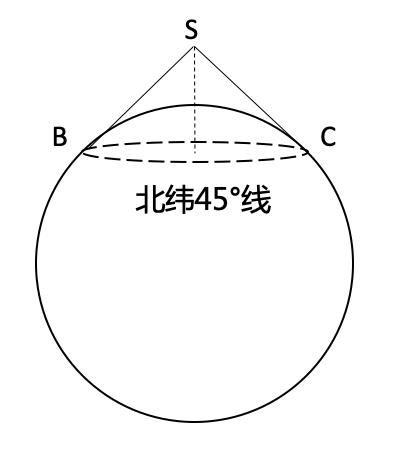

A、(√2−1)/2R B、(2−√2)/2R C、(√2−1)R D、(2−√2)R

来源：[2021年江苏公务员考试《行测》真题（A卷）.pdf](https://github.com/dumarstoft-ship-it/xingce/blob/407016b55b49581efa3771bb59a2dee8761d982f/2021%E5%B9%B4%E6%B1%9F%E8%8B%8F%E5%85%AC%E5%8A%A1%E5%91%98%E8%80%83%E8%AF%95%E3%80%8A%E8%A1%8C%E6%B5%8B%E3%80%8B%E7%9C%9F%E9%A2%98%EF%BC%88A%E5%8D%B7%EF%BC%89.pdf)，PDF 第 8 页。

## 第 66 题 · 判断推理

`JS2021-A类-066`

调查：求真
A、晨练：健身 B、施肥：收割 C、记忆：怀念 D、备份：复制

来源：[2021年江苏公务员考试《行测》真题（A卷）.pdf](https://github.com/dumarstoft-ship-it/xingce/blob/407016b55b49581efa3771bb59a2dee8761d982f/2021%E5%B9%B4%E6%B1%9F%E8%8B%8F%E5%85%AC%E5%8A%A1%E5%91%98%E8%80%83%E8%AF%95%E3%80%8A%E8%A1%8C%E6%B5%8B%E3%80%8B%E7%9C%9F%E9%A2%98%EF%BC%88A%E5%8D%B7%EF%BC%89.pdf)，PDF 第 8 页。

## 第 67 题 · 判断推理

`JS2021-A类-067`

头雁∶雁阵
A、蜂王∶蜂巢 B、猎狗∶羊群 C、蚁后∶工蚁 D、狮王∶狮群

来源：[2021年江苏公务员考试《行测》真题（A卷）.pdf](https://github.com/dumarstoft-ship-it/xingce/blob/407016b55b49581efa3771bb59a2dee8761d982f/2021%E5%B9%B4%E6%B1%9F%E8%8B%8F%E5%85%AC%E5%8A%A1%E5%91%98%E8%80%83%E8%AF%95%E3%80%8A%E8%A1%8C%E6%B5%8B%E3%80%8B%E7%9C%9F%E9%A2%98%EF%BC%88A%E5%8D%B7%EF%BC%89.pdf)，PDF 第 9 页。

## 第 68 题 · 判断推理

`JS2021-A类-068`

粮食安全∶国家安全
A、传统文化∶中国文化 B、家庭和谐∶社会和谐 C、主流媒体∶纸质媒体 D、地摊经济∶马路经济

来源：[2021年江苏公务员考试《行测》真题（A卷）.pdf](https://github.com/dumarstoft-ship-it/xingce/blob/407016b55b49581efa3771bb59a2dee8761d982f/2021%E5%B9%B4%E6%B1%9F%E8%8B%8F%E5%85%AC%E5%8A%A1%E5%91%98%E8%80%83%E8%AF%95%E3%80%8A%E8%A1%8C%E6%B5%8B%E3%80%8B%E7%9C%9F%E9%A2%98%EF%BC%88A%E5%8D%B7%EF%BC%89.pdf)，PDF 第 9 页。

## 第 69 题 · 判断推理

`JS2021-A类-069`

金∶金币∶货币
A、木∶木床∶床 B、水∶水稻∶稻 C、火∶火盆∶盆 D、土∶土鸡∶鸡

来源：[2021年江苏公务员考试《行测》真题（A卷）.pdf](https://github.com/dumarstoft-ship-it/xingce/blob/407016b55b49581efa3771bb59a2dee8761d982f/2021%E5%B9%B4%E6%B1%9F%E8%8B%8F%E5%85%AC%E5%8A%A1%E5%91%98%E8%80%83%E8%AF%95%E3%80%8A%E8%A1%8C%E6%B5%8B%E3%80%8B%E7%9C%9F%E9%A2%98%EF%BC%88A%E5%8D%B7%EF%BC%89.pdf)，PDF 第 9 页。

## 第 70 题 · 判断推理

`JS2021-A类-070`

花∶鸟∶杜鹃
A、戏∶剧∶昆曲 B、钟∶表∶秒表 C、草∶木∶植物 D、人∶畜∶黄牛

来源：[2021年江苏公务员考试《行测》真题（A卷）.pdf](https://github.com/dumarstoft-ship-it/xingce/blob/407016b55b49581efa3771bb59a2dee8761d982f/2021%E5%B9%B4%E6%B1%9F%E8%8B%8F%E5%85%AC%E5%8A%A1%E5%91%98%E8%80%83%E8%AF%95%E3%80%8A%E8%A1%8C%E6%B5%8B%E3%80%8B%E7%9C%9F%E9%A2%98%EF%BC%88A%E5%8D%B7%EF%BC%89.pdf)，PDF 第 9 页。

## 第 71 题 · 判断推理

`JS2021-A类-071`

白鸽∶母鸽∶鸽
A、柿饼∶甜饼∶饼 B、桃花∶梨花∶花 C、零售∶网售∶买 D、水桶∶铁桶∶桶

来源：[2021年江苏公务员考试《行测》真题（A卷）.pdf](https://github.com/dumarstoft-ship-it/xingce/blob/407016b55b49581efa3771bb59a2dee8761d982f/2021%E5%B9%B4%E6%B1%9F%E8%8B%8F%E5%85%AC%E5%8A%A1%E5%91%98%E8%80%83%E8%AF%95%E3%80%8A%E8%A1%8C%E6%B5%8B%E3%80%8B%E7%9C%9F%E9%A2%98%EF%BC%88A%E5%8D%B7%EF%BC%89.pdf)，PDF 第 9 页。

## 第 72 题 · 判断推理

`JS2021-A类-072`

国家∶治理∶现代化
A、企业∶规制∶自动化 B、社会∶建设∶法治化 C、社区∶服务∶数字化 D、政府∶管理∶一体化

来源：[2021年江苏公务员考试《行测》真题（A卷）.pdf](https://github.com/dumarstoft-ship-it/xingce/blob/407016b55b49581efa3771bb59a2dee8761d982f/2021%E5%B9%B4%E6%B1%9F%E8%8B%8F%E5%85%AC%E5%8A%A1%E5%91%98%E8%80%83%E8%AF%95%E3%80%8A%E8%A1%8C%E6%B5%8B%E3%80%8B%E7%9C%9F%E9%A2%98%EF%BC%88A%E5%8D%B7%EF%BC%89.pdf)，PDF 第 9 页。

## 第 73 题 · 判断推理

`JS2021-A类-073`

河长∶河道巡查∶水清岸绿
A、湖长∶污染治理∶波平浪静 B、路长∶道路维修∶车水马龙
C、机长∶客机驾驶∶安全准点 D、村长∶带头致富∶鸟语花香

来源：[2021年江苏公务员考试《行测》真题（A卷）.pdf](https://github.com/dumarstoft-ship-it/xingce/blob/407016b55b49581efa3771bb59a2dee8761d982f/2021%E5%B9%B4%E6%B1%9F%E8%8B%8F%E5%85%AC%E5%8A%A1%E5%91%98%E8%80%83%E8%AF%95%E3%80%8A%E8%A1%8C%E6%B5%8B%E3%80%8B%E7%9C%9F%E9%A2%98%EF%BC%88A%E5%8D%B7%EF%BC%89.pdf)，PDF 第 9 页。

## 第 74 题 · 判断推理

`JS2021-A类-074`

微信群 之于 （ ） 相当于 （ ） 之于 教学
A、符号；黑板 B、点赞；教师 C、社交；教室 D、红包；奖励

来源：[2021年江苏公务员考试《行测》真题（A卷）.pdf](https://github.com/dumarstoft-ship-it/xingce/blob/407016b55b49581efa3771bb59a2dee8761d982f/2021%E5%B9%B4%E6%B1%9F%E8%8B%8F%E5%85%AC%E5%8A%A1%E5%91%98%E8%80%83%E8%AF%95%E3%80%8A%E8%A1%8C%E6%B5%8B%E3%80%8B%E7%9C%9F%E9%A2%98%EF%BC%88A%E5%8D%B7%EF%BC%89.pdf)，PDF 第 9 页。

## 第 75 题 · 判断推理

`JS2021-A类-075`

水车 之于 （ ）相当于 （ ） 之于 计算器
A、风车；口算 B、稻田；计算 C、河水；数据 D、水泵；算盘

来源：[2021年江苏公务员考试《行测》真题（A卷）.pdf](https://github.com/dumarstoft-ship-it/xingce/blob/407016b55b49581efa3771bb59a2dee8761d982f/2021%E5%B9%B4%E6%B1%9F%E8%8B%8F%E5%85%AC%E5%8A%A1%E5%91%98%E8%80%83%E8%AF%95%E3%80%8A%E8%A1%8C%E6%B5%8B%E3%80%8B%E7%9C%9F%E9%A2%98%EF%BC%88A%E5%8D%B7%EF%BC%89.pdf)，PDF 第 9 页。

## 第 76 题 · 判断推理

`JS2021-A类-076`

请从所给的四个选项中，选出最恰当的一项填入问号处，使之呈现一定的规律。

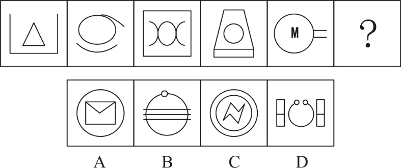

来源：[2021年江苏公务员考试《行测》真题（A卷）.pdf](https://github.com/dumarstoft-ship-it/xingce/blob/407016b55b49581efa3771bb59a2dee8761d982f/2021%E5%B9%B4%E6%B1%9F%E8%8B%8F%E5%85%AC%E5%8A%A1%E5%91%98%E8%80%83%E8%AF%95%E3%80%8A%E8%A1%8C%E6%B5%8B%E3%80%8B%E7%9C%9F%E9%A2%98%EF%BC%88A%E5%8D%B7%EF%BC%89.pdf)，PDF 第 9 页。

## 第 77 题 · 判断推理

`JS2021-A类-077`

请从所给的四个选项中，选出最恰当的一项填入问号处，使之呈现一定的规律。

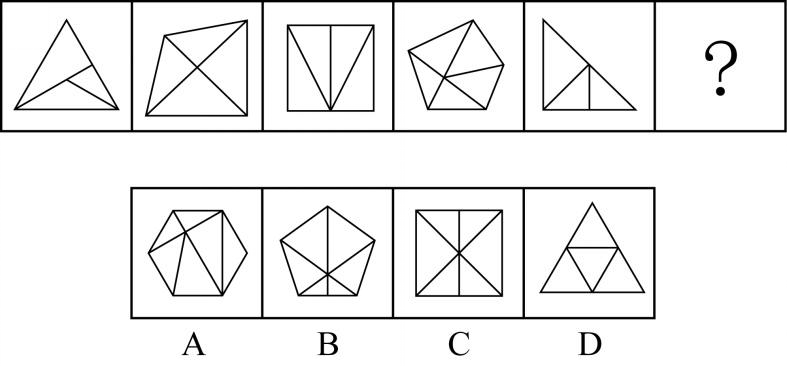

来源：[2021年江苏公务员考试《行测》真题（A卷）.pdf](https://github.com/dumarstoft-ship-it/xingce/blob/407016b55b49581efa3771bb59a2dee8761d982f/2021%E5%B9%B4%E6%B1%9F%E8%8B%8F%E5%85%AC%E5%8A%A1%E5%91%98%E8%80%83%E8%AF%95%E3%80%8A%E8%A1%8C%E6%B5%8B%E3%80%8B%E7%9C%9F%E9%A2%98%EF%BC%88A%E5%8D%B7%EF%BC%89.pdf)，PDF 第 9 页。

## 第 78 题 · 判断推理

`JS2021-A类-078`

请从所给的四个选项中，选出最恰当的一项填入问号处，使之呈现一定的规律。

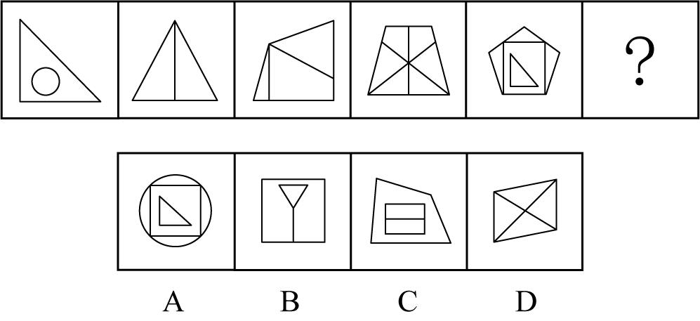

来源：[2021年江苏公务员考试《行测》真题（A卷）.pdf](https://github.com/dumarstoft-ship-it/xingce/blob/407016b55b49581efa3771bb59a2dee8761d982f/2021%E5%B9%B4%E6%B1%9F%E8%8B%8F%E5%85%AC%E5%8A%A1%E5%91%98%E8%80%83%E8%AF%95%E3%80%8A%E8%A1%8C%E6%B5%8B%E3%80%8B%E7%9C%9F%E9%A2%98%EF%BC%88A%E5%8D%B7%EF%BC%89.pdf)，PDF 第 9 页。

## 第 79 题 · 判断推理

`JS2021-A类-079`

请从所给的四个选项中，选出最恰当的一项填入问号处，使之呈现一定的规律。

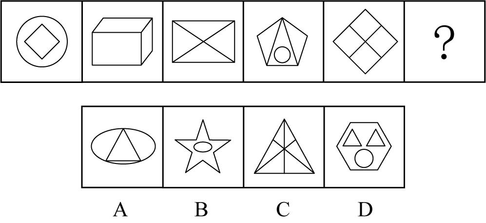

来源：[2021年江苏公务员考试《行测》真题（A卷）.pdf](https://github.com/dumarstoft-ship-it/xingce/blob/407016b55b49581efa3771bb59a2dee8761d982f/2021%E5%B9%B4%E6%B1%9F%E8%8B%8F%E5%85%AC%E5%8A%A1%E5%91%98%E8%80%83%E8%AF%95%E3%80%8A%E8%A1%8C%E6%B5%8B%E3%80%8B%E7%9C%9F%E9%A2%98%EF%BC%88A%E5%8D%B7%EF%BC%89.pdf)，PDF 第 9、10 页。

## 第 80 题 · 判断推理

`JS2021-A类-080`

请从所给的四个选项中，选出最恰当的一项填入问号处，使之呈现一定的规律。

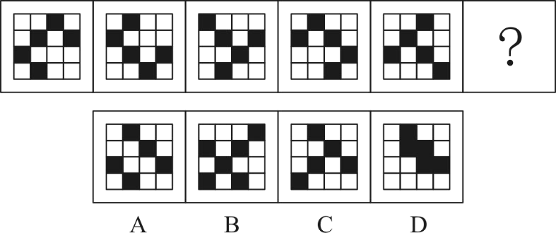

来源：[2021年江苏公务员考试《行测》真题（A卷）.pdf](https://github.com/dumarstoft-ship-it/xingce/blob/407016b55b49581efa3771bb59a2dee8761d982f/2021%E5%B9%B4%E6%B1%9F%E8%8B%8F%E5%85%AC%E5%8A%A1%E5%91%98%E8%80%83%E8%AF%95%E3%80%8A%E8%A1%8C%E6%B5%8B%E3%80%8B%E7%9C%9F%E9%A2%98%EF%BC%88A%E5%8D%B7%EF%BC%89.pdf)，PDF 第 10 页。

## 第 81 题 · 判断推理

`JS2021-A类-081`

请从所给的四个选项中，选出最恰当的一项填入问号处，使之呈现一定的规律。

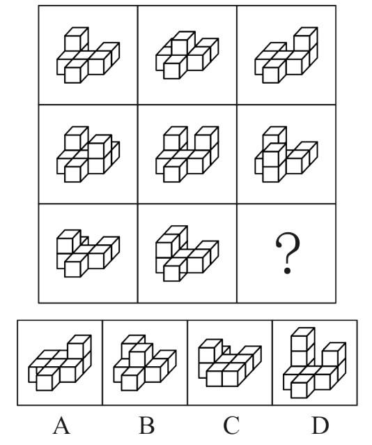

来源：[2021年江苏公务员考试《行测》真题（A卷）.pdf](https://github.com/dumarstoft-ship-it/xingce/blob/407016b55b49581efa3771bb59a2dee8761d982f/2021%E5%B9%B4%E6%B1%9F%E8%8B%8F%E5%85%AC%E5%8A%A1%E5%91%98%E8%80%83%E8%AF%95%E3%80%8A%E8%A1%8C%E6%B5%8B%E3%80%8B%E7%9C%9F%E9%A2%98%EF%BC%88A%E5%8D%B7%EF%BC%89.pdf)，PDF 第 10 页。

## 第 82 题 · 判断推理

`JS2021-A类-082`

请从所给的四个选项中，选出最恰当的一项填入问号处，使之呈现一定的规律。

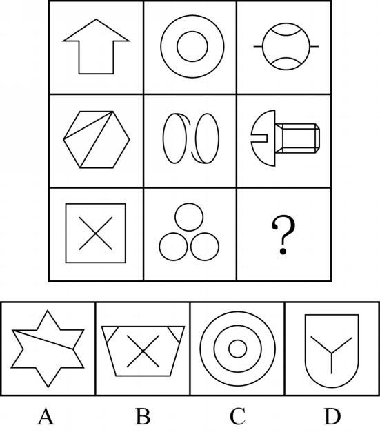

来源：[2021年江苏公务员考试《行测》真题（A卷）.pdf](https://github.com/dumarstoft-ship-it/xingce/blob/407016b55b49581efa3771bb59a2dee8761d982f/2021%E5%B9%B4%E6%B1%9F%E8%8B%8F%E5%85%AC%E5%8A%A1%E5%91%98%E8%80%83%E8%AF%95%E3%80%8A%E8%A1%8C%E6%B5%8B%E3%80%8B%E7%9C%9F%E9%A2%98%EF%BC%88A%E5%8D%B7%EF%BC%89.pdf)，PDF 第 10 页。

## 第 83 题 · 判断推理

`JS2021-A类-083`

右边四个图形中，只有一个是由左边的四个图形拼合（只能通过上、下、左、右平移）而成的，请把它找出
来。

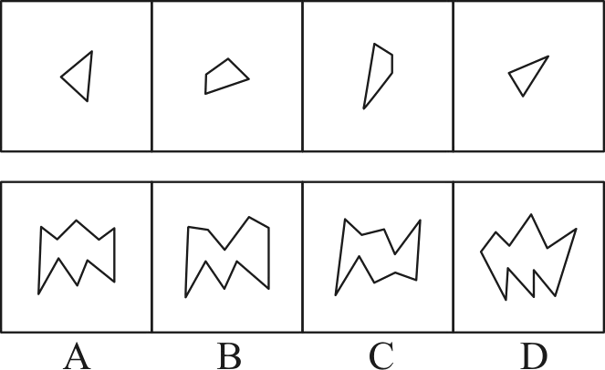

来源：[2021年江苏公务员考试《行测》真题（A卷）.pdf](https://github.com/dumarstoft-ship-it/xingce/blob/407016b55b49581efa3771bb59a2dee8761d982f/2021%E5%B9%B4%E6%B1%9F%E8%8B%8F%E5%85%AC%E5%8A%A1%E5%91%98%E8%80%83%E8%AF%95%E3%80%8A%E8%A1%8C%E6%B5%8B%E3%80%8B%E7%9C%9F%E9%A2%98%EF%BC%88A%E5%8D%B7%EF%BC%89.pdf)，PDF 第 11 页。

## 第 84 题 · 判断推理

`JS2021-A类-084`

右边四个图形中，只有一个是由左边的四个图形拼合（只能通过上、下、左、右平移）而成的，请把它找出
来。

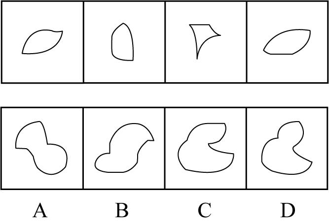

来源：[2021年江苏公务员考试《行测》真题（A卷）.pdf](https://github.com/dumarstoft-ship-it/xingce/blob/407016b55b49581efa3771bb59a2dee8761d982f/2021%E5%B9%B4%E6%B1%9F%E8%8B%8F%E5%85%AC%E5%8A%A1%E5%91%98%E8%80%83%E8%AF%95%E3%80%8A%E8%A1%8C%E6%B5%8B%E3%80%8B%E7%9C%9F%E9%A2%98%EF%BC%88A%E5%8D%B7%EF%BC%89.pdf)，PDF 第 11 页。

## 第 85 题 · 判断推理

`JS2021-A类-085`

右边四个图形中，只有一个是由左边的四个图形拼合（只能通过上、下、左、右平移）而成的，请把它找出
来。

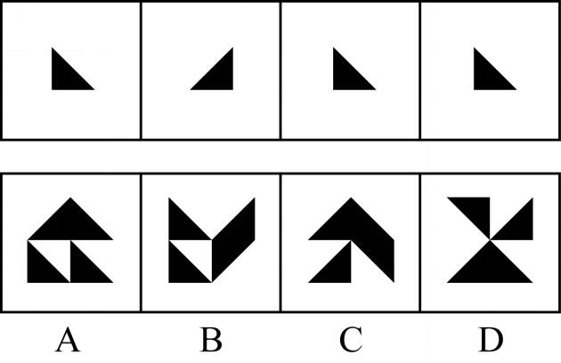

来源：[2021年江苏公务员考试《行测》真题（A卷）.pdf](https://github.com/dumarstoft-ship-it/xingce/blob/407016b55b49581efa3771bb59a2dee8761d982f/2021%E5%B9%B4%E6%B1%9F%E8%8B%8F%E5%85%AC%E5%8A%A1%E5%91%98%E8%80%83%E8%AF%95%E3%80%8A%E8%A1%8C%E6%B5%8B%E3%80%8B%E7%9C%9F%E9%A2%98%EF%BC%88A%E5%8D%B7%EF%BC%89.pdf)，PDF 第 11 页。

## 第 86 题 · 判断推理

`JS2021-A类-086`

右边四个图形中，只有一个是由左边的四个图形拼合（只能通过上、下、左、右平移）而成的，请把它找出
来。

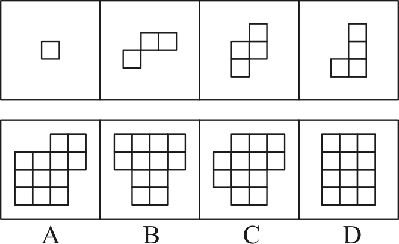

来源：[2021年江苏公务员考试《行测》真题（A卷）.pdf](https://github.com/dumarstoft-ship-it/xingce/blob/407016b55b49581efa3771bb59a2dee8761d982f/2021%E5%B9%B4%E6%B1%9F%E8%8B%8F%E5%85%AC%E5%8A%A1%E5%91%98%E8%80%83%E8%AF%95%E3%80%8A%E8%A1%8C%E6%B5%8B%E3%80%8B%E7%9C%9F%E9%A2%98%EF%BC%88A%E5%8D%B7%EF%BC%89.pdf)，PDF 第 11 页。

## 第 87 题 · 判断推理

`JS2021-A类-087`

左边给定的是多面体的外表面，右边哪一项能由它折叠而成？请把它找出来。

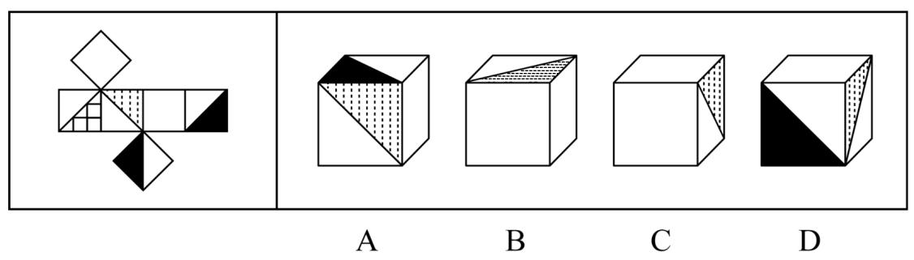

来源：[2021年江苏公务员考试《行测》真题（A卷）.pdf](https://github.com/dumarstoft-ship-it/xingce/blob/407016b55b49581efa3771bb59a2dee8761d982f/2021%E5%B9%B4%E6%B1%9F%E8%8B%8F%E5%85%AC%E5%8A%A1%E5%91%98%E8%80%83%E8%AF%95%E3%80%8A%E8%A1%8C%E6%B5%8B%E3%80%8B%E7%9C%9F%E9%A2%98%EF%BC%88A%E5%8D%B7%EF%BC%89.pdf)，PDF 第 12 页。

## 第 88 题 · 判断推理

`JS2021-A类-088`

左边给定的是多边形的外表面，右边哪一项能由它折叠而成？请把它找出来。

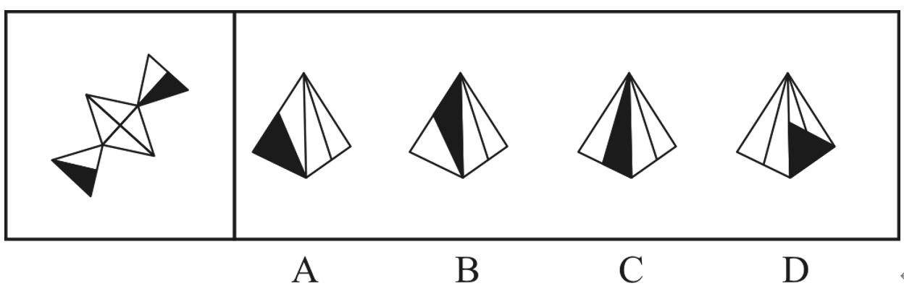

来源：[2021年江苏公务员考试《行测》真题（A卷）.pdf](https://github.com/dumarstoft-ship-it/xingce/blob/407016b55b49581efa3771bb59a2dee8761d982f/2021%E5%B9%B4%E6%B1%9F%E8%8B%8F%E5%85%AC%E5%8A%A1%E5%91%98%E8%80%83%E8%AF%95%E3%80%8A%E8%A1%8C%E6%B5%8B%E3%80%8B%E7%9C%9F%E9%A2%98%EF%BC%88A%E5%8D%B7%EF%BC%89.pdf)，PDF 第 12 页。

## 第 89 题 · 判断推理

`JS2021-A类-089`

左边给定的是多边形的外表面，右边哪一项不能由它折叠而成？请把它找出来。

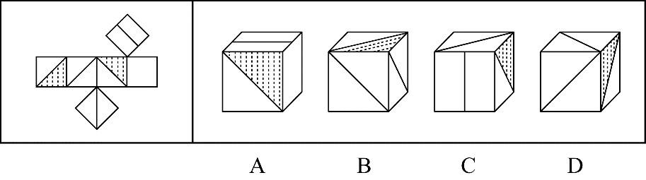

来源：[2021年江苏公务员考试《行测》真题（A卷）.pdf](https://github.com/dumarstoft-ship-it/xingce/blob/407016b55b49581efa3771bb59a2dee8761d982f/2021%E5%B9%B4%E6%B1%9F%E8%8B%8F%E5%85%AC%E5%8A%A1%E5%91%98%E8%80%83%E8%AF%95%E3%80%8A%E8%A1%8C%E6%B5%8B%E3%80%8B%E7%9C%9F%E9%A2%98%EF%BC%88A%E5%8D%B7%EF%BC%89.pdf)，PDF 第 12 页。

## 第 90 题 · 判断推理

`JS2021-A类-090`

左边给定的是立方体，右边哪一项是它的外表面展开图？请把它找出来。

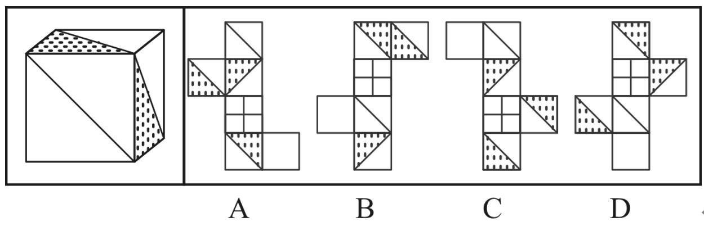

来源：[2021年江苏公务员考试《行测》真题（A卷）.pdf](https://github.com/dumarstoft-ship-it/xingce/blob/407016b55b49581efa3771bb59a2dee8761d982f/2021%E5%B9%B4%E6%B1%9F%E8%8B%8F%E5%85%AC%E5%8A%A1%E5%91%98%E8%80%83%E8%AF%95%E3%80%8A%E8%A1%8C%E6%B5%8B%E3%80%8B%E7%9C%9F%E9%A2%98%EF%BC%88A%E5%8D%B7%EF%BC%89.pdf)，PDF 第 12 页。

## 第 91 题 · 判断推理

`JS2021-A类-091`

人无精神则不立，国无精神则不强。精神是一个民族赖以长久生存的灵魂唯有精神上达到一定的高度，一个
民族才能在历史的洪流中奋勇向前。
根据以上陈述，可以得出以下哪项？
A、人有精神则立，国有精神则强
B、一个民族如果精神上没有达到一定的高度，就没有赖以长久生存的灵魂
C、一个民族若在历史的洪流中奋勇向前，则精神上已达到一定的高度
D、一个民族如果精神上达到一定的高度，就会在历史的洪流中奋勇向前

来源：[2021年江苏公务员考试《行测》真题（A卷）.pdf](https://github.com/dumarstoft-ship-it/xingce/blob/407016b55b49581efa3771bb59a2dee8761d982f/2021%E5%B9%B4%E6%B1%9F%E8%8B%8F%E5%85%AC%E5%8A%A1%E5%91%98%E8%80%83%E8%AF%95%E3%80%8A%E8%A1%8C%E6%B5%8B%E3%80%8B%E7%9C%9F%E9%A2%98%EF%BC%88A%E5%8D%B7%EF%BC%89.pdf)，PDF 第 12 页。

## 第 92 题 · 判断推理

`JS2021-A类-092`

古人云:立善法于天下，则天下治；立善法于一国，则一国治。
以下哪项与上述古人说法的形式结构最为相似？
A、民生在勤，勤则不匮 B、穷则独善其身，达则兼济天下
C、明者因时而变，知者随事而制 D、俭则约，约则百善俱兴；侈则肆，肆则百恶俱纵

来源：[2021年江苏公务员考试《行测》真题（A卷）.pdf](https://github.com/dumarstoft-ship-it/xingce/blob/407016b55b49581efa3771bb59a2dee8761d982f/2021%E5%B9%B4%E6%B1%9F%E8%8B%8F%E5%85%AC%E5%8A%A1%E5%91%98%E8%80%83%E8%AF%95%E3%80%8A%E8%A1%8C%E6%B5%8B%E3%80%8B%E7%9C%9F%E9%A2%98%EF%BC%88A%E5%8D%B7%EF%BC%89.pdf)，PDF 第 12 页。

## 第 93 题 · 判断推理

`JS2021-A类-093`

最近，一些海洋考古人员在地中海卡梅尔海岸附近的海底发现了一堵约100 米长的巨型石墙。尽管石墙上没
有留下任何文字符号，历史上也没有留下关于这堵石墙的任何记录，考古人员仍然通过对散落在石墙附近的木桩、
石碗和兽骨等物品的测定，认为石墙是7000 年前人类创造的遗迹。它的用途究竟是什么？由于当时敌人很难来
自海上，研究人员推断，当时这里的人们筑起石墙，主要是为了避免海水上涨后淹没村庄。
以下哪项如果为真，最能支持上述研究人员的推断？
A、7000 年前，地球正处于冰河期结束前期，地中海海平面每年抬升4 至7 毫米
B、石墙之后发现有人类定居点的遗迹，现在它们都被海水淹没在三四米深的海底
C、考古发现的石墙虽然只有100 米长，但算上损毁部分，其长度足够包围定居点
D、今天的人类同样面临海平面上升的风险，有的国家也采取筑墙防御的应对策略

来源：[2021年江苏公务员考试《行测》真题（A卷）.pdf](https://github.com/dumarstoft-ship-it/xingce/blob/407016b55b49581efa3771bb59a2dee8761d982f/2021%E5%B9%B4%E6%B1%9F%E8%8B%8F%E5%85%AC%E5%8A%A1%E5%91%98%E8%80%83%E8%AF%95%E3%80%8A%E8%A1%8C%E6%B5%8B%E3%80%8B%E7%9C%9F%E9%A2%98%EF%BC%88A%E5%8D%B7%EF%BC%89.pdf)，PDF 第 12、13 页。

## 第 94 题 · 判断推理

`JS2021-A类-094`

甲、乙、丙、丁4 位中学同学毕业30 年后相聚。现在，他们已成为企业家、大学教师、歌手和会计师，且
每人只有一种身份，并不重复。他们在中学时代就各人的未来职业有过如下预言:
甲: 乙不会成为歌手；
乙: 丙会成为会计师；
丙: 丁不会成为企业家；
丁: 乙不会成为大学教师。
现在看来，他们当中只有会计师的预言是正确的。
根据上述信息可以推断，甲、乙、丙、丁的职业分别是：
A、企业家、大学教师、歌手、会计师 B、大学教师、歌手、企业家、会计师
C、企业家、歌手、会计师、大学教师 D、会计师、大学教师、歌手、企业家

来源：[2021年江苏公务员考试《行测》真题（A卷）.pdf](https://github.com/dumarstoft-ship-it/xingce/blob/407016b55b49581efa3771bb59a2dee8761d982f/2021%E5%B9%B4%E6%B1%9F%E8%8B%8F%E5%85%AC%E5%8A%A1%E5%91%98%E8%80%83%E8%AF%95%E3%80%8A%E8%A1%8C%E6%B5%8B%E3%80%8B%E7%9C%9F%E9%A2%98%EF%BC%88A%E5%8D%B7%EF%BC%89.pdf)，PDF 第 13 页。

## 第 95 题 · 判断推理

`JS2021-A类-095`

2020 年疫情肆虐，但电商直播逆势崛起，一季度全国电商直播超过400 万场，“万物可播、全民可播”成
为一个响亮的口号。一项针对消费者和商家的调查显示，在电商直播中，许多消费者能以优惠的价格购买到心仪
的商品，商家也能提升其销售额。有专家据此推断，电商直播的商业模式在疫情过后仍会受到商家和消费者的追
捧。
以下各项如果为真，则除哪项外均能削弱上述专家的观点？
A、低价促销已经成为当前直播带货的常态，这种价格竞争让商家无利润可赚
B、直播带货往往造成线上线下的价格不一致，不利于商家维护企业品牌形象
C、许多消费者购买直播销售的商品后遇到了以次充好、售后维权困难等情况
D、个别带货主播为了利益常常夸大自己的销售数据，而消费者对此并不知情

来源：[2021年江苏公务员考试《行测》真题（A卷）.pdf](https://github.com/dumarstoft-ship-it/xingce/blob/407016b55b49581efa3771bb59a2dee8761d982f/2021%E5%B9%B4%E6%B1%9F%E8%8B%8F%E5%85%AC%E5%8A%A1%E5%91%98%E8%80%83%E8%AF%95%E3%80%8A%E8%A1%8C%E6%B5%8B%E3%80%8B%E7%9C%9F%E9%A2%98%EF%BC%88A%E5%8D%B7%EF%BC%89.pdf)，PDF 第 13 页。

## 第 96 题 · 判断推理

`JS2021-A类-096`

一般认为，7 万多年前的多巴火山喷发造成了全球气候变冷及环境恶化，并最终导致热带非洲以外地区人类
的灭绝。近期一项对现生人群的基因研究认为，约6 万年前至5 万年前之间曾有一次非洲人群替代其他地区人群
的过程，关于现代人的起源，“完全替代假说”是成立的，即非洲人是其他地区人群的直接祖先。
以下哪项如果为真，最能质疑上述研究人员的论证？
A、多巴火山喷发后，热带非洲以外的地区仍有人类活动
B、多巴火山的喷发短时间内仅对附近地区造成毁灭性的影响
C、距今10 万年前至4 万年前，东亚地区的人类演化链条从来没有中断过
D、尼安德特人在2 万年前至3 万年前已经灭绝，但现存智人仍保留他们的基因

来源：[2021年江苏公务员考试《行测》真题（A卷）.pdf](https://github.com/dumarstoft-ship-it/xingce/blob/407016b55b49581efa3771bb59a2dee8761d982f/2021%E5%B9%B4%E6%B1%9F%E8%8B%8F%E5%85%AC%E5%8A%A1%E5%91%98%E8%80%83%E8%AF%95%E3%80%8A%E8%A1%8C%E6%B5%8B%E3%80%8B%E7%9C%9F%E9%A2%98%EF%BC%88A%E5%8D%B7%EF%BC%89.pdf)，PDF 第 13 页。

## 第 97 题 · 判断推理

`JS2021-A类-097`

近日，某社区为活跃社区文化气氛，开展了一场别开生面的社区文化活动，有若干兴趣社团供居民选择。已
知报名情况如下：
（1）居民在诗词社和书法社中至少参加了一个；
（2）居民如果参加了诗词社，则没有参加合唱团；
（3）李女士参加了合唱团。
社区主任知道上述情况后断定，李女士也参加了戏迷社。
以下哪项如果为真，可以成为社区主任断定所需的前提？
A、李女士没有参加诗词社 B、参加了戏迷社的也参加了书法社
C、李女士没有参加书法业 D、不参加戏迷社的都不参加书法社

来源：[2021年江苏公务员考试《行测》真题（A卷）.pdf](https://github.com/dumarstoft-ship-it/xingce/blob/407016b55b49581efa3771bb59a2dee8761d982f/2021%E5%B9%B4%E6%B1%9F%E8%8B%8F%E5%85%AC%E5%8A%A1%E5%91%98%E8%80%83%E8%AF%95%E3%80%8A%E8%A1%8C%E6%B5%8B%E3%80%8B%E7%9C%9F%E9%A2%98%EF%BC%88A%E5%8D%B7%EF%BC%89.pdf)，PDF 第 13 页。

## 第 98 题 · 判断推理

`JS2021-A类-098`

当前，很多高校规定研究生毕业之前必须发表一定数量的学术文章，并将其与学位获得资格挂钩。校方认为，
研究生学习期间发表论文，有利于提高其学术水平，增强其学术能力，既能实现人才培养的目标，又能扩大学校
的知名度。然而，最近某高校取消了研究生论文发表与学位获得资格挂钩的规定，受到许多研究生导师的认同。
他们认为，这一规定更有利于培养该校研究生的学术能力。
以下哪项如果为真，最能支持上述研究生导师们的观点？
A、该校的研究生素质高，即使学校不做规定，大部分研究生也会想方设法发表论文
B、该校曾有极少数研究生为了学位而肆意抄袭、买卖论文，严重影响学校声誉
C、该校许多导师指导多名研究生，需要花费大量时间来修改学生的投稿论文
D、该校过去用论文发表要求来代替培养过程监督，导致学生难以沉下心来研究学问

来源：[2021年江苏公务员考试《行测》真题（A卷）.pdf](https://github.com/dumarstoft-ship-it/xingce/blob/407016b55b49581efa3771bb59a2dee8761d982f/2021%E5%B9%B4%E6%B1%9F%E8%8B%8F%E5%85%AC%E5%8A%A1%E5%91%98%E8%80%83%E8%AF%95%E3%80%8A%E8%A1%8C%E6%B5%8B%E3%80%8B%E7%9C%9F%E9%A2%98%EF%BC%88A%E5%8D%B7%EF%BC%89.pdf)，PDF 第 13、14 页。

## 第 99 题 · 判断推理

`JS2021-A类-099`

### 共用材料

一条新开通的南北向高速公路，中间有6 条隧道:长川隧道、大美隧道、青山隧道、绿水隧道、彩石隧道、白玉
隧道。已知：
（1）白玉隧道在彩石隧道的北边并与之相邻，在大美隧道的南边但与之不相邻；
（2）长川隧道与青山隧道之间隔一条隧道。

根据上述信息，以下哪项是不可能的？
A、长川隧道在最南边 B、绿水隧道在最北边
C、彩石隧道与青山隧道隔一条隧道 D、白玉隧道与大美隧道隔一条隧道

来源：[2021年江苏公务员考试《行测》真题（A卷）.pdf](https://github.com/dumarstoft-ship-it/xingce/blob/407016b55b49581efa3771bb59a2dee8761d982f/2021%E5%B9%B4%E6%B1%9F%E8%8B%8F%E5%85%AC%E5%8A%A1%E5%91%98%E8%80%83%E8%AF%95%E3%80%8A%E8%A1%8C%E6%B5%8B%E3%80%8B%E7%9C%9F%E9%A2%98%EF%BC%88A%E5%8D%B7%EF%BC%89.pdf)，PDF 第 14 页。

## 第 100 题 · 判断推理

`JS2021-A类-100`

### 共用材料

一条新开通的南北向高速公路，中间有6 条隧道:长川隧道、大美隧道、青山隧道、绿水隧道、彩石隧道、白玉
隧道。已知：
（1）白玉隧道在彩石隧道的北边并与之相邻，在大美隧道的南边但与之不相邻；
（2）长川隧道与青山隧道之间隔一条隧道。

如果绿水隧道与白玉隧道相邻，则以下哪项一定为真？
A、彩石隧道处于由南向北的第二位 B、大美隧道处于由北向南的第二位
C、长川隧道处于由北向南的第三位 D、青山隧道处于由南向北的第三位

来源：[2021年江苏公务员考试《行测》真题（A卷）.pdf](https://github.com/dumarstoft-ship-it/xingce/blob/407016b55b49581efa3771bb59a2dee8761d982f/2021%E5%B9%B4%E6%B1%9F%E8%8B%8F%E5%85%AC%E5%8A%A1%E5%91%98%E8%80%83%E8%AF%95%E3%80%8A%E8%A1%8C%E6%B5%8B%E3%80%8B%E7%9C%9F%E9%A2%98%EF%BC%88A%E5%8D%B7%EF%BC%89.pdf)，PDF 第 14 页。

## 第 101 题 · 判断推理

`JS2021-A类-101`

逆向文化冲击：指旅居他乡者回到故国或故乡后，短时间内在生活、心理等方面难以适应本土文化的现象。
下列不属于逆向文化冲击的是：
A、大卫在中国从事英语培训工作10 多年，回国后感到很不习惯。他在不久前的一段视频中抱怨说：半夜饿了，
在中国拿出手机点个外卖，半个小时就送到了，而这里啥都没有，只能饿死在去超市的路上
B、在城里生活多年的老杨，今年春节回到农村老家后，亲戚朋友请他到附近饭店吃饭。开席后，他习惯性地让
服务员去拿公筷、公勺，服务员惊讶地看着他，半天没反应过来，亲戚们也觉得他怪怪的
C、留学刚回国的小吴约朋友去青岛看海，因为没有12306 账户，只得请朋友帮忙购票。上车后他惊讶地发现，
高铁上不仅可以扫码点餐，还可以点外卖，自己头天准备的面包、饼干一点没用上。他感觉自己在朋友心目中简
直就像个弱智
D、欧洲姑娘玛丽来华留学，虽然早已听说过中国的无现金支付，第一周她还是惊呆了：楼下卖红薯的大爷都在
用“互联网+”，菜市场的每个摊位上居然都有收款二维码，更不要说超市和商场了

来源：[2021年江苏公务员考试《行测》真题（A卷）.pdf](https://github.com/dumarstoft-ship-it/xingce/blob/407016b55b49581efa3771bb59a2dee8761d982f/2021%E5%B9%B4%E6%B1%9F%E8%8B%8F%E5%85%AC%E5%8A%A1%E5%91%98%E8%80%83%E8%AF%95%E3%80%8A%E8%A1%8C%E6%B5%8B%E3%80%8B%E7%9C%9F%E9%A2%98%EF%BC%88A%E5%8D%B7%EF%BC%89.pdf)，PDF 第 14 页。

## 第 102 题 · 判断推理

`JS2021-A类-102`

双塔效应：指两个实力雄厚的相邻经济体强强联合，利用各自的集聚辐射能力，共同带动周围区域发展的
现象。
下列属于双塔效应的是：
A、某市围绕“精准定位消费人群、打造特色商业体”的要求，以市区著名商圈为轴心，推动商业布局错位竞争，
建成了商务、文化、居住等不同功能区
B、某区域两个特大城市利用优越的区位条件，按照“发挥优势、取长补短、互惠互利”的原则，经过多年努力，
在科技、文化、工业等方面形成了国内领先的优势
C、某市为了加快经济发展，将经济基础雄厚、发展空间有限的核心区与基础薄弱但发展潜力巨大的城郊区进行
了区域整合，城市综合实力很快有了显著提升
D、某市国家级创新产业园成立之初，重点培育信息和医药两大产业，吸引多家世界500 强企业入驻，进一步促
进了本市产业转型升级，提升了城市的整体竞争力

来源：[2021年江苏公务员考试《行测》真题（A卷）.pdf](https://github.com/dumarstoft-ship-it/xingce/blob/407016b55b49581efa3771bb59a2dee8761d982f/2021%E5%B9%B4%E6%B1%9F%E8%8B%8F%E5%85%AC%E5%8A%A1%E5%91%98%E8%80%83%E8%AF%95%E3%80%8A%E8%A1%8C%E6%B5%8B%E3%80%8B%E7%9C%9F%E9%A2%98%EF%BC%88A%E5%8D%B7%EF%BC%89.pdf)，PDF 第 14 页。

## 第 103 题 · 判断推理

`JS2021-A类-103`

闭环思维：指工作学习过程中用各种方式的提示、应答使每个操作环节形成封闭的环，以利于实时把握进
程、及时调整方向的一种思维方式。
下列不属于闭环思维的是：
A、赵教练每次收到学员发来的信息时，都会给予答复并习惯性地发送一个表情，他的手机里存了很多张风格各
异的应答图片
B、钱先生每次给下属布置任务，都要求他们尽快回复信息，包括是否收到、能否完成、什么时候完成等，与他
共事的人都感觉很有压力
C、小孙刚到单位时，领导安排的任务他总是很爽快地答应下来并想方设法去完成。半年后，工作越来越忙，他
发现有些任务很难完成，再也不敢随意应承了
D、经理要求小李一周内草拟一个工作计划。经过认真调研，小李完成了计划书并用电子邮件发给了经理。十几
天后经理特意问他：计划书写好了吗？小李惊讶地说：我早已发给你了

来源：[2021年江苏公务员考试《行测》真题（A卷）.pdf](https://github.com/dumarstoft-ship-it/xingce/blob/407016b55b49581efa3771bb59a2dee8761d982f/2021%E5%B9%B4%E6%B1%9F%E8%8B%8F%E5%85%AC%E5%8A%A1%E5%91%98%E8%80%83%E8%AF%95%E3%80%8A%E8%A1%8C%E6%B5%8B%E3%80%8B%E7%9C%9F%E9%A2%98%EF%BC%88A%E5%8D%B7%EF%BC%89.pdf)，PDF 第 14 页。

## 第 104 题 · 判断推理

`JS2021-A类-104`

隐性管理：指通过引导、支持或服务等行为，对员工施加非制度性影响以达到预期目标的管理方式。
下列属于隐性管理的是：
A、为了丰富员工的业余文化生活，某公司专门成立了羽毛球协会，定期举办相关活动，不久以后大多数员工的
羽毛球水平都有了明显提高
B、迟到早退是困扰公司多年的老大难问题，今年初公司安装了门禁系统，经理每天带头准时打卡上班，一段时
间后，几乎再也看不到员工迟到早退
C、小李因家庭纠纷，工作时情绪低落，单位领导得知情况后多次与他沟通交谈，解开了他心中的疙瘩，现在小
李的工作比以前更出色了
D、某企业办公楼装修完后，在楼外各个角落安装了十多个摄像头，既解决了安全问题，又解决了长期以来员工
乱扔垃圾、乱停私家车的问题

来源：[2021年江苏公务员考试《行测》真题（A卷）.pdf](https://github.com/dumarstoft-ship-it/xingce/blob/407016b55b49581efa3771bb59a2dee8761d982f/2021%E5%B9%B4%E6%B1%9F%E8%8B%8F%E5%85%AC%E5%8A%A1%E5%91%98%E8%80%83%E8%AF%95%E3%80%8A%E8%A1%8C%E6%B5%8B%E3%80%8B%E7%9C%9F%E9%A2%98%EF%BC%88A%E5%8D%B7%EF%BC%89.pdf)，PDF 第 14、15 页。

## 第 105 题 · 判断推理

`JS2021-A类-105`

网络社交消费：指在网络社交过程中对某商品产生即兴消费欲望，借助社交平台链接完成购买行为的一种
消费方式。
下列属于网络社交消费的是：
A、小夏在微博上看到一篇介绍某品牌跑步机的文章，感觉很对自己的胃口，毫不犹豫地点赞并通过博文后面的
网址购买了一台
B、果蔬团购微信群中可以定时秒杀群主发布的低价产品，也可以预定自己想要的品种，既便捷又实惠，小李是
这些活动的常客
C、歌手小兰上传了一个翻唱经典老歌的短视频，她在视频中戴的船形帽迅速走红，“歌手小兰爆款船形帽”成
为网络热搜词，在各大购物网站上卖到断货
D、某甜品店的订餐卡上印有自己的公众号，顾客关注该公众号订购甜品比外卖平台还要便宜并且可以免费送货

来源：[2021年江苏公务员考试《行测》真题（A卷）.pdf](https://github.com/dumarstoft-ship-it/xingce/blob/407016b55b49581efa3771bb59a2dee8761d982f/2021%E5%B9%B4%E6%B1%9F%E8%8B%8F%E5%85%AC%E5%8A%A1%E5%91%98%E8%80%83%E8%AF%95%E3%80%8A%E8%A1%8C%E6%B5%8B%E3%80%8B%E7%9C%9F%E9%A2%98%EF%BC%88A%E5%8D%B7%EF%BC%89.pdf)，PDF 第 15 页。

## 第 106 题 · 判断推理

`JS2021-A类-106`

逆化用：指根据表达需要，将他人的语句化解后重新组合融入自己的作品中，所表达的意思与原意相反。
下列属于逆化用的是：
A、原句：失之东隅，收之桑榆
化用：东隅已逝，桑榆非晚
B、原句：无边落木萧萧下，不尽长江滚滚来
化用：千古兴亡多少事，悠悠，不尽长江滚滚流
C、原句：归师勿遏，围师必阙，穷寇勿追
化用：宜将剩勇追穷寇，不可沽名学霸王
D、原句：国破山河在，城春草木深
化用：无限山河泪，谁言天地宽

来源：[2021年江苏公务员考试《行测》真题（A卷）.pdf](https://github.com/dumarstoft-ship-it/xingce/blob/407016b55b49581efa3771bb59a2dee8761d982f/2021%E5%B9%B4%E6%B1%9F%E8%8B%8F%E5%85%AC%E5%8A%A1%E5%91%98%E8%80%83%E8%AF%95%E3%80%8A%E8%A1%8C%E6%B5%8B%E3%80%8B%E7%9C%9F%E9%A2%98%EF%BC%88A%E5%8D%B7%EF%BC%89.pdf)，PDF 第 15 页。

## 第 107 题 · 判断推理

`JS2021-A类-107`

共享用工：指企业在特殊时期，为了降低人力成本或解决人工短缺问题，通过借用或外派员工实现劳动力
共享的临时用工方式。
下列属于共享用工的是：
A、为节省成本支出，某广告公司长期通过创客网站发包设计任务，并与一些水平较高的自由创客人员签订了合
作协议，建立了密切的业务关系
B、某公司正在扩大生产经营规模，急需大量技术人员，通过线上线下相结合的形式，招聘一批兼职技术人员，
既解决了无人可用的燃眉之急，又节约了用人成本
C、疫情期间，某生鲜电商平台订单激增，该平台与当地的餐饮、酒店等行业的数十家公司进行协商合作，利用
他们派来的员工，缓解了自身的用工压力
D、某高校在科研项目攻关过程中遇到研发人员不足的问题，于是借用多家单位的科研人员组成联合攻关团队，
终于成功解决了一系列技术难题

来源：[2021年江苏公务员考试《行测》真题（A卷）.pdf](https://github.com/dumarstoft-ship-it/xingce/blob/407016b55b49581efa3771bb59a2dee8761d982f/2021%E5%B9%B4%E6%B1%9F%E8%8B%8F%E5%85%AC%E5%8A%A1%E5%91%98%E8%80%83%E8%AF%95%E3%80%8A%E8%A1%8C%E6%B5%8B%E3%80%8B%E7%9C%9F%E9%A2%98%EF%BC%88A%E5%8D%B7%EF%BC%89.pdf)，PDF 第 15 页。

## 第 108 题 · 判断推理

`JS2021-A类-108`

城市文化客厅：指城市利用商圈、地铁、机场等处的小型公共空间举办艺术、历史、民俗等方面的常态性
文化休闲活动，让市民和八方来客共享的场所。
下列不属于城市文化客厅的是：
A、某市中心步行街最近举行了十周年庆典活动，亲子类节目浸入式戏剧展演以及深受学生喜爱的二次元展、电
竞展，吸引了很多年轻一族前来“打卡”
B、某市图书馆附近的广场上，陈列了多组以昆曲、扬剧、锡剧、淮剧为主题的形态各异的雕塑，每到周末前来
观赏的市民络绎不绝
C、某市中心地下过街通道的墙壁上最近换上了记录近百年来城市发展变化的老照片，它与周边的会展中心、大
剧院、科技馆等新建筑群形成强烈对比
D、某机场近年来在候机大厅举办多场小型非遗作品展，四面八方的旅客在候机之余感受、体验到了中华传统文
化的魅力

来源：[2021年江苏公务员考试《行测》真题（A卷）.pdf](https://github.com/dumarstoft-ship-it/xingce/blob/407016b55b49581efa3771bb59a2dee8761d982f/2021%E5%B9%B4%E6%B1%9F%E8%8B%8F%E5%85%AC%E5%8A%A1%E5%91%98%E8%80%83%E8%AF%95%E3%80%8A%E8%A1%8C%E6%B5%8B%E3%80%8B%E7%9C%9F%E9%A2%98%EF%BC%88A%E5%8D%B7%EF%BC%89.pdf)，PDF 第 15 页。

## 第 109 题 · 判断推理

`JS2021-A类-109`

信息疫情：指事件传播过程中掺杂了影响判断和认知的不实信息，这些信息可能给人们带来消极影响，甚
至危害身心健康。
下列不属于信息疫情的是：
A、某地发生多人腹泻、发烧现象，有人说大蒜可以预防，也有人说白醋可以治疗，短短几天时间，大蒜、白醋
在当地超市脱销，后来这些传言都被证实是无稽之谈
B、一村民在微信群里说，他家院子里的老丼最近水温突然升高，其他村民议论纷纷，有人说，三天以内肯定要
发生大地震，许多村民连续一周都不敢在室内睡觉
C、王先生一直在向朋友抱怨，五年前购房时听很多人说自家小区附近很快就会开一家大型超市，地铁也会在那
里设一个站点，可是到现在却没有一点动静
D、某山区连日暴雨，巡山员发现山上有小石头滚落，估计将发生山体塌方，立即通知村民撤离，半信半疑的村
民刚刚全部搬出村子，滑落的山体就摧毁了村民房屋

来源：[2021年江苏公务员考试《行测》真题（A卷）.pdf](https://github.com/dumarstoft-ship-it/xingce/blob/407016b55b49581efa3771bb59a2dee8761d982f/2021%E5%B9%B4%E6%B1%9F%E8%8B%8F%E5%85%AC%E5%8A%A1%E5%91%98%E8%80%83%E8%AF%95%E3%80%8A%E8%A1%8C%E6%B5%8B%E3%80%8B%E7%9C%9F%E9%A2%98%EF%BC%88A%E5%8D%B7%EF%BC%89.pdf)，PDF 第 15、16 页。

## 第 110 题 · 判断推理

`JS2021-A类-110`

U 盘化生存：只凭借个人技能而不依赖组织内的身份，自主决定是否参与社会协作，完全由市场评判其个
人价值的生存方式。
下列不属于U 盘化生存的是：
A、小韩大学毕业后，曾在多家培训机构当过数学老师，她总是感觉这样工作收入虽然高，但是太辛苦了，前不
久，她没有同家人商量，就自作主张进了一所民办中学
B、网络写手周女士根据自己之前的职场经历写出了多部网络畅销小说，多家著名网站慕名向她约稿，由于不愿
受交稿日期的限制，她经常会拒绝一些约稿
C、木匠老周进城打工十年多了，活儿干得很好，挣了不少钱，现在他有了自己的装修队，每天从早到晚都有人
找他联系装修的事
D、从单位辞职后，刘先生夫妇来到南方，将租下的一栋小楼改造成了民宿。在他们精心打理下，生意十分红火，
客房一度需要提前两个月预定

来源：[2021年江苏公务员考试《行测》真题（A卷）.pdf](https://github.com/dumarstoft-ship-it/xingce/blob/407016b55b49581efa3771bb59a2dee8761d982f/2021%E5%B9%B4%E6%B1%9F%E8%8B%8F%E5%85%AC%E5%8A%A1%E5%91%98%E8%80%83%E8%AF%95%E3%80%8A%E8%A1%8C%E6%B5%8B%E3%80%8B%E7%9C%9F%E9%A2%98%EF%BC%88A%E5%8D%B7%EF%BC%89.pdf)，PDF 第 16 页。

## 第 111 题 · 判断推理

`JS2021-A类-111`

百姓讲师：指基层单位选用普通群众，用喜闻乐见的形式宣传党和政府的方针政策。
下列属于百姓讲师的是：
A、镇政府经常邀请熟悉乡情乡风的村民为新入职的干部介绍农村基本情况，讲解在农村落实上级政策的办法
B、村支书记老陈每天准时收看《新闻联播》，通过和村民聊天宣传党和国家的方针政策，并解答他们的疑问
C、朱老师退休后长期走街串巷，宣传移风易俗、乡村振兴的道理，被乡政府授予“乡村文化名人”称号
D、市民蒋先生受街道办委托把新医保政策编成快板，并录成视频，每天都发布在微信公众号及朋友圈中

来源：[2021年江苏公务员考试《行测》真题（A卷）.pdf](https://github.com/dumarstoft-ship-it/xingce/blob/407016b55b49581efa3771bb59a2dee8761d982f/2021%E5%B9%B4%E6%B1%9F%E8%8B%8F%E5%85%AC%E5%8A%A1%E5%91%98%E8%80%83%E8%AF%95%E3%80%8A%E8%A1%8C%E6%B5%8B%E3%80%8B%E7%9C%9F%E9%A2%98%EF%BC%88A%E5%8D%B7%EF%BC%89.pdf)，PDF 第 16 页。

## 第 112 题 · 判断推理

`JS2021-A类-112`

能力陷阱：人们总是喜欢做比较擅长的、能够带来自信心和满足感的事情，是由此而造成某种单一能力强
化和其他能力弱化，难以适应社会变化对能力的新要求。
下列属于能力陷阱的是：
A、小李博士毕业后在一所大学任教，不到五年就评上了副教授。近两年来，他的工作越来越忙，成果越来越多，
一直没时间考虑成家的事
B、老张修了多年自行车，小日子过得有滋有味。这两年，来修自行车的人越来越少，收入大不如前，他几次尝
试学习摩托车修理都没学会，现在只能给电动车补胎
C、林先生整天忙着扩大经营规模，连锁店越开越多，效益越来越好，但他对日常生活琐事既不擅长也不关心，
购物、做饭、打扫卫生等家务均由妻子承担
D、王师博擅长淮扬菜，在江苏小有名气，到四川后很快就发现没有用武之地了，于是他花了半年时间，终于学
会了川菜的做法，虽然不够正宗，他自己却很满意

来源：[2021年江苏公务员考试《行测》真题（A卷）.pdf](https://github.com/dumarstoft-ship-it/xingce/blob/407016b55b49581efa3771bb59a2dee8761d982f/2021%E5%B9%B4%E6%B1%9F%E8%8B%8F%E5%85%AC%E5%8A%A1%E5%91%98%E8%80%83%E8%AF%95%E3%80%8A%E8%A1%8C%E6%B5%8B%E3%80%8B%E7%9C%9F%E9%A2%98%EF%BC%88A%E5%8D%B7%EF%BC%89.pdf)，PDF 第 16 页。

## 第 113 题 · 判断推理

`JS2021-A类-113`

数字困境：指老年人由于生活习惯、文化水平等因素，不熟悉数字化产品的使用方法，给日常生活带来困
扰的现象。
下列不属于数字困境的是：
A、小高为父母安装了网络电视，由于操作太复杂，父母总是找不到想看的频道，只好把旧电视机重新搬了出来
B、疫情期间各种公共场所都必须出示健康码，由于老孙不会使用智能手机，每次外出都会遇到不少麻烦
C、老陈的手机开通了移动支付功能，却从没使用过，虽然偶尔也会遇到一些麻烦，但他觉得这些没什么大不了
D、医院早已开通了网络预约挂号，但是患慢性病多年的老钱不会上网，每次都得到医院窗口排队挂号

来源：[2021年江苏公务员考试《行测》真题（A卷）.pdf](https://github.com/dumarstoft-ship-it/xingce/blob/407016b55b49581efa3771bb59a2dee8761d982f/2021%E5%B9%B4%E6%B1%9F%E8%8B%8F%E5%85%AC%E5%8A%A1%E5%91%98%E8%80%83%E8%AF%95%E3%80%8A%E8%A1%8C%E6%B5%8B%E3%80%8B%E7%9C%9F%E9%A2%98%EF%BC%88A%E5%8D%B7%EF%BC%89.pdf)，PDF 第 16 页。

## 第 114 题 · 判断推理

`JS2021-A类-114`

超极化：指先列举一种比较极端的情况，然后再列出更为极端的情况，从而达到层层推进效果的表达手法。
下列不属于超极化的是：
A、扶桑已在渺茫中，家在扶桑东更东 B、洞天有路不知处，绝顶异香难更闻
C、怕说万山天样远，房陵更在万山西 D、平芜尽处是春山，行人更在春山外

来源：[2021年江苏公务员考试《行测》真题（A卷）.pdf](https://github.com/dumarstoft-ship-it/xingce/blob/407016b55b49581efa3771bb59a2dee8761d982f/2021%E5%B9%B4%E6%B1%9F%E8%8B%8F%E5%85%AC%E5%8A%A1%E5%91%98%E8%80%83%E8%AF%95%E3%80%8A%E8%A1%8C%E6%B5%8B%E3%80%8B%E7%9C%9F%E9%A2%98%EF%BC%88A%E5%8D%B7%EF%BC%89.pdf)，PDF 第 16 页。

## 第 115 题 · 判断推理

`JS2021-A类-115`

凡尔赛文学：指在各种公开场合用先抑后扬、明贬暗褒的手法，故作低调，实则自我炫耀的说话方式。
下列属于凡尔赛文学的是：
A、邻居家的电脑出了故障，打来电话求助。李先生告诉他：“我对电脑真是一窍不通，平时出了问题，都是秘
书帮着解决的，我自己一点办法也没有”
B、刘先生经常向别人讲述：“我一点也不擅长写作，去年随手把高中时写的一篇小说投到网络平台，没想到点
击量超百万，到现在我都不明白这是怎么回事”
C、朋友们很羡慕郑先生良好的生活习惯，他多次解释原因：小时候家里很穷，晚上经常一碗稀粥就权当晚餐，
为了不挨饿，只好早睡早起，就养成了这样的习惯
D、小张向参加聚会的高中同学说：“我家住在小山脚下，附近没有几户人家，周围很幽静，有时会有松鼠闯进
后院，只是离市中心有点远，交通不太方便”

来源：[2021年江苏公务员考试《行测》真题（A卷）.pdf](https://github.com/dumarstoft-ship-it/xingce/blob/407016b55b49581efa3771bb59a2dee8761d982f/2021%E5%B9%B4%E6%B1%9F%E8%8B%8F%E5%85%AC%E5%8A%A1%E5%91%98%E8%80%83%E8%AF%95%E3%80%8A%E8%A1%8C%E6%B5%8B%E3%80%8B%E7%9C%9F%E9%A2%98%EF%BC%88A%E5%8D%B7%EF%BC%89.pdf)，PDF 第 17 页。
