# 2022 年江苏行测（A类） · 答案与解析

以下为来源原文的结构化转写；缺失及冲突答案不补写。

## 第 18 题 · 言语理解与表达

参考答案：**C**

解析
第一步，分析文段。文段较为简短，重点在末尾的总结：“是一部体现我国社会主义性质、符合人民利益和愿
望、顺应时代发展要求的民法典”。可知我国《民法典》兼具中国特色、实践特色、时代特色。
第二步，对比选项。A 项“切合实践诉求”指的是“符合人民利益和愿望”，即实践特色。B 项“中国特色”重
点指“社会主义性质”，即中国特色。D 项“符合时代法治建设发展要求”指的是“顺应时代发展要求”，即时
代特色。可知，这三项均为片面表达，不符合文意。排除A 项、B 项和D 项。而C 项“体现新中国的法治化进
程”属于简要概括，更为全面，符合文意。
因此，选择C 选项。
拓展
文段出处：《市场监督管理《民法典》学习手册》

来源：[2022年江苏公务员考试《行测》（A类）及解析.pdf](https://github.com/dumarstoft-ship-it/xingce/blob/407016b55b49581efa3771bb59a2dee8761d982f/2022%E5%B9%B4%E6%B1%9F%E8%8B%8F%E5%85%AC%E5%8A%A1%E5%91%98%E8%80%83%E8%AF%95%E3%80%8A%E8%A1%8C%E6%B5%8B%E3%80%8B%EF%BC%88A%E7%B1%BB%EF%BC%89%E5%8F%8A%E8%A7%A3%E6%9E%90.pdf)，PDF 第 8 页。

## 第 19 题 · 言语理解与表达

参考答案：**C**

解析
第一步，分析文段。文段首句为背景，指出在经济全球化的背景之下，各民族文化差异在减少。第二句转折之后
提到文化是千年积累的成果。第三句说明文化对于民族的重要性，是“民族的灵魂和尊严”“区别于其他民族的
标记”。第四句为主旨句，指出将千差万别的文化变为单一文化，不可想象，即不能抛弃各民族文化。尾句用反
面论证形式，进一步证明主旨句。
第二步，对比选项。C 项是对文段主旨句的同义替换，保留C 项。A 项“区别在于其传统文化”强调的是文化是
民族标记的作用，非重点，排除A 项。B 项“长期形成的民族文化传统是该民族的灵魂”对应第二句，非重点，
排除B 项。D 项缺少主体词“民族文化”，排除D 项。
因此，选择C 选项。
拓展
文段出处：人民网《袁行霈：中华文明的历史启示》

来源：[2022年江苏公务员考试《行测》（A类）及解析.pdf](https://github.com/dumarstoft-ship-it/xingce/blob/407016b55b49581efa3771bb59a2dee8761d982f/2022%E5%B9%B4%E6%B1%9F%E8%8B%8F%E5%85%AC%E5%8A%A1%E5%91%98%E8%80%83%E8%AF%95%E3%80%8A%E8%A1%8C%E6%B5%8B%E3%80%8B%EF%BC%88A%E7%B1%BB%EF%BC%89%E5%8F%8A%E8%A7%A3%E6%9E%90.pdf)，PDF 第 8 页。

## 第 20 题 · 言语理解与表达

参考答案：**C**

解析
第一步，分析文段，将选项与文段一一对应。
第二步，辨析选项。A 项和D 项对应“但绝大多数时候，科学的进步是超越并拓展了过去的概念，而非提出相反
的概念”，二者与文意相符。B 项对应“偶尔，人们最后发现，那个独辟蹊径的人才是正确的——大家乐见其
成，但这样的案例比我们想象的要少得多，甚至比媒体报道的还要少”，符合文意。C 项对应“但这样的案例比
我们想象的要少得多，甚至比媒体报道的还要少。有时，新的发现推翻了先前的共识”，可知新发现推翻先前共
识发生的次数并不多，C 项“经常发生”表述与文意相悖，不符合文意。
因此，选择C 选项。
拓展
文段出处：搜狐网《科学家一定要非常聪明吗？》

来源：[2022年江苏公务员考试《行测》（A类）及解析.pdf](https://github.com/dumarstoft-ship-it/xingce/blob/407016b55b49581efa3771bb59a2dee8761d982f/2022%E5%B9%B4%E6%B1%9F%E8%8B%8F%E5%85%AC%E5%8A%A1%E5%91%98%E8%80%83%E8%AF%95%E3%80%8A%E8%A1%8C%E6%B5%8B%E3%80%8B%EF%BC%88A%E7%B1%BB%EF%BC%89%E5%8F%8A%E8%A7%A3%E6%9E%90.pdf)，PDF 第 8 页。

## 第 21 题 · 言语理解与表达

参考答案：**B**

解析
第一步，分析文段。首句提出话题“信息无障碍建设应该转变为创建全社会的信息无障碍环境”。第二句话对当
今社会的背景进行了描述，“这就意味着”得出结论“要进行无障碍优化”。尾句通过必要条件的形式给出对
策，“将信息无障碍的理念融入到信息产品的研发和信息服务的运营中”。因此，全文为“分-总”结构，重点句
为“将信息无障碍的理念融入到信息产品的研发和信息服务的运营中”。
第二步，辨析选项。B 项是对重点句的同义替换。A 项陈述信息无障碍建设的重要性，未体现对策，排除A 项。C
项表明信息无障碍的未来趋势。D 项表明信息无障碍体现的作用。C 项和D 项均未体现对策，排除。
因此，选择B 选项。
拓展
文段出处：人民网《让信息无障碍成为社会共识》

来源：[2022年江苏公务员考试《行测》（A类）及解析.pdf](https://github.com/dumarstoft-ship-it/xingce/blob/407016b55b49581efa3771bb59a2dee8761d982f/2022%E5%B9%B4%E6%B1%9F%E8%8B%8F%E5%85%AC%E5%8A%A1%E5%91%98%E8%80%83%E8%AF%95%E3%80%8A%E8%A1%8C%E6%B5%8B%E3%80%8B%EF%BC%88A%E7%B1%BB%EF%BC%89%E5%8F%8A%E8%A7%A3%E6%9E%90.pdf)，PDF 第 8 页。

## 第 22 题 · 言语理解与表达

参考答案：**B**

解析
第一步，分析文段，将选项与原文一一对应。
第二步，辨析选项。A 项符合原文，对应最后一句“……被外行业误解和误用，让很多人认为多学科交叉就是现有
多学科的几何交集……”。B 项与原文不符，对应第二句“……就归纳出来一些交叉学科的创生模式，并经常用简
单直观的集合或几何图交叉加以示意表达。这类表达方式被外行人或寻求简单化的管理者误解和误用”，这种模
式被错误理解和使用，文中并未表述这种模式本身是错误的，无中生有。C 项符合原文，对应最后一句“这类表
达方式被外行人或为了简单化的管理者误解和误用，让很多人认为交叉学科就是现有多学科的几何交集，学科交
叉的形式是有限的”。D 项符合原文，对应第一句“随着学科的不断延伸、细分、侧生和增多，现在全新的独立
学科创生越来越少”。
因此，选择B 选项。
拓展
文段出处：《从“学科”到“学块”，让学科交叉成真！》

来源：[2022年江苏公务员考试《行测》（A类）及解析.pdf](https://github.com/dumarstoft-ship-it/xingce/blob/407016b55b49581efa3771bb59a2dee8761d982f/2022%E5%B9%B4%E6%B1%9F%E8%8B%8F%E5%85%AC%E5%8A%A1%E5%91%98%E8%80%83%E8%AF%95%E3%80%8A%E8%A1%8C%E6%B5%8B%E3%80%8B%EF%BC%88A%E7%B1%BB%EF%BC%89%E5%8F%8A%E8%A7%A3%E6%9E%90.pdf)，PDF 第 9 页。

## 第 23 题 · 言语理解与表达

参考答案：**A**

解析
第一步，分析文段。文段开篇就强调了农村金融对农村发展的重要性，可以初步判定文段话题说的是“农村金
融”“农村发展”。其次，文段后半部分阐述的为如何“全面疏解农村地区信贷供给”，需要一方面促进金融资
源向农业农村流动，另一方面要大力发展农村普惠金融，“金融资源”“普惠金融”都属于“金融支农”的具体
措施。
第二步，对比选项。A 项为文段主要内容的关键词对应项，符合文段主要内容。
因此，选择A 选项。
拓展
B 项：金融机构，非文段重点。C 项：金融资源，概括片面，没有体现文段“同时”之后的内容，此外，农业农
村，体现不出金融这一文段主题。D 项：普惠金融，概括片面，没有体现文段“同时”之前的内容，此外，服务
农村，也体现不出金融这一文段主题。
文段出处：中国社会科学网-中国社会科学报《稳步实现农业农村高质量发展》

来源：[2022年江苏公务员考试《行测》（A类）及解析.pdf](https://github.com/dumarstoft-ship-it/xingce/blob/407016b55b49581efa3771bb59a2dee8761d982f/2022%E5%B9%B4%E6%B1%9F%E8%8B%8F%E5%85%AC%E5%8A%A1%E5%91%98%E8%80%83%E8%AF%95%E3%80%8A%E8%A1%8C%E6%B5%8B%E3%80%8B%EF%BC%88A%E7%B1%BB%EF%BC%89%E5%8F%8A%E8%A7%A3%E6%9E%90.pdf)，PDF 第 9 页。

## 第 24 题 · 言语理解与表达

参考答案：**D**

解析
第一步，分析文段，文段第一句话提出观点，说明科学技术是人类智慧的共同结晶。第二句、第三句、第四句，
通过科技的发展史、拍黑洞照片、智能手机等来论证科学技术科技的发展是国际合作的过程。再看最后一句，更
是重申了科技的发展需要国际合作这一观点。整个文段主要的话题的落脚点还是落在“科技的国际合作”这一话
题。根据话题一致的原则，文段接下来，将继续围绕这一话题来讨论。
第二步，辨析选项。文中最后一句“无论是基础性、长周期的探索研究，还是分工复杂的高科技产业，单靠一个
国家的力量远远不够”，A 项“高科技产业”片面，更重要的是，A 项话题是“全球人才”，与文段话题“国际
合作”不一致，排除A 项。B 项“国际合作的科研工作有怎样的前景”，文段最后一句“实践”说明已经了解到
国际合作的意义和重要性，上文已论述，排除B 项。C 项强调的是“科研工作者”的“全球合作”，文段最后一
句的观点是“科技”的“国际合作”，话题不一致，排除C 项。D 项“怎样进一步推动科技界的国际合作”，上
文谈到科技的国际合作是大趋势，那么下文讲述如何推动国合作，符合话题一致。
因此，选择D 选项。
拓展
文段出处：《进一步推动国际科技合作》

来源：[2022年江苏公务员考试《行测》（A类）及解析.pdf](https://github.com/dumarstoft-ship-it/xingce/blob/407016b55b49581efa3771bb59a2dee8761d982f/2022%E5%B9%B4%E6%B1%9F%E8%8B%8F%E5%85%AC%E5%8A%A1%E5%91%98%E8%80%83%E8%AF%95%E3%80%8A%E8%A1%8C%E6%B5%8B%E3%80%8B%EF%BC%88A%E7%B1%BB%EF%BC%89%E5%8F%8A%E8%A7%A3%E6%9E%90.pdf)，PDF 第 9 页。

## 第 25 题 · 言语理解与表达

参考答案：**A**

解析
第一步，分析文段。文段当中的“白噪声”指的是均匀分布比较“悦耳”的声音。将选项与原文一一对应。
第二步，辨析选项。A 项“蝉噪林逾静，鸟鸣山更幽”，符合原文定义。B 项“百里雷声震，瞧弦标辅弹”不是
均匀分布且悦耳的声波，与原文不符。C“夜阑卧听风吹雨，铁马冰河入梦来”，不是均匀分布且悦耳的声波，与
原文不符。D“今夜闻君琵琶语，如听仙乐耳暂明”，不属于自然的声音，与原文不符。
因此，选择A 选项。
拓展
文段出处：业百科《雨声是白噪音吗？》

来源：[2022年江苏公务员考试《行测》（A类）及解析.pdf](https://github.com/dumarstoft-ship-it/xingce/blob/407016b55b49581efa3771bb59a2dee8761d982f/2022%E5%B9%B4%E6%B1%9F%E8%8B%8F%E5%85%AC%E5%8A%A1%E5%91%98%E8%80%83%E8%AF%95%E3%80%8A%E8%A1%8C%E6%B5%8B%E3%80%8B%EF%BC%88A%E7%B1%BB%EF%BC%89%E5%8F%8A%E8%A7%A3%E6%9E%90.pdf)，PDF 第 9、10 页。

## 第 26 题 · 言语理解与表达

参考答案：**C**

解析
第一步，分析文段。第一句，背景铺垫，说明全球氢燃料电池汽车保有量大幅增加。
文段第二句描述氢能的大规模应用逐渐拓展到其他交通、建筑和工业等领域，也就说氢能的应用领域越来越广
泛。文段第三句、第四句和最后一句，分别详细阐述了的氢能在交通、建筑和工业领域的应用。文段属于“总-
分”结构，第二句是主旨句。
第二步，对比选项。C 项“氢能有着多元的应用场景”是对主旨句的同义替换，符合文意。
因此，选择C 选项。
拓展
A 项：“氢能热效率高于传统能源”,文段重点并无二者对比。B 项：“取代”，为无中生有，文段只是在描述氢
能的应用领域越来越广泛。D 项：在文段的第四句，一方面属于分述的内容，不是文段重点，另一方面，“将成
为”，文段并无直接描述，属于过度推断。
文段出处：人民网《氢能缘何受瞩目（科技大观）》

来源：[2022年江苏公务员考试《行测》（A类）及解析.pdf](https://github.com/dumarstoft-ship-it/xingce/blob/407016b55b49581efa3771bb59a2dee8761d982f/2022%E5%B9%B4%E6%B1%9F%E8%8B%8F%E5%85%AC%E5%8A%A1%E5%91%98%E8%80%83%E8%AF%95%E3%80%8A%E8%A1%8C%E6%B5%8B%E3%80%8B%EF%BC%88A%E7%B1%BB%EF%BC%89%E5%8F%8A%E8%A7%A3%E6%9E%90.pdf)，PDF 第 10 页。

## 第 27 题 · 言语理解与表达

参考答案：**B**

解析
第一步，分析文段。文段首句提出经济效益与环境治理关系紧密。第二句论述“环境管理”、“业绩效益”“精
益生产经验”“环境管理实践”、“市场财务绩效”之间的关系。第三句“然而”转折之后强调“改善环境绩效
降低环境管理实践对市场和财务绩效的负面影响”，即“改善环境绩效”的作用，结尾通过代词“这”指代前文
论述部分，“环境治理产生的环境绩效有利于产业长期的经济效益”是文段的重点。
第二步，对比选项。B 项是对文段主旨句的同义替换，符合文段主旨。
因此，选择B 选项。
拓展
A 项：缺失核心话题“环境绩效”。C 项：“造成的损失仅是暂时性”无中生有。D 项：“产生无法预估的影
响”无中生有。
文段出处：中国社会科学网：《推动企业实现绿色治理》

来源：[2022年江苏公务员考试《行测》（A类）及解析.pdf](https://github.com/dumarstoft-ship-it/xingce/blob/407016b55b49581efa3771bb59a2dee8761d982f/2022%E5%B9%B4%E6%B1%9F%E8%8B%8F%E5%85%AC%E5%8A%A1%E5%91%98%E8%80%83%E8%AF%95%E3%80%8A%E8%A1%8C%E6%B5%8B%E3%80%8B%EF%BC%88A%E7%B1%BB%EF%BC%89%E5%8F%8A%E8%A7%A3%E6%9E%90.pdf)，PDF 第 10 页。

## 第 28 题 · 言语理解与表达

参考答案：**D**

解析
第一步，分析文段。文段先“獬豸”引出“公平正义”的话题。随后谈论“公平正义”对法治建设的重要性。最
后一句提出对策，强调推进全面依法治国要围绕“公平正义”进行。文段为“分-总”结构，主旨句为最后一句
话，核心话题为“公平正义”。
第二步，对比选项。D 项是文段重点的同义替换，符合文段意图。A 项对应首句，非重点，排除。B 项“社会的
底线公平”无中生有，排除。C 项缺少核心话题“公平正义”，排除。
因此，选择D 选项。
拓展
文段出处：澎湃网《一起来学：第三十八问、第三十九问》

来源：[2022年江苏公务员考试《行测》（A类）及解析.pdf](https://github.com/dumarstoft-ship-it/xingce/blob/407016b55b49581efa3771bb59a2dee8761d982f/2022%E5%B9%B4%E6%B1%9F%E8%8B%8F%E5%85%AC%E5%8A%A1%E5%91%98%E8%80%83%E8%AF%95%E3%80%8A%E8%A1%8C%E6%B5%8B%E3%80%8B%EF%BC%88A%E7%B1%BB%EF%BC%89%E5%8F%8A%E8%A7%A3%E6%9E%90.pdf)，PDF 第 10 页。

## 第 29 题 · 言语理解与表达

参考答案：**D**

解析
第一步，分析横线的下文语境。横线位于文段尾句，根据前半句的“简而言之”可知，最后一句话是对前一句的
解释说明。前一句由转折词“然而”引出与前文相反的观点，强调如互联网用户遍布全球，公众能够直接面对信
息来源，甚至可以实现信息的交叉验证，表示媒介机构的权威性已被削弱，新闻报道会受到公众参与的影响。
第二步，对比选项，D 项强调了公众参与的作用，符合语境。
因此，选择D 选项。
拓展
A 项：还是强调媒体的权威，表述与原文意思相反；B 项：意思是符合语境的，但是没有点出“公众”这个话
题；C 项：“消解”带有消极倾向，原文只是说公众会参与信息来源且使得信息交叉验证，但并没有消解新闻报
道的价值。
文段出处：《读<“液态”的新闻业：新传播形态与新闻专业主义再思考>有感》

来源：[2022年江苏公务员考试《行测》（A类）及解析.pdf](https://github.com/dumarstoft-ship-it/xingce/blob/407016b55b49581efa3771bb59a2dee8761d982f/2022%E5%B9%B4%E6%B1%9F%E8%8B%8F%E5%85%AC%E5%8A%A1%E5%91%98%E8%80%83%E8%AF%95%E3%80%8A%E8%A1%8C%E6%B5%8B%E3%80%8B%EF%BC%88A%E7%B1%BB%EF%BC%89%E5%8F%8A%E8%A7%A3%E6%9E%90.pdf)，PDF 第 10、11 页。

## 第 30 题 · 言语理解与表达

参考答案：**D**

解析
第一步，分析文段。首句指出海量数据的重要性，引出话题。第二句介绍数字化治理的具体内涵。随后第三句通
过“能够……”引出主旨，主旨句强调数字化改革可以使治理主体更好进行城市治理。
第二步，对比选项。D 项是对主旨句的同义替换，符合作者意图。A 项中“终极目标”文段未提及，太过绝对，
排除。B 项“革命性变革”，文段未提及，排除。C 项，文段重在说明数字化治理对城市治理的作用，“基础”非
重点，排除。
因此，选择D 选项。
拓展
文段出处：《数字化让城市更智慧》

来源：[2022年江苏公务员考试《行测》（A类）及解析.pdf](https://github.com/dumarstoft-ship-it/xingce/blob/407016b55b49581efa3771bb59a2dee8761d982f/2022%E5%B9%B4%E6%B1%9F%E8%8B%8F%E5%85%AC%E5%8A%A1%E5%91%98%E8%80%83%E8%AF%95%E3%80%8A%E8%A1%8C%E6%B5%8B%E3%80%8B%EF%BC%88A%E7%B1%BB%EF%BC%89%E5%8F%8A%E8%A7%A3%E6%9E%90.pdf)，PDF 第 11 页。

## 第 31 题 · 言语理解与表达

参考答案：**C**

解析
第一步，分析文段，将选项与文段一一对应。
第二步，辨析选项。A 项对应“而泉州所管辖的德化、晋江、南安等地区，多山脉丘陵，林木茂密，溪流纵横，
瓷土资源丰富，水陆交通畅达，具备制瓷手工业发展的所有必要条件”，文段涉及，排除A 项。B 项对应“宋元
时期，北方的磁州窑、定窑、耀州窑，南方的越窑、龙泉窑、景德镇窑等名窑产品都有外销，但多数窑口距离海
港路途遥远，运输成本以及损耗率居高不下，难成规模”，文段涉及，排除B 项。D 项对应“宋元时期，北方的
磁州窑、定窑、耀州窑，南方的越窑、龙泉窑、景德镇窑等名窑产品都有外销”，文段涉及,排除D 项。文中涉及
泉州地区的描述，只是“泉州所辖管的地方开始设窑大量仿烧越窑、龙泉窑的青瓷、景德镇窑的青白瓷，专供外
销”，而C 项“泉州地区外销瓷器工艺水平后来居上”，其中“工艺水平后来居上”，文段未涉及。
因此，选择C 选项。

来源：[2022年江苏公务员考试《行测》（A类）及解析.pdf](https://github.com/dumarstoft-ship-it/xingce/blob/407016b55b49581efa3771bb59a2dee8761d982f/2022%E5%B9%B4%E6%B1%9F%E8%8B%8F%E5%85%AC%E5%8A%A1%E5%91%98%E8%80%83%E8%AF%95%E3%80%8A%E8%A1%8C%E6%B5%8B%E3%80%8B%EF%BC%88A%E7%B1%BB%EF%BC%89%E5%8F%8A%E8%A7%A3%E6%9E%90.pdf)，PDF 第 11 页。

## 第 32 题 · 言语理解与表达

参考答案：**C**

解析
第一步，对比选项，确定首句。③和⑥都是原因解释，无法判断首句。
第二步，对比选项。②通过“然而”转折指出围绕“生物多样性和生态系统”我们有许多证据，根据转折前后语
义相反，表明生物多样性和生态系统难以证明。①只有生物多样性，没有体现两者关系，因此排除A 项。⑤与②
话题不一致，排除B 项。⑥围绕生物多样性和生态系统，且表明两者之间没有定律，与②话题一致，语义相反保
留C 项和D 项。另外，⑤由“从而”引导结论生物不会一家独大，与前一句呈现因果关系。①分析生物之间呈现
牵制关系，③围绕人类活动对生态系统的消极影响，与⑤话题不一致，排除D 项。
因此，选择C 选项。
拓展
文段出处：《刘夙评︱复杂生命诞生的条件》

来源：[2022年江苏公务员考试《行测》（A类）及解析.pdf](https://github.com/dumarstoft-ship-it/xingce/blob/407016b55b49581efa3771bb59a2dee8761d982f/2022%E5%B9%B4%E6%B1%9F%E8%8B%8F%E5%85%AC%E5%8A%A1%E5%91%98%E8%80%83%E8%AF%95%E3%80%8A%E8%A1%8C%E6%B5%8B%E3%80%8B%EF%BC%88A%E7%B1%BB%EF%BC%89%E5%8F%8A%E8%A7%A3%E6%9E%90.pdf)，PDF 第 11 页。

## 第 33 题 · 言语理解与表达

参考答案：**C**

解析
第一步，突破口在第二空。根据“巩固脱贫攻坚”“乡村振兴”和国家政策背景可知，先有脱贫成功，再接着去
振兴乡村，故该空应体现二者之间的先后动作。A 项“结合”指彼此发生密切联系；B 项“协调”指配合适当，
步调一致；D 项“联系”指联络、接洽、事物之间的有机联系，三者均未体现先后的动作，不符文意，排除A
项、B 项和D 项。C 项“衔接”指事物首尾连接，侧重前后连接，符合文意，答案锁定C 选项。
第二步，验证第一空。“依托”表示依靠，依仗的意思，代入该空，符合文意。
因此，选择C 选项。

来源：[2022年江苏公务员考试《行测》（A类）及解析.pdf](https://github.com/dumarstoft-ship-it/xingce/blob/407016b55b49581efa3771bb59a2dee8761d982f/2022%E5%B9%B4%E6%B1%9F%E8%8B%8F%E5%85%AC%E5%8A%A1%E5%91%98%E8%80%83%E8%AF%95%E3%80%8A%E8%A1%8C%E6%B5%8B%E3%80%8B%EF%BC%88A%E7%B1%BB%EF%BC%89%E5%8F%8A%E8%A7%A3%E6%9E%90.pdf)，PDF 第 11、12 页。

## 第 34 题 · 言语理解与表达

参考答案：**C**

解析
第一步，分析第一空。根据“加大监管力度，……让相关政策法规更好落地见效，推动行业高质量发展”可知，
“才”之前的内容均为手段，空处与“加大”并列，该空要体现出在原有的基础上进一步完善的意思。A 项“规
范”是对于某一工程作业或者行为进行定性的信息规定，不符合文意，排除A 项。B 项“升级”是指等级或班级
由低升到高或指事物规模扩大，局势的紧张程度变深等，不符合文意，排除B 项。
第二步，分析第二空。D 项“重组”是经济学名词，指企业制定和控制的，将显著改变企业组织形式、经营范围
或经营方式的计划实施行为，不符合文意，排除D 项。C 项“完善”符合文意。
因此，选择C 选项。
拓展
文段出处：人民时评《对流量造假、数据造假“零容忍”》

来源：[2022年江苏公务员考试《行测》（A类）及解析.pdf](https://github.com/dumarstoft-ship-it/xingce/blob/407016b55b49581efa3771bb59a2dee8761d982f/2022%E5%B9%B4%E6%B1%9F%E8%8B%8F%E5%85%AC%E5%8A%A1%E5%91%98%E8%80%83%E8%AF%95%E3%80%8A%E8%A1%8C%E6%B5%8B%E3%80%8B%EF%BC%88A%E7%B1%BB%EF%BC%89%E5%8F%8A%E8%A7%A3%E6%9E%90.pdf)，PDF 第 12 页。

## 第 35 题 · 言语理解与表达

参考答案：**B**

解析
第一步，突破口在第二空。根据“城镇化是一个渐进过程，很多问题的解决无法________”可知，该空形容“问
题”，表意与“渐进”相对，强调问题不是一下子就可以解决的。A 项“迎刃而解”比喻事情容易解决，但不能
与“渐进”相对，不符合文意，排除A 项。B 项“一蹴而就”形容事情轻而易举，一下子就能完成，符合文意。C
项“急功近利”指急于求成，贪图眼前利益，主语一般为人，形容“问题”不合适，排除C 项。D 项“立竿见
影”比喻行事能马上看到效果或付出能马上得到收获，多用于形容具体的措施或解决方法，形容“问题”不合
适，排除D 项。答案锁定B 选项。
第二步，验证第一空。“窘境”指使人为难、害羞或难堪的处境，与上文“民生保障问题”对应，符合文意。
因此，选择B 选项。
拓展
挫折：1.失败；失利。2.压制，阻碍，使削弱或停顿。劣势：指在力量或态势上处于比对方不利的地位。困难：1.
事情复杂，阻碍很多，不容易解决。2.生活上贫穷困顿。
文段出处：《光明日报：称“农民工”为“建设者”是好开端，是一种以人为本、与时俱进的表现》

来源：[2022年江苏公务员考试《行测》（A类）及解析.pdf](https://github.com/dumarstoft-ship-it/xingce/blob/407016b55b49581efa3771bb59a2dee8761d982f/2022%E5%B9%B4%E6%B1%9F%E8%8B%8F%E5%85%AC%E5%8A%A1%E5%91%98%E8%80%83%E8%AF%95%E3%80%8A%E8%A1%8C%E6%B5%8B%E3%80%8B%EF%BC%88A%E7%B1%BB%EF%BC%89%E5%8F%8A%E8%A7%A3%E6%9E%90.pdf)，PDF 第 12 页。

## 第 36 题 · 言语理解与表达

参考答案：**A**

解析
第一步，分析第一空。第一空修饰“办法”。A 项“精雕细刻”指精心细致地雕刻。符合要求，先保留。B 项
“返璞归真”指去掉外饰，还其本质，比喻恢复原来的自然状态。根据“遵循‘修旧如旧，建新如故’的原则”
可知，并不是要回到原来的自然状态，而是要刻意体现年代感，历史感。不符合语境，排除B 项。C 项“一丝不
苟”指做事认真细致，一点儿不马虎。多修饰“做事态度”，不用于修饰“办法”，排除C 项。D 项“纤毫毕
现”形容极细小的部分都显现出来了。根据“很好地保留了历史建筑的整体_______和空间肌理”可知，文段只是
强调保留建筑的整体性，并没有体现“细节”这一语境，排除D 项。答案锁定A 选项。
第二步，验证第二空和第三空。“历史建筑的整体风貌”和“导入文创产业”搭配得当。
因此，选择A 选项。
拓展
文段出处：人民网《永庆坊的悠长时光》

来源：[2022年江苏公务员考试《行测》（A类）及解析.pdf](https://github.com/dumarstoft-ship-it/xingce/blob/407016b55b49581efa3771bb59a2dee8761d982f/2022%E5%B9%B4%E6%B1%9F%E8%8B%8F%E5%85%AC%E5%8A%A1%E5%91%98%E8%80%83%E8%AF%95%E3%80%8A%E8%A1%8C%E6%B5%8B%E3%80%8B%EF%BC%88A%E7%B1%BB%EF%BC%89%E5%8F%8A%E8%A7%A3%E6%9E%90.pdf)，PDF 第 12 页。

## 第 37 题 · 言语理解与表达

参考答案：**C**

解析
第一步，分析第一空。根据“中国人口众多，地域辽阔”可知，第一空强调的是中国具有的优势。A 项“不可多
得”形容非常稀少，很难得到（多指人才或稀有物品），本语境并未体现“稀少”，排除A 项。B 项“天时地
利”指作战时的自然气候条件，地理环境，语义不符，排除。C 项“得天独厚”具有特殊优越的条件。符合语
境。D 项“无可比拟”没有可以与之相比的。上下语境并没有强调与其它国家对比，排除D 项。锁定C 项。
第二步，验证第二空，第三空。“内部循环”搭配得当，“作为……经济标志”搭配得当。
因此，选择C 选项。
拓展
文段出处：《中国经济发展的突出特征在于增长的稳定性》

来源：[2022年江苏公务员考试《行测》（A类）及解析.pdf](https://github.com/dumarstoft-ship-it/xingce/blob/407016b55b49581efa3771bb59a2dee8761d982f/2022%E5%B9%B4%E6%B1%9F%E8%8B%8F%E5%85%AC%E5%8A%A1%E5%91%98%E8%80%83%E8%AF%95%E3%80%8A%E8%A1%8C%E6%B5%8B%E3%80%8B%EF%BC%88A%E7%B1%BB%EF%BC%89%E5%8F%8A%E8%A7%A3%E6%9E%90.pdf)，PDF 第 12、13 页。

## 第 38 题 · 言语理解与表达

参考答案：**C**

解析
第一步，分析第一空。根据冒号后解释说明的部分“城区是超大集聚，郊区则应该是中型或小型集聚......郊区则是
相对低容积率和低密度的”可知，文中要表达的意思是城区和郊区定位和功能是不同的，C 项“错位”能体现寻
求不同生存发展空间的含义，符合文意。A 项、B 项和D 项均无此意，排除。
第二步，代入验证第二、三空。C 项“相得益彰”指两件事物互相配合，双方的能力和作用更能显示出来。“尽
显魅力”为固定搭配，符合文意。
因此，选择C 选项。
拓展
美美与共：将各自之美和别人之美拼合在一起，就会实现理想中的大同美。珠联璧合：比喻杰出的人才或美好的
事物聚集在一起的美好样子。融为一体：比喻几种事物关系密切，配合自然，如同一个整体。
文段出处：《求解超大城市土地发展难题》

来源：[2022年江苏公务员考试《行测》（A类）及解析.pdf](https://github.com/dumarstoft-ship-it/xingce/blob/407016b55b49581efa3771bb59a2dee8761d982f/2022%E5%B9%B4%E6%B1%9F%E8%8B%8F%E5%85%AC%E5%8A%A1%E5%91%98%E8%80%83%E8%AF%95%E3%80%8A%E8%A1%8C%E6%B5%8B%E3%80%8B%EF%BC%88A%E7%B1%BB%EF%BC%89%E5%8F%8A%E8%A7%A3%E6%9E%90.pdf)，PDF 第 13 页。

## 第 39 题 · 言语理解与表达

参考答案：**B**

解析
第一步，分析第一空。根据“能够听到音乐，能够看到电影，能够欣赏到藏品”可知，填入词语要表达的意思是
能够有各种各样的文化服务。A 项“触手可及”形容距离极近，不符合语境，排除。B 项“应有尽有”意思是应
该有的都有，符合语境，保留。C 项“扑面而来”通常表示某种事物，从正对着自己的方向急促的赶来，通常形
容某种感觉和状态，不符合语境，排除。D 项“信手拈来”多形容写文章时词汇或材料丰富，不费思索，就能写
出来，意思与语境不符，排除。答案锁定B 项
第二步，验证第二空与第三空。第二空，根据登录平台即可“听到世界各地的音乐，试看全球的电影”，“足不
出户”符合此语境。第三空，手机和平板电脑的特性“契合”现代社会特点，搭配得当。
因此，选择B 选项。
拓展
文段出处：《江小涓：数字时代的技术与文化》

来源：[2022年江苏公务员考试《行测》（A类）及解析.pdf](https://github.com/dumarstoft-ship-it/xingce/blob/407016b55b49581efa3771bb59a2dee8761d982f/2022%E5%B9%B4%E6%B1%9F%E8%8B%8F%E5%85%AC%E5%8A%A1%E5%91%98%E8%80%83%E8%AF%95%E3%80%8A%E8%A1%8C%E6%B5%8B%E3%80%8B%EF%BC%88A%E7%B1%BB%EF%BC%89%E5%8F%8A%E8%A7%A3%E6%9E%90.pdf)，PDF 第 13 页。

## 第 40 题 · 言语理解与表达

参考答案：**D**

解析
第一步，突破口在第二空。根据“依靠人力是难扑灭的，它的热辐射能力非常强，防火隔离带对它________”可
知，文中要表达的意思是防火带不起作用。A 项“形同虚设”指形式上虽有，却不起作用，程度重，不符合文
意，排除A 项。B 项“望洋兴叹”比喻因眼界大开而惊奇赞叹或因能力不及而感到无可奈何，主语多是人，不符
合文意，排除B 项。C 项“鞭长莫及”比喻相隔太远，力量达不到，不符合文意，排除C 项。D 项“无能为力”
指没有能力去做或力量达不到，符合文意，锁定D 选项。
第二步，验证第一空和第三空。“温和”指不严厉、不粗暴；平和不猛烈、激烈。“防微杜渐”指在错误或坏事
刚露出苗头时就及时制止，不让它发展。“火灾最初都是比较温和的”“对于森林防火而言，防微杜渐是最有效
的办法”，符合文意。
因此，选择D 选项。
拓展
未雨绸缪：比喻事先做好准备。防患未然：在事故或灾害发生之前就加以预防。斩草除根：比喻除去祸根，以免
后患。
文段出处：中国科学报《加强预警把火苗扑灭在摇篮里》

来源：[2022年江苏公务员考试《行测》（A类）及解析.pdf](https://github.com/dumarstoft-ship-it/xingce/blob/407016b55b49581efa3771bb59a2dee8761d982f/2022%E5%B9%B4%E6%B1%9F%E8%8B%8F%E5%85%AC%E5%8A%A1%E5%91%98%E8%80%83%E8%AF%95%E3%80%8A%E8%A1%8C%E6%B5%8B%E3%80%8B%EF%BC%88A%E7%B1%BB%EF%BC%89%E5%8F%8A%E8%A7%A3%E6%9E%90.pdf)，PDF 第 13 页。

## 第 41 题 · 言语理解与表达

参考答案：**A**

解析
第一步，分析第一空。根据“作者以文学实录的形式写下的山民故事和个人感悟，________，情深意切”可知，该
空表达的意思是作者以文学实录形式写下的故事与感悟，描述得缓慢而详细，照应后文的解释说明。A 项“娓娓
道来”指连续不断地说、生动地谈论。形容谈论不倦或说话动听，符合文意。B 项“滔滔不绝”指像流水一般不
间断，形容话很多，说起来没个完，侧重话很多，不符合文意，排除B 项。C 项“从容不迫”指镇定沉着，形容
遇事镇定自若，不慌不忙。文段未提及“遇事镇定”，不符合文意，排除C 项。D 项“侃侃而谈”指理直气壮、
从容不迫地说话，符合文意。
第二步，分析第二空。根据“有的记录________花海的一头幸福猪”可知，该空搭配“花海”，表示猪在花海里玩
耍很幸福。A 项“徜徉”指安闲自在的徘徊，“徜徉花海”搭配恰当。D 项“闯入”指强行进入、突进，侧重
“强行进入”，不符合文意，排除D 项。
第三步，验证第三空。“会心一笑”指领会到对方没有表明的意思而微微一笑。“幽默之处常常引得读者会心一
笑”，符合文意。
因此，选择A 选项。
拓展
徘徊：指在一个地方来回走动，或比喻犹豫不决，也比喻事物在某个范围内来回浮动、起伏。寄身：指托身。拍
手叫好：形容仇恨得到消除。抚掌大笑：指拍手大笑，形容非常高兴。忍俊不禁：指忍不住笑出来。
文段出处：和璇《沉潜学海三十载寻径问学度华年——我的老师杨福泉印象》

来源：[2022年江苏公务员考试《行测》（A类）及解析.pdf](https://github.com/dumarstoft-ship-it/xingce/blob/407016b55b49581efa3771bb59a2dee8761d982f/2022%E5%B9%B4%E6%B1%9F%E8%8B%8F%E5%85%AC%E5%8A%A1%E5%91%98%E8%80%83%E8%AF%95%E3%80%8A%E8%A1%8C%E6%B5%8B%E3%80%8B%EF%BC%88A%E7%B1%BB%EF%BC%89%E5%8F%8A%E8%A7%A3%E6%9E%90.pdf)，PDF 第 13、14 页。

## 第 42 题 · 言语理解与表达

参考答案：**D**

解析
第一步，分析第一空。根据“当我们踏上古代文献中”可知，该空体现文献中的内容，且修饰的是“地点”，A
项“如雷贯耳”形容人的名声大，不符合文意，排除A 项。C 项“司空见惯”指常见之事，不足为奇，侧重常
见，排除C 项。B 项“如数家珍”比喻对所讲的事情十分熟悉，符合文意；D 项“耳熟能详”指听得多了，就可
以说的详尽细致，符合文意，保留B、D 两项。
第二步，分析第二空。前文语境提到“描绘的古代社会面貌在脑海中清晰了起来”，该空体现古籍带我们回顾古
代情景。B 项“白纸黑字”比喻有确凿的文字凭据，不容抵赖，不符合文意，排除B 项。D 项“只言片语”指个
别词语片段的话，符合文意，保留D 项。
第三步，验证第三空。“独立性”指学科不同领域的不同含义，符合文意。
因此，选择D 选项。
拓展
刀光剑影：形容坏人就要行凶，也形容激烈斗争的场面。鼓角齐鸣：形容军队出击时的雄壮阵势。
文段出处：《发现与推理：如何做好一个“考古侦探”？》

来源：[2022年江苏公务员考试《行测》（A类）及解析.pdf](https://github.com/dumarstoft-ship-it/xingce/blob/407016b55b49581efa3771bb59a2dee8761d982f/2022%E5%B9%B4%E6%B1%9F%E8%8B%8F%E5%85%AC%E5%8A%A1%E5%91%98%E8%80%83%E8%AF%95%E3%80%8A%E8%A1%8C%E6%B5%8B%E3%80%8B%EF%BC%88A%E7%B1%BB%EF%BC%89%E5%8F%8A%E8%A7%A3%E6%9E%90.pdf)，PDF 第 14 页。

## 第 43 题 · 言语理解与表达

参考答案：**C**

解析
第一步，分析语境。根据“不间断地为我国载人空间站的在轨安全运行保驾护航”可知，该空照应“不间断”，
应体现预报中心要时刻开启着空间环境保障模式之意。
第二步，辨析选项。A 项“一站式”指通过互联网为顾客提供更多的产品及服务，让顾客在家里就能实现一站式
选购，侧重便利购物；B 项“无缝隙”指事物没有空隙或缝隙；D 项“定制型”指为个别客户量身剪裁，实现个
性化服务，三者均不能照应“不间断”，不符文意，排除A 项、B 项和D 项。C 项“全天候”指不受天气限制，
在各种天气条件下都适用、都有效或都可运行，符合文意。
因此，选择C 选项。
拓展
文段出处：《空间环境预报：太空“晴雨”早知道》

来源：[2022年江苏公务员考试《行测》（A类）及解析.pdf](https://github.com/dumarstoft-ship-it/xingce/blob/407016b55b49581efa3771bb59a2dee8761d982f/2022%E5%B9%B4%E6%B1%9F%E8%8B%8F%E5%85%AC%E5%8A%A1%E5%91%98%E8%80%83%E8%AF%95%E3%80%8A%E8%A1%8C%E6%B5%8B%E3%80%8B%EF%BC%88A%E7%B1%BB%EF%BC%89%E5%8F%8A%E8%A7%A3%E6%9E%90.pdf)，PDF 第 14 页。

## 第 44 题 · 言语理解与表达

参考答案：**D**

解析
第一步，定位原文。“影响载人空间站发射和运行安全”出现在文章第三段。根据“影响载人空间站发射和运行
安全的轨道空间环境主要是大气环境、高能辐射环境和流星体环境等。这些环境的变化主要受太阳活动和地磁活
动的制约”可知，影响载人空间站发射和运行安全的主要是轨道空间环境，而轨道空间环境主要受太阳活动和地
磁活动的制约。再根据后文具体阐述了太阳爆发活动和地磁暴活动对轨道空间环境的影响可知，“影响载人空间
站发射和运行安全”的最大因素在于“太阳的强爆发活动及地磁暴活动”
第二步，对比选项。只有D 项符合题意。
因此，选择D 选项。
拓展
文段出处：光明网《空间环境预报：太空“晴雨”早知道》

来源：[2022年江苏公务员考试《行测》（A类）及解析.pdf](https://github.com/dumarstoft-ship-it/xingce/blob/407016b55b49581efa3771bb59a2dee8761d982f/2022%E5%B9%B4%E6%B1%9F%E8%8B%8F%E5%85%AC%E5%8A%A1%E5%91%98%E8%80%83%E8%AF%95%E3%80%8A%E8%A1%8C%E6%B5%8B%E3%80%8B%EF%BC%88A%E7%B1%BB%EF%BC%89%E5%8F%8A%E8%A7%A3%E6%9E%90.pdf)，PDF 第 14、15 页。

## 第 45 题 · 言语理解与表达

参考答案：**B**

解析
第一步，定位原文。载人空间站的发射期在2021—2022 年的原因出现在文章第四段。根据“载人空间站各个舱
段的发射期（2021—2022 年）处于第25 太阳活动周的开始和上升阶段，太阳爆发活动的强度和频次相对低一
些。”可知，将载人空间站的发射期定在此时主要是因为发射窗口的空间环境是相对安全的。
第二步，对比选项。B 项符合题意。
因此，选择B 选项。
拓展
A 项属于背景和大环境，但并不是直接原因。C 项无中生有。D 项对应“地磁暴期间，高层大气密度会迅速上
升，导致低轨道上航天器的阻力增加，从而改变航天器的正常运行轨道，增大航天器定轨和轨道预测的误差。”
与发射期定在2021—2022 年的原因无关。
文段出处：光明网《空间环境预报：太空“晴雨”早知道》

来源：[2022年江苏公务员考试《行测》（A类）及解析.pdf](https://github.com/dumarstoft-ship-it/xingce/blob/407016b55b49581efa3771bb59a2dee8761d982f/2022%E5%B9%B4%E6%B1%9F%E8%8B%8F%E5%85%AC%E5%8A%A1%E5%91%98%E8%80%83%E8%AF%95%E3%80%8A%E8%A1%8C%E6%B5%8B%E3%80%8B%EF%BC%88A%E7%B1%BB%EF%BC%89%E5%8F%8A%E8%A7%A3%E6%9E%90.pdf)，PDF 第 15 页。

## 第 46 题 · 言语理解与表达

参考答案：**A**

解析
第一步，定位原文。设问是空间环境预报中心时刻监测空间环境变化的任务，也就是空间环境预报中心在检测空
间环境变化时要做的工作，根据这两个主体，定位文段的最后三段。
第二步，根据“预报中心重点增加了针对空间站轨道预报的支持产品和针对航天员辐射安全的预警评估产品”可
知，C 项是预报中心的任务。同时根据最后一段“空间环境预报员24 小时值班，时刻监视空间环境的变化，及时
报告空间环境态势，评估空间环境变化对载人空间站可能带来的威胁，协助空间站系统和航天员及时规避未知的
空间环境危害”对应B 项和D 项。因为本题任务不包括的是A 项。A 项是对应“空间站要正常运行，必备一个高
压供电系统，太空中的等离子体环境会导致弧光放电、电流泄露等效应突出。”此处是说明空间站的特点，和
“空间环境预报中心”这一主题无关。
因此，选择A 选项。
拓展
文段出处：《空间环境预报：太空“晴雨”早知道》

来源：[2022年江苏公务员考试《行测》（A类）及解析.pdf](https://github.com/dumarstoft-ship-it/xingce/blob/407016b55b49581efa3771bb59a2dee8761d982f/2022%E5%B9%B4%E6%B1%9F%E8%8B%8F%E5%85%AC%E5%8A%A1%E5%91%98%E8%80%83%E8%AF%95%E3%80%8A%E8%A1%8C%E6%B5%8B%E3%80%8B%EF%BC%88A%E7%B1%BB%EF%BC%89%E5%8F%8A%E8%A7%A3%E6%9E%90.pdf)，PDF 第 15 页。

## 第 47 题 · 言语理解与表达

参考答案：**A**

解析
第一步，分析全文。首段提出作者观点“空间环境预报对保证航天员的工作、保障载人空间站的安全非常重
要”。后文大篇幅的介绍空间环境预报是如何对航天员工作、载人空间站等发挥作用的，为什么非常重要，篇章
最后一段再次强调了环境预报的重要性。文段为“总分总”结构。
第二步，对比选项。A 项“空间‘晴雨’早知道”对应篇章主旨，且符合标题特点。
因此，选择A 选项。
拓展
B 项“规避航天风险”并非篇章讨论重点；C 项和D 项过多强调航天安全与空间预报的关系，二者并无直接关
联，是需要通过对空间的预报做出科学的行为，有助于航天的安全。

来源：[2022年江苏公务员考试《行测》（A类）及解析.pdf](https://github.com/dumarstoft-ship-it/xingce/blob/407016b55b49581efa3771bb59a2dee8761d982f/2022%E5%B9%B4%E6%B1%9F%E8%8B%8F%E5%85%AC%E5%8A%A1%E5%91%98%E8%80%83%E8%AF%95%E3%80%8A%E8%A1%8C%E6%B5%8B%E3%80%8B%EF%BC%88A%E7%B1%BB%EF%BC%89%E5%8F%8A%E8%A7%A3%E6%9E%90.pdf)，PDF 第 15 页。

## 第 48 题 · 数量关系

参考答案：**A**

解析
第一步，本题考查多级数列。
第二步，相邻两项做减法（后－前），得差数列16，-24，36，-54，是一个公比为-1.5 的等比数列，下一项为-
54×1.5=81，所求项为81－19＝62。
因此，选择A 选项。

来源：[2022年江苏公务员考试《行测》（A类）及解析.pdf](https://github.com/dumarstoft-ship-it/xingce/blob/407016b55b49581efa3771bb59a2dee8761d982f/2022%E5%B9%B4%E6%B1%9F%E8%8B%8F%E5%85%AC%E5%8A%A1%E5%91%98%E8%80%83%E8%AF%95%E3%80%8A%E8%A1%8C%E6%B5%8B%E3%80%8B%EF%BC%88A%E7%B1%BB%EF%BC%89%E5%8F%8A%E8%A7%A3%E6%9E%90.pdf)，PDF 第 16 页。

## 第 49 题 · 数量关系

参考答案：**D**

解析
第一步，本题考查非整数数列。
第二步，小数数列，优先分组找规律，即小数部分一起看，整数部分一起看。
整数部分为2，2，8，56，560，相邻两项之间倍数关系明显，后项÷前项得到1，4，7，10，够成公差为3 的
等差数列，下一项为10+3=13，则所求项的整数部分为560×13=7280。
小数部分为5，4，9，13，22，是递推和数列，则所求项的小数部分为13+22=35。
故所求项为7280.35。
因此，选择D 选项。

来源：[2022年江苏公务员考试《行测》（A类）及解析.pdf](https://github.com/dumarstoft-ship-it/xingce/blob/407016b55b49581efa3771bb59a2dee8761d982f/2022%E5%B9%B4%E6%B1%9F%E8%8B%8F%E5%85%AC%E5%8A%A1%E5%91%98%E8%80%83%E8%AF%95%E3%80%8A%E8%A1%8C%E6%B5%8B%E3%80%8B%EF%BC%88A%E7%B1%BB%EF%BC%89%E5%8F%8A%E8%A7%A3%E6%9E%90.pdf)，PDF 第 16 页。

## 第 50 题 · 数量关系

参考答案：**C**

解析
第一步，本题考查多级数列。
第二步，项数为6 项，项数比较少，属于短数列，由于数字之间变化平缓且稳定，优先考虑多级数列的解题思
路，相邻项之间并不都存在倍数关系，增速趋势比较慢，做差或求和处理。
第三步，通过观察不难发现，相邻项加和后的数字具有明显规律，加和之后的数字分别为1，8，27，64，（）。
这些数字都是立方数，分别为1³，2³，3³，4³，（ ）。故括号内数字为5³。5³＝125，故所要求的数字为125-
43=82。
因此，选择C 选项。

来源：[2022年江苏公务员考试《行测》（A类）及解析.pdf](https://github.com/dumarstoft-ship-it/xingce/blob/407016b55b49581efa3771bb59a2dee8761d982f/2022%E5%B9%B4%E6%B1%9F%E8%8B%8F%E5%85%AC%E5%8A%A1%E5%91%98%E8%80%83%E8%AF%95%E3%80%8A%E8%A1%8C%E6%B5%8B%E3%80%8B%EF%BC%88A%E7%B1%BB%EF%BC%89%E5%8F%8A%E8%A7%A3%E6%9E%90.pdf)，PDF 第 16 页。

## 第 51 题 · 数量关系

参考答案：**C**

解析
第一步，本题考查非整数数列。
第二步，把所有项都改成根式的形式，在根号内部找规律，原数列改成 √2， √27，
√100 ， √245， √486，（ ）。
第三步，通过观察不难发现，根号内的数字属于短数列增速比较慢，相邻项优先考虑做差，后减前依次是25，
73，145，241，（ ）；没发现明显的规律继续做二次差，得到48，72，96，（ ）。此时48，72，96 形
成的是公差为24 的等差数列，最后一次括号内数字为96+24=120，反求一次差为241+120=361，最终求得的
答案为361+486=847。
因此，选择C 选项。

来源：[2022年江苏公务员考试《行测》（A类）及解析.pdf](https://github.com/dumarstoft-ship-it/xingce/blob/407016b55b49581efa3771bb59a2dee8761d982f/2022%E5%B9%B4%E6%B1%9F%E8%8B%8F%E5%85%AC%E5%8A%A1%E5%91%98%E8%80%83%E8%AF%95%E3%80%8A%E8%A1%8C%E6%B5%8B%E3%80%8B%EF%BC%88A%E7%B1%BB%EF%BC%89%E5%8F%8A%E8%A7%A3%E6%9E%90.pdf)，PDF 第 16 页。

## 第 52 题 · 数量关系

参考答案：**B**

解析
第一步，本题考查非整数数列，用上下看解题。
第二步，分数数列，优先把不是分数形式的化成分数形式，化成的形式为 1/1， 3/1， 7/2， 5/2， 31/24，（ ）。
第三步，通过观察不难发现，该分数分母上的数字存在倍数的关系，优先从分母入手。前面三个分母为1，1，
2，存在后比前分别为1 倍和2 倍的关系，则后面应该是3 倍的关系改成2×3=6，刚好最后一个分母为24 是6
的4 倍，最后所求的分母应该是24 的5 倍，为24×5=120。分子上的数字1，3，7，15，31，（ ），后项减
前项的结果分别为2，4，8，16，（），这是一个公比为2 的等比数列，最后的差值应该是32，故分子最后一个
数字为31+32=63。最后得到的分数数列变成 1/1，3/1 ，7/2 ， 15/6， 31/24，（ 63/120）。化成最简形式，有
63/120=21/40 。
因此，选择B 选项。

来源：[2022年江苏公务员考试《行测》（A类）及解析.pdf](https://github.com/dumarstoft-ship-it/xingce/blob/407016b55b49581efa3771bb59a2dee8761d982f/2022%E5%B9%B4%E6%B1%9F%E8%8B%8F%E5%85%AC%E5%8A%A1%E5%91%98%E8%80%83%E8%AF%95%E3%80%8A%E8%A1%8C%E6%B5%8B%E3%80%8B%EF%BC%88A%E7%B1%BB%EF%BC%89%E5%8F%8A%E8%A7%A3%E6%9E%90.pdf)，PDF 第 16、17 页。

## 第 53 题 · 数量关系

参考答案：**D**

解析
第一步，本题考查平均数问题。
第二步，该户平均每月的排放量为10×0.9＋380×0.8＋35×0.2＝320（千克），那么该户一年的排放量为320×
12＝3840（千克）。
因此，选择D 选项。

来源：[2022年江苏公务员考试《行测》（A类）及解析.pdf](https://github.com/dumarstoft-ship-it/xingce/blob/407016b55b49581efa3771bb59a2dee8761d982f/2022%E5%B9%B4%E6%B1%9F%E8%8B%8F%E5%85%AC%E5%8A%A1%E5%91%98%E8%80%83%E8%AF%95%E3%80%8A%E8%A1%8C%E6%B5%8B%E3%80%8B%EF%BC%88A%E7%B1%BB%EF%BC%89%E5%8F%8A%E8%A7%A3%E6%9E%90.pdf)，PDF 第 17 页。

## 第 54 题 · 数量关系

参考答案：**D**

解析
第一步，本题考查概率问题中的基本概率。
第二步，赋值男性志愿者为40 人，女性志愿者为60 人，根据题意可得男性志愿者中教师为40×20%=8 人，女
性志愿者中教师为60×25%=15 人，因此教师人数为8+15=23 人。
第三步，根据概率=满足条件的情况数÷总情况数，得到该志愿者为男性的概率为8/23。
因此，选择D 选项。

来源：[2022年江苏公务员考试《行测》（A类）及解析.pdf](https://github.com/dumarstoft-ship-it/xingce/blob/407016b55b49581efa3771bb59a2dee8761d982f/2022%E5%B9%B4%E6%B1%9F%E8%8B%8F%E5%85%AC%E5%8A%A1%E5%91%98%E8%80%83%E8%AF%95%E3%80%8A%E8%A1%8C%E6%B5%8B%E3%80%8B%EF%BC%88A%E7%B1%BB%EF%BC%89%E5%8F%8A%E8%A7%A3%E6%9E%90.pdf)，PDF 第 17 页。

## 第 55 题 · 数量关系

参考答案：**B**

解析
第一步，本题考查定积分的应用。
第二步，曲边梯形面积的计算，采用定积分来解题。
A 选项，∫_{−1}^{1}e^x dx=e^x|_{−1}^{1}=e−1/e≠2，A 选项错误；
B 选项，∫_{−π/2}^{π/2}cos x dx=sin x|_{−π/2}^{π/2}=sin(π/2)−sin(−π/2)=2，B 选项正确；
C 选项，∫_0^4√x dx=(2/3)x^(3/2)|_0^4=(2/3)×√(4³)−0=16/3≠2，C 选项错误；
D 选项，∫_0^2 x²dx=(1/3)x³|_0^2=(1/3)×2³−0=8/3≠2，D 选项错误。
因此，选择B 选项。

来源：[2022年江苏公务员考试《行测》（A类）及解析.pdf](https://github.com/dumarstoft-ship-it/xingce/blob/407016b55b49581efa3771bb59a2dee8761d982f/2022%E5%B9%B4%E6%B1%9F%E8%8B%8F%E5%85%AC%E5%8A%A1%E5%91%98%E8%80%83%E8%AF%95%E3%80%8A%E8%A1%8C%E6%B5%8B%E3%80%8B%EF%BC%88A%E7%B1%BB%EF%BC%89%E5%8F%8A%E8%A7%A3%E6%9E%90.pdf)，PDF 第 17 页。

## 第 56 题 · 数量关系

参考答案：**A**

解析
第一步，本题考查最值问题，属于多集合反向构造。
第二步，根据多集合反向构造的思路，“反向——求和——做差”。
反向：未观看乒乓球比赛的人数为1000×（1-87%）=130 人，未观看跳水比赛的人数为1000×（1-75%）
=250 人，未观看田径比赛的人数为1000×（1-69%）=310 人。
求和：三种比赛有人没看过的最多有130+250+310=690 人。
做差：三种比赛都观看过的至少为1000-690=310 人。
因此，选择A 选项。

来源：[2022年江苏公务员考试《行测》（A类）及解析.pdf](https://github.com/dumarstoft-ship-it/xingce/blob/407016b55b49581efa3771bb59a2dee8761d982f/2022%E5%B9%B4%E6%B1%9F%E8%8B%8F%E5%85%AC%E5%8A%A1%E5%91%98%E8%80%83%E8%AF%95%E3%80%8A%E8%A1%8C%E6%B5%8B%E3%80%8B%EF%BC%88A%E7%B1%BB%EF%BC%89%E5%8F%8A%E8%A7%A3%E6%9E%90.pdf)，PDF 第 17 页。

## 第 57 题 · 数量关系

参考答案：**C**

解析
第一步，本题考查基础应用题。
第二步，甲、乙两部门的男女人数之比分别为4：1 和3：2，合并后，男女人数之比为7：3，可知甲部门男女人
数分别为4x、x，乙部门男女人数分别为3x、2x。甲、乙两部门党员人数之比分别为9：2 和9：4，乙部门女党
员人数占本部门人数的比重是甲部门人数的两倍，由于甲、乙两部门各自总人数均为5x，设甲部门女党员人数为
2y，则乙部门女党员人数为4y，则合并后男女党员人数之比为（9y＋9y）：（2y+4y）=18：6=3：1。
因此，选择C 选项。

来源：[2022年江苏公务员考试《行测》（A类）及解析.pdf](https://github.com/dumarstoft-ship-it/xingce/blob/407016b55b49581efa3771bb59a2dee8761d982f/2022%E5%B9%B4%E6%B1%9F%E8%8B%8F%E5%85%AC%E5%8A%A1%E5%91%98%E8%80%83%E8%AF%95%E3%80%8A%E8%A1%8C%E6%B5%8B%E3%80%8B%EF%BC%88A%E7%B1%BB%EF%BC%89%E5%8F%8A%E8%A7%A3%E6%9E%90.pdf)，PDF 第 17 页。

## 第 58 题 · 数量关系

参考答案：**C**

解析
第一步，本题考查行程问题。
第二步，甲每半小时走3 公里，休息15 分钟，以此为周期循环，如下图所示。乙与甲相遇2 次，求乙从A 地到
B 地所用的时间至少，则乙的速度应尽可能大。要使乙的速度最大，则此射线斜率应最大，且保证与甲的图像有2
个交点，则甲乙两人，首次相遇于M 点、第二次相遇于N 点，最后相遇于终点。

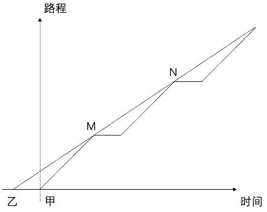

第三步，乙比甲早出发15 分钟，可知乙走3 公里用时15+30=45 分钟，全程9 公里，乙从A 地到B 地所用时间
至少为45×3=135 分钟。
因此，选择C 选项。

来源：[2022年江苏公务员考试《行测》（A类）及解析.pdf](https://github.com/dumarstoft-ship-it/xingce/blob/407016b55b49581efa3771bb59a2dee8761d982f/2022%E5%B9%B4%E6%B1%9F%E8%8B%8F%E5%85%AC%E5%8A%A1%E5%91%98%E8%80%83%E8%AF%95%E3%80%8A%E8%A1%8C%E6%B5%8B%E3%80%8B%EF%BC%88A%E7%B1%BB%EF%BC%89%E5%8F%8A%E8%A7%A3%E6%9E%90.pdf)，PDF 第 18 页。

## 第 59 题 · 数量关系

参考答案：**A**

解析
第一步，本题考查几何问题，属于几何特性类。
第二步，根据题意，如果ADE−A′D′E′与原蛋糕ABC−A′B′C′'的形状相同，且体积之比为1：3，根据三棱
柱的体积公式：V=底面积×高，因为ADE−A′D′E′与原蛋糕ABC−A′B′C′的高相同，所以底面积之比为1：
3，即△ADE 的面积与△ABC 的面积之比为1：3。
因为∠BAC=30°，不妨假设△ADE 的三边DE=a、AE=2a、AD=√3 a，△ABC 的三边BC=b、AC=2b、
AB=√3b，根据直角三角形面积比可知，S△ADE/S△ABC=[(1/2)×DE×AD]/[(1/2)×BC×AB]=(a×√3×a)/(b×√3×b)=a²/b²=1/3，即b=√3a，因
此，AE/EB=AE/(AB−AE)=2a/(√3×b−2a)=2a/(√3×√3×a−2a)=2/1。
因此，选择A 选项。

来源：[2022年江苏公务员考试《行测》（A类）及解析.pdf](https://github.com/dumarstoft-ship-it/xingce/blob/407016b55b49581efa3771bb59a2dee8761d982f/2022%E5%B9%B4%E6%B1%9F%E8%8B%8F%E5%85%AC%E5%8A%A1%E5%91%98%E8%80%83%E8%AF%95%E3%80%8A%E8%A1%8C%E6%B5%8B%E3%80%8B%EF%BC%88A%E7%B1%BB%EF%BC%89%E5%8F%8A%E8%A7%A3%E6%9E%90.pdf)，PDF 第 18 页。

## 第 60 题 · 数量关系

参考答案：**C**

解析
第一步，本题考查循环周期问题。
第二步，问最小的年龄，选项从最小的开始代入。代入D 选项，1 周岁=365 天，体力处于365÷22=16 个周
期……13 天，13 天不属于22 天的前半个周期的“高潮期”，排除。代入C 选项，2 周岁=365×2=730 天，体
力、情绪、智力分别处于730÷22=33 个周期……4 天、730÷28=26 个周期……2 天、730÷33=22 个周期……4
天，均处于每个周期的前半个周期的“高潮期”，正确。
因此，选择C 选项。

来源：[2022年江苏公务员考试《行测》（A类）及解析.pdf](https://github.com/dumarstoft-ship-it/xingce/blob/407016b55b49581efa3771bb59a2dee8761d982f/2022%E5%B9%B4%E6%B1%9F%E8%8B%8F%E5%85%AC%E5%8A%A1%E5%91%98%E8%80%83%E8%AF%95%E3%80%8A%E8%A1%8C%E6%B5%8B%E3%80%8B%EF%BC%88A%E7%B1%BB%EF%BC%89%E5%8F%8A%E8%A7%A3%E6%9E%90.pdf)，PDF 第 18 页。

## 第 61 题 · 数量关系

参考答案：**B**

解析
第一步，本题考查基础应用题。
第二步，设或得10 万元、5 万元、1 万元的人数分别为x、y、z 人。根据总人数与总的奖金可列式：x+y+z=30
①，10x+5y+z=89②，①×5－②可得4z-5x=61，由于5x 的尾数只能是0 或5，则4z 的尾数只能是1 或6，排
除C、D 选项。代入A 选项，z=14，则x=（4×14-61）÷5＜0，排除。
因此，选择B 选项。

来源：[2022年江苏公务员考试《行测》（A类）及解析.pdf](https://github.com/dumarstoft-ship-it/xingce/blob/407016b55b49581efa3771bb59a2dee8761d982f/2022%E5%B9%B4%E6%B1%9F%E8%8B%8F%E5%85%AC%E5%8A%A1%E5%91%98%E8%80%83%E8%AF%95%E3%80%8A%E8%A1%8C%E6%B5%8B%E3%80%8B%EF%BC%88A%E7%B1%BB%EF%BC%89%E5%8F%8A%E8%A7%A3%E6%9E%90.pdf)，PDF 第 18 页。

## 第 62 题 · 数量关系

参考答案：**A**

解析
第一步，本题考查钟表问题。
第二步，四个钟分别在钟楼的东西南北四个方向，所以相邻的两个钟所在的面是垂直的，要想时针垂直，只需要
时针垂直相邻钟表所在的面即可，即早上9 点，下午3 点两个时刻。
因此，选择A 选项。

来源：[2022年江苏公务员考试《行测》（A类）及解析.pdf](https://github.com/dumarstoft-ship-it/xingce/blob/407016b55b49581efa3771bb59a2dee8761d982f/2022%E5%B9%B4%E6%B1%9F%E8%8B%8F%E5%85%AC%E5%8A%A1%E5%91%98%E8%80%83%E8%AF%95%E3%80%8A%E8%A1%8C%E6%B5%8B%E3%80%8B%EF%BC%88A%E7%B1%BB%EF%BC%89%E5%8F%8A%E8%A7%A3%E6%9E%90.pdf)，PDF 第 18、19 页。

## 第 63 题 · 数量关系

参考答案：**B**

解析
第一步，本题考查工程问题中的条件类。
第二步，假设前五天徒弟的效率为x，师傅为2x，共生产零件15x，中间五天徒弟效率为x+5，共生产零件5
（x+5），后五天徒弟效率1.5（x+5），师傅2x，共生产零件7.5（x+5）+10x，所有零件总计1000 个，解得
x=25，徒弟生产的零件数为5x+5（x+5）+7.5（x+5）=500。
因此，选择B 选项。

来源：[2022年江苏公务员考试《行测》（A类）及解析.pdf](https://github.com/dumarstoft-ship-it/xingce/blob/407016b55b49581efa3771bb59a2dee8761d982f/2022%E5%B9%B4%E6%B1%9F%E8%8B%8F%E5%85%AC%E5%8A%A1%E5%91%98%E8%80%83%E8%AF%95%E3%80%8A%E8%A1%8C%E6%B5%8B%E3%80%8B%EF%BC%88A%E7%B1%BB%EF%BC%89%E5%8F%8A%E8%A7%A3%E6%9E%90.pdf)，PDF 第 19 页。

## 第 64 题 · 数量关系

参考答案：**A**

解析
第一步，本题考查基础计算问题，方程法解题。
第二步，设甲卖了x 份，乙卖了y 份，根据一共卖500 份和收入21400 元，可得方程x+y=500①；
30x+50y=21400②；解得x=180，y=320，所以差值为140。
因此，选择A 选项。

来源：[2022年江苏公务员考试《行测》（A类）及解析.pdf](https://github.com/dumarstoft-ship-it/xingce/blob/407016b55b49581efa3771bb59a2dee8761d982f/2022%E5%B9%B4%E6%B1%9F%E8%8B%8F%E5%85%AC%E5%8A%A1%E5%91%98%E8%80%83%E8%AF%95%E3%80%8A%E8%A1%8C%E6%B5%8B%E3%80%8B%EF%BC%88A%E7%B1%BB%EF%BC%89%E5%8F%8A%E8%A7%A3%E6%9E%90.pdf)，PDF 第 19 页。

## 第 65 题 · 数量关系

参考答案：**D**

解析
第一步，本题考查排列组合问题，用插空法解题。
第二步，假设三个公司分别为A、B、C，先排AB，因此共有A(2,2)×A(2,2)×A(2,2)=8 种。此时排完有三种情况，第一
种：AABB，此时只要把C 公司的两个人放入到两个A 和两个B 中间的那两个位置就可以了，共有A(2,2)=2种；第
二种：ABAB，此时形成5 个空，将两个C 放入其中，共有A(5,2)=20 种；第三种ABBA 或者BAAB，最中间的位置
必须放一个，剩下的四个位置选一个，即C(2,1)×C(4,1)=8 种。
总的情况共有8×（2+20+8）=240 种
因此，选择D 选项。

来源：[2022年江苏公务员考试《行测》（A类）及解析.pdf](https://github.com/dumarstoft-ship-it/xingce/blob/407016b55b49581efa3771bb59a2dee8761d982f/2022%E5%B9%B4%E6%B1%9F%E8%8B%8F%E5%85%AC%E5%8A%A1%E5%91%98%E8%80%83%E8%AF%95%E3%80%8A%E8%A1%8C%E6%B5%8B%E3%80%8B%EF%BC%88A%E7%B1%BB%EF%BC%89%E5%8F%8A%E8%A7%A3%E6%9E%90.pdf)，PDF 第 19 页。

## 第 66 题 · 数量关系

参考答案：**A**

解析
第一步，本题考查比赛问题。
第二步，5 只足球队进行单循环比赛，共比赛C(5,2)=10 场，10 场比赛，有输赢一场共3 分，平一场共2 分，总分
为25 分即5 胜5 平；每人打4 场比赛，冠军得12 分，只能是赢4 场；亚军最多赢一场，两场平，一场输给冠
军；故亚军得分3+1+1=5 分。
因此，选择A 选项。

来源：[2022年江苏公务员考试《行测》（A类）及解析.pdf](https://github.com/dumarstoft-ship-it/xingce/blob/407016b55b49581efa3771bb59a2dee8761d982f/2022%E5%B9%B4%E6%B1%9F%E8%8B%8F%E5%85%AC%E5%8A%A1%E5%91%98%E8%80%83%E8%AF%95%E3%80%8A%E8%A1%8C%E6%B5%8B%E3%80%8B%EF%BC%88A%E7%B1%BB%EF%BC%89%E5%8F%8A%E8%A7%A3%E6%9E%90.pdf)，PDF 第 19 页。

## 第 67 题 · 数量关系

参考答案：**D**

解析
第一步，本题考查几何问题中的立体几何类。
第二步，如图所示：

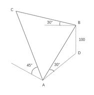

[代码描摹高清 PNG](../../../images/code_hd/529.png) · [SVG](../../../images/code_hd/529.svg)（原图为准）

AD 为水平面，AB 的垂直高度差100，即BD⊥AD，∠D 为90°，∠BAD 为30°，所以AB=2BD=200。
从整个图形的一侧观察，可得下图：

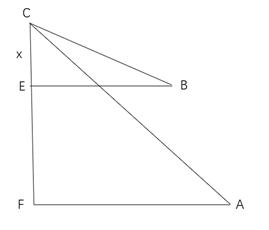

[代码描摹高清 PNG](../../../images/code_hd/998.png) · [SVG](../../../images/code_hd/998.svg)（原图为准）

BE 和AF 为水平面，CF 为垂直高度，假设CE=x，根据条件可知∠B=30°，BC=2x，EF=100，∠A 为45°，则
AF=CF=100+x，AC=√2（100+x），那么在△ABC 中，由于∠ABC 为90°，则有勾股定理
BC²+AB²=AC²，代入数值计算可得，x=100，所以C 比A 高的高度即CF=200。
因此，选择D 选项。

来源：[2022年江苏公务员考试《行测》（A类）及解析.pdf](https://github.com/dumarstoft-ship-it/xingce/blob/407016b55b49581efa3771bb59a2dee8761d982f/2022%E5%B9%B4%E6%B1%9F%E8%8B%8F%E5%85%AC%E5%8A%A1%E5%91%98%E8%80%83%E8%AF%95%E3%80%8A%E8%A1%8C%E6%B5%8B%E3%80%8B%EF%BC%88A%E7%B1%BB%EF%BC%89%E5%8F%8A%E8%A7%A3%E6%9E%90.pdf)，PDF 第 19、20 页。

## 第 68 题 · 判断推理

参考答案：**B**

解析
第一步，确定题干逻辑关系。
“山峰”中的“峰”的意思为高而尖的山头，“碳达峰”中的“峰”为最高处之意，因而后两词中的“峰”的意
思是不同的，且“山峰”是具体事物，而“碳达峰”是一个抽象概念。
第二步，辨析选项。
A 项：“世界”中的“界”是指范围，“思想界”中的“界”指“按职业或性别等所划的人群范围”，因而后两
词中的“界”的意思是不同的，“世界”和“思想界”都是抽象概念，与题干逻辑关系不一致，排除；
B 项：“海潮”中的“潮”是海水因为受了日月的引力而定时涨落的现象，“移民潮”中的“潮”是指像潮水那
样汹涌起伏的，因而后两词中的“潮”的意思是不同的，且“海潮”是具体事物，而“移民潮”是一个抽象概
念，与题干逻辑关系一致，符合；
C 项：“儿子”中的“子”专指儿子，“菜篮子”是装菜的篮子，这两个“子”都是附加在名词后，具有名词
性，意思是相同的，与题干逻辑关系不一致，排除；
D 项：“山羊”是一种羊，“领头羊”本身也是羊，只不过现引申为团体中起主导作用的人。因而，后两词中的
“羊”的意思是相同的，与题干逻辑关系不一致，排除。
因此，选择B 选项。

来源：[2022年江苏公务员考试《行测》（A类）及解析.pdf](https://github.com/dumarstoft-ship-it/xingce/blob/407016b55b49581efa3771bb59a2dee8761d982f/2022%E5%B9%B4%E6%B1%9F%E8%8B%8F%E5%85%AC%E5%8A%A1%E5%91%98%E8%80%83%E8%AF%95%E3%80%8A%E8%A1%8C%E6%B5%8B%E3%80%8B%EF%BC%88A%E7%B1%BB%EF%BC%89%E5%8F%8A%E8%A7%A3%E6%9E%90.pdf)，PDF 第 20 页。

## 第 69 题 · 判断推理

参考答案：**A**

解析
第一步，确定题干逻辑关系。
“辩护”是“论辩”的一种方式，二者属于方式对应关系，“论辩”的目的是为了达成“共识”，二者属于目的
对应关系。
第二步，辨析选项。
A 项：“签约”是“贸易”的一种方式，二者属于方式对应关系，“贸易”的目的是为了获取利益，二者属于目
的对应关系，与题干逻辑关系一致，符合；
B 项：“休学”并不是“就读”的一种方式，与题干逻辑关系不一致，排除；
C 项：“座谈”和“问卷”都是调研的一种方式，与题干逻辑关系不一致，排除；
D 项：“诊脉”是看病的一种方式，但是“看病”的目的是为了恢复健康，不是“理疗”，与题干逻辑关系不一
致，排除。
因此，选择A 选项。

来源：[2022年江苏公务员考试《行测》（A类）及解析.pdf](https://github.com/dumarstoft-ship-it/xingce/blob/407016b55b49581efa3771bb59a2dee8761d982f/2022%E5%B9%B4%E6%B1%9F%E8%8B%8F%E5%85%AC%E5%8A%A1%E5%91%98%E8%80%83%E8%AF%95%E3%80%8A%E8%A1%8C%E6%B5%8B%E3%80%8B%EF%BC%88A%E7%B1%BB%EF%BC%89%E5%8F%8A%E8%A7%A3%E6%9E%90.pdf)，PDF 第 20、21 页。

## 第 70 题 · 判断推理

参考答案：**B**

解析
第一步，确定题干逻辑关系。
“电气”是电力相关的工程总称，“煤气”是可燃烧的气体，“气”是气体。“电气”不是气体，“煤气”是一
种气体，“煤气”和“气”属于种属关系。
第二步，辨析选项。
A 项：“酸奶”是一种乳制品，“羊奶”是一种“奶”，“奶”和“羊奶”是“酸奶”的原材料，为对应关系，
排除；
B 项：“银河”不是河，“运河”是“河”的一种，与题干逻辑关系一致，符合；
C 项：“正面”不是“面”，“反面”也不是“面”，与题干逻辑不一致，排除；
D 项：“榆钱”不是“钱”，“金钱”和“钱”属于近义关系，与题干逻辑不一致，排除。
因此，选择B 选项。

来源：[2022年江苏公务员考试《行测》（A类）及解析.pdf](https://github.com/dumarstoft-ship-it/xingce/blob/407016b55b49581efa3771bb59a2dee8761d982f/2022%E5%B9%B4%E6%B1%9F%E8%8B%8F%E5%85%AC%E5%8A%A1%E5%91%98%E8%80%83%E8%AF%95%E3%80%8A%E8%A1%8C%E6%B5%8B%E3%80%8B%EF%BC%88A%E7%B1%BB%EF%BC%89%E5%8F%8A%E8%A7%A3%E6%9E%90.pdf)，PDF 第 21 页。

## 第 71 题 · 判断推理

参考答案：**A**

解析
第一步，确定题干逻辑关系。
“鬼斧神工”鬼斧神工原义是像是鬼神制作出来的。形容艺术技巧高超，非常神奇，不像是人力所能达到的。
“神奇”与“鬼斧神工”属于近义词，且二者都是褒义词。
第二步，辨析选项。
A 项：“大慈大悲”形容人心肠善良。“善良”与“大慈大悲”属于近义词，且二者都是褒义词，与题干逻辑关
系一致，符合；
B 项：“不可一世”形容人自命不凡，狂妄自大到了极点，并非指“强大”，“强大”与“不可一世”不是近义
词，与题干逻辑关系不一致，排除；
C 项：“冰天雪地”形容严冬季节到处是冰雪的景象，并非指“寒冷”，“寒冷”与“冰天雪地”不是近义词，
与题干逻辑关系不一致，排除；
D 项：“乱七八糟”形容毫无秩序及条理，乱糟糟的样子。“混乱”与“乱七八糟”属于近义词，但二者含贬
义，与题干逻辑关系不一致，排除。
因此，选择A 选项。

来源：[2022年江苏公务员考试《行测》（A类）及解析.pdf](https://github.com/dumarstoft-ship-it/xingce/blob/407016b55b49581efa3771bb59a2dee8761d982f/2022%E5%B9%B4%E6%B1%9F%E8%8B%8F%E5%85%AC%E5%8A%A1%E5%91%98%E8%80%83%E8%AF%95%E3%80%8A%E8%A1%8C%E6%B5%8B%E3%80%8B%EF%BC%88A%E7%B1%BB%EF%BC%89%E5%8F%8A%E8%A7%A3%E6%9E%90.pdf)，PDF 第 21 页。

## 第 72 题 · 判断推理

参考答案：**C**

解析
第一步，确定题干逻辑关系。
“暖冬”是“冬”的一种情况，二者属于种属关系，且“暖冬”是在对“冬”做分类。
第二步，辨析选项。
A 项：“妻”意为男子的配偶；“未婚妻”指已与某男子订婚尚未结婚的女子，是“妻”的前期状态，二者属于
对应关系，与题干逻辑关系不一致，排除；
B 项：“植物人”是与植物生存状态相似的特殊的人体状态，“植物人”不是在对“人”做分类，而是“人”的
一种病态状态，与题干逻辑关系不一致，排除；
C 项：“平价菜”是以低于市场价位的价格出售的“菜”，二者属于种属关系，且“平价菜”是在对“菜”做分
类，与题干逻辑关系一致，符合；
D 项：“书”指装订成册的图书和文字，在狭义上的理解是带有文字和图像、纸张的集合；“有声书”是一种个
人或多人依据文稿并借着不同的声音表情和录音格式所录制的作品，常见的有声书格式有录音带、CD、数位档
（例如MP3），“有声书”不是在给“书”做分类，而是“书”发展之后的一种衍生状态，与题干逻辑关系不一
致，排除。
因此，选择C 选项。

来源：[2022年江苏公务员考试《行测》（A类）及解析.pdf](https://github.com/dumarstoft-ship-it/xingce/blob/407016b55b49581efa3771bb59a2dee8761d982f/2022%E5%B9%B4%E6%B1%9F%E8%8B%8F%E5%85%AC%E5%8A%A1%E5%91%98%E8%80%83%E8%AF%95%E3%80%8A%E8%A1%8C%E6%B5%8B%E3%80%8B%EF%BC%88A%E7%B1%BB%EF%BC%89%E5%8F%8A%E8%A7%A3%E6%9E%90.pdf)，PDF 第 21、22 页。

## 第 73 题 · 判断推理

参考答案：**C**

解析
第一步，确定题干逻辑关系。
“灭蚊剂”的主要用途是为了消灭“蚊子”，二者属于对应关系。
第二步，辨析选项。
A 项：“居家隔离”是为了阻断病毒传播，并不能消灭病毒，与题干逻辑关系不一致，排除；
B 项：“市场经济”不能解决“垄断”问题，相反，在“市场经济”下可能出现“垄断”现象，与题干逻辑关系
不一致，排除；
C 项：“首问负责”制是政府为解决政府工作人员面对群众来访“推诿”扯皮而制定的制度，二者属于对应关
系，与题干逻辑关系一致，符合；
D 项：“民意测验”是指用来测定民众对政治或社会问题的主观认识和感受的社会调查方法，它并不解决“分
歧”问题，与题干逻辑关系不一致，排除。
因此，选择C 选项。

来源：[2022年江苏公务员考试《行测》（A类）及解析.pdf](https://github.com/dumarstoft-ship-it/xingce/blob/407016b55b49581efa3771bb59a2dee8761d982f/2022%E5%B9%B4%E6%B1%9F%E8%8B%8F%E5%85%AC%E5%8A%A1%E5%91%98%E8%80%83%E8%AF%95%E3%80%8A%E8%A1%8C%E6%B5%8B%E3%80%8B%EF%BC%88A%E7%B1%BB%EF%BC%89%E5%8F%8A%E8%A7%A3%E6%9E%90.pdf)，PDF 第 22 页。

## 第 74 题 · 判断推理

参考答案：**D**

解析
第一步，确定题干逻辑关系。
“水中捞月”指到水中去捞月亮。比喻去做根本做不到的事情，只能“白费功夫”，二者属于比喻象征义关系，
且“水中捞月”含贬义。
第二步，辨析选项。
A 项：“霸王之兵”是兵法的内容之一，“勇往直前”指勇敢地一直向前进，二者无明显逻辑关系，排除；
B 项：“天涯海角”形容极偏远的地方，“杳无音信”形容一直不知道对方的消息，二者无明显逻辑关系，排
除；
C 项：“棋逢对手”比喻争斗的双方本领“不相上下”，二者属于比喻象征义关系，但“棋逢对手”是中性成
语，排除；
D 项：“蚍蜉撼树”比喻力量本来很微弱，而又妄想动摇强大的事物，“不自量力”，二者属于比喻象征义关
系，且“蚍蜉撼树”含贬义，与题干逻辑关系一致，符合。
因此，选择D 选项。

来源：[2022年江苏公务员考试《行测》（A类）及解析.pdf](https://github.com/dumarstoft-ship-it/xingce/blob/407016b55b49581efa3771bb59a2dee8761d982f/2022%E5%B9%B4%E6%B1%9F%E8%8B%8F%E5%85%AC%E5%8A%A1%E5%91%98%E8%80%83%E8%AF%95%E3%80%8A%E8%A1%8C%E6%B5%8B%E3%80%8B%EF%BC%88A%E7%B1%BB%EF%BC%89%E5%8F%8A%E8%A7%A3%E6%9E%90.pdf)，PDF 第 22 页。

## 第 75 题 · 判断推理

参考答案：**B**

解析
分别将选项代入题干，确定逻辑关系。
A 项：“韩国”是“东北亚”的一部分，二者属于组成关系；“树墩”指树身锯去后剩下的靠近根部的一段，
“树冠”指乔木树干的上部及其枝叶，“树墩”与“树冠”均是树的组成部分，二者属于并列关系，前后逻辑关
系不一致，排除；
B 项：“东北亚”和“南亚”都是亚洲的组成部分，二者属于并列关系中的反对关系；“树根”和“树冠”都是
树的组成部分，二者属于并列关系中的反对关系，前后逻辑关系一致，符合；
C 项：“东北亚”是“东半球”的一部分，二者属于组成关系；“树洞”是树木损失后的空心，“树洞”与“树
冠”均是树的组成部分，二者属于并列关系，前后逻辑关系不一致，排除；
D 项：“日本海”是“东北亚”的一部分，二者属于组成关系；“树冠”可以形成“树荫”，二者属于对应关
系，前后逻辑关系不一致，排除。
因此，选择B 选项。

来源：[2022年江苏公务员考试《行测》（A类）及解析.pdf](https://github.com/dumarstoft-ship-it/xingce/blob/407016b55b49581efa3771bb59a2dee8761d982f/2022%E5%B9%B4%E6%B1%9F%E8%8B%8F%E5%85%AC%E5%8A%A1%E5%91%98%E8%80%83%E8%AF%95%E3%80%8A%E8%A1%8C%E6%B5%8B%E3%80%8B%EF%BC%88A%E7%B1%BB%EF%BC%89%E5%8F%8A%E8%A7%A3%E6%9E%90.pdf)，PDF 第 22 页。

## 第 76 题 · 判断推理

参考答案：**D**

解析
第一步，确定题干逻辑关系。
“呼气”与“吸气”是呼吸的两个过程，且呼吸只有“呼气”和“吸气”这两个过程，二者属于并列关系中的矛
盾关系。
第二步，辨析选项。
A 项：“救火”指对火灾现场抢救作，与“灭火”意思相近，二者属于近义关系，排除；
B 项：“治病”和“养病”都是针对病症的方式，“治病”是有针对性的治疗，“养病”是休养和调理身体，
“养病”与“治病”存在交叉，二者属于交叉关系，排除；
C 项：“出神”指因精神过度集中而发呆，强调神态格外专注，到了发呆的地步，“入神”指对眼前的事物发生
浓厚的兴趣而注意力高度集中，强调注意力格外集中，到了入迷的地步，两词都可以形容人的心神专注，二者属
于近义关系，排除；
D 项：“出世”和“入世”是两种不同的人生态度，“出世”指远离尘世凡俗，“入世”指进入尘世，二者属于
并列关系中的矛盾关系，与题干逻辑关系一致，符合。
因此，选择D 选项。

来源：[2022年江苏公务员考试《行测》（A类）及解析.pdf](https://github.com/dumarstoft-ship-it/xingce/blob/407016b55b49581efa3771bb59a2dee8761d982f/2022%E5%B9%B4%E6%B1%9F%E8%8B%8F%E5%85%AC%E5%8A%A1%E5%91%98%E8%80%83%E8%AF%95%E3%80%8A%E8%A1%8C%E6%B5%8B%E3%80%8B%EF%BC%88A%E7%B1%BB%EF%BC%89%E5%8F%8A%E8%A7%A3%E6%9E%90.pdf)，PDF 第 22、23 页。

## 第 77 题 · 判断推理

参考答案：**C**

解析
第一步，确定题干逻辑关系。
“良禽择木而栖”，意思是好的鸟要选择树木栖息，“贤臣择主而事”，意思是贤明的臣子要选择君主侍奉，二
者语义相近，属于近义关系。
第二步，辨析选项。
A 项：“关关雎鸠在河之洲”，意思是关关和鸣的雎鸠，栖息在河中的小洲，“窈窕淑女君子好逑”，意思是贤
良美好的女子，是君子好的配偶，二者不属于近义关系，排除；
B 项：“树欲静而风不止”，意思是树希望静止不摆，风却不停息，“子欲养而亲不待”，意思是子女想赡养父
母，父母却已离去了，二者不属于近义关系，排除；
C 项：“天有不测风云”，“人有旦夕祸福”，都比喻有些灾祸的发生，事先是无法预料的，二者语义相近，属
于近义关系，与题干逻辑关系一致，符合；
D 项：“士为知己者死”，意思是男人愿意为赏识自己、了解自己的人献身，“女为悦己者容”，意思是女人愿
意为欣赏自己、喜欢自己的人而打扮，二者不属于近义关系，排除。
因此，选择C 选项。

来源：[2022年江苏公务员考试《行测》（A类）及解析.pdf](https://github.com/dumarstoft-ship-it/xingce/blob/407016b55b49581efa3771bb59a2dee8761d982f/2022%E5%B9%B4%E6%B1%9F%E8%8B%8F%E5%85%AC%E5%8A%A1%E5%91%98%E8%80%83%E8%AF%95%E3%80%8A%E8%A1%8C%E6%B5%8B%E3%80%8B%EF%BC%88A%E7%B1%BB%EF%BC%89%E5%8F%8A%E8%A7%A3%E6%9E%90.pdf)，PDF 第 23 页。

## 第 78 题 · 判断推理

参考答案：**B**

解析
第一步，观察特征。
组成元素不同，优先考虑数量类或属性类。图形均出现交点，考虑数点。
第二步，一条式，从左到右找规律。
整体观察发现，交点个数依次为：2、3、4、5、6、？，呈等差规律，因此问号处应选择交点个数为7 的图形，
只有B 项符合。
因此，选择B 选项。

来源：[2022年江苏公务员考试《行测》（A类）及解析.pdf](https://github.com/dumarstoft-ship-it/xingce/blob/407016b55b49581efa3771bb59a2dee8761d982f/2022%E5%B9%B4%E6%B1%9F%E8%8B%8F%E5%85%AC%E5%8A%A1%E5%91%98%E8%80%83%E8%AF%95%E3%80%8A%E8%A1%8C%E6%B5%8B%E3%80%8B%EF%BC%88A%E7%B1%BB%EF%BC%89%E5%8F%8A%E8%A7%A3%E6%9E%90.pdf)，PDF 第 23 页。

## 第 79 题 · 判断推理

参考答案：**D**

解析
第一步，观察特征。
图形组成元素相同，但无动态位置类规律，由于图形均由黑白求组成，可以考虑黑白求相关考点。
第二步，辨析选项。
观察发现，题干图形黑球个数均为3，排除B 项；继续观察发现，白色小球的部分数均为2，排除AC 项。
因此，选择D 选项。

来源：[2022年江苏公务员考试《行测》（A类）及解析.pdf](https://github.com/dumarstoft-ship-it/xingce/blob/407016b55b49581efa3771bb59a2dee8761d982f/2022%E5%B9%B4%E6%B1%9F%E8%8B%8F%E5%85%AC%E5%8A%A1%E5%91%98%E8%80%83%E8%AF%95%E3%80%8A%E8%A1%8C%E6%B5%8B%E3%80%8B%EF%BC%88A%E7%B1%BB%EF%BC%89%E5%8F%8A%E8%A7%A3%E6%9E%90.pdf)，PDF 第 23 页。

## 第 80 题 · 判断推理

参考答案：**A**

解析
第一步，观察特征。
组成元素不同，每个图形均两部分构成，并且为内外结构。
第二步，一条式，从左到右找规律。
第1 个图中内部图形和外部图形分别只有一条对称轴，且两个图形的对称轴为垂直关系，后面2 图，3 图，4 图，
5 图中的内部图形和外部图形分别也只有一条对称轴，且两个图形的对称轴为垂直关系，所以问号处应选择一个
内部图形和外部图形分别只有一条对称轴，且两个图形的对称轴为垂直关系的图形，A 项中内部图形和外部图形
的对称轴为垂直关系，B 项两个图形不是内外关系，C 项内部图形和外部图形的对称轴是重合关系，D 项内部图形
和外部图形的对称轴为重合关系，如下图所示，只有A 项符合。

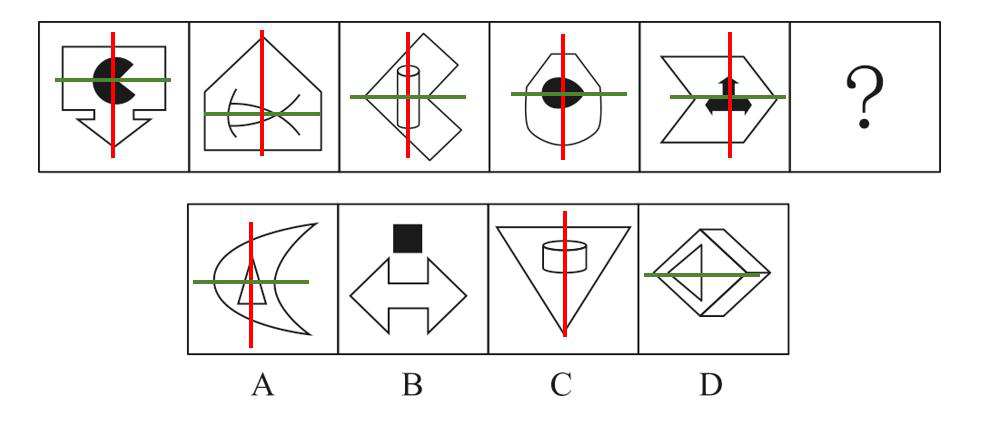

因此，选择A 选项。

来源：[2022年江苏公务员考试《行测》（A类）及解析.pdf](https://github.com/dumarstoft-ship-it/xingce/blob/407016b55b49581efa3771bb59a2dee8761d982f/2022%E5%B9%B4%E6%B1%9F%E8%8B%8F%E5%85%AC%E5%8A%A1%E5%91%98%E8%80%83%E8%AF%95%E3%80%8A%E8%A1%8C%E6%B5%8B%E3%80%8B%EF%BC%88A%E7%B1%BB%EF%BC%89%E5%8F%8A%E8%A7%A3%E6%9E%90.pdf)，PDF 第 23、24 页。

## 第 81 题 · 判断推理

参考答案：**D**

解析
第一步，观察特征。
组成元素相同，每个图形均由若干小圆和小三角形组成，小三角形在正方形中发生位置变化，考虑平移。
第二步，一条式，从左到右找规律。
小三角形沿着正方形四个顶点顺时针依次移动一个顶点的位置，问号处应移动到正方形左上顶点的位置，排除A
项；进一步观察，正方形中间的小圆个数发生变化，分别为1、2、1、2、1，所以问号处的正方形中间的小圆个
数为2，排除B 项；外圈小圆总数均为6 个，排除C 项，只有D 项符合。
因此，选择D 选项。

来源：[2022年江苏公务员考试《行测》（A类）及解析.pdf](https://github.com/dumarstoft-ship-it/xingce/blob/407016b55b49581efa3771bb59a2dee8761d982f/2022%E5%B9%B4%E6%B1%9F%E8%8B%8F%E5%85%AC%E5%8A%A1%E5%91%98%E8%80%83%E8%AF%95%E3%80%8A%E8%A1%8C%E6%B5%8B%E3%80%8B%EF%BC%88A%E7%B1%BB%EF%BC%89%E5%8F%8A%E8%A7%A3%E6%9E%90.pdf)，PDF 第 24 页。

## 第 82 题 · 判断推理

参考答案：**C**

解析
第一步，观察特征。
组成元素不同，可以考虑数量类，图形平行线特征较为明显，考虑平行线。
第二步，九宫格，优先横着看。
第一行，平行线的组数依次为1 组、2 组、3 组，验证第二行，规律成立，运用到第三行中，选择有3 组平行线的
规律的图形，如下图所示，只有C 项符合。

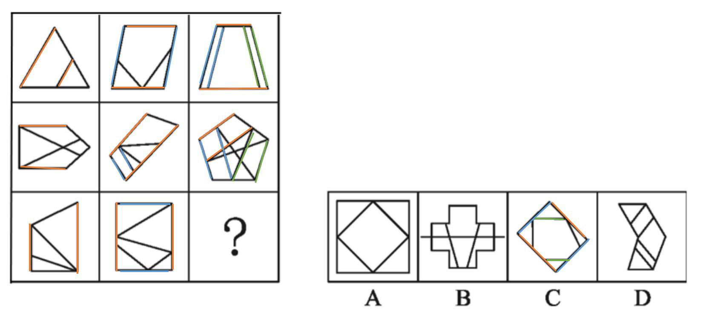

因此，选择C 选项。

来源：[2022年江苏公务员考试《行测》（A类）及解析.pdf](https://github.com/dumarstoft-ship-it/xingce/blob/407016b55b49581efa3771bb59a2dee8761d982f/2022%E5%B9%B4%E6%B1%9F%E8%8B%8F%E5%85%AC%E5%8A%A1%E5%91%98%E8%80%83%E8%AF%95%E3%80%8A%E8%A1%8C%E6%B5%8B%E3%80%8B%EF%BC%88A%E7%B1%BB%EF%BC%89%E5%8F%8A%E8%A7%A3%E6%9E%90.pdf)，PDF 第 24、25 页。

## 第 83 题 · 判断推理

参考答案：**B**

解析
第一步，观察特征。
组成元素相同，考虑动态位置类。
第二步，九宫格，横向规律较为常见，优先考虑。
观察第一行，图形都是时钟，只是时针分针方向不同，图一逆时针旋转90°，得到图二，图二经过上下翻转，得
到图三。第二行经验证符合此规律。第三行图2 上下翻转之后得到选项B。
因此，选择B 选项。

来源：[2022年江苏公务员考试《行测》（A类）及解析.pdf](https://github.com/dumarstoft-ship-it/xingce/blob/407016b55b49581efa3771bb59a2dee8761d982f/2022%E5%B9%B4%E6%B1%9F%E8%8B%8F%E5%85%AC%E5%8A%A1%E5%91%98%E8%80%83%E8%AF%95%E3%80%8A%E8%A1%8C%E6%B5%8B%E3%80%8B%EF%BC%88A%E7%B1%BB%EF%BC%89%E5%8F%8A%E8%A7%A3%E6%9E%90.pdf)，PDF 第 25 页。

## 第 84 题 · 判断推理

参考答案：**A**

解析
第一步，明确设问内容。
题目要求各图平移后拼合。
第二步，观察图形特征，寻找平行等长边，将其拼合后得到如下图所示：

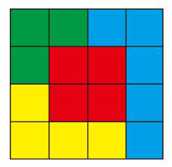

因此，选择A 选项。

来源：[2022年江苏公务员考试《行测》（A类）及解析.pdf](https://github.com/dumarstoft-ship-it/xingce/blob/407016b55b49581efa3771bb59a2dee8761d982f/2022%E5%B9%B4%E6%B1%9F%E8%8B%8F%E5%85%AC%E5%8A%A1%E5%91%98%E8%80%83%E8%AF%95%E3%80%8A%E8%A1%8C%E6%B5%8B%E3%80%8B%EF%BC%88A%E7%B1%BB%EF%BC%89%E5%8F%8A%E8%A7%A3%E6%9E%90.pdf)，PDF 第 25 页。

## 第 85 题 · 判断推理

参考答案：**D**

解析
第一步，明确设问内容。
题目要求各个面平移后拼合。
第二步，观察图形特征，寻找平行且等长边及最特殊的角或边，将其拼合后得到如下图所示：

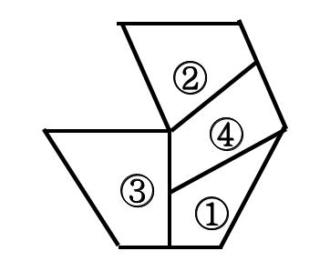

因此，选择D 选项。

来源：[2022年江苏公务员考试《行测》（A类）及解析.pdf](https://github.com/dumarstoft-ship-it/xingce/blob/407016b55b49581efa3771bb59a2dee8761d982f/2022%E5%B9%B4%E6%B1%9F%E8%8B%8F%E5%85%AC%E5%8A%A1%E5%91%98%E8%80%83%E8%AF%95%E3%80%8A%E8%A1%8C%E6%B5%8B%E3%80%8B%EF%BC%88A%E7%B1%BB%EF%BC%89%E5%8F%8A%E8%A7%A3%E6%9E%90.pdf)，PDF 第 25、26 页。

## 第 86 题 · 判断推理

参考答案：**A**

解析
第一步，明确设问内容。
题目要求各面平移后拼合。
第二步，观察图形特征，寻找凹凸程度相匹配的边，将其拼合后得到如下图所示：

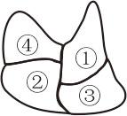

[代码描摹高清 PNG](../../../images/code_hd/85.png) · [SVG](../../../images/code_hd/85.svg)（原图为准）

因此，选择A 选项。

来源：[2022年江苏公务员考试《行测》（A类）及解析.pdf](https://github.com/dumarstoft-ship-it/xingce/blob/407016b55b49581efa3771bb59a2dee8761d982f/2022%E5%B9%B4%E6%B1%9F%E8%8B%8F%E5%85%AC%E5%8A%A1%E5%91%98%E8%80%83%E8%AF%95%E3%80%8A%E8%A1%8C%E6%B5%8B%E3%80%8B%EF%BC%88A%E7%B1%BB%EF%BC%89%E5%8F%8A%E8%A7%A3%E6%9E%90.pdf)，PDF 第 26 页。

## 第 87 题 · 判断推理

参考答案：**D**

解析
第一步，明确设问内容。
题目中要求各图在可平移、旋转、翻转的情况下拼合而成。
第二步，观察图形特征，按下图所示进行拼合：

因此，选择D 选项。

来源：[2022年江苏公务员考试《行测》（A类）及解析.pdf](https://github.com/dumarstoft-ship-it/xingce/blob/407016b55b49581efa3771bb59a2dee8761d982f/2022%E5%B9%B4%E6%B1%9F%E8%8B%8F%E5%85%AC%E5%8A%A1%E5%91%98%E8%80%83%E8%AF%95%E3%80%8A%E8%A1%8C%E6%B5%8B%E3%80%8B%EF%BC%88A%E7%B1%BB%EF%BC%89%E5%8F%8A%E8%A7%A3%E6%9E%90.pdf)，PDF 第 26 页。

## 第 88 题 · 判断推理

参考答案：**C**

解析
第一步，明确设问内容。
题目中要求各图在可平移、旋转、翻转的情况下拼合而成。
第二步，观察图形特征，按下图所示进行拼合：

因此，选择C 选项。

来源：[2022年江苏公务员考试《行测》（A类）及解析.pdf](https://github.com/dumarstoft-ship-it/xingce/blob/407016b55b49581efa3771bb59a2dee8761d982f/2022%E5%B9%B4%E6%B1%9F%E8%8B%8F%E5%85%AC%E5%8A%A1%E5%91%98%E8%80%83%E8%AF%95%E3%80%8A%E8%A1%8C%E6%B5%8B%E3%80%8B%EF%BC%88A%E7%B1%BB%EF%BC%89%E5%8F%8A%E8%A7%A3%E6%9E%90.pdf)，PDF 第 26、27 页。

## 第 89 题 · 判断推理

参考答案：**B**

解析
第一步，本题考查四面体重构问题。

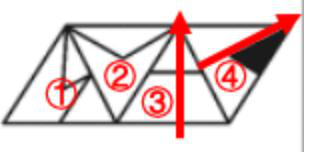

第二步，对题干中的四个面进行标号，如下图所示： 第三步，
分析选项：

A 项： 面①位于面④的左侧，题干图形中面④左侧的面应该是面②，与题干不符合，排除；

B 项： 面④的右侧是面①，符合题干；

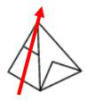

C 项： 面③的右侧是面②，题干中面③的右侧是面④，与题干不符合，排除；

D 项： 面④的右侧是面①，但是面①中的折线相交于两个面之间的公共棱的中
点处，与题干不符合，排除。
因此，选择B 选项。

来源：[2022年江苏公务员考试《行测》（A类）及解析.pdf](https://github.com/dumarstoft-ship-it/xingce/blob/407016b55b49581efa3771bb59a2dee8761d982f/2022%E5%B9%B4%E6%B1%9F%E8%8B%8F%E5%85%AC%E5%8A%A1%E5%91%98%E8%80%83%E8%AF%95%E3%80%8A%E8%A1%8C%E6%B5%8B%E3%80%8B%EF%BC%88A%E7%B1%BB%EF%BC%89%E5%8F%8A%E8%A7%A3%E6%9E%90.pdf)，PDF 第 27 页。

## 第 90 题 · 判断推理

参考答案：**C**

解析
第一步，本题考查四面体折纸盒。
对题干中的各面进行标号。如下图所示：

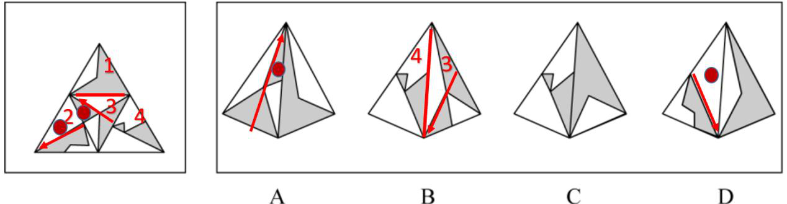

第
二步，分析选项。
A 项：在左侧面画箭头，如图所示，选项中圆圈所标识的小三角形在箭头的右侧，题干原图中面3 画箭头，圆圈
所标识的小三角形在箭头的左侧，所以选项左侧面与题干不一致，排除；
B 项：在面3 上画箭头，如图所示，选项中该箭头右侧为面4，而题干原图中，该箭头右侧应该为面1，方向不一
致，排除；
C 项：左侧面为面4，右侧面为面1，与选项一致，当选；
D 项：在左侧面上画箭头，如图所示，选项中圆圈标识的白色三角形在箭头左侧，而题干原图中圆圈标识的白色
三角形在箭头右侧，展开图与选项不一致，排除。
因此，选择C 选项。

来源：[2022年江苏公务员考试《行测》（A类）及解析.pdf](https://github.com/dumarstoft-ship-it/xingce/blob/407016b55b49581efa3771bb59a2dee8761d982f/2022%E5%B9%B4%E6%B1%9F%E8%8B%8F%E5%85%AC%E5%8A%A1%E5%91%98%E8%80%83%E8%AF%95%E3%80%8A%E8%A1%8C%E6%B5%8B%E3%80%8B%EF%BC%88A%E7%B1%BB%EF%BC%89%E5%8F%8A%E8%A7%A3%E6%9E%90.pdf)，PDF 第 28 页。

## 第 91 题 · 判断推理

参考答案：**A**

解析
第一步，本题考查折纸盒。
对展开图中的各面进行编号，如下图所示：

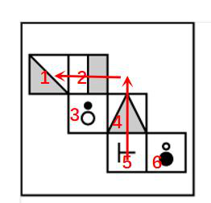

第二步，分析选项。
A 项：选项与题干中面的相对位置关系一致，当选；
B 项：面2 具有明显的方向性，从阴影部分向白色部分画箭头判定方向，面2 的左侧为面3，选项B 用相同的方
式画箭头，面2 的左侧为面6，排除：

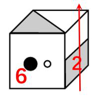

C 项：在面4 上画箭头，题干面4 右侧为面6，并且移面之后，面6 的白色小圆贴近面4，选项中面4 画箭头，
右侧为面6，但是两个圆纵向排布，位置不一致，排除；

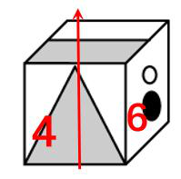

D 项：面2 画箭头，题干中左侧面为面3，选项中，面3 在箭头右侧，位置不一致，排除。

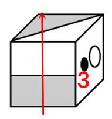

因此，选择A 选项。

来源：[2022年江苏公务员考试《行测》（A类）及解析.pdf](https://github.com/dumarstoft-ship-it/xingce/blob/407016b55b49581efa3771bb59a2dee8761d982f/2022%E5%B9%B4%E6%B1%9F%E8%8B%8F%E5%85%AC%E5%8A%A1%E5%91%98%E8%80%83%E8%AF%95%E3%80%8A%E8%A1%8C%E6%B5%8B%E3%80%8B%EF%BC%88A%E7%B1%BB%EF%BC%89%E5%8F%8A%E8%A7%A3%E6%9E%90.pdf)，PDF 第 28、29 页。

## 第 92 题 · 判断推理

参考答案：**C**

解析
第一步，本题考查折纸盒。
展开图中的各面进行编号，如下图所示：

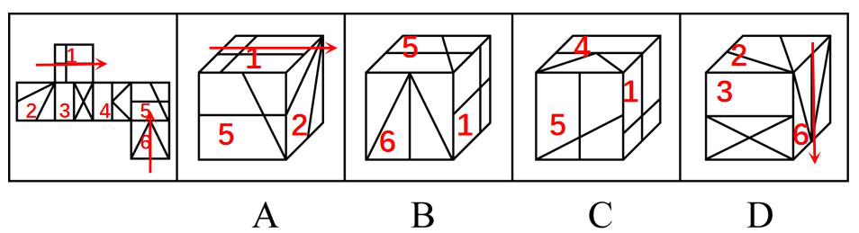

第二步，分析选项。
A 项：选择有方向性的面1 画箭头，如上图所示，题干箭头右侧为面3，A 项箭头右侧为面5，位置关系不一致，
排除。
B 项：选项中出现的面为图1、5、6，面1 和面6 在展开图中为相对面，不可能同时出现，位置不一致，排除。
C 项：选项与题干中面的相对位置关系一致，符合。
D 项：选择方向性的面6 画箭头，题干中经过移面，箭头右侧为面2，选项中箭头右侧为面3,，位置不一致，排
除。
因此，选择C 选项。

来源：[2022年江苏公务员考试《行测》（A类）及解析.pdf](https://github.com/dumarstoft-ship-it/xingce/blob/407016b55b49581efa3771bb59a2dee8761d982f/2022%E5%B9%B4%E6%B1%9F%E8%8B%8F%E5%85%AC%E5%8A%A1%E5%91%98%E8%80%83%E8%AF%95%E3%80%8A%E8%A1%8C%E6%B5%8B%E3%80%8B%EF%BC%88A%E7%B1%BB%EF%BC%89%E5%8F%8A%E8%A7%A3%E6%9E%90.pdf)，PDF 第 29、30 页。

## 第 93 题 · 判断推理

参考答案：**C**

解析
第一步，确定题型。
根据提问方式中的“支持”，确定为加强论证。
第二步，找论点和论据。
论点：有专家指出，中国已经是全球变绿的最重要的力量之一。
论据：无。
第三步，辨析选项。
A 项：无关选项。该项指出中国西南地区和东北地区的快速造林对我国木材行业进口方面的好处，而论点讨论的
内容为中国是全球变绿的重要力量，与论点内容不相关。
B 项：不明确项。该项说明了中国的绿色植被覆盖了过去的沙漠化，但是不明确中国是否是全球变绿的重要力量
之一，不具有加强作用。
C 项：增加论据。该项说明中国虽然植被占比很少，但是全球植被面积净增长的25%来自中国，说明贡献的力量
比较大，具有加强作用。
D 项：无关选项。该项指出有些国家和地区毁林开荒的危害，而论点讨论的内容为中国是全球变绿的重要力量，
与论点论题不一致，无法加强。
因此，选择C 选项。

来源：[2022年江苏公务员考试《行测》（A类）及解析.pdf](https://github.com/dumarstoft-ship-it/xingce/blob/407016b55b49581efa3771bb59a2dee8761d982f/2022%E5%B9%B4%E6%B1%9F%E8%8B%8F%E5%85%AC%E5%8A%A1%E5%91%98%E8%80%83%E8%AF%95%E3%80%8A%E8%A1%8C%E6%B5%8B%E3%80%8B%EF%BC%88A%E7%B1%BB%EF%BC%89%E5%8F%8A%E8%A7%A3%E6%9E%90.pdf)，PDF 第 30 页。

## 第 94 题 · 判断推理

参考答案：**B**

解析
第一步，确定题型。
根据提问方式中的“最能质疑”，确定为削弱论证题。
第二步，找论点和论据。
论点：各种方言作品大行其道，其实不利于普通话在全国范围内的使用和推广。
论据：各种方言演绎的段子大量涌入影视作品，使从小生长在普通话环境里的人，也会觉得亲切兴起了一股学习
方言的热潮。
第三步，辨析选项。
A 项：保护传承方言与影视作品中的方言是否不利于普通话在全国范围内的使用和推广没有关系，不具有削弱作
用。
B 项：增加论据否定论点，说明即使人们学习了方言，也不影响普通话在公共场所的使用和推广。
C 项：论点说的是方言作品不利于普通话在全国范围内的使用推广，而选项说短时间内不需要也很难恢复方言的
活力，不具有削弱作用，排除;
D 项：论点说的是方言作品不利于普通话在全国范围内的使用推广，选项说的是方言承载着人们的乡土之情，是
方言的作用，不具有削弱作用，排除。
因此，选择B 选项。

来源：[2022年江苏公务员考试《行测》（A类）及解析.pdf](https://github.com/dumarstoft-ship-it/xingce/blob/407016b55b49581efa3771bb59a2dee8761d982f/2022%E5%B9%B4%E6%B1%9F%E8%8B%8F%E5%85%AC%E5%8A%A1%E5%91%98%E8%80%83%E8%AF%95%E3%80%8A%E8%A1%8C%E6%B5%8B%E3%80%8B%EF%BC%88A%E7%B1%BB%EF%BC%89%E5%8F%8A%E8%A7%A3%E6%9E%90.pdf)，PDF 第 30 页。

## 第 95 题 · 判断推理

参考答案：**A**

解析
第一步，确定题型。
根据提问方式中的“解释”，确定为原因解释。
第二步，分析题干。
题干现象为：某企业重视专业技术人才，今年招聘人数增加了，然而招聘的工人很少来自甲职业技术学院，且无
培训经验。
第三步，辨析选项。
A 项：该企业增设了技术培训部门，用来培训新招聘的机械工人，这举措代替了甲职业技术学院的培训功能，并
可以为企业减少人力成本，可以解释，符合。
B 项：AI 的应用，指人工智能的应用，如果AI 代替人工，应该减少招聘机械工人的总数，而非明显增加，排
除；
C 项：文章未提到乙学院，排除；
D 项：很多没有上过职业技术学院的工人很有才华，不等于技术过硬，不符合该企业“致力于专业技术人才队伍
建设”的理念，排除。
因此，选择A 选项。

来源：[2022年江苏公务员考试《行测》（A类）及解析.pdf](https://github.com/dumarstoft-ship-it/xingce/blob/407016b55b49581efa3771bb59a2dee8761d982f/2022%E5%B9%B4%E6%B1%9F%E8%8B%8F%E5%85%AC%E5%8A%A1%E5%91%98%E8%80%83%E8%AF%95%E3%80%8A%E8%A1%8C%E6%B5%8B%E3%80%8B%EF%BC%88A%E7%B1%BB%EF%BC%89%E5%8F%8A%E8%A7%A3%E6%9E%90.pdf)，PDF 第 30、31 页。

## 第 96 题 · 判断推理

参考答案：**B**

解析
第一步，确定题型。
根据提问方式中的“最能支持”，确定为加强论证选是题。
第二步，找论点和论据。
论点：有专家据此指出，诗中首句的“秋月”其实应为“秋色”。
论据：在一般不对原文做修改的宋清两朝的诸多类书中诗首句“秋月”皆作“秋色”。
第三步，辨析选项。
A 项：不明确项。选项中说《望洞庭》为经典名作，历朝历代众口传诵，期间难免出现不同的版本，给出了一种
可能为“秋色”的解释，但可信度存疑，没有直接指出“秋月”为何应为“秋色”，另该选项侧重强调版本，并
非强调对于“秋色”“秋月”两词的推敲，不具有加强作用。
B 项：增加论据。选项中说月光下很难分辨山水的不同色彩，翠色，白银盘、青螺皆是白天的景观，通过现实情
景与逻辑分析诗句中如果为“秋月”后续对于景色的描写不符合常理，具有加强作用。
C 项：不明确项。选项中说洞庭秋色是历代文人所关注的美景，该诗强调秋色之美也在常理之中，只是解释存在
“秋色”这种可能，但并未具体解释“秋月”为何不合常理，应该为“秋色”所替换，不具有加强作用。
D 项：无关选项。选项中说学术界公认这首诗，描写了洞庭湖的优美景色，应是诗人对洞庭湖的实景描，该项强
调了诗句描写的景物，但对于“秋色”与“秋月”的分歧并未提及，不具有加强作用。
因此，选择B 选项。

来源：[2022年江苏公务员考试《行测》（A类）及解析.pdf](https://github.com/dumarstoft-ship-it/xingce/blob/407016b55b49581efa3771bb59a2dee8761d982f/2022%E5%B9%B4%E6%B1%9F%E8%8B%8F%E5%85%AC%E5%8A%A1%E5%91%98%E8%80%83%E8%AF%95%E3%80%8A%E8%A1%8C%E6%B5%8B%E3%80%8B%EF%BC%88A%E7%B1%BB%EF%BC%89%E5%8F%8A%E8%A7%A3%E6%9E%90.pdf)，PDF 第 31 页。

## 第 97 题 · 判断推理

参考答案：**C**

解析
第一步，确定题型。
根据题干关联词“至少”等，确定为翻译推理。
第二步，翻译题干。
①丙和丁二选一
②甲或乙
③甲和丁二选一
④丙→乙
⑤甲、戊、己三选二
第三步，进行推理。
①③都出现了丁，可以从丁入手，分为丁被录用和丁没被录用两种情况。丁被录用时，由①③知甲和丙都没被录
用，再结合②，可知乙被录用，根据⑤，戊和己都被录用，那么共录用4 人。丁没被录用时，由①③可知，甲和
丙都被录用了，由④知，乙也被录用了，所以甲乙丙都被录用了，再结合⑤可知：戊、己中有一人被录用，所以
共录用4 人。
因此，选择C 选项。

来源：[2022年江苏公务员考试《行测》（A类）及解析.pdf](https://github.com/dumarstoft-ship-it/xingce/blob/407016b55b49581efa3771bb59a2dee8761d982f/2022%E5%B9%B4%E6%B1%9F%E8%8B%8F%E5%85%AC%E5%8A%A1%E5%91%98%E8%80%83%E8%AF%95%E3%80%8A%E8%A1%8C%E6%B5%8B%E3%80%8B%EF%BC%88A%E7%B1%BB%EF%BC%89%E5%8F%8A%E8%A7%A3%E6%9E%90.pdf)，PDF 第 31、32 页。

## 第 98 题 · 判断推理

参考答案：**C**

解析
第一步，确定题型。
题干有明显的信息匹配特征，确定为分析推理。
第二步，分析条件，进行推理。
由题干可知，①张全猜错了，②其余3 人分别猜对了1 个。
A 项：王全都猜错了，不符合其余3 人分别猜对了1 个，排除；
B 项：王猜对了2 个，不符合其余3 人分别猜对了1 个，排除；
C 项：张全猜错了，王猜对1 个，李猜对1 个，赵猜对1 个，符合；
D 项：王全都猜错了，不符合其余3 人分别猜对了1 个，排除。
因此，选择C 选项。

来源：[2022年江苏公务员考试《行测》（A类）及解析.pdf](https://github.com/dumarstoft-ship-it/xingce/blob/407016b55b49581efa3771bb59a2dee8761d982f/2022%E5%B9%B4%E6%B1%9F%E8%8B%8F%E5%85%AC%E5%8A%A1%E5%91%98%E8%80%83%E8%AF%95%E3%80%8A%E8%A1%8C%E6%B5%8B%E3%80%8B%EF%BC%88A%E7%B1%BB%EF%BC%89%E5%8F%8A%E8%A7%A3%E6%9E%90.pdf)，PDF 第 32 页。

## 第 99 题 · 判断推理

参考答案：**B**

解析
第一步，确定题型。
题干有明显的信息匹配特征，确定为分析推理。
第二步，分析条件，进行推理。
根据张全猜错了，说明张猜的丙第二不对，因此丙不是第二。王只猜对了一个甲的名次，说明王猜的丙第四不
对，因此丙也不是第四。因为王猜对了甲第三，因此丙也不可能是第三，那么丙只能是第一。
因此，选择B 选项。

来源：[2022年江苏公务员考试《行测》（A类）及解析.pdf](https://github.com/dumarstoft-ship-it/xingce/blob/407016b55b49581efa3771bb59a2dee8761d982f/2022%E5%B9%B4%E6%B1%9F%E8%8B%8F%E5%85%AC%E5%8A%A1%E5%91%98%E8%80%83%E8%AF%95%E3%80%8A%E8%A1%8C%E6%B5%8B%E3%80%8B%EF%BC%88A%E7%B1%BB%EF%BC%89%E5%8F%8A%E8%A7%A3%E6%9E%90.pdf)，PDF 第 32 页。

## 第 100 题 · 判断推理

参考答案：**C**

解析
第一步，确定题型。
根据提问方式中的“解释”，确定为原因解释。
第二步，分析题干。
题干现象为：秦汉时期的老百姓很不愿意种麦子，汉朝曾为增加粮食产量两次大力推广种麦子，但老百姓并没有
积极响应。
第三步，辨析选项。
A 项：只提到不是每种作物一传入就被接受，但是小麦是否会被接受并不知道，无法解释为什么秦汉时期的老百
姓很不愿意种麦子，排除；
B 项：“官宦人家”才拥有上下两扇带有磨齿的磨盘，与题干中的主题老百姓不一致，而且题干是秦汉时期，选
项是东汉时期，时间不一致，无法解释为什么老百姓很不愿意种麦子，排除；
C 项：“麦饭”口感很差，秦汉时期的绝大多数人都不爱吃，老百姓不爱吃所以才不愿意种植，可以解释，符
合；
D 项：东汉以后麦子才变得好吃了，但是老百姓是否种植并不知道，而且题干是秦汉时期，选项是东汉时期，时
间不一致，无法解释为什么秦汉时期老百姓很不愿意种麦子，排除。
因此，选择C 选项。

来源：[2022年江苏公务员考试《行测》（A类）及解析.pdf](https://github.com/dumarstoft-ship-it/xingce/blob/407016b55b49581efa3771bb59a2dee8761d982f/2022%E5%B9%B4%E6%B1%9F%E8%8B%8F%E5%85%AC%E5%8A%A1%E5%91%98%E8%80%83%E8%AF%95%E3%80%8A%E8%A1%8C%E6%B5%8B%E3%80%8B%EF%BC%88A%E7%B1%BB%EF%BC%89%E5%8F%8A%E8%A7%A3%E6%9E%90.pdf)，PDF 第 32 页。

## 第 101 题 · 判断推理

参考答案：**A**

解析
第一步，确定题型。
根据提问方式中的“质疑”，确定为削弱论证。
第二步，找论点和论据。
论点：应该放宽同情用药使用条件。
论据：在新冠肺炎疫情初期，提前使用抗疫药物的同情用药案例数有所增加，效果良好。但是，同情用药的实施
条件十分严格，大部分患者不具备用药资格。
第三步，辨析选项。
A 项：增加反向论据。该选项明确指出同情用药的不良后果，具有削弱作用。
B 项：不明确项。该项所述内容为即便“无药可救”的患者愿意使用未获批的在研药物也未必取得好的效果，而
“愿意使用”未获批在研药物的患者是否是具备用药资格的患者不确定。所以该项不能否定同情用药的效果，也
就不能否定放宽同情用药使用条件的初衷，排除；
C 项：加强选项。该选项指出当前大部分国家严禁未经过临床试验的药品上市的原因，是对题目论据的补充，排
除。
D 项：无关选项。该选项指出大部分常见疾病不需要同情用药，而题目中探讨的是一些重症，论题不一致，排
除。
因此，选择A 选项。

来源：[2022年江苏公务员考试《行测》（A类）及解析.pdf](https://github.com/dumarstoft-ship-it/xingce/blob/407016b55b49581efa3771bb59a2dee8761d982f/2022%E5%B9%B4%E6%B1%9F%E8%8B%8F%E5%85%AC%E5%8A%A1%E5%91%98%E8%80%83%E8%AF%95%E3%80%8A%E8%A1%8C%E6%B5%8B%E3%80%8B%EF%BC%88A%E7%B1%BB%EF%BC%89%E5%8F%8A%E8%A7%A3%E6%9E%90.pdf)，PDF 第 32、33 页。

## 第 102 题 · 判断推理

参考答案：**D**

解析
第一步，确定题型。
根据提问方式中的“与上述对话最为相似”，确定为平行结构。
第二步，分析题干推理形式。
甲的提问是基于“乙读过这本小说”的预设，而乙说自己对小说不感兴趣根本没读过，属于否定了甲所提问题的
预设。
第三步，辨析选项。
A 项：教师的提问是基于“以考上理想大学为目标”的预设，教师的话可翻译为考上理想大学→努力，而学生则
认为再努力也不一定能考上，属于肯后无必然结论，并没有否定教师提问中的预设，与题干对话逻辑不相同，排
除；
B 项：员工甲的提问是基于“总经理讲了话”的预设，员工甲问员工乙总经理的讲话中认可哪些，员工乙回答都
认可，没有否定员工甲提问中的预设，与题干对话逻辑不相同，排除；
C 项：孩子的提问是基于“游泳锻炼身体”的预设，孩子问爸爸在夏天还是冬天游泳更能锻炼身体，爸爸回答都
可以，没有否定孩子提问中的预设，与题干对话逻辑不相同，排除；
D 项：商户的提问是基于“顾客购买了冰箱”的预设，但顾客回答自己买的不是冰箱而是洗衣机，属于否定了商
户提问中的预设，与题干对话逻辑相同，符合。
因此，选择D 选项。

来源：[2022年江苏公务员考试《行测》（A类）及解析.pdf](https://github.com/dumarstoft-ship-it/xingce/blob/407016b55b49581efa3771bb59a2dee8761d982f/2022%E5%B9%B4%E6%B1%9F%E8%8B%8F%E5%85%AC%E5%8A%A1%E5%91%98%E8%80%83%E8%AF%95%E3%80%8A%E8%A1%8C%E6%B5%8B%E3%80%8B%EF%BC%88A%E7%B1%BB%EF%BC%89%E5%8F%8A%E8%A7%A3%E6%9E%90.pdf)，PDF 第 33 页。

## 第 103 题 · 判断推理

参考答案：**C**

解析
第一步，确定题型。
题干有信息匹配特征，确定为分析推理。
第二步，分析条件，进行推理。
根据题干条件，有党员3 人，结合条件（4），可知乙和丙都是党员，根据条件（5），可知丁不是党员，则甲是
党员。假设甲和乙都是男性，则丁不是男性，丁目前不符合组长的任何一个特征，则丁必须是教授，但此时，没
有人可以满足成为组长的3 个条件，因此，甲和乙不是男性，丙和丁是男性，则同时满足三个特征的人只能是
丙。
因此，选择C 选项。

来源：[2022年江苏公务员考试《行测》（A类）及解析.pdf](https://github.com/dumarstoft-ship-it/xingce/blob/407016b55b49581efa3771bb59a2dee8761d982f/2022%E5%B9%B4%E6%B1%9F%E8%8B%8F%E5%85%AC%E5%8A%A1%E5%91%98%E8%80%83%E8%AF%95%E3%80%8A%E8%A1%8C%E6%B5%8B%E3%80%8B%EF%BC%88A%E7%B1%BB%EF%BC%89%E5%8F%8A%E8%A7%A3%E6%9E%90.pdf)，PDF 第 33 页。

## 第 104 题 · 判断推理

参考答案：**D**

解析
第一步，确定题型。
根据提问方式中的“根据上述信息，可以推出以下哪项？”，确定为分析推理题。
第二步，分析题干。
①甲没考上农业大学；
②丁是湖北人、考上农业大学的是江苏人，可以推出丁没考上农业大学；
③丙考上了师范大学，可以推出丙没考上农业大学
由此可以推出乙考上了农业大学。
第三步，辨析选项。
A 项：丙是湖南人不确定，排除；
B 项：甲是浙江人不确定，排除；
C 项：丁考上了财经大学不确定，排除；
D 项：根据上述推理，乙考上了农业大学，符合。
因此，选择D 选项。

来源：[2022年江苏公务员考试《行测》（A类）及解析.pdf](https://github.com/dumarstoft-ship-it/xingce/blob/407016b55b49581efa3771bb59a2dee8761d982f/2022%E5%B9%B4%E6%B1%9F%E8%8B%8F%E5%85%AC%E5%8A%A1%E5%91%98%E8%80%83%E8%AF%95%E3%80%8A%E8%A1%8C%E6%B5%8B%E3%80%8B%EF%BC%88A%E7%B1%BB%EF%BC%89%E5%8F%8A%E8%A7%A3%E6%9E%90.pdf)，PDF 第 33、34 页。

## 第 105 题 · 判断推理

参考答案：**C**

解析
第一步，确定题型。
根据提问方式中的“哪项为假”，确定为真假推理。
第二步，分析题干。
结合材料和105 题干梳理信息：
（1）甲考上的不是农业大学
（2）考上农业大学的是江苏人
（3）丙考上了师范大学
（4）丁是湖北人
（5）考上医科大学的是湖南人
第一，结合（1）（2）（3）（4）甲：非农业大学、非江苏人、非师范大学、非湖北人
第二，结合（2）（3）（4）丙：师范大学、非江苏人、非湖北人
第三，结合（2）（3）（4）（5）丁：非农业大学、非师范大学、非医科大学，湖北人；则丁是【考上财经大学
的湖北人】
第四，结合第一和第四，甲为医科大学，加上信息（5），则甲是【考上医科大学的湖南人】
第五，结合第二、第四，丙，师范大学，非江苏人、非湖北人、非湖南人，则，丙是【考上师范大学的浙江人】
第六，结合上述内容，得出，乙是【考上农业大学的江苏人】
|人员|大学条件|籍贯条件|推得大学|推得籍贯|
|---|---|---|---|---|
|甲|非农业、非师范大学|非江苏、湖北人|医科大学|湖南人|
|乙|非师范大学|非湖北人|农业大学|江苏人|
|丙|师范大学|非江苏、湖北、湖南人|师范大学|浙江人|
|丁|非师范大学、非农业大学|湖北人|财经大学|湖北人|
第
三步，辨析选项。注意，选择“哪项为假”
A 项：符合推导结果，排除；
B 项：符合推导结果，排除；
C 项：不符合推导结果，可以选；
D 项：符合推导结果，排除。
因此，选择C 选项。

来源：[2022年江苏公务员考试《行测》（A类）及解析.pdf](https://github.com/dumarstoft-ship-it/xingce/blob/407016b55b49581efa3771bb59a2dee8761d982f/2022%E5%B9%B4%E6%B1%9F%E8%8B%8F%E5%85%AC%E5%8A%A1%E5%91%98%E8%80%83%E8%AF%95%E3%80%8A%E8%A1%8C%E6%B5%8B%E3%80%8B%EF%BC%88A%E7%B1%BB%EF%BC%89%E5%8F%8A%E8%A7%A3%E6%9E%90.pdf)，PDF 第 34 页。

## 第 106 题 · 判断推理

参考答案：**A**

解析
第一步，看提问方式，本题属于选是题。
第二步，找关键信息。
①不参与过度竞争，也不消极接受现状；
②专注于本职工作；
③合理调整工作方向，追求自我价值实现。
第三步，辨析选项。
A 项：设计师小谭“离开了加盟三年的设计公司”之后改做陶瓷设计，体现了他仍专注于自己的设计工作，而最
终设计出大受市场欢迎的作品说明他的自我价值得以实现，符合定义；
B 项：“小李把自己的旅行社转让出去在网络上为家乡景点直播”实现的是社会价值，而并非是自我价值，不符
合定义；
C 项：小柳“索性在网上当起了自律监督师”是完全改变了自己的就业预期，未体现“专注于本职工作的同时合
理调整工作方向”，不符合定义；
D 项：“公司内部竞争压力很大”体现了竞争压力，而小何“决定每年给自己放个小长假”并未体现“合理调整
工作方向”，不符合定义。
因此，选择A 选项。

来源：[2022年江苏公务员考试《行测》（A类）及解析.pdf](https://github.com/dumarstoft-ship-it/xingce/blob/407016b55b49581efa3771bb59a2dee8761d982f/2022%E5%B9%B4%E6%B1%9F%E8%8B%8F%E5%85%AC%E5%8A%A1%E5%91%98%E8%80%83%E8%AF%95%E3%80%8A%E8%A1%8C%E6%B5%8B%E3%80%8B%EF%BC%88A%E7%B1%BB%EF%BC%89%E5%8F%8A%E8%A7%A3%E6%9E%90.pdf)，PDF 第 34、35 页。

## 第 107 题 · 判断推理

参考答案：**A**

解析
第一步，看提问方式，本题属于选非题。
第二步，找关键信息。
①不改变土地承包关系；
②农户将耕、种、管、收等部分或全部作业环节委托给社会化组织完成；
③成为规模经营的参与者和受益者；
④新型农业经营方式。
第三步，辨析选项。
A 项：泥瓦匠老李是将“他家的10 亩稻田三年前已经以每年5000 元的价格租给了在家务农的邻居”，不是委托
给“社会化组织”，不符合关键信息②，不符合定义；
B 项：老刘全家商量把田里的农活全部包给村里的几个年轻小伙成立的生产合作社，未改变土地承包关系，老刘
全家都是规模经营的参与者和受益者，符合定义；
C 项：大王庄村委会推出了秸秆加工服务为周围村子的农民解决了秸秆处置问题，未改变土地承包关系，周围村
子的农民都是规模经营的参与者和受益者，符合定义；
D 项：“某农业科技服务公司”是社会化组织，让当地不少农民变成了“甩手掌柜”，成为了规模经营的参与者
和受益者，符合定义。
因此，选择A 选项。

来源：[2022年江苏公务员考试《行测》（A类）及解析.pdf](https://github.com/dumarstoft-ship-it/xingce/blob/407016b55b49581efa3771bb59a2dee8761d982f/2022%E5%B9%B4%E6%B1%9F%E8%8B%8F%E5%85%AC%E5%8A%A1%E5%91%98%E8%80%83%E8%AF%95%E3%80%8A%E8%A1%8C%E6%B5%8B%E3%80%8B%EF%BC%88A%E7%B1%BB%EF%BC%89%E5%8F%8A%E8%A7%A3%E6%9E%90.pdf)，PDF 第 35 页。

## 第 108 题 · 判断推理

参考答案：**D**

解析
第一步，看提问方式，本题属于选是题。
第二步，找关键信息。
①作为独立个体；
②不受雇于任何雇主；
③依托网络平台；
④提供商品或服务并获得相应报酬的就业形式。
第三步，辨析选项。
A 项：没有阐明“提供商品或服务并获得相应报酬”，不符合定义；
B 项：在全国各地买服装，没有体现“依托网络平台”，不符合定义；
C 项：兼职工作，有雇主，没有体现“作为独立个体，不受雇于任何雇主”，不符合定义；
D 项：在某平台写小说获得粉丝打赏，体现“作为独立个体不受雇于任何雇主，依托网络平台提供商品或服务并
获得相应报酬的就业形式”，符合定义。
因此，选择D 选项。

来源：[2022年江苏公务员考试《行测》（A类）及解析.pdf](https://github.com/dumarstoft-ship-it/xingce/blob/407016b55b49581efa3771bb59a2dee8761d982f/2022%E5%B9%B4%E6%B1%9F%E8%8B%8F%E5%85%AC%E5%8A%A1%E5%91%98%E8%80%83%E8%AF%95%E3%80%8A%E8%A1%8C%E6%B5%8B%E3%80%8B%EF%BC%88A%E7%B1%BB%EF%BC%89%E5%8F%8A%E8%A7%A3%E6%9E%90.pdf)，PDF 第 35、36 页。

## 第 109 题 · 判断推理

参考答案：**D**

解析
第一步，看提问方式，本题属于选非题。
第二步，找关键信息。
①重在依据自己耳闻目睹的具体个案；
②不是权威性、科学性信息；
③做出选择。
第三步，辨析选项。
A 项：众所周知飞机的事故率在所有交通工具中是最低的，属于“权威性、科学性信息”，在电视上看到的民航
客机失事新闻，属于“耳闻目睹的具体个案”，李先生再也没有乘坐过飞机，属于“依据自己耳闻目睹的具体个
案做出选择”，符合定义；
B 项：该洗衣机是知名品牌，属于“权威性、科学性信息”，好朋友打电话所说的情况，属于“耳闻目睹的具体
个案”，小罗当场放弃了购买计划，符合“重在依据自己耳闻目睹的具体个案做出选择”，符合定义；
C 项：喝酒有害身体，属于“权威性、科学性信息”，看到80 岁高龄的邻居每天都要小酌且身体一直很好，属于
“耳闻目睹的具体个案”，王大伯逐渐不再刻意回避喝酒，属于“重在依据自己耳闻目睹的具体个案做出选
择”，符合定义；
D 项：小谬登录该品牌的官网购买按摩椅，属于重视权威性、科学性信息的具体表现，不符合“重在依据自己耳
闻目睹的具体个案做出选择”，不符合定义。
因此，选择D 选项。

来源：[2022年江苏公务员考试《行测》（A类）及解析.pdf](https://github.com/dumarstoft-ship-it/xingce/blob/407016b55b49581efa3771bb59a2dee8761d982f/2022%E5%B9%B4%E6%B1%9F%E8%8B%8F%E5%85%AC%E5%8A%A1%E5%91%98%E8%80%83%E8%AF%95%E3%80%8A%E8%A1%8C%E6%B5%8B%E3%80%8B%EF%BC%88A%E7%B1%BB%EF%BC%89%E5%8F%8A%E8%A7%A3%E6%9E%90.pdf)，PDF 第 36 页。

## 第 110 题 · 判断推理

参考答案：**B**

解析
第一步，看提问方式，本题属于选是题。
第二步，找关键信息。
①有关部门或组织在法定范围内根据企业、个人信用记录；
②采取部门联动、社会协同等方式；
③对其依法联合实施奖励或惩戒的行为。
第三步，辨析选项。
A 项：未体现“有关部门或组织在法定范围内根据企业、个人信用记录”，不符合定义；
B 项：餐馆老板由于其信用等级为A 级可以享受审批绿色通道，属于“有关部门或组织在法定范围内根据企业、
个人信用记录，采取部门联动、社会协同等方式，对其依法联合实施奖励或惩戒的行为”，符合定义；
C 项：只是住房保障部门扣罚了保证金，但未体现“部门联动、社会协同等方式”，不符合定义；
D 项：未体现“有关部门或组织在法定范围内根据企业、个人信用记录”，不符合定义。
因此，选择B 选项。

来源：[2022年江苏公务员考试《行测》（A类）及解析.pdf](https://github.com/dumarstoft-ship-it/xingce/blob/407016b55b49581efa3771bb59a2dee8761d982f/2022%E5%B9%B4%E6%B1%9F%E8%8B%8F%E5%85%AC%E5%8A%A1%E5%91%98%E8%80%83%E8%AF%95%E3%80%8A%E8%A1%8C%E6%B5%8B%E3%80%8B%EF%BC%88A%E7%B1%BB%EF%BC%89%E5%8F%8A%E8%A7%A3%E6%9E%90.pdf)，PDF 第 36 页。

## 第 111 题 · 判断推理

参考答案：**C**

解析
第一步，看提问方式，本题属于选是题。
第二步，找关键信息。
①还有使用价值但闲置未用的物品；
②通过网络平台进行交易。
第三步，辨析选项。
A 项：“家里用了三年的电磁炉”未体现“闲置未用的物品”，不符合定义；
B 项：“校园网上公布的位置摆摊设点”是在线下摆摊交易，未体现“通过网络平台进行交易”，不符合定义；
C 项：“别人眼中的废品”体现“闲置未用的物品”，老陈将他们“做成了再生艺术品”，体现了“还有使用价
值”，是通过网上购买，符合定义；
D 项：小佳的行为属于捐赠，而非交易，不符合“通过网络平台进行交易”，不符合定义。
因此，选择C 选项。

来源：[2022年江苏公务员考试《行测》（A类）及解析.pdf](https://github.com/dumarstoft-ship-it/xingce/blob/407016b55b49581efa3771bb59a2dee8761d982f/2022%E5%B9%B4%E6%B1%9F%E8%8B%8F%E5%85%AC%E5%8A%A1%E5%91%98%E8%80%83%E8%AF%95%E3%80%8A%E8%A1%8C%E6%B5%8B%E3%80%8B%EF%BC%88A%E7%B1%BB%EF%BC%89%E5%8F%8A%E8%A7%A3%E6%9E%90.pdf)，PDF 第 36、37 页。

## 第 112 题 · 判断推理

参考答案：**C**

解析
第一步，看提问方式，本题属于选是题。
第二步，找关键信息。
①现实生活中；
②受到前人信息的影响时，放弃自己原有的想法，跟着他人选择的现象。
第三步，辨析选项。
A 项:小李递交求职信，招聘单位大都以他失业太久为理由而拒绝他，招聘单位在招人的时候并不会彼此交流也没
有受到前人信息的影响，不符合“放弃自己原有的想法，跟着他人选择的现象”，不符合定义；
B 项:不爱吃辣的胡先生跟着几位湖南同事进了一家湘菜馆，只是说他不爱吃辣，并没有体现他原来想吃什么，不
符合”放弃自己原有的想法”，不符合定义；
C 项:消费者受明星影响，重新接纳之前认为过时的服装款式，符合“放弃自己原有的想法，跟着他人去选择”，
符合定义；
D 项:该厂外壳酷似史前巨型昆虫的办公椅，在市场上收到喜爱，成为畅销的椅子，并没有体现消费者受到“前人
信息的的影响”，也没有体现“放弃自己的想法，跟着他人选择”，不符合定义。
因此，选择C 选项。

来源：[2022年江苏公务员考试《行测》（A类）及解析.pdf](https://github.com/dumarstoft-ship-it/xingce/blob/407016b55b49581efa3771bb59a2dee8761d982f/2022%E5%B9%B4%E6%B1%9F%E8%8B%8F%E5%85%AC%E5%8A%A1%E5%91%98%E8%80%83%E8%AF%95%E3%80%8A%E8%A1%8C%E6%B5%8B%E3%80%8B%EF%BC%88A%E7%B1%BB%EF%BC%89%E5%8F%8A%E8%A7%A3%E6%9E%90.pdf)，PDF 第 37 页。

## 第 113 题 · 判断推理

参考答案：**B**

解析
第一步，看提问方式，本题属于选非题。
第二步，找关键信息。
①使用各种表面上看似比较简单、笨拙的临时性手段；
②有效解决实际问题的方式。
第三步，辨析选项。
A 项：小丽用塑料袋套在脚上避免自己的鞋子弄脏弄湿，符合使用比较简单的临时性手段有效解决实际问题，符
合定义；
B 项：马先生尝试用白醋兑苏打水通下水，但试验多次均未成功，不符合关键信息②，不符合定义；
C 项：“花街突然停电，社工小叶买来蜡烛照亮花街”符合“使用比较简单的临时性手段”，“还吸引了更多游
客”说明有效地解决了实际问题，符合定义；
D 项：“小雯用与朋友的合影遮住脱落墙皮的地方”符合“使用比较简单的临时性手段”，“美观又温馨”说明
有效地解决了实际问题，符合定义。
因此，选择B 选项。

来源：[2022年江苏公务员考试《行测》（A类）及解析.pdf](https://github.com/dumarstoft-ship-it/xingce/blob/407016b55b49581efa3771bb59a2dee8761d982f/2022%E5%B9%B4%E6%B1%9F%E8%8B%8F%E5%85%AC%E5%8A%A1%E5%91%98%E8%80%83%E8%AF%95%E3%80%8A%E8%A1%8C%E6%B5%8B%E3%80%8B%EF%BC%88A%E7%B1%BB%EF%BC%89%E5%8F%8A%E8%A7%A3%E6%9E%90.pdf)，PDF 第 37 页。

## 第 114 题 · 判断推理

参考答案：**A**

解析
第一步，看提问方式，本题属于选非题。
第二步，找关键信息。
①由于误解他人行为动机和意图；
②造成的不良后果。
第三步，辨析选项。
A 项：因为“骑电瓶车忘带头盔而被批评教育”不属于“误解他人行为动机和意图”，也不属于“造成的不良后
果”，不符合定义；
B 项：“以为村民担心她会踩坏庄稼”属于“误解他人行为动机和意图”，“被旁边树上飞出的马蜂蛰了，又疼
又肿” 属于“造成的不良后果”，符合定义；
C 项：“不少孩子最初都会担心受到歧视” 属于“误解他人行为动机和意图”，“学习成绩也有所下滑，性格也
变得更加敏感脆弱” 属于“造成的不良后果”，符合定义；
D 项：“连老师问话都不回答” 属于“误解他人行为动机和意图”，“非常胆小，动不动就哭” 属于“造成的不
良后果”，符合定义。
因此，选择A 选项。

来源：[2022年江苏公务员考试《行测》（A类）及解析.pdf](https://github.com/dumarstoft-ship-it/xingce/blob/407016b55b49581efa3771bb59a2dee8761d982f/2022%E5%B9%B4%E6%B1%9F%E8%8B%8F%E5%85%AC%E5%8A%A1%E5%91%98%E8%80%83%E8%AF%95%E3%80%8A%E8%A1%8C%E6%B5%8B%E3%80%8B%EF%BC%88A%E7%B1%BB%EF%BC%89%E5%8F%8A%E8%A7%A3%E6%9E%90.pdf)，PDF 第 37、38 页。

## 第 115 题 · 判断推理

参考答案：**D**

解析
第一步，确定题型。
根据提问方式中的“不属于”，确定为选非题。
第二步，找关键信息。
①经过官方许可；
②以“线上申请、线下服务”的方式；
③为老弱病残孕等行动不便的人上门提供医疗相关服务。
第三步，辨析选项。
A 项：谭女士是因治疗原因留置PICC 管，加之家里距医院较远，看病不便，所以在线上申请了上门服务，符合定
义；
B 项：颜奶奶家属利用小程序预购了医院护理服务，然后肝胆外科护士上门为颜奶奶进行T 管冲洗，符合关键信
息，符合定义；
C 项：该医院推出的APP，慢病患者用该APP 申请护理服务，符合关键信息，符合定义；
D 项：刘爷爷的子女到医院为他申请定期看护服务，不符合关键信息②以“线上申请”的方式，不符合定义。
因此，选择D 选项。

来源：[2022年江苏公务员考试《行测》（A类）及解析.pdf](https://github.com/dumarstoft-ship-it/xingce/blob/407016b55b49581efa3771bb59a2dee8761d982f/2022%E5%B9%B4%E6%B1%9F%E8%8B%8F%E5%85%AC%E5%8A%A1%E5%91%98%E8%80%83%E8%AF%95%E3%80%8A%E8%A1%8C%E6%B5%8B%E3%80%8B%EF%BC%88A%E7%B1%BB%EF%BC%89%E5%8F%8A%E8%A7%A3%E6%9E%90.pdf)，PDF 第 38 页。
