# 2022 年江苏行测（A类） · 题目

保留原题号。来源页码按 PDF 实际页数计，从 1 开始。答案及解析另见 answers.md。

## 第 18 题 · 言语理解与表达

`JS2022-A类-018`

我国《民法典》系统整合了新中国70 多年来长期实践形成的民事法律规范，汲取了中华
民族5000 多年优秀法律文化，借鉴了人类法治文明建设有益成果，是一部体现我国社会主义性
质、符合人民利益和愿望、顺应时代发展要求的民法典。
这段文字重在说明
A、我国《民法典》切合司法实践诉求
B、我国《民法典》具有鲜明的中国特色
C、我国《民法典》体现新中国的法治化进程
D、我国《民法典》符合时代法治建设发展要求

来源：[2022年江苏公务员考试《行测》真题（A类）....pdf](https://github.com/dumarstoft-ship-it/xingce/blob/407016b55b49581efa3771bb59a2dee8761d982f/2022%E5%B9%B4%E6%B1%9F%E8%8B%8F%E5%85%AC%E5%8A%A1%E5%91%98%E8%80%83%E8%AF%95%E3%80%8A%E8%A1%8C%E6%B5%8B%E3%80%8B%E7%9C%9F%E9%A2%98%EF%BC%88A%E7%B1%BB%EF%BC%89....pdf)，PDF 第 2、3 页。

## 第 19 题 · 言语理解与表达

`JS2022-A类-019`

经济全球化促进了各国的经济往来，必定会在一定程度上减少各民族文化的差异，在一定
程度上使人类生存方式趋同。但是，一个民族的文化传统是几千年或更长时间积累的结果。文化，
是一个民族的灵魂和尊严，是一个民族区别于其他民族的标记。要将世界上各民族长期形成的、千
差万别的文化变成单一的文化，是不可想的。那种失去了多姿多彩的单调的文化，也是我们不愿意
看到的。
这段文字主要强调：
A、各民族之间最重要的区别在于其传统文化
B、长期形成的民族文化传统是该民族的灵魂
C、经济全球化中切不可丢失各民族文化的传统
D、警惕经济全球化导致所有人生存方式趋同

来源：[2022年江苏公务员考试《行测》真题（A类）....pdf](https://github.com/dumarstoft-ship-it/xingce/blob/407016b55b49581efa3771bb59a2dee8761d982f/2022%E5%B9%B4%E6%B1%9F%E8%8B%8F%E5%85%AC%E5%8A%A1%E5%91%98%E8%80%83%E8%AF%95%E3%80%8A%E8%A1%8C%E6%B5%8B%E3%80%8B%E7%9C%9F%E9%A2%98%EF%BC%88A%E7%B1%BB%EF%BC%89....pdf)，PDF 第 3 页。

## 第 20 题 · 言语理解与表达

`JS2022-A类-020`

要达成科学上的一致见解，道路是曲折的，会历经许许多多的死胡同。偶尔，人们最后发
现，那个独辟蹊径的人才是正确的——大家乐见其成，但这样的案例比我们想象的要少得多，甚至
比媒体报道的还要少。有时，新的发现推翻了先前的共识。但绝大多数时候，科学的进步是超越并
拓展了过去的概念，而非提出相反的概念。例如，爱因斯坦并没有“推翻”牛顿。他只是超越了牛
顿，为理解空间、时间和引力提供了一个全新的、更为广阔和深刻的视角。
下列说法与文意不符的是：
A、科学的发展进步大多是在前人基础上的超越
B、独辟蹊径并且取得成功在科学界其实非常难
C、新发现推翻先前共识是科学界经常发生的事
D、许多科学发展并非建立在颠覆原有的认知上

来源：[2022年江苏公务员考试《行测》真题（A类）....pdf](https://github.com/dumarstoft-ship-it/xingce/blob/407016b55b49581efa3771bb59a2dee8761d982f/2022%E5%B9%B4%E6%B1%9F%E8%8B%8F%E5%85%AC%E5%8A%A1%E5%91%98%E8%80%83%E8%AF%95%E3%80%8A%E8%A1%8C%E6%B5%8B%E3%80%8B%E7%9C%9F%E9%A2%98%EF%BC%88A%E7%B1%BB%EF%BC%89....pdf)，PDF 第 3 页。

## 第 21 题 · 言语理解与表达

`JS2022-A类-021`

今天，信息无障碍建设应从单纯为某个用户群体服务转变为创建全社会的信息无障碍环
境。当前，网站、A、PP 是各行各业向用户提供服务的信息窗口，这就意味着，需要对现有的所有
信息设备和服务进行无障碍优化，保障所有人平等参与社会生活。通过培育多元化市场主体、充分
调动企业积极性，将信息无障碍的理念融入到信息产品的研发和信息服务的运营中，才能促进信息
技术服务社会水平的整体提升。
这段文字意在说明：
A、信息无障碍建设是经济社会发展的基础
B、应当将信息无障碍建设融入信息化社会
C、信息无障碍将全面进入人们的社会生活
D、信息无障碍建设促使信息技术水平提升

来源：[2022年江苏公务员考试《行测》真题（A类）....pdf](https://github.com/dumarstoft-ship-it/xingce/blob/407016b55b49581efa3771bb59a2dee8761d982f/2022%E5%B9%B4%E6%B1%9F%E8%8B%8F%E5%85%AC%E5%8A%A1%E5%91%98%E8%80%83%E8%AF%95%E3%80%8A%E8%A1%8C%E6%B5%8B%E3%80%8B%E7%9C%9F%E9%A2%98%EF%BC%88A%E7%B1%BB%EF%BC%89....pdf)，PDF 第 3 页。

## 第 22 题 · 言语理解与表达

`JS2022-A类-022`

随着学科的不断延伸、细分、侧生和增多，现在全新的独立学科创生越来越少，以至于更
多的新学科是由多个已有学科交融孕育而成的。这些新学科被称为交叉学科。研究学科学的人，为
了表征新学科的创生规律，就归纳出一些交叉学科的创生模式，并经常用简单直观的集合或几何图
交叉加以示意表达。这类表达方式被外行人或寻求简单化的管理者误解和误用，让很多人认为交叉
学科就是现有多学科的几何交集，学科交叉的形式是有限的，是可以图示化的，等等。
下列说法与文意不符的是：
A、交叉学科的创生模式并非简单的多学科交集
B、用几何图交叉表达交叉学科的模式是错误的
C、交叉学科的形式实际上具有非常多的可能性
D、当下产生全新的独立学科的可能性越来越小

来源：[2022年江苏公务员考试《行测》真题（A类）....pdf](https://github.com/dumarstoft-ship-it/xingce/blob/407016b55b49581efa3771bb59a2dee8761d982f/2022%E5%B9%B4%E6%B1%9F%E8%8B%8F%E5%85%AC%E5%8A%A1%E5%91%98%E8%80%83%E8%AF%95%E3%80%8A%E8%A1%8C%E6%B5%8B%E3%80%8B%E7%9C%9F%E9%A2%98%EF%BC%88A%E7%B1%BB%EF%BC%89....pdf)，PDF 第 3 页。

## 第 23 题 · 言语理解与表达

`JS2022-A类-023`

农村金融需求是否满足，对农村发展的进程有极大影响。全面疏解农村地区信贷供给，是
我国推进农业农村优先发展的重要一环。要不断完善金融支农的激励约束机制，加快农村金融回归
“三农”本源的进程，促进金融资源向农业农村流动，以打通农村金融供需“梗阻”。持续推进农村金
融供给侧结构性改革，增强农村金融服务农村实体经济的能力。同时，大力发展农村普惠金融，鼓
励各金融机构为农业农村优先发展提供多层次、广覆盖、低成本、可持续的金融服务。
这段文字中提取的关键词最恰当的是：
A、农村金融农村发展金融支农
B、农村金融金融机构金融服务
C、农村金融金融资源农业农村
D、农村金融普惠金融服务农村

来源：[2022年江苏公务员考试《行测》真题（A类）....pdf](https://github.com/dumarstoft-ship-it/xingce/blob/407016b55b49581efa3771bb59a2dee8761d982f/2022%E5%B9%B4%E6%B1%9F%E8%8B%8F%E5%85%AC%E5%8A%A1%E5%91%98%E8%80%83%E8%AF%95%E3%80%8A%E8%A1%8C%E6%B5%8B%E3%80%8B%E7%9C%9F%E9%A2%98%EF%BC%88A%E7%B1%BB%EF%BC%89....pdf)，PDF 第 3、4 页。

## 第 24 题 · 言语理解与表达

`JS2022-A类-024`

作为应对人类发展挑战的重要手段，科学技术是世界性的、时代性的，更是人类智慧的共
同结晶。一部科技发展史，留下了一段段各国科学家紧密协作、共同应对挑战的佳话。随着探索的
深入，世界科技合作日益紧密，形成了难以分割的创新链条。拍出一张来自5500 万光年外的黑洞
照片，需要调动全球8 台射电望远镜；支撑一个底层软件的流畅运行，离不开十几个国家程序员写
下的几千万行代码；拿起一部智能手机，里面集合了芯片、摄像头、高端机床、模具制造等各种精
细工艺，整合了从实验室到车间的无数智慧。实践证明，无论是基础性、长周期的探索研究，还是
分工复杂的高科技产业，单靠一个国家的力量远远不够。
这段文字接下来最有可能讨论的是：
A、高科技产业如何寻求全球人才加盟
B、国际合作的科研工作有怎样的前景
C、科研工作者应该如何依靠全球合作
D、怎样进一步推动科技界的国际合作

来源：[2022年江苏公务员考试《行测》真题（A类）....pdf](https://github.com/dumarstoft-ship-it/xingce/blob/407016b55b49581efa3771bb59a2dee8761d982f/2022%E5%B9%B4%E6%B1%9F%E8%8B%8F%E5%85%AC%E5%8A%A1%E5%91%98%E8%80%83%E8%AF%95%E3%80%8A%E8%A1%8C%E6%B5%8B%E3%80%8B%E7%9C%9F%E9%A2%98%EF%BC%88A%E7%B1%BB%EF%BC%89....pdf)，PDF 第 4 页。

## 第 25 题 · 言语理解与表达

`JS2022-A类-025`

白噪声是指功率谱密度在整个频率频域内均匀分布的，所有频率具有相同能量密度的噪
声。大自然中海浪拍打岩石的声音,风吹过树叶的声音，枝头鸟儿轻轻吟唱的声音以及雨滴落在屋檐
上的声音，都是类似于白噪声的声音，现实生活中的噪声嘈杂刺耳,令人厌烦，会影响人们的工作，
学习和休息。而白噪声，由于其均匀分布，比较“悦耳”，在白噪声环境中，人们往往能放松心情。
下列诗句与上文中论及的白噪声带来的心理感受，最接近的是：
A、蝉噪林逾静，鸟鸣山更幽
B、百里雷声震，鸣弦暂辍弹
C、夜阑卧听风吹雨，铁马冰河入梦来
D、今夜闻君琵琶语，如听仙乐耳暂明

来源：[2022年江苏公务员考试《行测》真题（A类）....pdf](https://github.com/dumarstoft-ship-it/xingce/blob/407016b55b49581efa3771bb59a2dee8761d982f/2022%E5%B9%B4%E6%B1%9F%E8%8B%8F%E5%85%AC%E5%8A%A1%E5%91%98%E8%80%83%E8%AF%95%E3%80%8A%E8%A1%8C%E6%B5%8B%E3%80%8B%E7%9C%9F%E9%A2%98%EF%BC%88A%E7%B1%BB%EF%BC%89....pdf)，PDF 第 4 页。

## 第 26 题 · 言语理解与表达

`JS2022-A类-026`

截至2020 年底，全球氢燃料电池汽车保有量较上一年度增长38%。氢能的大规模应用正
从汽车领域逐步拓展至其他交通、建筑和工业等领域。应用在轨道交通和船舶上，氢能可降低长距
离、高负荷交通运输对传统油气燃料的依赖。应用于分布式发电，氢能可为家庭住宅、商业建筑供
电供暖。氢能还可直接为石化、钢铁、冶金等行业提供高效原料、还原剂和高品质热源，有效减少
碳排放。
这段文字着重介绍的是：
A、氢能热效率高于传统能源
B、氢能利用将取代传统的工业原料
C、氢能有着多元的应用场景
D、氢能利用将成为节能减排新举措

来源：[2022年江苏公务员考试《行测》真题（A类）....pdf](https://github.com/dumarstoft-ship-it/xingce/blob/407016b55b49581efa3771bb59a2dee8761d982f/2022%E5%B9%B4%E6%B1%9F%E8%8B%8F%E5%85%AC%E5%8A%A1%E5%91%98%E8%80%83%E8%AF%95%E3%80%8A%E8%A1%8C%E6%B5%8B%E3%80%8B%E7%9C%9F%E9%A2%98%EF%BC%88A%E7%B1%BB%EF%BC%89....pdf)，PDF 第 4 页。

## 第 27 题 · 言语理解与表达

`JS2022-A类-027`

企业经济效益与其环境治理的关系十分紧密，环境管理在公司财务绩效中往往起到关键作
用。环境管理与业务绩效之间呈正相关，精益生产经验与环境管理实践成正相关,单独的环境管理实
践与市场财务绩效呈负相关。然而改善环境绩效大大降低环境管理实践对市场和财务绩效的负面影
响，这说明环境治理产生的环境绩效有利于产业长期的经济效益。
这段文字重在说明：
A、开展环境治理，从长期来看，对企业经济效益的影响是积极的
B、环境治理产生的环境绩效有利于企业不断提升其经济效益
C、环境管理实践对企业绩效造成的损失仅是暂时性
D、环境管理在公司财务绩效中常产生无法预估的影响

来源：[2022年江苏公务员考试《行测》真题（A类）....pdf](https://github.com/dumarstoft-ship-it/xingce/blob/407016b55b49581efa3771bb59a2dee8761d982f/2022%E5%B9%B4%E6%B1%9F%E8%8B%8F%E5%85%AC%E5%8A%A1%E5%91%98%E8%80%83%E8%AF%95%E3%80%8A%E8%A1%8C%E6%B5%8B%E3%80%8B%E7%9C%9F%E9%A2%98%EF%BC%88A%E7%B1%BB%EF%BC%89....pdf)，PDF 第 4 页。

## 第 28 题 · 言语理解与表达

`JS2022-A类-028`

獬豸，是中国古代神话传说中的“法兽”，据《论衡》中描述，其双目明亮有神，独角，能
辨是非曲直，能识善恶忠奸，有勇猛、公正的寓意。在我国一些法院门口，往往能看到獬豸的雕
像，象征着对公平正义的守护。公平正义是司法的灵魂，是人民群众感知法治建设的一把尺子。推
进全面依法治国，要紧紧围绕保障和促进社会公平正义来进行，把这一价值追求贯穿到立法、执
法、司法、守法的全过程和各方面。
这段文字意在强调:
A、古代典籍描述的獬豸是法治的象征
B、司法公平是社会的底线公平
C、法治建设要贯穿于法制工作的全过程
D、公平和正义，是法治的生命线

来源：[2022年江苏公务员考试《行测》真题（A类）....pdf](https://github.com/dumarstoft-ship-it/xingce/blob/407016b55b49581efa3771bb59a2dee8761d982f/2022%E5%B9%B4%E6%B1%9F%E8%8B%8F%E5%85%AC%E5%8A%A1%E5%91%98%E8%80%83%E8%AF%95%E3%80%8A%E8%A1%8C%E6%B5%8B%E3%80%8B%E7%9C%9F%E9%A2%98%EF%BC%88A%E7%B1%BB%EF%BC%89....pdf)，PDF 第 5 页。

## 第 29 题 · 言语理解与表达

`JS2022-A类-029`

互联网新闻业颠覆了新闻媒介和职业记者是公众与消息来源和信息准确可靠性之间权威通
道的传统理念。以往优秀的职业记者和强大公信力的媒介机构在获取消息来源、验证信息准确度方
面具有得天独厚的资源和优势，这也是职业与非职业新闻业之间的分野所在。然而今天，除了各类
消息来源都可以直接面对公众之外，遍布全球、专业高效的互联网用户，也使得信息的交叉验证变
得比以往更为便捷。简而言之，媒介机构不再是新闻事件的权威阐释主体，新闻报道的价值和意义
________________。
填入画横线处最恰当的是：
A、已然掌握在互联网各类新媒体手中
B、不再由传统的权威新闻媒体所定义
C、由互联网用户的广泛参与而消解
D、经由公众的集体参与而被重塑

来源：[2022年江苏公务员考试《行测》真题（A类）....pdf](https://github.com/dumarstoft-ship-it/xingce/blob/407016b55b49581efa3771bb59a2dee8761d982f/2022%E5%B9%B4%E6%B1%9F%E8%8B%8F%E5%85%AC%E5%8A%A1%E5%91%98%E8%80%83%E8%AF%95%E3%80%8A%E8%A1%8C%E6%B5%8B%E3%80%8B%E7%9C%9F%E9%A2%98%EF%BC%88A%E7%B1%BB%EF%BC%89....pdf)，PDF 第 5 页。

## 第 30 题 · 言语理解与表达

`JS2022-A类-030`

城市治理活动中海量数据的背后，隐藏着人们对公共治理需求的偏好，也隐藏着公共治理
需求的优先顺序和变化趋势。数字化治理致力于运用大数据、云计算、区块链、人工智能等技术，
优化甚至重塑治理流程、组织结构、运行机制。通过数字化改革，治理主体能够更加精确地掌握不
同区域、不同群体甚至不同个体的治理需求及其动态变化，进而优化公共资源配置和服务流程，实
现城市治理的智能化。
这段文字意在强调：
A、精准化与智能化是数字化治理终极目标
B、数字化治理将会引发公共治理性质的革命性变革
C、数字化治理的基础是公共治理的数据化
D、数字化治理将有效提升公共治理主体的治理水平

来源：[2022年江苏公务员考试《行测》真题（A类）....pdf](https://github.com/dumarstoft-ship-it/xingce/blob/407016b55b49581efa3771bb59a2dee8761d982f/2022%E5%B9%B4%E6%B1%9F%E8%8B%8F%E5%85%AC%E5%8A%A1%E5%91%98%E8%80%83%E8%AF%95%E3%80%8A%E8%A1%8C%E6%B5%8B%E3%80%8B%E7%9C%9F%E9%A2%98%EF%BC%88A%E7%B1%BB%EF%BC%89....pdf)，PDF 第 5 页。

## 第 31 题 · 言语理解与表达

`JS2022-A类-031`

中国瓷器大规模外销始于唐、五代时期。宋元时期，北方的磁州窑、定窑、耀州窑，南方
的越窑、龙泉窑、景德镇窑等名窑产品都有外销。但多数窑口距离海港路途遥远，运输成本以及损
耗率居高不下，难成规模。而泉州所管辖的德化、晋江、南安等地区，多山脉丘陵，林木茂密，溪
流纵横，瓷土资源丰富，水陆交通畅达，具备制瓷手工业发展的所有必要条件。为满足海外市场对
名窑瓷器的巨大需求，宋元时期泉州所辖管的地方开始设窑大量仿烧越窑、龙泉窑的青瓷，景德镇
窑的青白瓷，专供外销。
以下概括文中未涉及的是：
A、泉州地区拥有优越的瓷器生产条件
B、海上运输是宋元瓷器外销的重要通道
C、泉州地区外销瓷器工艺水平后来居上
D、南北方生产的瓷器中均有名品外销

来源：[2022年江苏公务员考试《行测》真题（A类）....pdf](https://github.com/dumarstoft-ship-it/xingce/blob/407016b55b49581efa3771bb59a2dee8761d982f/2022%E5%B9%B4%E6%B1%9F%E8%8B%8F%E5%85%AC%E5%8A%A1%E5%91%98%E8%80%83%E8%AF%95%E3%80%8A%E8%A1%8C%E6%B5%8B%E3%80%8B%E7%9C%9F%E9%A2%98%EF%BC%88A%E7%B1%BB%EF%BC%89....pdf)，PDF 第 5 页。

## 第 32 题 · 言语理解与表达

`JS2022-A类-032`

①其背后的机制非常多样，其中一个可能的机制是——丰富的生物多样性，可以让生物之间形
成比较复杂的相互牵制关系。
②然而，我们已经有许多证据充分表明，丰富的生物多样性往往可以保证一个生态系统维持较
高的稳定性和抗干扰性。
③20 世纪后期以来，由于人类对全球生态系统的干扰和破坏不断加剧。
④生物多样性保护成为热门研究和实践领域。
⑤从而不会让某类生物一家独大造成失衡，引发整个生态系统的破坏。
⑥由于生物圈的复杂性，时至今日，生态学界还没有发现生物多样性和地球生态系统稳定性之
间存在什么简单的定律。
将以上六个句子重新排列语序正确的是：
A、⑥③①②⑤④
B、⑥①⑤②③④
C、③④⑥②①⑤
D、③⑤④⑥②①

来源：[2022年江苏公务员考试《行测》真题（A类）....pdf](https://github.com/dumarstoft-ship-it/xingce/blob/407016b55b49581efa3771bb59a2dee8761d982f/2022%E5%B9%B4%E6%B1%9F%E8%8B%8F%E5%85%AC%E5%8A%A1%E5%91%98%E8%80%83%E8%AF%95%E3%80%8A%E8%A1%8C%E6%B5%8B%E3%80%8B%E7%9C%9F%E9%A2%98%EF%BC%88A%E7%B1%BB%EF%BC%89....pdf)，PDF 第 5、6 页。

## 第 33 题 · 言语理解与表达

`JS2022-A类-033`

疫情导致全国产业格局重塑，中国国内也面临严峻挑战，中国将________内陆的新基建投
资和消费转型构建稳定的国内循环，巩固脱贫攻坚成果与乡村振兴的有机__________。进一步为深
化中国自然资本增值和重塑区域经济提供新的方向。
依次填入画横线处最恰当的一项是
A、提报结合
B、抓紧协调
C、依托衔接
D、力促联系

来源：[2022年江苏公务员考试《行测》真题（A类）....pdf](https://github.com/dumarstoft-ship-it/xingce/blob/407016b55b49581efa3771bb59a2dee8761d982f/2022%E5%B9%B4%E6%B1%9F%E8%8B%8F%E5%85%AC%E5%8A%A1%E5%91%98%E8%80%83%E8%AF%95%E3%80%8A%E8%A1%8C%E6%B5%8B%E3%80%8B%E7%9C%9F%E9%A2%98%EF%BC%88A%E7%B1%BB%EF%BC%89....pdf)，PDF 第 6 页。

## 第 34 题 · 言语理解与表达

`JS2022-A类-034`

视听传播行业的发展繁荣，需要“数据治理”做保障。加大监管力度，不断__________视听
传播数据的管理体系，运用大数据等手段_________统计信息系统，才能让相关政策法规更好落地
见效，推动行业高质量发展。
依次填入画横线处最恰当的一项是：
A、规范支持
B、升级更新
C、健全完善
D、优化重组

来源：[2022年江苏公务员考试《行测》真题（A类）....pdf](https://github.com/dumarstoft-ship-it/xingce/blob/407016b55b49581efa3771bb59a2dee8761d982f/2022%E5%B9%B4%E6%B1%9F%E8%8B%8F%E5%85%AC%E5%8A%A1%E5%91%98%E8%80%83%E8%AF%95%E3%80%8A%E8%A1%8C%E6%B5%8B%E3%80%8B%E7%9C%9F%E9%A2%98%EF%BC%88A%E7%B1%BB%EF%BC%89....pdf)，PDF 第 6 页。

## 第 35 题 · 言语理解与表达

`JS2022-A类-035`

广大进城务工人员常常在医疗、社保、子女入学等涉及公共服务均等化的民生保障问题上
面临________，这些都是摆在我们面前的现实问题。城镇化是一个渐进过程，很多问题的解决无法
________，但至少应该在发展的过程中，努力体现解决问题的诚意。
填入横线部分最恰当的一项是：
A、挫折迎刃而解
B、窘境一蹴而就
C、劣势急功近利
D、困难立竿见影

来源：[2022年江苏公务员考试《行测》真题（A类）....pdf](https://github.com/dumarstoft-ship-it/xingce/blob/407016b55b49581efa3771bb59a2dee8761d982f/2022%E5%B9%B4%E6%B1%9F%E8%8B%8F%E5%85%AC%E5%8A%A1%E5%91%98%E8%80%83%E8%AF%95%E3%80%8A%E8%A1%8C%E6%B5%8B%E3%80%8B%E7%9C%9F%E9%A2%98%EF%BC%88A%E7%B1%BB%EF%BC%89....pdf)，PDF 第 6 页。

## 第 36 题 · 言语理解与表达

`JS2022-A类-036`

“微改造”的城市更新模式遵循“修旧如旧，建新如故”的原则，采取_______的办法进行修复
改造，很好地保留了历史建筑的整体_______和空间肌理，同时_______文创产业，为历史街区增
添了活力。
依次填入画横线处最恰当的一项是：
A、精雕细刻风貌导入
B、返璞归真面貌植入
C、一丝不苟样貌融入
D、纤毫毕现容貌引入

来源：[2022年江苏公务员考试《行测》真题（A类）....pdf](https://github.com/dumarstoft-ship-it/xingce/blob/407016b55b49581efa3771bb59a2dee8761d982f/2022%E5%B9%B4%E6%B1%9F%E8%8B%8F%E5%85%AC%E5%8A%A1%E5%91%98%E8%80%83%E8%AF%95%E3%80%8A%E8%A1%8C%E6%B5%8B%E3%80%8B%E7%9C%9F%E9%A2%98%EF%BC%88A%E7%B1%BB%EF%BC%89....pdf)，PDF 第 6 页。

## 第 37 题 · 言语理解与表达

`JS2022-A类-037`

中国人口众多，地域辽阔，使得外卖具有________的内需市场和分工体系，即使在外部需
求受到冲击的情况下，仍然可能通过增加内部的________来保持增长，这已经被全球金融危机后的
一系列的事实所证明。由于各地发展仍不平衡，很多地方的经济发展具有很大的潜力，大国经济发
展上的区域间的差异，既是作为发展中国家尚不发达的重要经济________，同时也是可以保持更长
期持续增长“梯度效应”的重要条件。
A、不可多得消费特征
B、天时地利调节特点
C、得天独厚循环标志
D、无可比拟供给标识

来源：[2022年江苏公务员考试《行测》真题（A类）....pdf](https://github.com/dumarstoft-ship-it/xingce/blob/407016b55b49581efa3771bb59a2dee8761d982f/2022%E5%B9%B4%E6%B1%9F%E8%8B%8F%E5%85%AC%E5%8A%A1%E5%91%98%E8%80%83%E8%AF%95%E3%80%8A%E8%A1%8C%E6%B5%8B%E3%80%8B%E7%9C%9F%E9%A2%98%EF%BC%88A%E7%B1%BB%EF%BC%89....pdf)，PDF 第 6、7 页。

## 第 38 题 · 言语理解与表达

`JS2022-A类-038`

以都市圈视角来看，超大城市的城区和郊区应该互相________、互相补充并________:城
区是超大集聚，郊区则应该是中型或小型集聚；城区是尽显________的超级都市，郊区则是各有特
色的市镇体系和生态田园；城区是高容积率和高密度的，郊区则是相对低容积率和低密度的。
依次填入画横线处最恰当的一项是：
A、提携美美与共气势
B、呼应融为一体实力
C、错位相得益彰魅力
D、借签珠联璧合优势

来源：[2022年江苏公务员考试《行测》真题（A类）....pdf](https://github.com/dumarstoft-ship-it/xingce/blob/407016b55b49581efa3771bb59a2dee8761d982f/2022%E5%B9%B4%E6%B1%9F%E8%8B%8F%E5%85%AC%E5%8A%A1%E5%91%98%E8%80%83%E8%AF%95%E3%80%8A%E8%A1%8C%E6%B5%8B%E3%80%8B%E7%9C%9F%E9%A2%98%EF%BC%88A%E7%B1%BB%EF%BC%89....pdf)，PDF 第 7 页。

## 第 39 题 · 言语理解与表达

`JS2022-A类-039`

数字技术开启了图像和视频时代，极大拓展了各类人群参与文化创作和消费的规模。消费
者以较低费用甚至免费登录一个平台，文化服务就会________，能够听到或试听世界各地的音乐，
看到或试看全球的电影，________地欣赏博物馆中珍贵的藏品。手机和平板电脑的便携性和移动
性，更加________现代社会快节奏，时间碎片化，空间移动频繁的特点，更利于创作和欣赏文化产
品。
依次填入划横线处最恰当的一项是：
A、触手可及酣畅淋漓符合
B、应有尽有足不出户契合
C、扑面而来无拘无束贴合
D、信手拈来赏心悦目切合

来源：[2022年江苏公务员考试《行测》真题（A类）....pdf](https://github.com/dumarstoft-ship-it/xingce/blob/407016b55b49581efa3771bb59a2dee8761d982f/2022%E5%B9%B4%E6%B1%9F%E8%8B%8F%E5%85%AC%E5%8A%A1%E5%91%98%E8%80%83%E8%AF%95%E3%80%8A%E8%A1%8C%E6%B5%8B%E3%80%8B%E7%9C%9F%E9%A2%98%EF%BC%88A%E7%B1%BB%EF%BC%89....pdf)，PDF 第 7 页。

## 第 40 题 · 言语理解与表达

`JS2022-A类-040`

与地震，爆炸不同，任何一场森林火火，最初都是比较________的，速度只有百米或几百
米每小时，一旦发展成大火，速度会增加几十倍甚至上百倍，森林大火或特大火灾，依靠人力是难
扑灭的，它的热辐射能力非常强，防火隔离带对它________。当火场强度超过1700 千瓦/米时，就
超出了人类目前的灭火技术水平，只能依靠降面、可燃物燃尽，燃至湖海等方式熄灭。因此，对于
森林防火而言，________是最有效的办法。
依次填入画横线处最恰当的一项是：
A、微弱形同虚设未雨绸缪
B、缓慢望洋兴叹防患未然
C、可控鞭长莫及斩草除根
D、温和无能为力防微杜渐

来源：[2022年江苏公务员考试《行测》真题（A类）....pdf](https://github.com/dumarstoft-ship-it/xingce/blob/407016b55b49581efa3771bb59a2dee8761d982f/2022%E5%B9%B4%E6%B1%9F%E8%8B%8F%E5%85%AC%E5%8A%A1%E5%91%98%E8%80%83%E8%AF%95%E3%80%8A%E8%A1%8C%E6%B5%8B%E3%80%8B%E7%9C%9F%E9%A2%98%EF%BC%88A%E7%B1%BB%EF%BC%89....pdf)，PDF 第 7 页。

## 第 41 题 · 言语理解与表达

`JS2022-A类-041`

作者以文学实录的形式写下的山民故事和个人感悟，________，情深意切。有的考证源
流，有的用诗词歌赋表达山川秀美、古迹悠悠，有的记录________花海的一头幸福猪、古镇休憩中
的一条藏獒，幽默之处常常引得读者________，有的讲述古城的故人故事，有的怀念家人朋友，感
人至深。
依次填入划横线处最恰当的一项：
A、娓娓道来徜徉会心一笑
B、滔滔不绝徘徊拍手叫好
C、从容不迫寄身抚掌大笑
D、侃侃而谈闯入忍俊不禁

来源：[2022年江苏公务员考试《行测》真题（A类）....pdf](https://github.com/dumarstoft-ship-it/xingce/blob/407016b55b49581efa3771bb59a2dee8761d982f/2022%E5%B9%B4%E6%B1%9F%E8%8B%8F%E5%85%AC%E5%8A%A1%E5%91%98%E8%80%83%E8%AF%95%E3%80%8A%E8%A1%8C%E6%B5%8B%E3%80%8B%E7%9C%9F%E9%A2%98%EF%BC%88A%E7%B1%BB%EF%BC%89....pdf)，PDF 第 7 页。

## 第 42 题 · 言语理解与表达

`JS2022-A类-042`

访古是十分感人的经历，尤其是当我们踏上古代文献中________的地点时。亲手触摸庄重
威严的利簋，秀丽的铭文好像把我们拉回到三千年前牧野之战的场景，________中描绘的古代社会
面貌在脑海中清晰了起来，我们感受到了历史迎面扑来的强烈震颤。这种感觉，对于考古学家来说
可谓一种致命的“诱惑”。然而，身为一名严谨科学的从业者，必须对这种诱惑保持足够的警惕，维
护考古记录的________，这是一名考古学者的自警，也是整个考古学学科的自尊。
依次填入画横线处最恰当的一项是:
A、如雷贯耳刀光剑影客观性
B、如数家珍白纸黑字严肃性
C、司空见惯鼓角齐鸣主体性
D、耳熟能详只言片语独立性

来源：[2022年江苏公务员考试《行测》真题（A类）....pdf](https://github.com/dumarstoft-ship-it/xingce/blob/407016b55b49581efa3771bb59a2dee8761d982f/2022%E5%B9%B4%E6%B1%9F%E8%8B%8F%E5%85%AC%E5%8A%A1%E5%91%98%E8%80%83%E8%AF%95%E3%80%8A%E8%A1%8C%E6%B5%8B%E3%80%8B%E7%9C%9F%E9%A2%98%EF%BC%88A%E7%B1%BB%EF%BC%89....pdf)，PDF 第 7、8 页。

## 第 43 题 · 言语理解与表达

`JS2022-A类-043`

### 共用材料

我们习惯了出门要先看看天气预报。其实在太空中也是如此——空间环境预报对保证航天员的
工作、保障载人空间站的安全非常重要。
中科院空间环境预报中心承担着空间环境预报的任务，不仅要为发射任务提供空间环境保障服
务，还将开启________的空间环境保障模式，不间断地为我国载人空间站的在轨安全运行保驾护
航。
影响载人空间站发射和运行安全的轨道空间环境主要是大气环境、高能辐射环境和流星体环境
等。这些环境的变化主要受太阳活动和地磁活动的制约。太阳活动是近地空间环境的扰动源，大的
太阳爆发活动直接影响近地空间环境，如产生太阳质子事件引起高能辐射环境的变化。地磁暴期
间，高层大气密度会迅速上升，导致低轨道上航天器的阻力增加，从而改变航天器的正常运行轨
道，增大航天器定轨和轨道预测的误差。
载人空间站各个舱段的发射期（2021- 2022 年）处于第25 太阳活动周的开始和上升阶段，太
阳爆发活动的强度和频次相对低一些。但是这并不意味着空间环境就可以平静无虞了。太阳上的冕
洞经常连续几个太阳自转周（27 天）引起地磁扰动，偶发的日冕物质抛射也会时不时引起地磁暴。
最重要的是，载人空间站的运行期为10 余年，将横跨第25 太阳活动周，甚至延长至第26 太
阳活动周。长期的在轨运行，工程任务将越来越复杂，也将面临更加复杂多变的空间环境要素威
胁。
首先，空间站是一个大型航天器，更容易遭受空间粒子辐射、原子氧腐蚀、碎片撞击等效应影
响。它在轨时间很长，这就使得空间环境影响的累计效应非常突出。其次，空间站要正常运行，必
备一个高压供电系统，太空中的等离子体环境会导致弧光放电、电流泄露等效应突出。再次，空间
站将一直运行在低轨道区域，大气环境和碎片环境恶劣，轨道衰变、机械碰撞效应更为显著。对于
航天员而言，需要常驻在空间站，并开展出舱、交会对接等航天活动，遭受空间辐射的概率大大增
加。空间站长期运行任务中，将包括核心舱、货运飞船、载人飞船、实验舱1、实验舱2、光学舱
等频繁的发射和回收，航天任务重。要保障这些飞行任务的空间安全，需要的空间环境安全窗口更
多。
预报中心早在天和核心舱发射前一年就进入保障状态，对空间站任务期的整体空间环境态势及
其对任务的可能影响进行了全面的分析，为后续预报任务的制定和实行奠定了基础。
自2020 年6 月以来，预报中心对现有的空间环境预报保障系统进行了全面的升级和改造，重
点增加了针对空间站轨道预报的支持产品和针对航天员辐射安全的预警评估产A、,并于2021 年1
月完成了整个系统的建设和改造任务。
从核心舱发射前三个月开始，预报中心持续不断地向工程有关部门提供空间环境预报报告，对
发射窗口的空间环境状况进行精密的分析和预测，并分析空间环境可能对核心舱的影响，给出了精
确的短期预报结论:太阳不会发生强爆发活动，地磁不会发生强扰动，预计发射窗口的空间环境是安
全的。从4 月29 日核心舱入轨开始，预报中心进入空间站在轨飞行空间环境保障任务状态。空间环
境预报员24 小时值班，时刻监视空间环境的变化，及时报告空间环境态势，评估空间环境变化对载
人空间站可能带来的威胁，协助空间站系统和航天员及时规避未知的空间环境危害，保障载人空间
站的安全稳定运行。

填入文中画横线处最恰当的一项是：
A、一站式 B、无缝隙 C、全天候 D、定制型

来源：[2022年江苏公务员考试《行测》真题（A类）....pdf](https://github.com/dumarstoft-ship-it/xingce/blob/407016b55b49581efa3771bb59a2dee8761d982f/2022%E5%B9%B4%E6%B1%9F%E8%8B%8F%E5%85%AC%E5%8A%A1%E5%91%98%E8%80%83%E8%AF%95%E3%80%8A%E8%A1%8C%E6%B5%8B%E3%80%8B%E7%9C%9F%E9%A2%98%EF%BC%88A%E7%B1%BB%EF%BC%89....pdf)，PDF 第 8 页。

## 第 44 题 · 言语理解与表达

`JS2022-A类-044`

### 共用材料

我们习惯了出门要先看看天气预报。其实在太空中也是如此——空间环境预报对保证航天员的
工作、保障载人空间站的安全非常重要。
中科院空间环境预报中心承担着空间环境预报的任务，不仅要为发射任务提供空间环境保障服
务，还将开启________的空间环境保障模式，不间断地为我国载人空间站的在轨安全运行保驾护
航。
影响载人空间站发射和运行安全的轨道空间环境主要是大气环境、高能辐射环境和流星体环境
等。这些环境的变化主要受太阳活动和地磁活动的制约。太阳活动是近地空间环境的扰动源，大的
太阳爆发活动直接影响近地空间环境，如产生太阳质子事件引起高能辐射环境的变化。地磁暴期
间，高层大气密度会迅速上升，导致低轨道上航天器的阻力增加，从而改变航天器的正常运行轨
道，增大航天器定轨和轨道预测的误差。
载人空间站各个舱段的发射期（2021- 2022 年）处于第25 太阳活动周的开始和上升阶段，太
阳爆发活动的强度和频次相对低一些。但是这并不意味着空间环境就可以平静无虞了。太阳上的冕
洞经常连续几个太阳自转周（27 天）引起地磁扰动，偶发的日冕物质抛射也会时不时引起地磁暴。
最重要的是，载人空间站的运行期为10 余年，将横跨第25 太阳活动周，甚至延长至第26 太
阳活动周。长期的在轨运行，工程任务将越来越复杂，也将面临更加复杂多变的空间环境要素威
胁。
首先，空间站是一个大型航天器，更容易遭受空间粒子辐射、原子氧腐蚀、碎片撞击等效应影
响。它在轨时间很长，这就使得空间环境影响的累计效应非常突出。其次，空间站要正常运行，必
备一个高压供电系统，太空中的等离子体环境会导致弧光放电、电流泄露等效应突出。再次，空间
站将一直运行在低轨道区域，大气环境和碎片环境恶劣，轨道衰变、机械碰撞效应更为显著。对于
航天员而言，需要常驻在空间站，并开展出舱、交会对接等航天活动，遭受空间辐射的概率大大增
加。空间站长期运行任务中，将包括核心舱、货运飞船、载人飞船、实验舱1、实验舱2、光学舱
等频繁的发射和回收，航天任务重。要保障这些飞行任务的空间安全，需要的空间环境安全窗口更
多。
预报中心早在天和核心舱发射前一年就进入保障状态，对空间站任务期的整体空间环境态势及
其对任务的可能影响进行了全面的分析，为后续预报任务的制定和实行奠定了基础。
自2020 年6 月以来，预报中心对现有的空间环境预报保障系统进行了全面的升级和改造，重
点增加了针对空间站轨道预报的支持产品和针对航天员辐射安全的预警评估产A、,并于2021 年1
月完成了整个系统的建设和改造任务。
从核心舱发射前三个月开始，预报中心持续不断地向工程有关部门提供空间环境预报报告，对
发射窗口的空间环境状况进行精密的分析和预测，并分析空间环境可能对核心舱的影响，给出了精
确的短期预报结论:太阳不会发生强爆发活动，地磁不会发生强扰动，预计发射窗口的空间环境是安
全的。从4 月29 日核心舱入轨开始，预报中心进入空间站在轨飞行空间环境保障任务状态。空间环
境预报员24 小时值班，时刻监视空间环境的变化，及时报告空间环境态势，评估空间环境变化对载
人空间站可能带来的威胁，协助空间站系统和航天员及时规避未知的空间环境危害，保障载人空间
站的安全稳定运行。

作者认为影响载人空间站发射和运行安全的最大因素在于
A、太阳质子引发高能辐射环境变化 B、空间环境高层大气密度迅速上升
C、太阳活动周循环进入新上升阶段 D、太阳的强爆发活动及地磁暴活动

来源：[2022年江苏公务员考试《行测》真题（A类）....pdf](https://github.com/dumarstoft-ship-it/xingce/blob/407016b55b49581efa3771bb59a2dee8761d982f/2022%E5%B9%B4%E6%B1%9F%E8%8B%8F%E5%85%AC%E5%8A%A1%E5%91%98%E8%80%83%E8%AF%95%E3%80%8A%E8%A1%8C%E6%B5%8B%E3%80%8B%E7%9C%9F%E9%A2%98%EF%BC%88A%E7%B1%BB%EF%BC%89....pdf)，PDF 第 8 页。

## 第 45 题 · 言语理解与表达

`JS2022-A类-045`

### 共用材料

我们习惯了出门要先看看天气预报。其实在太空中也是如此——空间环境预报对保证航天员的
工作、保障载人空间站的安全非常重要。
中科院空间环境预报中心承担着空间环境预报的任务，不仅要为发射任务提供空间环境保障服
务，还将开启________的空间环境保障模式，不间断地为我国载人空间站的在轨安全运行保驾护
航。
影响载人空间站发射和运行安全的轨道空间环境主要是大气环境、高能辐射环境和流星体环境
等。这些环境的变化主要受太阳活动和地磁活动的制约。太阳活动是近地空间环境的扰动源，大的
太阳爆发活动直接影响近地空间环境，如产生太阳质子事件引起高能辐射环境的变化。地磁暴期
间，高层大气密度会迅速上升，导致低轨道上航天器的阻力增加，从而改变航天器的正常运行轨
道，增大航天器定轨和轨道预测的误差。
载人空间站各个舱段的发射期（2021- 2022 年）处于第25 太阳活动周的开始和上升阶段，太
阳爆发活动的强度和频次相对低一些。但是这并不意味着空间环境就可以平静无虞了。太阳上的冕
洞经常连续几个太阳自转周（27 天）引起地磁扰动，偶发的日冕物质抛射也会时不时引起地磁暴。
最重要的是，载人空间站的运行期为10 余年，将横跨第25 太阳活动周，甚至延长至第26 太
阳活动周。长期的在轨运行，工程任务将越来越复杂，也将面临更加复杂多变的空间环境要素威
胁。
首先，空间站是一个大型航天器，更容易遭受空间粒子辐射、原子氧腐蚀、碎片撞击等效应影
响。它在轨时间很长，这就使得空间环境影响的累计效应非常突出。其次，空间站要正常运行，必
备一个高压供电系统，太空中的等离子体环境会导致弧光放电、电流泄露等效应突出。再次，空间
站将一直运行在低轨道区域，大气环境和碎片环境恶劣，轨道衰变、机械碰撞效应更为显著。对于
航天员而言，需要常驻在空间站，并开展出舱、交会对接等航天活动，遭受空间辐射的概率大大增
加。空间站长期运行任务中，将包括核心舱、货运飞船、载人飞船、实验舱1、实验舱2、光学舱
等频繁的发射和回收，航天任务重。要保障这些飞行任务的空间安全，需要的空间环境安全窗口更
多。
预报中心早在天和核心舱发射前一年就进入保障状态，对空间站任务期的整体空间环境态势及
其对任务的可能影响进行了全面的分析，为后续预报任务的制定和实行奠定了基础。
自2020 年6 月以来，预报中心对现有的空间环境预报保障系统进行了全面的升级和改造，重
点增加了针对空间站轨道预报的支持产品和针对航天员辐射安全的预警评估产A、,并于2021 年1
月完成了整个系统的建设和改造任务。
从核心舱发射前三个月开始，预报中心持续不断地向工程有关部门提供空间环境预报报告，对
发射窗口的空间环境状况进行精密的分析和预测，并分析空间环境可能对核心舱的影响，给出了精
确的短期预报结论:太阳不会发生强爆发活动，地磁不会发生强扰动，预计发射窗口的空间环境是安
全的。从4 月29 日核心舱入轨开始，预报中心进入空间站在轨飞行空间环境保障任务状态。空间环
境预报员24 小时值班，时刻监视空间环境的变化，及时报告空间环境态势，评估空间环境变化对载
人空间站可能带来的威胁，协助空间站系统和航天员及时规避未知的空间环境危害，保障载人空间
站的安全稳定运行。

根据文意，载人空间站的发射期定于2021—2022 年的原因主要是：
A、第25 太阳活动周尚在开始阶段 B、空间环境处于相对的平静时期
C、方便航天器进入正常轨道运行 D、减少航天器定轨时产生的误差。

来源：[2022年江苏公务员考试《行测》真题（A类）....pdf](https://github.com/dumarstoft-ship-it/xingce/blob/407016b55b49581efa3771bb59a2dee8761d982f/2022%E5%B9%B4%E6%B1%9F%E8%8B%8F%E5%85%AC%E5%8A%A1%E5%91%98%E8%80%83%E8%AF%95%E3%80%8A%E8%A1%8C%E6%B5%8B%E3%80%8B%E7%9C%9F%E9%A2%98%EF%BC%88A%E7%B1%BB%EF%BC%89....pdf)，PDF 第 8 页。

## 第 46 题 · 言语理解与表达

`JS2022-A类-046`

### 共用材料

我们习惯了出门要先看看天气预报。其实在太空中也是如此——空间环境预报对保证航天员的
工作、保障载人空间站的安全非常重要。
中科院空间环境预报中心承担着空间环境预报的任务，不仅要为发射任务提供空间环境保障服
务，还将开启________的空间环境保障模式，不间断地为我国载人空间站的在轨安全运行保驾护
航。
影响载人空间站发射和运行安全的轨道空间环境主要是大气环境、高能辐射环境和流星体环境
等。这些环境的变化主要受太阳活动和地磁活动的制约。太阳活动是近地空间环境的扰动源，大的
太阳爆发活动直接影响近地空间环境，如产生太阳质子事件引起高能辐射环境的变化。地磁暴期
间，高层大气密度会迅速上升，导致低轨道上航天器的阻力增加，从而改变航天器的正常运行轨
道，增大航天器定轨和轨道预测的误差。
载人空间站各个舱段的发射期（2021- 2022 年）处于第25 太阳活动周的开始和上升阶段，太
阳爆发活动的强度和频次相对低一些。但是这并不意味着空间环境就可以平静无虞了。太阳上的冕
洞经常连续几个太阳自转周（27 天）引起地磁扰动，偶发的日冕物质抛射也会时不时引起地磁暴。
最重要的是，载人空间站的运行期为10 余年，将横跨第25 太阳活动周，甚至延长至第26 太
阳活动周。长期的在轨运行，工程任务将越来越复杂，也将面临更加复杂多变的空间环境要素威
胁。
首先，空间站是一个大型航天器，更容易遭受空间粒子辐射、原子氧腐蚀、碎片撞击等效应影
响。它在轨时间很长，这就使得空间环境影响的累计效应非常突出。其次，空间站要正常运行，必
备一个高压供电系统，太空中的等离子体环境会导致弧光放电、电流泄露等效应突出。再次，空间
站将一直运行在低轨道区域，大气环境和碎片环境恶劣，轨道衰变、机械碰撞效应更为显著。对于
航天员而言，需要常驻在空间站，并开展出舱、交会对接等航天活动，遭受空间辐射的概率大大增
加。空间站长期运行任务中，将包括核心舱、货运飞船、载人飞船、实验舱1、实验舱2、光学舱
等频繁的发射和回收，航天任务重。要保障这些飞行任务的空间安全，需要的空间环境安全窗口更
多。
预报中心早在天和核心舱发射前一年就进入保障状态，对空间站任务期的整体空间环境态势及
其对任务的可能影响进行了全面的分析，为后续预报任务的制定和实行奠定了基础。
自2020 年6 月以来，预报中心对现有的空间环境预报保障系统进行了全面的升级和改造，重
点增加了针对空间站轨道预报的支持产品和针对航天员辐射安全的预警评估产A、,并于2021 年1
月完成了整个系统的建设和改造任务。
从核心舱发射前三个月开始，预报中心持续不断地向工程有关部门提供空间环境预报报告，对
发射窗口的空间环境状况进行精密的分析和预测，并分析空间环境可能对核心舱的影响，给出了精
确的短期预报结论:太阳不会发生强爆发活动，地磁不会发生强扰动，预计发射窗口的空间环境是安
全的。从4 月29 日核心舱入轨开始，预报中心进入空间站在轨飞行空间环境保障任务状态。空间环
境预报员24 小时值班，时刻监视空间环境的变化，及时报告空间环境态势，评估空间环境变化对载
人空间站可能带来的威胁，协助空间站系统和航天员及时规避未知的空间环境危害，保障载人空间
站的安全稳定运行。

空间环境预报中心时刻监测空间环境变化，其任务不包括：
A、密切监控防止空间站高压供电系统电流泄露
B、评估空间环境变化对空间站可能带来的威胁
C、针对空间站航天员辐射安全发出预警评估
D、协助航天员及时规避未知的空间环境危害

来源：[2022年江苏公务员考试《行测》真题（A类）....pdf](https://github.com/dumarstoft-ship-it/xingce/blob/407016b55b49581efa3771bb59a2dee8761d982f/2022%E5%B9%B4%E6%B1%9F%E8%8B%8F%E5%85%AC%E5%8A%A1%E5%91%98%E8%80%83%E8%AF%95%E3%80%8A%E8%A1%8C%E6%B5%8B%E3%80%8B%E7%9C%9F%E9%A2%98%EF%BC%88A%E7%B1%BB%EF%BC%89....pdf)，PDF 第 8、9 页。

## 第 47 题 · 言语理解与表达

`JS2022-A类-047`

### 共用材料

我们习惯了出门要先看看天气预报。其实在太空中也是如此——空间环境预报对保证航天员的
工作、保障载人空间站的安全非常重要。
中科院空间环境预报中心承担着空间环境预报的任务，不仅要为发射任务提供空间环境保障服
务，还将开启________的空间环境保障模式，不间断地为我国载人空间站的在轨安全运行保驾护
航。
影响载人空间站发射和运行安全的轨道空间环境主要是大气环境、高能辐射环境和流星体环境
等。这些环境的变化主要受太阳活动和地磁活动的制约。太阳活动是近地空间环境的扰动源，大的
太阳爆发活动直接影响近地空间环境，如产生太阳质子事件引起高能辐射环境的变化。地磁暴期
间，高层大气密度会迅速上升，导致低轨道上航天器的阻力增加，从而改变航天器的正常运行轨
道，增大航天器定轨和轨道预测的误差。
载人空间站各个舱段的发射期（2021- 2022 年）处于第25 太阳活动周的开始和上升阶段，太
阳爆发活动的强度和频次相对低一些。但是这并不意味着空间环境就可以平静无虞了。太阳上的冕
洞经常连续几个太阳自转周（27 天）引起地磁扰动，偶发的日冕物质抛射也会时不时引起地磁暴。
最重要的是，载人空间站的运行期为10 余年，将横跨第25 太阳活动周，甚至延长至第26 太
阳活动周。长期的在轨运行，工程任务将越来越复杂，也将面临更加复杂多变的空间环境要素威
胁。
首先，空间站是一个大型航天器，更容易遭受空间粒子辐射、原子氧腐蚀、碎片撞击等效应影
响。它在轨时间很长，这就使得空间环境影响的累计效应非常突出。其次，空间站要正常运行，必
备一个高压供电系统，太空中的等离子体环境会导致弧光放电、电流泄露等效应突出。再次，空间
站将一直运行在低轨道区域，大气环境和碎片环境恶劣，轨道衰变、机械碰撞效应更为显著。对于
航天员而言，需要常驻在空间站，并开展出舱、交会对接等航天活动，遭受空间辐射的概率大大增
加。空间站长期运行任务中，将包括核心舱、货运飞船、载人飞船、实验舱1、实验舱2、光学舱
等频繁的发射和回收，航天任务重。要保障这些飞行任务的空间安全，需要的空间环境安全窗口更
多。
预报中心早在天和核心舱发射前一年就进入保障状态，对空间站任务期的整体空间环境态势及
其对任务的可能影响进行了全面的分析，为后续预报任务的制定和实行奠定了基础。
自2020 年6 月以来，预报中心对现有的空间环境预报保障系统进行了全面的升级和改造，重
点增加了针对空间站轨道预报的支持产品和针对航天员辐射安全的预警评估产A、,并于2021 年1
月完成了整个系统的建设和改造任务。
从核心舱发射前三个月开始，预报中心持续不断地向工程有关部门提供空间环境预报报告，对
发射窗口的空间环境状况进行精密的分析和预测，并分析空间环境可能对核心舱的影响，给出了精
确的短期预报结论:太阳不会发生强爆发活动，地磁不会发生强扰动，预计发射窗口的空间环境是安
全的。从4 月29 日核心舱入轨开始，预报中心进入空间站在轨飞行空间环境保障任务状态。空间环
境预报员24 小时值班，时刻监视空间环境的变化，及时报告空间环境态势，评估空间环境变化对载
人空间站可能带来的威胁，协助空间站系统和航天员及时规避未知的空间环境危害，保障载人空间
站的安全稳定运行。

作为文章标题，最切合文意的一项是：
A、空间“晴雨”早知道
B、规避航天风险的“利器”
C、保障航天安全监测提前预报
D、空间环境预报守护航天安全

来源：[2022年江苏公务员考试《行测》真题（A类）....pdf](https://github.com/dumarstoft-ship-it/xingce/blob/407016b55b49581efa3771bb59a2dee8761d982f/2022%E5%B9%B4%E6%B1%9F%E8%8B%8F%E5%85%AC%E5%8A%A1%E5%91%98%E8%80%83%E8%AF%95%E3%80%8A%E8%A1%8C%E6%B5%8B%E3%80%8B%E7%9C%9F%E9%A2%98%EF%BC%88A%E7%B1%BB%EF%BC%89....pdf)，PDF 第 9 页。

## 第 48 题 · 数量关系

`JS2022-A类-048`

7，23，-1，35，-19，（）
A、62 B、67 C、72 D、77

来源：[2022年江苏公务员考试《行测》真题（A类）....pdf](https://github.com/dumarstoft-ship-it/xingce/blob/407016b55b49581efa3771bb59a2dee8761d982f/2022%E5%B9%B4%E6%B1%9F%E8%8B%8F%E5%85%AC%E5%8A%A1%E5%91%98%E8%80%83%E8%AF%95%E3%80%8A%E8%A1%8C%E6%B5%8B%E3%80%8B%E7%9C%9F%E9%A2%98%EF%BC%88A%E7%B1%BB%EF%BC%89....pdf)，PDF 第 9 页。

## 第 49 题 · 数量关系

`JS2022-A类-049`

2.5，2.4，8.9，56.13，560.22，（）
A、5600.36 B、6140.35 C、6720.36 D、7280.35

来源：[2022年江苏公务员考试《行测》真题（A类）....pdf](https://github.com/dumarstoft-ship-it/xingce/blob/407016b55b49581efa3771bb59a2dee8761d982f/2022%E5%B9%B4%E6%B1%9F%E8%8B%8F%E5%85%AC%E5%8A%A1%E5%91%98%E8%80%83%E8%AF%95%E3%80%8A%E8%A1%8C%E6%B5%8B%E3%80%8B%E7%9C%9F%E9%A2%98%EF%BC%88A%E7%B1%BB%EF%BC%89....pdf)，PDF 第 9 页。

## 第 50 题 · 数量关系

`JS2022-A类-050`

-1，2，6，21，43，（ ）
A、61 B、75 C、82 D、98

来源：[2022年江苏公务员考试《行测》真题（A类）....pdf](https://github.com/dumarstoft-ship-it/xingce/blob/407016b55b49581efa3771bb59a2dee8761d982f/2022%E5%B9%B4%E6%B1%9F%E8%8B%8F%E5%85%AC%E5%8A%A1%E5%91%98%E8%80%83%E8%AF%95%E3%80%8A%E8%A1%8C%E6%B5%8B%E3%80%8B%E7%9C%9F%E9%A2%98%EF%BC%88A%E7%B1%BB%EF%BC%89....pdf)，PDF 第 9 页。

## 第 51 题 · 数量关系

`JS2022-A类-051`

√2，√27，10，7√5，√486，（ ）
A. 9√8
B. 10√5
C. √847
D. √924

来源：[2022年江苏公务员考试《行测》真题（A类）....pdf](https://github.com/dumarstoft-ship-it/xingce/blob/407016b55b49581efa3771bb59a2dee8761d982f/2022%E5%B9%B4%E6%B1%9F%E8%8B%8F%E5%85%AC%E5%8A%A1%E5%91%98%E8%80%83%E8%AF%95%E3%80%8A%E8%A1%8C%E6%B5%8B%E3%80%8B%E7%9C%9F%E9%A2%98%EF%BC%88A%E7%B1%BB%EF%BC%89....pdf)，PDF 第 9 页。

## 第 52 题 · 数量关系

`JS2022-A类-052`

1，3，7/2，5/2，31/24，（ ）
A、8/15 B、21/40 C、127/120 D、5

来源：[2022年江苏公务员考试《行测》真题（A类）....pdf](https://github.com/dumarstoft-ship-it/xingce/blob/407016b55b49581efa3771bb59a2dee8761d982f/2022%E5%B9%B4%E6%B1%9F%E8%8B%8F%E5%85%AC%E5%8A%A1%E5%91%98%E8%80%83%E8%AF%95%E3%80%8A%E8%A1%8C%E6%B5%8B%E3%80%8B%E7%9C%9F%E9%A2%98%EF%BC%88A%E7%B1%BB%EF%BC%89....pdf)，PDF 第 9 页。

## 第 53 题 · 数量关系

`JS2022-A类-053`

日常生活中，每家每户都会排放“碳”。家用水、电、气的碳排放量（单位:千克）分别等于
用水吨数乘以0.9、用电度数乘以0.8、用气立方米数乘以0.2。若某户平均每月用水10 吨，用电
380 度，用气35 立方米，则该户一年所用水、电、气产生的碳排放量是
A、320 千克 B、640 千克 C、1920 千克 D、3840 千克

来源：[2022年江苏公务员考试《行测》真题（A类）....pdf](https://github.com/dumarstoft-ship-it/xingce/blob/407016b55b49581efa3771bb59a2dee8761d982f/2022%E5%B9%B4%E6%B1%9F%E8%8B%8F%E5%85%AC%E5%8A%A1%E5%91%98%E8%80%83%E8%AF%95%E3%80%8A%E8%A1%8C%E6%B5%8B%E3%80%8B%E7%9C%9F%E9%A2%98%EF%BC%88A%E7%B1%BB%EF%BC%89....pdf)，PDF 第 9 页。

## 第 54 题 · 数量关系

`JS2022-A类-054`

某公益组织登记在册的男、女志愿者人数之比为2：3，男性志愿者中20%为教师，女性
志愿者中25%为教师。现从该公益组织登记在册的志愿者中随机选出1 人，恰好为教师，则该志愿
者为男性的概率是
A、2/5 B、3/7 C、9/16 D、8/23

来源：[2022年江苏公务员考试《行测》真题（A类）....pdf](https://github.com/dumarstoft-ship-it/xingce/blob/407016b55b49581efa3771bb59a2dee8761d982f/2022%E5%B9%B4%E6%B1%9F%E8%8B%8F%E5%85%AC%E5%8A%A1%E5%91%98%E8%80%83%E8%AF%95%E3%80%8A%E8%A1%8C%E6%B5%8B%E3%80%8B%E7%9C%9F%E9%A2%98%EF%BC%88A%E7%B1%BB%EF%BC%89....pdf)，PDF 第 9 页。

## 第 55 题 · 数量关系

`JS2022-A类-055`

下列图形中，阴影部分面积为2 的是
A. 

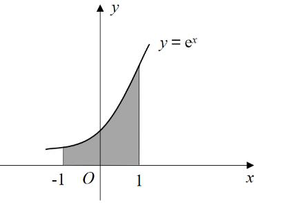

B. 

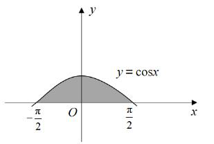

[代码描摹高清 PNG](../../../images/code_hd/828.png) · [SVG](../../../images/code_hd/828.svg)（原图为准）

C. 

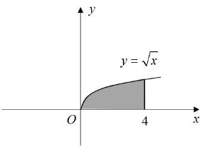

[代码描摹高清 PNG](../../../images/code_hd/770.png) · [SVG](../../../images/code_hd/770.svg)（原图为准）

D. 

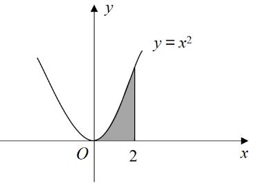

来源：[2022年江苏公务员考试《行测》真题（A类）....pdf](https://github.com/dumarstoft-ship-it/xingce/blob/407016b55b49581efa3771bb59a2dee8761d982f/2022%E5%B9%B4%E6%B1%9F%E8%8B%8F%E5%85%AC%E5%8A%A1%E5%91%98%E8%80%83%E8%AF%95%E3%80%8A%E8%A1%8C%E6%B5%8B%E3%80%8B%E7%9C%9F%E9%A2%98%EF%BC%88A%E7%B1%BB%EF%BC%89....pdf)，PDF 第 9、10、11 页。

## 第 56 题 · 数量关系

`JS2022-A类-056`

某机构对全运会收视情况进行调查，在1000 名受访者中，观看过乒乓球比赛的占87%，
观看过跳水比赛的占75%，观看过田径比赛的占69%。这1000 名受访者中，乒乓球、跳水和田径
比赛都观看过的至少有：
A、310 人 B、440 人 C、620 人 D、690 人

来源：[2022年江苏公务员考试《行测》真题（A类）....pdf](https://github.com/dumarstoft-ship-it/xingce/blob/407016b55b49581efa3771bb59a2dee8761d982f/2022%E5%B9%B4%E6%B1%9F%E8%8B%8F%E5%85%AC%E5%8A%A1%E5%91%98%E8%80%83%E8%AF%95%E3%80%8A%E8%A1%8C%E6%B5%8B%E3%80%8B%E7%9C%9F%E9%A2%98%EF%BC%88A%E7%B1%BB%EF%BC%89....pdf)，PDF 第 11 页。

## 第 57 题 · 数量关系

`JS2022-A类-057`

某政府机关将甲、乙两个部门合并。合并前，甲、乙两部门的男女人数之比分别为4 : 1
和3 : 2,男女党员人数之比分别为9 : 2 和9 : 4，乙部门女党员人数占本部门人数的比重是甲部门的
两倍。合并后，若男女人数之比为7 : 3，则男女党员人数之比为：
A、18:5 B、27:8 C、3:1 D、27:10

来源：[2022年江苏公务员考试《行测》真题（A类）....pdf](https://github.com/dumarstoft-ship-it/xingce/blob/407016b55b49581efa3771bb59a2dee8761d982f/2022%E5%B9%B4%E6%B1%9F%E8%8B%8F%E5%85%AC%E5%8A%A1%E5%91%98%E8%80%83%E8%AF%95%E3%80%8A%E8%A1%8C%E6%B5%8B%E3%80%8B%E7%9C%9F%E9%A2%98%EF%BC%88A%E7%B1%BB%EF%BC%89....pdf)，PDF 第 11 页。

## 第 58 题 · 数量关系

`JS2022-A类-058`

已知A、、B、两地相距9 公里，甲、乙两人匀速从A、地前往B、地。甲每小时走6 公
里，每走半小时休息15 分钟；乙比甲早15 分钟出发，中间不休息。若他们在途中（不含起点和终
点）相遇了2 次，则乙从A、地到B、地所用的时间至少为：
A、75 分钟 B、120 分钟 C、135 分钟 D、150 分钟

来源：[2022年江苏公务员考试《行测》真题（A类）....pdf](https://github.com/dumarstoft-ship-it/xingce/blob/407016b55b49581efa3771bb59a2dee8761d982f/2022%E5%B9%B4%E6%B1%9F%E8%8B%8F%E5%85%AC%E5%8A%A1%E5%91%98%E8%80%83%E8%AF%95%E3%80%8A%E8%A1%8C%E6%B5%8B%E3%80%8B%E7%9C%9F%E9%A2%98%EF%BC%88A%E7%B1%BB%EF%BC%89....pdf)，PDF 第 11 页。

## 第 59 题 · 数量关系

`JS2022-A类-059`

如图所示，小王买了一块直三棱柱形状的蛋糕A、B、C、-A、’B、’C、’，其中∠A、B、
C、=90°，∠B、A、C、=30°。为与两位室友分享，他切出一小块和原蛋糕形状相同的蛋糕A、D、
E-A、’D、’E’.其体积与原蛋糕的体积之比为1:3。若∠A、D、E=90°，则线段A、E 与EB、的长度之
比为：

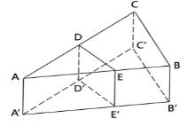

[代码描摹高清 PNG](../../../images/code_hd/894.png) · [SVG](../../../images/code_hd/894.svg)（原图为准）

A、2：1 B、3：2 C、√3：1 D、2：√3

来源：[2022年江苏公务员考试《行测》真题（A类）....pdf](https://github.com/dumarstoft-ship-it/xingce/blob/407016b55b49581efa3771bb59a2dee8761d982f/2022%E5%B9%B4%E6%B1%9F%E8%8B%8F%E5%85%AC%E5%8A%A1%E5%91%98%E8%80%83%E8%AF%95%E3%80%8A%E8%A1%8C%E6%B5%8B%E3%80%8B%E7%9C%9F%E9%A2%98%EF%BC%88A%E7%B1%BB%EF%BC%89....pdf)，PDF 第 11 页。

## 第 60 题 · 数量关系

`JS2022-A类-060`

某学者认为，人类的体力、情绪、智力自出生日起分别以22 天、28 天、33 天为周期开始
往复循环变化，前半个周期是“高潮期”，后半个周期是“低潮期”。根据该学者的观点，我们过公历
生日时，体力、情绪和智力同时处于“高潮期”的最小年龄是：
A、4 周岁 B、3 周岁 C、2 周岁 D、1 周岁

来源：[2022年江苏公务员考试《行测》真题（A类）....pdf](https://github.com/dumarstoft-ship-it/xingce/blob/407016b55b49581efa3771bb59a2dee8761d982f/2022%E5%B9%B4%E6%B1%9F%E8%8B%8F%E5%85%AC%E5%8A%A1%E5%91%98%E8%80%83%E8%AF%95%E3%80%8A%E8%A1%8C%E6%B5%8B%E3%80%8B%E7%9C%9F%E9%A2%98%EF%BC%88A%E7%B1%BB%EF%BC%89....pdf)，PDF 第 11 页。

## 第 61 题 · 数量关系

`JS2022-A类-061`

某企业年终评选了30 名优秀员工，分三个等级，分别按每人10 万元、5 万元、1 万元给
与奖励。若共发放奖金89 万元，则获得1 万元奖金的员工有：
A、14 人 B、19 人 C、20 人 D、21 人

来源：[2022年江苏公务员考试《行测》真题（A类）....pdf](https://github.com/dumarstoft-ship-it/xingce/blob/407016b55b49581efa3771bb59a2dee8761d982f/2022%E5%B9%B4%E6%B1%9F%E8%8B%8F%E5%85%AC%E5%8A%A1%E5%91%98%E8%80%83%E8%AF%95%E3%80%8A%E8%A1%8C%E6%B5%8B%E3%80%8B%E7%9C%9F%E9%A2%98%EF%BC%88A%E7%B1%BB%EF%BC%89....pdf)，PDF 第 11 页。

## 第 62 题 · 数量关系

`JS2022-A类-062`

某市民中心广场钟楼上东、西、南、北四面各有一个挂钟，则每日早8 点至晚8 点，任意
相邻两个钟的时针互相垂直的次数是：
A、2 B、3 C、4 D、5

来源：[2022年江苏公务员考试《行测》真题（A类）....pdf](https://github.com/dumarstoft-ship-it/xingce/blob/407016b55b49581efa3771bb59a2dee8761d982f/2022%E5%B9%B4%E6%B1%9F%E8%8B%8F%E5%85%AC%E5%8A%A1%E5%91%98%E8%80%83%E8%AF%95%E3%80%8A%E8%A1%8C%E6%B5%8B%E3%80%8B%E7%9C%9F%E9%A2%98%EF%BC%88A%E7%B1%BB%EF%BC%89....pdf)，PDF 第 11 页。

## 第 63 题 · 数量关系

`JS2022-A类-063`

师徒二人用15 天合作生产1000 个零件，前5 天师傅的效率是徒弟的2 倍，中间5 天师傅
休息，徒弟每天比原来多生产5 个零件，最后5 天两人又一起工作，师傅的效率不变，徒弟的效率
比中间5 天提高了50%，徒弟这15 天生产的零件个数是
A、450 B、500 C、550 D、600

来源：[2022年江苏公务员考试《行测》真题（A类）....pdf](https://github.com/dumarstoft-ship-it/xingce/blob/407016b55b49581efa3771bb59a2dee8761d982f/2022%E5%B9%B4%E6%B1%9F%E8%8B%8F%E5%85%AC%E5%8A%A1%E5%91%98%E8%80%83%E8%AF%95%E3%80%8A%E8%A1%8C%E6%B5%8B%E3%80%8B%E7%9C%9F%E9%A2%98%EF%BC%88A%E7%B1%BB%EF%BC%89....pdf)，PDF 第 11、12 页。

## 第 64 题 · 数量关系

`JS2022-A类-064`

某餐饮公司甲、乙两种外卖每份的售价分别为30 元和50 元，若该公司某天售出这两种外
卖共500 份，销售收入为21400 元，则售出的两种外卖数量相差
A、140 B、160 C、180 D、200

来源：[2022年江苏公务员考试《行测》真题（A类）....pdf](https://github.com/dumarstoft-ship-it/xingce/blob/407016b55b49581efa3771bb59a2dee8761d982f/2022%E5%B9%B4%E6%B1%9F%E8%8B%8F%E5%85%AC%E5%8A%A1%E5%91%98%E8%80%83%E8%AF%95%E3%80%8A%E8%A1%8C%E6%B5%8B%E3%80%8B%E7%9C%9F%E9%A2%98%EF%BC%88A%E7%B1%BB%EF%BC%89....pdf)，PDF 第 12 页。

## 第 65 题 · 数量关系

`JS2022-A类-065`

某企业举行职业技能大赛，3 个下属分公司均选2 名员工参赛。若同一分公司的员工比赛
时出场顺序不能相邻，则参赛的6 名员工不同的出场顺序共有
A、80 B、120 C、160 D、240

来源：[2022年江苏公务员考试《行测》真题（A类）....pdf](https://github.com/dumarstoft-ship-it/xingce/blob/407016b55b49581efa3771bb59a2dee8761d982f/2022%E5%B9%B4%E6%B1%9F%E8%8B%8F%E5%85%AC%E5%8A%A1%E5%91%98%E8%80%83%E8%AF%95%E3%80%8A%E8%A1%8C%E6%B5%8B%E3%80%8B%E7%9C%9F%E9%A2%98%EF%BC%88A%E7%B1%BB%EF%BC%89....pdf)，PDF 第 12 页。

## 第 66 题 · 数量关系

`JS2022-A类-066`

有5 支足球队进行单循环比赛，每场比赛胜者得3 分，负者不得分，平局双方各得1 分。
比赛结束后，若5 支球队的总得分为25 分，冠军得12 分，则亚军得
A、5 分 B、6 分 C、7 分 D、8 分

来源：[2022年江苏公务员考试《行测》真题（A类）....pdf](https://github.com/dumarstoft-ship-it/xingce/blob/407016b55b49581efa3771bb59a2dee8761d982f/2022%E5%B9%B4%E6%B1%9F%E8%8B%8F%E5%85%AC%E5%8A%A1%E5%91%98%E8%80%83%E8%AF%95%E3%80%8A%E8%A1%8C%E6%B5%8B%E3%80%8B%E7%9C%9F%E9%A2%98%EF%BC%88A%E7%B1%BB%EF%BC%89....pdf)，PDF 第 12 页。

## 第 67 题 · 数量关系

`JS2022-A类-067`

如图所示，为测量珠穆朗玛峰上某点C、的海拔高度，测量队选择了两个海拔高度相差
100 米的珠峰测量点A、和B、，测得∠A、B、C、为90°，从A、观测B、、C、的仰角分别为30°
和45°，从B、观测C、的仰角也为30°，则C、点的海拔高度比A、点高

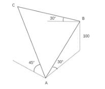

[代码描摹高清 PNG](../../../images/code_hd/990.png) · [SVG](../../../images/code_hd/990.svg)（原图为准）

A、100√2米 B、150 米 C、100√3米 D、200 米

来源：[2022年江苏公务员考试《行测》真题（A类）....pdf](https://github.com/dumarstoft-ship-it/xingce/blob/407016b55b49581efa3771bb59a2dee8761d982f/2022%E5%B9%B4%E6%B1%9F%E8%8B%8F%E5%85%AC%E5%8A%A1%E5%91%98%E8%80%83%E8%AF%95%E3%80%8A%E8%A1%8C%E6%B5%8B%E3%80%8B%E7%9C%9F%E9%A2%98%EF%BC%88A%E7%B1%BB%EF%BC%89....pdf)，PDF 第 12 页。

## 第 68 题 · 判断推理

`JS2022-A类-068`

峰∶山峰∶碳达峰
A、界∶世界∶思想界 B、潮∶海潮∶移民潮 C、子∶儿子∶菜篮子 D、羊∶山羊∶领头羊

来源：[2022年江苏公务员考试《行测》真题（A类）....pdf](https://github.com/dumarstoft-ship-it/xingce/blob/407016b55b49581efa3771bb59a2dee8761d982f/2022%E5%B9%B4%E6%B1%9F%E8%8B%8F%E5%85%AC%E5%8A%A1%E5%91%98%E8%80%83%E8%AF%95%E3%80%8A%E8%A1%8C%E6%B5%8B%E3%80%8B%E7%9C%9F%E9%A2%98%EF%BC%88A%E7%B1%BB%EF%BC%89....pdf)，PDF 第 12 页。

## 第 69 题 · 判断推理

`JS2022-A类-069`

论辩∶辩护∶共识
A、贸易∶签约∶利益 B、就读∶休学∶考试 C、调研∶座谈∶问卷 D、看病∶诊脉∶理疗

来源：[2022年江苏公务员考试《行测》真题（A类）....pdf](https://github.com/dumarstoft-ship-it/xingce/blob/407016b55b49581efa3771bb59a2dee8761d982f/2022%E5%B9%B4%E6%B1%9F%E8%8B%8F%E5%85%AC%E5%8A%A1%E5%91%98%E8%80%83%E8%AF%95%E3%80%8A%E8%A1%8C%E6%B5%8B%E3%80%8B%E7%9C%9F%E9%A2%98%EF%BC%88A%E7%B1%BB%EF%BC%89....pdf)，PDF 第 12 页。

## 第 70 题 · 判断推理

`JS2022-A类-070`

电气：煤气：气
A、酸奶：羊奶：奶 B、银河：运河：河 C、正面：反面：面 D、榆钱：金钱：钱

来源：[2022年江苏公务员考试《行测》真题（A类）....pdf](https://github.com/dumarstoft-ship-it/xingce/blob/407016b55b49581efa3771bb59a2dee8761d982f/2022%E5%B9%B4%E6%B1%9F%E8%8B%8F%E5%85%AC%E5%8A%A1%E5%91%98%E8%80%83%E8%AF%95%E3%80%8A%E8%A1%8C%E6%B5%8B%E3%80%8B%E7%9C%9F%E9%A2%98%EF%BC%88A%E7%B1%BB%EF%BC%89....pdf)，PDF 第 12 页。

## 第 71 题 · 判断推理

`JS2022-A类-071`

神奇:鬼斧神工
A、善良:大慈大悲 B、强大:不可一世 C、寒冷:冰天雪地 D、混乱:乱七八糟

来源：[2022年江苏公务员考试《行测》真题（A类）....pdf](https://github.com/dumarstoft-ship-it/xingce/blob/407016b55b49581efa3771bb59a2dee8761d982f/2022%E5%B9%B4%E6%B1%9F%E8%8B%8F%E5%85%AC%E5%8A%A1%E5%91%98%E8%80%83%E8%AF%95%E3%80%8A%E8%A1%8C%E6%B5%8B%E3%80%8B%E7%9C%9F%E9%A2%98%EF%BC%88A%E7%B1%BB%EF%BC%89....pdf)，PDF 第 12 页。

## 第 72 题 · 判断推理

`JS2022-A类-072`

冬∶暖冬
A、妻∶未婚妻 B、人∶植物人 C、菜∶平价菜 D、书∶有声书

来源：[2022年江苏公务员考试《行测》真题（A类）....pdf](https://github.com/dumarstoft-ship-it/xingce/blob/407016b55b49581efa3771bb59a2dee8761d982f/2022%E5%B9%B4%E6%B1%9F%E8%8B%8F%E5%85%AC%E5%8A%A1%E5%91%98%E8%80%83%E8%AF%95%E3%80%8A%E8%A1%8C%E6%B5%8B%E3%80%8B%E7%9C%9F%E9%A2%98%EF%BC%88A%E7%B1%BB%EF%BC%89....pdf)，PDF 第 12 页。

## 第 73 题 · 判断推理

`JS2022-A类-073`

灭蚊剂：蚊子
A、居家隔离∶病毒 B、市场经济∶垄断 C、首问负责∶推诿 D、民意测验∶分歧

来源：[2022年江苏公务员考试《行测》真题（A类）....pdf](https://github.com/dumarstoft-ship-it/xingce/blob/407016b55b49581efa3771bb59a2dee8761d982f/2022%E5%B9%B4%E6%B1%9F%E8%8B%8F%E5%85%AC%E5%8A%A1%E5%91%98%E8%80%83%E8%AF%95%E3%80%8A%E8%A1%8C%E6%B5%8B%E3%80%8B%E7%9C%9F%E9%A2%98%EF%BC%88A%E7%B1%BB%EF%BC%89....pdf)，PDF 第 12 页。

## 第 74 题 · 判断推理

`JS2022-A类-074`

水中捞月∶白费功夫
A、霸王之兵∶勇往直前 B、天涯海角∶杳无音信
C、棋逢对手∶不相上下 D、蚍蜉撼树∶不自量力

来源：[2022年江苏公务员考试《行测》真题（A类）....pdf](https://github.com/dumarstoft-ship-it/xingce/blob/407016b55b49581efa3771bb59a2dee8761d982f/2022%E5%B9%B4%E6%B1%9F%E8%8B%8F%E5%85%AC%E5%8A%A1%E5%91%98%E8%80%83%E8%AF%95%E3%80%8A%E8%A1%8C%E6%B5%8B%E3%80%8B%E7%9C%9F%E9%A2%98%EF%BC%88A%E7%B1%BB%EF%BC%89....pdf)，PDF 第 12 页。

## 第 75 题 · 判断推理

`JS2022-A类-075`

东北亚之于（ ）相当于（ ）之于树冠
A、韩国；树墩 B、南亚；树根 C、东半球；树洞 D、日本海；树荫

来源：[2022年江苏公务员考试《行测》真题（A类）....pdf](https://github.com/dumarstoft-ship-it/xingce/blob/407016b55b49581efa3771bb59a2dee8761d982f/2022%E5%B9%B4%E6%B1%9F%E8%8B%8F%E5%85%AC%E5%8A%A1%E5%91%98%E8%80%83%E8%AF%95%E3%80%8A%E8%A1%8C%E6%B5%8B%E3%80%8B%E7%9C%9F%E9%A2%98%EF%BC%88A%E7%B1%BB%EF%BC%89....pdf)，PDF 第 12 页。

## 第 76 题 · 判断推理

`JS2022-A类-076`

呼气之于吸气相当于（ ）之于（ ）
A、救火；灭火 B、治病；养病 C、入神；出神 D、出世；入世

来源：[2022年江苏公务员考试《行测》真题（A类）....pdf](https://github.com/dumarstoft-ship-it/xingce/blob/407016b55b49581efa3771bb59a2dee8761d982f/2022%E5%B9%B4%E6%B1%9F%E8%8B%8F%E5%85%AC%E5%8A%A1%E5%91%98%E8%80%83%E8%AF%95%E3%80%8A%E8%A1%8C%E6%B5%8B%E3%80%8B%E7%9C%9F%E9%A2%98%EF%BC%88A%E7%B1%BB%EF%BC%89....pdf)，PDF 第 12 页。

## 第 77 题 · 判断推理

`JS2022-A类-077`

良禽择木而栖之于贤臣择主而事相当于（ ）之于（ ）
A、关关雎鸠在河之洲窈窕淑女君子好逑 B、树欲静而风不止子欲养而亲不待
C、天有不测风云人有旦夕祸福 D、士为知己者死女为悦己者容

来源：[2022年江苏公务员考试《行测》真题（A类）....pdf](https://github.com/dumarstoft-ship-it/xingce/blob/407016b55b49581efa3771bb59a2dee8761d982f/2022%E5%B9%B4%E6%B1%9F%E8%8B%8F%E5%85%AC%E5%8A%A1%E5%91%98%E8%80%83%E8%AF%95%E3%80%8A%E8%A1%8C%E6%B5%8B%E3%80%8B%E7%9C%9F%E9%A2%98%EF%BC%88A%E7%B1%BB%EF%BC%89....pdf)，PDF 第 12 页。

## 第 78 题 · 判断推理

`JS2022-A类-078`

请从所给的四个选项中，选出最恰当的一项填入问号处，使之呈现一定的规律性。

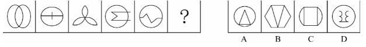

来源：[2022年江苏公务员考试《行测》真题（A类）....pdf](https://github.com/dumarstoft-ship-it/xingce/blob/407016b55b49581efa3771bb59a2dee8761d982f/2022%E5%B9%B4%E6%B1%9F%E8%8B%8F%E5%85%AC%E5%8A%A1%E5%91%98%E8%80%83%E8%AF%95%E3%80%8A%E8%A1%8C%E6%B5%8B%E3%80%8B%E7%9C%9F%E9%A2%98%EF%BC%88A%E7%B1%BB%EF%BC%89....pdf)，PDF 第 13 页。

## 第 79 题 · 判断推理

`JS2022-A类-079`

请从所给的四个选项中，选出最恰当的一项填入问号处，使之呈现一定的规律性

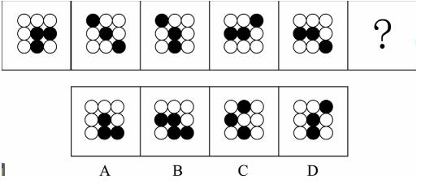

来源：[2022年江苏公务员考试《行测》真题（A类）....pdf](https://github.com/dumarstoft-ship-it/xingce/blob/407016b55b49581efa3771bb59a2dee8761d982f/2022%E5%B9%B4%E6%B1%9F%E8%8B%8F%E5%85%AC%E5%8A%A1%E5%91%98%E8%80%83%E8%AF%95%E3%80%8A%E8%A1%8C%E6%B5%8B%E3%80%8B%E7%9C%9F%E9%A2%98%EF%BC%88A%E7%B1%BB%EF%BC%89....pdf)，PDF 第 13 页。

## 第 80 题 · 判断推理

`JS2022-A类-080`

请从所给的四个选项中，选出最恰当的一项填入问号处，使之呈现一定的规律性。

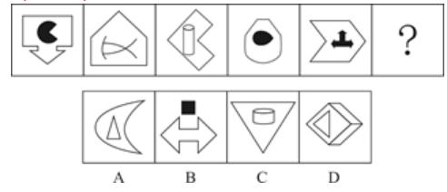

来源：[2022年江苏公务员考试《行测》真题（A类）....pdf](https://github.com/dumarstoft-ship-it/xingce/blob/407016b55b49581efa3771bb59a2dee8761d982f/2022%E5%B9%B4%E6%B1%9F%E8%8B%8F%E5%85%AC%E5%8A%A1%E5%91%98%E8%80%83%E8%AF%95%E3%80%8A%E8%A1%8C%E6%B5%8B%E3%80%8B%E7%9C%9F%E9%A2%98%EF%BC%88A%E7%B1%BB%EF%BC%89....pdf)，PDF 第 13 页。

## 第 81 题 · 判断推理

`JS2022-A类-081`

从所给的四个选项中，选择最合适的一个填入问号处，使之呈现一定的规律性：

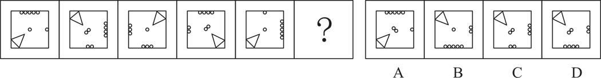

来源：[2022年江苏公务员考试《行测》真题（A类）....pdf](https://github.com/dumarstoft-ship-it/xingce/blob/407016b55b49581efa3771bb59a2dee8761d982f/2022%E5%B9%B4%E6%B1%9F%E8%8B%8F%E5%85%AC%E5%8A%A1%E5%91%98%E8%80%83%E8%AF%95%E3%80%8A%E8%A1%8C%E6%B5%8B%E3%80%8B%E7%9C%9F%E9%A2%98%EF%BC%88A%E7%B1%BB%EF%BC%89....pdf)，PDF 第 13 页。

## 第 82 题 · 判断推理

`JS2022-A类-082`

请从所给的四个选项中，选出最恰当的一项填入问号处，使之呈现一定的规律性。

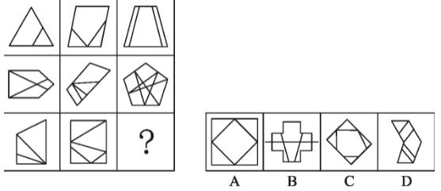

来源：[2022年江苏公务员考试《行测》真题（A类）....pdf](https://github.com/dumarstoft-ship-it/xingce/blob/407016b55b49581efa3771bb59a2dee8761d982f/2022%E5%B9%B4%E6%B1%9F%E8%8B%8F%E5%85%AC%E5%8A%A1%E5%91%98%E8%80%83%E8%AF%95%E3%80%8A%E8%A1%8C%E6%B5%8B%E3%80%8B%E7%9C%9F%E9%A2%98%EF%BC%88A%E7%B1%BB%EF%BC%89....pdf)，PDF 第 13、14 页。

## 第 83 题 · 判断推理

`JS2022-A类-083`

请从所给的四个选项中，选出最恰当的一项填入问号处，使之呈现一定的规律性。

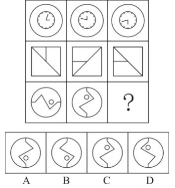

来源：[2022年江苏公务员考试《行测》真题（A类）....pdf](https://github.com/dumarstoft-ship-it/xingce/blob/407016b55b49581efa3771bb59a2dee8761d982f/2022%E5%B9%B4%E6%B1%9F%E8%8B%8F%E5%85%AC%E5%8A%A1%E5%91%98%E8%80%83%E8%AF%95%E3%80%8A%E8%A1%8C%E6%B5%8B%E3%80%8B%E7%9C%9F%E9%A2%98%EF%BC%88A%E7%B1%BB%EF%BC%89....pdf)，PDF 第 14 页。

## 第 84 题 · 判断推理

`JS2022-A类-084`

右边四个图形中，只有一个是由左边的四个图形拼合（只能通过上、下、左、右平移）而
成的，请把它找出来。

来源：[2022年江苏公务员考试《行测》真题（A类）....pdf](https://github.com/dumarstoft-ship-it/xingce/blob/407016b55b49581efa3771bb59a2dee8761d982f/2022%E5%B9%B4%E6%B1%9F%E8%8B%8F%E5%85%AC%E5%8A%A1%E5%91%98%E8%80%83%E8%AF%95%E3%80%8A%E8%A1%8C%E6%B5%8B%E3%80%8B%E7%9C%9F%E9%A2%98%EF%BC%88A%E7%B1%BB%EF%BC%89....pdf)，PDF 第 14 页。

## 第 85 题 · 判断推理

`JS2022-A类-085`

右边四个图形中，只有一个是由左边的四个图形拼合（只能通过上、下、左、右平移）而
成的，请把它找出来。

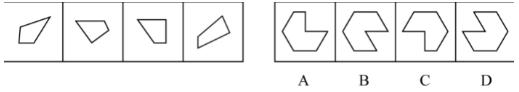

来源：[2022年江苏公务员考试《行测》真题（A类）....pdf](https://github.com/dumarstoft-ship-it/xingce/blob/407016b55b49581efa3771bb59a2dee8761d982f/2022%E5%B9%B4%E6%B1%9F%E8%8B%8F%E5%85%AC%E5%8A%A1%E5%91%98%E8%80%83%E8%AF%95%E3%80%8A%E8%A1%8C%E6%B5%8B%E3%80%8B%E7%9C%9F%E9%A2%98%EF%BC%88A%E7%B1%BB%EF%BC%89....pdf)，PDF 第 14 页。

## 第 86 题 · 判断推理

`JS2022-A类-086`

右边四个图形中，只有一个是由左边的四个图形拼合（只能通过上、下、左、右平移）而
成的，请把它找出来。

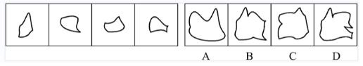

来源：[2022年江苏公务员考试《行测》真题（A类）....pdf](https://github.com/dumarstoft-ship-it/xingce/blob/407016b55b49581efa3771bb59a2dee8761d982f/2022%E5%B9%B4%E6%B1%9F%E8%8B%8F%E5%85%AC%E5%8A%A1%E5%91%98%E8%80%83%E8%AF%95%E3%80%8A%E8%A1%8C%E6%B5%8B%E3%80%8B%E7%9C%9F%E9%A2%98%EF%BC%88A%E7%B1%BB%EF%BC%89....pdf)，PDF 第 14、15 页。

## 第 87 题 · 判断推理

`JS2022-A类-087`

左边四张纸片，每张纸片一面是黑色，另一面是白色，右边仅有一项能有其拼合（可以平
移、旋转、翻账）而成，请把它找出来。

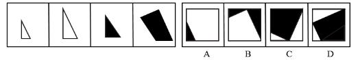

来源：[2022年江苏公务员考试《行测》真题（A类）....pdf](https://github.com/dumarstoft-ship-it/xingce/blob/407016b55b49581efa3771bb59a2dee8761d982f/2022%E5%B9%B4%E6%B1%9F%E8%8B%8F%E5%85%AC%E5%8A%A1%E5%91%98%E8%80%83%E8%AF%95%E3%80%8A%E8%A1%8C%E6%B5%8B%E3%80%8B%E7%9C%9F%E9%A2%98%EF%BC%88A%E7%B1%BB%EF%BC%89....pdf)，PDF 第 15 页。

## 第 88 题 · 判断推理

`JS2022-A类-088`

左边四张纸片，每张纸片一面是黑色，另一面是白色，右边仅有一项能由其拼合（可以平
移、旋转、翻转）而成，请把它找出来。

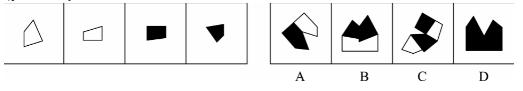

来源：[2022年江苏公务员考试《行测》真题（A类）....pdf](https://github.com/dumarstoft-ship-it/xingce/blob/407016b55b49581efa3771bb59a2dee8761d982f/2022%E5%B9%B4%E6%B1%9F%E8%8B%8F%E5%85%AC%E5%8A%A1%E5%91%98%E8%80%83%E8%AF%95%E3%80%8A%E8%A1%8C%E6%B5%8B%E3%80%8B%E7%9C%9F%E9%A2%98%EF%BC%88A%E7%B1%BB%EF%BC%89....pdf)，PDF 第 15 页。

## 第 89 题 · 判断推理

`JS2022-A类-089`

左图给定的是多面体的外表面，右边哪一项能由它折叠而成？请把他找出来。

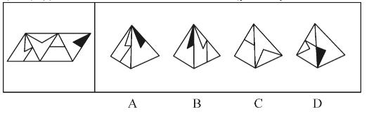

来源：[2022年江苏公务员考试《行测》真题（A类）....pdf](https://github.com/dumarstoft-ship-it/xingce/blob/407016b55b49581efa3771bb59a2dee8761d982f/2022%E5%B9%B4%E6%B1%9F%E8%8B%8F%E5%85%AC%E5%8A%A1%E5%91%98%E8%80%83%E8%AF%95%E3%80%8A%E8%A1%8C%E6%B5%8B%E3%80%8B%E7%9C%9F%E9%A2%98%EF%BC%88A%E7%B1%BB%EF%BC%89....pdf)，PDF 第 15 页。

## 第 90 题 · 判断推理

`JS2022-A类-090`

左边给定的是多面体的外表面，右边哪一项能由它折叠而成？请把它找出来

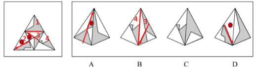

来源：[2022年江苏公务员考试《行测》真题（A类）....pdf](https://github.com/dumarstoft-ship-it/xingce/blob/407016b55b49581efa3771bb59a2dee8761d982f/2022%E5%B9%B4%E6%B1%9F%E8%8B%8F%E5%85%AC%E5%8A%A1%E5%91%98%E8%80%83%E8%AF%95%E3%80%8A%E8%A1%8C%E6%B5%8B%E3%80%8B%E7%9C%9F%E9%A2%98%EF%BC%88A%E7%B1%BB%EF%BC%89....pdf)，PDF 第 15 页。

## 第 91 题 · 判断推理

`JS2022-A类-091`

左边给定的是多面体的外表面，右边哪一项能由它折叠而成? 请把它找出来。

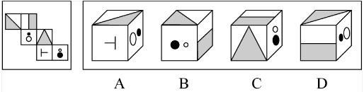

来源：[2022年江苏公务员考试《行测》真题（A类）....pdf](https://github.com/dumarstoft-ship-it/xingce/blob/407016b55b49581efa3771bb59a2dee8761d982f/2022%E5%B9%B4%E6%B1%9F%E8%8B%8F%E5%85%AC%E5%8A%A1%E5%91%98%E8%80%83%E8%AF%95%E3%80%8A%E8%A1%8C%E6%B5%8B%E3%80%8B%E7%9C%9F%E9%A2%98%EF%BC%88A%E7%B1%BB%EF%BC%89....pdf)，PDF 第 15 页。

## 第 92 题 · 判断推理

`JS2022-A类-092`

左边给定的是多面体的外表面，右边哪一项能由它折叠而成? 请把它找出来。

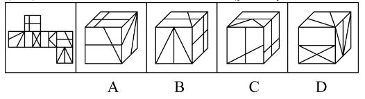

来源：[2022年江苏公务员考试《行测》真题（A类）....pdf](https://github.com/dumarstoft-ship-it/xingce/blob/407016b55b49581efa3771bb59a2dee8761d982f/2022%E5%B9%B4%E6%B1%9F%E8%8B%8F%E5%85%AC%E5%8A%A1%E5%91%98%E8%80%83%E8%AF%95%E3%80%8A%E8%A1%8C%E6%B5%8B%E3%80%8B%E7%9C%9F%E9%A2%98%EF%BC%88A%E7%B1%BB%EF%BC%89....pdf)，PDF 第 15、16 页。

## 第 93 题 · 判断推理

`JS2022-A类-093`

在广袤的中华大地上，最近几十年已经新植了数以十亿计的树木，绿色植被的增长有目共
睹，沙漠化和水土流失情况得到了极大缓解。据此，有专家指出，中国已经是全球变绿的最重要的
力量之一。
以下哪项如果为真，最能支持上述专家的观点?
A、中国西南地区和东北地区的快速造林大大减少了我国对进口木材的依赖
B、卫星数据对比显示，中国大量过去荒漠化的地方现在已经被绿色植被所覆盖
C、中国的植被面积仅占全球的6.6%，但全球植被面积净增长的25%来自中国
D、在有些国家和地区毁林开荒正在导致具有全球气候调节功能的雨林面积大大减少

来源：[2022年江苏公务员考试《行测》真题（A类）....pdf](https://github.com/dumarstoft-ship-it/xingce/blob/407016b55b49581efa3771bb59a2dee8761d982f/2022%E5%B9%B4%E6%B1%9F%E8%8B%8F%E5%85%AC%E5%8A%A1%E5%91%98%E8%80%83%E8%AF%95%E3%80%8A%E8%A1%8C%E6%B5%8B%E3%80%8B%E7%9C%9F%E9%A2%98%EF%BC%88A%E7%B1%BB%EF%BC%89....pdf)，PDF 第 16 页。

## 第 94 题 · 判断推理

`JS2022-A类-094`

普通话是国家通用语言，除普通话外，还有粤语，吴语等方言，近年来，用各种方言演绎
的段子大量涌入影视作品，短视频和网络综艺节目这些作品生动有趣，让那些即使是从小生长在普
通话环境里的人，也会觉得亲切兴起了一股学习方言的热潮，据此，有专家认为，各种方言作品大
行其道，其实不利于普通话在全国范围内的使用和推广。
以下哪项？如果为真，最能质疑上述专家的观点
A、保护传承方言是国家语言文字事业的重要组成部分，也是社会大众的共同愿望
B、方言多用于家庭等非正式场合，不会损害普通话在公共场所等正式场合的应用
C、短时间内让方言恢复自身活力或使用频率，既缺乏可行性，也没有必要性
D、每个人都有自己的故乡方言，承载着人们的乡土之情，是普通话的根

来源：[2022年江苏公务员考试《行测》真题（A类）....pdf](https://github.com/dumarstoft-ship-it/xingce/blob/407016b55b49581efa3771bb59a2dee8761d982f/2022%E5%B9%B4%E6%B1%9F%E8%8B%8F%E5%85%AC%E5%8A%A1%E5%91%98%E8%80%83%E8%AF%95%E3%80%8A%E8%A1%8C%E6%B5%8B%E3%80%8B%E7%9C%9F%E9%A2%98%EF%BC%88A%E7%B1%BB%EF%BC%89....pdf)，PDF 第 16 页。

## 第 95 题 · 判断推理

`JS2022-A类-095`

、某企业秉持人才为上的理念，一直致力于专业技术人才队伍建设，十年来，该企业招聘的
大部分机械工人来自甲职业技术学院，今年招聘的机械工人总数明显增加，但从该学院招聘的机械
工人数量却大幅减少，而且招进来的很多人没有经过职业技术学院系统的学习。
以下哪项？如果为真，最能解释该企业今年招聘情况的变化。
A、该企业增设了技术培训部门，以培训新招聘的机械工人
B、三年前，该企业的管理层进行了重大重组，决定推广A、I 的应用
C、从去年开始，权威的职业技术学院排行榜上，甲学院落后于乙学院
D、很多没有上过职业技术学院的工人很有才华，只是没有机会上学

来源：[2022年江苏公务员考试《行测》真题（A类）....pdf](https://github.com/dumarstoft-ship-it/xingce/blob/407016b55b49581efa3771bb59a2dee8761d982f/2022%E5%B9%B4%E6%B1%9F%E8%8B%8F%E5%85%AC%E5%8A%A1%E5%91%98%E8%80%83%E8%AF%95%E3%80%8A%E8%A1%8C%E6%B5%8B%E3%80%8B%E7%9C%9F%E9%A2%98%EF%BC%88A%E7%B1%BB%EF%BC%89....pdf)，PDF 第 16 页。

## 第 96 题 · 判断推理

`JS2022-A类-096`

唐代大诗人刘禹锡《望洞庭》诗云：“湖光秋月两相和，潭面无风镜未磨。遥望洞庭山水
翠，白银盘里一青螺。”然而，在一般不对原文做修改的宋清两朝的
以下哪项？如果为真，最能支持上述专家的观点
A.《望洞庭》为经典名作，历朝历代众口传诵，期间难免出现不同的版本
B.月光下很难分辨山水的不同色彩，翠色，白银盘、青螺皆是白天的景观
C.洞庭秋色是历代文人所关注的美景，该诗强调秋色之美也在常理之中
D.学术界公认这首诗，描写了洞庭湖的优美景色，应是诗人对洞庭湖的实景描写

来源：[2022年江苏公务员考试《行测》真题（A类）....pdf](https://github.com/dumarstoft-ship-it/xingce/blob/407016b55b49581efa3771bb59a2dee8761d982f/2022%E5%B9%B4%E6%B1%9F%E8%8B%8F%E5%85%AC%E5%8A%A1%E5%91%98%E8%80%83%E8%AF%95%E3%80%8A%E8%A1%8C%E6%B5%8B%E3%80%8B%E7%9C%9F%E9%A2%98%EF%BC%88A%E7%B1%BB%EF%BC%89....pdf)，PDF 第 16 页。

## 第 97 题 · 判断推理

`JS2022-A类-097`

某单位准备从甲、乙、丙、丁、戊、己六人中择优录取数名技术人员，录用情况符合如下
条件：
（1）丙和丁恰有一人录取；
（2）甲和乙至少有一人录取；
（3）甲和丁恰有一人录取；
（4）录取乙当且仅当录用丙；
（5）甲、戊、己中恰有两人录用；
根据上述信息，可以推出最终录用的人数为：
A、2 B、3 C、4 D、5

来源：[2022年江苏公务员考试《行测》真题（A类）....pdf](https://github.com/dumarstoft-ship-it/xingce/blob/407016b55b49581efa3771bb59a2dee8761d982f/2022%E5%B9%B4%E6%B1%9F%E8%8B%8F%E5%85%AC%E5%8A%A1%E5%91%98%E8%80%83%E8%AF%95%E3%80%8A%E8%A1%8C%E6%B5%8B%E3%80%8B%E7%9C%9F%E9%A2%98%EF%BC%88A%E7%B1%BB%EF%BC%89....pdf)，PDF 第 16 页。

## 第 98 题 · 判断推理

`JS2022-A类-098`

### 共用材料

运动会的3000 米比赛中，运动员你追我赶，其中选手甲、乙、丙、丁表现特别出色，交替领
先。观众张、王、李、赵分别预测了4 位选手的最终名次：
张：甲第四，乙第三，丙第二，丁第一；
王：甲第三，乙第二，丙第四，丁第一；
李：甲第四，乙第二，丙第一，丁第三；
赵：甲第二，乙第三，丙第一，丁第四。
比赛结束后，甲、乙、丙、丁确实位列前四名，而且不存在并列情况。但他们的具体名次，张
全猜错了，而其余3 人分别猜对了1 个。

根据以上陈述，以下哪项可能为真?
A、丙第一，甲第二，丁第三，乙第四 B、乙第一，丁第二，甲第三，丙第四
C、乙第一，甲第二，丁第三，丙第四 D、甲第一，丁第二，丙第三，乙第四

来源：[2022年江苏公务员考试《行测》真题（A类）....pdf](https://github.com/dumarstoft-ship-it/xingce/blob/407016b55b49581efa3771bb59a2dee8761d982f/2022%E5%B9%B4%E6%B1%9F%E8%8B%8F%E5%85%AC%E5%8A%A1%E5%91%98%E8%80%83%E8%AF%95%E3%80%8A%E8%A1%8C%E6%B5%8B%E3%80%8B%E7%9C%9F%E9%A2%98%EF%BC%88A%E7%B1%BB%EF%BC%89....pdf)，PDF 第 17 页。

## 第 99 题 · 判断推理

`JS2022-A类-099`

### 共用材料

运动会的3000 米比赛中，运动员你追我赶，其中选手甲、乙、丙、丁表现特别出色，交替领
先。观众张、王、李、赵分别预测了4 位选手的最终名次：
张：甲第四，乙第三，丙第二，丁第一；
王：甲第三，乙第二，丙第四，丁第一；
李：甲第四，乙第二，丙第一，丁第三；
赵：甲第二，乙第三，丙第一，丁第四。
比赛结束后，甲、乙、丙、丁确实位列前四名，而且不存在并列情况。但他们的具体名次，张
全猜错了，而其余3 人分别猜对了1 个。

假如王猜对了甲的名次，那么以下哪项一定为真?
A、丁第四 B、丙第一 C、乙第二 D、乙第一

来源：[2022年江苏公务员考试《行测》真题（A类）....pdf](https://github.com/dumarstoft-ship-it/xingce/blob/407016b55b49581efa3771bb59a2dee8761d982f/2022%E5%B9%B4%E6%B1%9F%E8%8B%8F%E5%85%AC%E5%8A%A1%E5%91%98%E8%80%83%E8%AF%95%E3%80%8A%E8%A1%8C%E6%B5%8B%E3%80%8B%E7%9C%9F%E9%A2%98%EF%BC%88A%E7%B1%BB%EF%BC%89....pdf)，PDF 第 17 页。

## 第 100 题 · 判断推理

`JS2022-A类-100`

麦子大约在五千年前由西亚传入中国，但由麦子做成的面食直到唐宋时期才成为北方人
的主食。在此之前，北方的主粮是栗，也就是小米。秦汉时期的老百姓很不愿意种麦子，汉朝曾为
增加粮食产量两次大力推广种麦子，但老百姓并没有积板响应。
以下哪项如果为真，最能解释上述历史现象?
A、外来作物很多，除了麦子，还有番薯、胡麻，不是每种作物一传入就被接受
B、磨粉技术传播较晚，东汉时只有官宦人家才拥有上下两扇带有磨齿的磨盘
C、麦粒直接煮成的“麦饭”生硬难咽、口感很差，秦汉时期的绝大多数人都不爱吃
D、东汉以后磨盘磨粉和“热汤饼”等面食技术逐渐推广开来，麦子才变得“好吃”了

来源：[2022年江苏公务员考试《行测》真题（A类）....pdf](https://github.com/dumarstoft-ship-it/xingce/blob/407016b55b49581efa3771bb59a2dee8761d982f/2022%E5%B9%B4%E6%B1%9F%E8%8B%8F%E5%85%AC%E5%8A%A1%E5%91%98%E8%80%83%E8%AF%95%E3%80%8A%E8%A1%8C%E6%B5%8B%E3%80%8B%E7%9C%9F%E9%A2%98%EF%BC%88A%E7%B1%BB%EF%BC%89....pdf)，PDF 第 17 页。

## 第 101 题 · 判断推理

`JS2022-A类-101`

“同情用药”指的是某些重症患者可以在不参加临床试验的情况下，使用尚未获批上市的在
研药物。在新冠肺炎疫情初期，提前使用抗疫药物的同情用药案例数有所增加，效果良好。但是，
同情用药的实施条件十分严格，大部分患者不具备用药资格。对此，有专家建议，应该放宽同情用
药使用条件。
以下哪项如果为真，最能质疑上述专家建议的合理性?
A、同情用药会破坏新药审批的程序和权威，这对患者和社会都有不可预料的后果
B、即便“无药可救”的患者愿意使用未获批的在研药物，也不一定能够成功延长生命
C、为了保护患者用药安全，大部分国家目前严禁未经过临床试验的药品上市
D、目前，大部分常见疾病都已经有一些适用药物，这些疾病并不需要同情用药

来源：[2022年江苏公务员考试《行测》真题（A类）....pdf](https://github.com/dumarstoft-ship-it/xingce/blob/407016b55b49581efa3771bb59a2dee8761d982f/2022%E5%B9%B4%E6%B1%9F%E8%8B%8F%E5%85%AC%E5%8A%A1%E5%91%98%E8%80%83%E8%AF%95%E3%80%8A%E8%A1%8C%E6%B5%8B%E3%80%8B%E7%9C%9F%E9%A2%98%EF%BC%88A%E7%B1%BB%EF%BC%89....pdf)，PDF 第 17 页。

## 第 102 题 · 判断推理

`JS2022-A类-102`

甲：这本小说太精彩了，你喜欢里面的哪个角色呢？
乙：我对小说不感兴趣，没有读过这本小说
以下哪项的对话与上述对话最为相似？
A、教师：你不努力学习以后怎么能考上理想的大学呢？
学生：我理想的大学太难考了，再努力也不一定能考上
B、员工甲：总经理的讲话中，你认可哪些呢？
员工乙：总经理的讲话我都赞成，我会尽全力执行讲话中的要求
C、孩子：爸爸，夏天游泳更能锻炼身体呢，还是冬天游泳更能锻炼身体呢？
父亲：游泳是非常好的锻炼方式，在任何时候游泳都能锻炼人
D、商户：您上个月在我们商店购买的冰箱好用吗？
顾客：你可能记错了，我上个月在你们店购买的是洗衣机

来源：[2022年江苏公务员考试《行测》真题（A类）....pdf](https://github.com/dumarstoft-ship-it/xingce/blob/407016b55b49581efa3771bb59a2dee8761d982f/2022%E5%B9%B4%E6%B1%9F%E8%8B%8F%E5%85%AC%E5%8A%A1%E5%91%98%E8%80%83%E8%AF%95%E3%80%8A%E8%A1%8C%E6%B5%8B%E3%80%8B%E7%9C%9F%E9%A2%98%EF%BC%88A%E7%B1%BB%EF%BC%89....pdf)，PDF 第 17 页。

## 第 103 题 · 判断推理

`JS2022-A类-103`

某高校选派甲、乙、丙、丁4 位专家组成乡村振兴调研小组，担任组长的专家为男性、
党员、教授。已知这4 位专家中：
（1）每位专家都至少具有组长的一个特征；
（2）有党员3 人，男性2 人，教授1 人；
（3）甲和乙性别相同；
（4）乙是党员当且仅当丙是党员；
（5）丙和丁不全是党员。
由此推出，担任组长的是
A、甲 B、乙 C、丙 D、丁

来源：[2022年江苏公务员考试《行测》真题（A类）....pdf](https://github.com/dumarstoft-ship-it/xingce/blob/407016b55b49581efa3771bb59a2dee8761d982f/2022%E5%B9%B4%E6%B1%9F%E8%8B%8F%E5%85%AC%E5%8A%A1%E5%91%98%E8%80%83%E8%AF%95%E3%80%8A%E8%A1%8C%E6%B5%8B%E3%80%8B%E7%9C%9F%E9%A2%98%EF%BC%88A%E7%B1%BB%EF%BC%89....pdf)，PDF 第 17、18 页。

## 第 104 题 · 判断推理

`JS2022-A类-104`

### 共用材料

甲、乙、丙、丁4 人为室友，来自江苏、浙江、湖南、湖北，毕业时都考上了研究生，录取她
们的有师范大学、医科大学、财经大学、农业大学，已知：甲考上的不是农业大学，考上农业大学
的是江苏人，丙考上了师范大学，丁是湖北人。

根据上述信息，可以推出以下哪项？
A、丙是湖南人 B、甲是浙江人 C、丁考上了财经大学 D、乙考上了农业大学

来源：[2022年江苏公务员考试《行测》真题（A类）....pdf](https://github.com/dumarstoft-ship-it/xingce/blob/407016b55b49581efa3771bb59a2dee8761d982f/2022%E5%B9%B4%E6%B1%9F%E8%8B%8F%E5%85%AC%E5%8A%A1%E5%91%98%E8%80%83%E8%AF%95%E3%80%8A%E8%A1%8C%E6%B5%8B%E3%80%8B%E7%9C%9F%E9%A2%98%EF%BC%88A%E7%B1%BB%EF%BC%89....pdf)，PDF 第 18 页。

## 第 105 题 · 判断推理

`JS2022-A类-105`

### 共用材料

甲、乙、丙、丁4 人为室友，来自江苏、浙江、湖南、湖北，毕业时都考上了研究生，录取她
们的有师范大学、医科大学、财经大学、农业大学，已知：甲考上的不是农业大学，考上农业大学
的是江苏人，丙考上了师范大学，丁是湖北人。

如果考上医科大学的是湖南人，那么以下哪项为假？
A、甲考上了医科大学
B、丁考上了财经大学
C、丙不是浙江人
D、丙不是湖南人

来源：[2022年江苏公务员考试《行测》真题（A类）....pdf](https://github.com/dumarstoft-ship-it/xingce/blob/407016b55b49581efa3771bb59a2dee8761d982f/2022%E5%B9%B4%E6%B1%9F%E8%8B%8F%E5%85%AC%E5%8A%A1%E5%91%98%E8%80%83%E8%AF%95%E3%80%8A%E8%A1%8C%E6%B5%8B%E3%80%8B%E7%9C%9F%E9%A2%98%EF%BC%88A%E7%B1%BB%EF%BC%89....pdf)，PDF 第 18 页。

## 第 106 题 · 判断推理

`JS2022-A类-106`

微躺青年：指面对现实中的竞争压力，既不参与过度竞争，也不消极接受现状，而在专
注于本职工作的同时，合理调整工作方向，追求自我价值实现的年轻人。
下列属于微躺青年的是：
A、设计师小谭研究生毕业后，因与投资人理念不合，离开了加盟三年的设计公司到外地改做
陶瓷设计。最艰难的时候，天天工作到深夜，终于设计出大受市场欢迎的产品，实现了大学以来的
梦想
B、随着新冠肺炎疫情防控形势好转，各地游客都明显增多，商家纷纷推出低价游抢占旅游市
场。小李把自己的旅行社转让出去后，开始在网络上进行家乡景点直播，很快就成为直播达人，带
动了家乡旅游产业的发展
C、今年大学毕业的小柳投递了许多份求职信，但都石沉大海。索性在网上当起了自律监督
师，每天要定十几个闹钟，最多同时监督20 多个人。刚开始觉得工作枯燥乏味，但现在已经收到了
数百条好评，让他很有成就感
D、小何毕业后一直在互联网公司工作，公司内部竞争压力很大，常常加班到深夜。虽然收入
十分可观，但他觉得高强度工作损害了身心健康，决定每年给自己放个小长假

来源：[2022年江苏公务员考试《行测》真题（A类）....pdf](https://github.com/dumarstoft-ship-it/xingce/blob/407016b55b49581efa3771bb59a2dee8761d982f/2022%E5%B9%B4%E6%B1%9F%E8%8B%8F%E5%85%AC%E5%8A%A1%E5%91%98%E8%80%83%E8%AF%95%E3%80%8A%E8%A1%8C%E6%B5%8B%E3%80%8B%E7%9C%9F%E9%A2%98%EF%BC%88A%E7%B1%BB%EF%BC%89....pdf)，PDF 第 18 页。

## 第 107 题 · 判断推理

`JS2022-A类-107`

田保姆：指在不改变土地承包关系的前提下，农户将耕、种、管、收等部分或全部作业
环节委托给社会化组织完成，成为规模经营的参与者和受益者的新型农业经营方式。
下列不属于田保姆的是：
A、晚稻收割接近尾声，泥瓦匠老李仍然不慌不忙，在周边市区接了好几单活，他家的10 亩稻
田三年前已经以每年5000 元的价格租给了在家务农的邻居，连收带运，啥都不用他操心
B、老刘夫妇近年来一直跟着亲戚在外地打工，每到收割季节都得回家忙乎一阵子。去年，村
里的几个年轻人合伙买了大型收割机，成立了生产合作社，老刘全家商量把田里的农活全部包给了
他们
C、每年收获季，处置成堆的秸秆都让种植户非常头疼，为了解决这个问题，大王庄村委会先
后购置了10 套秸杆打捆、粉碎机械，及时推出了秸杆回收加工服务项目。周围村子的农民再也不为
这个事情发愁了
D、某农业科技服务公司在各个村镇建立了所管地块的示范田，定期召开现场会，展示播种方
式、田间管理等，当地不少农民变成了“甩手掌柜”，随时可以通过扫描公司的二维码了解托管服务
的进程

来源：[2022年江苏公务员考试《行测》真题（A类）....pdf](https://github.com/dumarstoft-ship-it/xingce/blob/407016b55b49581efa3771bb59a2dee8761d982f/2022%E5%B9%B4%E6%B1%9F%E8%8B%8F%E5%85%AC%E5%8A%A1%E5%91%98%E8%80%83%E8%AF%95%E3%80%8A%E8%A1%8C%E6%B5%8B%E3%80%8B%E7%9C%9F%E9%A2%98%EF%BC%88A%E7%B1%BB%EF%BC%89....pdf)，PDF 第 18 页。

## 第 108 题 · 判断推理

`JS2022-A类-108`

去雇主化职业：指作为独立个体不受雇于任何雇主，依托网络平台提供商品或服务并获
得相应报酬的就业形式。
下列属于去雇主化职业的是：
A、林先生辞职后来到南方注册了一家绿植盆景网店，在一个多月的时间里，租赁场地。筹措
资金，完善平台，忙得不亦乐乎
B、专业买手陈女士每月穿梭在世界各地，寻找带有当季流行元素或者可能在国内热卖的款式
和品牌服装，并将其带回国内
C、小李加入了一个微信群，里而提供了许多可兼职工作的岗位。经过一番挑选，他选择了一
份帮忙代取快递的兼职，用赚来的钱贴补每月生活费
D、喜欢写作的大二学生小孟在某平台网文写手的影响下，也开始在这家平台上更新写的小
说，得到了许多粉丝的打赏，他很有成就感

来源：[2022年江苏公务员考试《行测》真题（A类）....pdf](https://github.com/dumarstoft-ship-it/xingce/blob/407016b55b49581efa3771bb59a2dee8761d982f/2022%E5%B9%B4%E6%B1%9F%E8%8B%8F%E5%85%AC%E5%8A%A1%E5%91%98%E8%80%83%E8%AF%95%E3%80%8A%E8%A1%8C%E6%B5%8B%E3%80%8B%E7%9C%9F%E9%A2%98%EF%BC%88A%E7%B1%BB%EF%BC%89....pdf)，PDF 第 18、19 页。

## 第 109 题 · 判断推理

`JS2022-A类-109`

鲜活性效应：指重在依据自己耳闻目睹的具体个案而不是权威性、科学性信息做出选择
的现象。
下列不属于鲜活性效应的是：
A、众所周知，飞机的事故率在所有交通工具中是最低的。但是李先生在电视上看到一则民航
客机失事的新闻后，再也没有乘坐过飞机
B、小罗看中了某知名品牌的洗衣机，正打算付款。一个好朋友打来电话告诉她，自家这个牌
子的洗衣机经常出故障，小罗当场放弃了购买计划
C、王大伯非常注重养生，本来滴酒不沾，后来他看到80 岁高龄的邻居老赵每天都要小酌几
杯，身体一直很好。于是，他逐渐不再刻意回避喝酒
D、小缪常用的视频网站总是会给她推送某品牌的按摩椅，父亲节的时候小缪想给父亲送按摩
椅当礼物，就登录该品牌的官网购买

来源：[2022年江苏公务员考试《行测》真题（A类）....pdf](https://github.com/dumarstoft-ship-it/xingce/blob/407016b55b49581efa3771bb59a2dee8761d982f/2022%E5%B9%B4%E6%B1%9F%E8%8B%8F%E5%85%AC%E5%8A%A1%E5%91%98%E8%80%83%E8%AF%95%E3%80%8A%E8%A1%8C%E6%B5%8B%E3%80%8B%E7%9C%9F%E9%A2%98%EF%BC%88A%E7%B1%BB%EF%BC%89....pdf)，PDF 第 19 页。

## 第 110 题 · 判断推理

`JS2022-A类-110`

信用联动奖惩：指有关部门或组织在法定范围内根据企业、个人信用记录，采取部门联
动、社会协同等方式，对其依法联合实施奖励或惩戒的行为。
下列属于信用联动奖惩的是
A、某市设立了无偿献血“五星级志愿者”、志愿服务终身荣誉奖，获奖市民可以免除市管公园
门票，免费乘坐市内公交车，享受市属公立医院诊察费半价优惠
B、餐馆老板李先生在当地政务服务网提交了经营性临时占道申请，由于其信用等级为A、
级，可以享受审批绿色通道，第二天就收到了城管和其他相关部门的许可短信
C、阮先生在承租的公租房里开设棋牌室，违背了申请公租房时的诚信承诺，被住房保障部门
扣罚了住房保证金，并纳入五年内不得申请公租房的名单。阮先生对自己的失信行为深感后悔，保
证以后一定做一个诚信公民
D、某区政府接到媒体举报，辖区内一超市以次充好，将普通猪肉当黑猪肉售卖，区政府立即
召集市场监管、税务等职能部门赶到超市，现场联合办公，对相关责任人进行查处

来源：[2022年江苏公务员考试《行测》真题（A类）....pdf](https://github.com/dumarstoft-ship-it/xingce/blob/407016b55b49581efa3771bb59a2dee8761d982f/2022%E5%B9%B4%E6%B1%9F%E8%8B%8F%E5%85%AC%E5%8A%A1%E5%91%98%E8%80%83%E8%AF%95%E3%80%8A%E8%A1%8C%E6%B5%8B%E3%80%8B%E7%9C%9F%E9%A2%98%EF%BC%88A%E7%B1%BB%EF%BC%89....pdf)，PDF 第 19 页。

## 第 111 题 · 判断推理

`JS2022-A类-111`

闲置经济：指将一些还有使用价值但闲置未用的物品，以较低的价格通过网络平台进行
交易的经济现象。
下列属于闲置经济的是
A、某品牌电器官网举办以旧换新活动，孔女士便把家里用了三年的电磁炉寄去换了一台新
款，比直接购买省了一半的钱
B、每到毕业季，大学生就会在操场、寝室门口等校园网上公布的位置摆摊设点，将自己的专
业书籍低价转让给学弟学妹
C、近年来，老陈在网上买到了不少便宜货，如老旧缝纫机、修鞋机、磅秤等，他用这些别人
眼中的废品做成了再生艺术品
D、小佳在社交平台看到了一则北方小镇遭受雪灾的消息，就将自己前些年穿过的厚衣物寄给
平台，统一消毒后发往灾区

来源：[2022年江苏公务员考试《行测》真题（A类）....pdf](https://github.com/dumarstoft-ship-it/xingce/blob/407016b55b49581efa3771bb59a2dee8761d982f/2022%E5%B9%B4%E6%B1%9F%E8%8B%8F%E5%85%AC%E5%8A%A1%E5%91%98%E8%80%83%E8%AF%95%E3%80%8A%E8%A1%8C%E6%B5%8B%E3%80%8B%E7%9C%9F%E9%A2%98%EF%BC%88A%E7%B1%BB%EF%BC%89....pdf)，PDF 第 19 页。

## 第 112 题 · 判断推理

`JS2022-A类-112`

信息瀑布：指现实生活中，当受到前人信息的影响时，放弃自己原有的想法。跟着他人
选择的现象。下列属于信息瀑布的是
A、小李从单位离职后在家里呆了一段时间，上个月他发现了几份适合自己的工作，就分别递
交了求职信。这几天收到了多封邮件，招聘单位大都以他失业太久为理由而拒绝了他
B、公司去陌生小镇组织团建活动，午餐时看到街边的一排小餐馆，不爱吃辣的胡先生纠结了
一会，最终还是跟着几位湖南同事进了一家湘菜馆
C、消费者们通常认为十多年前的服装款式已经过时，但经过时装周推广、明星带货。哪些
款式往往又会成为新的时尚，重新受到追捧
D、某家具厂的一款外壳酷似巨型昆虫的黑色办公椅，全厂上下都觉得像是用回收垃圾做的，对它的市场前
景表示悲观，却意外地受到了办公人士的喜爱，最终成了该厂建厂以来最畅销的椅子

来源：[2022年江苏公务员考试《行测》真题（A类）....pdf](https://github.com/dumarstoft-ship-it/xingce/blob/407016b55b49581efa3771bb59a2dee8761d982f/2022%E5%B9%B4%E6%B1%9F%E8%8B%8F%E5%85%AC%E5%8A%A1%E5%91%98%E8%80%83%E8%AF%95%E3%80%8A%E8%A1%8C%E6%B5%8B%E3%80%8B%E7%9C%9F%E9%A2%98%EF%BC%88A%E7%B1%BB%EF%BC%89....pdf)，PDF 第 19 页。

## 第 113 题 · 判断推理

`JS2022-A类-113`

胶带纸思维：指使用各种表面上看似比较简单、笨拙的临时性手段，有效解决实际问题
的方式。
下列不属于胶带纸思维的是
A、临近下班的时候突然下了大雨，穿了新鞋子的小丽不想把鞋子弄脏，于是从办公室抽屉里
拿了两个塑料袋，套在脚上，一直走到地铁站鞋子都没湿
B、马先生家下水道堵了好几天，偶然在短视频中看到了一个用白醋兑苏打水通下水，在家试
验多次都没有成功，最后还得请专业人员上门疏通
C、某社区举办的花街夜市突然停电，周围一片黑暗。社工小叶立刻去商场买来了一些蜡烛。
点点烛光不仅照亮花街，还吸引了更多游客
D、小雯的房间突然掉了一块墙皮，但第二天有几个朋友要来访，她急中生智，找出与朋友们
的合影，遮住了脱落墙皮的地方，美观又温馨

来源：[2022年江苏公务员考试《行测》真题（A类）....pdf](https://github.com/dumarstoft-ship-it/xingce/blob/407016b55b49581efa3771bb59a2dee8761d982f/2022%E5%B9%B4%E6%B1%9F%E8%8B%8F%E5%85%AC%E5%8A%A1%E5%91%98%E8%80%83%E8%AF%95%E3%80%8A%E8%A1%8C%E6%B5%8B%E3%80%8B%E7%9C%9F%E9%A2%98%EF%BC%88A%E7%B1%BB%EF%BC%89....pdf)，PDF 第 20 页。

## 第 114 题 · 判断推理

`JS2022-A类-114`

陌生人社交困境：指在与陌生人交往过程中，由于误解他人行为动机和意图而造成的不
良后果的现象。
下列不属于陌生人社交困境的是：
A、早高峰时期，骑电瓶车忘带头盔的小吴被文明交通志愿者拦下来批评教育。
B、赵女士在田边拍照，看到远处有身有村民向她挥手大喊，以为村民担心她会踩坏庄稼，就
挥了挥手，继续拍照。不一会儿，她就被旁边树上飞出的马蜂蛰了，又疼又肿。
C、农村随迁儿童转学到城市学校后，不少孩子最初都会担心受到歧视，而不愿意与大家交
往，抵触班级的集体活动，学习成绩也有所下滑，性格也变得更加敏感脆弱，情况严重者甚至需要
半年时间，自卑心理才会逐渐消失。
D、杨女士经常叮嘱三岁的女儿小青，不要和陌生人说话，不要随便跟陌生人走，不要吃陌生
人的东西，不要给陌生人开门。结果小青进入幼儿园以后的几个月里非常胆小，动不动就哭，平时
连老师问话都不回答。

来源：[2022年江苏公务员考试《行测》真题（A类）....pdf](https://github.com/dumarstoft-ship-it/xingce/blob/407016b55b49581efa3771bb59a2dee8761d982f/2022%E5%B9%B4%E6%B1%9F%E8%8B%8F%E5%85%AC%E5%8A%A1%E5%91%98%E8%80%83%E8%AF%95%E3%80%8A%E8%A1%8C%E6%B5%8B%E3%80%8B%E7%9C%9F%E9%A2%98%EF%BC%88A%E7%B1%BB%EF%BC%89....pdf)，PDF 第 20 页。

## 第 115 题 · 判断推理

`JS2022-A类-115`

网约护士服务：指经过官方许可，以“线上申请、线下服务”的方式，为老弱病残孕等行动
不便的人上门提供慢病管理、康复护理或专项护理等延续性的便捷服务。
下列不属于网约护士服务的是：
A.谭女士因治疗原因留置了PICC 管，每周需要更换一次贴膜，家住得比较远，每次去医院换膜都要
耗费大量时间。家人在线下单预约后，医院护士准备好护理用品。到谭女士家中为她更换PICC 管
专用贴膜，同时对其家人进行了护理指导。
B.颜奶奶在医院进行了胆总管探查术，出院后需要定期进行T 管维护，家属利用小程序预购了医院
护理服务。接到订单后，肝胆外科护士上门为颜奶奶进行T 管冲洗。家属感激地说：“护士上门服务
真方便，以后再也不用发愁去医院了”。
C.某民营医院最近推出了一项新的便民服务措施，慢病患者下载“医者仁心”术后护理APP，进入平
台选择自己所需要的服务项目，只要详细填写服务需求，上传就医证明，完成预约后，就可以等待
护士上门服务。
D.刘爷爷平时独居在家，一天因高血压晕倒，被邻居及时送到医院才脱离危险。在外工作的子女急
忙回家到医院为他申请定期看护服务，护士会在每次服务后将他的健康报告上传到系统中，以便子
女了解刘爷爷的健康情况。

来源：[2022年江苏公务员考试《行测》真题（A类）....pdf](https://github.com/dumarstoft-ship-it/xingce/blob/407016b55b49581efa3771bb59a2dee8761d982f/2022%E5%B9%B4%E6%B1%9F%E8%8B%8F%E5%85%AC%E5%8A%A1%E5%91%98%E8%80%83%E8%AF%95%E3%80%8A%E8%A1%8C%E6%B5%8B%E3%80%8B%E7%9C%9F%E9%A2%98%EF%BC%88A%E7%B1%BB%EF%BC%89....pdf)，PDF 第 20 页。
