# 2023 年江苏行测（A类） · 答案与解析

以下为来源原文的结构化转写；缺失及冲突答案不补写。

## 第 16 题 · 言语理解与表达

参考答案：**A**

【答案】A
【解析】总分结构。这段文字首先介绍了中国作为世界第二大经济体和世界第一制造业大国的地位，
然后提到了中国产业链供应链与全球生产网络的深度融合，以及中国在各类产业链中的重要角色。这些信
息都在强调中国经济发展迅速体量规模稳居世界第一方阵。BC 项均为文段解释说明部分。D 项进出口贸易
无中生有。
因此，正确答案是A

来源：[2023年江苏公务员考试《行测》真题（A类）解析.pdf](https://github.com/dumarstoft-ship-it/xingce/blob/407016b55b49581efa3771bb59a2dee8761d982f/2023%E5%B9%B4%E6%B1%9F%E8%8B%8F%E5%85%AC%E5%8A%A1%E5%91%98%E8%80%83%E8%AF%95%E3%80%8A%E8%A1%8C%E6%B5%8B%E3%80%8B%E7%9C%9F%E9%A2%98%EF%BC%88A%E7%B1%BB%EF%BC%89%E8%A7%A3%E6%9E%90.pdf)，PDF 第 9 页。

## 第 17 题 · 言语理解与表达

参考答案：**C**

【答案】C
【解析】本题考查主旨概括，材料为分总结构。首先引出园林模糊了现实和再现之间界限的话题，接
下来进行详细阐述，指出园林实现了人类精神活动的空间再现，是对现实山水的艺术化过程，最后总结园
林山水是人对自然实践的哲学和美学认知，C 选项紧扣总述句的内容，当选。
A 选项“对精神家园的追求”、D 选项“对自然山水的艺术化表现”是创造园林过程中的直接体现，
并非材料主旨，排除；
B 选项，理解错误，创造园林的过程中有丰富的创造，不仅仅是对自然山水的“整体位移和再现”，
排除。
因此，本题答案为C 选项。

来源：[2023年江苏公务员考试《行测》真题（A类）解析.pdf](https://github.com/dumarstoft-ship-it/xingce/blob/407016b55b49581efa3771bb59a2dee8761d982f/2023%E5%B9%B4%E6%B1%9F%E8%8B%8F%E5%85%AC%E5%8A%A1%E5%91%98%E8%80%83%E8%AF%95%E3%80%8A%E8%A1%8C%E6%B5%8B%E3%80%8B%E7%9C%9F%E9%A2%98%EF%BC%88A%E7%B1%BB%EF%BC%89%E8%A7%A3%E6%9E%90.pdf)，PDF 第 9、10 页。

## 第 18 题 · 言语理解与表达

参考答案：**D**

【答案】D
【解析】本题考查主旨概括，材料为因果关系。首先指出我国语言文字体系“多元一体”的特点，接
着介绍了此体系中国家通用语言文字的基础导向作用和其他类型语言文字的从属地位，最后通过“因而”
总结，强调“全国通用”具有规范性效力，即要保障国家通用语言文字在全国范围内通行适用。分析选
项，D 选项的“适用保障”概括了材料的重点，当选。
A 选项的“应用范围”、B 选项的“法律地位”、C 选项的“学术概念”均无法概括材料重点，故排
除。
因此，本题答案为D 选项。

来源：[2023年江苏公务员考试《行测》真题（A类）解析.pdf](https://github.com/dumarstoft-ship-it/xingce/blob/407016b55b49581efa3771bb59a2dee8761d982f/2023%E5%B9%B4%E6%B1%9F%E8%8B%8F%E5%85%AC%E5%8A%A1%E5%91%98%E8%80%83%E8%AF%95%E3%80%8A%E8%A1%8C%E6%B5%8B%E3%80%8B%E7%9C%9F%E9%A2%98%EF%BC%88A%E7%B1%BB%EF%BC%89%E8%A7%A3%E6%9E%90.pdf)，PDF 第 10 页。

## 第 19 题 · 言语理解与表达

参考答案：**C**

【答案】C
【解析】文中提到，在自然界中，形式对称性的生成，源自受到作用力的大小和方向始终一致，这种
对称性不仅带来了美观，也有实际的效用。例如，雪花、花朵或水池中的波纹等二维形态，以及球形等三
维形态，都是因为对称性的作用力使得形态具有实际的效用，如节省能量、便于传播等。因此，我们可以
推出选项A 和B 是正确的，即自然界众多形态其实具有经济型，自然之美往往有现实的效用。同时，文中
也未提到自然界对称性生成是偶然的，因此选项D 也是正确的。然而，文中并未提到自然界从不追求华而
不实的美感.
因此选项C 是无法从文中推出。

来源：[2023年江苏公务员考试《行测》真题（A类）解析.pdf](https://github.com/dumarstoft-ship-it/xingce/blob/407016b55b49581efa3771bb59a2dee8761d982f/2023%E5%B9%B4%E6%B1%9F%E8%8B%8F%E5%85%AC%E5%8A%A1%E5%91%98%E8%80%83%E8%AF%95%E3%80%8A%E8%A1%8C%E6%B5%8B%E3%80%8B%E7%9C%9F%E9%A2%98%EF%BC%88A%E7%B1%BB%EF%BC%89%E8%A7%A3%E6%9E%90.pdf)，PDF 第 10、11 页。

## 第 20 题 · 言语理解与表达

参考答案：**D**

【答案】D
【解析】这段文字主要讨论了古籍整理出版的要求和策略。首先，它强调要避免低水平的重复出版，
同时要加强对基础古籍的深度整理和出版，这意味着需要对古籍进行分类和评估，以确定哪些有传播价
值，哪些只有文物价值，并据此决定是否出版和如何出版。对于有传播价值的古代文献，需要根据其内容
来决定出版方式，对于需求量小的文献可以考虑影印，对于需求量大的应该整理出版。同时，资金支持应
该向深度整理的项目倾斜，以推动古籍整理的高质量发展。因此，这段文字的主要意图是说明古籍整理出
版需要有针对性地分类进行.
故选D。

来源：[2023年江苏公务员考试《行测》真题（A类）解析.pdf](https://github.com/dumarstoft-ship-it/xingce/blob/407016b55b49581efa3771bb59a2dee8761d982f/2023%E5%B9%B4%E6%B1%9F%E8%8B%8F%E5%85%AC%E5%8A%A1%E5%91%98%E8%80%83%E8%AF%95%E3%80%8A%E8%A1%8C%E6%B5%8B%E3%80%8B%E7%9C%9F%E9%A2%98%EF%BC%88A%E7%B1%BB%EF%BC%89%E8%A7%A3%E6%9E%90.pdf)，PDF 第 11 页。

## 第 21 题 · 言语理解与表达

参考答案：**A**

【答案】A
【解析】这段文字主要讨论了国家取消农业税后，如何通过转移资源到农村，以建设农村公共品和促
进农村发展。其中，关键词“农村公共品”出现了两次，表明这是讨论的重点。其次，“资源分配”和
“分配型民主”也分别出现了两次，前者指的是如何将资源分配到农村，后者则指的是如何通过民主程序
来分配这些资源。因此，最恰当的关键词应该是“农村公共品”、“资源分配”和“分配型民主”。
因此，正确答案应该选择A。

来源：[2023年江苏公务员考试《行测》真题（A类）解析.pdf](https://github.com/dumarstoft-ship-it/xingce/blob/407016b55b49581efa3771bb59a2dee8761d982f/2023%E5%B9%B4%E6%B1%9F%E8%8B%8F%E5%85%AC%E5%8A%A1%E5%91%98%E8%80%83%E8%AF%95%E3%80%8A%E8%A1%8C%E6%B5%8B%E3%80%8B%E7%9C%9F%E9%A2%98%EF%BC%88A%E7%B1%BB%EF%BC%89%E8%A7%A3%E6%9E%90.pdf)，PDF 第 11、12 页。

## 第 22 题 · 言语理解与表达

参考答案：**C**

【答案】C
【解析】接语选择题重点关注文段尾句。尾句指出当前中国面临的科技伦理挑战日益增多，且存在很
多未知领域，故下文应针对如何解决这些问题展开论述，C 项符合尾句所强调的重点。A 项，“认识科技
伦理问题治理的重要意义”尾句并未提及，无中生有，排除；B 项，“引领国际科技发展”尾句并未提
及，无中生有，排除；D 项，“群策群力”“科技发展的现实需求”尾句并未提及，无中生有，排除。
故正确答案为C。

来源：[2023年江苏公务员考试《行测》真题（A类）解析.pdf](https://github.com/dumarstoft-ship-it/xingce/blob/407016b55b49581efa3771bb59a2dee8761d982f/2023%E5%B9%B4%E6%B1%9F%E8%8B%8F%E5%85%AC%E5%8A%A1%E5%91%98%E8%80%83%E8%AF%95%E3%80%8A%E8%A1%8C%E6%B5%8B%E3%80%8B%E7%9C%9F%E9%A2%98%EF%BC%88A%E7%B1%BB%EF%BC%89%E8%A7%A3%E6%9E%90.pdf)，PDF 第 12 页。

## 第 23 题 · 言语理解与表达

参考答案：**A**

【答案】A
【解析】分析选项.
A 选项，根据“它不是指法院或法官作出的判决实际上被某个公民或社会公众所预测到，无论是被他
们自己偶然地预测到，还是借助于人工智能或算法系统被有规律地预测到”可知，法院法官作出的司法裁
判是有可能被公众偶然预测到，或借助人工智能被有规律地预测到，故该项表述错误，当选；
B 选项，根据尾句内容推知，该项“不一定可靠”的说法正确，排除；
C 选项，根据首句内容可知，该项说法正确，排除；
D 选项，根据尾句内容可知，该项表述正确，排除。
因此，本题答案为A 选项。

来源：[2023年江苏公务员考试《行测》真题（A类）解析.pdf](https://github.com/dumarstoft-ship-it/xingce/blob/407016b55b49581efa3771bb59a2dee8761d982f/2023%E5%B9%B4%E6%B1%9F%E8%8B%8F%E5%85%AC%E5%8A%A1%E5%91%98%E8%80%83%E8%AF%95%E3%80%8A%E8%A1%8C%E6%B5%8B%E3%80%8B%E7%9C%9F%E9%A2%98%EF%BC%88A%E7%B1%BB%EF%BC%89%E8%A7%A3%E6%9E%90.pdf)，PDF 第 12、13 页。

## 第 24 题 · 言语理解与表达

参考答案：**A**

【答案】A
【解析】根据文中的描述，生物多样性对于人类生活的影响主要体现在对农村生态系统和城市生态系
统的作用上，并没有决定人类城乡生活的所有方面，因此选项A 的说法与文意不符。生物多样性在遭受自
然灾害后的复原过程中起着重要作用，因为生物多样性可以提供更多的物种和基因资源，有助于提高复原
的能力，因此选项B 的说法是正确的。人类文化的多样性也受到了生物多样性的影响，因为不同地区的文
化传统与当地的生物多样性密切相关，因此选项C 的说法是正确的。生物多样性是大自然的重要组成部
分，也是大自然丰富多彩的原因之一，因此选项D 的说法也是正确的。
因此，本题答案为A 选项。

来源：[2023年江苏公务员考试《行测》真题（A类）解析.pdf](https://github.com/dumarstoft-ship-it/xingce/blob/407016b55b49581efa3771bb59a2dee8761d982f/2023%E5%B9%B4%E6%B1%9F%E8%8B%8F%E5%85%AC%E5%8A%A1%E5%91%98%E8%80%83%E8%AF%95%E3%80%8A%E8%A1%8C%E6%B5%8B%E3%80%8B%E7%9C%9F%E9%A2%98%EF%BC%88A%E7%B1%BB%EF%BC%89%E8%A7%A3%E6%9E%90.pdf)，PDF 第 13 页。

## 第 25 题 · 言语理解与表达

参考答案：**D**

【答案】D
【解析】文章首先指出了科技成果转化是一个复杂的系统工程，面临着从实验室到产业化、从想法到
市场的挑战。然后强调了科技成果只有同国家需要、人民要求、市场需求相适应，完成从科学研究到实验
开发再到推广应用的三级跳，才能真正转化为现实生产力、实现创新驱动发展。因此，关键在于如何让科
技成果与市场需求对接，实现从科研到应用的转化。
所以，正确答案是D

来源：[2023年江苏公务员考试《行测》真题（A类）解析.pdf](https://github.com/dumarstoft-ship-it/xingce/blob/407016b55b49581efa3771bb59a2dee8761d982f/2023%E5%B9%B4%E6%B1%9F%E8%8B%8F%E5%85%AC%E5%8A%A1%E5%91%98%E8%80%83%E8%AF%95%E3%80%8A%E8%A1%8C%E6%B5%8B%E3%80%8B%E7%9C%9F%E9%A2%98%EF%BC%88A%E7%B1%BB%EF%BC%89%E8%A7%A3%E6%9E%90.pdf)，PDF 第 13、14 页。

## 第 26 题 · 言语理解与表达

参考答案：**D**

【答案】D
【解析】分析选项.
A 选项，根据尾句内容可知，漫长的暑热放大了人们对昼夜温差的感觉，所以觉得霜降节气昼夜温差
大，该项“加大了霜降节气的昼夜温差”表述错误，排除；
B 选项，根据“霜降节气全国各地的昼夜温差均值为11.6 摄氏度”可知，均值为11.6 摄氏度，不代
表没有超过12 摄氏度的情况，排除；
C 选项，根据“随着霜降节气的来临，冷空气活动开始频繁”可知，霜降之前可能有冷空气的活动，
只是不频繁而已，该项说法错误，排除；
D 选项，材料介绍了霜降节气的昼夜温差均值，与秋分、寒露节气相近，并在材料后半部分解释了为
何人们感觉霜降节气昼夜温差大，综合材料并结合常识可以推知，人们只是感觉霜降的昼夜温差很大，实
际上并不是最大的，该项可以合理推出，当选。
因此，本题答案为D 选项。

来源：[2023年江苏公务员考试《行测》真题（A类）解析.pdf](https://github.com/dumarstoft-ship-it/xingce/blob/407016b55b49581efa3771bb59a2dee8761d982f/2023%E5%B9%B4%E6%B1%9F%E8%8B%8F%E5%85%AC%E5%8A%A1%E5%91%98%E8%80%83%E8%AF%95%E3%80%8A%E8%A1%8C%E6%B5%8B%E3%80%8B%E7%9C%9F%E9%A2%98%EF%BC%88A%E7%B1%BB%EF%BC%89%E8%A7%A3%E6%9E%90.pdf)，PDF 第 14、15 页。

## 第 27 题 · 言语理解与表达

参考答案：**B**

【答案】B
【解析】分析选项.
A 选项，根据“这些由电子电路体现的数学结构，和神经科学家开发的大脑认知模型有一些相似之
处”可知，该项表述正确，排除；
B 选项，根据“有时候在某种程度上，我们的大脑和人造大脑似乎是利用相似的结构原理来工作的。
然而，从构成的材料和信号处理过程的方式来看，它们的差别当然是非常大的”可知，大脑和人工智能并
非利用相似的结构原理工作，该项说法与材料内容相悖，当选；
C 选项，根据“因此，在人工智能和认知科学之间出现了一个创造性的反馈回路，它们彼此借鉴对方
的思路”可知，该项说法正确，排除；
D 选项，根据“然而，从构成的材料和信号处理过程的方式来看，它们的差别当然是非常大的”可
知，该项表述正确，排除。
因此，本题答案为B 选项。

来源：[2023年江苏公务员考试《行测》真题（A类）解析.pdf](https://github.com/dumarstoft-ship-it/xingce/blob/407016b55b49581efa3771bb59a2dee8761d982f/2023%E5%B9%B4%E6%B1%9F%E8%8B%8F%E5%85%AC%E5%8A%A1%E5%91%98%E8%80%83%E8%AF%95%E3%80%8A%E8%A1%8C%E6%B5%8B%E3%80%8B%E7%9C%9F%E9%A2%98%EF%BC%88A%E7%B1%BB%EF%BC%89%E8%A7%A3%E6%9E%90.pdf)，PDF 第 15 页。

## 第 28 题 · 言语理解与表达

参考答案：**A**

【答案】A
【解析】文段首先介绍了诗歌的特点，即以简洁的话语展现无穷意蕴，接着通过“因而”总结上文，
指出诗歌与数字游戏之间有相似之处，即二者都要求文字文本表达精炼、准确，都使用修辞、符号，所以
可以认为二者相互适配，对应A 项。B 项只是介绍诗歌的特性，不能完整概括文段的主题，排除。C 项和D
项都只是文段的部分内容，不能概括整个文段，排除。
故正确答案为A。

来源：[2023年江苏公务员考试《行测》真题（A类）解析.pdf](https://github.com/dumarstoft-ship-it/xingce/blob/407016b55b49581efa3771bb59a2dee8761d982f/2023%E5%B9%B4%E6%B1%9F%E8%8B%8F%E5%85%AC%E5%8A%A1%E5%91%98%E8%80%83%E8%AF%95%E3%80%8A%E8%A1%8C%E6%B5%8B%E3%80%8B%E7%9C%9F%E9%A2%98%EF%BC%88A%E7%B1%BB%EF%BC%89%E8%A7%A3%E6%9E%90.pdf)，PDF 第 15、16 页。

## 第 29 题 · 言语理解与表达

参考答案：**A**

【答案】A
【解析】这段文字主要强调的是，科学家们在探究未知的过程中，会经历无知、疑惑、不确定的状
态，这种经历对于科学的发展至关重要。当科学家不知道答案时，他们是无知的；当他们心中有了猜测
时，他们是不确定的；即使他们满有把握时，他们也会永远留下质疑的余地。这表明，科学知识的获取并
不是一蹴而就的过程，而是在不断质疑、探索、验证的过程中逐步形成的。
因此，正确答案是A

来源：[2023年江苏公务员考试《行测》真题（A类）解析.pdf](https://github.com/dumarstoft-ship-it/xingce/blob/407016b55b49581efa3771bb59a2dee8761d982f/2023%E5%B9%B4%E6%B1%9F%E8%8B%8F%E5%85%AC%E5%8A%A1%E5%91%98%E8%80%83%E8%AF%95%E3%80%8A%E8%A1%8C%E6%B5%8B%E3%80%8B%E7%9C%9F%E9%A2%98%EF%BC%88A%E7%B1%BB%EF%BC%89%E8%A7%A3%E6%9E%90.pdf)，PDF 第 16 页。

## 第 30 题 · 言语理解与表达

参考答案：**C**

【答案】C
【解析】定位选项首句③和④，③指出大众要深入了解非物质文化遗产并不容易这一问题，④则指出
通过拍摄影像，可以真实、准确地做好非遗的记录和留存工作，也就有利于大众的了解，即④是针对③中
问题的解决，应在③之后，故排除A、D 选项。
再对比B、C 两项，③为首句，第二句不同，分别是⑤和①，如果③⑤捆绑，则⑤中被寄予期待的对
象未知，逻辑错误，故应是③①捆绑，③提出问题，①引出纪录片这一解决方案，最后代入C 选项通读一
遍，逻辑通顺，当选。
因此，本题答案为C 选项。

来源：[2023年江苏公务员考试《行测》真题（A类）解析.pdf](https://github.com/dumarstoft-ship-it/xingce/blob/407016b55b49581efa3771bb59a2dee8761d982f/2023%E5%B9%B4%E6%B1%9F%E8%8B%8F%E5%85%AC%E5%8A%A1%E5%91%98%E8%80%83%E8%AF%95%E3%80%8A%E8%A1%8C%E6%B5%8B%E3%80%8B%E7%9C%9F%E9%A2%98%EF%BC%88A%E7%B1%BB%EF%BC%89%E8%A7%A3%E6%9E%90.pdf)，PDF 第 16、17 页。

## 第 31 题 · 言语理解与表达

参考答案：**C**

【答案】C
【解析】第一空，根据文段可知，综合国力的竞争最终可以追溯到“人才的竞争、劳动者素质的竞
争”，A 项“追本溯源”比喻追寻根源，C 项“归根到底”指归结到根本上，D 项“不言而喻”指不用说就
可以明白，均符合文意。B 项“毋容置疑”指不容置疑，指不容许有什么怀疑，用来形容事实明摆着，不
需要质疑，不符合文意，排除。
第二空，横线处所填词语与“不断改变着中国的面貌”构成对应，强调中国制造、中国创造、中国建
造对于改变中国面貌的作用，C 项“发力”指用尽全力去做，符合文意，当选。A 项“奋斗”指为了达到
一定目的而努力干，与文段想要强调的是三者共同发力，排除；D 项“奋战”指奋力作战，与文段强调的
“不断改变着中国的面貌”无关，排除。
故正确答案为C。

来源：[2023年江苏公务员考试《行测》真题（A类）解析.pdf](https://github.com/dumarstoft-ship-it/xingce/blob/407016b55b49581efa3771bb59a2dee8761d982f/2023%E5%B9%B4%E6%B1%9F%E8%8B%8F%E5%85%AC%E5%8A%A1%E5%91%98%E8%80%83%E8%AF%95%E3%80%8A%E8%A1%8C%E6%B5%8B%E3%80%8B%E7%9C%9F%E9%A2%98%EF%BC%88A%E7%B1%BB%EF%BC%89%E8%A7%A3%E6%9E%90.pdf)，PDF 第 17 页。

## 第 32 题 · 言语理解与表达

参考答案：**C**

【答案】C
【解析】根据上下文，设计需要的是一种能够快速传达信息的视觉效果，因此应该填入一个表示“简
洁明了”的词语且与“概括、有视觉冲击力”相对应，即表示简洁、直观的词语。因此，选项C“直观”
最符合文意。
第二空由于上下文提到像素风格的文字相较于普通文字字体更加别具一格，应填入表示摒弃、放弃的
词语，且与“像素风格的文字”相对应。选项C“摒弃”符合文意。
因此，正确答案为C。

来源：[2023年江苏公务员考试《行测》真题（A类）解析.pdf](https://github.com/dumarstoft-ship-it/xingce/blob/407016b55b49581efa3771bb59a2dee8761d982f/2023%E5%B9%B4%E6%B1%9F%E8%8B%8F%E5%85%AC%E5%8A%A1%E5%91%98%E8%80%83%E8%AF%95%E3%80%8A%E8%A1%8C%E6%B5%8B%E3%80%8B%E7%9C%9F%E9%A2%98%EF%BC%88A%E7%B1%BB%EF%BC%89%E8%A7%A3%E6%9E%90.pdf)，PDF 第 17、18 页。

## 第 33 题 · 言语理解与表达

参考答案：**未确定 / 来源缺失**

> 原文件答案栏与解析结论冲突；标准答案留空，保留原文各说法。

【答案】A
【解析】第一空根据上下文，可以发现这些动画电影都带有中华传统文化元素。所填词语应该表示这
些电影在市场上逐渐崭露头角、受到人们的关注。选项A 的“脱颖而出”和选项B 的“蜂拥而出”都有这
个意思，但是选项C 的“层见叠出”指的是接连不断地出现，而选项D 的“呼之欲出”则是指非常逼真、
形象生动，与题意不符。因此，第一空应选A 或B。
第二空需要填入一个词语，来描述创作与产业之间的关系。根据上下文，可以发现两者之间是互相促
进、互相影响的。选项A 的“砥砺”是形容坚定、坚毅的意思，与题意不符；而选项B 的“激励”则是指
激发、鼓励，与题意相符。因此，第二空应选B。
所以，正确答案是B

来源：[2023年江苏公务员考试《行测》真题（A类）解析.pdf](https://github.com/dumarstoft-ship-it/xingce/blob/407016b55b49581efa3771bb59a2dee8761d982f/2023%E5%B9%B4%E6%B1%9F%E8%8B%8F%E5%85%AC%E5%8A%A1%E5%91%98%E8%80%83%E8%AF%95%E3%80%8A%E8%A1%8C%E6%B5%8B%E3%80%8B%E7%9C%9F%E9%A2%98%EF%BC%88A%E7%B1%BB%EF%BC%89%E8%A7%A3%E6%9E%90.pdf)，PDF 第 18 页。

## 第 34 题 · 言语理解与表达

参考答案：**B**

【答案】B
【解析】第一空，横线处所填词语与“细致入微”并列，共同形容商家为了留住客源、促进消费所做
出的努力。A 项“匠心独运”指独具创新地运用精巧的心思，形容独特的艺术构思；B 项“别出心裁”指
独创一格，与众不同，均与文段中“服务”“产品设计”对应恰当。C 项“自出机杼”指比喻诗文的构思
和布局别出心裁，独创新意，不如原意“别出心裁”的程度重，且与“产品设计”搭配不当，排除。D 项
“标新立异”指提出新的主张、见解或创造出新奇的样式，也指为了显示自己，故意显出自己的与众不同
或者用往常不同的表达方式来吸引人，文段并无此意，排除。
第二空，由文段可知，消费者能够通过这些“用心之处”体会到商家所带来的情绪影响。B 项“体
验”指通过实践来认识周围的事物，符合文意，当选。A 项“感受”指接触外界事物得到的影响；体会，
置身其中而产生某种情感、思想、认识，通常只能与具体事物搭配，不能与抽象事物搭配，且与文段语意
不符，排除。
故正确答案为B。

来源：[2023年江苏公务员考试《行测》真题（A类）解析.pdf](https://github.com/dumarstoft-ship-it/xingce/blob/407016b55b49581efa3771bb59a2dee8761d982f/2023%E5%B9%B4%E6%B1%9F%E8%8B%8F%E5%85%AC%E5%8A%A1%E5%91%98%E8%80%83%E8%AF%95%E3%80%8A%E8%A1%8C%E6%B5%8B%E3%80%8B%E7%9C%9F%E9%A2%98%EF%BC%88A%E7%B1%BB%EF%BC%89%E8%A7%A3%E6%9E%90.pdf)，PDF 第 18、19 页。

## 第 35 题 · 言语理解与表达

参考答案：**B**

【答案】B
【解析】第一空，由“法制是法律制度的简称”可知，横线处所填词语应与“制度”搭配，表达法制
所属的领域之意。A 项“层面”指事物在某一范围里的部分，体现的是某一方面的具体内容，C 项“范
围”指界限，约束、限制事物的范围，D 项“领域”指某个特定的范围、区域、范畴，均与“制度”搭配
不当，排除。B 项“范畴”指领域、范围，通常指具有共同性的概念、规律等所构成的某一整体，与“制
度”搭配恰当，当选。
第二空，由“法制是法治的基础和前提条件”可知，横线处所填词语应与“基础和前提条件”对应，
表达法制要具有完善之意。B 项“完备”指应该有的都有了，符合文意，当选。A 项“完善”指完美、完
整、没有缺点，程度较重，与文段不符，排除。C 项“完整”指具有或显示应有的所有构成部分或部件；
没有缺少什么应有的部分，也不多不少；齐全，程度较轻，与文段不符，排除。
第三空，横线处所填词语与后文“法制的发展前途必然是最终……”对应，表达的是法制发展的目标
之意。B 项“实现”指使成为事实，符合文意，当选。A 项“体现”指某种现象通过某种事物表现出来，
与文段不符，排除。C 项“抵达”指到达目的地，D 项“达至”指到达、达到，均无法与文段对应，排
除。
故正确答案为B。

来源：[2023年江苏公务员考试《行测》真题（A类）解析.pdf](https://github.com/dumarstoft-ship-it/xingce/blob/407016b55b49581efa3771bb59a2dee8761d982f/2023%E5%B9%B4%E6%B1%9F%E8%8B%8F%E5%85%AC%E5%8A%A1%E5%91%98%E8%80%83%E8%AF%95%E3%80%8A%E8%A1%8C%E6%B5%8B%E3%80%8B%E7%9C%9F%E9%A2%98%EF%BC%88A%E7%B1%BB%EF%BC%89%E8%A7%A3%E6%9E%90.pdf)，PDF 第 19、20 页。

## 第 36 题 · 言语理解与表达

参考答案：**B**

【答案】B
【解析】第一空，横线处所填词语应体现出人工智能在多个领域取得了显著的进步。A 项“叹为观
止”指赞美所见到的事物好到了极点；B 项“令人惊叹”指事情极富震撼力，让人惊叹；C 项“令人瞩
目”指使人注视；D 项“有目共睹”指非常明显，谁都能看到，均符合文意。
第二空，横线处所填词语应体现出人工智能在文学创作领域发展得相对较慢。A 项“滞缓”指迟缓，
与“文学创作领域比较”搭配不当，排除；B 项“滞后”指落后，符合文意；C 项“落伍”指落在队伍的
后面，比喻赶不上时代的潮流或某种水平、某一方面落在后头，文中并非强调赶不上潮流，且与“文学创
作领域比较”搭配不当，排除；D 项“迟缓”指缓慢，与“文学创作领域比较”搭配不当，排除。
第三空，横线处所填词语与后文对应，表示另一方面如何证明文学是人类最高智慧的结晶之一。B 项
“验证”指经过检验得到证实，可以证明，符合文意，当选。A 项“证实”指用实际行动或待人处事取得
成功，证明使真实可靠；C 项“明确”指清晰明白而确定不移；D 项“证明”指根据确实的材料判明人或
事物的真实性，均无法与后文形成对应关系，排除。
故正确答案为B。

来源：[2023年江苏公务员考试《行测》真题（A类）解析.pdf](https://github.com/dumarstoft-ship-it/xingce/blob/407016b55b49581efa3771bb59a2dee8761d982f/2023%E5%B9%B4%E6%B1%9F%E8%8B%8F%E5%85%AC%E5%8A%A1%E5%91%98%E8%80%83%E8%AF%95%E3%80%8A%E8%A1%8C%E6%B5%8B%E3%80%8B%E7%9C%9F%E9%A2%98%EF%BC%88A%E7%B1%BB%EF%BC%89%E8%A7%A3%E6%9E%90.pdf)，PDF 第 20 页。

## 第 37 题 · 言语理解与表达

参考答案：**D**

【答案】D
【解析】第一空，绘画和摄影在艺术上侧重点不同。A 项“相辅相成”指两种事物互相辅助，互相促
成，侧重于相互辅助、相互成就，与文段语意不符，排除。D 项“各有千秋”指各有各存在的意义和价
值，侧重于各有各的特色、优点，保留。B 项“各擅胜场”指各有各的长处、优胜之处，C 项“大相径
庭”指彼此相差很远或矛盾很大，均符合文意。
第二空，由“摄影当然可以呈现某一物种的全貌”可知，摄影可以记录某一瞬间的景象。B 项“凝
固”指由液态变为固态，可以体现摄影定格某一瞬间的景象，符合文意，当选。C 项“定格”指固定、停
止的意思，但摄影无法像植物科学画那样表达出一颗绿绒嵩盛开时那种对生命和繁衍的渴望，与后文语意
不符，排除。D 项“还原”景象固定搭配，当选。
第三空，横线处所填词语用以形容植物科学画的优点。B 项“栩栩如生”形容艺术形象非常逼真，像
活的一样，与文段语意不符，排除。D 项“一目了然”指一眼就可以看清楚，符合文段“着重呈现物种特
征”之意，当选。
故正确答案为D。

来源：[2023年江苏公务员考试《行测》真题（A类）解析.pdf](https://github.com/dumarstoft-ship-it/xingce/blob/407016b55b49581efa3771bb59a2dee8761d982f/2023%E5%B9%B4%E6%B1%9F%E8%8B%8F%E5%85%AC%E5%8A%A1%E5%91%98%E8%80%83%E8%AF%95%E3%80%8A%E8%A1%8C%E6%B5%8B%E3%80%8B%E7%9C%9F%E9%A2%98%EF%BC%88A%E7%B1%BB%EF%BC%89%E8%A7%A3%E6%9E%90.pdf)，PDF 第 20、21 页。

## 第 38 题 · 言语理解与表达

参考答案：**C**

【答案】C
【解析】从第二空入手，与“摘取”搭配，分析选项，C 选项的“桂冠”与“摘取”为习惯搭配，可
优先考虑；A 选项的“盛誉”多与“享有”搭配，B 选项的“美称”的一般用法为“有…的美称”，D 选项
的“殊荣”多与“获得”搭配，故均排除。
代入第一空、第三空验证，各大中心城市各尽所能，力图摘取桂冠；最先进的高科技产业和最具创新
能力的企业家集聚，它们相得益彰，均符合文意所需，当选。
因此，正确答案是C

来源：[2023年江苏公务员考试《行测》真题（A类）解析.pdf](https://github.com/dumarstoft-ship-it/xingce/blob/407016b55b49581efa3771bb59a2dee8761d982f/2023%E5%B9%B4%E6%B1%9F%E8%8B%8F%E5%85%AC%E5%8A%A1%E5%91%98%E8%80%83%E8%AF%95%E3%80%8A%E8%A1%8C%E6%B5%8B%E3%80%8B%E7%9C%9F%E9%A2%98%EF%BC%88A%E7%B1%BB%EF%BC%89%E8%A7%A3%E6%9E%90.pdf)，PDF 第 21 页。

## 第 39 题 · 言语理解与表达

参考答案：**D**

【答案】D
【解析】第一空，根据后文“新现象日新月异”可知，横线处所填词语应表示新事物连续不断地出
现，C 项“接踵而至”指一个接着一个到来，一直不断地出现，D 项“层出不穷”指接连不断地出现，没
有穷尽，C、D 两项均符合文意。A 项“应接不暇”指原指美景繁多，看不过来，后形容来人或事情太多，
接受应付不过来，保留；B 项“屡见不鲜”指常常见到并不新奇，与文段语境不符，排除。
第二空，横线处所填词语与前文“日新月异”构成对应，表达词库随着新事物的出现不断更新的意
思。D 项“吐故纳新”原指人呼吸时，吐出浊气，吸进新鲜空气，现多用来比喻扬弃旧的、不好的，吸收
新的，好的，符合文意，当选。C 项“去芜存菁”指除去杂质，保留精华，文段并未涉及杂质和精华的区
别，与文段语境不符，排除。
第三空，横线处所填词语与前文列举的多种新词新语构成对应，表达新词新语非常多的意思。D 项
“不胜枚举”指无法一一全举出来，形容为数极多，符合文意，当选。A 项“不可胜数”指数不过来，形
容数量多得难以计算，程度过重，与后文列举的各类新词新语之间语义重复，排除。
故正确答案为D。

来源：[2023年江苏公务员考试《行测》真题（A类）解析.pdf](https://github.com/dumarstoft-ship-it/xingce/blob/407016b55b49581efa3771bb59a2dee8761d982f/2023%E5%B9%B4%E6%B1%9F%E8%8B%8F%E5%85%AC%E5%8A%A1%E5%91%98%E8%80%83%E8%AF%95%E3%80%8A%E8%A1%8C%E6%B5%8B%E3%80%8B%E7%9C%9F%E9%A2%98%EF%BC%88A%E7%B1%BB%EF%BC%89%E8%A7%A3%E6%9E%90.pdf)，PDF 第 21、22 页。

## 第 40 题 · 言语理解与表达

参考答案：**A**

【答案】A
【解析】第一空，根据“人文学者担负的任务…是理解、解释从而传播人文经典”可知，该空应表达
理解、解释之意。分析选项，A 选项的“阐释”、C 选项的“诠释”均符合材料所需，保留；而B 选项的
“精通”是透彻通晓之意，D 选项的“通晓”是透彻了解之意，均不如A、C 选项更呼应，故排除。
第二空，表示创造性思想不易产生，由后文“不应该是预先设立的目标”可知，创造性思想应该是人
文学者“修炼”到一定程度自然产生的，A 选项“可遇不可求”意为无意遇到的人或事不是有心而求得，
符合文意，保留；而C 选项“可望不可即”意为能望见，但达不到或不能接近，常比喻目前还不能实现的
事物，文中没有表达创造性思想不能实现之意，排除。
代入第三空验证，“水到渠成”比喻条件成熟了，事情自然会成功，其中的“条件成熟”对应的即是
人文学者“修炼”到一定程度，符合文意所需，当选。
因此，本题答案为A 选项。

来源：[2023年江苏公务员考试《行测》真题（A类）解析.pdf](https://github.com/dumarstoft-ship-it/xingce/blob/407016b55b49581efa3771bb59a2dee8761d982f/2023%E5%B9%B4%E6%B1%9F%E8%8B%8F%E5%85%AC%E5%8A%A1%E5%91%98%E8%80%83%E8%AF%95%E3%80%8A%E8%A1%8C%E6%B5%8B%E3%80%8B%E7%9C%9F%E9%A2%98%EF%BC%88A%E7%B1%BB%EF%BC%89%E8%A7%A3%E6%9E%90.pdf)，PDF 第 22、23 页。

## 第 41 题 · 言语理解与表达

参考答案：**B**

【答案】B
【解析】定位第一段，该空表达遥感的9 大应用领域包含灾害、卫生等方面。分析选项，B 选项的
“涵盖”即包括、包含之意，符合文意，当选。
A 选项，“覆盖”意思是指遮盖、掩盖，不符合文意，排除；
C 选项，“囊括”指全部包罗在内，比如囊括四海，范围更大，材料并无此意，排除；
D 选项，“包含”与“涵盖”相比，前者是里边含有之意，其后只需最少列举1 项，而后者要列举完
所有内容，根据材料中9 大应用领域的全部列举可知，应选择“涵盖”，故排除。
因此，本题答案为B 选项。

来源：[2023年江苏公务员考试《行测》真题（A类）解析.pdf](https://github.com/dumarstoft-ship-it/xingce/blob/407016b55b49581efa3771bb59a2dee8761d982f/2023%E5%B9%B4%E6%B1%9F%E8%8B%8F%E5%85%AC%E5%8A%A1%E5%91%98%E8%80%83%E8%AF%95%E3%80%8A%E8%A1%8C%E6%B5%8B%E3%80%8B%E7%9C%9F%E9%A2%98%EF%BC%88A%E7%B1%BB%EF%BC%89%E8%A7%A3%E6%9E%90.pdf)，PDF 第 24 页。

## 第 42 题 · 言语理解与表达

参考答案：**D**

【答案】D
【解析】定位第二段，“研究者更注重用数学建立起自然世界的研究对象之间的映射关系，以便用数
学方法解释自然规律并进一步预测规律。因此相较于定性的描述，定量的刻画和应用更是自然科学的关键
所在”中“以便”表示了定量刻画与应用的目的，即关键作用——解释自然规律并进一步预测规律，D 项
当选。
A 选项属于原理，B 选项是背景描述，C 选项属于原因，均不是“关键作用”，排除。
因此，本题答案为D 选项。

来源：[2023年江苏公务员考试《行测》真题（A类）解析.pdf](https://github.com/dumarstoft-ship-it/xingce/blob/407016b55b49581efa3771bb59a2dee8761d982f/2023%E5%B9%B4%E6%B1%9F%E8%8B%8F%E5%85%AC%E5%8A%A1%E5%91%98%E8%80%83%E8%AF%95%E3%80%8A%E8%A1%8C%E6%B5%8B%E3%80%8B%E7%9C%9F%E9%A2%98%EF%BC%88A%E7%B1%BB%EF%BC%89%E8%A7%A3%E6%9E%90.pdf)，PDF 第 24 页。

## 第 43 题 · 言语理解与表达

参考答案：**D**

【答案】D
【解析】定位第三、四段，分析选项，
A 选项，根据“早期遥感的应用，更多的是基于定性描述，也就是通过可视的地物颜色、纹理、形
状、大小等要素来对地物的各种属性进行推断并进行运用”可知，“依靠人类知识做有关推断”的表述正
确，排除；
B 选项，根据“例如，卫星遥感通过云图可以很直观地显示各种气团的运动趋势”可知，该项说法正
确，排除；
C 选项，根据“早期遥感的应用，更多的是基于定性描述，也就是通过可视的地物颜色、纹理、形
状、大小等要素来对地物的各种属性进行推断并进行运用”可知，该项说法正确，排除；
D 选项，根据“例如，卫星遥感通过云图可以很直观地显示各种气团的运动趋势，但中、长期天气预
报的准确性仍不令人满意”可知，对云图的观测能给出中、长期天气预报，只是准确性不令人满意，该项
说法错误，当选。
因此，本题答案为D 选项。

来源：[2023年江苏公务员考试《行测》真题（A类）解析.pdf](https://github.com/dumarstoft-ship-it/xingce/blob/407016b55b49581efa3771bb59a2dee8761d982f/2023%E5%B9%B4%E6%B1%9F%E8%8B%8F%E5%85%AC%E5%8A%A1%E5%91%98%E8%80%83%E8%AF%95%E3%80%8A%E8%A1%8C%E6%B5%8B%E3%80%8B%E7%9C%9F%E9%A2%98%EF%BC%88A%E7%B1%BB%EF%BC%89%E8%A7%A3%E6%9E%90.pdf)，PDF 第 24、25 页。

## 第 44 题 · 言语理解与表达

参考答案：**C**

【答案】C
【解析】定位第六、七段，分析选项，
A 选项，根据“在全球气候变化研究中，定量的遥感数据产品起着至关重要的作用。它们不仅能够作
为输入参数集来驱动数值过程模型运行、评价和验证其模拟结果…”可知，该项表述正确，排除；
B 选项，根据“对应于定性遥感而言，定量遥感是从地物反射或发射的电磁辐射里，来推演得到地物
某些特征定量化描述的手段”可知，该项表述正确，排除；
C 选项，根据“在行业部门的各种业务应用中，各种评估对量化指标的旺盛需求，也对遥感的定量化
提出了更高要求”可知，各行业是否均有使用遥感定量化的需求，无从推出，该项表述错误，当选；
D 选项，定位第二段，自然科学研究离不开“量化”，据此推断，定量遥感能够满足科研需要“量
化”这一条件，该项表述正确，排除。
因此，本题答案为C 选项。

来源：[2023年江苏公务员考试《行测》真题（A类）解析.pdf](https://github.com/dumarstoft-ship-it/xingce/blob/407016b55b49581efa3771bb59a2dee8761d982f/2023%E5%B9%B4%E6%B1%9F%E8%8B%8F%E5%85%AC%E5%8A%A1%E5%91%98%E8%80%83%E8%AF%95%E3%80%8A%E8%A1%8C%E6%B5%8B%E3%80%8B%E7%9C%9F%E9%A2%98%EF%BC%88A%E7%B1%BB%EF%BC%89%E8%A7%A3%E6%9E%90.pdf)，PDF 第 25 页。

## 第 45 题 · 言语理解与表达

参考答案：**A**

【答案】A
【解析】文章第一段即引出话题，遥感因其特点在国民经济、社会发展等方面有重要作用，第二段通
过“因此”总结，指出定量的刻画和应用是自然科学的关键，第三、四段主要介绍了早期遥感基于定性描
述，不能满足一些现实需求，第五、六、七段则指出定量遥感承载了更多的应用需求，人们寄希望与此。
综合以上，文章论述的思路是：遥感的重要性-定量的需要-早期遥感基于定性研究的不足-定量遥感才是
解决之道，故重点落在定量遥感这一核心话题上。分析选项，A 选项涵盖了文章论述的重点，当选。
B 选项，“运用领域”的研究表述片面，未能涵盖材料中心，排除；
C 选项，脱离文章主题词“定量遥感”，排除；
D 选项，材料重点在于“定量遥感”这一话题，并非“定量遥感与定性遥感”两个话题，排除。
因此，本题答案为A 选项。

来源：[2023年江苏公务员考试《行测》真题（A类）解析.pdf](https://github.com/dumarstoft-ship-it/xingce/blob/407016b55b49581efa3771bb59a2dee8761d982f/2023%E5%B9%B4%E6%B1%9F%E8%8B%8F%E5%85%AC%E5%8A%A1%E5%91%98%E8%80%83%E8%AF%95%E3%80%8A%E8%A1%8C%E6%B5%8B%E3%80%8B%E7%9C%9F%E9%A2%98%EF%BC%88A%E7%B1%BB%EF%BC%89%E8%A7%A3%E6%9E%90.pdf)，PDF 第 25、26 页。

## 第 46 题 · 数量关系

参考答案：**B**

> 来源解析中存在疑似计算或论述错误；保留原文，不代为改题或重写解析。

【答案】B
【解析】两两作差，后项-前项得出，2,3,5,7，（9）质数数列，故，括号内应为9+14=23
故正确答案为B

来源：[2023年江苏公务员考试《行测》真题（A类）解析.pdf](https://github.com/dumarstoft-ship-it/xingce/blob/407016b55b49581efa3771bb59a2dee8761d982f/2023%E5%B9%B4%E6%B1%9F%E8%8B%8F%E5%85%AC%E5%8A%A1%E5%91%98%E8%80%83%E8%AF%95%E3%80%8A%E8%A1%8C%E6%B5%8B%E3%80%8B%E7%9C%9F%E9%A2%98%EF%BC%88A%E7%B1%BB%EF%BC%89%E8%A7%A3%E6%9E%90.pdf)，PDF 第 26 页。

## 第 47 题 · 数量关系

参考答案：**D**

【答案】D
【解析】原数列之间变化幅度较小，但是任意两项间存在较大的约数，后项除以前项可以得到商数
列：1/2，2/3，3/4，4/5，（5/6），商的分子部分：1，2，3，4，是公差为1 的等差数列，故下项分子为5；
商的分母部分：2，3，4，5 是公差为1 的等差数列，故下项分母为6，所以商数列的下一项为5/6，则原数
列括号内的数字为12×(5/6)=10。
因此，本题答案为D 选项。

来源：[2023年江苏公务员考试《行测》真题（A类）解析.pdf](https://github.com/dumarstoft-ship-it/xingce/blob/407016b55b49581efa3771bb59a2dee8761d982f/2023%E5%B9%B4%E6%B1%9F%E8%8B%8F%E5%85%AC%E5%8A%A1%E5%91%98%E8%80%83%E8%AF%95%E3%80%8A%E8%A1%8C%E6%B5%8B%E3%80%8B%E7%9C%9F%E9%A2%98%EF%BC%88A%E7%B1%BB%EF%BC%89%E8%A7%A3%E6%9E%90.pdf)，PDF 第 26、27 页。

## 第 48 题 · 数量关系

参考答案：**A**

【答案】A
【解析】题干为分数数列。先通分再找规律。通分后数列为9/1，12/2，15/3，18/4，21/5，分子是公差为3的等差数列，括号处的分数分子应为21+3=24；分母是公差为1的等差数列，括号处分数的分母应为5+1=6。所以括号处分数应为24/6=4。
故正确答案为A。

来源：[2023年江苏公务员考试《行测》真题（A类）解析.pdf](https://github.com/dumarstoft-ship-it/xingce/blob/407016b55b49581efa3771bb59a2dee8761d982f/2023%E5%B9%B4%E6%B1%9F%E8%8B%8F%E5%85%AC%E5%8A%A1%E5%91%98%E8%80%83%E8%AF%95%E3%80%8A%E8%A1%8C%E6%B5%8B%E3%80%8B%E7%9C%9F%E9%A2%98%EF%BC%88A%E7%B1%BB%EF%BC%89%E8%A7%A3%E6%9E%90.pdf)，PDF 第 27 页。

## 第 49 题 · 数量关系

参考答案：**D**

【答案】D
【解析】观察原数列中的5√43，需要把原数列中的所有根式统一为b√x，则原数列转变为：
1√3，2√4，3√7，4√16，5√43，根号外的整数：1，2，3，4，5 是公差为1 的等差数列，故下一项的分
母为5+1=6；根号内的数字3，4，7，16，43，变化幅度较大，优先考虑倍数为：3×3-5=4，4×3-5=7，
7×3-5=16，16×3-5=43，满足前项×3-5=后项，故根号内下一项为43×3-5=124。所以原数列中括号内的
数字为6√124=12√31。
因此，本题答案为D 选项。

来源：[2023年江苏公务员考试《行测》真题（A类）解析.pdf](https://github.com/dumarstoft-ship-it/xingce/blob/407016b55b49581efa3771bb59a2dee8761d982f/2023%E5%B9%B4%E6%B1%9F%E8%8B%8F%E5%85%AC%E5%8A%A1%E5%91%98%E8%80%83%E8%AF%95%E3%80%8A%E8%A1%8C%E6%B5%8B%E3%80%8B%E7%9C%9F%E9%A2%98%EF%BC%88A%E7%B1%BB%EF%BC%89%E8%A7%A3%E6%9E%90.pdf)，PDF 第 27、28 页。

## 第 50 题 · 数量关系

参考答案：**B**

【答案】B
【解析】小数数列，小数点前后分别找规律。小数点前后数字求和组成新数列2,4,8,16，32，是公比
为2 的等比数列。因此括号处数列小数点前后数字求和应为64，回到选项只有B 选项符合要求。
故正确答案为B

来源：[2023年江苏公务员考试《行测》真题（A类）解析.pdf](https://github.com/dumarstoft-ship-it/xingce/blob/407016b55b49581efa3771bb59a2dee8761d982f/2023%E5%B9%B4%E6%B1%9F%E8%8B%8F%E5%85%AC%E5%8A%A1%E5%91%98%E8%80%83%E8%AF%95%E3%80%8A%E8%A1%8C%E6%B5%8B%E3%80%8B%E7%9C%9F%E9%A2%98%EF%BC%88A%E7%B1%BB%EF%BC%89%E8%A7%A3%E6%9E%90.pdf)，PDF 第 28 页。

## 第 51 题 · 数量关系

参考答案：**B**

【答案】B
【解析】根据“食用西红柿、猪大排、油炸土豆片、牛奶各100 克吸收的热量分别为20 大卡、388 大
卡、612 大卡、54 大卡，”可得享用了西红柿84 克、猪大排120 克、油炸土豆片40 克和牛奶120 克吸收
的热量为84×(20/100)+120×(388/100)+40×(612/100)+120×(54/100)=792大卡，则通过快走消耗掉午餐吸收的热量所需时间为792/(132×2)=3小时。
因此，本题答案为B 选项。

来源：[2023年江苏公务员考试《行测》真题（A类）解析.pdf](https://github.com/dumarstoft-ship-it/xingce/blob/407016b55b49581efa3771bb59a2dee8761d982f/2023%E5%B9%B4%E6%B1%9F%E8%8B%8F%E5%85%AC%E5%8A%A1%E5%91%98%E8%80%83%E8%AF%95%E3%80%8A%E8%A1%8C%E6%B5%8B%E3%80%8B%E7%9C%9F%E9%A2%98%EF%BC%88A%E7%B1%BB%EF%BC%89%E8%A7%A3%E6%9E%90.pdf)，PDF 第 28 页。

## 第 52 题 · 数量关系

参考答案：**C**

【答案】C
【解析】设五年前甲乙的年收入分别为x 万元、y 万元。根据收入之和列方程组为：
联立：(1+50%)x+(1+60%)y+20=84……①；50%x+60%y+[20/(1+150%)]×150%=35……②，解方程组可以得到y=25 万元，即五年前乙家庭的年收入为25 万元。因
此，本题答案为C 选项。

来源：[2023年江苏公务员考试《行测》真题（A类）解析.pdf](https://github.com/dumarstoft-ship-it/xingce/blob/407016b55b49581efa3771bb59a2dee8761d982f/2023%E5%B9%B4%E6%B1%9F%E8%8B%8F%E5%85%AC%E5%8A%A1%E5%91%98%E8%80%83%E8%AF%95%E3%80%8A%E8%A1%8C%E6%B5%8B%E3%80%8B%E7%9C%9F%E9%A2%98%EF%BC%88A%E7%B1%BB%EF%BC%89%E8%A7%A3%E6%9E%90.pdf)，PDF 第 28、29 页。

## 第 53 题 · 数量关系

参考答案：**D**

【答案】D
【解析】根据覆盖半径，结合圆的面积公式：S_圆=π·r²，可以得到一个A 型4G 基站的地面覆盖面积为
1²π～3²π=π～9π平方千米；一个B 型5G 基站的地面覆盖面积为0.1²π～0.2²π=0.01π～0.04π平方千
米，则两个面积之比的最小值为π/(0.04π)=25倍，面积之比的最大值为9π/(0.01π)=900倍。所以按此计算，一个A 型
4G 基站的地面覆盖面积为B 型5G 基站的25～900 倍。
因此，本题答案为D 选项。

来源：[2023年江苏公务员考试《行测》真题（A类）解析.pdf](https://github.com/dumarstoft-ship-it/xingce/blob/407016b55b49581efa3771bb59a2dee8761d982f/2023%E5%B9%B4%E6%B1%9F%E8%8B%8F%E5%85%AC%E5%8A%A1%E5%91%98%E8%80%83%E8%AF%95%E3%80%8A%E8%A1%8C%E6%B5%8B%E3%80%8B%E7%9C%9F%E9%A2%98%EF%BC%88A%E7%B1%BB%EF%BC%89%E8%A7%A3%E6%9E%90.pdf)，PDF 第 29 页。

## 第 54 题 · 数量关系

参考答案：**D**

【答案】D
【解析】设甲、乙、丙三个专业的学生人数分别为8x、7x、5x，三个专业总人数为20x。已知该学院三个专业学生的男女总人数之比是3：1，则三个专业男女生人数之比为15x:5x。甲、乙两个专业学生的男女人数之比分别是7：3和6：1，则甲、乙两个专业男生人数为(7/10)·8x+(6/7)·7x=11.6x，甲、乙两个专业女生人数为(3/10)·8x+(1/7)·7x=3.4x。因此丙专业的男生人数为15x−11.6x=3.4x，丙专业的女生人数为5x−3.4x=1.6x，丙专业学生的男女人数之比是3.4x:1.6x，即17：8。
因此，正确答案是D。

来源：[2023年江苏公务员考试《行测》真题（A类）解析.pdf](https://github.com/dumarstoft-ship-it/xingce/blob/407016b55b49581efa3771bb59a2dee8761d982f/2023%E5%B9%B4%E6%B1%9F%E8%8B%8F%E5%85%AC%E5%8A%A1%E5%91%98%E8%80%83%E8%AF%95%E3%80%8A%E8%A1%8C%E6%B5%8B%E3%80%8B%E7%9C%9F%E9%A2%98%EF%BC%88A%E7%B1%BB%EF%BC%89%E8%A7%A3%E6%9E%90.pdf)，PDF 第 29、30 页。

## 第 55 题 · 数量关系

参考答案：**D**

【答案】D
【解析】方法一：本题考查平面几何。根据“边界椭圆上一点到中心距离的最小值是20 米，两点间
距离的最大值为80 米。”，可知椭圆的短半轴b=20 米，长半轴a=80÷2=40 米。结合结论：同院内接矩
形面积的最大值为2ab，可得若学生在该运动场上排成方阵，则所排成长方形方阵面积的最大值为
2×20×40=1600 平方米。因此，本题答案为D 选项。
方法二：本题考查平面几何。根据“边界椭圆上一点到中心距离的最小值是20 米，两点间距离的最
大值为80 米。”，可知椭圆的短半轴b=20 米，长半轴a=80÷2=40 米。结合椭圆标准方程：x²/a²+y²/b²=1，（a
为椭圆的长半轴，b 为椭圆的短半轴），设椭圆上的坐标点（x，y），则xy 满足方程：x²/1600+y²/400=1，整理方
程可得：x²+4y²=1600，结合均值不等式可知：x²+4y²≥4xy，4xy 的最大值为1600，即椭圆内接
矩形的面积2x×2y=4xy=1600 平方米，所以若学生在该运动场上排成方阵，则所排成长方形方阵面积的最
大值为2×20×40=1600 平方米。
因此，本题答案为D 选项。

来源：[2023年江苏公务员考试《行测》真题（A类）解析.pdf](https://github.com/dumarstoft-ship-it/xingce/blob/407016b55b49581efa3771bb59a2dee8761d982f/2023%E5%B9%B4%E6%B1%9F%E8%8B%8F%E5%85%AC%E5%8A%A1%E5%91%98%E8%80%83%E8%AF%95%E3%80%8A%E8%A1%8C%E6%B5%8B%E3%80%8B%E7%9C%9F%E9%A2%98%EF%BC%88A%E7%B1%BB%EF%BC%89%E8%A7%A3%E6%9E%90.pdf)，PDF 第 30 页。

## 第 56 题 · 数量关系

参考答案：**B**

【答案】B
【解析】设获赠康乃馨、玫瑰花、百合花盲盒的人数分别为x、y、z，那么有以下两个方程：x + y +
z = 24；3x + 5y + 8z = 127，三个未知数两个方程，用消元法得出：2y+5z=55，问获赠玫瑰花盲盒的顾
客最多为多少，即求y 的最大值，用代入法将选项从大到小依次带入，为使方程有解，当y=20 时，z=3 有
解，即获赠玫瑰花盲盒的顾客最多有20 人。
故正确答案为B。

来源：[2023年江苏公务员考试《行测》真题（A类）解析.pdf](https://github.com/dumarstoft-ship-it/xingce/blob/407016b55b49581efa3771bb59a2dee8761d982f/2023%E5%B9%B4%E6%B1%9F%E8%8B%8F%E5%85%AC%E5%8A%A1%E5%91%98%E8%80%83%E8%AF%95%E3%80%8A%E8%A1%8C%E6%B5%8B%E3%80%8B%E7%9C%9F%E9%A2%98%EF%BC%88A%E7%B1%BB%EF%BC%89%E8%A7%A3%E6%9E%90.pdf)，PDF 第 30、31 页。

## 第 57 题 · 数量关系

参考答案：**D**

【答案】D
【解析】由于已知量全是比例，求解对象也是比例量，故可用赋值思想解题。赋值圆柱形甜点的底面
半径为4、高为2，结合公式：V_柱=S_底×h，可以得到圆柱形甜点的体积为π×4²×2=32π，根据“半球形
甜点的体积缩小到圆柱形甜点的9/16”，可以得到半球形甜点的体积为32π×(9/16)=18π，结合公式：
V_球=(4/3)πr³，可以得到半球形甜点半径为∛[18π×2×3/(4π)]=∛27=3，则半球形甜点的底面半径是圆柱形甜点底面半径的3/4。
因此，本题答案为D 选项。

来源：[2023年江苏公务员考试《行测》真题（A类）解析.pdf](https://github.com/dumarstoft-ship-it/xingce/blob/407016b55b49581efa3771bb59a2dee8761d982f/2023%E5%B9%B4%E6%B1%9F%E8%8B%8F%E5%85%AC%E5%8A%A1%E5%91%98%E8%80%83%E8%AF%95%E3%80%8A%E8%A1%8C%E6%B5%8B%E3%80%8B%E7%9C%9F%E9%A2%98%EF%BC%88A%E7%B1%BB%EF%BC%89%E8%A7%A3%E6%9E%90.pdf)，PDF 第 31 页。

## 第 58 题 · 数量关系

参考答案：**B**

【答案】B
【解析】由于已知的是路程，求解的也是路程，所以可以用赋值思想。赋值甲的速度为3 米/分钟，
则乙的速度为1 米/分钟，则乙从出发到B 地，用时4000÷1=4000 分钟。而在这段时间内，甲所有的路程
为4000-400=3600 米，所用行驶时间为3600÷3=1200 分钟，则修车时间为4000-1200=2800 分钟，则在甲
修车的时间段内，乙走过的路程为2800×1=2800 米。
因此，本题答案为B 选项。

来源：[2023年江苏公务员考试《行测》真题（A类）解析.pdf](https://github.com/dumarstoft-ship-it/xingce/blob/407016b55b49581efa3771bb59a2dee8761d982f/2023%E5%B9%B4%E6%B1%9F%E8%8B%8F%E5%85%AC%E5%8A%A1%E5%91%98%E8%80%83%E8%AF%95%E3%80%8A%E8%A1%8C%E6%B5%8B%E3%80%8B%E7%9C%9F%E9%A2%98%EF%BC%88A%E7%B1%BB%EF%BC%89%E8%A7%A3%E6%9E%90.pdf)，PDF 第 31、32 页。

## 第 59 题 · 数量关系

参考答案：**A**

【答案】A
【解析】把AB 上与AC 等长的线段记为AC’,如图，根据直角三角形三边关系可以得到
AC=√(10²−8²)=6厘米，则BC’=10-6=4 厘米，由于△BC’D 和△BCA 对应的三个角相等，对应边成比
例，所以△BC’D 与△BCA 相似，所以满足(C′D)/CA=(BC′)/BC,C′D=(4×6)/8=3，则CD=3，结合直角三角形面积公
式，可以得到S△ABC=(6×8)/2=24平方厘米，S△ACD=(6×3)/2=9平方厘米，则△ABD 的面积为24-9=15 平方厘
米。
因此，本题答案为A 选项。

来源：[2023年江苏公务员考试《行测》真题（A类）解析.pdf](https://github.com/dumarstoft-ship-it/xingce/blob/407016b55b49581efa3771bb59a2dee8761d982f/2023%E5%B9%B4%E6%B1%9F%E8%8B%8F%E5%85%AC%E5%8A%A1%E5%91%98%E8%80%83%E8%AF%95%E3%80%8A%E8%A1%8C%E6%B5%8B%E3%80%8B%E7%9C%9F%E9%A2%98%EF%BC%88A%E7%B1%BB%EF%BC%89%E8%A7%A3%E6%9E%90.pdf)，PDF 第 32 页。

## 第 60 题 · 数量关系

参考答案：**A**

【答案】A
【解析】5 类文物要在连续的4 天展出，根据“若要求每天仅展出2 类文物，每类文物都要展出但不
能连续2 天展出，且玉器和国画这2 类文物不在第1 天展出，”，从第一天到第四天分四步分析。第一
步：第一天需要从除了“玉器和国画”这2 类文物之外的三类文物中选择2 类，对应的方法数为C(3,2)种；第
二步：第二天需要从第一天选择的2 类文物之外的三类文物中选择2 类，对应的方法数为C(3,2)种；第三
步：前面两天已经展出了4 类，需要考虑第5 类文物是否在第三天展出，若最后一类文物在第三天展出，
对应的方法数为1×C(2,1)，此类情况第四天只需要从不同第三天的2 类文物之外的三类种选择两类就可，对
应方法数为C(3,2)，若最后一类不在第三天展出，对应的方法数为C(2,2)，此类情况第四天只就需要展出最后
一类文物和不同与第三天的文物类型，对应方法数为1×C(2,1)
综上所述，不同的展出方式共有C(3,2)×C(3,2)×[C(2,1)×C(3,2)+C(2,2)×C(2,1)]=3×3×8=72种。
因此，本题答案为A 选项。

来源：[2023年江苏公务员考试《行测》真题（A类）解析.pdf](https://github.com/dumarstoft-ship-it/xingce/blob/407016b55b49581efa3771bb59a2dee8761d982f/2023%E5%B9%B4%E6%B1%9F%E8%8B%8F%E5%85%AC%E5%8A%A1%E5%91%98%E8%80%83%E8%AF%95%E3%80%8A%E8%A1%8C%E6%B5%8B%E3%80%8B%E7%9C%9F%E9%A2%98%EF%BC%88A%E7%B1%BB%EF%BC%89%E8%A7%A3%E6%9E%90.pdf)，PDF 第 32、33 页。

## 第 61 题 · 数量关系

参考答案：**C**

【答案】C
【解析】根据“甲每工作3 天休息1 天，乙每工作5 天休息2 天。若甲先工作，2 天后乙加入，则再
用21 天完工；”可以得到甲乙合作完成这项工程，甲需要工作的天数为(21+2)/4=5…3，即5 个周期零3 天，
共计3×5+3=18 天，乙需要的工作天数为21/7=3个周期，共计3×5=15 天；或者根据“若乙先工作，12 天
后甲加入，则再用15 天完工。” 可以得到甲乙合作完成这项工程，甲需要工作的天数为 15/4=3…3，即3
个周期零3 天，共计3×3+3=12 天，乙需要的工作天数为 (12+15)/7=3…6，即3 个周期零6 天，共计
3×5+5=20 天；根据工程量相同，列方程为：18 甲+15 乙=12 甲+20 乙，整理可得：甲乙效率之比为甲：乙
=5；6，赋值甲乙的效率分别为5 和6，则工程总量为18×5+15×6=180，则甲单独完成该项工程需要工作
的天数是180÷5=36 天，按照“每工作3 天休息1 天”则需要[(36−3)/3]×4+3=47天。
因此，本题答案为C 选项。

来源：[2023年江苏公务员考试《行测》真题（A类）解析.pdf](https://github.com/dumarstoft-ship-it/xingce/blob/407016b55b49581efa3771bb59a2dee8761d982f/2023%E5%B9%B4%E6%B1%9F%E8%8B%8F%E5%85%AC%E5%8A%A1%E5%91%98%E8%80%83%E8%AF%95%E3%80%8A%E8%A1%8C%E6%B5%8B%E3%80%8B%E7%9C%9F%E9%A2%98%EF%BC%88A%E7%B1%BB%EF%BC%89%E8%A7%A3%E6%9E%90.pdf)，PDF 第 33、34 页。

## 第 62 题 · 数量关系

参考答案：**B**

【答案】B
【解析】设浓度分别为68%、72%、78%的三种酒精溶液的质量 分别为x 克、y 克、z 克，根据混合前
后溶液溶质总量相等，可以列方程组为联立方程：x+y+z=240……①；72%y+78%z=76%(y+z)……②；68%x+76%(240−x)=74%×240……③。，解方程组可以得到y=60
克。因此，本题答案为D 选项。
65.解析:
本题考查等差数列。根据题干中的图及规律发现，第二行中间数字需要第一行中间数字减去2，第三
行中间数字需要第二行中间数字减去4，第四行中间数字需要第三行中间数字减去6，……，依次枚举可
得到规律，第n 行中间的数=第1 行中间数-（2+4+6+……+2（n-1））,所以第30 行中间的数是2022-
（2+4+6+……+58）=2022−[(58+2)/2]×29=1152，
因此，本题答案为B 选项。

来源：[2023年江苏公务员考试《行测》真题（A类）解析.pdf](https://github.com/dumarstoft-ship-it/xingce/blob/407016b55b49581efa3771bb59a2dee8761d982f/2023%E5%B9%B4%E6%B1%9F%E8%8B%8F%E5%85%AC%E5%8A%A1%E5%91%98%E8%80%83%E8%AF%95%E3%80%8A%E8%A1%8C%E6%B5%8B%E3%80%8B%E7%9C%9F%E9%A2%98%EF%BC%88A%E7%B1%BB%EF%BC%89%E8%A7%A3%E6%9E%90.pdf)，PDF 第 34 页。

## 第 63 题 · 数量关系

参考答案：**C**

【答案】C
【解析】根据“小王、小李和小陈都是该公司的员工，若他们分别从下周的周一到周五中随机选2
天、3 天、4 天去公司工作，”可以得到，他们三个做这件事情的所有方法数为：C(5,2)×C(5,3)×C(5,4)=500种；
符合条件的是他们三人选择的天数中都有一个周三，所以只需要选择剩下的天数即可，小王在剩下的四天
里选1 天，小李在剩下的四天里选2 天，小陈在剩下的四天里选3 天，对应的方法数为C(4,1)×C(4,2)×C(4,3)=96
种，则他们下周三都去公司工作的概率是96/500=24/125。
因此，本题答案为C 选项。

来源：[2023年江苏公务员考试《行测》真题（A类）解析.pdf](https://github.com/dumarstoft-ship-it/xingce/blob/407016b55b49581efa3771bb59a2dee8761d982f/2023%E5%B9%B4%E6%B1%9F%E8%8B%8F%E5%85%AC%E5%8A%A1%E5%91%98%E8%80%83%E8%AF%95%E3%80%8A%E8%A1%8C%E6%B5%8B%E3%80%8B%E7%9C%9F%E9%A2%98%EF%BC%88A%E7%B1%BB%EF%BC%89%E8%A7%A3%E6%9E%90.pdf)，PDF 第 34、35 页。

## 第 64 题 · 数量关系

参考答案：**B**

【答案】B
【解析】设快递员有n 个人，找等量关系列出方程：220n=260+218（n-1），解得n=21，由此得出此题
实际考察21 个快递员总共送件220×21=4620 件，问送件最多的那个快递员送了多少件的求最值问题。设
送检最多的快递员送了x 件，由题干条件，列出方程：200×19+260+x=4620，解得x=560.
故正确答案为B

来源：[2023年江苏公务员考试《行测》真题（A类）解析.pdf](https://github.com/dumarstoft-ship-it/xingce/blob/407016b55b49581efa3771bb59a2dee8761d982f/2023%E5%B9%B4%E6%B1%9F%E8%8B%8F%E5%85%AC%E5%8A%A1%E5%91%98%E8%80%83%E8%AF%95%E3%80%8A%E8%A1%8C%E6%B5%8B%E3%80%8B%E7%9C%9F%E9%A2%98%EF%BC%88A%E7%B1%BB%EF%BC%89%E8%A7%A3%E6%9E%90.pdf)，PDF 第 35 页。

## 第 65 题 · 数量关系

参考答案：**D**

【答案】D
【解析】由题意可知各行之和，各列之和均相等。简单入手寻找等量关系。找到第二行与第三列共有
两个未知数，3+17+b+11=8+b+5+z，解得z=18，再由第一列与第四行得出等量关系：a+3+11+x=x+14+z+2,
解得a=20,。
故正确答案为D

来源：[2023年江苏公务员考试《行测》真题（A类）解析.pdf](https://github.com/dumarstoft-ship-it/xingce/blob/407016b55b49581efa3771bb59a2dee8761d982f/2023%E5%B9%B4%E6%B1%9F%E8%8B%8F%E5%85%AC%E5%8A%A1%E5%91%98%E8%80%83%E8%AF%95%E3%80%8A%E8%A1%8C%E6%B5%8B%E3%80%8B%E7%9C%9F%E9%A2%98%EF%BC%88A%E7%B1%BB%EF%BC%89%E8%A7%A3%E6%9E%90.pdf)，PDF 第 35 页。

## 第 66 题 · 判断推理

参考答案：**D**

【答案】D
【解析】分析题干，元宇宙是人类运用数字技术构建的，由现实世界映射或超越现实世界，可与现实
世界交互的虚拟世界，因此元宇宙不是宇宙，A 不是B 的一种（反向包容）
A 项，亲闺女就是闺女，正向包容关系，排除；
B 项，假消息是消息的一种，正向包容关系，排除；
C 项，云计算是分布式计算的一种，正向包容关系，排除；
D 项，化石是存留在岩石中的古生物遗体、遗物或遗迹，最常见的是骨头与贝壳等。而活化石，可以
模糊的讲叫孑遗生物，是指任何生物其类似种只存在于化石中，而没有其他现存的近似种类。这些种类曾
经从主要的灭绝事件中存活下来，并保留过去原始的特性。现存的一些古老的生物种类，属非科学术语。
活化石并不是化石的一种，当选。
故正确答案为D

来源：[2023年江苏公务员考试《行测》真题（A类）解析.pdf](https://github.com/dumarstoft-ship-it/xingce/blob/407016b55b49581efa3771bb59a2dee8761d982f/2023%E5%B9%B4%E6%B1%9F%E8%8B%8F%E5%85%AC%E5%8A%A1%E5%91%98%E8%80%83%E8%AF%95%E3%80%8A%E8%A1%8C%E6%B5%8B%E3%80%8B%E7%9C%9F%E9%A2%98%EF%BC%88A%E7%B1%BB%EF%BC%89%E8%A7%A3%E6%9E%90.pdf)，PDF 第 36 页。

## 第 67 题 · 判断推理

参考答案：**A**

【答案】A
【解析】分析题干，先挑战再应战，存在先后关系并且主体不一致，别人挑战，我去应战。
A 项，先报考再录取，报考与录取的主体不一致，保留；
B 项，先观察再评估，主体一致，排除；
C 项，抚养指的是亲属之间，扶养指的是对社会关系中的“弱者”，二者无先后关系，排除；
D 项，限速是为了防止超速，二者无先后关系，排除；
故正确答案为A

来源：[2023年江苏公务员考试《行测》真题（A类）解析.pdf](https://github.com/dumarstoft-ship-it/xingce/blob/407016b55b49581efa3771bb59a2dee8761d982f/2023%E5%B9%B4%E6%B1%9F%E8%8B%8F%E5%85%AC%E5%8A%A1%E5%91%98%E8%80%83%E8%AF%95%E3%80%8A%E8%A1%8C%E6%B5%8B%E3%80%8B%E7%9C%9F%E9%A2%98%EF%BC%88A%E7%B1%BB%EF%BC%89%E8%A7%A3%E6%9E%90.pdf)，PDF 第 36、37 页。

## 第 68 题 · 判断推理

参考答案：**D**

【答案】D
【解析】分析题干，考察比喻象征关系，布衣象征百信，二级辨析为先横向再纵向。横向比喻象征关
系ABCD 均符合，纵向分析，布衣指的是衣服，只有D 选项，帼指妇女头发上的装饰物，巾帼指妇女的头
巾和头发上的装饰物，属于衣服的范畴。
故正确答案为D

来源：[2023年江苏公务员考试《行测》真题（A类）解析.pdf](https://github.com/dumarstoft-ship-it/xingce/blob/407016b55b49581efa3771bb59a2dee8761d982f/2023%E5%B9%B4%E6%B1%9F%E8%8B%8F%E5%85%AC%E5%8A%A1%E5%91%98%E8%80%83%E8%AF%95%E3%80%8A%E8%A1%8C%E6%B5%8B%E3%80%8B%E7%9C%9F%E9%A2%98%EF%BC%88A%E7%B1%BB%EF%BC%89%E8%A7%A3%E6%9E%90.pdf)，PDF 第 37 页。

## 第 69 题 · 判断推理

参考答案：**B**

【答案】B
【解析】企鹅和北极熊是并列关系，同时企鹅生活在南极洲，是南极洲中重要的动物，北极熊并不生
活在南极洲。
A 选项，种子和宇航员并不是并列关系，且二者都可以在空间站，与题干逻辑关系不一致；
B 选项，李逵和沙和尚是并列关系，李逵是中国古典小说《水浒传》中的重要人物，与题干逻辑关系
一致；
C 选项，字符串或串是由数字、字母、下划线组成的一串字符，是编程语言中表示文本的数据类型；
算法是指解题方案的准确而完整的描述，是一系列解决问题的清晰指令，算法代表着用系统的方法描述解
决问题的策略机制。二者是并列关系，它们都被应用于大数据，与题干逻辑关系不一致；
D 选项，指战员在地雷战中指挥战役，地雷战需要提前做好工事，与题干逻辑关系不一致。
因此，本题答案为B 选项。

来源：[2023年江苏公务员考试《行测》真题（A类）解析.pdf](https://github.com/dumarstoft-ship-it/xingce/blob/407016b55b49581efa3771bb59a2dee8761d982f/2023%E5%B9%B4%E6%B1%9F%E8%8B%8F%E5%85%AC%E5%8A%A1%E5%91%98%E8%80%83%E8%AF%95%E3%80%8A%E8%A1%8C%E6%B5%8B%E3%80%8B%E7%9C%9F%E9%A2%98%EF%BC%88A%E7%B1%BB%EF%BC%89%E8%A7%A3%E6%9E%90.pdf)，PDF 第 37 页。

## 第 70 题 · 判断推理

参考答案：**B**

【答案】B
【解析】分析题干，友善和诚信是并列关系，且二者都是价值观的一种，属于包容关系中的种属关
系。
A 项，增量是一种变化量，不属于资产总量，排除；
B 项，作揖和握手是并列关系，且二者都是行礼方式的一种，属于包容关系中的种属关系，与题干逻
辑关系一致，当选；
C 项，交通枢纽是不同运输方式的交通网络运输线路的交汇点，机场只有飞机一种运输方式，不属于
交通枢纽一种，排除；
D 项，军舰不是舰载飞机的一种，排除；
故正确答案为B。

来源：[2023年江苏公务员考试《行测》真题（A类）解析.pdf](https://github.com/dumarstoft-ship-it/xingce/blob/407016b55b49581efa3771bb59a2dee8761d982f/2023%E5%B9%B4%E6%B1%9F%E8%8B%8F%E5%85%AC%E5%8A%A1%E5%91%98%E8%80%83%E8%AF%95%E3%80%8A%E8%A1%8C%E6%B5%8B%E3%80%8B%E7%9C%9F%E9%A2%98%EF%BC%88A%E7%B1%BB%EF%BC%89%E8%A7%A3%E6%9E%90.pdf)，PDF 第 37、38 页。

## 第 71 题 · 判断推理

参考答案：**C**

【答案】C
【解析】分析题干，重阳在山坡登高，登高是重阳节的习俗，登高的场所是在山坡上。习俗与场所的
对应关系。
A 项，在秋日赏菊，但不能说在蓝天上赏菊，与题干逻辑关系不一致，排除；
B 项，在冬日跳舞，但不能在篝火上跳舞，与题干逻辑关系不一致，排除；
C 项，夏日在庭院里纳凉，符合，当选；
D 项，在春日踏青，但不能在细雨上踏青，细雨不是场所，与题干逻辑关系不一致，排除；
故正确答案为C。

来源：[2023年江苏公务员考试《行测》真题（A类）解析.pdf](https://github.com/dumarstoft-ship-it/xingce/blob/407016b55b49581efa3771bb59a2dee8761d982f/2023%E5%B9%B4%E6%B1%9F%E8%8B%8F%E5%85%AC%E5%8A%A1%E5%91%98%E8%80%83%E8%AF%95%E3%80%8A%E8%A1%8C%E6%B5%8B%E3%80%8B%E7%9C%9F%E9%A2%98%EF%BC%88A%E7%B1%BB%EF%BC%89%E8%A7%A3%E6%9E%90.pdf)，PDF 第 38 页。

## 第 72 题 · 判断推理

参考答案：**B**

【答案】B
【解析】分析题干，畅销书与精装书属于交叉关系，有的畅销书是精装书，有的精装书不是畅销书；
精装书与电子书属于并列关系；畅销书与电子书属于交叉关系。
A项， 预选赛是选拔赛的一种，属于种属关系，与题干逻辑关系不一致，排除；
苏夫子教育 025-86460083
B 项，自由诗是指没有规则的音节、韵律及其他正规设计的诗。自由诗与叙事诗、抒情诗是交叉关
系，叙事诗与抒情诗是并列关系，与题干逻辑关系一致，当选；
C 项，三者属于并列关系，与题干逻辑关系不一致，排除；
D 项，三者两两交叉，与题干逻辑关系不一致，排除。
故正确答案为B。

来源：[2023年江苏公务员考试《行测》真题（A类）解析.pdf](https://github.com/dumarstoft-ship-it/xingce/blob/407016b55b49581efa3771bb59a2dee8761d982f/2023%E5%B9%B4%E6%B1%9F%E8%8B%8F%E5%85%AC%E5%8A%A1%E5%91%98%E8%80%83%E8%AF%95%E3%80%8A%E8%A1%8C%E6%B5%8B%E3%80%8B%E7%9C%9F%E9%A2%98%EF%BC%88A%E7%B1%BB%EF%BC%89%E8%A7%A3%E6%9E%90.pdf)，PDF 第 38、39 页。

## 第 73 题 · 判断推理

参考答案：**D**

【答案】D
【解析】代入选项。A 选项，蜘蛛和螃蟹是并列关系，才干也是一种能力，前后逻辑关系不一致；B
选项，蜘蛛织蛛网，能力是成功的条件，前后逻辑关系不一致；C 选项，蜘蛛属于动物，仁义是一种品
德，而不是能力，前后逻辑关系不一致；D 选项，蜘蛛可以吐蛛丝，人才可以发挥能力，前后逻辑关系一
致。
因此，本题答案为D 选项。

来源：[2023年江苏公务员考试《行测》真题（A类）解析.pdf](https://github.com/dumarstoft-ship-it/xingce/blob/407016b55b49581efa3771bb59a2dee8761d982f/2023%E5%B9%B4%E6%B1%9F%E8%8B%8F%E5%85%AC%E5%8A%A1%E5%91%98%E8%80%83%E8%AF%95%E3%80%8A%E8%A1%8C%E6%B5%8B%E3%80%8B%E7%9C%9F%E9%A2%98%EF%BC%88A%E7%B1%BB%EF%BC%89%E8%A7%A3%E6%9E%90.pdf)，PDF 第 39 页。

## 第 74 题 · 判断推理

参考答案：**C**

【答案】C
【解析】代入选项。A 项，句号是一种标点符号，无法用来表示语气，可以用秋千来做游戏，前后逻
辑关系不一致；B 项，问号和句号都是标点符号，属于并列关系，但秋千并不是在秋季出现的，前后逻辑
关系不一致；C 项，句子与句号属于组成关系，秋千与绳索属于组成关系，前后逻辑关系一致，当选；D
项，句号是符号的一种属于种属关系，但玩具不是秋千的一种，位置颠倒，前后逻辑关系不一致。
故正确答案为C

来源：[2023年江苏公务员考试《行测》真题（A类）解析.pdf](https://github.com/dumarstoft-ship-it/xingce/blob/407016b55b49581efa3771bb59a2dee8761d982f/2023%E5%B9%B4%E6%B1%9F%E8%8B%8F%E5%85%AC%E5%8A%A1%E5%91%98%E8%80%83%E8%AF%95%E3%80%8A%E8%A1%8C%E6%B5%8B%E3%80%8B%E7%9C%9F%E9%A2%98%EF%BC%88A%E7%B1%BB%EF%BC%89%E8%A7%A3%E6%9E%90.pdf)，PDF 第 39 页。

## 第 75 题 · 判断推理

参考答案：**D**

【答案】D
【解析】A 选项，无理数和整数是并列关系，它们都属于数据，为种属关系；哲学和历史是并列关
系，它们并不属于大学，而是大学教授的科目，前后逻辑关系不一致；
B 选项，无理数和整数是并列关系，它们属于理科的研究对象，哲学和历史是并列关系，它们属于文
科，前后逻辑关系不一致；
C 选项，无理数和数学都是数学的研究内容，哲学和历史并不一定是典籍的研究内容，前后逻辑关系
不一致；
D 选项，无理数和整数都属于实数，哲学和历史都属于学科，前后逻辑关系一致。
因此，本题答案为D 选项。

来源：[2023年江苏公务员考试《行测》真题（A类）解析.pdf](https://github.com/dumarstoft-ship-it/xingce/blob/407016b55b49581efa3771bb59a2dee8761d982f/2023%E5%B9%B4%E6%B1%9F%E8%8B%8F%E5%85%AC%E5%8A%A1%E5%91%98%E8%80%83%E8%AF%95%E3%80%8A%E8%A1%8C%E6%B5%8B%E3%80%8B%E7%9C%9F%E9%A2%98%EF%BC%88A%E7%B1%BB%EF%BC%89%E8%A7%A3%E6%9E%90.pdf)，PDF 第 39、40 页。

## 第 76 题 · 判断推理

参考答案：**D**

【答案】D
【解析】题干图形不相似，看属性规律，考察对称性，题干图形均为对称图形，排除AC；题干的第
1、3、5 幅图的对称轴与图形内部线条重合，第2、4 幅图形对称轴与图形内部线条不重合，故“？”处应
是对称图形，且对称轴与内部线条不重合，只有D 符合。
故正确答案为D

来源：[2023年江苏公务员考试《行测》真题（A类）解析.pdf](https://github.com/dumarstoft-ship-it/xingce/blob/407016b55b49581efa3771bb59a2dee8761d982f/2023%E5%B9%B4%E6%B1%9F%E8%8B%8F%E5%85%AC%E5%8A%A1%E5%91%98%E8%80%83%E8%AF%95%E3%80%8A%E8%A1%8C%E6%B5%8B%E3%80%8B%E7%9C%9F%E9%A2%98%EF%BC%88A%E7%B1%BB%EF%BC%89%E8%A7%A3%E6%9E%90.pdf)，PDF 第 40 页。

## 第 77 题 · 判断推理

参考答案：**C**

【答案】C
【解析】题干图形不相似，且无属性规律，考察数量规律。观察发现第三幅图属于完整图形出现缺
口，C、D 选项出现十字交叉，考察直角数量，依次是1、2、3、4、5，“？”处应是6 个直角的图形，只
有C 符合。
故正确答案为C。

来源：[2023年江苏公务员考试《行测》真题（A类）解析.pdf](https://github.com/dumarstoft-ship-it/xingce/blob/407016b55b49581efa3771bb59a2dee8761d982f/2023%E5%B9%B4%E6%B1%9F%E8%8B%8F%E5%85%AC%E5%8A%A1%E5%91%98%E8%80%83%E8%AF%95%E3%80%8A%E8%A1%8C%E6%B5%8B%E3%80%8B%E7%9C%9F%E9%A2%98%EF%BC%88A%E7%B1%BB%EF%BC%89%E8%A7%A3%E6%9E%90.pdf)，PDF 第 40、41 页。

## 第 78 题 · 判断推理

参考答案：**C**

【答案】C
【解析】题干图形不相似，且无属性规律，考虑数量规律。观察发现，题干均为上下两部分图形，排
除AD 项，同时，题干两部分为一笔画+两笔画图形，排除B 选项，只有C 选项符合。
因此，本题答案为C 选项。

来源：[2023年江苏公务员考试《行测》真题（A类）解析.pdf](https://github.com/dumarstoft-ship-it/xingce/blob/407016b55b49581efa3771bb59a2dee8761d982f/2023%E5%B9%B4%E6%B1%9F%E8%8B%8F%E5%85%AC%E5%8A%A1%E5%91%98%E8%80%83%E8%AF%95%E3%80%8A%E8%A1%8C%E6%B5%8B%E3%80%8B%E7%9C%9F%E9%A2%98%EF%BC%88A%E7%B1%BB%EF%BC%89%E8%A7%A3%E6%9E%90.pdf)，PDF 第 41 页。

## 第 79 题 · 判断推理

参考答案：**B**

【答案】B
【解析】题干图形组成元素不同，优先考虑属性，观察发现题干均为对称图形，且对称轴依次顺时针
旋转45°，排除A 项；继续观察发现题干均含有相切圆，考察一笔画，题干图形均为一笔画，而CD 为两
笔画，只有B 符合。
故正确答案为B。

来源：[2023年江苏公务员考试《行测》真题（A类）解析.pdf](https://github.com/dumarstoft-ship-it/xingce/blob/407016b55b49581efa3771bb59a2dee8761d982f/2023%E5%B9%B4%E6%B1%9F%E8%8B%8F%E5%85%AC%E5%8A%A1%E5%91%98%E8%80%83%E8%AF%95%E3%80%8A%E8%A1%8C%E6%B5%8B%E3%80%8B%E7%9C%9F%E9%A2%98%EF%BC%88A%E7%B1%BB%EF%BC%89%E8%A7%A3%E6%9E%90.pdf)，PDF 第 41、42 页。

## 第 80 题 · 判断推理

参考答案：**A**

【答案】A
【解析】题干图形不相似，考虑属性规律。观察发现，题干第一列图形均为纯曲线图形，第二列均为
纯直线图形，第三列均为直线+曲线组成的图形，照此规律，只有A 选项符合。
因此，本题答案为A 选项。

来源：[2023年江苏公务员考试《行测》真题（A类）解析.pdf](https://github.com/dumarstoft-ship-it/xingce/blob/407016b55b49581efa3771bb59a2dee8761d982f/2023%E5%B9%B4%E6%B1%9F%E8%8B%8F%E5%85%AC%E5%8A%A1%E5%91%98%E8%80%83%E8%AF%95%E3%80%8A%E8%A1%8C%E6%B5%8B%E3%80%8B%E7%9C%9F%E9%A2%98%EF%BC%88A%E7%B1%BB%EF%BC%89%E8%A7%A3%E6%9E%90.pdf)，PDF 第 42 页。

## 第 81 题 · 判断推理

参考答案：**D**

【答案】D
【解析】题干图形不相似，考虑属性规律。观察发现，题干第一列图形均为轴对称图形且只有一条对
称轴，第二列均为中心对称图形，第三列均为有且仅有两条垂直的对称轴图形，只有D 符合。
故正确答案为D。

来源：[2023年江苏公务员考试《行测》真题（A类）解析.pdf](https://github.com/dumarstoft-ship-it/xingce/blob/407016b55b49581efa3771bb59a2dee8761d982f/2023%E5%B9%B4%E6%B1%9F%E8%8B%8F%E5%85%AC%E5%8A%A1%E5%91%98%E8%80%83%E8%AF%95%E3%80%8A%E8%A1%8C%E6%B5%8B%E3%80%8B%E7%9C%9F%E9%A2%98%EF%BC%88A%E7%B1%BB%EF%BC%89%E8%A7%A3%E6%9E%90.pdf)，PDF 第 43 页。

## 第 82 题 · 判断推理

参考答案：**D**

【答案】D
【解析】题干图形拼接后可得：

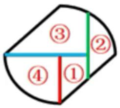

因此，本题答案为D 选项。

来源：[2023年江苏公务员考试《行测》真题（A类）解析.pdf](https://github.com/dumarstoft-ship-it/xingce/blob/407016b55b49581efa3771bb59a2dee8761d982f/2023%E5%B9%B4%E6%B1%9F%E8%8B%8F%E5%85%AC%E5%8A%A1%E5%91%98%E8%80%83%E8%AF%95%E3%80%8A%E8%A1%8C%E6%B5%8B%E3%80%8B%E7%9C%9F%E9%A2%98%EF%BC%88A%E7%B1%BB%EF%BC%89%E8%A7%A3%E6%9E%90.pdf)，PDF 第 43、44 页。

## 第 83 题 · 判断推理

参考答案：**A**

【答案】A
【解析】题干图形拼接后可得：

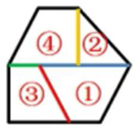

因此，本题答案为A 选项。

来源：[2023年江苏公务员考试《行测》真题（A类）解析.pdf](https://github.com/dumarstoft-ship-it/xingce/blob/407016b55b49581efa3771bb59a2dee8761d982f/2023%E5%B9%B4%E6%B1%9F%E8%8B%8F%E5%85%AC%E5%8A%A1%E5%91%98%E8%80%83%E8%AF%95%E3%80%8A%E8%A1%8C%E6%B5%8B%E3%80%8B%E7%9C%9F%E9%A2%98%EF%BC%88A%E7%B1%BB%EF%BC%89%E8%A7%A3%E6%9E%90.pdf)，PDF 第 44、45 页。

## 第 84 题 · 判断推理

参考答案：**B**

【答案】B
【解析】题干图形拼接后可得：

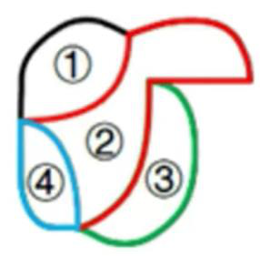

因此，本题答案为B 选项。

来源：[2023年江苏公务员考试《行测》真题（A类）解析.pdf](https://github.com/dumarstoft-ship-it/xingce/blob/407016b55b49581efa3771bb59a2dee8761d982f/2023%E5%B9%B4%E6%B1%9F%E8%8B%8F%E5%85%AC%E5%8A%A1%E5%91%98%E8%80%83%E8%AF%95%E3%80%8A%E8%A1%8C%E6%B5%8B%E3%80%8B%E7%9C%9F%E9%A2%98%EF%BC%88A%E7%B1%BB%EF%BC%89%E8%A7%A3%E6%9E%90.pdf)，PDF 第 45 页。

## 第 85 题 · 判断推理

参考答案：**A**

【答案】A
【解析】题干图形拼接后可得：

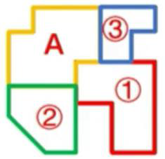

因此，本题答案为A 选项。

来源：[2023年江苏公务员考试《行测》真题（A类）解析.pdf](https://github.com/dumarstoft-ship-it/xingce/blob/407016b55b49581efa3771bb59a2dee8761d982f/2023%E5%B9%B4%E6%B1%9F%E8%8B%8F%E5%85%AC%E5%8A%A1%E5%91%98%E8%80%83%E8%AF%95%E3%80%8A%E8%A1%8C%E6%B5%8B%E3%80%8B%E7%9C%9F%E9%A2%98%EF%BC%88A%E7%B1%BB%EF%BC%89%E8%A7%A3%E6%9E%90.pdf)，PDF 第 45、46 页。

## 第 86 题 · 判断推理

参考答案：**B**

【答案】B
【解析】

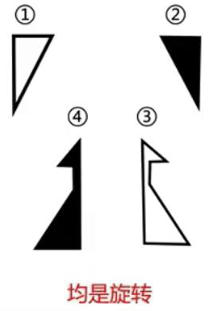

A 项， ，可以拼出，不能选；
B 项，无法拼出，当选；

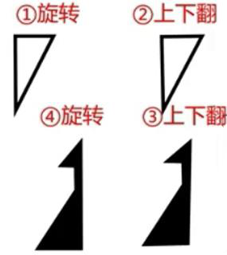

C 项， ，可以拼出，不能选；

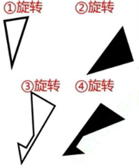

D 项， ，可以拼出，不能选。
故正确答案为B

来源：[2023年江苏公务员考试《行测》真题（A类）解析.pdf](https://github.com/dumarstoft-ship-it/xingce/blob/407016b55b49581efa3771bb59a2dee8761d982f/2023%E5%B9%B4%E6%B1%9F%E8%8B%8F%E5%85%AC%E5%8A%A1%E5%91%98%E8%80%83%E8%AF%95%E3%80%8A%E8%A1%8C%E6%B5%8B%E3%80%8B%E7%9C%9F%E9%A2%98%EF%BC%88A%E7%B1%BB%EF%BC%89%E8%A7%A3%E6%9E%90.pdf)，PDF 第 46、47 页。

## 第 87 题 · 判断推理

参考答案：**C**

【答案】C
【解析】

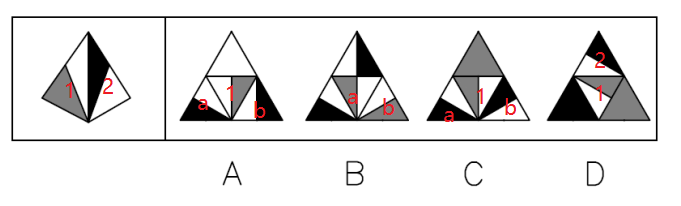

A 选项，题干的1 面如A 项所示，那么题干的2 面为a 或b 面，如果是a 面，该面黑三角部分不临近
两面的公共边，与题干不一致，如果是b 面，该面黑三角部分不临近两面的公共边，与题干不一致，排
除；B 选项，如果题干的1 面为a 面，那么以a 面为参考，题干的2 面应该是该项的b 面，与题干不一
致，如果题干的1 面为b 面，b 面和1 面图形不一致，与题干不一致，排除；C 选项，题干的1 面如该项
所示，以它为参考，题干的2 面应该为该项的b 面，与题干一致；D 选项，题干的1 面如该项所示，以它
为参考，题干的2 面为该项的2 面，2 面的黑色部分应该临近两面的公共边，与题干不一致，排除。
因此，本题答案为C 选项。

来源：[2023年江苏公务员考试《行测》真题（A类）解析.pdf](https://github.com/dumarstoft-ship-it/xingce/blob/407016b55b49581efa3771bb59a2dee8761d982f/2023%E5%B9%B4%E6%B1%9F%E8%8B%8F%E5%85%AC%E5%8A%A1%E5%91%98%E8%80%83%E8%AF%95%E3%80%8A%E8%A1%8C%E6%B5%8B%E3%80%8B%E7%9C%9F%E9%A2%98%EF%BC%88A%E7%B1%BB%EF%BC%89%E8%A7%A3%E6%9E%90.pdf)，PDF 第 47、48 页。

## 第 88 题 · 判断推理

参考答案：**B**

【答案】B
【解析】首先将题干个面标记序号，如下图

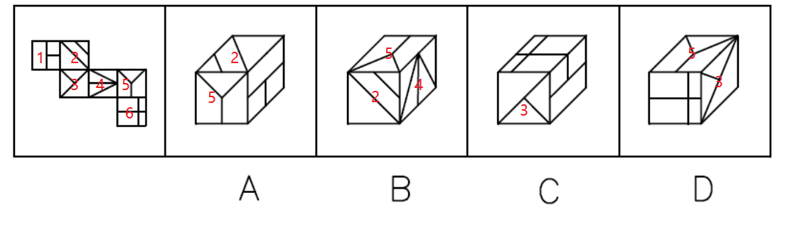

A 选项，该项顶面为2 面，正面为5 面，以2、5 面为参考，右侧面应该为1 面，1 面内部的小正方形
应该临近与2 面的公共边，该项与题干关系不一致；B 选项，该项正面为2 面，顶面为5 面，右侧面为4
面，三面关系与题干一致；C 选项，该项正面为3 面，以3 面为参考，右侧面应该为1 面，1 面内部的小
正方形应该临近与2 面的公共边，该项与题干关系不一致；D 选项，该项顶面为5 面，右侧面为3 面，两
面为相对面，无法同时出现，该项与题干关系不一致，排除。
因此，本题答案为B 选项。

来源：[2023年江苏公务员考试《行测》真题（A类）解析.pdf](https://github.com/dumarstoft-ship-it/xingce/blob/407016b55b49581efa3771bb59a2dee8761d982f/2023%E5%B9%B4%E6%B1%9F%E8%8B%8F%E5%85%AC%E5%8A%A1%E5%91%98%E8%80%83%E8%AF%95%E3%80%8A%E8%A1%8C%E6%B5%8B%E3%80%8B%E7%9C%9F%E9%A2%98%EF%BC%88A%E7%B1%BB%EF%BC%89%E8%A7%A3%E6%9E%90.pdf)，PDF 第 48、49 页。

## 第 89 题 · 判断推理

参考答案：**A**

【答案】A
【解析】题干一共出现了4 个面，依次做如下标记：

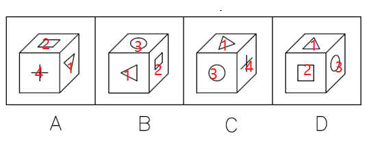

A 选项，1 面的三角形的边平行于与2 面的公共边，以1、2 面为参考（观察顺序为1 面上2 面下），4
面位于两面的右边；B 选项，以1、2 面为参考（观察顺序为1 面上2 面下），3 面位于两面右侧，故A、B
项一定有一个是不同的立体图形；D 项和B 项所表示的是3 个相同的面，故以D 项验证，D 项中，以1、2
面为参考（观察顺序为1 面上2 面下），3 面位于两面右侧，故A 选项是不同的立体图形。
因此，本题答案为A 选项。

来源：[2023年江苏公务员考试《行测》真题（A类）解析.pdf](https://github.com/dumarstoft-ship-it/xingce/blob/407016b55b49581efa3771bb59a2dee8761d982f/2023%E5%B9%B4%E6%B1%9F%E8%8B%8F%E5%85%AC%E5%8A%A1%E5%91%98%E8%80%83%E8%AF%95%E3%80%8A%E8%A1%8C%E6%B5%8B%E3%80%8B%E7%9C%9F%E9%A2%98%EF%BC%88A%E7%B1%BB%EF%BC%89%E8%A7%A3%E6%9E%90.pdf)，PDF 第 49 页。

## 第 90 题 · 判断推理

参考答案：**A**

【答案】A
【解析】

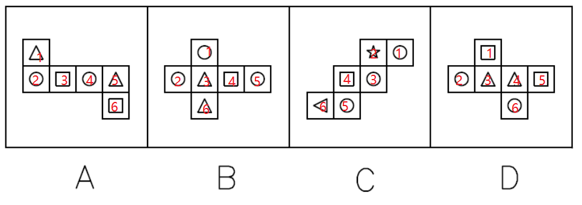

A 选项，该项任意三个相邻面中，必定会出现含有圆的图形，正确；B 选项，该项如果以3、4、6 三
面为相邻的立体图形的外面，此时没有出现圆，不符合题干要求；C 选项，该项如果以2、4、6 三面为相
邻的立体图形的外面，此时没有出现圆，不符合题干要求；D 选项，该项如果是以1、3、4 三面为相邻的
立体图形的外面，此时没有出现圆，不符合题干要求。
因此，本题答案为A 选项。

来源：[2023年江苏公务员考试《行测》真题（A类）解析.pdf](https://github.com/dumarstoft-ship-it/xingce/blob/407016b55b49581efa3771bb59a2dee8761d982f/2023%E5%B9%B4%E6%B1%9F%E8%8B%8F%E5%85%AC%E5%8A%A1%E5%91%98%E8%80%83%E8%AF%95%E3%80%8A%E8%A1%8C%E6%B5%8B%E3%80%8B%E7%9C%9F%E9%A2%98%EF%BC%88A%E7%B1%BB%EF%BC%89%E8%A7%A3%E6%9E%90.pdf)，PDF 第 49、50 页。

## 第 91 题 · 判断推理

参考答案：**A**

【答案】A
【解析】题干可翻译为：①事立→心立②一个人理想信念坚定→“骨头”就硬③理想信念缺失或者不
坚定→精神上就会“缺钙”→就会得“软骨病”→容易在考验面前迷失方向。
A 选项，该项可翻译为：不想事立→无须心立，是对①的否前，否定前件得不出确定结论，该项无法
推出，当选；
B 选项，该项可翻译为：一个人“骨头”不硬→他的理想信念不坚定，是对②的否后，否后推否前，
该项可以推出，排除；
C 选项，该项可翻译为：一个人理想信念缺失→会得“软骨病”，是对③的肯前，肯前推肯后，该项
可以推出，排除；
D 选项，该项可翻译为：一个人不容易在考验面前迷失方向→说明他有坚定的理想信念，是对③的否
后，否后推否前，该项可以推出，排除。
因此，本题答案为A 选项。

来源：[2023年江苏公务员考试《行测》真题（A类）解析.pdf](https://github.com/dumarstoft-ship-it/xingce/blob/407016b55b49581efa3771bb59a2dee8761d982f/2023%E5%B9%B4%E6%B1%9F%E8%8B%8F%E5%85%AC%E5%8A%A1%E5%91%98%E8%80%83%E8%AF%95%E3%80%8A%E8%A1%8C%E6%B5%8B%E3%80%8B%E7%9C%9F%E9%A2%98%EF%BC%88A%E7%B1%BB%EF%BC%89%E8%A7%A3%E6%9E%90.pdf)，PDF 第 50、51 页。

## 第 92 题 · 判断推理

参考答案：**B**

【答案】B
【解析】整体题干信息，论点：尽管《现代汉语词典》伴随自己的学生时代，但在互联网时代，它已
经远离了我们的生活，论据：如今，利用网络检索信息、查阅资料非常方便，大多数人遇到生僻的字词需
要检索、查找、求证时，第一选择是上网而不是翻检词典。
A 项，说明《现代汉语词典》会更新，但对于是否远离我们生活不知道，无关选项，排除；
B 项，网络检索的信息都是依据《现代汉语词典》，说明间接的一直在使用《现代汉语词典》，所以并
未原理我们的生活，可以削弱，保留；
C 项，未涉及《现代汉语词典》、网络检索，与我们生活的关系，无关项，排除；
D 项，文段未提及准确度，无关选项，，排除。
故正确答案为B。

来源：[2023年江苏公务员考试《行测》真题（A类）解析.pdf](https://github.com/dumarstoft-ship-it/xingce/blob/407016b55b49581efa3771bb59a2dee8761d982f/2023%E5%B9%B4%E6%B1%9F%E8%8B%8F%E5%85%AC%E5%8A%A1%E5%91%98%E8%80%83%E8%AF%95%E3%80%8A%E8%A1%8C%E6%B5%8B%E3%80%8B%E7%9C%9F%E9%A2%98%EF%BC%88A%E7%B1%BB%EF%BC%89%E8%A7%A3%E6%9E%90.pdf)，PDF 第 51 页。

## 第 93 题 · 判断推理

参考答案：**D**

【答案】D
【解析】首先整理题干信息：
（1）有3 人为青年教师，2 人为中年教师；
（2）语文教师有2 人，数学教师有3 人；
（3）甲与丙同龄，丁与戊年龄相差最大；
（4）乙与戊所教课程相同，丙与丁所教课程不同；
（5）担任组长的是一名中年语文教师。
结合（1）（3）可得，甲和丙一定是青年教师；结合（2）（4）可得乙和戊一定是数学老师，结合
（5），说明组长不是甲、丙、乙、戊，那么只能是丁。
因此，本题答案为D 选项。

来源：[2023年江苏公务员考试《行测》真题（A类）解析.pdf](https://github.com/dumarstoft-ship-it/xingce/blob/407016b55b49581efa3771bb59a2dee8761d982f/2023%E5%B9%B4%E6%B1%9F%E8%8B%8F%E5%85%AC%E5%8A%A1%E5%91%98%E8%80%83%E8%AF%95%E3%80%8A%E8%A1%8C%E6%B5%8B%E3%80%8B%E7%9C%9F%E9%A2%98%EF%BC%88A%E7%B1%BB%EF%BC%89%E8%A7%A3%E6%9E%90.pdf)，PDF 第 51、52 页。

## 第 94 题 · 判断推理

参考答案：**C**

【答案】C
【解析】题干论点是：死海是淹不死人的；论据是：②死海海水含盐量很大。③死海海水中有135 亿
吨氯化钠，有64 亿吨氯化钙，有20 亿吨氯化钾……各种盐的质量加在一起占死海全部海水的23%~25%。
由于④死海海水的比重超过了人体的比重，以致⑤人到死海里会自然漂起来，沉不下去。结合四个论据，
③在说明死海的含盐量，据此可以得出死海的海水含盐量很大，故③是②的论据，故应该是②←③，排除
BD 项，以③②为基础，可以得到④死海海水的比重超过了人体的比重，进而可以推出⑤人到死海里会自然
漂起来，沉不下去。最终得出结论①死海淹不死人。所以应该是①←⑤←④←②←③，只有C 选项符合。
因此，本题答案为C 选项。

来源：[2023年江苏公务员考试《行测》真题（A类）解析.pdf](https://github.com/dumarstoft-ship-it/xingce/blob/407016b55b49581efa3771bb59a2dee8761d982f/2023%E5%B9%B4%E6%B1%9F%E8%8B%8F%E5%85%AC%E5%8A%A1%E5%91%98%E8%80%83%E8%AF%95%E3%80%8A%E8%A1%8C%E6%B5%8B%E3%80%8B%E7%9C%9F%E9%A2%98%EF%BC%88A%E7%B1%BB%EF%BC%89%E8%A7%A3%E6%9E%90.pdf)，PDF 第 52 页。

## 第 95 题 · 判断推理

参考答案：**D**

【答案】D
【解析】分析题干，论点：长此以往许多厨师将面临失业的风险，论据：规模化连锁餐饮店用预制菜
多。
A 项，需要厨师预处理，厨师不会面临失业风险，无法支持论点，排除；
B 项，预制菜进入家庭，与题干中规模化连锁餐饮店使用预制菜无关，对于厨师是否面临失业风险未
知，无法支持论点，排除；
C 项，肯定论据，并未涉及论点，支持力度较小，保留；
D 项，肯定论据，不使用厨师的成本低，用厨师的竞争不过，最终导致厨师失业，支持力度强，当
选。
正确答案为D。

来源：[2023年江苏公务员考试《行测》真题（A类）解析.pdf](https://github.com/dumarstoft-ship-it/xingce/blob/407016b55b49581efa3771bb59a2dee8761d982f/2023%E5%B9%B4%E6%B1%9F%E8%8B%8F%E5%85%AC%E5%8A%A1%E5%91%98%E8%80%83%E8%AF%95%E3%80%8A%E8%A1%8C%E6%B5%8B%E3%80%8B%E7%9C%9F%E9%A2%98%EF%BC%88A%E7%B1%BB%EF%BC%89%E8%A7%A3%E6%9E%90.pdf)，PDF 第 53 页。

## 第 96 题 · 判断推理

参考答案：**A**

【答案】A
【解析】分析题干，找到题干矛盾点：大部分使用者很少或从没阅读过APP 提供的用户协议，也不乐
意APP 有超出其功能的某些权限，但他们都会点击“我已阅读并同意用户协议”。
A 项，用户下载app 就是为了使用它，因此为了达到目的用户依然会点击同意，即使他们很少或从没
阅读过APP 提供的用户协议也不乐意APP 有超出其功能的某些权限。可以解释上述现象，当选；
B 项，通过正规平台下载的app 非常安全，可以让用户直接点击“我已阅读并同意用户协议”，对于
题干中不乐意APP 有超出其功能的某些权限，但还是点击“我已阅读并同意用户协议”，无法起到解释作
用。且题干中未出现正规不正规平台的区别，排除；
C 项，回应了用户协议的缺陷，是大部分使用者很少或从没阅读过APP 提供的用户协议但还是同意了
的客观部分，未分析使用者不乐意APP 有超出其功能的某些权限但仍然同意的主观因素，无法起到解释作
用，排除；
D 项，举个例，不能够完全解释，且后期可以修改，使用者不需要不乐意，排除。
故正确答案为A。

来源：[2023年江苏公务员考试《行测》真题（A类）解析.pdf](https://github.com/dumarstoft-ship-it/xingce/blob/407016b55b49581efa3771bb59a2dee8761d982f/2023%E5%B9%B4%E6%B1%9F%E8%8B%8F%E5%85%AC%E5%8A%A1%E5%91%98%E8%80%83%E8%AF%95%E3%80%8A%E8%A1%8C%E6%B5%8B%E3%80%8B%E7%9C%9F%E9%A2%98%EF%BC%88A%E7%B1%BB%EF%BC%89%E8%A7%A3%E6%9E%90.pdf)，PDF 第 53、54 页。

## 第 97 题 · 判断推理

参考答案：**B**

【答案】B
【解析】首先整理题干信息：
（1）赵是第六名，郑的名次在孙之前；
（2）男选手的排名不相邻；
（3）吴的名次在钱和李之前，排名在吴之前的选手中有两名男性；
（4）7 名选手有男有女，没有并列名次。
结合（1）（2）（3）可知，吴后面至少有钱、李、赵3 人，吴前面至少也有3 人，说明吴是第4 名，
钱和李为第5 名或第7 名，周、郑、孙则位于前三名，结合（1）郑在孙名次之前，则郑的名次为第1 名
或第2 名，他和吴不可能相邻，B 选项符合。
因此，本题答案为B 选项。

来源：[2023年江苏公务员考试《行测》真题（A类）解析.pdf](https://github.com/dumarstoft-ship-it/xingce/blob/407016b55b49581efa3771bb59a2dee8761d982f/2023%E5%B9%B4%E6%B1%9F%E8%8B%8F%E5%85%AC%E5%8A%A1%E5%91%98%E8%80%83%E8%AF%95%E3%80%8A%E8%A1%8C%E6%B5%8B%E3%80%8B%E7%9C%9F%E9%A2%98%EF%BC%88A%E7%B1%BB%EF%BC%89%E8%A7%A3%E6%9E%90.pdf)，PDF 第 54 页。

## 第 98 题 · 判断推理

参考答案：**C**

【答案】C
【解析】首先整理题干信息：
（1）赵是第六名，郑的名次在孙之前；
（2）男选手的排名不相邻；
（3）吴的名次在钱和李之前，排名在吴之前的选手中有两名男性；
（4）7 名选手有男有女，没有并列名次；
（5）周是第三名。
结合上题可知，吴是第4 名，钱和李为第5 名或第7 名，周、郑、孙则位于前三名。如果周是第3
名，那么郑一定是第1 名，孙为第2 名，七人情况如下表：
|名次|1|2|3|4|5|6|7|
|---|---|---|---|---|---|---|---|
|选手|郑|孙|周|吴|钱（李）|赵|李（钱）|
根据上表，结合（2）（3）可知，郑和周为男性，孙为女性，C 选项符合。
因此，本题答案为C 选项。

来源：[2023年江苏公务员考试《行测》真题（A类）解析.pdf](https://github.com/dumarstoft-ship-it/xingce/blob/407016b55b49581efa3771bb59a2dee8761d982f/2023%E5%B9%B4%E6%B1%9F%E8%8B%8F%E5%85%AC%E5%8A%A1%E5%91%98%E8%80%83%E8%AF%95%E3%80%8A%E8%A1%8C%E6%B5%8B%E3%80%8B%E7%9C%9F%E9%A2%98%EF%BC%88A%E7%B1%BB%EF%BC%89%E8%A7%A3%E6%9E%90.pdf)，PDF 第 54、55 页。

## 第 99 题 · 判断推理

参考答案：**A**

【答案】
【解析】分析题干，论点：这一成绩要求违背了该校制定转专业政策的初衷，初衷：为了调动学生的
学习主动性和积极性、提高学生对所学专业的满意度，制度：允许在原专业中成绩名列年级前10%且不存
在挂科的学生更换专业。
A 项，指出学生是对原专业不感兴趣而缺乏学习的动力，若实施新的制度的话依然达不到初衷，可以
支持，当选；
B 项，论点讨论的是转专业政策的初衷，选项中谈论的是对所学专业的兴趣，话题不一致，不能支
持，排除；
C 项，不管是否换了专业，学生都不愿意学，不能够支持专家观点，排除；
D 项，话题不一致，题干中并未提到专业的平衡发展，排除。
故正确答案为A

来源：[2023年江苏公务员考试《行测》真题（A类）解析.pdf](https://github.com/dumarstoft-ship-it/xingce/blob/407016b55b49581efa3771bb59a2dee8761d982f/2023%E5%B9%B4%E6%B1%9F%E8%8B%8F%E5%85%AC%E5%8A%A1%E5%91%98%E8%80%83%E8%AF%95%E3%80%8A%E8%A1%8C%E6%B5%8B%E3%80%8B%E7%9C%9F%E9%A2%98%EF%BC%88A%E7%B1%BB%EF%BC%89%E8%A7%A3%E6%9E%90.pdf)，PDF 第 55 页。

## 第 100 题 · 判断推理

参考答案：**C**

【答案】C
【解析】题干的论点为：乌鸦更喜欢停留在杨树多的地方过冬；论据为：冬季都有成群的乌鸦聚集于
甲路边的树上，但乙路边的树上基本没有乌鸦。
A 选项，题干讲述的是过冬，该项讲述的是夏秋之交，话题不一致，排除；
B 选项，该项讲述的是城市重视绿化为鸟类提供了良好的栖息环境，但并未提及乌鸦为什么喜欢在甲
路边上，无法削弱，排除；
C 选项，该项说明是因为风的原因导致乌鸦喜欢在甲路而不是乙路，另有他因，可以削弱；
D 选项，该项通过类比，说明与乙路差不多拥有同样杨树的另一条路在冬季也没有乌鸦，加强了题干
论点，排除。
因此，本题答案为C 选项。

来源：[2023年江苏公务员考试《行测》真题（A类）解析.pdf](https://github.com/dumarstoft-ship-it/xingce/blob/407016b55b49581efa3771bb59a2dee8761d982f/2023%E5%B9%B4%E6%B1%9F%E8%8B%8F%E5%85%AC%E5%8A%A1%E5%91%98%E8%80%83%E8%AF%95%E3%80%8A%E8%A1%8C%E6%B5%8B%E3%80%8B%E7%9C%9F%E9%A2%98%EF%BC%88A%E7%B1%BB%EF%BC%89%E8%A7%A3%E6%9E%90.pdf)，PDF 第 56 页。

## 第 101 题 · 判断推理

参考答案：**B**

【答案】B
【解析】题干的论证结构为：小李是通过说明小朱的观点没有证据，从而反驳了小朱的观点。
A 选项，该项乙是通过提供一个论据“现在的天气状况特别好”，得出“明天很可能不下雨”，从而
反驳了甲的观点，与题干论证方式不一致；
B 选项，该项乙指出“我一直没看到他们出去”， 说明没有证据说明老王一家外出散步了，即说明甲
的观点没有证据，从而反驳甲的观点，与题干论证结构一致；
C 选项，该项乙通过提供一个论据“我只见过老赵不聪明的时候”， 得出“老赵有时不聪明” 从而
反驳了甲的观点，与题干论证方式不一致；
D 选项，该项乙是通过提供一个论据“目前小徐在积分榜上排名靠后”，从而得出“小徐可能不会晋
级”，从而反驳了甲的观点，与题干论证方式不一致。
故正确答案为B。

来源：[2023年江苏公务员考试《行测》真题（A类）解析.pdf](https://github.com/dumarstoft-ship-it/xingce/blob/407016b55b49581efa3771bb59a2dee8761d982f/2023%E5%B9%B4%E6%B1%9F%E8%8B%8F%E5%85%AC%E5%8A%A1%E5%91%98%E8%80%83%E8%AF%95%E3%80%8A%E8%A1%8C%E6%B5%8B%E3%80%8B%E7%9C%9F%E9%A2%98%EF%BC%88A%E7%B1%BB%EF%BC%89%E8%A7%A3%E6%9E%90.pdf)，PDF 第 56、57 页。

## 第 102 题 · 判断推理

参考答案：**C**

【答案】
【解析】分析题干，设问的意思即为甲默认的事情，在说话时隐含的意思。
A 项，“没事，没事”，“我倒是很在意您对这件事的态度”，说明甲不怎么在意消费者是否愿意配
合，符合对话假设，不能选；
B 项，“请您把您的态度告诉我”，说明甲默认了乙有态度，并询问，符合对话假设，不能选；
C 项，“请您把您的态度告诉我”，这是甲在请求乙将自己的态度说出来而发出的问询，说明甲事先
并不知道乙会不会将自己的态度告诉甲，不是对话假设，当选；
D 项，“因为您的态度会左右我下一步的选择”，说明甲对自己下一步的选择是有想法的，符合对话
假设，不能选。
故正确答案为C。

来源：[2023年江苏公务员考试《行测》真题（A类）解析.pdf](https://github.com/dumarstoft-ship-it/xingce/blob/407016b55b49581efa3771bb59a2dee8761d982f/2023%E5%B9%B4%E6%B1%9F%E8%8B%8F%E5%85%AC%E5%8A%A1%E5%91%98%E8%80%83%E8%AF%95%E3%80%8A%E8%A1%8C%E6%B5%8B%E3%80%8B%E7%9C%9F%E9%A2%98%EF%BC%88A%E7%B1%BB%EF%BC%89%E8%A7%A3%E6%9E%90.pdf)，PDF 第 57 页。

## 第 103 题 · 判断推理

参考答案：**D**

【答案】D
【解析】首先整理题干信息：
（1）甲：我身高不到1.70 米；
（2）乙：丙身高1.72 米，偏瘦；
（3）丙：丁身高1.68 米，偏胖；
（4）丁：乙身高1.65 米，偏瘦；
（5）体型偏瘦的说真话，体型偏胖的说假话；
（6）有两人体型偏瘦，两人体型偏胖。
A 选项，甲身高1.65 米，偏胖，代入题干，可知甲说真话，则甲应该偏瘦而不是偏胖，冲突，排除；
B 选项，乙身高1.70 米，偏瘦，代入题干，可知乙说真话，则丙身高1.72 米，偏瘦；进而可知丙说
真话，则丁身高1.68 米，偏胖，综上可得甲的身高为1.65 米，根据乙和丙偏瘦，说真话，可知甲和丁偏
胖，说假话，结合“甲的身高为1.65 米”和甲所说的“我身高不到1.70 米”，可知甲说的是真话，冲
突，排除；
C 选项，丙身高1.72 米，偏瘦，代入题干，可知丙说真话，则丁身高1.68 米，偏胖；根据丙的情
况，可知乙说的是真话，乙偏瘦，结合乙偏瘦和丁说假话，可知，乙的身高不是1.65 米，则乙的身高为
1.7 米，甲的身高为1.65 米，此时甲说真话，根据丙和乙说真话，甲应该说假话，冲突，排除；
D 选项，丁身高1.68 米，偏胖，代入题干，可知，丙说的是真话，进而可知甲和乙的话一真一假，如
果甲说真话，甲的身高为1.65，偏瘦，甲说真话则乙说假话，进而可得丙的身高不是1.72 米，那么丙的
身高为1.7 米，乙的身高则为1.72 米，与题干不冲突。
因此，本题答案为D 选项。

来源：[2023年江苏公务员考试《行测》真题（A类）解析.pdf](https://github.com/dumarstoft-ship-it/xingce/blob/407016b55b49581efa3771bb59a2dee8761d982f/2023%E5%B9%B4%E6%B1%9F%E8%8B%8F%E5%85%AC%E5%8A%A1%E5%91%98%E8%80%83%E8%AF%95%E3%80%8A%E8%A1%8C%E6%B5%8B%E3%80%8B%E7%9C%9F%E9%A2%98%EF%BC%88A%E7%B1%BB%EF%BC%89%E8%A7%A3%E6%9E%90.pdf)，PDF 第 57、58 页。

## 第 104 题 · 判断推理

参考答案：**A**

【答案】A
【解析】首先整理题干信息：
（1）丁点芹菜肉丝→甲点清蒸鲈鱼；
（2）丙点清蒸鲈鱼→乙和丁也点清蒸鲈鱼；
（3）乙在芹菜肉丝和清蒸鲈鱼中至少点一道→乙也点毛豆仔鸡；
（4）丙在芹菜肉丝和毛豆仔鸡中至少点一道→丙也点清蒸鲈鱼；
（5）甲、乙、丙、丁各点了其中的2 道；
（6）没有一道菜四人都点，也没有一道菜四人都不点。
假设乙不点毛豆仔鸡，结合（3），可知乙也不点芹菜肉丝和清蒸鲈鱼，此时乙最多点一个菜，与
（5）冲突，故（7）乙一定点毛豆仔鸡；假设丙不点清蒸鲈鱼，结合（4），可知丙也不点芹菜肉丝和毛豆
仔鸡，此时丙最多点一个菜，与（5）冲突，故（7）丙一定点清蒸鲈鱼。根据（2）（7）可得，丙、乙、
丁都点清蒸鲈鱼，结合（6）可知，甲一定不点清蒸鲈鱼，如下表：
|甲（不选清蒸鲈鱼）|乙|丙|丁|
|---|---|---|---|
||毛豆仔鸡|清蒸鲈鱼|清蒸鲈鱼|
||清蒸鲈鱼|||
结合上表，甲可选的菜品为芹菜肉丝、毛豆仔鸡、糖醋排骨中的两道，无论选哪两道，芹菜肉丝和毛
豆仔鸡甲至少要有一个，A 选项正确。
因此，本题答案为A 选项。

来源：[2023年江苏公务员考试《行测》真题（A类）解析.pdf](https://github.com/dumarstoft-ship-it/xingce/blob/407016b55b49581efa3771bb59a2dee8761d982f/2023%E5%B9%B4%E6%B1%9F%E8%8B%8F%E5%85%AC%E5%8A%A1%E5%91%98%E8%80%83%E8%AF%95%E3%80%8A%E8%A1%8C%E6%B5%8B%E3%80%8B%E7%9C%9F%E9%A2%98%EF%BC%88A%E7%B1%BB%EF%BC%89%E8%A7%A3%E6%9E%90.pdf)，PDF 第 58、59 页。

## 第 105 题 · 判断推理

参考答案：**C**

【答案】C
【解析】首先整理题干信息：
（1）丁点芹菜肉丝→甲点清蒸鲈鱼；
（2）丙点清蒸鲈鱼→乙和丁也点清蒸鲈鱼；
（3）乙在芹菜肉丝和清蒸鲈鱼中至少点一道→乙也点毛豆仔鸡；
（4）丙在芹菜肉丝和毛豆仔鸡中至少点一道→丙也点清蒸鲈鱼；
（5）甲、乙、丙、丁各点了其中的2 道；
（6）没有一道菜四人都点，也没有一道菜四人都不点；
（7）任意两人点的菜都不完全相同。
根据上题可知：
|甲（不选清蒸鲈鱼）|乙|丙|丁|
|---|---|---|---|
||毛豆仔鸡|清蒸鲈鱼|清蒸鲈鱼|
||清蒸鲈鱼|||
根据
（1）可知，丁不点芹菜肉丝，结合（7）可知，丁只能点糖醋排骨和清蒸鲈鱼，那么丙只能点芹菜肉丝和
清蒸鲈鱼，C 选项正确。因此，本题答案为C 选项。

来源：[2023年江苏公务员考试《行测》真题（A类）解析.pdf](https://github.com/dumarstoft-ship-it/xingce/blob/407016b55b49581efa3771bb59a2dee8761d982f/2023%E5%B9%B4%E6%B1%9F%E8%8B%8F%E5%85%AC%E5%8A%A1%E5%91%98%E8%80%83%E8%AF%95%E3%80%8A%E8%A1%8C%E6%B5%8B%E3%80%8B%E7%9C%9F%E9%A2%98%EF%BC%88A%E7%B1%BB%EF%BC%89%E8%A7%A3%E6%9E%90.pdf)，PDF 第 59、60 页。

## 第 106 题 · 判断推理

参考答案：**B**

【答案】B
【解析】①以中国革命或社会主义建设时期的历史、事迹和精神为主题；②以相关纪念地、标志物等
为载体组织开展的旅游活动。
A 选项，该项很多学生来到渡江胜利纪念馆，属于学生自发行为而不是组织行为，不符合②；
B 选项，该项北大荒开发建设纪念馆属于“社会主义建设时期的历史、事迹和精神为主题，以相关纪
念地”，老师组织近百名团员去纪念馆参观，属于红色研学，符合关键词；
C 选项，该项吟诵爱国主义诗词作品并不是以相关纪念地、标志物等为载体，不符合②；
D 选项，该地是为外地游客讲解烈士事迹，并不是组织开展的旅游活动，不符合②。
因此，本题答案为B 选项。

来源：[2023年江苏公务员考试《行测》真题（A类）解析.pdf](https://github.com/dumarstoft-ship-it/xingce/blob/407016b55b49581efa3771bb59a2dee8761d982f/2023%E5%B9%B4%E6%B1%9F%E8%8B%8F%E5%85%AC%E5%8A%A1%E5%91%98%E8%80%83%E8%AF%95%E3%80%8A%E8%A1%8C%E6%B5%8B%E3%80%8B%E7%9C%9F%E9%A2%98%EF%BC%88A%E7%B1%BB%EF%BC%89%E8%A7%A3%E6%9E%90.pdf)，PDF 第 60 页。

## 第 107 题 · 判断推理

参考答案：**A**

【答案】A
【解析】①消费者将对某品牌特定产品的认同感转移到该品牌的新产品上②企业利用旗舰产品的良好
形象推出相关产品, 迅速占领市场
A 项，指出该企业有良好形象的旗舰产品洗衣机，并推出了相关产品迷你型产品，符合②，保留；
B 项，指出消费者倪先生对该品牌的认同感，促使购买该品牌认证的产品，该品牌认证的产品并不是
该品牌的新产品，不符合①，排除；
C 项，指出某知名品牌电动自行车广受欢迎，但是并未指出该知名品牌利用旗舰产品的良好形象推出
相关产品，不符合②，排除；
D 项，并未指出该知名玩具公司有良好形象的旗舰产品，而是利用自身之外的世界杯的热度，不符合
②，排除。
故正确答案为A。

来源：[2023年江苏公务员考试《行测》真题（A类）解析.pdf](https://github.com/dumarstoft-ship-it/xingce/blob/407016b55b49581efa3771bb59a2dee8761d982f/2023%E5%B9%B4%E6%B1%9F%E8%8B%8F%E5%85%AC%E5%8A%A1%E5%91%98%E8%80%83%E8%AF%95%E3%80%8A%E8%A1%8C%E6%B5%8B%E3%80%8B%E7%9C%9F%E9%A2%98%EF%BC%88A%E7%B1%BB%EF%BC%89%E8%A7%A3%E6%9E%90.pdf)，PDF 第 60、61 页。

## 第 108 题 · 判断推理

参考答案：**D**

【答案】D
【解析】①城乡建设过程中；②以大数据、物联网等数字化技术为基础；③通过多领域数据的互联互
通；④提高政府治理效能及宜居度的举措。
A 选项，该项是利用物联网技术，强化产品质量溯源体系建设，并不是对于多领域数据的互联互通，
不符合③；
B 选项，该项农业园采用多项“5G+农业”技术，利用监测点检测作物生长情况，同时把这些数据传回
控制中心，根据这些数据进行种苗选育，水肥管控，属于利用大数据，通过多领域数据的互联互通，但并
没有提高政府的治理效能，不符合④；
C 选项，该项“研发出了一套新的智能信控系统，有望实现从“车看灯”到“灯看车”的转变”并没
有涉及多领域数据的互联互通，仅仅是交通领域，不符合③，且企业行为是为了挣钱，目的不符合④；
D 选项，该项的市区积水地图，通过多领域数据的互联互通，提高政府治理效能及宜居度,当选。
因此，本题答案为D 选项。

来源：[2023年江苏公务员考试《行测》真题（A类）解析.pdf](https://github.com/dumarstoft-ship-it/xingce/blob/407016b55b49581efa3771bb59a2dee8761d982f/2023%E5%B9%B4%E6%B1%9F%E8%8B%8F%E5%85%AC%E5%8A%A1%E5%91%98%E8%80%83%E8%AF%95%E3%80%8A%E8%A1%8C%E6%B5%8B%E3%80%8B%E7%9C%9F%E9%A2%98%EF%BC%88A%E7%B1%BB%EF%BC%89%E8%A7%A3%E6%9E%90.pdf)，PDF 第 61、62 页。

## 第 109 题 · 判断推理

参考答案：**B**

【答案】B
【解析】①消费者在特定情形下；②为了表达对相关企业产品的支持；③有意忽略产品性能、个人消
费能力或需求的情感性购买行为
A 项，为了支持小孩的生活，买了小孩的土豆，不符合②，排除；
B 项，符合①②③，当选；
C 项，老马包子铺并不是企业，不符合②，排除；
D 项，心仪已久说明他考虑了产品性能，不符合③排除；
故正确答案为B。

来源：[2023年江苏公务员考试《行测》真题（A类）解析.pdf](https://github.com/dumarstoft-ship-it/xingce/blob/407016b55b49581efa3771bb59a2dee8761d982f/2023%E5%B9%B4%E6%B1%9F%E8%8B%8F%E5%85%AC%E5%8A%A1%E5%91%98%E8%80%83%E8%AF%95%E3%80%8A%E8%A1%8C%E6%B5%8B%E3%80%8B%E7%9C%9F%E9%A2%98%EF%BC%88A%E7%B1%BB%EF%BC%89%E8%A7%A3%E6%9E%90.pdf)，PDF 第 62 页。

## 第 110 题 · 判断推理

参考答案：**C**

【答案】C
【解析】①节假日期间；②主动避开热点城市、景区，到消费低、游客少的冷门景点；③追求个性
化、高品质体验的小众旅游活动。
A 选项，该项老周在五一期间重游奉献三十年青春的林区，与阔别多年的老同事、老朋友相聚，并不
是要主动避开热门景点，而是为了怀旧和聚会，不符合②；
B 选项，该项新婚期间并不一定属于节假日，不符合①；
C 选项，赵先生在春节期间，去一个无名小镇滑冰、滑雪、看冰灯，属于主动避开热门景点，追求高
品质的小众旅游，符合关键词；
D 选项，该项湿地公园不一定不是热门景点，不符合①。
因此，本题答案为C 选项。

来源：[2023年江苏公务员考试《行测》真题（A类）解析.pdf](https://github.com/dumarstoft-ship-it/xingce/blob/407016b55b49581efa3771bb59a2dee8761d982f/2023%E5%B9%B4%E6%B1%9F%E8%8B%8F%E5%85%AC%E5%8A%A1%E5%91%98%E8%80%83%E8%AF%95%E3%80%8A%E8%A1%8C%E6%B5%8B%E3%80%8B%E7%9C%9F%E9%A2%98%EF%BC%88A%E7%B1%BB%EF%BC%89%E8%A7%A3%E6%9E%90.pdf)，PDF 第 62、63 页。

## 第 111 题 · 判断推理

参考答案：**A**

【答案】A
【解析】①文学创作中不是一味表现自我；②而是以客观事实为依据，换位思考，设想对方的情感反
应并作出判断的手法。
A 选项，该项的意思是如果把美丽的西湖比作美人西施,那么晴朗的西湖就如浓妆的西施，而雨天的西
湖就像淡妆的西施，都是同样的美丽无比。该项只是在客观描述西湖的美，未涉及到其他人，更无从谈起
换位思考，不符合②
B 选项，遥想兄弟们今日登高望远时,头上插满茱萸只少我一人。诗人通过换位思考，表达出自己的友
人、亲人的思念之情，符合关键词；
C 选项，该项的意思是如果洛阳的亲友若是问起我来,就说我的心依然像玉壶里的冰一样纯洁,未受功
名利禄等世情的玷污。作者以玉壶的冰以比喻自己未受功名利禄等世情的玷污，并没有直接表达，通过冰
心在玉壶的表述，可以让别人体会到自己的清廉、纯粹，符合关键词；
D 选项，该项处在《夜雨寄北》，是作者李商隐写给远在北方的妻子的，该项的意思是什么时候才能
回到家乡，在西窗下同你共剪烛花，相互倾诉今宵巴山夜雨中的思念之情。
因此，本题答案为A 选项。

来源：[2023年江苏公务员考试《行测》真题（A类）解析.pdf](https://github.com/dumarstoft-ship-it/xingce/blob/407016b55b49581efa3771bb59a2dee8761d982f/2023%E5%B9%B4%E6%B1%9F%E8%8B%8F%E5%85%AC%E5%8A%A1%E5%91%98%E8%80%83%E8%AF%95%E3%80%8A%E8%A1%8C%E6%B5%8B%E3%80%8B%E7%9C%9F%E9%A2%98%EF%BC%88A%E7%B1%BB%EF%BC%89%E8%A7%A3%E6%9E%90.pdf)，PDF 第 63、64 页。

## 第 112 题 · 判断推理

参考答案：**B**

【答案】B
【解析】①原来价格不高的大众化商品②由于产品升级、成本上涨或者营销策略等因素涨价幅度过大
③造成消费者心理震撼或购买不便
A 项，并未指出冰淇淋原先的价格，不符合①，排除；
B 项，原先价格比较低符合①，现在涨幅过大符合②，花掉半个月工资并感叹符合③，保留；
C 项，并未指出原先的价格，不符合①，排除；
D 项，汽车不属于价格不高的大众化产品，不符合①，排除；
故正确答案为B。

来源：[2023年江苏公务员考试《行测》真题（A类）解析.pdf](https://github.com/dumarstoft-ship-it/xingce/blob/407016b55b49581efa3771bb59a2dee8761d982f/2023%E5%B9%B4%E6%B1%9F%E8%8B%8F%E5%85%AC%E5%8A%A1%E5%91%98%E8%80%83%E8%AF%95%E3%80%8A%E8%A1%8C%E6%B5%8B%E3%80%8B%E7%9C%9F%E9%A2%98%EF%BC%88A%E7%B1%BB%EF%BC%89%E8%A7%A3%E6%9E%90.pdf)，PDF 第 64 页。

## 第 113 题 · 判断推理

参考答案：**B**

【答案】B
【解析】分析选项，首项为②④，左边偏旁不同，右边均相同。

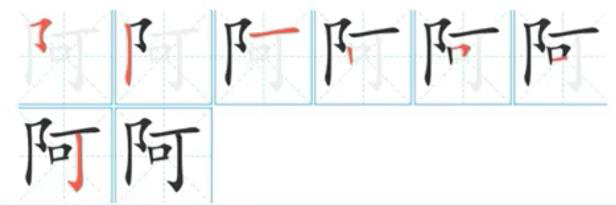

而单耳旁为两笔画，“口”为三笔画，故②的笔画数少于④，排除CD 项；
再看①③，两个字的笔画数相同，起笔笔形均为撇（丿），第二笔笔形①为折（乛），③为横
（一），因此③的顺序在前，①在后。最终顺序为②④③①
故正确答案为B。

来源：[2023年江苏公务员考试《行测》真题（A类）解析.pdf](https://github.com/dumarstoft-ship-it/xingce/blob/407016b55b49581efa3771bb59a2dee8761d982f/2023%E5%B9%B4%E6%B1%9F%E8%8B%8F%E5%85%AC%E5%8A%A1%E5%91%98%E8%80%83%E8%AF%95%E3%80%8A%E8%A1%8C%E6%B5%8B%E3%80%8B%E7%9C%9F%E9%A2%98%EF%BC%88A%E7%B1%BB%EF%BC%89%E8%A7%A3%E6%9E%90.pdf)，PDF 第 64、65 页。

## 第 114 题 · 判断推理

参考答案：**D**

【答案】D
【解析】①面对面交往过程中；②由于汉语本身对交际对象没有确切、得体的称呼词语而造成尴尬的
现象。
A 选项，该项董先生的高中同学是有确切、得体的称呼的，不符合②；
B 选项，该项小赵是因为性格内向，不擅长推测别人年龄而不知道怎样打招呼，并不是由于汉语本身
对交际对象没有确切、得体的称呼词语，不符合②；
C 选项，该项小朋友喊上大学的小孙为阿姨，在年龄上这个称呼是正确的，说明对于小朋友来说，称
呼小孙为阿姨属于确切的称呼，不符合②；
D 选项，该项老师的老公可以称之为师公，也可以称之为叔叔，说明对老师的老公的称呼没有确切的
称呼，对于女老师的丈夫，在对他不熟悉的情况下，通常不知如何称呼，进而引发了尴尬，符合关键词。
因此，本题答案为D 选项。

来源：[2023年江苏公务员考试《行测》真题（A类）解析.pdf](https://github.com/dumarstoft-ship-it/xingce/blob/407016b55b49581efa3771bb59a2dee8761d982f/2023%E5%B9%B4%E6%B1%9F%E8%8B%8F%E5%85%AC%E5%8A%A1%E5%91%98%E8%80%83%E8%AF%95%E3%80%8A%E8%A1%8C%E6%B5%8B%E3%80%8B%E7%9C%9F%E9%A2%98%EF%BC%88A%E7%B1%BB%EF%BC%89%E8%A7%A3%E6%9E%90.pdf)，PDF 第 65 页。

## 第 115 题 · 判断推理

参考答案：**B**

【答案】B
【解析】①从井里往外打水的工具②横杆的中间由竖柱支撑或悬吊，一端用竖杆连接水桶，另一端悬
绑重物③压竖杆则水桶向下灌水，灌满后压另一头，水桶就提升到井外
A 项，横杆中间没有用竖柱支撑或悬吊，不符合②；
C 项，另一端没有重物，不符②；
D 项，不是打水工具，不符合①；
故正确选项为B。

来源：[2023年江苏公务员考试《行测》真题（A类）解析.pdf](https://github.com/dumarstoft-ship-it/xingce/blob/407016b55b49581efa3771bb59a2dee8761d982f/2023%E5%B9%B4%E6%B1%9F%E8%8B%8F%E5%85%AC%E5%8A%A1%E5%91%98%E8%80%83%E8%AF%95%E3%80%8A%E8%A1%8C%E6%B5%8B%E3%80%8B%E7%9C%9F%E9%A2%98%EF%BC%88A%E7%B1%BB%EF%BC%89%E8%A7%A3%E6%9E%90.pdf)，PDF 第 66 页。
