# 2023 年江苏行测（A类） · 题目

保留原题号。来源页码按 PDF 实际页数计，从 1 开始。答案及解析另见 answers.md。

## 第 16 题 · 言语理解与表达

`JS2023-A类-016`

中国是世界第二大经济体、世界第一制造业大国，拥有全球最完整且规模最大的工业体
系、强大的生产能力、完善的配套能力。一方面，中国产业链供应链与全球生产网络高度融
合，根据联合国贸易和发展会议发布的《全球贸易最新情况》报告，2021 年，中国进出口
总值居世界首位。另一方面，中国深度参与经济全球化，并形成巨大的经济规模效应、产业
集群优势和物流网络体系，在几乎各类产业链中都扮演着重要角色。
这段文字意在强调
A.中国经济发展迅速体量规模稳居世界第一方阵
B.中国在全球产业链供应链中发挥着压舱石作用
C.中国产业链供应链已积极参与全球生产网络
D.中国进出口贸易持续发展总值位居世界榜首

来源：[2023年江苏公务员考试《行测》真题（A类）.pdf](https://github.com/dumarstoft-ship-it/xingce/blob/407016b55b49581efa3771bb59a2dee8761d982f/2023%E5%B9%B4%E6%B1%9F%E8%8B%8F%E5%85%AC%E5%8A%A1%E5%91%98%E8%80%83%E8%AF%95%E3%80%8A%E8%A1%8C%E6%B5%8B%E3%80%8B%E7%9C%9F%E9%A2%98%EF%BC%88A%E7%B1%BB%EF%BC%89.pdf)，PDF 第 6 页。

## 第 17 题 · 言语理解与表达

`JS2023-A类-017`

园林模糊了现实和再现之间的界限。现实是外部世界的自然，经由园林化改造，叠加了
人文内容，在现实的材料元素上，创造了一个至高的、审美化的现实，从而实现了人类精神
活动的空间再现。再现的过程就是对园林的不断创造和丰富，体现了人们心中对自然山水和
理想家园的创造力，这是一个艺术化的过程。园林山水是实践活动中挪用和活用的自然，时
常让它在主观判断里浮现，是人对这种空间实践的哲学和美学认知。
对这段文字的主旨，下列概括最恰当的是
A.园林反映了人类对精神家园的追求
B.园林是自然山水的整体位移和再现
C.园林体现了人类对哲学美学的认知
D.园林是人对自然山水的艺术化表现

来源：[2023年江苏公务员考试《行测》真题（A类）.pdf](https://github.com/dumarstoft-ship-it/xingce/blob/407016b55b49581efa3771bb59a2dee8761d982f/2023%E5%B9%B4%E6%B1%9F%E8%8B%8F%E5%85%AC%E5%8A%A1%E5%91%98%E8%80%83%E8%AF%95%E3%80%8A%E8%A1%8C%E6%B5%8B%E3%80%8B%E7%9C%9F%E9%A2%98%EF%BC%88A%E7%B1%BB%EF%BC%89.pdf)，PDF 第 6 页。

## 第 18 题 · 言语理解与表达

`JS2023-A类-018`

我国具有“多元一体”的语言文字体系。在此体系中，国家通用语言文字发挥基础和导向
作用，其优先地位受到宪法和法律的保障；其他类型的语言文字起辅助作用，处于从属地位，
旨在为部分公民提供更为便捷的诉讼、仲裁和文化等公共服务，但其适用范围受到限制。因
而，“全国通用”不仅是个描述性概念，也具有规范性效力，即国家要采取各种措施保障国家
通用语言文字在全国范围内（包括民族自治地方和少数民族聚居地方）通行适用。
这段文字重在说明
A.国家通用语言文字的应用范围
B.国家通用语言文字的法律地位
C.国家通用语言文字的学术概念
D.国家通用语言文字的适用保障

来源：[2023年江苏公务员考试《行测》真题（A类）.pdf](https://github.com/dumarstoft-ship-it/xingce/blob/407016b55b49581efa3771bb59a2dee8761d982f/2023%E5%B9%B4%E6%B1%9F%E8%8B%8F%E5%85%AC%E5%8A%A1%E5%91%98%E8%80%83%E8%AF%95%E3%80%8A%E8%A1%8C%E6%B5%8B%E3%80%8B%E7%9C%9F%E9%A2%98%EF%BC%88A%E7%B1%BB%EF%BC%89.pdf)，PDF 第 6 页。

## 第 19 题 · 言语理解与表达

`JS2023-A类-019`

在自然界中，形式对称性的生成，源自受到作用力的大小和方向始终一致。例如在二维
情况下的雪花、花朵或水池中的波纹，三维空间中的球形。然此自然之大美却并非以美为美，
而是一种实在的效用。正如牛顿所说，绝不浪费一丝一毫。这其中最典型的例子就是蜂巢的
六边形网络，它是在把平面划分为很多面积相等的部分时，边界网所具有的总长度最短的图
形。
下列说法从文中无法推出的是
A.自然界众多形态其实具有经济型
B.自然之美往往有现实的效用
C.自然界从不追求华而不实的美感
D.自然界对称性生成并非偶然

来源：[2023年江苏公务员考试《行测》真题（A类）.pdf](https://github.com/dumarstoft-ship-it/xingce/blob/407016b55b49581efa3771bb59a2dee8761d982f/2023%E5%B9%B4%E6%B1%9F%E8%8B%8F%E5%85%AC%E5%8A%A1%E5%91%98%E8%80%83%E8%AF%95%E3%80%8A%E8%A1%8C%E6%B5%8B%E3%80%8B%E7%9C%9F%E9%A2%98%EF%BC%88A%E7%B1%BB%EF%BC%89.pdf)，PDF 第 6 页。

## 第 20 题 · 言语理解与表达

`JS2023-A类-020`

古籍整理出版要避免低水平重复，同时要加强对基础古籍的深度整理出版。出版的目的
是传播，一种文献该不该整理，要不要出版，首先得看它有没有传播价值，有些可能只有文
物价值，对它们主要是做好防护。有些有文献价值，但关注的人极少，对这类文献可以考虑
只做数字化处理。对于有传播价值的古代文献，也要根据其内容来判定出版方式，需求量小
的可以影印，需求量大的就应该整理出版。支持资金要向深度整理的项目倾斜，推动古籍整
理高质量发展。
这段文字意在说明
A.古籍整理出版首先要评估其传播价值
B.数字化技术可以应用于古籍整理保护
C.基础古籍整理出版资助需要精准实施
D.古籍整理出版要有针对性地分类进行

来源：[2023年江苏公务员考试《行测》真题（A类）.pdf](https://github.com/dumarstoft-ship-it/xingce/blob/407016b55b49581efa3771bb59a2dee8761d982f/2023%E5%B9%B4%E6%B1%9F%E8%8B%8F%E5%85%AC%E5%8A%A1%E5%91%98%E8%80%83%E8%AF%95%E3%80%8A%E8%A1%8C%E6%B5%8B%E3%80%8B%E7%9C%9F%E9%A2%98%EF%BC%88A%E7%B1%BB%EF%BC%89.pdf)，PDF 第 7 页。

## 第 21 题 · 言语理解与表达

`JS2023-A类-021`

取消农业税后，国家开始向农村转移大量资源用于建设农村公共品，农民从农村公共品
供给的主要提供者成为受益人。最近十多年某市借助城乡统筹试验区建设，以村庄为单位，
由财政提供村庄公共服务资金，鼓励农民通过村民议事会分配资源，建设村庄公共品，形成
具有地方特色的分配型民主。该市的试验为中国农村基层治理提供了有益的启示，具体来说，
国家可以将部分惠农资源按人均转移到村庄，作为村庄可以自由使用的公共服务资金，再经
由村民自治的民主程序进行资源分配。
这段文字中提取的关键词最恰当的是
A.农村公共品 资源分配 分配型民主
B.农村公共品 资源下乡 基层治理
C.农村公共品 公共服务 分配型民主
D.农村公共品 惠农经济 民主程序

来源：[2023年江苏公务员考试《行测》真题（A类）.pdf](https://github.com/dumarstoft-ship-it/xingce/blob/407016b55b49581efa3771bb59a2dee8761d982f/2023%E5%B9%B4%E6%B1%9F%E8%8B%8F%E5%85%AC%E5%8A%A1%E5%91%98%E8%80%83%E8%AF%95%E3%80%8A%E8%A1%8C%E6%B5%8B%E3%80%8B%E7%9C%9F%E9%A2%98%EF%BC%88A%E7%B1%BB%EF%BC%89.pdf)，PDF 第 7 页。

## 第 22 题 · 言语理解与表达

`JS2023-A类-022`

近年来，中国科技创新快速发展，面临的科技伦理挑战也日益增多。由于我国科技伦理
问题治理起步较晚，体制机制还不健全，制度体系尚不完善，领域发展仍不均衡，无法适应
我国科技创新快速发展的需要。特别是目前，中国一些领域的科技发展已经走在了国际前沿，
部分科技工作已经到了“无人区”探索发展的阶段，存在很多未知领域。
这段文字接下来最有可能讨论的是
A.如何进一步认识科技伦理问题治理的重要意义
B.如何步出“无人区”，引领国际科技发展
C.如何更好地引导科技向善，规范科技创新行为
D.如何群策群力，深度回应科技发展的现实需求

来源：[2023年江苏公务员考试《行测》真题（A类）.pdf](https://github.com/dumarstoft-ship-it/xingce/blob/407016b55b49581efa3771bb59a2dee8761d982f/2023%E5%B9%B4%E6%B1%9F%E8%8B%8F%E5%85%AC%E5%8A%A1%E5%91%98%E8%80%83%E8%AF%95%E3%80%8A%E8%A1%8C%E6%B5%8B%E3%80%8B%E7%9C%9F%E9%A2%98%EF%BC%88A%E7%B1%BB%EF%BC%89.pdf)，PDF 第 7 页。

## 第 23 题 · 言语理解与表达

`JS2023-A类-023`

法律或司法裁判的确应具备可预测性，但可预测性指的只是司法裁判应建立在事先已经
被公布的一般法律规则的基础之上。它不是指法院或法官作出的判决实际上被某个公民或社
会公众所预测到，无论是被他们自己偶然地预测到，还是借助于人工智能或算法系统被有规
律地预测到。因此，基于技术对司法裁判的预测不等同于司法裁判的可预测性，前者涉及事
实上的预测能力，而后者涉及法律上的可预测性。
根据这段文字，下列说法不正确的是
A.法院法官作出的司法裁判是不可被预测的
B.基于人工智能预测的司法裁判不一定可靠
C.司法裁判的可预测性建立在法律规则之上
D.基于技术对裁判的预测不能等同法院裁判

来源：[2023年江苏公务员考试《行测》真题（A类）.pdf](https://github.com/dumarstoft-ship-it/xingce/blob/407016b55b49581efa3771bb59a2dee8761d982f/2023%E5%B9%B4%E6%B1%9F%E8%8B%8F%E5%85%AC%E5%8A%A1%E5%91%98%E8%80%83%E8%AF%95%E3%80%8A%E8%A1%8C%E6%B5%8B%E3%80%8B%E7%9C%9F%E9%A2%98%EF%BC%88A%E7%B1%BB%EF%BC%89.pdf)，PDF 第 7 页。

## 第 24 题 · 言语理解与表达

`JS2023-A类-024`

生物多样性通常指物种多样性、遗传多样性和生态系统多样性。大自然与生物多样性相
辅相成，不同地区的人们耕作、饮食、艺术等文化传统的多样性，也深受生物多样性影响。
在工业化高度发达的今天，农村生态系统、城市生态系统等是大自然与人类社会交融的产物。
生物多样性就像一个看不见的稳定器，有助于降低洪水、病虫害、山火等自然灾害带来的损
失并提高复原的能力。
下列说法与文意不符的是
A.生物多样性决定了人类城乡生活的所有方面
B.遭受自然灾害后复原过程需借助生物多样性
C.人类文化的多样性反映出生物多样性
D.生物多样性造就了大自然的丰富多彩

来源：[2023年江苏公务员考试《行测》真题（A类）.pdf](https://github.com/dumarstoft-ship-it/xingce/blob/407016b55b49581efa3771bb59a2dee8761d982f/2023%E5%B9%B4%E6%B1%9F%E8%8B%8F%E5%85%AC%E5%8A%A1%E5%91%98%E8%80%83%E8%AF%95%E3%80%8A%E8%A1%8C%E6%B5%8B%E3%80%8B%E7%9C%9F%E9%A2%98%EF%BC%88A%E7%B1%BB%EF%BC%89.pdf)，PDF 第 8 页。

## 第 25 题 · 言语理解与表达

`JS2023-A类-025`

科技成果转化是一个复杂的系统工程，面临着从实验室到产业化、从想法到市场的挑战。
科技成果只有同国家需要、人民要求、市场需求相适应，完成从科学研究到实验开发再到推
广应用的三级跳，才能真正转化为现实生产力、实现创新驱动发展。多年来，一些部门和领
域存在着科技成果向现实生产力转化不力、不顺、不畅的痼疾，科研成果封闭自我循环的问
题比较严重，创新和转化的各个环节衔接不够紧密。
作者认为加快科技成果向现实生产力转化，关键在于
A.充分考虑转化过程的复杂性
B.破除科研成果自我循环障碍
C.推动各部门各领域的协同配合
D.注重实验开发与市场需求对接

来源：[2023年江苏公务员考试《行测》真题（A类）.pdf](https://github.com/dumarstoft-ship-it/xingce/blob/407016b55b49581efa3771bb59a2dee8761d982f/2023%E5%B9%B4%E6%B1%9F%E8%8B%8F%E5%85%AC%E5%8A%A1%E5%91%98%E8%80%83%E8%AF%95%E3%80%8A%E8%A1%8C%E6%B5%8B%E3%80%8B%E7%9C%9F%E9%A2%98%EF%BC%88A%E7%B1%BB%EF%BC%89.pdf)，PDF 第 8 页。

## 第 26 题 · 言语理解与表达

`JS2023-A类-026`

人们常用一天中的最高气温与最低气温的差值代表昼夜温差。根据近10 年的气象资料
分析，霜降节气全国各地的昼夜温差均值为11.6 摄氏度，与秋分、寒露节气的昼夜温差相
近。人们之所以感觉霜降节气昼夜温差大，是因为在霜降来临前，我们经历了漫长的暑热，
而随着霜降节气的来临，冷空气活动开始频繁，白天光照较强烈，夜间降温明显，放大了昼
夜温差。
下列说法与文意相符的是
A.暑热的持续加大了霜降节气的昼夜温差
B.全国各地霜降昼夜温差不超过12 摄氏度
C.霜降节气之前全国几乎没有冷空气的活动
D.霜降的昼夜温差并不是所有节气中最大的

来源：[2023年江苏公务员考试《行测》真题（A类）.pdf](https://github.com/dumarstoft-ship-it/xingce/blob/407016b55b49581efa3771bb59a2dee8761d982f/2023%E5%B9%B4%E6%B1%9F%E8%8B%8F%E5%85%AC%E5%8A%A1%E5%91%98%E8%80%83%E8%AF%95%E3%80%8A%E8%A1%8C%E6%B5%8B%E3%80%8B%E7%9C%9F%E9%A2%98%EF%BC%88A%E7%B1%BB%EF%BC%89.pdf)，PDF 第 8 页。

## 第 27 题 · 言语理解与表达

`JS2023-A类-027`

人工智能应该以与人类智能相同的方式工作，在逻辑上是没有道理的，这也是用形容词
“人工”的一个原因。然而，这些由电子电路体现的数学结构，和神经科学家开发的大脑认知
模型有一些相似之处。因此，在人工智能和认知科学之间出现了一个创造性的反馈回路，它
们彼此借鉴对方的思路。有时候在某种程度上，我们的大脑和人造大脑似乎是利用相似的结
构原理来工作的。然而，从构成的材料和信号处理过程的方式来看，它们的差别当然是非常
大的。
下列说法与文意不符的是
A.人工智能和人类大脑认知模式有类似之处
B.人工智能与人类大脑利用相近的原理工作
C.人工智能借鉴了认知科学的有关研究成果
D.人工智能信号处理方式与人脑有很大差别

来源：[2023年江苏公务员考试《行测》真题（A类）.pdf](https://github.com/dumarstoft-ship-it/xingce/blob/407016b55b49581efa3771bb59a2dee8761d982f/2023%E5%B9%B4%E6%B1%9F%E8%8B%8F%E5%85%AC%E5%8A%A1%E5%91%98%E8%80%83%E8%AF%95%E3%80%8A%E8%A1%8C%E6%B5%8B%E3%80%8B%E7%9C%9F%E9%A2%98%EF%BC%88A%E7%B1%BB%EF%BC%89.pdf)，PDF 第 8、9 页。

## 第 28 题 · 言语理解与表达

`JS2023-A类-028`

诗歌原本就是语言的艺术与游戏，最擅长的便是以简洁的话语勾勒复杂的图景，是一种
在有限的措辞中努力实现无穷意蕴的文体。诗歌的创作与最终的呈现同样对其句子表达的精
炼、准确，以及其中所使用的符号、修辞做出要求，与数字游戏对文字文本的要求不谋而合。
因而从某种程度上来说，数字游戏与诗歌原本就是相互适配的；数字游戏适合以诗歌为其文
字表达，诗歌也适合以数字游戏作为载体。
通过这段文字作者主要想表达
A.数字游戏与诗歌之间有密不可分的关系
B.诗歌写作其实可以说是一种语言的游戏
C.数字游戏选用诗歌作文字文本是适宜的
D.诗歌表达方式其实与数字游戏相反相成

来源：[2023年江苏公务员考试《行测》真题（A类）.pdf](https://github.com/dumarstoft-ship-it/xingce/blob/407016b55b49581efa3771bb59a2dee8761d982f/2023%E5%B9%B4%E6%B1%9F%E8%8B%8F%E5%85%AC%E5%8A%A1%E5%91%98%E8%80%83%E8%AF%95%E3%80%8A%E8%A1%8C%E6%B5%8B%E3%80%8B%E7%9C%9F%E9%A2%98%EF%BC%88A%E7%B1%BB%EF%BC%89.pdf)，PDF 第 9 页。

## 第 29 题 · 言语理解与表达

`JS2023-A类-029`

科学家们成天经历的就是无知、疑惑、不确定，这种经历是极其重要的。当科学家不知
道答案时，他是无知的；当他心中大概有了猜测时，他是不确定的；即便他满有把握时，他
也会永远留下质疑的余地。承认自己的无知，留下质疑的余地，这两者对于任何发展都必不
可少。科学知识本身是一个具有不同层次可信度的集合体：有的根本不确定，有的比较确定，
但没有什么是完全确定的。
通过这段文字作者主要强调
A.科学就是在不断质疑的过程中发展的
B.科学知识本身常常是充满不确定性的
C.科学家并非永远对自己的工作有自信
D.承认自己无知并不影响科学家的声誉

来源：[2023年江苏公务员考试《行测》真题（A类）.pdf](https://github.com/dumarstoft-ship-it/xingce/blob/407016b55b49581efa3771bb59a2dee8761d982f/2023%E5%B9%B4%E6%B1%9F%E8%8B%8F%E5%85%AC%E5%8A%A1%E5%91%98%E8%80%83%E8%AF%95%E3%80%8A%E8%A1%8C%E6%B5%8B%E3%80%8B%E7%9C%9F%E9%A2%98%EF%BC%88A%E7%B1%BB%EF%BC%89.pdf)，PDF 第 9 页。

## 第 30 题 · 言语理解与表达

`JS2023-A类-030`

①而纪录片恰恰可以充当人们走近非遗的“桥梁”
②以期给观众带来人文精神和审美体验的双重享受
③非物质文化遗产古老而传统，有些还有着较高的门槛，大众要深入了解并不容易
④最初，田野考察中拍摄影像的目的，主要是做好非遗的记录和留存工作，侧重真实性、准
确性
⑤也因此被寄予了更多传播、普及非遗的期待
⑥而面向大众的影视纪录作品，在真实记录非遗技艺的同时，还努力追求镜头美、语言美、
叙事美
将以上6 个句子重新排列，语序正确的是
A.④⑤③⑥②①
B.③⑤⑥④①②
C.③①④⑥②⑤
D.④③⑤⑥②①

来源：[2023年江苏公务员考试《行测》真题（A类）.pdf](https://github.com/dumarstoft-ship-it/xingce/blob/407016b55b49581efa3771bb59a2dee8761d982f/2023%E5%B9%B4%E6%B1%9F%E8%8B%8F%E5%85%AC%E5%8A%A1%E5%91%98%E8%80%83%E8%AF%95%E3%80%8A%E8%A1%8C%E6%B5%8B%E3%80%8B%E7%9C%9F%E9%A2%98%EF%BC%88A%E7%B1%BB%EF%BC%89.pdf)，PDF 第 9 页。

## 第 31 题 · 言语理解与表达

`JS2023-A类-031`

当今世界，综合国力的竞争_______是人才的竞争、劳动者素质的竞争。这些年来，中国
制造、中国创造、中国建造共同________，不断改变着中国的面貌。
依次填入画横线处最恰当的一项是
A.追本溯源 奋斗
B.毋容置疑 努力
C.归根到底 发力
D.不言而喻 奋战

来源：[2023年江苏公务员考试《行测》真题（A类）.pdf](https://github.com/dumarstoft-ship-it/xingce/blob/407016b55b49581efa3771bb59a2dee8761d982f/2023%E5%B9%B4%E6%B1%9F%E8%8B%8F%E5%85%AC%E5%8A%A1%E5%91%98%E8%80%83%E8%AF%95%E3%80%8A%E8%A1%8C%E6%B5%8B%E3%80%8B%E7%9C%9F%E9%A2%98%EF%BC%88A%E7%B1%BB%EF%BC%89.pdf)，PDF 第 9、10 页。

## 第 32 题 · 言语理解与表达

`JS2023-A类-032`

不同时代的审美需求指向不同维度，在繁杂且快节奏的信息传递时代，设计需要概括、
_________且有视觉冲击力。像素风格的文字虽________了繁杂的设计，但相较于普通的文字
字体显得别具一格，因此能够快速抓住受众眼球。
依次填入画横线处最恰当的一项是
A.直接 扬弃
B.具体 舍弃
C.直观 摒弃
D.具象 放弃

来源：[2023年江苏公务员考试《行测》真题（A类）.pdf](https://github.com/dumarstoft-ship-it/xingce/blob/407016b55b49581efa3771bb59a2dee8761d982f/2023%E5%B9%B4%E6%B1%9F%E8%8B%8F%E5%85%AC%E5%8A%A1%E5%91%98%E8%80%83%E8%AF%95%E3%80%8A%E8%A1%8C%E6%B5%8B%E3%80%8B%E7%9C%9F%E9%A2%98%EF%BC%88A%E7%B1%BB%EF%BC%89.pdf)，PDF 第 10 页。

## 第 33 题 · 言语理解与表达

`JS2023-A类-033`

近几年，主打中华传统文化元素的动画电影_______，与之对应的产业链也日渐生成，创
作与产业互相______，呈现生机勃勃的气象。
依次填入画横线处最恰当的一项是
A.脱颖而出 砥砺
B.蜂拥而出 激励
C.层见叠出 呼应
D.呼之欲出 推动

来源：[2023年江苏公务员考试《行测》真题（A类）.pdf](https://github.com/dumarstoft-ship-it/xingce/blob/407016b55b49581efa3771bb59a2dee8761d982f/2023%E5%B9%B4%E6%B1%9F%E8%8B%8F%E5%85%AC%E5%8A%A1%E5%91%98%E8%80%83%E8%AF%95%E3%80%8A%E8%A1%8C%E6%B5%8B%E3%80%8B%E7%9C%9F%E9%A2%98%EF%BC%88A%E7%B1%BB%EF%BC%89.pdf)，PDF 第 10 页。

## 第 34 题 · 言语理解与表达

`JS2023-A类-034`

在服务上细致入微，在产品设计上_______，是商家为留住客源、促进消费做出的努力。
往更深层次看，这些用心之处都是为消费者带来了良好的情绪_______，提升了产品和服务的
价值。
依次填入画横线处最恰当的一项是
A.匠心独运 感受
B.别出心裁 体验
C.自出机杼 效应
D.标新立异 反映

来源：[2023年江苏公务员考试《行测》真题（A类）.pdf](https://github.com/dumarstoft-ship-it/xingce/blob/407016b55b49581efa3771bb59a2dee8761d982f/2023%E5%B9%B4%E6%B1%9F%E8%8B%8F%E5%85%AC%E5%8A%A1%E5%91%98%E8%80%83%E8%AF%95%E3%80%8A%E8%A1%8C%E6%B5%8B%E3%80%8B%E7%9C%9F%E9%A2%98%EF%BC%88A%E7%B1%BB%EF%BC%89.pdf)，PDF 第 10 页。

## 第 35 题 · 言语理解与表达

`JS2023-A类-035`

法制与法治是既有区别又有联系的两个概念。法制是法律制度的简称，属于制度的
_________；法治是法律统治的简称，是一种治国原则和方法，是相对于“人治”而言的。二者
的联系在于：法制是法治的基础和前提条件，要实行法治，必须具有_________的法制；法治
是法制的立足点和归宿，法制的发展前途必然是最终_________法治。
依次填入画横线处最恰当的一项是
A.层面 完善 体现
B.范畴 完备 实现
C.范围 完整 抵达
D.领域 完全 达至

来源：[2023年江苏公务员考试《行测》真题（A类）.pdf](https://github.com/dumarstoft-ship-it/xingce/blob/407016b55b49581efa3771bb59a2dee8761d982f/2023%E5%B9%B4%E6%B1%9F%E8%8B%8F%E5%85%AC%E5%8A%A1%E5%91%98%E8%80%83%E8%AF%95%E3%80%8A%E8%A1%8C%E6%B5%8B%E3%80%8B%E7%9C%9F%E9%A2%98%EF%BC%88A%E7%B1%BB%EF%BC%89.pdf)，PDF 第 10 页。

## 第 36 题 · 言语理解与表达

`JS2023-A类-036`

时至今日，人工智能已经在音乐、绘画、棋艺等方面取得了__________的进步，之所以在
文学创作领域比较________，也从另一方面________了文学是人类最高智慧的结晶之一。人类
读者对有意义的书面语中大量的句法和语义有更强的感知能力。
依次填入画横线处最恰当的一项是
A.叹为观止 滞缓 证实
B.令人惊叹 滞后 验证
C.令人瞩目 落伍 明确
D.有目共睹 迟缓 证明

来源：[2023年江苏公务员考试《行测》真题（A类）.pdf](https://github.com/dumarstoft-ship-it/xingce/blob/407016b55b49581efa3771bb59a2dee8761d982f/2023%E5%B9%B4%E6%B1%9F%E8%8B%8F%E5%85%AC%E5%8A%A1%E5%91%98%E8%80%83%E8%AF%95%E3%80%8A%E8%A1%8C%E6%B5%8B%E3%80%8B%E7%9C%9F%E9%A2%98%EF%BC%88A%E7%B1%BB%EF%BC%89.pdf)，PDF 第 10、11 页。

## 第 37 题 · 言语理解与表达

`JS2023-A类-037`

植物科学画和摄影是完全不同的门类。我们有时候称赞照片，说它美得像幅画，但其实
绘画和摄影在艺术上_________。哪怕再好的画师，也无法像摄影那样全面________那一瞬间
的景象；而有时候，摄影又无法像植物科学画那样表达出一颗绿绒嵩盛开时那种对生命和繁
衍的渴望。摄影当然可以呈现某一物种的全貌，但是乍一看，特征不会那么明显，植物科学
画则可以着重呈现物种特征，更加_______。
依次填入画横线处最恰当的一项是
A.相辅相成 捕获 纤毫毕现
B.各擅胜场 凝固 栩栩如生
C.大相径庭 定格 有的放矢
D.各有千秋 还原 一目了然

来源：[2023年江苏公务员考试《行测》真题（A类）.pdf](https://github.com/dumarstoft-ship-it/xingce/blob/407016b55b49581efa3771bb59a2dee8761d982f/2023%E5%B9%B4%E6%B1%9F%E8%8B%8F%E5%85%AC%E5%8A%A1%E5%91%98%E8%80%83%E8%AF%95%E3%80%8A%E8%A1%8C%E6%B5%8B%E3%80%8B%E7%9C%9F%E9%A2%98%EF%BC%88A%E7%B1%BB%EF%BC%89.pdf)，PDF 第 11 页。

## 第 38 题 · 言语理解与表达

`JS2023-A类-038`

新一轮科技和产业革命风起云涌，席卷全球。各大科技强国的中心城市_______，力图摘
取全球“科创策源地”这一_______，这是一个能够激起世界级城市管理者内心澎湃的宏伟目标。
作为策源地，不仅意味着科学上的领先，还意味着最先进的高科技产业和最具创新能力的企
业家的集聚，能够在城市中水乳交融，_______，向外源源不断地释放出能量。
依次填入画横线处最恰当的一项是
A.争先恐后 盛誉 交相辉映
B.各显神通 美称 互通有无
C.各尽所能 桂冠 相得益彰
D.尽心尽力 殊荣 取长补短

来源：[2023年江苏公务员考试《行测》真题（A类）.pdf](https://github.com/dumarstoft-ship-it/xingce/blob/407016b55b49581efa3771bb59a2dee8761d982f/2023%E5%B9%B4%E6%B1%9F%E8%8B%8F%E5%85%AC%E5%8A%A1%E5%91%98%E8%80%83%E8%AF%95%E3%80%8A%E8%A1%8C%E6%B5%8B%E3%80%8B%E7%9C%9F%E9%A2%98%EF%BC%88A%E7%B1%BB%EF%BC%89.pdf)，PDF 第 11 页。

## 第 39 题 · 言语理解与表达

`JS2023-A类-039`

当下发展迅速的社会生活带来了多种多样的语言新现象。词语是时代变迁的监测器。新
事物_______，新现象日新月异，词库便随之不断_________。从融媒体到神经网络、区块链、
多重体验、数据信托，各类新词新语_________。
依次填入画横线处最恰当的一项是
A.应接不暇 推陈出新 不可胜数
B.屡见不鲜 弃旧图新 俯拾即是
C.接踵而至 去芜存菁 恒河沙数
D.层出不穷 吐故纳新 不胜枚举

来源：[2023年江苏公务员考试《行测》真题（A类）.pdf](https://github.com/dumarstoft-ship-it/xingce/blob/407016b55b49581efa3771bb59a2dee8761d982f/2023%E5%B9%B4%E6%B1%9F%E8%8B%8F%E5%85%AC%E5%8A%A1%E5%91%98%E8%80%83%E8%AF%95%E3%80%8A%E8%A1%8C%E6%B5%8B%E3%80%8B%E7%9C%9F%E9%A2%98%EF%BC%88A%E7%B1%BB%EF%BC%89.pdf)，PDF 第 11 页。

## 第 40 题 · 言语理解与表达

`JS2023-A类-040`

在人文领域，人文学者担负的任务首先而且主要是“传承”人类文化，是理解、解释从而
传播人文经典。评价一个人文学者学术水平的基本标准是，他熟悉多少经典著作，能在多大
程度上_______经典著作，本着当代人面临的问题开展与伟大经典的对话。至于创造性思想，
那是一种________的事情，有些才能杰出者或许可以提出富有创造性的思想，甚至提出自己
独特的理论体系，但那是人文学者“修炼”过程中________的事情，不应该是预先设立的目标。
依次填入画横线处最恰当的一项是
A.阐释 可遇不可求 水到渠成
B.精通 难能可贵 功到自然成
C.诠释 可望不可即 自然而然
D.通晓 不可多得 铁杵磨成针

来源：[2023年江苏公务员考试《行测》真题（A类）.pdf](https://github.com/dumarstoft-ship-it/xingce/blob/407016b55b49581efa3771bb59a2dee8761d982f/2023%E5%B9%B4%E6%B1%9F%E8%8B%8F%E5%85%AC%E5%8A%A1%E5%91%98%E8%80%83%E8%AF%95%E3%80%8A%E8%A1%8C%E6%B5%8B%E3%80%8B%E7%9C%9F%E9%A2%98%EF%BC%88A%E7%B1%BB%EF%BC%89.pdf)，PDF 第 11、12 页。

## 第 41 题 · 言语理解与表达

`JS2023-A类-041`

### 共用材料

人类的信息需求有80%与地理空间位置有关，而在全球普遍面临日益严重的资源环境问
题的形势下，遥感宏观、动态、精确等特点，在国民经济、社会发展和国防安全中起着越来
越重要的作用。地球观测组织（GEO）确定的遥感9 大应用领域，________了灾害、卫生、
能源、气候、水、天气、生态系统、农业、生物多样性等，更是涉及了人类生活的方方面面。
人们对事物的认知，总是先看到表面，然后涉及实质，尤其是对自然科学研究而言，观
察-总结-归纳-演绎推理-实证是通用的研究逻辑。研究者更注重用数学建立起自然世界的研
究对象之间的映射关系，以便用数学方法解释自然规律并进一步预测规律。因此相较于定性
的描述，定量的刻画和应用更是自然科学的关键所在。自然科学的分析、对规律现象的确定
性描述，这都离不开“数据”或者“量化”这一研究基础。
20 世纪70 年代以来，卫星遥感主要采取垂直观测方式，以获得地表二维信息，对获取
的数据则基于地面目标漫反射的假定，作一些简单校正后利用地面目标的光谱特性作地表分
类或经验判读。早期遥感的应用，更多的是基于定性描述，也就是通过可视的地物颜色、纹
理、形状、大小等要素来对地物的各种属性进行推断并进行运用。但是，随着需求的发展，
定性遥感越来越难以满足科研和应用的需求。
例如，卫星遥感通过云图可以很直观地显示各种气团的运动趋势，但中、长期天气预报
的准确性仍不令人满意。其主要原因之一就是在大气动力学模型中，需要知道影响地面和大
气温度的大气下垫面反照率和影响气流运动的粗糙度这些量化的信息，而定性的分析显然不
能满足这个需求。
很自然地，人们开始着眼于通过遥感的方式来获取地物更多量化信息的研究，并期望定
量遥感能承载更多的应用需求。
对应于定性遥感而言，定量遥感是从地物反射或发射的电磁辐射里，来推演得到地物
某些特征定量化描述的手段。通俗地说，就是在遥感获取的各项电磁辐射信号的基础上，通
过数字的或者物理的模型，将遥感信息与观测地表目标联系起来，定量地反演或推算目标的
各种自然属性信息。
我们以全球气候变化研究为例。在全球气候变化研究中，定量的遥感数据产品起着至关
重要的作用。它们不仅能够作为输入参数集来驱动数值过程模型运行、评价和验证其模拟结
果，还可以通过适时地输入更新结合数据同化的方法确定过程模型的某些状态变量或者参数，
以提高不同时空尺度的碳、水、氮通量等模拟精度并进行预测。在行业部门的各种业务应用
中，各种评估对量化指标的旺盛需求，也对遥感的定量化提出了更高要求。

填入文章第一段画横线处最恰当的一项是
A.覆盖
B.涵盖
C.囊括
D.包含

来源：[2023年江苏公务员考试《行测》真题（A类）.pdf](https://github.com/dumarstoft-ship-it/xingce/blob/407016b55b49581efa3771bb59a2dee8761d982f/2023%E5%B9%B4%E6%B1%9F%E8%8B%8F%E5%85%AC%E5%8A%A1%E5%91%98%E8%80%83%E8%AF%95%E3%80%8A%E8%A1%8C%E6%B5%8B%E3%80%8B%E7%9C%9F%E9%A2%98%EF%BC%88A%E7%B1%BB%EF%BC%89.pdf)，PDF 第 12 页。

## 第 42 题 · 言语理解与表达

`JS2023-A类-042`

### 共用材料

人类的信息需求有80%与地理空间位置有关，而在全球普遍面临日益严重的资源环境问
题的形势下，遥感宏观、动态、精确等特点，在国民经济、社会发展和国防安全中起着越来
越重要的作用。地球观测组织（GEO）确定的遥感9 大应用领域，________了灾害、卫生、
能源、气候、水、天气、生态系统、农业、生物多样性等，更是涉及了人类生活的方方面面。
人们对事物的认知，总是先看到表面，然后涉及实质，尤其是对自然科学研究而言，观
察-总结-归纳-演绎推理-实证是通用的研究逻辑。研究者更注重用数学建立起自然世界的研
究对象之间的映射关系，以便用数学方法解释自然规律并进一步预测规律。因此相较于定性
的描述，定量的刻画和应用更是自然科学的关键所在。自然科学的分析、对规律现象的确定
性描述，这都离不开“数据”或者“量化”这一研究基础。
20 世纪70 年代以来，卫星遥感主要采取垂直观测方式，以获得地表二维信息，对获取
的数据则基于地面目标漫反射的假定，作一些简单校正后利用地面目标的光谱特性作地表分
类或经验判读。早期遥感的应用，更多的是基于定性描述，也就是通过可视的地物颜色、纹
理、形状、大小等要素来对地物的各种属性进行推断并进行运用。但是，随着需求的发展，
定性遥感越来越难以满足科研和应用的需求。
例如，卫星遥感通过云图可以很直观地显示各种气团的运动趋势，但中、长期天气预报
的准确性仍不令人满意。其主要原因之一就是在大气动力学模型中，需要知道影响地面和大
气温度的大气下垫面反照率和影响气流运动的粗糙度这些量化的信息，而定性的分析显然不
能满足这个需求。
很自然地，人们开始着眼于通过遥感的方式来获取地物更多量化信息的研究，并期望定
量遥感能承载更多的应用需求。
对应于定性遥感而言，定量遥感是从地物反射或发射的电磁辐射里，来推演得到地物
某些特征定量化描述的手段。通俗地说，就是在遥感获取的各项电磁辐射信号的基础上，通
过数字的或者物理的模型，将遥感信息与观测地表目标联系起来，定量地反演或推算目标的
各种自然属性信息。
我们以全球气候变化研究为例。在全球气候变化研究中，定量的遥感数据产品起着至关
重要的作用。它们不仅能够作为输入参数集来驱动数值过程模型运行、评价和验证其模拟结
果，还可以通过适时地输入更新结合数据同化的方法确定过程模型的某些状态变量或者参数，
以提高不同时空尺度的碳、水、氮通量等模拟精度并进行预测。在行业部门的各种业务应用
中，各种评估对量化指标的旺盛需求，也对遥感的定量化提出了更高要求。

根据文意，“定量的刻画和应用”的关键作用在于
A.用数学建立各研究对象之间的映射关系
B.对事物的认识从表面进入到确定性描述
C.是自然科学研究进入实证阶段的必要途径
D.可以解释自然规律并进一步预测相关规律

来源：[2023年江苏公务员考试《行测》真题（A类）.pdf](https://github.com/dumarstoft-ship-it/xingce/blob/407016b55b49581efa3771bb59a2dee8761d982f/2023%E5%B9%B4%E6%B1%9F%E8%8B%8F%E5%85%AC%E5%8A%A1%E5%91%98%E8%80%83%E8%AF%95%E3%80%8A%E8%A1%8C%E6%B5%8B%E3%80%8B%E7%9C%9F%E9%A2%98%EF%BC%88A%E7%B1%BB%EF%BC%89.pdf)，PDF 第 12、13 页。

## 第 43 题 · 言语理解与表达

`JS2023-A类-043`

### 共用材料

人类的信息需求有80%与地理空间位置有关，而在全球普遍面临日益严重的资源环境问
题的形势下，遥感宏观、动态、精确等特点，在国民经济、社会发展和国防安全中起着越来
越重要的作用。地球观测组织（GEO）确定的遥感9 大应用领域，________了灾害、卫生、
能源、气候、水、天气、生态系统、农业、生物多样性等，更是涉及了人类生活的方方面面。
人们对事物的认知，总是先看到表面，然后涉及实质，尤其是对自然科学研究而言，观
察-总结-归纳-演绎推理-实证是通用的研究逻辑。研究者更注重用数学建立起自然世界的研
究对象之间的映射关系，以便用数学方法解释自然规律并进一步预测规律。因此相较于定性
的描述，定量的刻画和应用更是自然科学的关键所在。自然科学的分析、对规律现象的确定
性描述，这都离不开“数据”或者“量化”这一研究基础。
20 世纪70 年代以来，卫星遥感主要采取垂直观测方式，以获得地表二维信息，对获取
的数据则基于地面目标漫反射的假定，作一些简单校正后利用地面目标的光谱特性作地表分
类或经验判读。早期遥感的应用，更多的是基于定性描述，也就是通过可视的地物颜色、纹
理、形状、大小等要素来对地物的各种属性进行推断并进行运用。但是，随着需求的发展，
定性遥感越来越难以满足科研和应用的需求。
例如，卫星遥感通过云图可以很直观地显示各种气团的运动趋势，但中、长期天气预报
的准确性仍不令人满意。其主要原因之一就是在大气动力学模型中，需要知道影响地面和大
气温度的大气下垫面反照率和影响气流运动的粗糙度这些量化的信息，而定性的分析显然不
能满足这个需求。
很自然地，人们开始着眼于通过遥感的方式来获取地物更多量化信息的研究，并期望定
量遥感能承载更多的应用需求。
对应于定性遥感而言，定量遥感是从地物反射或发射的电磁辐射里，来推演得到地物
某些特征定量化描述的手段。通俗地说，就是在遥感获取的各项电磁辐射信号的基础上，通
过数字的或者物理的模型，将遥感信息与观测地表目标联系起来，定量地反演或推算目标的
各种自然属性信息。
我们以全球气候变化研究为例。在全球气候变化研究中，定量的遥感数据产品起着至关
重要的作用。它们不仅能够作为输入参数集来驱动数值过程模型运行、评价和验证其模拟结
果，还可以通过适时地输入更新结合数据同化的方法确定过程模型的某些状态变量或者参数，
以提高不同时空尺度的碳、水、氮通量等模拟精度并进行预测。在行业部门的各种业务应用
中，各种评估对量化指标的旺盛需求，也对遥感的定量化提出了更高要求。

关于早期遥感，下列说法不符合文意的是
A.早期遥感获取信息后依靠人类知识做有关推断
B.遥感通过云图可以直观显示大气气团运动趋势
C.卫星遥感主要是测定可视地面目标的各种属性
D.对云图的观测不能给出中长期的天气趋势预测

来源：[2023年江苏公务员考试《行测》真题（A类）.pdf](https://github.com/dumarstoft-ship-it/xingce/blob/407016b55b49581efa3771bb59a2dee8761d982f/2023%E5%B9%B4%E6%B1%9F%E8%8B%8F%E5%85%AC%E5%8A%A1%E5%91%98%E8%80%83%E8%AF%95%E3%80%8A%E8%A1%8C%E6%B5%8B%E3%80%8B%E7%9C%9F%E9%A2%98%EF%BC%88A%E7%B1%BB%EF%BC%89.pdf)，PDF 第 13 页。

## 第 44 题 · 言语理解与表达

`JS2023-A类-044`

### 共用材料

人类的信息需求有80%与地理空间位置有关，而在全球普遍面临日益严重的资源环境问
题的形势下，遥感宏观、动态、精确等特点，在国民经济、社会发展和国防安全中起着越来
越重要的作用。地球观测组织（GEO）确定的遥感9 大应用领域，________了灾害、卫生、
能源、气候、水、天气、生态系统、农业、生物多样性等，更是涉及了人类生活的方方面面。
人们对事物的认知，总是先看到表面，然后涉及实质，尤其是对自然科学研究而言，观
察-总结-归纳-演绎推理-实证是通用的研究逻辑。研究者更注重用数学建立起自然世界的研
究对象之间的映射关系，以便用数学方法解释自然规律并进一步预测规律。因此相较于定性
的描述，定量的刻画和应用更是自然科学的关键所在。自然科学的分析、对规律现象的确定
性描述，这都离不开“数据”或者“量化”这一研究基础。
20 世纪70 年代以来，卫星遥感主要采取垂直观测方式，以获得地表二维信息，对获取
的数据则基于地面目标漫反射的假定，作一些简单校正后利用地面目标的光谱特性作地表分
类或经验判读。早期遥感的应用，更多的是基于定性描述，也就是通过可视的地物颜色、纹
理、形状、大小等要素来对地物的各种属性进行推断并进行运用。但是，随着需求的发展，
定性遥感越来越难以满足科研和应用的需求。
例如，卫星遥感通过云图可以很直观地显示各种气团的运动趋势，但中、长期天气预报
的准确性仍不令人满意。其主要原因之一就是在大气动力学模型中，需要知道影响地面和大
气温度的大气下垫面反照率和影响气流运动的粗糙度这些量化的信息，而定性的分析显然不
能满足这个需求。
很自然地，人们开始着眼于通过遥感的方式来获取地物更多量化信息的研究，并期望定
量遥感能承载更多的应用需求。
对应于定性遥感而言，定量遥感是从地物反射或发射的电磁辐射里，来推演得到地物
某些特征定量化描述的手段。通俗地说，就是在遥感获取的各项电磁辐射信号的基础上，通
过数字的或者物理的模型，将遥感信息与观测地表目标联系起来，定量地反演或推算目标的
各种自然属性信息。
我们以全球气候变化研究为例。在全球气候变化研究中，定量的遥感数据产品起着至关
重要的作用。它们不仅能够作为输入参数集来驱动数值过程模型运行、评价和验证其模拟结
果，还可以通过适时地输入更新结合数据同化的方法确定过程模型的某些状态变量或者参数，
以提高不同时空尺度的碳、水、氮通量等模拟精度并进行预测。在行业部门的各种业务应用
中，各种评估对量化指标的旺盛需求，也对遥感的定量化提出了更高要求。

根据文意，下列有关定量遥感的说法不准确的是
A.定量遥感数据产品能够验证其模拟结果并进行评价
B.通过定量遥感可以对地物某些特征进行定量化描述
C.各行业均有使用遥感定量化指标的业务应用需求
D.定量遥感切合了科研需要“量化”这一基础条件

来源：[2023年江苏公务员考试《行测》真题（A类）.pdf](https://github.com/dumarstoft-ship-it/xingce/blob/407016b55b49581efa3771bb59a2dee8761d982f/2023%E5%B9%B4%E6%B1%9F%E8%8B%8F%E5%85%AC%E5%8A%A1%E5%91%98%E8%80%83%E8%AF%95%E3%80%8A%E8%A1%8C%E6%B5%8B%E3%80%8B%E7%9C%9F%E9%A2%98%EF%BC%88A%E7%B1%BB%EF%BC%89.pdf)，PDF 第 13 页。

## 第 45 题 · 言语理解与表达

`JS2023-A类-045`

### 共用材料

人类的信息需求有80%与地理空间位置有关，而在全球普遍面临日益严重的资源环境问
题的形势下，遥感宏观、动态、精确等特点，在国民经济、社会发展和国防安全中起着越来
越重要的作用。地球观测组织（GEO）确定的遥感9 大应用领域，________了灾害、卫生、
能源、气候、水、天气、生态系统、农业、生物多样性等，更是涉及了人类生活的方方面面。
人们对事物的认知，总是先看到表面，然后涉及实质，尤其是对自然科学研究而言，观
察-总结-归纳-演绎推理-实证是通用的研究逻辑。研究者更注重用数学建立起自然世界的研
究对象之间的映射关系，以便用数学方法解释自然规律并进一步预测规律。因此相较于定性
的描述，定量的刻画和应用更是自然科学的关键所在。自然科学的分析、对规律现象的确定
性描述，这都离不开“数据”或者“量化”这一研究基础。
20 世纪70 年代以来，卫星遥感主要采取垂直观测方式，以获得地表二维信息，对获取
的数据则基于地面目标漫反射的假定，作一些简单校正后利用地面目标的光谱特性作地表分
类或经验判读。早期遥感的应用，更多的是基于定性描述，也就是通过可视的地物颜色、纹
理、形状、大小等要素来对地物的各种属性进行推断并进行运用。但是，随着需求的发展，
定性遥感越来越难以满足科研和应用的需求。
例如，卫星遥感通过云图可以很直观地显示各种气团的运动趋势，但中、长期天气预报
的准确性仍不令人满意。其主要原因之一就是在大气动力学模型中，需要知道影响地面和大
气温度的大气下垫面反照率和影响气流运动的粗糙度这些量化的信息，而定性的分析显然不
能满足这个需求。
很自然地，人们开始着眼于通过遥感的方式来获取地物更多量化信息的研究，并期望定
量遥感能承载更多的应用需求。
对应于定性遥感而言，定量遥感是从地物反射或发射的电磁辐射里，来推演得到地物
某些特征定量化描述的手段。通俗地说，就是在遥感获取的各项电磁辐射信号的基础上，通
过数字的或者物理的模型，将遥感信息与观测地表目标联系起来，定量地反演或推算目标的
各种自然属性信息。
我们以全球气候变化研究为例。在全球气候变化研究中，定量的遥感数据产品起着至关
重要的作用。它们不仅能够作为输入参数集来驱动数值过程模型运行、评价和验证其模拟结
果，还可以通过适时地输入更新结合数据同化的方法确定过程模型的某些状态变量或者参数，
以提高不同时空尺度的碳、水、氮通量等模拟精度并进行预测。在行业部门的各种业务应用
中，各种评估对量化指标的旺盛需求，也对遥感的定量化提出了更高要求。

这篇文章主要讨论的是
A.为什么需要定量遥感
B.定量遥感的运用领域
C.卫星遥感技术的发展趋势
D.定量遥感与定性遥感的不同

来源：[2023年江苏公务员考试《行测》真题（A类）.pdf](https://github.com/dumarstoft-ship-it/xingce/blob/407016b55b49581efa3771bb59a2dee8761d982f/2023%E5%B9%B4%E6%B1%9F%E8%8B%8F%E5%85%AC%E5%8A%A1%E5%91%98%E8%80%83%E8%AF%95%E3%80%8A%E8%A1%8C%E6%B5%8B%E3%80%8B%E7%9C%9F%E9%A2%98%EF%BC%88A%E7%B1%BB%EF%BC%89.pdf)，PDF 第 13 页。

## 第 46 题 · 数量关系

`JS2023-A类-046`

-3，-1，2，7，14，（ ）
A. 22
B. 23
C. 25
D. 26

来源：[2023年江苏公务员考试《行测》真题（A类）.pdf](https://github.com/dumarstoft-ship-it/xingce/blob/407016b55b49581efa3771bb59a2dee8761d982f/2023%E5%B9%B4%E6%B1%9F%E8%8B%8F%E5%85%AC%E5%8A%A1%E5%91%98%E8%80%83%E8%AF%95%E3%80%8A%E8%A1%8C%E6%B5%8B%E3%80%8B%E7%9C%9F%E9%A2%98%EF%BC%88A%E7%B1%BB%EF%BC%89.pdf)，PDF 第 13 页。

## 第 47 题 · 数量关系

`JS2023-A类-047`

60，30，20，15，12，（ ）
A. 6
B. 8
C. 9
D. 10

来源：[2023年江苏公务员考试《行测》真题（A类）.pdf](https://github.com/dumarstoft-ship-it/xingce/blob/407016b55b49581efa3771bb59a2dee8761d982f/2023%E5%B9%B4%E6%B1%9F%E8%8B%8F%E5%85%AC%E5%8A%A1%E5%91%98%E8%80%83%E8%AF%95%E3%80%8A%E8%A1%8C%E6%B5%8B%E3%80%8B%E7%9C%9F%E9%A2%98%EF%BC%88A%E7%B1%BB%EF%BC%89.pdf)，PDF 第 13 页。

## 第 48 题 · 数量关系

`JS2023-A类-048`

9，6，5，9/2，21/5，（ ）
A. 4
B. 18/5
C. 3
D. 27/10

来源：[2023年江苏公务员考试《行测》真题（A类）.pdf](https://github.com/dumarstoft-ship-it/xingce/blob/407016b55b49581efa3771bb59a2dee8761d982f/2023%E5%B9%B4%E6%B1%9F%E8%8B%8F%E5%85%AC%E5%8A%A1%E5%91%98%E8%80%83%E8%AF%95%E3%80%8A%E8%A1%8C%E6%B5%8B%E3%80%8B%E7%9C%9F%E9%A2%98%EF%BC%88A%E7%B1%BB%EF%BC%89.pdf)，PDF 第 13、14 页。

## 第 49 题 · 数量关系

`JS2023-A类-049`

√3，4，√63，16，5√43，（ ）
A. 42
B. 6√59
C. 49
D. 12√31

来源：[2023年江苏公务员考试《行测》真题（A类）.pdf](https://github.com/dumarstoft-ship-it/xingce/blob/407016b55b49581efa3771bb59a2dee8761d982f/2023%E5%B9%B4%E6%B1%9F%E8%8B%8F%E5%85%AC%E5%8A%A1%E5%91%98%E8%80%83%E8%AF%95%E3%80%8A%E8%A1%8C%E6%B5%8B%E3%80%8B%E7%9C%9F%E9%A2%98%EF%BC%88A%E7%B1%BB%EF%BC%89.pdf)，PDF 第 14 页。

## 第 50 题 · 数量关系

`JS2023-A类-050`

1.1，3.1，6.2，5.11，30.2，（ ）
A. 21.4
B. 56.8
C. 63.63
D. 124.4

来源：[2023年江苏公务员考试《行测》真题（A类）.pdf](https://github.com/dumarstoft-ship-it/xingce/blob/407016b55b49581efa3771bb59a2dee8761d982f/2023%E5%B9%B4%E6%B1%9F%E8%8B%8F%E5%85%AC%E5%8A%A1%E5%91%98%E8%80%83%E8%AF%95%E3%80%8A%E8%A1%8C%E6%B5%8B%E3%80%8B%E7%9C%9F%E9%A2%98%EF%BC%88A%E7%B1%BB%EF%BC%89.pdf)，PDF 第 14 页。

## 第 51 题 · 数量关系

`JS2023-A类-051`

已知食用西红柿、猪大排、油炸土豆片、牛奶各100 克吸收的热量分别为20 大卡、388
大卡、612 大卡、54 大卡，快走每30 分钟可以消耗热量132 大卡。若小红午餐享用了西红
柿84 克、猪大排120 克、油炸土豆片40 克和牛奶120 克，则她通过快走消耗掉午餐吸收
的热量所需的时间是
A. 1.5 小时
B. 3 小时
C. 4.5 小时
D. 6 小时

来源：[2023年江苏公务员考试《行测》真题（A类）.pdf](https://github.com/dumarstoft-ship-it/xingce/blob/407016b55b49581efa3771bb59a2dee8761d982f/2023%E5%B9%B4%E6%B1%9F%E8%8B%8F%E5%85%AC%E5%8A%A1%E5%91%98%E8%80%83%E8%AF%95%E3%80%8A%E8%A1%8C%E6%B5%8B%E3%80%8B%E7%9C%9F%E9%A2%98%EF%BC%88A%E7%B1%BB%EF%BC%89.pdf)，PDF 第 14 页。

## 第 52 题 · 数量关系

`JS2023-A类-052`

甲、乙、丙三个家庭去年的年收入比五年前分别增长了50%、60%、150%。这三个家庭
去年的年收入总和为84 万元，比五年前多35 万元。若去年丙家庭的年收入为20 万元，则
五年前乙家庭的年收入为
A. 16 万元
B. 20 万元
C. 25 万元
D. 36 万元

来源：[2023年江苏公务员考试《行测》真题（A类）.pdf](https://github.com/dumarstoft-ship-it/xingce/blob/407016b55b49581efa3771bb59a2dee8761d982f/2023%E5%B9%B4%E6%B1%9F%E8%8B%8F%E5%85%AC%E5%8A%A1%E5%91%98%E8%80%83%E8%AF%95%E3%80%8A%E8%A1%8C%E6%B5%8B%E3%80%8B%E7%9C%9F%E9%A2%98%EF%BC%88A%E7%B1%BB%EF%BC%89.pdf)，PDF 第 14 页。

## 第 53 题 · 数量关系

`JS2023-A类-053`

一个A 型4G 基站的地面覆盖半径为1~3 千米，一个B 型5G 基站的地面覆盖半径为
100~200 米。按此计算，一个A 型4G 基站的地面覆盖面积为B 型5G 基站的
A. 100~225 倍
B. 100~900 倍
C. 25~225 倍
D. 25~900 倍

来源：[2023年江苏公务员考试《行测》真题（A类）.pdf](https://github.com/dumarstoft-ship-it/xingce/blob/407016b55b49581efa3771bb59a2dee8761d982f/2023%E5%B9%B4%E6%B1%9F%E8%8B%8F%E5%85%AC%E5%8A%A1%E5%91%98%E8%80%83%E8%AF%95%E3%80%8A%E8%A1%8C%E6%B5%8B%E3%80%8B%E7%9C%9F%E9%A2%98%EF%BC%88A%E7%B1%BB%EF%BC%89.pdf)，PDF 第 14 页。

## 第 54 题 · 数量关系

`JS2023-A类-054`

某高校机械学院有甲、乙、丙三个专业，学生人数之比是8：7：5。已知该学院三个专
业学生的男女总人数之比是3：1，甲、乙两个专业学生的男女人数之比分别是7：3 和6：
1，则丙专业学生的男女人数之比是
A. 7：2
B. 4：1
C. 15：4
D. 17：8

来源：[2023年江苏公务员考试《行测》真题（A类）.pdf](https://github.com/dumarstoft-ship-it/xingce/blob/407016b55b49581efa3771bb59a2dee8761d982f/2023%E5%B9%B4%E6%B1%9F%E8%8B%8F%E5%85%AC%E5%8A%A1%E5%91%98%E8%80%83%E8%AF%95%E3%80%8A%E8%A1%8C%E6%B5%8B%E3%80%8B%E7%9C%9F%E9%A2%98%EF%BC%88A%E7%B1%BB%EF%BC%89.pdf)，PDF 第 14、15 页。

## 第 55 题 · 数量关系

`JS2023-A类-055`

某学校的运动场是椭圆形。边界椭圆上一点到中心距离的最小值是20 米，两点间距离
的最大值为80 米。若学生在该运动场上排成方阵，则所排成方阵面积的最大值为
A. 1280 平方米
B. 1360 平方米
C. 1440 平方米
D. 1600 平方米

来源：[2023年江苏公务员考试《行测》真题（A类）.pdf](https://github.com/dumarstoft-ship-it/xingce/blob/407016b55b49581efa3771bb59a2dee8761d982f/2023%E5%B9%B4%E6%B1%9F%E8%8B%8F%E5%85%AC%E5%8A%A1%E5%91%98%E8%80%83%E8%AF%95%E3%80%8A%E8%A1%8C%E6%B5%8B%E3%80%8B%E7%9C%9F%E9%A2%98%EF%BC%88A%E7%B1%BB%EF%BC%89.pdf)，PDF 第 15 页。

## 第 56 题 · 数量关系

`JS2023-A类-056`

小王经营一家鲜花网店，每位顾客均随机获赠一个装有一支康乃馨、玫瑰花或百合花的
盲盒，3 种盲盒的成本分别为3 元、5 元、8 元。某日该鲜花网店共有顾客24 人，赠送盲盒
的总成本为127 元，则获赠玫瑰花盲盒的顾客最多有
A. 19 人
B. 20 人
C. 21 人
D. 22 人

来源：[2023年江苏公务员考试《行测》真题（A类）.pdf](https://github.com/dumarstoft-ship-it/xingce/blob/407016b55b49581efa3771bb59a2dee8761d982f/2023%E5%B9%B4%E6%B1%9F%E8%8B%8F%E5%85%AC%E5%8A%A1%E5%91%98%E8%80%83%E8%AF%95%E3%80%8A%E8%A1%8C%E6%B5%8B%E3%80%8B%E7%9C%9F%E9%A2%98%EF%BC%88A%E7%B1%BB%EF%BC%89.pdf)，PDF 第 15 页。

## 第 57 题 · 数量关系

`JS2023-A类-057`

某食品企业为丰富产品造型，将一款甜点的外形由圆柱形改为半球形。若圆柱形甜点的
底面半径是高的2 倍，半球形甜点的体积缩小到圆柱形甜点的9/16，则半球形甜点的底面
半径是圆柱形甜点底面半径的
A. 1/4
B. 1/3
C. 2/3
D. 3/4

来源：[2023年江苏公务员考试《行测》真题（A类）.pdf](https://github.com/dumarstoft-ship-it/xingce/blob/407016b55b49581efa3771bb59a2dee8761d982f/2023%E5%B9%B4%E6%B1%9F%E8%8B%8F%E5%85%AC%E5%8A%A1%E5%91%98%E8%80%83%E8%AF%95%E3%80%8A%E8%A1%8C%E6%B5%8B%E3%80%8B%E7%9C%9F%E9%A2%98%EF%BC%88A%E7%B1%BB%EF%BC%89.pdf)，PDF 第 15 页。

## 第 58 题 · 数量关系

`JS2023-A类-058`

甲骑自行车，乙步行，同时从A 地前往B 地。已知A、B 两地相距4000 米，甲的速度
是乙的3 倍。途中自行车发生故障，甲修车耽误了一段时间。当乙到达B 地时，甲离B 地
还有400 米。在甲修车的时间段内，乙走过的路程为
A. 3000 米
B. 2800 米
C. 2400 米
D. 2000 米

来源：[2023年江苏公务员考试《行测》真题（A类）.pdf](https://github.com/dumarstoft-ship-it/xingce/blob/407016b55b49581efa3771bb59a2dee8761d982f/2023%E5%B9%B4%E6%B1%9F%E8%8B%8F%E5%85%AC%E5%8A%A1%E5%91%98%E8%80%83%E8%AF%95%E3%80%8A%E8%A1%8C%E6%B5%8B%E3%80%8B%E7%9C%9F%E9%A2%98%EF%BC%88A%E7%B1%BB%EF%BC%89.pdf)，PDF 第 15 页。

## 第 59 题 · 数量关系

`JS2023-A类-059`

如图所示，纸片ABC 的形状为直角三角形，AB=10 厘米，BC=8 厘米。若将纸片沿AD


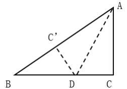

[代码描摹高清 PNG](../../../images/code_hd/27.png) · [SVG](../../../images/code_hd/27.svg)（原图为准）


折叠，直角边AC 恰好与斜边AB 重叠，则△ABD 的面积为
A. 15 平方厘米
B. 16 平方厘米
C. 18 平方厘米
D. 21 平方厘米

来源：[2023年江苏公务员考试《行测》真题（A类）.pdf](https://github.com/dumarstoft-ship-it/xingce/blob/407016b55b49581efa3771bb59a2dee8761d982f/2023%E5%B9%B4%E6%B1%9F%E8%8B%8F%E5%85%AC%E5%8A%A1%E5%91%98%E8%80%83%E8%AF%95%E3%80%8A%E8%A1%8C%E6%B5%8B%E3%80%8B%E7%9C%9F%E9%A2%98%EF%BC%88A%E7%B1%BB%EF%BC%89.pdf)，PDF 第 15 页。

## 第 60 题 · 数量关系

`JS2023-A类-060`

某博物馆拟举办一次为期4 天的文物展览活动，展出的文物共有5 类：青铜器、瓷器、
玉器、书法、国画。若要求每天仅展出2 类文物，每类文物都要展出但不能连续2 天展出，
且玉器和国画这2 类文物不在第1 天展出，则不同的展出方式共有
A. 72 种
B. 120 种
C. 216 种
D. 360 种

来源：[2023年江苏公务员考试《行测》真题（A类）.pdf](https://github.com/dumarstoft-ship-it/xingce/blob/407016b55b49581efa3771bb59a2dee8761d982f/2023%E5%B9%B4%E6%B1%9F%E8%8B%8F%E5%85%AC%E5%8A%A1%E5%91%98%E8%80%83%E8%AF%95%E3%80%8A%E8%A1%8C%E6%B5%8B%E3%80%8B%E7%9C%9F%E9%A2%98%EF%BC%88A%E7%B1%BB%EF%BC%89.pdf)，PDF 第 16 页。

## 第 61 题 · 数量关系

`JS2023-A类-061`

甲、乙两个工程队合作完成一项工程，甲每工作3 天休息1 天，乙每工作5 天休息2 天。
若甲先工作，2 天后乙加入，则再用21 天完工；若乙先工作，12 天后甲加入，则再用15
天完工。甲单独完成该项工程需要的天数是
A. 43
B. 44
C. 47
D. 48

来源：[2023年江苏公务员考试《行测》真题（A类）.pdf](https://github.com/dumarstoft-ship-it/xingce/blob/407016b55b49581efa3771bb59a2dee8761d982f/2023%E5%B9%B4%E6%B1%9F%E8%8B%8F%E5%85%AC%E5%8A%A1%E5%91%98%E8%80%83%E8%AF%95%E3%80%8A%E8%A1%8C%E6%B5%8B%E3%80%8B%E7%9C%9F%E9%A2%98%EF%BC%88A%E7%B1%BB%EF%BC%89.pdf)，PDF 第 16 页。

## 第 62 题 · 数量关系

`JS2023-A类-062`

浓度分别为68%、72%、78%的三种酒精溶液的总质量为240 克。若将它们全部混合，则
可得浓度为74%的酒精溶液；若只将浓度为72%和78%的酒精溶液混合，则得浓度为76%的
酒精溶液。这三种酒精溶液中，浓度为72%的酒精溶液质量为
A. 30 克
B. 40 克
C. 48 克
D. 60 克

来源：[2023年江苏公务员考试《行测》真题（A类）.pdf](https://github.com/dumarstoft-ship-it/xingce/blob/407016b55b49581efa3771bb59a2dee8761d982f/2023%E5%B9%B4%E6%B1%9F%E8%8B%8F%E5%85%AC%E5%8A%A1%E5%91%98%E8%80%83%E8%AF%95%E3%80%8A%E8%A1%8C%E6%B5%8B%E3%80%8B%E7%9C%9F%E9%A2%98%EF%BC%88A%E7%B1%BB%EF%BC%89.pdf)，PDF 第 16 页。

## 第 63 题 · 数量关系

`JS2023-A类-063`

某公司实行弹性工作制，允许居家办公，但要求员工每周的周一到周五至少有两天在公
司工作。小王、小李和小陈都是该公司的员工，若他们分别从下周的周一到周五中随机选2
天、3 天、4 天去公司工作，则他们下周三都去公司工作的概率是
A. 1/25
B. 6/125
C. 24/125
D. 3/250

来源：[2023年江苏公务员考试《行测》真题（A类）.pdf](https://github.com/dumarstoft-ship-it/xingce/blob/407016b55b49581efa3771bb59a2dee8761d982f/2023%E5%B9%B4%E6%B1%9F%E8%8B%8F%E5%85%AC%E5%8A%A1%E5%91%98%E8%80%83%E8%AF%95%E3%80%8A%E8%A1%8C%E6%B5%8B%E3%80%8B%E7%9C%9F%E9%A2%98%EF%BC%88A%E7%B1%BB%EF%BC%89.pdf)，PDF 第 16 页。

## 第 64 题 · 数量关系

`JS2023-A类-064`

一个快递分发点的快递员某天人均送件量为220 件，最少的送了200 件。已知有一名快
递员送了260 件，除他之外的快递员人均送件量为218 件。当天该快递分发点的一名快递
员送件量最多为
A. 542 件
B. 560 件
C. 582 件
D. 596 件

来源：[2023年江苏公务员考试《行测》真题（A类）.pdf](https://github.com/dumarstoft-ship-it/xingce/blob/407016b55b49581efa3771bb59a2dee8761d982f/2023%E5%B9%B4%E6%B1%9F%E8%8B%8F%E5%85%AC%E5%8A%A1%E5%91%98%E8%80%83%E8%AF%95%E3%80%8A%E8%A1%8C%E6%B5%8B%E3%80%8B%E7%9C%9F%E9%A2%98%EF%BC%88A%E7%B1%BB%EF%BC%89.pdf)，PDF 第 16 页。

## 第 65 题 · 数量关系

`JS2023-A类-065`

原图为4×4方格，各行从左至右如下（无额外表头）：

```text
a   4   8   m
3  17   b  11
11  y   5   c
x  14   z   2
```
在下表中，小方格中的字母均为整数。若各行之和、各列之和、
各对角线之和均相等，则a 的值为
A. 17
B. 18
C. 19
D. 20

来源：[2023年江苏公务员考试《行测》真题（A类）.pdf](https://github.com/dumarstoft-ship-it/xingce/blob/407016b55b49581efa3771bb59a2dee8761d982f/2023%E5%B9%B4%E6%B1%9F%E8%8B%8F%E5%85%AC%E5%8A%A1%E5%91%98%E8%80%83%E8%AF%95%E3%80%8A%E8%A1%8C%E6%B5%8B%E3%80%8B%E7%9C%9F%E9%A2%98%EF%BC%88A%E7%B1%BB%EF%BC%89.pdf)，PDF 第 16、17 页。

## 第 66 题 · 判断推理

`JS2023-A类-066`

请从四个选项中选出恰当的一项，使其关系与题干给出的词或词组的关系最为相似。

宇宙：元宇宙
A.闺女：亲闺女
B.消息：假消息
C.计算：云计算
D.化石：活化石

来源：[2023年江苏公务员考试《行测》真题（A类）.pdf](https://github.com/dumarstoft-ship-it/xingce/blob/407016b55b49581efa3771bb59a2dee8761d982f/2023%E5%B9%B4%E6%B1%9F%E8%8B%8F%E5%85%AC%E5%8A%A1%E5%91%98%E8%80%83%E8%AF%95%E3%80%8A%E8%A1%8C%E6%B5%8B%E3%80%8B%E7%9C%9F%E9%A2%98%EF%BC%88A%E7%B1%BB%EF%BC%89.pdf)，PDF 第 17 页。

## 第 67 题 · 判断推理

`JS2023-A类-067`

请从四个选项中选出恰当的一项，使其关系与题干给出的词或词组的关系最为相似。

挑战：应战
A.报考：录取
B.观察：评估
C.抚养：扶养
D.超速：限速

来源：[2023年江苏公务员考试《行测》真题（A类）.pdf](https://github.com/dumarstoft-ship-it/xingce/blob/407016b55b49581efa3771bb59a2dee8761d982f/2023%E5%B9%B4%E6%B1%9F%E8%8B%8F%E5%85%AC%E5%8A%A1%E5%91%98%E8%80%83%E8%AF%95%E3%80%8A%E8%A1%8C%E6%B5%8B%E3%80%8B%E7%9C%9F%E9%A2%98%EF%BC%88A%E7%B1%BB%EF%BC%89.pdf)，PDF 第 17 页。

## 第 68 题 · 判断推理

`JS2023-A类-068`

请从四个选项中选出恰当的一项，使其关系与题干给出的词或词组的关系最为相似。

布衣：百姓
A.鸿雁：书信
B.枢纽：关键
C.须眉：男子
D.巾帼：女子

来源：[2023年江苏公务员考试《行测》真题（A类）.pdf](https://github.com/dumarstoft-ship-it/xingce/blob/407016b55b49581efa3771bb59a2dee8761d982f/2023%E5%B9%B4%E6%B1%9F%E8%8B%8F%E5%85%AC%E5%8A%A1%E5%91%98%E8%80%83%E8%AF%95%E3%80%8A%E8%A1%8C%E6%B5%8B%E3%80%8B%E7%9C%9F%E9%A2%98%EF%BC%88A%E7%B1%BB%EF%BC%89.pdf)，PDF 第 17 页。

## 第 69 题 · 判断推理

`JS2023-A类-069`

请从四个选项中选出恰当的一项，使其关系与题干给出的词或词组的关系最为相似。

南极洲：企鹅：北极熊
A.空间站：种子：宇航员
B.水浒传：李逵：沙和尚
C.大数据：算法：字符串
D.地雷战：工事：指战员

来源：[2023年江苏公务员考试《行测》真题（A类）.pdf](https://github.com/dumarstoft-ship-it/xingce/blob/407016b55b49581efa3771bb59a2dee8761d982f/2023%E5%B9%B4%E6%B1%9F%E8%8B%8F%E5%85%AC%E5%8A%A1%E5%91%98%E8%80%83%E8%AF%95%E3%80%8A%E8%A1%8C%E6%B5%8B%E3%80%8B%E7%9C%9F%E9%A2%98%EF%BC%88A%E7%B1%BB%EF%BC%89.pdf)，PDF 第 17 页。

## 第 70 题 · 判断推理

`JS2023-A类-070`

请从四个选项中选出恰当的一项，使其关系与题干给出的词或词组的关系最为相似。

友善：诚信：价值观
A.存量：增量：资产总量
B.作揖：握手：行礼方式
C.机场：车站：交通枢纽
D.军舰：军机：舰载飞机

来源：[2023年江苏公务员考试《行测》真题（A类）.pdf](https://github.com/dumarstoft-ship-it/xingce/blob/407016b55b49581efa3771bb59a2dee8761d982f/2023%E5%B9%B4%E6%B1%9F%E8%8B%8F%E5%85%AC%E5%8A%A1%E5%91%98%E8%80%83%E8%AF%95%E3%80%8A%E8%A1%8C%E6%B5%8B%E3%80%8B%E7%9C%9F%E9%A2%98%EF%BC%88A%E7%B1%BB%EF%BC%89.pdf)，PDF 第 17、18 页。

## 第 71 题 · 判断推理

`JS2023-A类-071`

请从四个选项中选出恰当的一项，使其关系与题干给出的词或词组的关系最为相似。

登高：重阳：山坡
A.赏菊：秋日：蓝天
B.跳舞：冬日：篝火
C.纳凉：夏日：庭院
D.踏青：春日：细雨

来源：[2023年江苏公务员考试《行测》真题（A类）.pdf](https://github.com/dumarstoft-ship-it/xingce/blob/407016b55b49581efa3771bb59a2dee8761d982f/2023%E5%B9%B4%E6%B1%9F%E8%8B%8F%E5%85%AC%E5%8A%A1%E5%91%98%E8%80%83%E8%AF%95%E3%80%8A%E8%A1%8C%E6%B5%8B%E3%80%8B%E7%9C%9F%E9%A2%98%EF%BC%88A%E7%B1%BB%EF%BC%89.pdf)，PDF 第 18 页。

## 第 72 题 · 判断推理

`JS2023-A类-072`

请从四个选项中选出恰当的一项，使其关系与题干给出的词或词组的关系最为相似。

畅销书：精装书：电子书
A.预选赛：选拔赛：友谊赛
B.自由诗：叙事诗：抒情诗
C.显微镜：放大镜：望远镜
D.特效药：中成药：口服药

来源：[2023年江苏公务员考试《行测》真题（A类）.pdf](https://github.com/dumarstoft-ship-it/xingce/blob/407016b55b49581efa3771bb59a2dee8761d982f/2023%E5%B9%B4%E6%B1%9F%E8%8B%8F%E5%85%AC%E5%8A%A1%E5%91%98%E8%80%83%E8%AF%95%E3%80%8A%E8%A1%8C%E6%B5%8B%E3%80%8B%E7%9C%9F%E9%A2%98%EF%BC%88A%E7%B1%BB%EF%BC%89.pdf)，PDF 第 18 页。

## 第 73 题 · 判断推理

`JS2023-A类-073`

请从四个选项中选出恰当的一项，使得该项的两个词或词组依次代入题干的括号中，题干的前后两组词或词组的关系最为相似。

蜘蛛 之于 （ ） 相当于 （ ） 之于 能力
A.螃蟹 才干
B.蛛网 成功
C.动物 仁义
D.蛛丝 人才

来源：[2023年江苏公务员考试《行测》真题（A类）.pdf](https://github.com/dumarstoft-ship-it/xingce/blob/407016b55b49581efa3771bb59a2dee8761d982f/2023%E5%B9%B4%E6%B1%9F%E8%8B%8F%E5%85%AC%E5%8A%A1%E5%91%98%E8%80%83%E8%AF%95%E3%80%8A%E8%A1%8C%E6%B5%8B%E3%80%8B%E7%9C%9F%E9%A2%98%EF%BC%88A%E7%B1%BB%EF%BC%89.pdf)，PDF 第 18 页。

## 第 74 题 · 判断推理

`JS2023-A类-074`

请从四个选项中选出恰当的一项，使得该项的两个词或词组依次代入题干的括号中，题干的前后两组词或词组的关系最为相似。

（ ） 之于 句号 相当于 秋千 之于 （ ）
A.语气 游戏
B.问号 秋季
C.句子 绳索
D.符号 玩具

来源：[2023年江苏公务员考试《行测》真题（A类）.pdf](https://github.com/dumarstoft-ship-it/xingce/blob/407016b55b49581efa3771bb59a2dee8761d982f/2023%E5%B9%B4%E6%B1%9F%E8%8B%8F%E5%85%AC%E5%8A%A1%E5%91%98%E8%80%83%E8%AF%95%E3%80%8A%E8%A1%8C%E6%B5%8B%E3%80%8B%E7%9C%9F%E9%A2%98%EF%BC%88A%E7%B1%BB%EF%BC%89.pdf)，PDF 第 18 页。

## 第 75 题 · 判断推理

`JS2023-A类-075`

请从四个选项中选出恰当的一项，使得该项的两个词或词组依次代入题干的括号中，题干的前后两组词或词组的关系最为相似。

无理数 整数 之于 （ ） 相当于 哲学 历史 之于 （ ）
A.数据 大学
B.理科 文科
C.数学 典籍
D.实数 学科

来源：[2023年江苏公务员考试《行测》真题（A类）.pdf](https://github.com/dumarstoft-ship-it/xingce/blob/407016b55b49581efa3771bb59a2dee8761d982f/2023%E5%B9%B4%E6%B1%9F%E8%8B%8F%E5%85%AC%E5%8A%A1%E5%91%98%E8%80%83%E8%AF%95%E3%80%8A%E8%A1%8C%E6%B5%8B%E3%80%8B%E7%9C%9F%E9%A2%98%EF%BC%88A%E7%B1%BB%EF%BC%89.pdf)，PDF 第 18 页。

## 第 76 题 · 判断推理

`JS2023-A类-076`

请从四个选项中选出最恰当的一项填入问号处，使题干图形呈现一定的规律性。


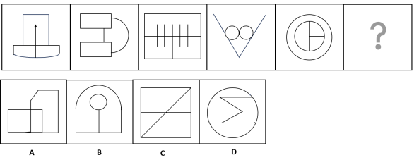


来源：[2023年江苏公务员考试《行测》真题（A类）.pdf](https://github.com/dumarstoft-ship-it/xingce/blob/407016b55b49581efa3771bb59a2dee8761d982f/2023%E5%B9%B4%E6%B1%9F%E8%8B%8F%E5%85%AC%E5%8A%A1%E5%91%98%E8%80%83%E8%AF%95%E3%80%8A%E8%A1%8C%E6%B5%8B%E3%80%8B%E7%9C%9F%E9%A2%98%EF%BC%88A%E7%B1%BB%EF%BC%89.pdf)，PDF 第 18、19 页。

## 第 77 题 · 判断推理

`JS2023-A类-077`

请从四个选项中选出最恰当的一项填入问号处，使题干图形呈现一定的规律性。


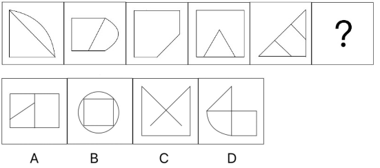


来源：[2023年江苏公务员考试《行测》真题（A类）.pdf](https://github.com/dumarstoft-ship-it/xingce/blob/407016b55b49581efa3771bb59a2dee8761d982f/2023%E5%B9%B4%E6%B1%9F%E8%8B%8F%E5%85%AC%E5%8A%A1%E5%91%98%E8%80%83%E8%AF%95%E3%80%8A%E8%A1%8C%E6%B5%8B%E3%80%8B%E7%9C%9F%E9%A2%98%EF%BC%88A%E7%B1%BB%EF%BC%89.pdf)，PDF 第 19 页。

## 第 78 题 · 判断推理

`JS2023-A类-078`

请从四个选项中选出最恰当的一项填入问号处，使题干图形呈现一定的规律性。


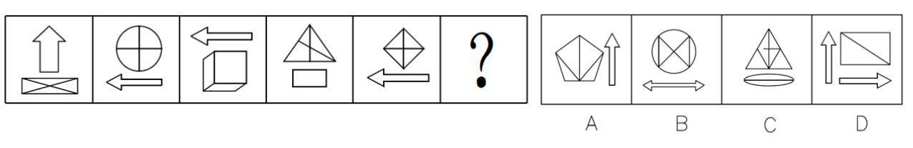


来源：[2023年江苏公务员考试《行测》真题（A类）.pdf](https://github.com/dumarstoft-ship-it/xingce/blob/407016b55b49581efa3771bb59a2dee8761d982f/2023%E5%B9%B4%E6%B1%9F%E8%8B%8F%E5%85%AC%E5%8A%A1%E5%91%98%E8%80%83%E8%AF%95%E3%80%8A%E8%A1%8C%E6%B5%8B%E3%80%8B%E7%9C%9F%E9%A2%98%EF%BC%88A%E7%B1%BB%EF%BC%89.pdf)，PDF 第 19 页。

## 第 79 题 · 判断推理

`JS2023-A类-079`

请从四个选项中选出最恰当的一项填入问号处，使题干图形呈现一定的规律性。


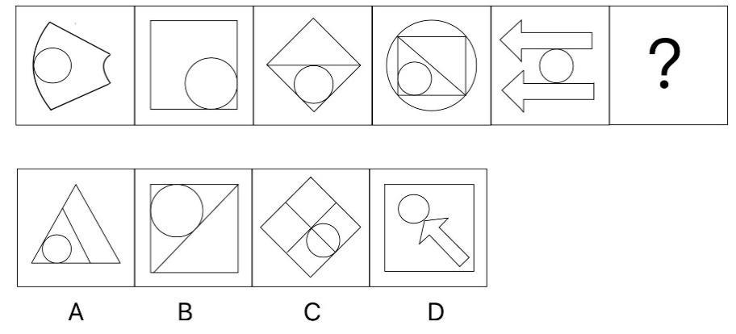


来源：[2023年江苏公务员考试《行测》真题（A类）.pdf](https://github.com/dumarstoft-ship-it/xingce/blob/407016b55b49581efa3771bb59a2dee8761d982f/2023%E5%B9%B4%E6%B1%9F%E8%8B%8F%E5%85%AC%E5%8A%A1%E5%91%98%E8%80%83%E8%AF%95%E3%80%8A%E8%A1%8C%E6%B5%8B%E3%80%8B%E7%9C%9F%E9%A2%98%EF%BC%88A%E7%B1%BB%EF%BC%89.pdf)，PDF 第 19 页。

## 第 80 题 · 判断推理

`JS2023-A类-080`

请从四个选项中选出最恰当的一项填入问号处，使题干图形呈现一定的规律性。


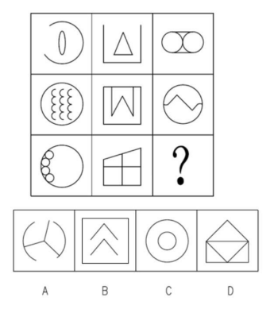


来源：[2023年江苏公务员考试《行测》真题（A类）.pdf](https://github.com/dumarstoft-ship-it/xingce/blob/407016b55b49581efa3771bb59a2dee8761d982f/2023%E5%B9%B4%E6%B1%9F%E8%8B%8F%E5%85%AC%E5%8A%A1%E5%91%98%E8%80%83%E8%AF%95%E3%80%8A%E8%A1%8C%E6%B5%8B%E3%80%8B%E7%9C%9F%E9%A2%98%EF%BC%88A%E7%B1%BB%EF%BC%89.pdf)，PDF 第 19 页。

## 第 81 题 · 判断推理

`JS2023-A类-081`

请从四个选项中选出最恰当的一项填入问号处，使题干图形呈现一定的规律性。


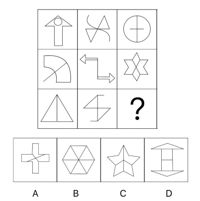


来源：[2023年江苏公务员考试《行测》真题（A类）.pdf](https://github.com/dumarstoft-ship-it/xingce/blob/407016b55b49581efa3771bb59a2dee8761d982f/2023%E5%B9%B4%E6%B1%9F%E8%8B%8F%E5%85%AC%E5%8A%A1%E5%91%98%E8%80%83%E8%AF%95%E3%80%8A%E8%A1%8C%E6%B5%8B%E3%80%8B%E7%9C%9F%E9%A2%98%EF%BC%88A%E7%B1%BB%EF%BC%89.pdf)，PDF 第 19、20 页。

## 第 82 题 · 判断推理

`JS2023-A类-082`

右边四个图形中，只有一个是由左边的四个图形拼合（只能通过上、下、左、右平移）而成的，请把它找出来。


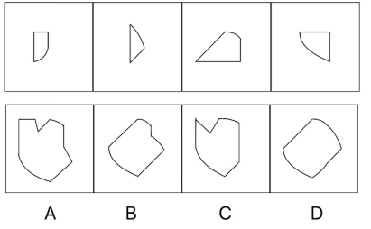


来源：[2023年江苏公务员考试《行测》真题（A类）.pdf](https://github.com/dumarstoft-ship-it/xingce/blob/407016b55b49581efa3771bb59a2dee8761d982f/2023%E5%B9%B4%E6%B1%9F%E8%8B%8F%E5%85%AC%E5%8A%A1%E5%91%98%E8%80%83%E8%AF%95%E3%80%8A%E8%A1%8C%E6%B5%8B%E3%80%8B%E7%9C%9F%E9%A2%98%EF%BC%88A%E7%B1%BB%EF%BC%89.pdf)，PDF 第 20 页。

## 第 83 题 · 判断推理

`JS2023-A类-083`

右边四个图形中，只有一个是由左边的四个图形拼合（只能通过上、下、左、右平移）而成的，请把它找出来。


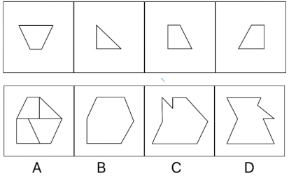


来源：[2023年江苏公务员考试《行测》真题（A类）.pdf](https://github.com/dumarstoft-ship-it/xingce/blob/407016b55b49581efa3771bb59a2dee8761d982f/2023%E5%B9%B4%E6%B1%9F%E8%8B%8F%E5%85%AC%E5%8A%A1%E5%91%98%E8%80%83%E8%AF%95%E3%80%8A%E8%A1%8C%E6%B5%8B%E3%80%8B%E7%9C%9F%E9%A2%98%EF%BC%88A%E7%B1%BB%EF%BC%89.pdf)，PDF 第 20 页。

## 第 84 题 · 判断推理

`JS2023-A类-084`

右边四个图形中，只有一个是由左边的四个图形拼合（只能通过上、下、左、右平移）而成的，请把它找出来。


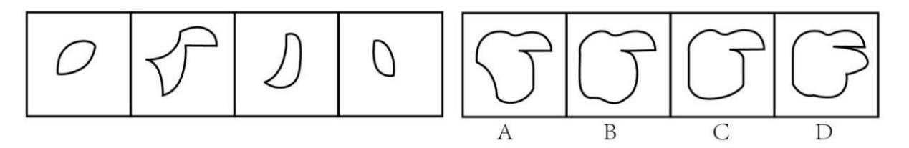


来源：[2023年江苏公务员考试《行测》真题（A类）.pdf](https://github.com/dumarstoft-ship-it/xingce/blob/407016b55b49581efa3771bb59a2dee8761d982f/2023%E5%B9%B4%E6%B1%9F%E8%8B%8F%E5%85%AC%E5%8A%A1%E5%91%98%E8%80%83%E8%AF%95%E3%80%8A%E8%A1%8C%E6%B5%8B%E3%80%8B%E7%9C%9F%E9%A2%98%EF%BC%88A%E7%B1%BB%EF%BC%89.pdf)，PDF 第 20 页。

## 第 85 题 · 判断推理

`JS2023-A类-085`

从四个选项中选出一项填入问号处，使左边四个图形可以拼合（只能通过上、下、左、
右平移）成中间的图形。


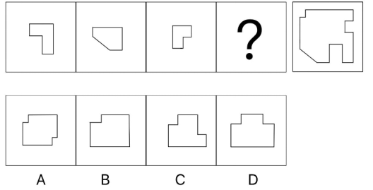


来源：[2023年江苏公务员考试《行测》真题（A类）.pdf](https://github.com/dumarstoft-ship-it/xingce/blob/407016b55b49581efa3771bb59a2dee8761d982f/2023%E5%B9%B4%E6%B1%9F%E8%8B%8F%E5%85%AC%E5%8A%A1%E5%91%98%E8%80%83%E8%AF%95%E3%80%8A%E8%A1%8C%E6%B5%8B%E3%80%8B%E7%9C%9F%E9%A2%98%EF%BC%88A%E7%B1%BB%EF%BC%89.pdf)，PDF 第 20 页。

## 第 86 题 · 判断推理

`JS2023-A类-086`

左边四张纸片，都是一面为白色，一面为黑色，在允许平移、旋转和翻转的条件下，可
以拼合成多种图形。右边哪项不能由其拼合而成？


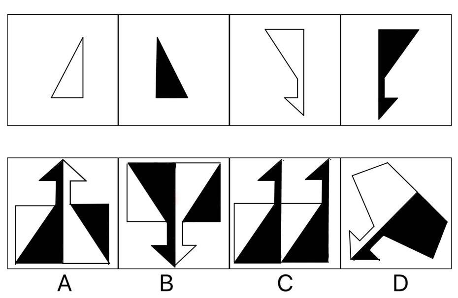


来源：[2023年江苏公务员考试《行测》真题（A类）.pdf](https://github.com/dumarstoft-ship-it/xingce/blob/407016b55b49581efa3771bb59a2dee8761d982f/2023%E5%B9%B4%E6%B1%9F%E8%8B%8F%E5%85%AC%E5%8A%A1%E5%91%98%E8%80%83%E8%AF%95%E3%80%8A%E8%A1%8C%E6%B5%8B%E3%80%8B%E7%9C%9F%E9%A2%98%EF%BC%88A%E7%B1%BB%EF%BC%89.pdf)，PDF 第 20、21 页。

## 第 87 题 · 判断推理

`JS2023-A类-087`

左边给定的是一个四面体，右边哪一项可能是它的外表面展开图？


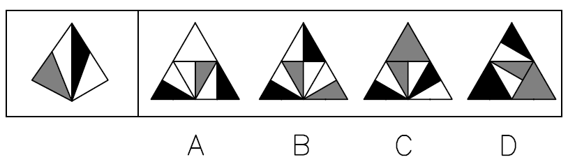


来源：[2023年江苏公务员考试《行测》真题（A类）.pdf](https://github.com/dumarstoft-ship-it/xingce/blob/407016b55b49581efa3771bb59a2dee8761d982f/2023%E5%B9%B4%E6%B1%9F%E8%8B%8F%E5%85%AC%E5%8A%A1%E5%91%98%E8%80%83%E8%AF%95%E3%80%8A%E8%A1%8C%E6%B5%8B%E3%80%8B%E7%9C%9F%E9%A2%98%EF%BC%88A%E7%B1%BB%EF%BC%89.pdf)，PDF 第 21 页。

## 第 88 题 · 判断推理

`JS2023-A类-088`

左边给定的是一个六面体的外表面展开图，右边哪一项能由它折叠而成？


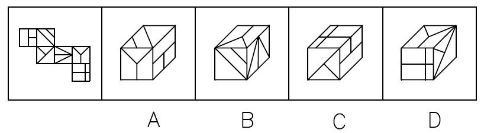


来源：[2023年江苏公务员考试《行测》真题（A类）.pdf](https://github.com/dumarstoft-ship-it/xingce/blob/407016b55b49581efa3771bb59a2dee8761d982f/2023%E5%B9%B4%E6%B1%9F%E8%8B%8F%E5%85%AC%E5%8A%A1%E5%91%98%E8%80%83%E8%AF%95%E3%80%8A%E8%A1%8C%E6%B5%8B%E3%80%8B%E7%9C%9F%E9%A2%98%EF%BC%88A%E7%B1%BB%EF%BC%89.pdf)，PDF 第 21 页。

## 第 89 题 · 判断推理

`JS2023-A类-089`

某立方体每个面上各有一种不同的图案，下列四个选项中有且仅有一个不是该立方体，
请把它找出来。


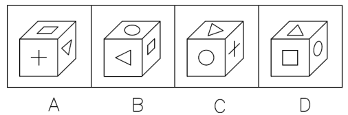


来源：[2023年江苏公务员考试《行测》真题（A类）.pdf](https://github.com/dumarstoft-ship-it/xingce/blob/407016b55b49581efa3771bb59a2dee8761d982f/2023%E5%B9%B4%E6%B1%9F%E8%8B%8F%E5%85%AC%E5%8A%A1%E5%91%98%E8%80%83%E8%AF%95%E3%80%8A%E8%A1%8C%E6%B5%8B%E3%80%8B%E7%9C%9F%E9%A2%98%EF%BC%88A%E7%B1%BB%EF%BC%89.pdf)，PDF 第 21 页。

## 第 90 题 · 判断推理

`JS2023-A类-090`

下列四个立方体的外表面展开图，其中一个展开图还原成立方体后，从能同时看到3 个
面的任一角度看（如 


 ），都可以至少看到一个圆。请把它找出来。


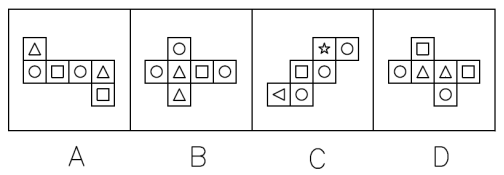


来源：[2023年江苏公务员考试《行测》真题（A类）.pdf](https://github.com/dumarstoft-ship-it/xingce/blob/407016b55b49581efa3771bb59a2dee8761d982f/2023%E5%B9%B4%E6%B1%9F%E8%8B%8F%E5%85%AC%E5%8A%A1%E5%91%98%E8%80%83%E8%AF%95%E3%80%8A%E8%A1%8C%E6%B5%8B%E3%80%8B%E7%9C%9F%E9%A2%98%EF%BC%88A%E7%B1%BB%EF%BC%89.pdf)，PDF 第 21 页。

## 第 91 题 · 判断推理

`JS2023-A类-091`

欲事立，须是心立。理想信念是中国共产党员精神上的“钙”，一个人理想信念坚定，“骨
头”就硬；理想信念缺失或者不坚定，精神上就会“缺钙”，就会得“软骨病”，就容易在考验面
前迷失方向。
以下哪项不能由以上陈述推出？
A.一个人若不想事立，他就无须心立
B.如果一个人“骨头”不硬，就说明他的理想信念不坚定
C.一个人理想信念缺失，他就会得“软骨病”
D.若一个人不容易在考验面前迷失方向，就说明他有坚定的理想信念

来源：[2023年江苏公务员考试《行测》真题（A类）.pdf](https://github.com/dumarstoft-ship-it/xingce/blob/407016b55b49581efa3771bb59a2dee8761d982f/2023%E5%B9%B4%E6%B1%9F%E8%8B%8F%E5%85%AC%E5%8A%A1%E5%91%98%E8%80%83%E8%AF%95%E3%80%8A%E8%A1%8C%E6%B5%8B%E3%80%8B%E7%9C%9F%E9%A2%98%EF%BC%88A%E7%B1%BB%EF%BC%89.pdf)，PDF 第 21、22 页。

## 第 92 题 · 判断推理

`JS2023-A类-092`

如今，利用网络检索信息、查阅资料非常方便，大多数人遇到生僻的字词需要检索、查
找、求证时，第一选择是上网而不是翻检词典。有网友坦言：尽管《现代汉语词典》伴随自
己的学生时代，但在互联网时代，它已经远离了我们的生活。
以下哪项如果为真，最能质疑上述网友的说法？
A.《现代汉语词典》每隔几年就会推出修订版，收录近期产生的新词语
B.网上查到的规范的字词解释是以《现代汉语词典》等工具书作为数据库提供的
C.在网络流行语的冲击下，词语意义和用法的精准解释对国人尤为重要
D.有些网络提供的字词解释不够准确，检索到的内容很容易出现错误

来源：[2023年江苏公务员考试《行测》真题（A类）.pdf](https://github.com/dumarstoft-ship-it/xingce/blob/407016b55b49581efa3771bb59a2dee8761d982f/2023%E5%B9%B4%E6%B1%9F%E8%8B%8F%E5%85%AC%E5%8A%A1%E5%91%98%E8%80%83%E8%AF%95%E3%80%8A%E8%A1%8C%E6%B5%8B%E3%80%8B%E7%9C%9F%E9%A2%98%EF%BC%88A%E7%B1%BB%EF%BC%89.pdf)，PDF 第 22 页。

## 第 93 题 · 判断推理

`JS2023-A类-093`

某市教育局派出由甲、乙、丙、丁、戊5 名优秀教师组成的支教团支援西部。已知：
（1）有3 人为青年教师，2 人为中年教师；
（2）语文教师有2 人，数学教师有3 人；
（3）甲与丙同龄，丁与戊年龄相差最大；
（4）乙与戊所教课程相同，丙与丁所教课程不同；
（5）担任组长的是一名中年语文教师。
根据以上陈述，可以推出以下哪项？
A.甲是组长
B.乙是组长
C.丙是组长
D.丁是组长

来源：[2023年江苏公务员考试《行测》真题（A类）.pdf](https://github.com/dumarstoft-ship-it/xingce/blob/407016b55b49581efa3771bb59a2dee8761d982f/2023%E5%B9%B4%E6%B1%9F%E8%8B%8F%E5%85%AC%E5%8A%A1%E5%91%98%E8%80%83%E8%AF%95%E3%80%8A%E8%A1%8C%E6%B5%8B%E3%80%8B%E7%9C%9F%E9%A2%98%EF%BC%88A%E7%B1%BB%EF%BC%89.pdf)，PDF 第 22 页。

## 第 94 题 · 判断推理

`JS2023-A类-094`

①死海是淹不死人的。因为②死海海水含盐量很大。据统计，③死海海水中有135 亿吨
氯化钠，有64 亿吨氯化钙，有20 亿吨氯化钾……各种盐的质量加在一起占死海全部海水的
23%~25%。由于④死海海水的比重超过了人体的比重，以致⑤人到死海里会自然漂起来，沉
不下去。
若用“A←B”表示陈述B 是陈述A 的论据，则题干的论证关系应表示为
A.⑤←①←②←③←④
B.①←⑤←③←④←②
C.①←⑤←④←②←③
D.⑤←①←④←③←②

来源：[2023年江苏公务员考试《行测》真题（A类）.pdf](https://github.com/dumarstoft-ship-it/xingce/blob/407016b55b49581efa3771bb59a2dee8761d982f/2023%E5%B9%B4%E6%B1%9F%E8%8B%8F%E5%85%AC%E5%8A%A1%E5%91%98%E8%80%83%E8%AF%95%E3%80%8A%E8%A1%8C%E6%B5%8B%E3%80%8B%E7%9C%9F%E9%A2%98%EF%BC%88A%E7%B1%BB%EF%BC%89.pdf)，PDF 第 22 页。

## 第 95 题 · 判断推理

`JS2023-A类-095`

近两年，预制菜成为很多餐饮店的新宠，经过洗、切、搭配、烹制等步骤的预制菜，在
餐饮店的后厨只需经过简单加工即可上桌。在这样的情形下，使用预制菜的规模化连锁餐饮
店遍地开花。有专家据此指出，长此以往许多厨师将面临失业的风险。
以下哪项如果为真，最能支持上述专家的观点？
A.用餐的客人越来越心急，点完菜恨不得立刻吃上，导致很多需要慢慢烹制的菜都得厨师预
先处理
B.高端的预制菜已经走进了许多家庭之中，人们不需要具备高超的厨艺即可化身大厨，为家
人带来一份丰盛的大餐
C.很多连锁餐饮店开在商场，而商场由于消防要求对明火管控严格，导致这些餐饮店只能使
用预制菜
D.规模化连锁餐饮店使用预制菜，方便快捷，成本比用厨师的中小餐馆要低得多，大多数中
小餐馆无力与之竞争。

来源：[2023年江苏公务员考试《行测》真题（A类）.pdf](https://github.com/dumarstoft-ship-it/xingce/blob/407016b55b49581efa3771bb59a2dee8761d982f/2023%E5%B9%B4%E6%B1%9F%E8%8B%8F%E5%85%AC%E5%8A%A1%E5%91%98%E8%80%83%E8%AF%95%E3%80%8A%E8%A1%8C%E6%B5%8B%E3%80%8B%E7%9C%9F%E9%A2%98%EF%BC%88A%E7%B1%BB%EF%BC%89.pdf)，PDF 第 22、23 页。

## 第 96 题 · 判断推理

`JS2023-A类-096`

手机APP 为了获得一些读取信息和修改手机设置的权限，都会提供用户协议并要求使用
者同意。然而，据权威调查显示，大部分使用者很少或从没阅读过APP 提供的用户协议，
也不乐意APP 有超出其功能的某些权限，但他们都会点击“我已阅读并同意用户协议”。
以下哪项如果为真，最能解释上述现象？
A.如果用户不同意手机APP 所提供的用户协议，就不能使用这款APP
B.通过正规平台下载的APP 有平台审核其安全性，不需要下载者进行核查
C.很多手机APP 的用户协议冗长复杂，用户无法在短时间内读完或读懂
D.对于某些APP 来说，用户在使用过程中还能重新设定它获取的各种权限

来源：[2023年江苏公务员考试《行测》真题（A类）.pdf](https://github.com/dumarstoft-ship-it/xingce/blob/407016b55b49581efa3771bb59a2dee8761d982f/2023%E5%B9%B4%E6%B1%9F%E8%8B%8F%E5%85%AC%E5%8A%A1%E5%91%98%E8%80%83%E8%AF%95%E3%80%8A%E8%A1%8C%E6%B5%8B%E3%80%8B%E7%9C%9F%E9%A2%98%EF%BC%88A%E7%B1%BB%EF%BC%89.pdf)，PDF 第 23 页。

## 第 97 题 · 判断推理

`JS2023-A类-097`

### 共用材料

赵、钱、孙、李、周、吴和郑获得某职业技能大赛的前七名，7 名选手有男有女，没有并列
名次。已知：
（1）赵是第六名，郑的名次在孙之前；
（2）男选手的排名不相邻；
（3）吴的名次在钱和李之前，排名在吴之前的选手中有两名男性。

根据以上陈述，下列选手名次不可能相邻的是
A.孙和吴
B.吴和郑
C.吴和李
D.周和吴

来源：[2023年江苏公务员考试《行测》真题（A类）.pdf](https://github.com/dumarstoft-ship-it/xingce/blob/407016b55b49581efa3771bb59a2dee8761d982f/2023%E5%B9%B4%E6%B1%9F%E8%8B%8F%E5%85%AC%E5%8A%A1%E5%91%98%E8%80%83%E8%AF%95%E3%80%8A%E8%A1%8C%E6%B5%8B%E3%80%8B%E7%9C%9F%E9%A2%98%EF%BC%88A%E7%B1%BB%EF%BC%89.pdf)，PDF 第 23 页。

## 第 98 题 · 判断推理

`JS2023-A类-098`

### 共用材料

赵、钱、孙、李、周、吴和郑获得某职业技能大赛的前七名，7 名选手有男有女，没有并列
名次。已知：
（1）赵是第六名，郑的名次在孙之前；
（2）男选手的排名不相邻；
（3）吴的名次在钱和李之前，排名在吴之前的选手中有两名男性。

如果周是第三名，以下哪位选手一定是女性？
A.赵
B.钱
C.孙
D.李

来源：[2023年江苏公务员考试《行测》真题（A类）.pdf](https://github.com/dumarstoft-ship-it/xingce/blob/407016b55b49581efa3771bb59a2dee8761d982f/2023%E5%B9%B4%E6%B1%9F%E8%8B%8F%E5%85%AC%E5%8A%A1%E5%91%98%E8%80%83%E8%AF%95%E3%80%8A%E8%A1%8C%E6%B5%8B%E3%80%8B%E7%9C%9F%E9%A2%98%EF%BC%88A%E7%B1%BB%EF%BC%89.pdf)，PDF 第 23 页。

## 第 99 题 · 判断推理

`JS2023-A类-099`

据一项调查显示，对所学专业满意的大学生不到一半。某高校为了调动学生的学习主动
性和积极性、提高学生对所学专业的满意度，允许在原专业中成绩名列年级前10%且不存在
挂科的学生更换专业。有专家指出，这一成绩要求违背了该校制定转专业政策的初衷。
以下哪项如果为真，最能支持上述专家的观点？
A.许多学生因为对原专业不感兴趣而缺乏学习的动力，导致学习成绩差
B.一些学生对所学专业很感兴趣，但因为方法不对，学习成绩不是很理想
C.不少学生考上大学后没有把心思花在学习上，即使更换专业也不会满意
D.学校出台转专业政策时不仅要考虑学生因素，更要考虑专业的平衡发展

来源：[2023年江苏公务员考试《行测》真题（A类）.pdf](https://github.com/dumarstoft-ship-it/xingce/blob/407016b55b49581efa3771bb59a2dee8761d982f/2023%E5%B9%B4%E6%B1%9F%E8%8B%8F%E5%85%AC%E5%8A%A1%E5%91%98%E8%80%83%E8%AF%95%E3%80%8A%E8%A1%8C%E6%B5%8B%E3%80%8B%E7%9C%9F%E9%A2%98%EF%BC%88A%E7%B1%BB%EF%BC%89.pdf)，PDF 第 23 页。

## 第 100 题 · 判断推理

`JS2023-A类-100`

北方某市有甲、乙两条十字交叉的马路，每年冬季都有成群的乌鸦聚集于甲路边的树
上，但乙路边的树上基本没有乌鸦。有鸟类爱好者发现，甲路两旁的杨树要比乙路多数倍。
据此，该鸟类爱好者断言，乌鸦更喜欢停留在杨树多的地方过冬。
以下哪项如果为真，最能削弱上述鸟类爱好者的断言？
A.在夏秋之交，甲、乙两条路旁的树上都会聚集大量的乌鸦
B.近二十年来该市特别重视道路绿化，为鸟类提供了良好的栖息环境
C.乙路是南北方向，凛冽的北风长驱直入，而甲路旁边的建筑能有效阻挡北风
D.该市有一条与甲路平行的路，杨树的数量与乙路差不多，但冬季几乎没有乌鸦

来源：[2023年江苏公务员考试《行测》真题（A类）.pdf](https://github.com/dumarstoft-ship-it/xingce/blob/407016b55b49581efa3771bb59a2dee8761d982f/2023%E5%B9%B4%E6%B1%9F%E8%8B%8F%E5%85%AC%E5%8A%A1%E5%91%98%E8%80%83%E8%AF%95%E3%80%8A%E8%A1%8C%E6%B5%8B%E3%80%8B%E7%9C%9F%E9%A2%98%EF%BC%88A%E7%B1%BB%EF%BC%89.pdf)，PDF 第 23、24 页。

## 第 101 题 · 判断推理

`JS2023-A类-101`

小朱：外星人一定存在
小李：没有任何有关外星人存在的证据，所以外星人一定不存在
以下哪项中乙的论证方式与小李最为相似？
A.甲：明天可能下雨
乙：现在的天气状况特别好，所以明天很可能不下雨
B.甲：老王一家今天应该都外出散步了
乙：我一直没看到他们出去，所以老王一家应该都没有外出散步
C.甲：老赵有时聪明
乙：我只见过老赵不聪明的时候，所以老赵有时不聪明
D.甲：小徐一定能晋级
乙：目前小徐在积分榜上排名靠后，所以小徐可能不会晋级

来源：[2023年江苏公务员考试《行测》真题（A类）.pdf](https://github.com/dumarstoft-ship-it/xingce/blob/407016b55b49581efa3771bb59a2dee8761d982f/2023%E5%B9%B4%E6%B1%9F%E8%8B%8F%E5%85%AC%E5%8A%A1%E5%91%98%E8%80%83%E8%AF%95%E3%80%8A%E8%A1%8C%E6%B5%8B%E3%80%8B%E7%9C%9F%E9%A2%98%EF%BC%88A%E7%B1%BB%EF%BC%89.pdf)，PDF 第 24 页。

## 第 102 题 · 判断推理

`JS2023-A类-102`

甲对乙说：“没事，没事，我知道消费者不愿意配合。不过，我倒是很在意您对这件事
的态度，请您把您的态度告诉我，因为您的态度会左右我下一步的选择。”
以下哪项不可能是甲在对话时的假设？
A.甲不太在意消费者不愿意配合
B.这件事乙是有自己态度的
C.乙会把对事情的态度告诉甲
D.甲对下一步的选择时有想法的

来源：[2023年江苏公务员考试《行测》真题（A类）.pdf](https://github.com/dumarstoft-ship-it/xingce/blob/407016b55b49581efa3771bb59a2dee8761d982f/2023%E5%B9%B4%E6%B1%9F%E8%8B%8F%E5%85%AC%E5%8A%A1%E5%91%98%E8%80%83%E8%AF%95%E3%80%8A%E8%A1%8C%E6%B5%8B%E3%80%8B%E7%9C%9F%E9%A2%98%EF%BC%88A%E7%B1%BB%EF%BC%89.pdf)，PDF 第 24 页。

## 第 103 题 · 判断推理

`JS2023-A类-103`

有身高为1.65 米、1.68 米、1.70 米和1.72 米的四人，其中有两人体型偏瘦，两人体型
偏胖。关于身高体型，这四个人有如下陈述：
甲：我身高不到1.70 米；
乙：丙身高1.72 米，偏瘦；
丙：丁身高1.68 米，偏胖；
丁：乙身高1.65 米，偏瘦。
如果体型偏瘦的说真话，体型偏胖的说假话，那么可以推出以下哪项？
A.甲身高1.65 米，偏胖
B.乙身高1.70 米，偏瘦
C.丙身高1.72 米，偏瘦
D.丁身高1.68 米，偏胖

来源：[2023年江苏公务员考试《行测》真题（A类）.pdf](https://github.com/dumarstoft-ship-it/xingce/blob/407016b55b49581efa3771bb59a2dee8761d982f/2023%E5%B9%B4%E6%B1%9F%E8%8B%8F%E5%85%AC%E5%8A%A1%E5%91%98%E8%80%83%E8%AF%95%E3%80%8A%E8%A1%8C%E6%B5%8B%E3%80%8B%E7%9C%9F%E9%A2%98%EF%BC%88A%E7%B1%BB%EF%BC%89.pdf)，PDF 第 24 页。

## 第 104 题 · 判断推理

`JS2023-A类-104`

### 共用材料

某餐馆菜单上有芹菜肉丝、清蒸鲈鱼、毛豆仔鸡、糖醋排骨4 道菜。甲、乙、丙、丁各点了
其中的2 道，没有一道菜四人都点，也没有一道菜四人都不点。已知：
（1）只有甲点清蒸鲈鱼，丁才点芹菜肉丝；
（2）如果丙点清蒸鲈鱼，则乙和丁也点清蒸鲈鱼；
（3）如果乙在芹菜肉丝和清蒸鲈鱼中至少点一道，则乙也点毛豆仔鸡；
（4）如果丙在芹菜肉丝和毛豆仔鸡中至少点一道，则丙也点清蒸鲈鱼。

根据以上陈述，可以推出以下哪项？
A.甲在芹菜肉丝和毛豆仔鸡中至少点一道
B.乙在芹菜肉丝和糖醋排骨中至少点一道
C.丙在毛豆仔鸡和糖醋排骨中至少点一道
D.丁在芹菜肉丝和毛豆仔鸡中至少点一道

来源：[2023年江苏公务员考试《行测》真题（A类）.pdf](https://github.com/dumarstoft-ship-it/xingce/blob/407016b55b49581efa3771bb59a2dee8761d982f/2023%E5%B9%B4%E6%B1%9F%E8%8B%8F%E5%85%AC%E5%8A%A1%E5%91%98%E8%80%83%E8%AF%95%E3%80%8A%E8%A1%8C%E6%B5%8B%E3%80%8B%E7%9C%9F%E9%A2%98%EF%BC%88A%E7%B1%BB%EF%BC%89.pdf)，PDF 第 25 页。

## 第 105 题 · 判断推理

`JS2023-A类-105`

### 共用材料

某餐馆菜单上有芹菜肉丝、清蒸鲈鱼、毛豆仔鸡、糖醋排骨4 道菜。甲、乙、丙、丁各点了
其中的2 道，没有一道菜四人都点，也没有一道菜四人都不点。已知：
（1）只有甲点清蒸鲈鱼，丁才点芹菜肉丝；
（2）如果丙点清蒸鲈鱼，则乙和丁也点清蒸鲈鱼；
（3）如果乙在芹菜肉丝和清蒸鲈鱼中至少点一道，则乙也点毛豆仔鸡；
（4）如果丙在芹菜肉丝和毛豆仔鸡中至少点一道，则丙也点清蒸鲈鱼。

如果任意两人点的菜都不完全相同，则可以推出以下哪项？
A.甲点芹菜肉丝和毛豆仔鸡
B.乙点毛豆仔鸡和糖醋排骨
C.丙点清蒸鲈鱼和芹菜肉丝
D.丁点糖醋排骨和毛豆仔鸡

来源：[2023年江苏公务员考试《行测》真题（A类）.pdf](https://github.com/dumarstoft-ship-it/xingce/blob/407016b55b49581efa3771bb59a2dee8761d982f/2023%E5%B9%B4%E6%B1%9F%E8%8B%8F%E5%85%AC%E5%8A%A1%E5%91%98%E8%80%83%E8%AF%95%E3%80%8A%E8%A1%8C%E6%B5%8B%E3%80%8B%E7%9C%9F%E9%A2%98%EF%BC%88A%E7%B1%BB%EF%BC%89.pdf)，PDF 第 25 页。

## 第 106 题 · 判断推理

`JS2023-A类-106`

红色研学：指以中国革命或社会主义建设时期的历史、事迹和精神为主题，以相关纪
念地、标志物等为载体组织开展的旅游活动。
下列属于红色研学的是
A.每到节假日都有很多学生来到渡江胜利纪念馆，了解新中国诞生的历史，学习革命先辈的
英勇献身精神，观赏长江美景
B.某实验中学的近百名团员在老师带领下来到北大荒开发建设纪念馆，从讲解员的介绍中感
受了北大荒建设的艰辛及辉煌成就
C.寒假期间，市文化中心推出“培根铸魂颂中华”活动，组织青少年吟诵爱国主义诗词作品，
增强对中华文化的自豪感
D.清明节前夕，某大学组织学生党员到市郊革命列士陵园开展义务宣讲活动，为外地游客讲
述烈士事迹，受到游客的广泛赞誉

来源：[2023年江苏公务员考试《行测》真题（A类）.pdf](https://github.com/dumarstoft-ship-it/xingce/blob/407016b55b49581efa3771bb59a2dee8761d982f/2023%E5%B9%B4%E6%B1%9F%E8%8B%8F%E5%85%AC%E5%8A%A1%E5%91%98%E8%80%83%E8%AF%95%E3%80%8A%E8%A1%8C%E6%B5%8B%E3%80%8B%E7%9C%9F%E9%A2%98%EF%BC%88A%E7%B1%BB%EF%BC%89.pdf)，PDF 第 25 页。

## 第 107 题 · 判断推理

`JS2023-A类-107`

形象转移：指消费者将对某品牌特定产品的认同感转移到该品牌的新产品上，也指企
业利用旗舰产品的良好形象推出相关产品，以迅速占领市场的经营策略。
下列属于形象转移的是
A.某品牌洗衣机一直稳居市场占有率前三名。其公司乘势而上，最近又开发出了针对小件衣
物的迷你型产品
B.倪先生购买了某品牌的一款新手机。尽管价格很高，他还是买了经该品牌认证的耳机、充
电器等配套产品
C.某知名品牌电动自行车广受欢迎，为满足需要，厂家扩大生产规模，产量大幅增长，投放
市场后仍然供不应求
D.某知名玩具公司趁着世界杯的热度，推出了利用传统榫卯技艺制作、不用钉子胶水的木质
足球玩具，很快就被小球迷抢购一空

来源：[2023年江苏公务员考试《行测》真题（A类）.pdf](https://github.com/dumarstoft-ship-it/xingce/blob/407016b55b49581efa3771bb59a2dee8761d982f/2023%E5%B9%B4%E6%B1%9F%E8%8B%8F%E5%85%AC%E5%8A%A1%E5%91%98%E8%80%83%E8%AF%95%E3%80%8A%E8%A1%8C%E6%B5%8B%E3%80%8B%E7%9C%9F%E9%A2%98%EF%BC%88A%E7%B1%BB%EF%BC%89.pdf)，PDF 第 25 页。

## 第 108 题 · 判断推理

`JS2023-A类-108`

智慧城乡建设：指在城乡建设过程中，以大数据、物联网等数字化技术为基础，通过
多领域数据的互联互通，提高政府治理效能及宜居度的举措。
下列属于智慧城乡建设的是
A.某县小商品市场利用物联网技术，强化产品质量溯源体系建设，所有商品实现了“带证上
网、带码上线、带标上市”，交易额大幅提高
B.某现代农业园采用多项“5G+农业”技术，通过上百个检测点实时监测作物生长情况，把各
区域的温度、湿度等数据传输到控制中心，根据数据进行种苗选育、水肥管控
C.某公司针对城区道路上下班高峰期的拥堵问题，研发出了一套新的智能信控系统，有望实
现从“车看灯”到“灯看车”的转变
D.某地依托城市洪涝数值模拟模型发布了市区积水地图，能直观展示低洼路段、下穿立交等
区域的风险点位分布以及相应的避险提示。从此以后，市民雨天出行再也没有出现过安全问
题

来源：[2023年江苏公务员考试《行测》真题（A类）.pdf](https://github.com/dumarstoft-ship-it/xingce/blob/407016b55b49581efa3771bb59a2dee8761d982f/2023%E5%B9%B4%E6%B1%9F%E8%8B%8F%E5%85%AC%E5%8A%A1%E5%91%98%E8%80%83%E8%AF%95%E3%80%8A%E8%A1%8C%E6%B5%8B%E3%80%8B%E7%9C%9F%E9%A2%98%EF%BC%88A%E7%B1%BB%EF%BC%89.pdf)，PDF 第 25、26 页。

## 第 109 题 · 判断推理

`JS2023-A类-109`

野性消费：指消费者在特定情形下，为了表达对相关企业产品的支持而有意忽略产品
性能、个人消费能力或需求的情感性购买行为。
下列属于野性消费的是
A.陈女士自驾游时，看见一个孩子在路边卖土豆，得知他的父亲遭遇车祸后，毫不犹豫买下
全部土豆，并开车把他送回了几公里外的家
B.某地发生自然灾害后，某服装企业低调捐赠了数百万元赈灾物资，网友深受感动，涌入其
直播间下单，很多人一买就是几十件
C.老马包子铺多年来一直向每位进店消费的环卫工赠送两个包子。网友拍到后顶上了热搜，
许多顾客纷纷前来购买
D.刚工作的小邓喜欢“花明天的钱，圆今天的梦”，昨天手机碎屏后立马用分期付款的方式购
买了一款心仪已久的折叠屏手机

来源：[2023年江苏公务员考试《行测》真题（A类）.pdf](https://github.com/dumarstoft-ship-it/xingce/blob/407016b55b49581efa3771bb59a2dee8761d982f/2023%E5%B9%B4%E6%B1%9F%E8%8B%8F%E5%85%AC%E5%8A%A1%E5%91%98%E8%80%83%E8%AF%95%E3%80%8A%E8%A1%8C%E6%B5%8B%E3%80%8B%E7%9C%9F%E9%A2%98%EF%BC%88A%E7%B1%BB%EF%BC%89.pdf)，PDF 第 26 页。

## 第 110 题 · 判断推理

`JS2023-A类-110`

反向旅游：指节假日期间主动避开热点城市、景区，到消费低、游客少的冷门景点，
追求个性化、高品质体验的小众旅游活动。
下列属于反向旅游的是
A.退休工程师老周打算在五一期间重游奉献三十年青春的林区，与阔别多年的老同事、老朋
友相聚
B.小陈夫妇新婚旅行没有去人挤人的热点景点，而是选择了一处幽静的民宿住了下来，结识
了不少新朋友
C.春节期间，赵先生全家来到东北一个无名小镇，滑冰、滑雪、看冰灯，没有花多少钱就度
过了一个难忘的假期
D.张先生周末约了几个摄影爱好者一起来到湿地公园，既拍摄到了很多珍稀鸟类，也拍下了
各色各样游客的身影

来源：[2023年江苏公务员考试《行测》真题（A类）.pdf](https://github.com/dumarstoft-ship-it/xingce/blob/407016b55b49581efa3771bb59a2dee8761d982f/2023%E5%B9%B4%E6%B1%9F%E8%8B%8F%E5%85%AC%E5%8A%A1%E5%91%98%E8%80%83%E8%AF%95%E3%80%8A%E8%A1%8C%E6%B5%8B%E3%80%8B%E7%9C%9F%E9%A2%98%EF%BC%88A%E7%B1%BB%EF%BC%89.pdf)，PDF 第 26 页。

## 第 111 题 · 判断推理

`JS2023-A类-111`

情感预判：指文学创作中不是一味表现自我，而是以客观事实为依据，换位思考，设
想对方的情感反应并作出判断的手法。
下列不属于情感预判的是
A.欲把西湖比西子，淡妆浓抹总相宜
B.遥知兄弟登高处，遍插茱萸少一人
C.洛阳亲友如相问，一片冰心在玉壶
D.何当共剪西窗烛，却话巴山夜雨时

来源：[2023年江苏公务员考试《行测》真题（A类）.pdf](https://github.com/dumarstoft-ship-it/xingce/blob/407016b55b49581efa3771bb59a2dee8761d982f/2023%E5%B9%B4%E6%B1%9F%E8%8B%8F%E5%85%AC%E5%8A%A1%E5%91%98%E8%80%83%E8%AF%95%E3%80%8A%E8%A1%8C%E6%B5%8B%E3%80%8B%E7%9C%9F%E9%A2%98%EF%BC%88A%E7%B1%BB%EF%BC%89.pdf)，PDF 第 26 页。

## 第 112 题 · 判断推理

`JS2023-A类-112`

雪糕刺客现象：指原来价格不高的大众化商品由于产品升级、成本上涨或者营销策略
等因素涨价幅度过大，造成消费者心理震撼或购买不便。
下列属于雪糕刺客现象的是
A.小张花二百多元网购了一盒网红冰淇淋。听到这个离谱的价格，心疼不已的父母足足唠叨
了半个小时，直到他吃光了都没停下来
B.小刘为儿子买了两个新款汽车玩具，几乎花掉了半个月工资。想起自己童年时代几块钱就
能买到玩具，不禁感叹时代真的变了
C.小严到附近花店选了二十几支百合想送给妈妈作为生日礼物，结账时发现竟要五百多元，
只好请朋友微信转钱解围。后来才知道这些都是今年新品
D.丁先生6 年前购买了一辆小车，最近打算换车。他来到4S 店后，发现同系列的最新款车
价格居然是以前的2 倍多，吓得赶紧从店里“逃”了出来

来源：[2023年江苏公务员考试《行测》真题（A类）.pdf](https://github.com/dumarstoft-ship-it/xingce/blob/407016b55b49581efa3771bb59a2dee8761d982f/2023%E5%B9%B4%E6%B1%9F%E8%8B%8F%E5%85%AC%E5%8A%A1%E5%91%98%E8%80%83%E8%AF%95%E3%80%8A%E8%A1%8C%E6%B5%8B%E3%80%8B%E7%9C%9F%E9%A2%98%EF%BC%88A%E7%B1%BB%EF%BC%89.pdf)，PDF 第 27 页。

## 第 113 题 · 判断推理

`JS2023-A类-113`

《现代汉语词典》（第7 版）词条排列法如下：单词条目按拼音字母次序排列。同音字
按笔画排列，笔画少的在前，笔画多的在后。笔画数相同的，按起笔笔形横（一）、竖（丨），
撇（丿）、点（丶）、折（乛）的次序排列。起笔相同的按第二笔笔形的次序排列，以下类推。
据此，汉字：①腌（ā）、②阿（ā）、③锕（ā）、④呵（ā）在《现代汉语词典》（第7 版）中的排列次序
是
A.②④①③
B.②④③①
C.④②③①
D.④②①③

来源：[2023年江苏公务员考试《行测》真题（A类）.pdf](https://github.com/dumarstoft-ship-it/xingce/blob/407016b55b49581efa3771bb59a2dee8761d982f/2023%E5%B9%B4%E6%B1%9F%E8%8B%8F%E5%85%AC%E5%8A%A1%E5%91%98%E8%80%83%E8%AF%95%E3%80%8A%E8%A1%8C%E6%B5%8B%E3%80%8B%E7%9C%9F%E9%A2%98%EF%BC%88A%E7%B1%BB%EF%BC%89.pdf)，PDF 第 27 页。

## 第 114 题 · 判断推理

`JS2023-A类-114`

社交称谓缺位：指面对面交往过程中，由于汉语本身对交际对象没有确切、得体的称
呼词语而造成尴尬的现象。
下列属于社交称谓缺位的是
A.董先生在超市偶遇多年不见的高中同学，聊了半天也没想起他的名字，最后只好用“老同
学”这个称呼混了过去
B.小赵性格内向，又不擅长推测别人的年龄，每次在电梯间碰到邻居时都不知道怎样打招呼，
生怕自己得罪了人
C.刚读大学的小孙昨天在街上遇到小朋友喊她“阿姨”，听到这个称呼她当场就愣住了，因为
她觉得自己也还是个孩子
D.小丁第一次到汪老师家中做客，见到她丈夫时竟然找不到合适的称呼，情急之下憋出了“师
爸”这个词，窘得真想找个地缝钻进去

来源：[2023年江苏公务员考试《行测》真题（A类）.pdf](https://github.com/dumarstoft-ship-it/xingce/blob/407016b55b49581efa3771bb59a2dee8761d982f/2023%E5%B9%B4%E6%B1%9F%E8%8B%8F%E5%85%AC%E5%8A%A1%E5%91%98%E8%80%83%E8%AF%95%E3%80%8A%E8%A1%8C%E6%B5%8B%E3%80%8B%E7%9C%9F%E9%A2%98%EF%BC%88A%E7%B1%BB%EF%BC%89.pdf)，PDF 第 27 页。

## 第 115 题 · 判断推理

`JS2023-A类-115`

桔槔：指一种从井里往外打水的工具。其结构相当于普通的杠杆，横杆的中间由竖柱支
撑或悬吊，横杆的一端用竖杆连接水桶，另一端悬绑重物。汲水时，压竖杆则水桶向下灌水，
灌满后压另一头，水桶就提升到井外。
下列属于桔槔的是


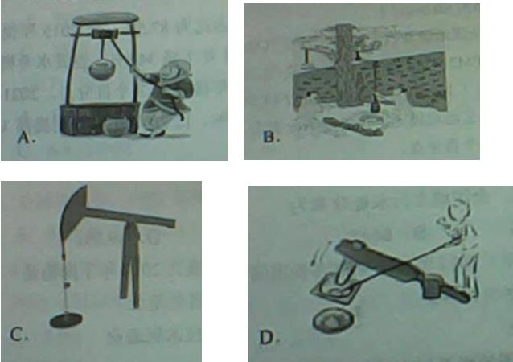


来源：[2023年江苏公务员考试《行测》真题（A类）.pdf](https://github.com/dumarstoft-ship-it/xingce/blob/407016b55b49581efa3771bb59a2dee8761d982f/2023%E5%B9%B4%E6%B1%9F%E8%8B%8F%E5%85%AC%E5%8A%A1%E5%91%98%E8%80%83%E8%AF%95%E3%80%8A%E8%A1%8C%E6%B5%8B%E3%80%8B%E7%9C%9F%E9%A2%98%EF%BC%88A%E7%B1%BB%EF%BC%89.pdf)，PDF 第 27、28 页。
